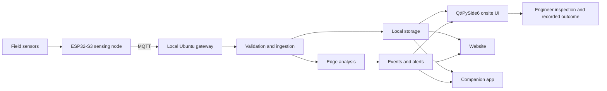
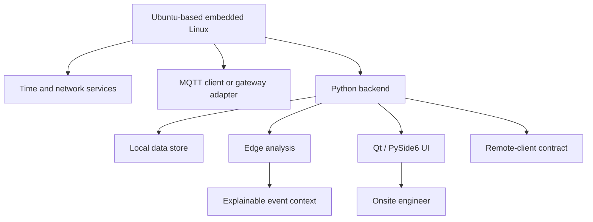
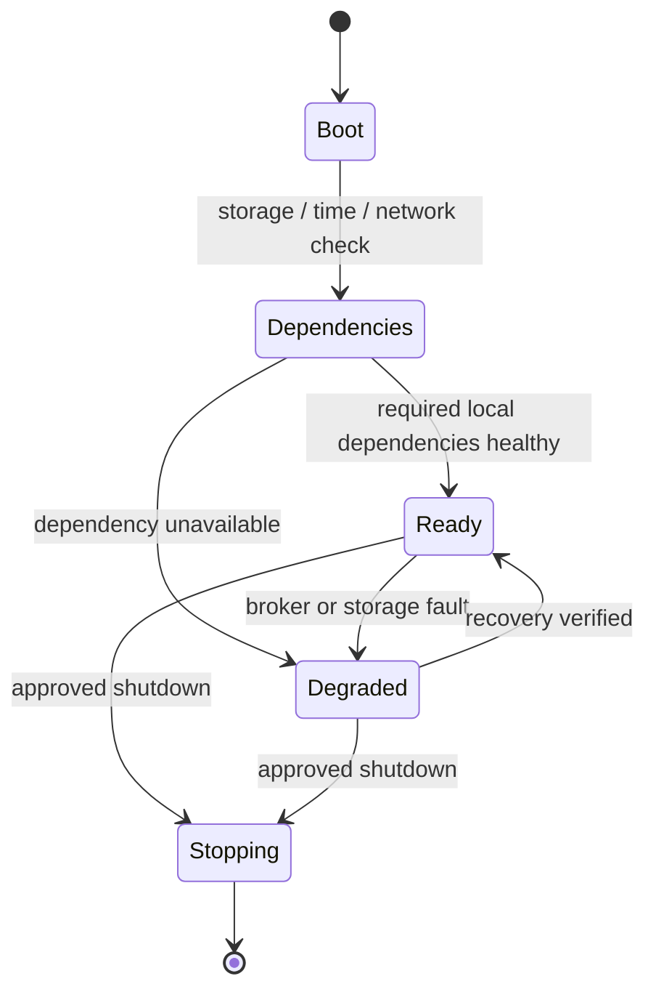
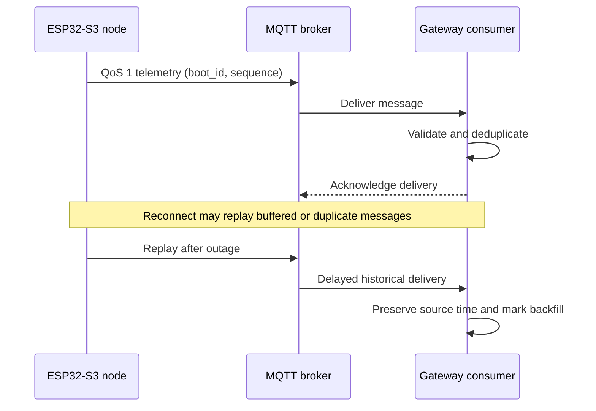
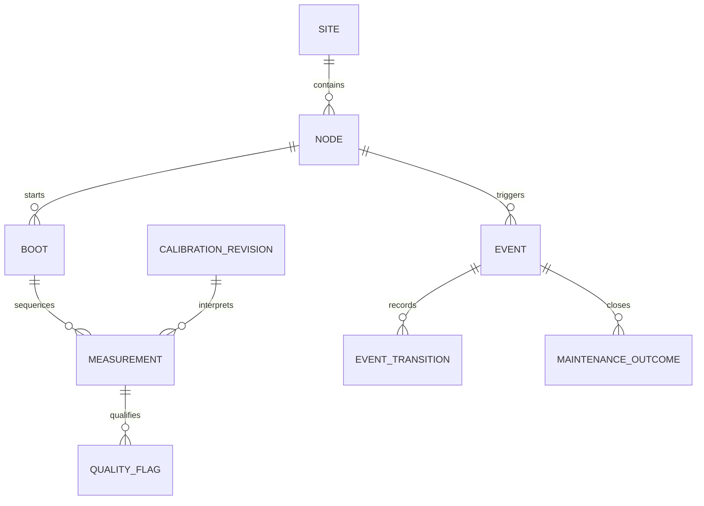
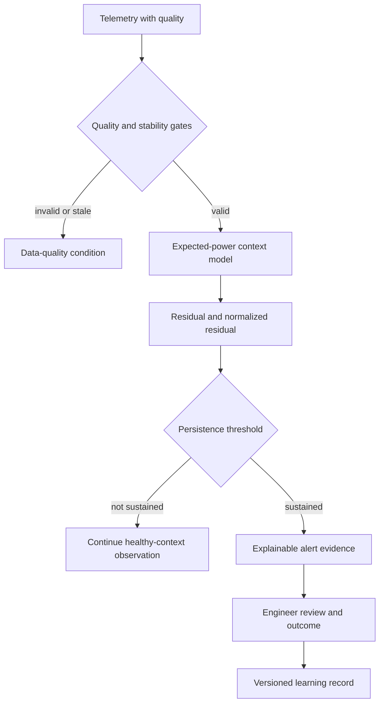
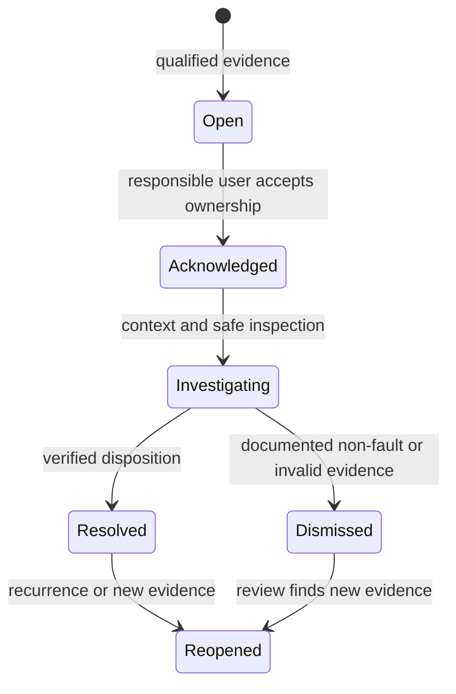
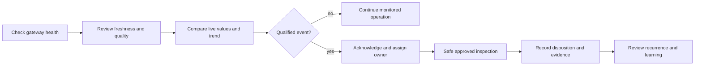

<div align="center">
  <h1>☀️ ARKA AI</h1>
  <h3>Intelligent Edge-AI Monitoring &amp; Performance Optimization<br/>System for Solar Power Plants</h3>
  <p><strong>Local intelligence. Connected monitoring. Engineer-led decisions.</strong></p>
  <p>
    
    
    
    
    
  </p>
  <table>
    <tr><th>Application</th><th>Theme</th><th>Sub-theme</th></tr>
    <tr><td align="center"><strong>VK26-IITH-SE-0021</strong></td><td align="center">Sustainable Energy</td><td align="center">Renewable Energy Harvesting &amp; Generation Systems</td></tr>
  </table>
  <p><a href="https://github.com/DAnuraag/VK26-IITH-SE-0021"><strong>Project Repository &amp; Review Hub</strong></a></p>
  <p><a href="#end-to-end-system-architecture">Architecture</a> · <a href="#ubuntu-based-embedded-operating-environment">Embedded OS</a> · <a href="#website--app-connectivity-and-access">Website / App</a> · <a href="#installation-and-development-environment">Installation</a> · <a href="#testing-and-validation-strategy">Validation</a> · <a href="#prototype-video-and-review-evidence">Prototype Video</a> · <a href="#power-rails-isolation-and-electrical-safety">Safety</a></p>
</div>
> **Reviewer path:** Start with the [architecture](#end-to-end-system-architecture), [validation](#testing-and-validation-strategy), and [prototype-video evidence](#prototype-video-and-review-evidence). The prototype-video section records its honest current publication status.
## Contents
- [Executive Overview](#executive-overview)
- [Problem, Users & Requirements](#problem-users-and-requirements)
- [Project Scope & Ecosystem Boundaries](#scope-and-ecosystem-boundaries)
- [End-to-End System Architecture](#end-to-end-system-architecture)
- [Ubuntu-Based Embedded Operating Environment](#ubuntu-based-embedded-operating-environment)
- [Boot, Application Services & Recovery](#boot-application-services-and-recovery)
- [Qt / PySide6 Onsite Engineering UI](#qt--pyside6-onsite-engineering-ui)
- [Python Backend](#python-backend)
- [Website](#website)
- [Companion App](#companion-app)
- [Cross-Client Consistency & Operator Workflows](#cross-client-consistency-and-operator-workflows)
- [ESP32-S3 Sensing-Node Firmware](#esp32-s3-sensing-node-firmware)
- [Voltage, Current, Power & Energy Measurement](#voltage-current-power-and-energy-measurement)
- [Irradiance, Temperature & Optional Battery Sensing](#irradiance-temperature-and-optional-battery-sensing)
- [Power Rails, Isolation & Electrical Safety](#power-rails-isolation-and-electrical-safety)
- [MQTT Topics, Transport & Delivery Behavior](#mqtt-topics-transport-and-delivery-behavior)
- [Telemetry Payloads, Units & Configuration Contracts](#telemetry-payloads-units-and-configuration-contracts)
- [Local Storage, Schema & Retention](#local-storage-schema-and-retention)
- [Timestamps, Quality, Stale Data & Outage Recovery](#timestamps-quality-stale-data-and-outage-recovery)
- [Edge-AI Analytics & Explainable Anomaly Logic](#edge-ai-analytics-and-explainable-anomaly-logic)
- [Alerts, Acknowledgement & Maintenance Workflow](#alerts-acknowledgement-and-maintenance-workflow)
- [Installation & Development Environment](#installation-and-development-environment)
- [Configuration & Secret Management](#configuration-and-secret-management)
- [Running, Packaging & Deployment](#running-packaging-and-deployment)
- [Onsite Engineer Operating Guide](#onsite-engineer-operating-guide)
- [Website / App Connectivity & Access](#website--app-connectivity-and-access)
- [Testing & Validation Strategy](#testing-and-validation-strategy)
- [Metrology Calibration & Acceptance Procedures](#metrology-calibration-and-acceptance-procedures)
- [Security, Privacy & Threat Model](#security-privacy-and-threat-model)
- [Troubleshooting & Failure Diagnosis](#troubleshooting-and-failure-diagnosis)
- [Observability, Backup & Maintenance](#observability-backup-and-maintenance)
- [CAD, Packaging, Mechanical & Thermal Studies](#cad-packaging-mechanical-and-thermal-studies)
- [BOM, Budget & Procurement Assumptions](#bom-budget-and-procurement-assumptions)
- [Performance Targets & Measurement Methodology](#performance-targets-and-measurement-methodology)
- [Risk Register & Mitigation](#risk-register-and-mitigation)
- [Maker Journey & Implementation Milestones](#maker-journey-and-implementation-milestones)
- [Roadmap & Future Development](#roadmap-and-future-development)
- [Prototype Video & Review Evidence](#prototype-video-and-review-evidence)
- [Glossary, References & Documentation Conventions](#glossary-references-and-documentation-conventions)
## Documentation status at a glance
| Label | Meaning in this README | Reader action |
|---|---|---|
| Team-confirmed implemented scope | Explicit implementation statement supplied by the project team. | Seek released artifacts for exact mechanics. |
| Proposed engineering design | A presentation design input awaiting implementation review or validation. | Do not treat as deployed hardware. |
| Acceptance target | A planned measurable criterion. | Do not treat as an achieved result. |
| Reference deployment pattern | A careful example where project-specific implementation detail is unpublished. | Reconcile with released artifacts before use. |
| Public documentation gap | A relevant detail is not in the inspected public material. | Request evidence rather than infer it. |
## Reading commitments
- The sensing node and the Ubuntu gateway are separate compute boundaries.
- Measurements carry identity, units, timestamp, validity, and calibration context.
- Low-voltage read-only monitoring does not replace certified electrical protection.
- Local-first operation preserves onsite capability; it does not create remote access without a network.
- A target, concept, or planning estimate is never reported here as a measured result.
## Reviewer quick checks
- Confirm that every result claim is supported by a published evidence artifact.
- Confirm that every hardware action stays inside the documented low-voltage read-only boundary.
- Confirm that remote clients display freshness and quality rather than inferred live state.
- Confirm that source timestamps, gateway receive timestamps, and outage periods remain distinguishable.
- Confirm that alerts support an engineer-led inspection and recorded outcome.
## Review orientation
- Read status labels before interpreting hardware choices, thresholds, or delivery behavior.
- The canonical repository is the only verified project URL documented at this time.
- Prototype video, website, and companion-app links remain absent until genuine project-owned URLs are available.
- The project is a monitoring and decision-support ecosystem; it does not claim automatic plant control.
## Evidence hierarchy
1. Inspected implementation, configuration, and test artifacts establish exact technical details.
2. Explicit team statements establish confirmed implemented software scope.
3. Original submission material establishes intended architecture and project scope.
4. Proposed designs, reference patterns, and future validation plans remain explicitly labeled.
## Safety at a glance
- Use only the proposed low-voltage read-only demonstrator boundary: 12–24 V DC and no more than 5 A.
- Do not connect the demonstrator directly to live plant PV strings.
- Monitoring never replaces certified electrical protection, permits, or qualified review.
## Document use
- Judges can trace scope, targets, and publication gaps without mistaking planning material for results.
- Engineers can use reference procedures to prepare safe validation once released artifacts identify actual commands and interfaces.
- Maintainers can use terminology, data contracts, and status labels to extend the ecosystem without changing meanings.
## Navigation notes
- Links in this table of contents point to the first-level engineering sections below.
- Mermaid diagrams describe documented or reference flows and should be reconciled with released configurations.
- Code blocks use illustrative values and omit real credentials, endpoint addresses, and personal data.
- **Reading control:** Use the linked heading names in this document to preserve navigation when citing a section.
- **Evidence control:** Treat a missing public artifact as a request for evidence, not as proof that the capability is absent.
- **Safety control:** Prefer qualified review and approved low-voltage test setups over improvised plant-adjacent demonstrations.
- **Client control:** Expect website and app visibility to depend on approved connectivity even when local gateway operation continues.
- **Analytics control:** Interpret anomaly logic as explainable decision support, not a certified prediction or autonomous controller.
- **Data control:** Require identity, unit, source time, quality, and revision before accepting a value as engineering evidence.
- **Recovery control:** Require an explicit stale or offline state whenever current data cannot be confirmed.
- **Review control:** Capture limitations beside positive observations so future maintainers do not overgeneralize a test.
- **Reading control:** Use the linked heading names in this document to preserve navigation when citing a section.
- **Evidence control:** Treat a missing public artifact as a request for evidence, not as proof that the capability is absent.
- **Safety control:** Prefer qualified review and approved low-voltage test setups over improvised plant-adjacent demonstrations.
- **Client control:** Expect website and app visibility to depend on approved connectivity even when local gateway operation continues.
- **Analytics control:** Interpret anomaly logic as explainable decision support, not a certified prediction or autonomous controller.
- **Data control:** Require identity, unit, source time, quality, and revision before accepting a value as engineering evidence.
- **Recovery control:** Require an explicit stale or offline state whenever current data cannot be confirmed.
- **Review control:** Capture limitations beside positive observations so future maintainers do not overgeneralize a test.
- **Reading control:** Use the linked heading names in this document to preserve navigation when citing a section.
- **Evidence control:** Treat a missing public artifact as a request for evidence, not as proof that the capability is absent.
- **Safety control:** Prefer qualified review and approved low-voltage test setups over improvised plant-adjacent demonstrations.
<a id="executive-overview"></a>
## Executive Overview
> **Purpose:** This section gives reviewers and operators a bounded view of ARKA AI before detailed engineering sections.
### Engineering record
### Scope statement
- **Mission:** ARKA AI links field measurements with local analysis so an engineer can investigate plant performance in context.
- **Operating model:** The documented control loop is sense, analyse, support a decision, respond through an engineer, and record the outcome.
- **Beneficiaries:** Onsite engineers, operators, maintenance teams, and renewable-energy asset owners need timely, interpretable context.
- **Local intelligence:** The onsite platform is intended to retain useful monitoring capability when continuous WAN access is unavailable.
- **Software surfaces:** Ubuntu-based embedded Linux, Qt/PySide6, Python, a website, and a companion app are team-confirmed integrated scope.
- **Telemetry context:** Readings include electrical values, irradiance, temperature, node state, data quality, and historical context.
- **Analytics boundary:** Expected-output comparisons and persistent anomalies guide inspection; they do not establish a failure date or remaining useful life.
- **Review posture:** The document distinguishes observed or team-confirmed scope from proposed choices, reference patterns, and targets.
### Evidence posture
- **Mission:** The project team explicitly confirms `mission` within implemented ecosystem scope; exact source-level mechanics still need published artifacts.
- **Operating model:** The project team explicitly confirms `operating model` within implemented ecosystem scope; exact source-level mechanics still need published artifacts.
- **Beneficiaries:** The project team explicitly confirms `beneficiaries` within implemented ecosystem scope; exact source-level mechanics still need published artifacts.
- **Local intelligence:** The project team explicitly confirms `local intelligence` within implemented ecosystem scope; exact source-level mechanics still need published artifacts.
- **Software surfaces:** The project team explicitly confirms `software surfaces` within implemented ecosystem scope; exact source-level mechanics still need published artifacts.
- **Telemetry context:** The project team explicitly confirms `telemetry context` within implemented ecosystem scope; exact source-level mechanics still need published artifacts.
- **Analytics boundary:** The project team explicitly confirms `analytics boundary` within implemented ecosystem scope; exact source-level mechanics still need published artifacts.
- **Review posture:** The project team explicitly confirms `review posture` within implemented ecosystem scope; exact source-level mechanics still need published artifacts.
### Design implication
- **Mission:** For `mission`, define the relevant inputs, output or state, accountable owner, and observable failure boundary before integration.
- **Operating model:** For `operating model`, define the relevant inputs, output or state, accountable owner, and observable failure boundary before integration.
- **Beneficiaries:** For `beneficiaries`, define the relevant inputs, output or state, accountable owner, and observable failure boundary before integration.
- **Local intelligence:** For `local intelligence`, define the relevant inputs, output or state, accountable owner, and observable failure boundary before integration.
- **Software surfaces:** For `software surfaces`, define the relevant inputs, output or state, accountable owner, and observable failure boundary before integration.
- **Telemetry context:** For `telemetry context`, define the relevant inputs, output or state, accountable owner, and observable failure boundary before integration.
- **Analytics boundary:** For `analytics boundary`, define the relevant inputs, output or state, accountable owner, and observable failure boundary before integration.
- **Review posture:** For `review posture`, define the relevant inputs, output or state, accountable owner, and observable failure boundary before integration.
### Operator interpretation
- **Mission:** An engineer should interpret `mission` with its identity, freshness, quality, and surrounding operational context rather than as an isolated indicator.
- **Operating model:** An engineer should interpret `operating model` with its identity, freshness, quality, and surrounding operational context rather than as an isolated indicator.
- **Beneficiaries:** An engineer should interpret `beneficiaries` with its identity, freshness, quality, and surrounding operational context rather than as an isolated indicator.
- **Local intelligence:** An engineer should interpret `local intelligence` with its identity, freshness, quality, and surrounding operational context rather than as an isolated indicator.
- **Software surfaces:** An engineer should interpret `software surfaces` with its identity, freshness, quality, and surrounding operational context rather than as an isolated indicator.
- **Telemetry context:** An engineer should interpret `telemetry context` with its identity, freshness, quality, and surrounding operational context rather than as an isolated indicator.
- **Analytics boundary:** An engineer should interpret `analytics boundary` with its identity, freshness, quality, and surrounding operational context rather than as an isolated indicator.
- **Review posture:** An engineer should interpret `review posture` with its identity, freshness, quality, and surrounding operational context rather than as an isolated indicator.
### Constraint
- **Mission:** Review the architecture and validation sections before treating any target as achieved.
- **Operating model:** Human review remains the decision point for maintenance and safety actions.
- **Beneficiaries:** A role sees information; it does not receive authority to override electrical protection.
- **Local intelligence:** Local-first does not make offsite website or app access network-independent.
- **Software surfaces:** The public repository snapshot does not document every framework, endpoint, or deployment package.
- **Telemetry context:** A numeric value without timestamp, unit, quality, and identity is not adequate engineering evidence.
- **Analytics boundary:** Prediction claims require a validated model, representative data, and separately reported evidence.
- **Review posture:** Readers should preserve those labels when extracting requirements or test cases.
### Data trace
- **Mission:** Any record used to support `mission` should preserve source, timestamp, configuration or calibration revision, and reason for any derived conclusion.
- **Operating model:** Any record used to support `operating model` should preserve source, timestamp, configuration or calibration revision, and reason for any derived conclusion.
- **Beneficiaries:** Any record used to support `beneficiaries` should preserve source, timestamp, configuration or calibration revision, and reason for any derived conclusion.
- **Local intelligence:** Any record used to support `local intelligence` should preserve source, timestamp, configuration or calibration revision, and reason for any derived conclusion.
- **Software surfaces:** Any record used to support `software surfaces` should preserve source, timestamp, configuration or calibration revision, and reason for any derived conclusion.
- **Telemetry context:** Any record used to support `telemetry context` should preserve source, timestamp, configuration or calibration revision, and reason for any derived conclusion.
- **Analytics boundary:** Any record used to support `analytics boundary` should preserve source, timestamp, configuration or calibration revision, and reason for any derived conclusion.
- **Review posture:** Any record used to support `review posture` should preserve source, timestamp, configuration or calibration revision, and reason for any derived conclusion.
### Interface behavior
- **Mission:** Where `mission` reaches Qt, web, app, or maintenance workflows, retain a single canonical meaning and expose unavailable or stale state.
- **Operating model:** Where `operating model` reaches Qt, web, app, or maintenance workflows, retain a single canonical meaning and expose unavailable or stale state.
- **Beneficiaries:** Where `beneficiaries` reaches Qt, web, app, or maintenance workflows, retain a single canonical meaning and expose unavailable or stale state.
- **Local intelligence:** Where `local intelligence` reaches Qt, web, app, or maintenance workflows, retain a single canonical meaning and expose unavailable or stale state.
- **Software surfaces:** Where `software surfaces` reaches Qt, web, app, or maintenance workflows, retain a single canonical meaning and expose unavailable or stale state.
- **Telemetry context:** Where `telemetry context` reaches Qt, web, app, or maintenance workflows, retain a single canonical meaning and expose unavailable or stale state.
- **Analytics boundary:** Where `analytics boundary` reaches Qt, web, app, or maintenance workflows, retain a single canonical meaning and expose unavailable or stale state.
- **Review posture:** Where `review posture` reaches Qt, web, app, or maintenance workflows, retain a single canonical meaning and expose unavailable or stale state.
### Degraded path
- **Mission:** If evidence for `mission` becomes invalid, delayed, or unavailable, show the condition explicitly and route diagnosis to the responsible layer.
- **Operating model:** If evidence for `operating model` becomes invalid, delayed, or unavailable, show the condition explicitly and route diagnosis to the responsible layer.
- **Beneficiaries:** If evidence for `beneficiaries` becomes invalid, delayed, or unavailable, show the condition explicitly and route diagnosis to the responsible layer.
- **Local intelligence:** If evidence for `local intelligence` becomes invalid, delayed, or unavailable, show the condition explicitly and route diagnosis to the responsible layer.
- **Software surfaces:** If evidence for `software surfaces` becomes invalid, delayed, or unavailable, show the condition explicitly and route diagnosis to the responsible layer.
- **Telemetry context:** If evidence for `telemetry context` becomes invalid, delayed, or unavailable, show the condition explicitly and route diagnosis to the responsible layer.
- **Analytics boundary:** If evidence for `analytics boundary` becomes invalid, delayed, or unavailable, show the condition explicitly and route diagnosis to the responsible layer.
- **Review posture:** If evidence for `review posture` becomes invalid, delayed, or unavailable, show the condition explicitly and route diagnosis to the responsible layer.
### Controlled change
- **Mission:** Changes affecting `mission` need a recorded revision, rationale, approval, rollback approach, and post-change check.
- **Operating model:** Changes affecting `operating model` need a recorded revision, rationale, approval, rollback approach, and post-change check.
- **Beneficiaries:** Changes affecting `beneficiaries` need a recorded revision, rationale, approval, rollback approach, and post-change check.
<a id="problem-users-and-requirements"></a>
## Problem, Users & Requirements
> **Purpose:** This section translates the solar-plant monitoring problem into observable, safety-conscious engineering needs.
### Engineering record
### Scope statement
- **Changing operating conditions:** Irradiance, module temperature, electrical loading, and weather cause legitimate variation in solar output.
- **Fragmented readings:** Delayed or isolated readings can hide underperformance, abnormal voltage/current behavior, and inverter-related deviations.
- **Onsite engineer:** The engineer needs fresh readings, clear quality state, historical comparison, and a route to record inspection outcomes.
- **Plant operator:** The operator needs a concise view of affected site or node identity, severity, status, and acknowledgement ownership.
- **Maintenance team:** The maintenance workflow needs a reproducible event timeline and the ability to attach a verified disposition.
- **Asset owner:** The owner benefits from transparent evidence of measurement coverage, alert handling, and data retention assumptions.
- **Read-only boundary:** The demonstrator is specified as low-voltage and read-only, not as a plant controller or protection device.
- **Acceptance traceability:** Requirements should map to test procedures, evidence artifacts, and explicit pass criteria rather than implied readiness.
### Evidence posture
- **Changing operating conditions:** The project team explicitly confirms `changing operating conditions` within implemented ecosystem scope; exact source-level mechanics still need published artifacts.
- **Fragmented readings:** The project team explicitly confirms `fragmented readings` within implemented ecosystem scope; exact source-level mechanics still need published artifacts.
- **Onsite engineer:** The project team explicitly confirms `onsite engineer` within implemented ecosystem scope; exact source-level mechanics still need published artifacts.
- **Plant operator:** The project team explicitly confirms `plant operator` within implemented ecosystem scope; exact source-level mechanics still need published artifacts.
- **Maintenance team:** The project team explicitly confirms `maintenance team` within implemented ecosystem scope; exact source-level mechanics still need published artifacts.
- **Asset owner:** The project team explicitly confirms `asset owner` within implemented ecosystem scope; exact source-level mechanics still need published artifacts.
- **Read-only boundary:** `Read-only boundary` is a proposed design input; it requires implementation review and validation before it is treated as field behavior.
- **Acceptance traceability:** `Acceptance traceability` is a reference pattern used because project-specific mechanics are not publicly documented; reconcile it with released artifacts.
### Design implication
- **Changing operating conditions:** For `changing operating conditions`, define the relevant inputs, output or state, accountable owner, and observable failure boundary before integration.
- **Fragmented readings:** For `fragmented readings`, define the relevant inputs, output or state, accountable owner, and observable failure boundary before integration.
- **Onsite engineer:** For `onsite engineer`, define the relevant inputs, output or state, accountable owner, and observable failure boundary before integration.
- **Plant operator:** For `plant operator`, define the relevant inputs, output or state, accountable owner, and observable failure boundary before integration.
- **Maintenance team:** For `maintenance team`, define the relevant inputs, output or state, accountable owner, and observable failure boundary before integration.
- **Asset owner:** For `asset owner`, define the relevant inputs, output or state, accountable owner, and observable failure boundary before integration.
- **Read-only boundary:** For `read-only boundary`, define the relevant inputs, output or state, accountable owner, and observable failure boundary before integration.
- **Acceptance traceability:** For `acceptance traceability`, define the relevant inputs, output or state, accountable owner, and observable failure boundary before integration.
### Operator interpretation
- **Changing operating conditions:** An engineer should interpret `changing operating conditions` with its identity, freshness, quality, and surrounding operational context rather than as an isolated indicator.
- **Fragmented readings:** An engineer should interpret `fragmented readings` with its identity, freshness, quality, and surrounding operational context rather than as an isolated indicator.
- **Onsite engineer:** An engineer should interpret `onsite engineer` with its identity, freshness, quality, and surrounding operational context rather than as an isolated indicator.
- **Plant operator:** An engineer should interpret `plant operator` with its identity, freshness, quality, and surrounding operational context rather than as an isolated indicator.
- **Maintenance team:** An engineer should interpret `maintenance team` with its identity, freshness, quality, and surrounding operational context rather than as an isolated indicator.
- **Asset owner:** An engineer should interpret `asset owner` with its identity, freshness, quality, and surrounding operational context rather than as an isolated indicator.
- **Read-only boundary:** An engineer should interpret `read-only boundary` with its identity, freshness, quality, and surrounding operational context rather than as an isolated indicator.
- **Acceptance traceability:** An engineer should interpret `acceptance traceability` with its identity, freshness, quality, and surrounding operational context rather than as an isolated indicator.
### Constraint
- **Changing operating conditions:** A low power value alone is not proof of a panel fault.
- **Fragmented readings:** Trend and context are required before escalating a suspected fault.
- **Onsite engineer:** The interface must show when evidence is stale or incomplete.
- **Plant operator:** Acknowledgement records awareness, not resolution.
- **Maintenance team:** Physical work remains subject to site permits and qualified electrical practice.
- **Asset owner:** Monitoring indicators must not be represented as independently audited yield figures.
- **Read-only boundary:** No workflow authorizes switching, bypassing, or direct connection to live PV strings.
- **Acceptance traceability:** A target remains unverified until a controlled test record is published.
### Data trace
- **Changing operating conditions:** Any record used to support `changing operating conditions` should preserve source, timestamp, configuration or calibration revision, and reason for any derived conclusion.
- **Fragmented readings:** Any record used to support `fragmented readings` should preserve source, timestamp, configuration or calibration revision, and reason for any derived conclusion.
- **Onsite engineer:** Any record used to support `onsite engineer` should preserve source, timestamp, configuration or calibration revision, and reason for any derived conclusion.
- **Plant operator:** Any record used to support `plant operator` should preserve source, timestamp, configuration or calibration revision, and reason for any derived conclusion.
- **Maintenance team:** Any record used to support `maintenance team` should preserve source, timestamp, configuration or calibration revision, and reason for any derived conclusion.
- **Asset owner:** Any record used to support `asset owner` should preserve source, timestamp, configuration or calibration revision, and reason for any derived conclusion.
- **Read-only boundary:** Any record used to support `read-only boundary` should preserve source, timestamp, configuration or calibration revision, and reason for any derived conclusion.
- **Acceptance traceability:** Any record used to support `acceptance traceability` should preserve source, timestamp, configuration or calibration revision, and reason for any derived conclusion.
### Interface behavior
- **Changing operating conditions:** Where `changing operating conditions` reaches Qt, web, app, or maintenance workflows, retain a single canonical meaning and expose unavailable or stale state.
- **Fragmented readings:** Where `fragmented readings` reaches Qt, web, app, or maintenance workflows, retain a single canonical meaning and expose unavailable or stale state.
- **Onsite engineer:** Where `onsite engineer` reaches Qt, web, app, or maintenance workflows, retain a single canonical meaning and expose unavailable or stale state.
- **Plant operator:** Where `plant operator` reaches Qt, web, app, or maintenance workflows, retain a single canonical meaning and expose unavailable or stale state.
- **Maintenance team:** Where `maintenance team` reaches Qt, web, app, or maintenance workflows, retain a single canonical meaning and expose unavailable or stale state.
- **Asset owner:** Where `asset owner` reaches Qt, web, app, or maintenance workflows, retain a single canonical meaning and expose unavailable or stale state.
- **Read-only boundary:** Where `read-only boundary` reaches Qt, web, app, or maintenance workflows, retain a single canonical meaning and expose unavailable or stale state.
- **Acceptance traceability:** Where `acceptance traceability` reaches Qt, web, app, or maintenance workflows, retain a single canonical meaning and expose unavailable or stale state.
### Degraded path
- **Changing operating conditions:** If evidence for `changing operating conditions` becomes invalid, delayed, or unavailable, show the condition explicitly and route diagnosis to the responsible layer.
- **Fragmented readings:** If evidence for `fragmented readings` becomes invalid, delayed, or unavailable, show the condition explicitly and route diagnosis to the responsible layer.
- **Onsite engineer:** If evidence for `onsite engineer` becomes invalid, delayed, or unavailable, show the condition explicitly and route diagnosis to the responsible layer.
- **Plant operator:** If evidence for `plant operator` becomes invalid, delayed, or unavailable, show the condition explicitly and route diagnosis to the responsible layer.
- **Maintenance team:** If evidence for `maintenance team` becomes invalid, delayed, or unavailable, show the condition explicitly and route diagnosis to the responsible layer.
- **Asset owner:** If evidence for `asset owner` becomes invalid, delayed, or unavailable, show the condition explicitly and route diagnosis to the responsible layer.
- **Read-only boundary:** If evidence for `read-only boundary` becomes invalid, delayed, or unavailable, show the condition explicitly and route diagnosis to the responsible layer.
- **Acceptance traceability:** If evidence for `acceptance traceability` becomes invalid, delayed, or unavailable, show the condition explicitly and route diagnosis to the responsible layer.
### Controlled change
- **Changing operating conditions:** Changes affecting `changing operating conditions` need a recorded revision, rationale, approval, rollback approach, and post-change check.
- **Fragmented readings:** Changes affecting `fragmented readings` need a recorded revision, rationale, approval, rollback approach, and post-change check.
- **Onsite engineer:** Changes affecting `onsite engineer` need a recorded revision, rationale, approval, rollback approach, and post-change check.
<a id="scope-and-ecosystem-boundaries"></a>
## Project Scope & Ecosystem Boundaries
> **Purpose:** This section states what the ecosystem monitors, what it deliberately does not control, and where evidence must be supplied.
### Engineering record
### Scope statement
- **In-scope sensing:** Voltage, current, calculated power, energy, irradiance, panel temperature, node state, quality, and history are core context.
- **Inverter information:** Inverter parameters may be included only through an appropriate approved interface.
- **Gateway boundary:** The Ubuntu-based gateway hosts the ARKA application stack; ESP32-S3 sensing nodes are separate embedded devices.
- **Web boundary:** The website is a team-confirmed access surface for the integrated ecosystem.
- **App boundary:** The companion app is a team-confirmed access surface for the integrated ecosystem.
- **Local storage:** Local storage and edge analysis are part of the documented ecosystem path.
- **Battery visibility:** Optional sensor-node battery voltage is an expansion-scope reading.
- **Safety boundary:** Diagnostics supplement observation and maintenance planning; they never replace certified protection.
- **Evidence boundary:** Public documentation is not proof of deployment, calibration, field yield recovery, or certification.
### Evidence posture
- **In-scope sensing:** The project team explicitly confirms `in-scope sensing` within implemented ecosystem scope; exact source-level mechanics still need published artifacts.
- **Inverter information:** The project team explicitly confirms `inverter information` within implemented ecosystem scope; exact source-level mechanics still need published artifacts.
- **Gateway boundary:** The project team explicitly confirms `gateway boundary` within implemented ecosystem scope; exact source-level mechanics still need published artifacts.
- **Web boundary:** The project team explicitly confirms `web boundary` within implemented ecosystem scope; exact source-level mechanics still need published artifacts.
- **App boundary:** The project team explicitly confirms `app boundary` within implemented ecosystem scope; exact source-level mechanics still need published artifacts.
- **Local storage:** The project team explicitly confirms `local storage` within implemented ecosystem scope; exact source-level mechanics still need published artifacts.
- **Battery visibility:** `Battery visibility` is a proposed design input; it requires implementation review and validation before it is treated as field behavior.
- **Safety boundary:** The project team explicitly confirms `safety boundary` within implemented ecosystem scope; exact source-level mechanics still need published artifacts.
- **Evidence boundary:** The project team explicitly confirms `evidence boundary` within implemented ecosystem scope; exact source-level mechanics still need published artifacts.
### Design implication
- **In-scope sensing:** For `in-scope sensing`, define the relevant inputs, output or state, accountable owner, and observable failure boundary before integration.
- **Inverter information:** For `inverter information`, define the relevant inputs, output or state, accountable owner, and observable failure boundary before integration.
- **Gateway boundary:** For `gateway boundary`, define the relevant inputs, output or state, accountable owner, and observable failure boundary before integration.
- **Web boundary:** For `web boundary`, define the relevant inputs, output or state, accountable owner, and observable failure boundary before integration.
- **App boundary:** For `app boundary`, define the relevant inputs, output or state, accountable owner, and observable failure boundary before integration.
- **Local storage:** For `local storage`, define the relevant inputs, output or state, accountable owner, and observable failure boundary before integration.
- **Battery visibility:** For `battery visibility`, define the relevant inputs, output or state, accountable owner, and observable failure boundary before integration.
- **Safety boundary:** For `safety boundary`, define the relevant inputs, output or state, accountable owner, and observable failure boundary before integration.
- **Evidence boundary:** For `evidence boundary`, define the relevant inputs, output or state, accountable owner, and observable failure boundary before integration.
### Operator interpretation
- **In-scope sensing:** An engineer should interpret `in-scope sensing` with its identity, freshness, quality, and surrounding operational context rather than as an isolated indicator.
- **Inverter information:** An engineer should interpret `inverter information` with its identity, freshness, quality, and surrounding operational context rather than as an isolated indicator.
- **Gateway boundary:** An engineer should interpret `gateway boundary` with its identity, freshness, quality, and surrounding operational context rather than as an isolated indicator.
- **Web boundary:** An engineer should interpret `web boundary` with its identity, freshness, quality, and surrounding operational context rather than as an isolated indicator.
- **App boundary:** An engineer should interpret `app boundary` with its identity, freshness, quality, and surrounding operational context rather than as an isolated indicator.
- **Local storage:** An engineer should interpret `local storage` with its identity, freshness, quality, and surrounding operational context rather than as an isolated indicator.
- **Battery visibility:** An engineer should interpret `battery visibility` with its identity, freshness, quality, and surrounding operational context rather than as an isolated indicator.
- **Safety boundary:** An engineer should interpret `safety boundary` with its identity, freshness, quality, and surrounding operational context rather than as an isolated indicator.
- **Evidence boundary:** An engineer should interpret `evidence boundary` with its identity, freshness, quality, and surrounding operational context rather than as an isolated indicator.
### Constraint
- **In-scope sensing:** Each recorded value must retain its unit and validity meaning.
- **Inverter information:** No inverter register map, protocol, or access approval is documented in the public material.
- **Gateway boundary:** The ESP32-S3 does not run Ubuntu or replace the onsite gateway.
- **Web boundary:** A public URL, hosting arrangement, and web framework have not been verified here.
- **App boundary:** Mobile platform, store availability, permissions, and notification behavior await published evidence.
- **Local storage:** Database engine, path, schema file, and backup implementation are not published artifacts.
- **Battery visibility:** Voltage alone is not a validated battery-life or state-of-charge estimate.
- **Safety boundary:** Protection coordination and live plant work need qualified, approved engineering review.
- **Evidence boundary:** Publish dated artifacts before making those claims.
### Data trace
- **In-scope sensing:** Any record used to support `in-scope sensing` should preserve source, timestamp, configuration or calibration revision, and reason for any derived conclusion.
- **Inverter information:** Any record used to support `inverter information` should preserve source, timestamp, configuration or calibration revision, and reason for any derived conclusion.
- **Gateway boundary:** Any record used to support `gateway boundary` should preserve source, timestamp, configuration or calibration revision, and reason for any derived conclusion.
- **Web boundary:** Any record used to support `web boundary` should preserve source, timestamp, configuration or calibration revision, and reason for any derived conclusion.
- **App boundary:** Any record used to support `app boundary` should preserve source, timestamp, configuration or calibration revision, and reason for any derived conclusion.
- **Local storage:** Any record used to support `local storage` should preserve source, timestamp, configuration or calibration revision, and reason for any derived conclusion.
- **Battery visibility:** Any record used to support `battery visibility` should preserve source, timestamp, configuration or calibration revision, and reason for any derived conclusion.
- **Safety boundary:** Any record used to support `safety boundary` should preserve source, timestamp, configuration or calibration revision, and reason for any derived conclusion.
- **Evidence boundary:** Any record used to support `evidence boundary` should preserve source, timestamp, configuration or calibration revision, and reason for any derived conclusion.
### Interface behavior
- **In-scope sensing:** Where `in-scope sensing` reaches Qt, web, app, or maintenance workflows, retain a single canonical meaning and expose unavailable or stale state.
- **Inverter information:** Where `inverter information` reaches Qt, web, app, or maintenance workflows, retain a single canonical meaning and expose unavailable or stale state.
- **Gateway boundary:** Where `gateway boundary` reaches Qt, web, app, or maintenance workflows, retain a single canonical meaning and expose unavailable or stale state.
- **Web boundary:** Where `web boundary` reaches Qt, web, app, or maintenance workflows, retain a single canonical meaning and expose unavailable or stale state.
- **App boundary:** Where `app boundary` reaches Qt, web, app, or maintenance workflows, retain a single canonical meaning and expose unavailable or stale state.
- **Local storage:** Where `local storage` reaches Qt, web, app, or maintenance workflows, retain a single canonical meaning and expose unavailable or stale state.
- **Battery visibility:** Where `battery visibility` reaches Qt, web, app, or maintenance workflows, retain a single canonical meaning and expose unavailable or stale state.
- **Safety boundary:** Where `safety boundary` reaches Qt, web, app, or maintenance workflows, retain a single canonical meaning and expose unavailable or stale state.
- **Evidence boundary:** Where `evidence boundary` reaches Qt, web, app, or maintenance workflows, retain a single canonical meaning and expose unavailable or stale state.
### Degraded path
- **In-scope sensing:** If evidence for `in-scope sensing` becomes invalid, delayed, or unavailable, show the condition explicitly and route diagnosis to the responsible layer.
- **Inverter information:** If evidence for `inverter information` becomes invalid, delayed, or unavailable, show the condition explicitly and route diagnosis to the responsible layer.
- **Gateway boundary:** If evidence for `gateway boundary` becomes invalid, delayed, or unavailable, show the condition explicitly and route diagnosis to the responsible layer.
- **Web boundary:** If evidence for `web boundary` becomes invalid, delayed, or unavailable, show the condition explicitly and route diagnosis to the responsible layer.
- **App boundary:** If evidence for `app boundary` becomes invalid, delayed, or unavailable, show the condition explicitly and route diagnosis to the responsible layer.
- **Local storage:** If evidence for `local storage` becomes invalid, delayed, or unavailable, show the condition explicitly and route diagnosis to the responsible layer.
- **Battery visibility:** If evidence for `battery visibility` becomes invalid, delayed, or unavailable, show the condition explicitly and route diagnosis to the responsible layer.
- **Safety boundary:** If evidence for `safety boundary` becomes invalid, delayed, or unavailable, show the condition explicitly and route diagnosis to the responsible layer.
- **Evidence boundary:** If evidence for `evidence boundary` becomes invalid, delayed, or unavailable, show the condition explicitly and route diagnosis to the responsible layer.
### Controlled change
- **In-scope sensing:** Changes affecting `in-scope sensing` need a recorded revision, rationale, approval, rollback approach, and post-change check.
- **Inverter information:** Changes affecting `inverter information` need a recorded revision, rationale, approval, rollback approach, and post-change check.
- **Gateway boundary:** Changes affecting `gateway boundary` need a recorded revision, rationale, approval, rollback approach, and post-change check.
- **Web boundary:** Changes affecting `web boundary` need a recorded revision, rationale, approval, rollback approach, and post-change check.
- **App boundary:** Changes affecting `app boundary` need a recorded revision, rationale, approval, rollback approach, and post-change check.
- **Local storage:** Changes affecting `local storage` need a recorded revision, rationale, approval, rollback approach, and post-change check.
- **Battery visibility:** Changes affecting `battery visibility` need a recorded revision, rationale, approval, rollback approach, and post-change check.
- **Safety boundary:** Changes affecting `safety boundary` need a recorded revision, rationale, approval, rollback approach, and post-change check.
- **Evidence boundary:** Changes affecting `evidence boundary` need a recorded revision, rationale, approval, rollback approach, and post-change check.
### Historical use
- **In-scope sensing:** Historical interpretation of `in-scope sensing` must use the revision and validity context that applied when the associated data was created.
- **Inverter information:** Historical interpretation of `inverter information` must use the revision and validity context that applied when the associated data was created.
- **Gateway boundary:** Historical interpretation of `gateway boundary` must use the revision and validity context that applied when the associated data was created.
- **Web boundary:** Historical interpretation of `web boundary` must use the revision and validity context that applied when the associated data was created.
- **App boundary:** Historical interpretation of `app boundary` must use the revision and validity context that applied when the associated data was created.
<a id="end-to-end-system-architecture"></a>
## End-to-End System Architecture
> **Purpose:** This section describes the monitored information path and the isolation between field node, gateway, data, and clients.
### Conceptual view

*Diagram status: conceptual or reference view where exact implementation interfaces are not published.*
### Engineering record
### Scope statement
- **Field acquisition:** A sensing node acquires electrical and environmental context at the field edge.
- **Node identity:** Every stream should identify its site, node, boot instance, sequence, and configuration or calibration revision.
- **MQTT handoff:** The documented architecture uses MQTT between ESP32-S3 sensor nodes and the local gateway.
- **Gateway ingestion:** The gateway validates, stores, derives power or energy, and supplies analysis and client-visible context.
- **Derived values:** Power is computed from voltage and current; energy is integrated only across valid, known intervals.
- **Edge analysis:** Expected-output comparisons and persistent residuals support a focused engineering inspection.
- **Client surfaces:** Qt/PySide6, website, and companion app should present the same identity, freshness, quality, and event context.
- **Outcome record:** Inspection and maintenance results close the learning loop by associating a disposition with the event evidence.
- **Conceptual diagram:** The architecture diagram is a documented ecosystem view, not a claim that every depicted interface is publicly implemented.
### Evidence posture
- **Field acquisition:** The project team explicitly confirms `field acquisition` within implemented ecosystem scope; exact source-level mechanics still need published artifacts.
- **Node identity:** `Node identity` is a reference pattern used because project-specific mechanics are not publicly documented; reconcile it with released artifacts.
- **MQTT handoff:** The project team explicitly confirms `mqtt handoff` within implemented ecosystem scope; exact source-level mechanics still need published artifacts.
- **Gateway ingestion:** The project team explicitly confirms `gateway ingestion` within implemented ecosystem scope; exact source-level mechanics still need published artifacts.
- **Derived values:** The project team explicitly confirms `derived values` within implemented ecosystem scope; exact source-level mechanics still need published artifacts.
- **Edge analysis:** The project team explicitly confirms `edge analysis` within implemented ecosystem scope; exact source-level mechanics still need published artifacts.
- **Client surfaces:** The project team explicitly confirms `client surfaces` within implemented ecosystem scope; exact source-level mechanics still need published artifacts.
- **Outcome record:** `Outcome record` is a reference pattern used because project-specific mechanics are not publicly documented; reconcile it with released artifacts.
- **Conceptual diagram:** `Conceptual diagram` is a reference pattern used because project-specific mechanics are not publicly documented; reconcile it with released artifacts.
### Design implication
- **Field acquisition:** For `field acquisition`, define the relevant inputs, output or state, accountable owner, and observable failure boundary before integration.
- **Node identity:** For `node identity`, define the relevant inputs, output or state, accountable owner, and observable failure boundary before integration.
- **MQTT handoff:** For `mqtt handoff`, define the relevant inputs, output or state, accountable owner, and observable failure boundary before integration.
- **Gateway ingestion:** For `gateway ingestion`, define the relevant inputs, output or state, accountable owner, and observable failure boundary before integration.
- **Derived values:** For `derived values`, define the relevant inputs, output or state, accountable owner, and observable failure boundary before integration.
- **Edge analysis:** For `edge analysis`, define the relevant inputs, output or state, accountable owner, and observable failure boundary before integration.
- **Client surfaces:** For `client surfaces`, define the relevant inputs, output or state, accountable owner, and observable failure boundary before integration.
- **Outcome record:** For `outcome record`, define the relevant inputs, output or state, accountable owner, and observable failure boundary before integration.
- **Conceptual diagram:** For `conceptual diagram`, define the relevant inputs, output or state, accountable owner, and observable failure boundary before integration.
### Operator interpretation
- **Field acquisition:** An engineer should interpret `field acquisition` with its identity, freshness, quality, and surrounding operational context rather than as an isolated indicator.
- **Node identity:** An engineer should interpret `node identity` with its identity, freshness, quality, and surrounding operational context rather than as an isolated indicator.
- **MQTT handoff:** An engineer should interpret `mqtt handoff` with its identity, freshness, quality, and surrounding operational context rather than as an isolated indicator.
- **Gateway ingestion:** An engineer should interpret `gateway ingestion` with its identity, freshness, quality, and surrounding operational context rather than as an isolated indicator.
- **Derived values:** An engineer should interpret `derived values` with its identity, freshness, quality, and surrounding operational context rather than as an isolated indicator.
- **Edge analysis:** An engineer should interpret `edge analysis` with its identity, freshness, quality, and surrounding operational context rather than as an isolated indicator.
- **Client surfaces:** An engineer should interpret `client surfaces` with its identity, freshness, quality, and surrounding operational context rather than as an isolated indicator.
- **Outcome record:** An engineer should interpret `outcome record` with its identity, freshness, quality, and surrounding operational context rather than as an isolated indicator.
- **Conceptual diagram:** An engineer should interpret `conceptual diagram` with its identity, freshness, quality, and surrounding operational context rather than as an isolated indicator.
### Constraint
- **Field acquisition:** Sensor calibration and validity gates belong close to acquisition.
- **Node identity:** Identity is necessary for deduplication, auditability, and correct historical grouping.
- **MQTT handoff:** Broker endpoint, certificates, and actual topic names are not published.
- **Gateway ingestion:** A receive time cannot silently replace the source measurement time.
- **Derived values:** Unknown gaps must remain visible rather than being silently bridged.
- **Edge analysis:** An anomaly score is not a command to operate plant equipment.
- **Client surfaces:** The exact synchronization mechanism is not established by published source.
- **Outcome record:** A closure note should distinguish confirmed defect, environmental cause, data issue, and unresolved case.
- **Conceptual diagram:** Validate endpoint, protocol, and deployment details against released artifacts.
### Data trace
- **Field acquisition:** Any record used to support `field acquisition` should preserve source, timestamp, configuration or calibration revision, and reason for any derived conclusion.
- **Node identity:** Any record used to support `node identity` should preserve source, timestamp, configuration or calibration revision, and reason for any derived conclusion.
- **MQTT handoff:** Any record used to support `mqtt handoff` should preserve source, timestamp, configuration or calibration revision, and reason for any derived conclusion.
- **Gateway ingestion:** Any record used to support `gateway ingestion` should preserve source, timestamp, configuration or calibration revision, and reason for any derived conclusion.
- **Derived values:** Any record used to support `derived values` should preserve source, timestamp, configuration or calibration revision, and reason for any derived conclusion.
- **Edge analysis:** Any record used to support `edge analysis` should preserve source, timestamp, configuration or calibration revision, and reason for any derived conclusion.
- **Client surfaces:** Any record used to support `client surfaces` should preserve source, timestamp, configuration or calibration revision, and reason for any derived conclusion.
- **Outcome record:** Any record used to support `outcome record` should preserve source, timestamp, configuration or calibration revision, and reason for any derived conclusion.
- **Conceptual diagram:** Any record used to support `conceptual diagram` should preserve source, timestamp, configuration or calibration revision, and reason for any derived conclusion.
### Interface behavior
- **Field acquisition:** Where `field acquisition` reaches Qt, web, app, or maintenance workflows, retain a single canonical meaning and expose unavailable or stale state.
- **Node identity:** Where `node identity` reaches Qt, web, app, or maintenance workflows, retain a single canonical meaning and expose unavailable or stale state.
- **MQTT handoff:** Where `mqtt handoff` reaches Qt, web, app, or maintenance workflows, retain a single canonical meaning and expose unavailable or stale state.
- **Gateway ingestion:** Where `gateway ingestion` reaches Qt, web, app, or maintenance workflows, retain a single canonical meaning and expose unavailable or stale state.
- **Derived values:** Where `derived values` reaches Qt, web, app, or maintenance workflows, retain a single canonical meaning and expose unavailable or stale state.
- **Edge analysis:** Where `edge analysis` reaches Qt, web, app, or maintenance workflows, retain a single canonical meaning and expose unavailable or stale state.
- **Client surfaces:** Where `client surfaces` reaches Qt, web, app, or maintenance workflows, retain a single canonical meaning and expose unavailable or stale state.
- **Outcome record:** Where `outcome record` reaches Qt, web, app, or maintenance workflows, retain a single canonical meaning and expose unavailable or stale state.
- **Conceptual diagram:** Where `conceptual diagram` reaches Qt, web, app, or maintenance workflows, retain a single canonical meaning and expose unavailable or stale state.
### Degraded path
- **Field acquisition:** If evidence for `field acquisition` becomes invalid, delayed, or unavailable, show the condition explicitly and route diagnosis to the responsible layer.
- **Node identity:** If evidence for `node identity` becomes invalid, delayed, or unavailable, show the condition explicitly and route diagnosis to the responsible layer.
- **MQTT handoff:** If evidence for `mqtt handoff` becomes invalid, delayed, or unavailable, show the condition explicitly and route diagnosis to the responsible layer.
- **Gateway ingestion:** If evidence for `gateway ingestion` becomes invalid, delayed, or unavailable, show the condition explicitly and route diagnosis to the responsible layer.
- **Derived values:** If evidence for `derived values` becomes invalid, delayed, or unavailable, show the condition explicitly and route diagnosis to the responsible layer.
- **Edge analysis:** If evidence for `edge analysis` becomes invalid, delayed, or unavailable, show the condition explicitly and route diagnosis to the responsible layer.
- **Client surfaces:** If evidence for `client surfaces` becomes invalid, delayed, or unavailable, show the condition explicitly and route diagnosis to the responsible layer.
- **Outcome record:** If evidence for `outcome record` becomes invalid, delayed, or unavailable, show the condition explicitly and route diagnosis to the responsible layer.
- **Conceptual diagram:** If evidence for `conceptual diagram` becomes invalid, delayed, or unavailable, show the condition explicitly and route diagnosis to the responsible layer.
### Controlled change
- **Field acquisition:** Changes affecting `field acquisition` need a recorded revision, rationale, approval, rollback approach, and post-change check.
- **Node identity:** Changes affecting `node identity` need a recorded revision, rationale, approval, rollback approach, and post-change check.
- **MQTT handoff:** Changes affecting `mqtt handoff` need a recorded revision, rationale, approval, rollback approach, and post-change check.
- **Gateway ingestion:** Changes affecting `gateway ingestion` need a recorded revision, rationale, approval, rollback approach, and post-change check.
- **Derived values:** Changes affecting `derived values` need a recorded revision, rationale, approval, rollback approach, and post-change check.
- **Edge analysis:** Changes affecting `edge analysis` need a recorded revision, rationale, approval, rollback approach, and post-change check.
- **Client surfaces:** Changes affecting `client surfaces` need a recorded revision, rationale, approval, rollback approach, and post-change check.
- **Outcome record:** Changes affecting `outcome record` need a recorded revision, rationale, approval, rollback approach, and post-change check.
- **Conceptual diagram:** Changes affecting `conceptual diagram` need a recorded revision, rationale, approval, rollback approach, and post-change check.
### Historical use
- **Field acquisition:** Historical interpretation of `field acquisition` must use the revision and validity context that applied when the associated data was created.
- **Node identity:** Historical interpretation of `node identity` must use the revision and validity context that applied when the associated data was created.
- **MQTT handoff:** Historical interpretation of `mqtt handoff` must use the revision and validity context that applied when the associated data was created.
- **Gateway ingestion:** Historical interpretation of `gateway ingestion` must use the revision and validity context that applied when the associated data was created.
- **Derived values:** Historical interpretation of `derived values` must use the revision and validity context that applied when the associated data was created.
- **Edge analysis:** Historical interpretation of `edge analysis` must use the revision and validity context that applied when the associated data was created.
- **Client surfaces:** Historical interpretation of `client surfaces` must use the revision and validity context that applied when the associated data was created.
- **Outcome record:** Historical interpretation of `outcome record` must use the revision and validity context that applied when the associated data was created.
- **Conceptual diagram:** Historical interpretation of `conceptual diagram` must use the revision and validity context that applied when the associated data was created.
### Validation design
- **Field acquisition:** Validate `field acquisition` with defined preconditions, a safe procedure, expected observation, captured evidence, and an explicit pass decision.
- **Node identity:** Validate `node identity` with defined preconditions, a safe procedure, expected observation, captured evidence, and an explicit pass decision.
- **MQTT handoff:** Validate `mqtt handoff` with defined preconditions, a safe procedure, expected observation, captured evidence, and an explicit pass decision.
- **Gateway ingestion:** Validate `gateway ingestion` with defined preconditions, a safe procedure, expected observation, captured evidence, and an explicit pass decision.
- **Derived values:** Validate `derived values` with defined preconditions, a safe procedure, expected observation, captured evidence, and an explicit pass decision.
- **Edge analysis:** Validate `edge analysis` with defined preconditions, a safe procedure, expected observation, captured evidence, and an explicit pass decision.
- **Client surfaces:** Validate `client surfaces` with defined preconditions, a safe procedure, expected observation, captured evidence, and an explicit pass decision.
- **Outcome record:** Validate `outcome record` with defined preconditions, a safe procedure, expected observation, captured evidence, and an explicit pass decision.
- **Conceptual diagram:** Validate `conceptual diagram` with defined preconditions, a safe procedure, expected observation, captured evidence, and an explicit pass decision.
### Escalation decision
- **Field acquisition:** Escalate `field acquisition` when it signals an electrical-safety concern, data-integrity risk, or persistent unexplained performance deviation.
- **Node identity:** Escalate `node identity` when it signals an electrical-safety concern, data-integrity risk, or persistent unexplained performance deviation.
- **MQTT handoff:** Escalate `mqtt handoff` when it signals an electrical-safety concern, data-integrity risk, or persistent unexplained performance deviation.
- **Gateway ingestion:** Escalate `gateway ingestion` when it signals an electrical-safety concern, data-integrity risk, or persistent unexplained performance deviation.
- **Derived values:** Escalate `derived values` when it signals an electrical-safety concern, data-integrity risk, or persistent unexplained performance deviation.
- **Edge analysis:** Escalate `edge analysis` when it signals an electrical-safety concern, data-integrity risk, or persistent unexplained performance deviation.
- **Client surfaces:** Escalate `client surfaces` when it signals an electrical-safety concern, data-integrity risk, or persistent unexplained performance deviation.
- **Outcome record:** Escalate `outcome record` when it signals an electrical-safety concern, data-integrity risk, or persistent unexplained performance deviation.
- **Conceptual diagram:** Escalate `conceptual diagram` when it signals an electrical-safety concern, data-integrity risk, or persistent unexplained performance deviation.
### Review questions
- **Field acquisition — Classification check:** Carry the correct evidence label into the design review or test plan so a proposal does not appear as an achieved result.
- **Node identity — Classification check:** Carry the correct evidence label into the design review or test plan so a proposal does not appear as an achieved result.
- **MQTT handoff — Classification check:** Carry the correct evidence label into the design review or test plan so a proposal does not appear as an achieved result.
- **Gateway ingestion — Classification check:** Carry the correct evidence label into the design review or test plan so a proposal does not appear as an achieved result.
- **Derived values — Classification check:** Carry the correct evidence label into the design review or test plan so a proposal does not appear as an achieved result.
- **Edge analysis — Classification check:** Carry the correct evidence label into the design review or test plan so a proposal does not appear as an achieved result.
- **Client surfaces — Classification check:** Carry the correct evidence label into the design review or test plan so a proposal does not appear as an achieved result.
<a id="ubuntu-based-embedded-operating-environment"></a>
## Ubuntu-Based Embedded Operating Environment
> **Purpose:** This section explains the team-confirmed Ubuntu-based embedded Linux application environment without claiming a new distribution.
### Conceptual view

*Diagram status: conceptual or reference view where exact implementation interfaces are not published.*
### Engineering record
### Scope statement
- **Ubuntu base:** The onsite engineer environment is Ubuntu-based embedded Linux with the ARKA application stack.
- **Gateway role:** The gateway is the local execution boundary for ingestion, storage, analysis, and onsite engineering access.
- **Command line:** A command-line-based environment supports onsite administrative and engineering workflows.
- **Least privilege:** Runtime processes should use narrowly scoped accounts, file permissions, and service privileges.
- **Time service:** Reliable gateway time is foundational for receive timestamps, event ordering, and audit logs.
- **Network posture:** The onsite LAN can carry field telemetry while WAN services remain unavailable.
- **Storage posture:** Local data needs durable writes, defined capacity behavior, backup policy, and recovery tests.
- **Administrative access:** Administrative changes should be attributable, authorized, and recoverable.
- **Publication status:** The repository currently exposes no verified OS image, provisioning script, service unit, or package manifest.
### Evidence posture
- **Ubuntu base:** The project team explicitly confirms `ubuntu base` within implemented ecosystem scope; exact source-level mechanics still need published artifacts.
- **Gateway role:** The project team explicitly confirms `gateway role` within implemented ecosystem scope; exact source-level mechanics still need published artifacts.
- **Command line:** The project team explicitly confirms `command line` within implemented ecosystem scope; exact source-level mechanics still need published artifacts.
- **Least privilege:** `Least privilege` is a reference pattern used because project-specific mechanics are not publicly documented; reconcile it with released artifacts.
- **Time service:** `Time service` is a reference pattern used because project-specific mechanics are not publicly documented; reconcile it with released artifacts.
- **Network posture:** `Network posture` is a reference pattern used because project-specific mechanics are not publicly documented; reconcile it with released artifacts.
- **Storage posture:** `Storage posture` is a reference pattern used because project-specific mechanics are not publicly documented; reconcile it with released artifacts.
- **Administrative access:** `Administrative access` is a reference pattern used because project-specific mechanics are not publicly documented; reconcile it with released artifacts.
- **Publication status:** `Publication status` identifies a public documentation gap; missing evidence does not establish that a capability was never built.
### Design implication
- **Ubuntu base:** For `ubuntu base`, define the relevant inputs, output or state, accountable owner, and observable failure boundary before integration.
- **Gateway role:** For `gateway role`, define the relevant inputs, output or state, accountable owner, and observable failure boundary before integration.
- **Command line:** For `command line`, define the relevant inputs, output or state, accountable owner, and observable failure boundary before integration.
- **Least privilege:** For `least privilege`, define the relevant inputs, output or state, accountable owner, and observable failure boundary before integration.
- **Time service:** For `time service`, define the relevant inputs, output or state, accountable owner, and observable failure boundary before integration.
- **Network posture:** For `network posture`, define the relevant inputs, output or state, accountable owner, and observable failure boundary before integration.
- **Storage posture:** For `storage posture`, define the relevant inputs, output or state, accountable owner, and observable failure boundary before integration.
- **Administrative access:** For `administrative access`, define the relevant inputs, output or state, accountable owner, and observable failure boundary before integration.
- **Publication status:** For `publication status`, define the relevant inputs, output or state, accountable owner, and observable failure boundary before integration.
### Operator interpretation
- **Ubuntu base:** An engineer should interpret `ubuntu base` with its identity, freshness, quality, and surrounding operational context rather than as an isolated indicator.
- **Gateway role:** An engineer should interpret `gateway role` with its identity, freshness, quality, and surrounding operational context rather than as an isolated indicator.
- **Command line:** An engineer should interpret `command line` with its identity, freshness, quality, and surrounding operational context rather than as an isolated indicator.
- **Least privilege:** An engineer should interpret `least privilege` with its identity, freshness, quality, and surrounding operational context rather than as an isolated indicator.
- **Time service:** An engineer should interpret `time service` with its identity, freshness, quality, and surrounding operational context rather than as an isolated indicator.
- **Network posture:** An engineer should interpret `network posture` with its identity, freshness, quality, and surrounding operational context rather than as an isolated indicator.
- **Storage posture:** An engineer should interpret `storage posture` with its identity, freshness, quality, and surrounding operational context rather than as an isolated indicator.
- **Administrative access:** An engineer should interpret `administrative access` with its identity, freshness, quality, and surrounding operational context rather than as an isolated indicator.
- **Publication status:** An engineer should interpret `publication status` with its identity, freshness, quality, and surrounding operational context rather than as an isolated indicator.
### Constraint
- **Ubuntu base:** No Ubuntu release, Ubuntu Core use, custom kernel, or custom distribution has been verified.
- **Gateway role:** It is distinct from the microcontroller firmware running on sensing nodes.
- **Command line:** Commands must be published and reviewed before they are presented as project-specific run instructions.
- **Least privilege:** Do not weaken host security simply to simplify a demonstrator setup.
- **Time service:** Time synchronization state should be visible rather than assumed.
- **Network posture:** Remote reachability depends on an approved network path and access controls.
- **Storage posture:** A storage size estimate is not a retention guarantee without workload validation.
- **Administrative access:** Shared credentials and undocumented manual edits undermine a reviewable system.
- **Publication status:** The patterns in this guide are reference patterns unless released artifacts prove otherwise.
### Data trace
- **Ubuntu base:** Any record used to support `ubuntu base` should preserve source, timestamp, configuration or calibration revision, and reason for any derived conclusion.
- **Gateway role:** Any record used to support `gateway role` should preserve source, timestamp, configuration or calibration revision, and reason for any derived conclusion.
- **Command line:** Any record used to support `command line` should preserve source, timestamp, configuration or calibration revision, and reason for any derived conclusion.
- **Least privilege:** Any record used to support `least privilege` should preserve source, timestamp, configuration or calibration revision, and reason for any derived conclusion.
- **Time service:** Any record used to support `time service` should preserve source, timestamp, configuration or calibration revision, and reason for any derived conclusion.
- **Network posture:** Any record used to support `network posture` should preserve source, timestamp, configuration or calibration revision, and reason for any derived conclusion.
- **Storage posture:** Any record used to support `storage posture` should preserve source, timestamp, configuration or calibration revision, and reason for any derived conclusion.
- **Administrative access:** Any record used to support `administrative access` should preserve source, timestamp, configuration or calibration revision, and reason for any derived conclusion.
- **Publication status:** Any record used to support `publication status` should preserve source, timestamp, configuration or calibration revision, and reason for any derived conclusion.
### Interface behavior
- **Ubuntu base:** Where `ubuntu base` reaches Qt, web, app, or maintenance workflows, retain a single canonical meaning and expose unavailable or stale state.
- **Gateway role:** Where `gateway role` reaches Qt, web, app, or maintenance workflows, retain a single canonical meaning and expose unavailable or stale state.
- **Command line:** Where `command line` reaches Qt, web, app, or maintenance workflows, retain a single canonical meaning and expose unavailable or stale state.
- **Least privilege:** Where `least privilege` reaches Qt, web, app, or maintenance workflows, retain a single canonical meaning and expose unavailable or stale state.
- **Time service:** Where `time service` reaches Qt, web, app, or maintenance workflows, retain a single canonical meaning and expose unavailable or stale state.
- **Network posture:** Where `network posture` reaches Qt, web, app, or maintenance workflows, retain a single canonical meaning and expose unavailable or stale state.
- **Storage posture:** Where `storage posture` reaches Qt, web, app, or maintenance workflows, retain a single canonical meaning and expose unavailable or stale state.
- **Administrative access:** Where `administrative access` reaches Qt, web, app, or maintenance workflows, retain a single canonical meaning and expose unavailable or stale state.
- **Publication status:** Where `publication status` reaches Qt, web, app, or maintenance workflows, retain a single canonical meaning and expose unavailable or stale state.
### Degraded path
- **Ubuntu base:** If evidence for `ubuntu base` becomes invalid, delayed, or unavailable, show the condition explicitly and route diagnosis to the responsible layer.
- **Gateway role:** If evidence for `gateway role` becomes invalid, delayed, or unavailable, show the condition explicitly and route diagnosis to the responsible layer.
- **Command line:** If evidence for `command line` becomes invalid, delayed, or unavailable, show the condition explicitly and route diagnosis to the responsible layer.
- **Least privilege:** If evidence for `least privilege` becomes invalid, delayed, or unavailable, show the condition explicitly and route diagnosis to the responsible layer.
- **Time service:** If evidence for `time service` becomes invalid, delayed, or unavailable, show the condition explicitly and route diagnosis to the responsible layer.
- **Network posture:** If evidence for `network posture` becomes invalid, delayed, or unavailable, show the condition explicitly and route diagnosis to the responsible layer.
- **Storage posture:** If evidence for `storage posture` becomes invalid, delayed, or unavailable, show the condition explicitly and route diagnosis to the responsible layer.
- **Administrative access:** If evidence for `administrative access` becomes invalid, delayed, or unavailable, show the condition explicitly and route diagnosis to the responsible layer.
- **Publication status:** If evidence for `publication status` becomes invalid, delayed, or unavailable, show the condition explicitly and route diagnosis to the responsible layer.
### Controlled change
- **Ubuntu base:** Changes affecting `ubuntu base` need a recorded revision, rationale, approval, rollback approach, and post-change check.
- **Gateway role:** Changes affecting `gateway role` need a recorded revision, rationale, approval, rollback approach, and post-change check.
- **Command line:** Changes affecting `command line` need a recorded revision, rationale, approval, rollback approach, and post-change check.
- **Least privilege:** Changes affecting `least privilege` need a recorded revision, rationale, approval, rollback approach, and post-change check.
- **Time service:** Changes affecting `time service` need a recorded revision, rationale, approval, rollback approach, and post-change check.
- **Network posture:** Changes affecting `network posture` need a recorded revision, rationale, approval, rollback approach, and post-change check.
- **Storage posture:** Changes affecting `storage posture` need a recorded revision, rationale, approval, rollback approach, and post-change check.
- **Administrative access:** Changes affecting `administrative access` need a recorded revision, rationale, approval, rollback approach, and post-change check.
- **Publication status:** Changes affecting `publication status` need a recorded revision, rationale, approval, rollback approach, and post-change check.
### Historical use
- **Ubuntu base:** Historical interpretation of `ubuntu base` must use the revision and validity context that applied when the associated data was created.
- **Gateway role:** Historical interpretation of `gateway role` must use the revision and validity context that applied when the associated data was created.
- **Command line:** Historical interpretation of `command line` must use the revision and validity context that applied when the associated data was created.
- **Least privilege:** Historical interpretation of `least privilege` must use the revision and validity context that applied when the associated data was created.
- **Time service:** Historical interpretation of `time service` must use the revision and validity context that applied when the associated data was created.
- **Network posture:** Historical interpretation of `network posture` must use the revision and validity context that applied when the associated data was created.
- **Storage posture:** Historical interpretation of `storage posture` must use the revision and validity context that applied when the associated data was created.
- **Administrative access:** Historical interpretation of `administrative access` must use the revision and validity context that applied when the associated data was created.
- **Publication status:** Historical interpretation of `publication status` must use the revision and validity context that applied when the associated data was created.
### Validation design
- **Ubuntu base:** Validate `ubuntu base` with defined preconditions, a safe procedure, expected observation, captured evidence, and an explicit pass decision.
- **Gateway role:** Validate `gateway role` with defined preconditions, a safe procedure, expected observation, captured evidence, and an explicit pass decision.
- **Command line:** Validate `command line` with defined preconditions, a safe procedure, expected observation, captured evidence, and an explicit pass decision.
- **Least privilege:** Validate `least privilege` with defined preconditions, a safe procedure, expected observation, captured evidence, and an explicit pass decision.
- **Time service:** Validate `time service` with defined preconditions, a safe procedure, expected observation, captured evidence, and an explicit pass decision.
- **Network posture:** Validate `network posture` with defined preconditions, a safe procedure, expected observation, captured evidence, and an explicit pass decision.
- **Storage posture:** Validate `storage posture` with defined preconditions, a safe procedure, expected observation, captured evidence, and an explicit pass decision.
- **Administrative access:** Validate `administrative access` with defined preconditions, a safe procedure, expected observation, captured evidence, and an explicit pass decision.
- **Publication status:** Validate `publication status` with defined preconditions, a safe procedure, expected observation, captured evidence, and an explicit pass decision.
### Escalation decision
- **Ubuntu base:** Escalate `ubuntu base` when it signals an electrical-safety concern, data-integrity risk, or persistent unexplained performance deviation.
- **Gateway role:** Escalate `gateway role` when it signals an electrical-safety concern, data-integrity risk, or persistent unexplained performance deviation.
- **Command line:** Escalate `command line` when it signals an electrical-safety concern, data-integrity risk, or persistent unexplained performance deviation.
- **Least privilege:** Escalate `least privilege` when it signals an electrical-safety concern, data-integrity risk, or persistent unexplained performance deviation.
- **Time service:** Escalate `time service` when it signals an electrical-safety concern, data-integrity risk, or persistent unexplained performance deviation.
- **Network posture:** Escalate `network posture` when it signals an electrical-safety concern, data-integrity risk, or persistent unexplained performance deviation.
- **Storage posture:** Escalate `storage posture` when it signals an electrical-safety concern, data-integrity risk, or persistent unexplained performance deviation.
- **Administrative access:** Escalate `administrative access` when it signals an electrical-safety concern, data-integrity risk, or persistent unexplained performance deviation.
- **Publication status:** Escalate `publication status` when it signals an electrical-safety concern, data-integrity risk, or persistent unexplained performance deviation.
### Review questions
- **Ubuntu base — Classification check:** Carry the correct evidence label into the design review or test plan so a proposal does not appear as an achieved result.
- **Gateway role — Classification check:** Carry the correct evidence label into the design review or test plan so a proposal does not appear as an achieved result.
- **Command line — Classification check:** Carry the correct evidence label into the design review or test plan so a proposal does not appear as an achieved result.
- **Least privilege — Classification check:** Carry the correct evidence label into the design review or test plan so a proposal does not appear as an achieved result.
- **Time service — Classification check:** Carry the correct evidence label into the design review or test plan so a proposal does not appear as an achieved result.
- **Network posture — Classification check:** Carry the correct evidence label into the design review or test plan so a proposal does not appear as an achieved result.
- **Storage posture — Classification check:** Carry the correct evidence label into the design review or test plan so a proposal does not appear as an achieved result.
- **Administrative access — Classification check:** Carry the correct evidence label into the design review or test plan so a proposal does not appear as an achieved result.
- **Publication status — Classification check:** Carry the correct evidence label into the design review or test plan so a proposal does not appear as an achieved result.
- **Ubuntu base — Responsibility check:** Name the role that observes normal behavior, detects degraded behavior, and owns the next safe action.
- **Gateway role — Responsibility check:** Name the role that observes normal behavior, detects degraded behavior, and owns the next safe action.
- **Command line — Responsibility check:** Name the role that observes normal behavior, detects degraded behavior, and owns the next safe action.
- **Least privilege — Responsibility check:** Name the role that observes normal behavior, detects degraded behavior, and owns the next safe action.
- **Time service — Responsibility check:** Name the role that observes normal behavior, detects degraded behavior, and owns the next safe action.
- **Network posture — Responsibility check:** Name the role that observes normal behavior, detects degraded behavior, and owns the next safe action.
- **Storage posture — Responsibility check:** Name the role that observes normal behavior, detects degraded behavior, and owns the next safe action.
- **Administrative access — Responsibility check:** Name the role that observes normal behavior, detects degraded behavior, and owns the next safe action.
- **Publication status — Responsibility check:** Name the role that observes normal behavior, detects degraded behavior, and owns the next safe action.
- **Ubuntu base — Time-and-identity check:** Make source time, receive time where relevant, site/node identity, and revision visible in the evidence capture.
- **Gateway role — Time-and-identity check:** Make source time, receive time where relevant, site/node identity, and revision visible in the evidence capture.
- **Command line — Time-and-identity check:** Make source time, receive time where relevant, site/node identity, and revision visible in the evidence capture.
- **Least privilege — Time-and-identity check:** Make source time, receive time where relevant, site/node identity, and revision visible in the evidence capture.
- **Time service — Time-and-identity check:** Make source time, receive time where relevant, site/node identity, and revision visible in the evidence capture.
- **Network posture — Time-and-identity check:** Make source time, receive time where relevant, site/node identity, and revision visible in the evidence capture.
- **Storage posture — Time-and-identity check:** Make source time, receive time where relevant, site/node identity, and revision visible in the evidence capture.
- **Administrative access — Time-and-identity check:** Make source time, receive time where relevant, site/node identity, and revision visible in the evidence capture.
- **Publication status — Time-and-identity check:** Make source time, receive time where relevant, site/node identity, and revision visible in the evidence capture.
- **Ubuntu base — Reasoning check:** Separate raw observation, derived value, analytical inference, alert state, and maintenance disposition in the record.
- **Gateway role — Reasoning check:** Separate raw observation, derived value, analytical inference, alert state, and maintenance disposition in the record.
- **Command line — Reasoning check:** Separate raw observation, derived value, analytical inference, alert state, and maintenance disposition in the record.
- **Least privilege — Reasoning check:** Separate raw observation, derived value, analytical inference, alert state, and maintenance disposition in the record.
- **Time service — Reasoning check:** Separate raw observation, derived value, analytical inference, alert state, and maintenance disposition in the record.
- **Network posture — Reasoning check:** Separate raw observation, derived value, analytical inference, alert state, and maintenance disposition in the record.
- **Storage posture — Reasoning check:** Separate raw observation, derived value, analytical inference, alert state, and maintenance disposition in the record.
- **Administrative access — Reasoning check:** Separate raw observation, derived value, analytical inference, alert state, and maintenance disposition in the record.
- **Publication status — Reasoning check:** Separate raw observation, derived value, analytical inference, alert state, and maintenance disposition in the record.
- **Ubuntu base — Error-path check:** Verify that failure produces an auditable degraded condition rather than a plausible-looking substitute value.
- **Gateway role — Error-path check:** Verify that failure produces an auditable degraded condition rather than a plausible-looking substitute value.
- **Command line — Error-path check:** Verify that failure produces an auditable degraded condition rather than a plausible-looking substitute value.
- **Least privilege — Error-path check:** Verify that failure produces an auditable degraded condition rather than a plausible-looking substitute value.
- **Time service — Error-path check:** Verify that failure produces an auditable degraded condition rather than a plausible-looking substitute value.
<a id="boot-application-services-and-recovery"></a>
## Boot, Application Services & Recovery
> **Purpose:** This section gives a safe boot-to-operation and recovery model for a local monitoring gateway.
### Conceptual view

*Diagram status: conceptual or reference view where exact implementation interfaces are not published.*
### Engineering record
### Scope statement
- **Boot chain:** A reference deployment starts the supported Ubuntu base, initializes storage and time, then launches supervised services.
- **Dependency order:** The ingestion path should wait for local storage and required network interfaces before accepting telemetry.
- **UI readiness:** The onsite UI should show startup, reconnecting, ready, and degraded states without blocking the operator.
- **Broker recovery:** Broker loss should trigger bounded reconnection and preserve clear evidence of missing or replayed periods.
- **Process restart:** A supervised process may restart after a recoverable failure while retaining an incident record.
- **Graceful shutdown:** Shutdown should stop accepting work, flush durable writes, record final status, and close clients in order.
- **State restoration:** On restart, the system should reconstruct latest valid state from durable records and mark its age.
- **Safe mode:** A read-only diagnostic or safe mode can isolate the UI and storage from risky changes during investigation.
- **Recovery evidence:** Capture service status, bounded logs, clock state, storage health, and data-age transition during a recovery drill.
### Evidence posture
- **Boot chain:** `Boot chain` is a reference pattern used because project-specific mechanics are not publicly documented; reconcile it with released artifacts.
- **Dependency order:** `Dependency order` is a reference pattern used because project-specific mechanics are not publicly documented; reconcile it with released artifacts.
- **UI readiness:** `UI readiness` is a reference pattern used because project-specific mechanics are not publicly documented; reconcile it with released artifacts.
- **Broker recovery:** `Broker recovery` is a reference pattern used because project-specific mechanics are not publicly documented; reconcile it with released artifacts.
- **Process restart:** `Process restart` is a reference pattern used because project-specific mechanics are not publicly documented; reconcile it with released artifacts.
- **Graceful shutdown:** `Graceful shutdown` is a reference pattern used because project-specific mechanics are not publicly documented; reconcile it with released artifacts.
- **State restoration:** `State restoration` is a reference pattern used because project-specific mechanics are not publicly documented; reconcile it with released artifacts.
- **Safe mode:** `Safe mode` is a reference pattern used because project-specific mechanics are not publicly documented; reconcile it with released artifacts.
- **Recovery evidence:** `Recovery evidence` is a reference pattern used because project-specific mechanics are not publicly documented; reconcile it with released artifacts.
### Design implication
- **Boot chain:** For `boot chain`, define the relevant inputs, output or state, accountable owner, and observable failure boundary before integration.
- **Dependency order:** For `dependency order`, define the relevant inputs, output or state, accountable owner, and observable failure boundary before integration.
- **UI readiness:** For `ui readiness`, define the relevant inputs, output or state, accountable owner, and observable failure boundary before integration.
- **Broker recovery:** For `broker recovery`, define the relevant inputs, output or state, accountable owner, and observable failure boundary before integration.
- **Process restart:** For `process restart`, define the relevant inputs, output or state, accountable owner, and observable failure boundary before integration.
- **Graceful shutdown:** For `graceful shutdown`, define the relevant inputs, output or state, accountable owner, and observable failure boundary before integration.
- **State restoration:** For `state restoration`, define the relevant inputs, output or state, accountable owner, and observable failure boundary before integration.
- **Safe mode:** For `safe mode`, define the relevant inputs, output or state, accountable owner, and observable failure boundary before integration.
- **Recovery evidence:** For `recovery evidence`, define the relevant inputs, output or state, accountable owner, and observable failure boundary before integration.
### Operator interpretation
- **Boot chain:** An engineer should interpret `boot chain` with its identity, freshness, quality, and surrounding operational context rather than as an isolated indicator.
- **Dependency order:** An engineer should interpret `dependency order` with its identity, freshness, quality, and surrounding operational context rather than as an isolated indicator.
- **UI readiness:** An engineer should interpret `ui readiness` with its identity, freshness, quality, and surrounding operational context rather than as an isolated indicator.
- **Broker recovery:** An engineer should interpret `broker recovery` with its identity, freshness, quality, and surrounding operational context rather than as an isolated indicator.
- **Process restart:** An engineer should interpret `process restart` with its identity, freshness, quality, and surrounding operational context rather than as an isolated indicator.
- **Graceful shutdown:** An engineer should interpret `graceful shutdown` with its identity, freshness, quality, and surrounding operational context rather than as an isolated indicator.
- **State restoration:** An engineer should interpret `state restoration` with its identity, freshness, quality, and surrounding operational context rather than as an isolated indicator.
- **Safe mode:** An engineer should interpret `safe mode` with its identity, freshness, quality, and surrounding operational context rather than as an isolated indicator.
- **Recovery evidence:** An engineer should interpret `recovery evidence` with its identity, freshness, quality, and surrounding operational context rather than as an isolated indicator.
### Constraint
- **Boot chain:** Actual bootloader, image, and service-unit names have not been published.
- **Dependency order:** A service must expose degraded state rather than fabricate connectivity.
- **UI readiness:** A blank or frozen screen must be treated as an observable fault.
- **Broker recovery:** Retry storms can impair a constrained gateway and should be bounded.
- **Process restart:** Repeated restart loops need escalation rather than silent cycling.
- **Graceful shutdown:** Power removal during writes still requires recovery testing.
- **State restoration:** Recovered state must not be presented as a newly measured live value.
- **Safe mode:** Safe mode is not authorization for hardware intervention.
- **Recovery evidence:** Evidence should identify the site and time window without exposing secrets.
### Data trace
- **Boot chain:** Any record used to support `boot chain` should preserve source, timestamp, configuration or calibration revision, and reason for any derived conclusion.
- **Dependency order:** Any record used to support `dependency order` should preserve source, timestamp, configuration or calibration revision, and reason for any derived conclusion.
- **UI readiness:** Any record used to support `ui readiness` should preserve source, timestamp, configuration or calibration revision, and reason for any derived conclusion.
- **Broker recovery:** Any record used to support `broker recovery` should preserve source, timestamp, configuration or calibration revision, and reason for any derived conclusion.
- **Process restart:** Any record used to support `process restart` should preserve source, timestamp, configuration or calibration revision, and reason for any derived conclusion.
- **Graceful shutdown:** Any record used to support `graceful shutdown` should preserve source, timestamp, configuration or calibration revision, and reason for any derived conclusion.
- **State restoration:** Any record used to support `state restoration` should preserve source, timestamp, configuration or calibration revision, and reason for any derived conclusion.
- **Safe mode:** Any record used to support `safe mode` should preserve source, timestamp, configuration or calibration revision, and reason for any derived conclusion.
- **Recovery evidence:** Any record used to support `recovery evidence` should preserve source, timestamp, configuration or calibration revision, and reason for any derived conclusion.
### Interface behavior
- **Boot chain:** Where `boot chain` reaches Qt, web, app, or maintenance workflows, retain a single canonical meaning and expose unavailable or stale state.
- **Dependency order:** Where `dependency order` reaches Qt, web, app, or maintenance workflows, retain a single canonical meaning and expose unavailable or stale state.
- **UI readiness:** Where `ui readiness` reaches Qt, web, app, or maintenance workflows, retain a single canonical meaning and expose unavailable or stale state.
- **Broker recovery:** Where `broker recovery` reaches Qt, web, app, or maintenance workflows, retain a single canonical meaning and expose unavailable or stale state.
- **Process restart:** Where `process restart` reaches Qt, web, app, or maintenance workflows, retain a single canonical meaning and expose unavailable or stale state.
- **Graceful shutdown:** Where `graceful shutdown` reaches Qt, web, app, or maintenance workflows, retain a single canonical meaning and expose unavailable or stale state.
- **State restoration:** Where `state restoration` reaches Qt, web, app, or maintenance workflows, retain a single canonical meaning and expose unavailable or stale state.
- **Safe mode:** Where `safe mode` reaches Qt, web, app, or maintenance workflows, retain a single canonical meaning and expose unavailable or stale state.
- **Recovery evidence:** Where `recovery evidence` reaches Qt, web, app, or maintenance workflows, retain a single canonical meaning and expose unavailable or stale state.
### Degraded path
- **Boot chain:** If evidence for `boot chain` becomes invalid, delayed, or unavailable, show the condition explicitly and route diagnosis to the responsible layer.
- **Dependency order:** If evidence for `dependency order` becomes invalid, delayed, or unavailable, show the condition explicitly and route diagnosis to the responsible layer.
- **UI readiness:** If evidence for `ui readiness` becomes invalid, delayed, or unavailable, show the condition explicitly and route diagnosis to the responsible layer.
- **Broker recovery:** If evidence for `broker recovery` becomes invalid, delayed, or unavailable, show the condition explicitly and route diagnosis to the responsible layer.
- **Process restart:** If evidence for `process restart` becomes invalid, delayed, or unavailable, show the condition explicitly and route diagnosis to the responsible layer.
- **Graceful shutdown:** If evidence for `graceful shutdown` becomes invalid, delayed, or unavailable, show the condition explicitly and route diagnosis to the responsible layer.
- **State restoration:** If evidence for `state restoration` becomes invalid, delayed, or unavailable, show the condition explicitly and route diagnosis to the responsible layer.
- **Safe mode:** If evidence for `safe mode` becomes invalid, delayed, or unavailable, show the condition explicitly and route diagnosis to the responsible layer.
- **Recovery evidence:** If evidence for `recovery evidence` becomes invalid, delayed, or unavailable, show the condition explicitly and route diagnosis to the responsible layer.
### Controlled change
- **Boot chain:** Changes affecting `boot chain` need a recorded revision, rationale, approval, rollback approach, and post-change check.
- **Dependency order:** Changes affecting `dependency order` need a recorded revision, rationale, approval, rollback approach, and post-change check.
- **UI readiness:** Changes affecting `ui readiness` need a recorded revision, rationale, approval, rollback approach, and post-change check.
- **Broker recovery:** Changes affecting `broker recovery` need a recorded revision, rationale, approval, rollback approach, and post-change check.
- **Process restart:** Changes affecting `process restart` need a recorded revision, rationale, approval, rollback approach, and post-change check.
- **Graceful shutdown:** Changes affecting `graceful shutdown` need a recorded revision, rationale, approval, rollback approach, and post-change check.
- **State restoration:** Changes affecting `state restoration` need a recorded revision, rationale, approval, rollback approach, and post-change check.
- **Safe mode:** Changes affecting `safe mode` need a recorded revision, rationale, approval, rollback approach, and post-change check.
- **Recovery evidence:** Changes affecting `recovery evidence` need a recorded revision, rationale, approval, rollback approach, and post-change check.
### Historical use
- **Boot chain:** Historical interpretation of `boot chain` must use the revision and validity context that applied when the associated data was created.
- **Dependency order:** Historical interpretation of `dependency order` must use the revision and validity context that applied when the associated data was created.
- **UI readiness:** Historical interpretation of `ui readiness` must use the revision and validity context that applied when the associated data was created.
- **Broker recovery:** Historical interpretation of `broker recovery` must use the revision and validity context that applied when the associated data was created.
- **Process restart:** Historical interpretation of `process restart` must use the revision and validity context that applied when the associated data was created.
- **Graceful shutdown:** Historical interpretation of `graceful shutdown` must use the revision and validity context that applied when the associated data was created.
- **State restoration:** Historical interpretation of `state restoration` must use the revision and validity context that applied when the associated data was created.
- **Safe mode:** Historical interpretation of `safe mode` must use the revision and validity context that applied when the associated data was created.
- **Recovery evidence:** Historical interpretation of `recovery evidence` must use the revision and validity context that applied when the associated data was created.
### Validation design
- **Boot chain:** Validate `boot chain` with defined preconditions, a safe procedure, expected observation, captured evidence, and an explicit pass decision.
- **Dependency order:** Validate `dependency order` with defined preconditions, a safe procedure, expected observation, captured evidence, and an explicit pass decision.
- **UI readiness:** Validate `ui readiness` with defined preconditions, a safe procedure, expected observation, captured evidence, and an explicit pass decision.
- **Broker recovery:** Validate `broker recovery` with defined preconditions, a safe procedure, expected observation, captured evidence, and an explicit pass decision.
- **Process restart:** Validate `process restart` with defined preconditions, a safe procedure, expected observation, captured evidence, and an explicit pass decision.
- **Graceful shutdown:** Validate `graceful shutdown` with defined preconditions, a safe procedure, expected observation, captured evidence, and an explicit pass decision.
- **State restoration:** Validate `state restoration` with defined preconditions, a safe procedure, expected observation, captured evidence, and an explicit pass decision.
- **Safe mode:** Validate `safe mode` with defined preconditions, a safe procedure, expected observation, captured evidence, and an explicit pass decision.
- **Recovery evidence:** Validate `recovery evidence` with defined preconditions, a safe procedure, expected observation, captured evidence, and an explicit pass decision.
### Escalation decision
- **Boot chain:** Escalate `boot chain` when it signals an electrical-safety concern, data-integrity risk, or persistent unexplained performance deviation.
<a id="qt--pyside6-onsite-engineering-ui"></a>
## Qt / PySide6 Onsite Engineering UI
> **Purpose:** This section defines the onsite engineering interface as a decision-support surface with visible data quality and context.
### Engineering record
### Scope statement
- **Onsite role:** The Qt/PySide6 UI is team-confirmed as the onsite engineering interface within the ARKA ecosystem.
- **Live readings:** The UI should present voltage, current, power, irradiance, temperature, state, timestamp, and data age together.
- **Historical trends:** Trend views should distinguish measured samples, missing periods, and backfilled records.
- **Nonblocking work:** Acquisition, I/O, and analytics should not block event handling or repaint the interface synchronously.
- **Quality communication:** Color, label, icon, and text should combine to express good, suspect, stale, invalid, or offline state.
- **Event context:** An alert view should carry identity, severity, trigger interval, relevant inputs, status, and acknowledgement history.
- **Operator actions:** Operator actions should be confirmable, attributable, and reversible where safe.
- **Local fallback:** The UI is the primary local engineering surface when WAN-backed clients cannot be reached.
- **UI validation:** Validate responsiveness during telemetry bursts, broker reconnects, storage delays, and screen recovery.
### Evidence posture
- **Onsite role:** The project team explicitly confirms `onsite role` within implemented ecosystem scope; exact source-level mechanics still need published artifacts.
- **Live readings:** `Live readings` is a reference pattern used because project-specific mechanics are not publicly documented; reconcile it with released artifacts.
- **Historical trends:** `Historical trends` is a reference pattern used because project-specific mechanics are not publicly documented; reconcile it with released artifacts.
- **Nonblocking work:** `Nonblocking work` is a reference pattern used because project-specific mechanics are not publicly documented; reconcile it with released artifacts.
- **Quality communication:** `Quality communication` is a reference pattern used because project-specific mechanics are not publicly documented; reconcile it with released artifacts.
- **Event context:** `Event context` is a reference pattern used because project-specific mechanics are not publicly documented; reconcile it with released artifacts.
- **Operator actions:** `Operator actions` is a reference pattern used because project-specific mechanics are not publicly documented; reconcile it with released artifacts.
- **Local fallback:** The project team explicitly confirms `local fallback` within implemented ecosystem scope; exact source-level mechanics still need published artifacts.
- **UI validation:** `UI validation` is a reference pattern used because project-specific mechanics are not publicly documented; reconcile it with released artifacts.
### Design implication
- **Onsite role:** For `onsite role`, define the relevant inputs, output or state, accountable owner, and observable failure boundary before integration.
- **Live readings:** For `live readings`, define the relevant inputs, output or state, accountable owner, and observable failure boundary before integration.
- **Historical trends:** For `historical trends`, define the relevant inputs, output or state, accountable owner, and observable failure boundary before integration.
- **Nonblocking work:** For `nonblocking work`, define the relevant inputs, output or state, accountable owner, and observable failure boundary before integration.
- **Quality communication:** For `quality communication`, define the relevant inputs, output or state, accountable owner, and observable failure boundary before integration.
- **Event context:** For `event context`, define the relevant inputs, output or state, accountable owner, and observable failure boundary before integration.
- **Operator actions:** For `operator actions`, define the relevant inputs, output or state, accountable owner, and observable failure boundary before integration.
- **Local fallback:** For `local fallback`, define the relevant inputs, output or state, accountable owner, and observable failure boundary before integration.
- **UI validation:** For `ui validation`, define the relevant inputs, output or state, accountable owner, and observable failure boundary before integration.
### Operator interpretation
- **Onsite role:** An engineer should interpret `onsite role` with its identity, freshness, quality, and surrounding operational context rather than as an isolated indicator.
- **Live readings:** An engineer should interpret `live readings` with its identity, freshness, quality, and surrounding operational context rather than as an isolated indicator.
- **Historical trends:** An engineer should interpret `historical trends` with its identity, freshness, quality, and surrounding operational context rather than as an isolated indicator.
- **Nonblocking work:** An engineer should interpret `nonblocking work` with its identity, freshness, quality, and surrounding operational context rather than as an isolated indicator.
- **Quality communication:** An engineer should interpret `quality communication` with its identity, freshness, quality, and surrounding operational context rather than as an isolated indicator.
- **Event context:** An engineer should interpret `event context` with its identity, freshness, quality, and surrounding operational context rather than as an isolated indicator.
- **Operator actions:** An engineer should interpret `operator actions` with its identity, freshness, quality, and surrounding operational context rather than as an isolated indicator.
- **Local fallback:** An engineer should interpret `local fallback` with its identity, freshness, quality, and surrounding operational context rather than as an isolated indicator.
- **UI validation:** An engineer should interpret `ui validation` with its identity, freshness, quality, and surrounding operational context rather than as an isolated indicator.
### Constraint
- **Onsite role:** Published source does not establish page names, widget hierarchy, or screenshot evidence.
- **Live readings:** A reading is incomplete if its freshness or quality is hidden.
- **Historical trends:** Interpolated visuals must not imply uninterrupted measurement.
- **Nonblocking work:** Worker-to-UI handoff must respect the toolkit thread-affinity rules.
- **Quality communication:** Color alone is insufficient for accessibility and auditability.
- **Event context:** Acknowledgement cannot erase the original trigger evidence.
- **Operator actions:** No project-specific command, control action, or edit workflow is asserted without source evidence.
- **Local fallback:** Local operation still depends on the gateway, its power, and the relevant LAN path.
- **UI validation:** A planned test case is not a published performance result.
### Data trace
- **Onsite role:** Any record used to support `onsite role` should preserve source, timestamp, configuration or calibration revision, and reason for any derived conclusion.
- **Live readings:** Any record used to support `live readings` should preserve source, timestamp, configuration or calibration revision, and reason for any derived conclusion.
- **Historical trends:** Any record used to support `historical trends` should preserve source, timestamp, configuration or calibration revision, and reason for any derived conclusion.
- **Nonblocking work:** Any record used to support `nonblocking work` should preserve source, timestamp, configuration or calibration revision, and reason for any derived conclusion.
- **Quality communication:** Any record used to support `quality communication` should preserve source, timestamp, configuration or calibration revision, and reason for any derived conclusion.
- **Event context:** Any record used to support `event context` should preserve source, timestamp, configuration or calibration revision, and reason for any derived conclusion.
- **Operator actions:** Any record used to support `operator actions` should preserve source, timestamp, configuration or calibration revision, and reason for any derived conclusion.
- **Local fallback:** Any record used to support `local fallback` should preserve source, timestamp, configuration or calibration revision, and reason for any derived conclusion.
- **UI validation:** Any record used to support `ui validation` should preserve source, timestamp, configuration or calibration revision, and reason for any derived conclusion.
### Interface behavior
- **Onsite role:** Where `onsite role` reaches Qt, web, app, or maintenance workflows, retain a single canonical meaning and expose unavailable or stale state.
- **Live readings:** Where `live readings` reaches Qt, web, app, or maintenance workflows, retain a single canonical meaning and expose unavailable or stale state.
- **Historical trends:** Where `historical trends` reaches Qt, web, app, or maintenance workflows, retain a single canonical meaning and expose unavailable or stale state.
- **Nonblocking work:** Where `nonblocking work` reaches Qt, web, app, or maintenance workflows, retain a single canonical meaning and expose unavailable or stale state.
- **Quality communication:** Where `quality communication` reaches Qt, web, app, or maintenance workflows, retain a single canonical meaning and expose unavailable or stale state.
- **Event context:** Where `event context` reaches Qt, web, app, or maintenance workflows, retain a single canonical meaning and expose unavailable or stale state.
- **Operator actions:** Where `operator actions` reaches Qt, web, app, or maintenance workflows, retain a single canonical meaning and expose unavailable or stale state.
- **Local fallback:** Where `local fallback` reaches Qt, web, app, or maintenance workflows, retain a single canonical meaning and expose unavailable or stale state.
- **UI validation:** Where `ui validation` reaches Qt, web, app, or maintenance workflows, retain a single canonical meaning and expose unavailable or stale state.
### Degraded path
- **Onsite role:** If evidence for `onsite role` becomes invalid, delayed, or unavailable, show the condition explicitly and route diagnosis to the responsible layer.
- **Live readings:** If evidence for `live readings` becomes invalid, delayed, or unavailable, show the condition explicitly and route diagnosis to the responsible layer.
- **Historical trends:** If evidence for `historical trends` becomes invalid, delayed, or unavailable, show the condition explicitly and route diagnosis to the responsible layer.
- **Nonblocking work:** If evidence for `nonblocking work` becomes invalid, delayed, or unavailable, show the condition explicitly and route diagnosis to the responsible layer.
- **Quality communication:** If evidence for `quality communication` becomes invalid, delayed, or unavailable, show the condition explicitly and route diagnosis to the responsible layer.
- **Event context:** If evidence for `event context` becomes invalid, delayed, or unavailable, show the condition explicitly and route diagnosis to the responsible layer.
- **Operator actions:** If evidence for `operator actions` becomes invalid, delayed, or unavailable, show the condition explicitly and route diagnosis to the responsible layer.
- **Local fallback:** If evidence for `local fallback` becomes invalid, delayed, or unavailable, show the condition explicitly and route diagnosis to the responsible layer.
- **UI validation:** If evidence for `ui validation` becomes invalid, delayed, or unavailable, show the condition explicitly and route diagnosis to the responsible layer.
### Controlled change
- **Onsite role:** Changes affecting `onsite role` need a recorded revision, rationale, approval, rollback approach, and post-change check.
- **Live readings:** Changes affecting `live readings` need a recorded revision, rationale, approval, rollback approach, and post-change check.
- **Historical trends:** Changes affecting `historical trends` need a recorded revision, rationale, approval, rollback approach, and post-change check.
- **Nonblocking work:** Changes affecting `nonblocking work` need a recorded revision, rationale, approval, rollback approach, and post-change check.
- **Quality communication:** Changes affecting `quality communication` need a recorded revision, rationale, approval, rollback approach, and post-change check.
- **Event context:** Changes affecting `event context` need a recorded revision, rationale, approval, rollback approach, and post-change check.
- **Operator actions:** Changes affecting `operator actions` need a recorded revision, rationale, approval, rollback approach, and post-change check.
- **Local fallback:** Changes affecting `local fallback` need a recorded revision, rationale, approval, rollback approach, and post-change check.
- **UI validation:** Changes affecting `ui validation` need a recorded revision, rationale, approval, rollback approach, and post-change check.
### Historical use
- **Onsite role:** Historical interpretation of `onsite role` must use the revision and validity context that applied when the associated data was created.
- **Live readings:** Historical interpretation of `live readings` must use the revision and validity context that applied when the associated data was created.
- **Historical trends:** Historical interpretation of `historical trends` must use the revision and validity context that applied when the associated data was created.
- **Nonblocking work:** Historical interpretation of `nonblocking work` must use the revision and validity context that applied when the associated data was created.
- **Quality communication:** Historical interpretation of `quality communication` must use the revision and validity context that applied when the associated data was created.
- **Event context:** Historical interpretation of `event context` must use the revision and validity context that applied when the associated data was created.
- **Operator actions:** Historical interpretation of `operator actions` must use the revision and validity context that applied when the associated data was created.
- **Local fallback:** Historical interpretation of `local fallback` must use the revision and validity context that applied when the associated data was created.
- **UI validation:** Historical interpretation of `ui validation` must use the revision and validity context that applied when the associated data was created.
### Validation design
- **Onsite role:** Validate `onsite role` with defined preconditions, a safe procedure, expected observation, captured evidence, and an explicit pass decision.
- **Live readings:** Validate `live readings` with defined preconditions, a safe procedure, expected observation, captured evidence, and an explicit pass decision.
- **Historical trends:** Validate `historical trends` with defined preconditions, a safe procedure, expected observation, captured evidence, and an explicit pass decision.
- **Nonblocking work:** Validate `nonblocking work` with defined preconditions, a safe procedure, expected observation, captured evidence, and an explicit pass decision.
- **Quality communication:** Validate `quality communication` with defined preconditions, a safe procedure, expected observation, captured evidence, and an explicit pass decision.
- **Event context:** Validate `event context` with defined preconditions, a safe procedure, expected observation, captured evidence, and an explicit pass decision.
- **Operator actions:** Validate `operator actions` with defined preconditions, a safe procedure, expected observation, captured evidence, and an explicit pass decision.
- **Local fallback:** Validate `local fallback` with defined preconditions, a safe procedure, expected observation, captured evidence, and an explicit pass decision.
- **UI validation:** Validate `ui validation` with defined preconditions, a safe procedure, expected observation, captured evidence, and an explicit pass decision.
### Escalation decision
- **Onsite role:** Escalate `onsite role` when it signals an electrical-safety concern, data-integrity risk, or persistent unexplained performance deviation.
- **Live readings:** Escalate `live readings` when it signals an electrical-safety concern, data-integrity risk, or persistent unexplained performance deviation.
- **Historical trends:** Escalate `historical trends` when it signals an electrical-safety concern, data-integrity risk, or persistent unexplained performance deviation.
- **Nonblocking work:** Escalate `nonblocking work` when it signals an electrical-safety concern, data-integrity risk, or persistent unexplained performance deviation.
- **Quality communication:** Escalate `quality communication` when it signals an electrical-safety concern, data-integrity risk, or persistent unexplained performance deviation.
- **Event context:** Escalate `event context` when it signals an electrical-safety concern, data-integrity risk, or persistent unexplained performance deviation.
- **Operator actions:** Escalate `operator actions` when it signals an electrical-safety concern, data-integrity risk, or persistent unexplained performance deviation.
- **Local fallback:** Escalate `local fallback` when it signals an electrical-safety concern, data-integrity risk, or persistent unexplained performance deviation.
- **UI validation:** Escalate `ui validation` when it signals an electrical-safety concern, data-integrity risk, or persistent unexplained performance deviation.
### Review questions
- **Onsite role — Classification check:** Carry the correct evidence label into the design review or test plan so a proposal does not appear as an achieved result.
- **Live readings — Classification check:** Carry the correct evidence label into the design review or test plan so a proposal does not appear as an achieved result.
- **Historical trends — Classification check:** Carry the correct evidence label into the design review or test plan so a proposal does not appear as an achieved result.
- **Nonblocking work — Classification check:** Carry the correct evidence label into the design review or test plan so a proposal does not appear as an achieved result.
- **Quality communication — Classification check:** Carry the correct evidence label into the design review or test plan so a proposal does not appear as an achieved result.
- **Event context — Classification check:** Carry the correct evidence label into the design review or test plan so a proposal does not appear as an achieved result.
- **Operator actions — Classification check:** Carry the correct evidence label into the design review or test plan so a proposal does not appear as an achieved result.
- **Local fallback — Classification check:** Carry the correct evidence label into the design review or test plan so a proposal does not appear as an achieved result.
- **UI validation — Classification check:** Carry the correct evidence label into the design review or test plan so a proposal does not appear as an achieved result.
- **Onsite role — Responsibility check:** Name the role that observes normal behavior, detects degraded behavior, and owns the next safe action.
- **Live readings — Responsibility check:** Name the role that observes normal behavior, detects degraded behavior, and owns the next safe action.
- **Historical trends — Responsibility check:** Name the role that observes normal behavior, detects degraded behavior, and owns the next safe action.
- **Nonblocking work — Responsibility check:** Name the role that observes normal behavior, detects degraded behavior, and owns the next safe action.
- **Quality communication — Responsibility check:** Name the role that observes normal behavior, detects degraded behavior, and owns the next safe action.
- **Event context — Responsibility check:** Name the role that observes normal behavior, detects degraded behavior, and owns the next safe action.
- **Operator actions — Responsibility check:** Name the role that observes normal behavior, detects degraded behavior, and owns the next safe action.
- **Local fallback — Responsibility check:** Name the role that observes normal behavior, detects degraded behavior, and owns the next safe action.
- **UI validation — Responsibility check:** Name the role that observes normal behavior, detects degraded behavior, and owns the next safe action.
- **Onsite role — Time-and-identity check:** Make source time, receive time where relevant, site/node identity, and revision visible in the evidence capture.
- **Live readings — Time-and-identity check:** Make source time, receive time where relevant, site/node identity, and revision visible in the evidence capture.
- **Historical trends — Time-and-identity check:** Make source time, receive time where relevant, site/node identity, and revision visible in the evidence capture.
- **Nonblocking work — Time-and-identity check:** Make source time, receive time where relevant, site/node identity, and revision visible in the evidence capture.
- **Quality communication — Time-and-identity check:** Make source time, receive time where relevant, site/node identity, and revision visible in the evidence capture.
- **Event context — Time-and-identity check:** Make source time, receive time where relevant, site/node identity, and revision visible in the evidence capture.
- **Operator actions — Time-and-identity check:** Make source time, receive time where relevant, site/node identity, and revision visible in the evidence capture.
<a id="python-backend"></a>
## Python Backend
> **Purpose:** This section frames the Python backend as the local coordination layer while keeping unpublished implementation choices explicit.
### Engineering record
### Scope statement
- **Backend role:** A Python backend is team-confirmed as part of the integrated ARKA ecosystem.
- **Ingestion responsibility:** The backend should parse, validate, timestamp, deduplicate, persist, and route telemetry context.
- **Domain model:** Site, node, boot, sequence, measurement, quality, event, acknowledgement, and maintenance outcome form key domain concepts.
- **Worker isolation:** Network reads, durable writes, model evaluation, and client updates should be bounded and independently observable.
- **Idempotency:** Consumer logic should make a repeated QoS 1 delivery safe by using a stable node, boot, and sequence identity.
- **Derived computation:** Backend-derived power and energy should preserve source values, calibration revision, and validity basis.
- **Error handling:** Errors should be classified as transport, schema, quality, storage, analysis, or client-delivery conditions.
- **Client contract:** Clients should request or receive a canonical state model rather than independently recompute divergent statuses.
- **Backend evidence:** Publish dependency lockfiles, run instructions, tests, and interface definitions before claiming reproducible deployment.
### Evidence posture
- **Backend role:** The project team explicitly confirms `backend role` within implemented ecosystem scope; exact source-level mechanics still need published artifacts.
- **Ingestion responsibility:** `Ingestion responsibility` is a reference pattern used because project-specific mechanics are not publicly documented; reconcile it with released artifacts.
- **Domain model:** `Domain model` is a reference pattern used because project-specific mechanics are not publicly documented; reconcile it with released artifacts.
- **Worker isolation:** `Worker isolation` is a reference pattern used because project-specific mechanics are not publicly documented; reconcile it with released artifacts.
- **Idempotency:** `Idempotency` is an acceptance target, not a measured result; preserve the method and test record before claiming achievement.
- **Derived computation:** `Derived computation` is a reference pattern used because project-specific mechanics are not publicly documented; reconcile it with released artifacts.
- **Error handling:** `Error handling` is a reference pattern used because project-specific mechanics are not publicly documented; reconcile it with released artifacts.
- **Client contract:** `Client contract` is a reference pattern used because project-specific mechanics are not publicly documented; reconcile it with released artifacts.
- **Backend evidence:** `Backend evidence` identifies a public documentation gap; missing evidence does not establish that a capability was never built.
### Design implication
- **Backend role:** For `backend role`, define the relevant inputs, output or state, accountable owner, and observable failure boundary before integration.
- **Ingestion responsibility:** For `ingestion responsibility`, define the relevant inputs, output or state, accountable owner, and observable failure boundary before integration.
- **Domain model:** For `domain model`, define the relevant inputs, output or state, accountable owner, and observable failure boundary before integration.
- **Worker isolation:** For `worker isolation`, define the relevant inputs, output or state, accountable owner, and observable failure boundary before integration.
- **Idempotency:** For `idempotency`, define the relevant inputs, output or state, accountable owner, and observable failure boundary before integration.
- **Derived computation:** For `derived computation`, define the relevant inputs, output or state, accountable owner, and observable failure boundary before integration.
- **Error handling:** For `error handling`, define the relevant inputs, output or state, accountable owner, and observable failure boundary before integration.
- **Client contract:** For `client contract`, define the relevant inputs, output or state, accountable owner, and observable failure boundary before integration.
- **Backend evidence:** For `backend evidence`, define the relevant inputs, output or state, accountable owner, and observable failure boundary before integration.
### Operator interpretation
- **Backend role:** An engineer should interpret `backend role` with its identity, freshness, quality, and surrounding operational context rather than as an isolated indicator.
- **Ingestion responsibility:** An engineer should interpret `ingestion responsibility` with its identity, freshness, quality, and surrounding operational context rather than as an isolated indicator.
- **Domain model:** An engineer should interpret `domain model` with its identity, freshness, quality, and surrounding operational context rather than as an isolated indicator.
- **Worker isolation:** An engineer should interpret `worker isolation` with its identity, freshness, quality, and surrounding operational context rather than as an isolated indicator.
- **Idempotency:** An engineer should interpret `idempotency` with its identity, freshness, quality, and surrounding operational context rather than as an isolated indicator.
- **Derived computation:** An engineer should interpret `derived computation` with its identity, freshness, quality, and surrounding operational context rather than as an isolated indicator.
- **Error handling:** An engineer should interpret `error handling` with its identity, freshness, quality, and surrounding operational context rather than as an isolated indicator.
- **Client contract:** An engineer should interpret `client contract` with its identity, freshness, quality, and surrounding operational context rather than as an isolated indicator.
- **Backend evidence:** An engineer should interpret `backend evidence` with its identity, freshness, quality, and surrounding operational context rather than as an isolated indicator.
### Constraint
- **Backend role:** No public module layout, dependency manifest, framework, or endpoint contract is verified.
- **Ingestion responsibility:** Input rejection reasons should be retained as operational evidence.
- **Domain model:** Reference field names are not evidence of an existing database schema.
- **Worker isolation:** Long-running work should not stall telemetry acceptance.
- **Idempotency:** Duplicate-handling success must be demonstrated with a replay test.
- **Derived computation:** Derived values cannot repair invalid source measurements.
- **Error handling:** A catch-all log message is not sufficient for an engineer to diagnose a fault.
- **Client contract:** Actual API, stream, and cache behavior must be documented from released source.
- **Backend evidence:** Until then, implementation details in this README remain reference patterns.
### Data trace
- **Backend role:** Any record used to support `backend role` should preserve source, timestamp, configuration or calibration revision, and reason for any derived conclusion.
- **Ingestion responsibility:** Any record used to support `ingestion responsibility` should preserve source, timestamp, configuration or calibration revision, and reason for any derived conclusion.
- **Domain model:** Any record used to support `domain model` should preserve source, timestamp, configuration or calibration revision, and reason for any derived conclusion.
- **Worker isolation:** Any record used to support `worker isolation` should preserve source, timestamp, configuration or calibration revision, and reason for any derived conclusion.
- **Idempotency:** Any record used to support `idempotency` should preserve source, timestamp, configuration or calibration revision, and reason for any derived conclusion.
- **Derived computation:** Any record used to support `derived computation` should preserve source, timestamp, configuration or calibration revision, and reason for any derived conclusion.
- **Error handling:** Any record used to support `error handling` should preserve source, timestamp, configuration or calibration revision, and reason for any derived conclusion.
- **Client contract:** Any record used to support `client contract` should preserve source, timestamp, configuration or calibration revision, and reason for any derived conclusion.
- **Backend evidence:** Any record used to support `backend evidence` should preserve source, timestamp, configuration or calibration revision, and reason for any derived conclusion.
### Interface behavior
- **Backend role:** Where `backend role` reaches Qt, web, app, or maintenance workflows, retain a single canonical meaning and expose unavailable or stale state.
- **Ingestion responsibility:** Where `ingestion responsibility` reaches Qt, web, app, or maintenance workflows, retain a single canonical meaning and expose unavailable or stale state.
- **Domain model:** Where `domain model` reaches Qt, web, app, or maintenance workflows, retain a single canonical meaning and expose unavailable or stale state.
- **Worker isolation:** Where `worker isolation` reaches Qt, web, app, or maintenance workflows, retain a single canonical meaning and expose unavailable or stale state.
- **Idempotency:** Where `idempotency` reaches Qt, web, app, or maintenance workflows, retain a single canonical meaning and expose unavailable or stale state.
- **Derived computation:** Where `derived computation` reaches Qt, web, app, or maintenance workflows, retain a single canonical meaning and expose unavailable or stale state.
- **Error handling:** Where `error handling` reaches Qt, web, app, or maintenance workflows, retain a single canonical meaning and expose unavailable or stale state.
- **Client contract:** Where `client contract` reaches Qt, web, app, or maintenance workflows, retain a single canonical meaning and expose unavailable or stale state.
- **Backend evidence:** Where `backend evidence` reaches Qt, web, app, or maintenance workflows, retain a single canonical meaning and expose unavailable or stale state.
### Degraded path
- **Backend role:** If evidence for `backend role` becomes invalid, delayed, or unavailable, show the condition explicitly and route diagnosis to the responsible layer.
- **Ingestion responsibility:** If evidence for `ingestion responsibility` becomes invalid, delayed, or unavailable, show the condition explicitly and route diagnosis to the responsible layer.
- **Domain model:** If evidence for `domain model` becomes invalid, delayed, or unavailable, show the condition explicitly and route diagnosis to the responsible layer.
- **Worker isolation:** If evidence for `worker isolation` becomes invalid, delayed, or unavailable, show the condition explicitly and route diagnosis to the responsible layer.
- **Idempotency:** If evidence for `idempotency` becomes invalid, delayed, or unavailable, show the condition explicitly and route diagnosis to the responsible layer.
- **Derived computation:** If evidence for `derived computation` becomes invalid, delayed, or unavailable, show the condition explicitly and route diagnosis to the responsible layer.
- **Error handling:** If evidence for `error handling` becomes invalid, delayed, or unavailable, show the condition explicitly and route diagnosis to the responsible layer.
- **Client contract:** If evidence for `client contract` becomes invalid, delayed, or unavailable, show the condition explicitly and route diagnosis to the responsible layer.
- **Backend evidence:** If evidence for `backend evidence` becomes invalid, delayed, or unavailable, show the condition explicitly and route diagnosis to the responsible layer.
### Controlled change
- **Backend role:** Changes affecting `backend role` need a recorded revision, rationale, approval, rollback approach, and post-change check.
- **Ingestion responsibility:** Changes affecting `ingestion responsibility` need a recorded revision, rationale, approval, rollback approach, and post-change check.
- **Domain model:** Changes affecting `domain model` need a recorded revision, rationale, approval, rollback approach, and post-change check.
- **Worker isolation:** Changes affecting `worker isolation` need a recorded revision, rationale, approval, rollback approach, and post-change check.
- **Idempotency:** Changes affecting `idempotency` need a recorded revision, rationale, approval, rollback approach, and post-change check.
- **Derived computation:** Changes affecting `derived computation` need a recorded revision, rationale, approval, rollback approach, and post-change check.
- **Error handling:** Changes affecting `error handling` need a recorded revision, rationale, approval, rollback approach, and post-change check.
- **Client contract:** Changes affecting `client contract` need a recorded revision, rationale, approval, rollback approach, and post-change check.
- **Backend evidence:** Changes affecting `backend evidence` need a recorded revision, rationale, approval, rollback approach, and post-change check.
### Historical use
- **Backend role:** Historical interpretation of `backend role` must use the revision and validity context that applied when the associated data was created.
- **Ingestion responsibility:** Historical interpretation of `ingestion responsibility` must use the revision and validity context that applied when the associated data was created.
- **Domain model:** Historical interpretation of `domain model` must use the revision and validity context that applied when the associated data was created.
- **Worker isolation:** Historical interpretation of `worker isolation` must use the revision and validity context that applied when the associated data was created.
- **Idempotency:** Historical interpretation of `idempotency` must use the revision and validity context that applied when the associated data was created.
- **Derived computation:** Historical interpretation of `derived computation` must use the revision and validity context that applied when the associated data was created.
- **Error handling:** Historical interpretation of `error handling` must use the revision and validity context that applied when the associated data was created.
- **Client contract:** Historical interpretation of `client contract` must use the revision and validity context that applied when the associated data was created.
- **Backend evidence:** Historical interpretation of `backend evidence` must use the revision and validity context that applied when the associated data was created.
### Validation design
- **Backend role:** Validate `backend role` with defined preconditions, a safe procedure, expected observation, captured evidence, and an explicit pass decision.
- **Ingestion responsibility:** Validate `ingestion responsibility` with defined preconditions, a safe procedure, expected observation, captured evidence, and an explicit pass decision.
- **Domain model:** Validate `domain model` with defined preconditions, a safe procedure, expected observation, captured evidence, and an explicit pass decision.
- **Worker isolation:** Validate `worker isolation` with defined preconditions, a safe procedure, expected observation, captured evidence, and an explicit pass decision.
- **Idempotency:** Validate `idempotency` with defined preconditions, a safe procedure, expected observation, captured evidence, and an explicit pass decision.
- **Derived computation:** Validate `derived computation` with defined preconditions, a safe procedure, expected observation, captured evidence, and an explicit pass decision.
- **Error handling:** Validate `error handling` with defined preconditions, a safe procedure, expected observation, captured evidence, and an explicit pass decision.
- **Client contract:** Validate `client contract` with defined preconditions, a safe procedure, expected observation, captured evidence, and an explicit pass decision.
- **Backend evidence:** Validate `backend evidence` with defined preconditions, a safe procedure, expected observation, captured evidence, and an explicit pass decision.
### Escalation decision
- **Backend role:** Escalate `backend role` when it signals an electrical-safety concern, data-integrity risk, or persistent unexplained performance deviation.
- **Ingestion responsibility:** Escalate `ingestion responsibility` when it signals an electrical-safety concern, data-integrity risk, or persistent unexplained performance deviation.
- **Domain model:** Escalate `domain model` when it signals an electrical-safety concern, data-integrity risk, or persistent unexplained performance deviation.
- **Worker isolation:** Escalate `worker isolation` when it signals an electrical-safety concern, data-integrity risk, or persistent unexplained performance deviation.
- **Idempotency:** Escalate `idempotency` when it signals an electrical-safety concern, data-integrity risk, or persistent unexplained performance deviation.
- **Derived computation:** Escalate `derived computation` when it signals an electrical-safety concern, data-integrity risk, or persistent unexplained performance deviation.
- **Error handling:** Escalate `error handling` when it signals an electrical-safety concern, data-integrity risk, or persistent unexplained performance deviation.
- **Client contract:** Escalate `client contract` when it signals an electrical-safety concern, data-integrity risk, or persistent unexplained performance deviation.
- **Backend evidence:** Escalate `backend evidence` when it signals an electrical-safety concern, data-integrity risk, or persistent unexplained performance deviation.
### Review questions
- **Backend role — Classification check:** Carry the correct evidence label into the design review or test plan so a proposal does not appear as an achieved result.
- **Ingestion responsibility — Classification check:** Carry the correct evidence label into the design review or test plan so a proposal does not appear as an achieved result.
- **Domain model — Classification check:** Carry the correct evidence label into the design review or test plan so a proposal does not appear as an achieved result.
- **Worker isolation — Classification check:** Carry the correct evidence label into the design review or test plan so a proposal does not appear as an achieved result.
- **Idempotency — Classification check:** Carry the correct evidence label into the design review or test plan so a proposal does not appear as an achieved result.
- **Derived computation — Classification check:** Carry the correct evidence label into the design review or test plan so a proposal does not appear as an achieved result.
- **Error handling — Classification check:** Carry the correct evidence label into the design review or test plan so a proposal does not appear as an achieved result.
- **Client contract — Classification check:** Carry the correct evidence label into the design review or test plan so a proposal does not appear as an achieved result.
- **Backend evidence — Classification check:** Carry the correct evidence label into the design review or test plan so a proposal does not appear as an achieved result.
- **Backend role — Responsibility check:** Name the role that observes normal behavior, detects degraded behavior, and owns the next safe action.
- **Ingestion responsibility — Responsibility check:** Name the role that observes normal behavior, detects degraded behavior, and owns the next safe action.
- **Domain model — Responsibility check:** Name the role that observes normal behavior, detects degraded behavior, and owns the next safe action.
- **Worker isolation — Responsibility check:** Name the role that observes normal behavior, detects degraded behavior, and owns the next safe action.
- **Idempotency — Responsibility check:** Name the role that observes normal behavior, detects degraded behavior, and owns the next safe action.
- **Derived computation — Responsibility check:** Name the role that observes normal behavior, detects degraded behavior, and owns the next safe action.
- **Error handling — Responsibility check:** Name the role that observes normal behavior, detects degraded behavior, and owns the next safe action.
- **Client contract — Responsibility check:** Name the role that observes normal behavior, detects degraded behavior, and owns the next safe action.
- **Backend evidence — Responsibility check:** Name the role that observes normal behavior, detects degraded behavior, and owns the next safe action.
- **Backend role — Time-and-identity check:** Make source time, receive time where relevant, site/node identity, and revision visible in the evidence capture.
- **Ingestion responsibility — Time-and-identity check:** Make source time, receive time where relevant, site/node identity, and revision visible in the evidence capture.
- **Domain model — Time-and-identity check:** Make source time, receive time where relevant, site/node identity, and revision visible in the evidence capture.
- **Worker isolation — Time-and-identity check:** Make source time, receive time where relevant, site/node identity, and revision visible in the evidence capture.
- **Idempotency — Time-and-identity check:** Make source time, receive time where relevant, site/node identity, and revision visible in the evidence capture.
- **Derived computation — Time-and-identity check:** Make source time, receive time where relevant, site/node identity, and revision visible in the evidence capture.
- **Error handling — Time-and-identity check:** Make source time, receive time where relevant, site/node identity, and revision visible in the evidence capture.
- **Client contract — Time-and-identity check:** Make source time, receive time where relevant, site/node identity, and revision visible in the evidence capture.
- **Backend evidence — Time-and-identity check:** Make source time, receive time where relevant, site/node identity, and revision visible in the evidence capture.
- **Backend role — Reasoning check:** Separate raw observation, derived value, analytical inference, alert state, and maintenance disposition in the record.
- **Ingestion responsibility — Reasoning check:** Separate raw observation, derived value, analytical inference, alert state, and maintenance disposition in the record.
- **Domain model — Reasoning check:** Separate raw observation, derived value, analytical inference, alert state, and maintenance disposition in the record.
- **Worker isolation — Reasoning check:** Separate raw observation, derived value, analytical inference, alert state, and maintenance disposition in the record.
- **Idempotency — Reasoning check:** Separate raw observation, derived value, analytical inference, alert state, and maintenance disposition in the record.
- **Derived computation — Reasoning check:** Separate raw observation, derived value, analytical inference, alert state, and maintenance disposition in the record.
- **Error handling — Reasoning check:** Separate raw observation, derived value, analytical inference, alert state, and maintenance disposition in the record.
- **Client contract — Reasoning check:** Separate raw observation, derived value, analytical inference, alert state, and maintenance disposition in the record.
<a id="website"></a>
## Website
> **Purpose:** This section records the website as a complementary monitoring surface without inventing its framework or public availability.
### Engineering record
### Scope statement
- **Confirmed surface:** The team states that a website is built as part of the integrated monitoring ecosystem.
- **Monitoring role:** A website can provide a remote-friendly view of current condition, history, events, and workflow status.
- **Shared identity:** The website should use the same site and node identifiers as the onsite UI and companion app.
- **Freshness:** Remote pages should show source time, receive time where useful, and explicit data age.
- **Quality:** The website should preserve invalid, stale, missing, and backfilled states from the canonical data model.
- **History:** Historical views should identify aggregation, timezone, missing intervals, and applicable calibration revision.
- **Events:** Remote event views should expose status and acknowledgement history without silently closing open issues.
- **Accessibility:** Use text labels, semantic structure, keyboard support, and non-color cues for engineering status.
- **Publication gap:** Website implementation and access documentation are not included in the inspected repository snapshot.
### Evidence posture
- **Confirmed surface:** The project team explicitly confirms `confirmed surface` within implemented ecosystem scope; exact source-level mechanics still need published artifacts.
- **Monitoring role:** `Monitoring role` is a reference pattern used because project-specific mechanics are not publicly documented; reconcile it with released artifacts.
- **Shared identity:** `Shared identity` is a reference pattern used because project-specific mechanics are not publicly documented; reconcile it with released artifacts.
- **Freshness:** `Freshness` is a reference pattern used because project-specific mechanics are not publicly documented; reconcile it with released artifacts.
- **Quality:** `Quality` is a reference pattern used because project-specific mechanics are not publicly documented; reconcile it with released artifacts.
- **History:** `History` is a reference pattern used because project-specific mechanics are not publicly documented; reconcile it with released artifacts.
- **Events:** `Events` is a reference pattern used because project-specific mechanics are not publicly documented; reconcile it with released artifacts.
- **Accessibility:** `Accessibility` is a reference pattern used because project-specific mechanics are not publicly documented; reconcile it with released artifacts.
- **Publication gap:** `Publication gap` identifies a public documentation gap; missing evidence does not establish that a capability was never built.
### Design implication
- **Confirmed surface:** For `confirmed surface`, define the relevant inputs, output or state, accountable owner, and observable failure boundary before integration.
- **Monitoring role:** For `monitoring role`, define the relevant inputs, output or state, accountable owner, and observable failure boundary before integration.
- **Shared identity:** For `shared identity`, define the relevant inputs, output or state, accountable owner, and observable failure boundary before integration.
- **Freshness:** For `freshness`, define the relevant inputs, output or state, accountable owner, and observable failure boundary before integration.
- **Quality:** For `quality`, define the relevant inputs, output or state, accountable owner, and observable failure boundary before integration.
- **History:** For `history`, define the relevant inputs, output or state, accountable owner, and observable failure boundary before integration.
- **Events:** For `events`, define the relevant inputs, output or state, accountable owner, and observable failure boundary before integration.
- **Accessibility:** For `accessibility`, define the relevant inputs, output or state, accountable owner, and observable failure boundary before integration.
- **Publication gap:** For `publication gap`, define the relevant inputs, output or state, accountable owner, and observable failure boundary before integration.
### Operator interpretation
- **Confirmed surface:** An engineer should interpret `confirmed surface` with its identity, freshness, quality, and surrounding operational context rather than as an isolated indicator.
- **Monitoring role:** An engineer should interpret `monitoring role` with its identity, freshness, quality, and surrounding operational context rather than as an isolated indicator.
- **Shared identity:** An engineer should interpret `shared identity` with its identity, freshness, quality, and surrounding operational context rather than as an isolated indicator.
- **Freshness:** An engineer should interpret `freshness` with its identity, freshness, quality, and surrounding operational context rather than as an isolated indicator.
- **Quality:** An engineer should interpret `quality` with its identity, freshness, quality, and surrounding operational context rather than as an isolated indicator.
- **History:** An engineer should interpret `history` with its identity, freshness, quality, and surrounding operational context rather than as an isolated indicator.
- **Events:** An engineer should interpret `events` with its identity, freshness, quality, and surrounding operational context rather than as an isolated indicator.
- **Accessibility:** An engineer should interpret `accessibility` with its identity, freshness, quality, and surrounding operational context rather than as an isolated indicator.
- **Publication gap:** An engineer should interpret `publication gap` with its identity, freshness, quality, and surrounding operational context rather than as an isolated indicator.
### Constraint
- **Confirmed surface:** No public URL, hosting provider, framework, screenshots, or source bundle is verified in this repository.
- **Monitoring role:** Remote visibility depends on approved connectivity and authentication.
- **Shared identity:** Display aliases should not overwrite canonical identifiers.
- **Freshness:** A rendered page timestamp must not be confused with the measurement time.
- **Quality:** A chart must not hide a data-quality transition for visual simplicity.
- **History:** A daily total requires a stated handling rule for gaps.
- **Events:** Only authorized roles should mutate workflow state.
- **Accessibility:** Accessibility requirements should be tested against the released interface.
- **Publication gap:** Publish verified links only when an accessible project-owned endpoint exists.
### Data trace
- **Confirmed surface:** Any record used to support `confirmed surface` should preserve source, timestamp, configuration or calibration revision, and reason for any derived conclusion.
- **Monitoring role:** Any record used to support `monitoring role` should preserve source, timestamp, configuration or calibration revision, and reason for any derived conclusion.
- **Shared identity:** Any record used to support `shared identity` should preserve source, timestamp, configuration or calibration revision, and reason for any derived conclusion.
- **Freshness:** Any record used to support `freshness` should preserve source, timestamp, configuration or calibration revision, and reason for any derived conclusion.
- **Quality:** Any record used to support `quality` should preserve source, timestamp, configuration or calibration revision, and reason for any derived conclusion.
- **History:** Any record used to support `history` should preserve source, timestamp, configuration or calibration revision, and reason for any derived conclusion.
- **Events:** Any record used to support `events` should preserve source, timestamp, configuration or calibration revision, and reason for any derived conclusion.
- **Accessibility:** Any record used to support `accessibility` should preserve source, timestamp, configuration or calibration revision, and reason for any derived conclusion.
- **Publication gap:** Any record used to support `publication gap` should preserve source, timestamp, configuration or calibration revision, and reason for any derived conclusion.
### Interface behavior
- **Confirmed surface:** Where `confirmed surface` reaches Qt, web, app, or maintenance workflows, retain a single canonical meaning and expose unavailable or stale state.
- **Monitoring role:** Where `monitoring role` reaches Qt, web, app, or maintenance workflows, retain a single canonical meaning and expose unavailable or stale state.
- **Shared identity:** Where `shared identity` reaches Qt, web, app, or maintenance workflows, retain a single canonical meaning and expose unavailable or stale state.
- **Freshness:** Where `freshness` reaches Qt, web, app, or maintenance workflows, retain a single canonical meaning and expose unavailable or stale state.
- **Quality:** Where `quality` reaches Qt, web, app, or maintenance workflows, retain a single canonical meaning and expose unavailable or stale state.
- **History:** Where `history` reaches Qt, web, app, or maintenance workflows, retain a single canonical meaning and expose unavailable or stale state.
- **Events:** Where `events` reaches Qt, web, app, or maintenance workflows, retain a single canonical meaning and expose unavailable or stale state.
- **Accessibility:** Where `accessibility` reaches Qt, web, app, or maintenance workflows, retain a single canonical meaning and expose unavailable or stale state.
- **Publication gap:** Where `publication gap` reaches Qt, web, app, or maintenance workflows, retain a single canonical meaning and expose unavailable or stale state.
### Degraded path
- **Confirmed surface:** If evidence for `confirmed surface` becomes invalid, delayed, or unavailable, show the condition explicitly and route diagnosis to the responsible layer.
- **Monitoring role:** If evidence for `monitoring role` becomes invalid, delayed, or unavailable, show the condition explicitly and route diagnosis to the responsible layer.
- **Shared identity:** If evidence for `shared identity` becomes invalid, delayed, or unavailable, show the condition explicitly and route diagnosis to the responsible layer.
- **Freshness:** If evidence for `freshness` becomes invalid, delayed, or unavailable, show the condition explicitly and route diagnosis to the responsible layer.
- **Quality:** If evidence for `quality` becomes invalid, delayed, or unavailable, show the condition explicitly and route diagnosis to the responsible layer.
- **History:** If evidence for `history` becomes invalid, delayed, or unavailable, show the condition explicitly and route diagnosis to the responsible layer.
- **Events:** If evidence for `events` becomes invalid, delayed, or unavailable, show the condition explicitly and route diagnosis to the responsible layer.
- **Accessibility:** If evidence for `accessibility` becomes invalid, delayed, or unavailable, show the condition explicitly and route diagnosis to the responsible layer.
- **Publication gap:** If evidence for `publication gap` becomes invalid, delayed, or unavailable, show the condition explicitly and route diagnosis to the responsible layer.
### Controlled change
- **Confirmed surface:** Changes affecting `confirmed surface` need a recorded revision, rationale, approval, rollback approach, and post-change check.
- **Monitoring role:** Changes affecting `monitoring role` need a recorded revision, rationale, approval, rollback approach, and post-change check.
- **Shared identity:** Changes affecting `shared identity` need a recorded revision, rationale, approval, rollback approach, and post-change check.
- **Freshness:** Changes affecting `freshness` need a recorded revision, rationale, approval, rollback approach, and post-change check.
- **Quality:** Changes affecting `quality` need a recorded revision, rationale, approval, rollback approach, and post-change check.
- **History:** Changes affecting `history` need a recorded revision, rationale, approval, rollback approach, and post-change check.
- **Events:** Changes affecting `events` need a recorded revision, rationale, approval, rollback approach, and post-change check.
- **Accessibility:** Changes affecting `accessibility` need a recorded revision, rationale, approval, rollback approach, and post-change check.
- **Publication gap:** Changes affecting `publication gap` need a recorded revision, rationale, approval, rollback approach, and post-change check.
### Historical use
- **Confirmed surface:** Historical interpretation of `confirmed surface` must use the revision and validity context that applied when the associated data was created.
- **Monitoring role:** Historical interpretation of `monitoring role` must use the revision and validity context that applied when the associated data was created.
- **Shared identity:** Historical interpretation of `shared identity` must use the revision and validity context that applied when the associated data was created.
- **Freshness:** Historical interpretation of `freshness` must use the revision and validity context that applied when the associated data was created.
- **Quality:** Historical interpretation of `quality` must use the revision and validity context that applied when the associated data was created.
- **History:** Historical interpretation of `history` must use the revision and validity context that applied when the associated data was created.
- **Events:** Historical interpretation of `events` must use the revision and validity context that applied when the associated data was created.
- **Accessibility:** Historical interpretation of `accessibility` must use the revision and validity context that applied when the associated data was created.
- **Publication gap:** Historical interpretation of `publication gap` must use the revision and validity context that applied when the associated data was created.
### Validation design
- **Confirmed surface:** Validate `confirmed surface` with defined preconditions, a safe procedure, expected observation, captured evidence, and an explicit pass decision.
- **Monitoring role:** Validate `monitoring role` with defined preconditions, a safe procedure, expected observation, captured evidence, and an explicit pass decision.
- **Shared identity:** Validate `shared identity` with defined preconditions, a safe procedure, expected observation, captured evidence, and an explicit pass decision.
- **Freshness:** Validate `freshness` with defined preconditions, a safe procedure, expected observation, captured evidence, and an explicit pass decision.
- **Quality:** Validate `quality` with defined preconditions, a safe procedure, expected observation, captured evidence, and an explicit pass decision.
<a id="companion-app"></a>
## Companion App
> **Purpose:** This section records the companion app as a complementary access surface without assuming platform, store, or notification behavior.
### Engineering record
### Scope statement
- **Confirmed surface:** The team states that a companion app is built as part of the integrated monitoring ecosystem.
- **Companion role:** The app should complement onsite work by presenting the same monitoring and event context on an approved remote path.
- **Canonical state:** The app should display canonical site, node, timestamp, quality, freshness, and event status from the shared backend.
- **Offline presentation:** If cached data is shown, the app should label its age and offline state prominently.
- **Acknowledgement:** If acknowledgements are supported, the app should record identity, action time, and context under access control.
- **Network boundary:** App access needs a real network path to an approved service; local-first gateway design does not remove this need.
- **Privacy:** Mobile views should minimize personal and site-sensitive data while protecting sessions and local caches.
- **User expectations:** App labels should distinguish monitoring evidence, recommendations, and actions requiring a qualified engineer.
- **Publication gap:** Companion-app implementation and distribution details are not present in the inspected repository snapshot.
### Evidence posture
- **Confirmed surface:** The project team explicitly confirms `confirmed surface` within implemented ecosystem scope; exact source-level mechanics still need published artifacts.
- **Companion role:** `Companion role` is a reference pattern used because project-specific mechanics are not publicly documented; reconcile it with released artifacts.
- **Canonical state:** `Canonical state` is a reference pattern used because project-specific mechanics are not publicly documented; reconcile it with released artifacts.
- **Offline presentation:** `Offline presentation` is a reference pattern used because project-specific mechanics are not publicly documented; reconcile it with released artifacts.
- **Acknowledgement:** `Acknowledgement` is a reference pattern used because project-specific mechanics are not publicly documented; reconcile it with released artifacts.
- **Network boundary:** The project team explicitly confirms `network boundary` within implemented ecosystem scope; exact source-level mechanics still need published artifacts.
- **Privacy:** `Privacy` is a reference pattern used because project-specific mechanics are not publicly documented; reconcile it with released artifacts.
- **User expectations:** `User expectations` is a reference pattern used because project-specific mechanics are not publicly documented; reconcile it with released artifacts.
- **Publication gap:** `Publication gap` identifies a public documentation gap; missing evidence does not establish that a capability was never built.
### Design implication
- **Confirmed surface:** For `confirmed surface`, define the relevant inputs, output or state, accountable owner, and observable failure boundary before integration.
- **Companion role:** For `companion role`, define the relevant inputs, output or state, accountable owner, and observable failure boundary before integration.
- **Canonical state:** For `canonical state`, define the relevant inputs, output or state, accountable owner, and observable failure boundary before integration.
- **Offline presentation:** For `offline presentation`, define the relevant inputs, output or state, accountable owner, and observable failure boundary before integration.
- **Acknowledgement:** For `acknowledgement`, define the relevant inputs, output or state, accountable owner, and observable failure boundary before integration.
- **Network boundary:** For `network boundary`, define the relevant inputs, output or state, accountable owner, and observable failure boundary before integration.
- **Privacy:** For `privacy`, define the relevant inputs, output or state, accountable owner, and observable failure boundary before integration.
- **User expectations:** For `user expectations`, define the relevant inputs, output or state, accountable owner, and observable failure boundary before integration.
- **Publication gap:** For `publication gap`, define the relevant inputs, output or state, accountable owner, and observable failure boundary before integration.
### Operator interpretation
- **Confirmed surface:** An engineer should interpret `confirmed surface` with its identity, freshness, quality, and surrounding operational context rather than as an isolated indicator.
- **Companion role:** An engineer should interpret `companion role` with its identity, freshness, quality, and surrounding operational context rather than as an isolated indicator.
- **Canonical state:** An engineer should interpret `canonical state` with its identity, freshness, quality, and surrounding operational context rather than as an isolated indicator.
- **Offline presentation:** An engineer should interpret `offline presentation` with its identity, freshness, quality, and surrounding operational context rather than as an isolated indicator.
- **Acknowledgement:** An engineer should interpret `acknowledgement` with its identity, freshness, quality, and surrounding operational context rather than as an isolated indicator.
- **Network boundary:** An engineer should interpret `network boundary` with its identity, freshness, quality, and surrounding operational context rather than as an isolated indicator.
- **Privacy:** An engineer should interpret `privacy` with its identity, freshness, quality, and surrounding operational context rather than as an isolated indicator.
- **User expectations:** An engineer should interpret `user expectations` with its identity, freshness, quality, and surrounding operational context rather than as an isolated indicator.
- **Publication gap:** An engineer should interpret `publication gap` with its identity, freshness, quality, and surrounding operational context rather than as an isolated indicator.
### Constraint
- **Confirmed surface:** No mobile target, store listing, bundle, screenshots, permissions, or source package is verified here.
- **Companion role:** It is not a substitute for local inspection or plant safety procedure.
- **Canonical state:** Independent client-side status rules can create unsafe disagreement.
- **Offline presentation:** Cached content must never be styled as current telemetry.
- **Acknowledgement:** Acknowledgement does not attest that an onsite repair occurred.
- **Network boundary:** WAN loss can leave the onsite UI working while the app is unavailable.
- **Privacy:** Use least data and an explicit retention rule for any local cache.
- **User expectations:** No automated maintenance command should be implied.
- **Publication gap:** Do not infer availability from the statement that the integrated ecosystem was built.
### Data trace
- **Confirmed surface:** Any record used to support `confirmed surface` should preserve source, timestamp, configuration or calibration revision, and reason for any derived conclusion.
- **Companion role:** Any record used to support `companion role` should preserve source, timestamp, configuration or calibration revision, and reason for any derived conclusion.
- **Canonical state:** Any record used to support `canonical state` should preserve source, timestamp, configuration or calibration revision, and reason for any derived conclusion.
- **Offline presentation:** Any record used to support `offline presentation` should preserve source, timestamp, configuration or calibration revision, and reason for any derived conclusion.
- **Acknowledgement:** Any record used to support `acknowledgement` should preserve source, timestamp, configuration or calibration revision, and reason for any derived conclusion.
- **Network boundary:** Any record used to support `network boundary` should preserve source, timestamp, configuration or calibration revision, and reason for any derived conclusion.
- **Privacy:** Any record used to support `privacy` should preserve source, timestamp, configuration or calibration revision, and reason for any derived conclusion.
- **User expectations:** Any record used to support `user expectations` should preserve source, timestamp, configuration or calibration revision, and reason for any derived conclusion.
- **Publication gap:** Any record used to support `publication gap` should preserve source, timestamp, configuration or calibration revision, and reason for any derived conclusion.
### Interface behavior
- **Confirmed surface:** Where `confirmed surface` reaches Qt, web, app, or maintenance workflows, retain a single canonical meaning and expose unavailable or stale state.
- **Companion role:** Where `companion role` reaches Qt, web, app, or maintenance workflows, retain a single canonical meaning and expose unavailable or stale state.
- **Canonical state:** Where `canonical state` reaches Qt, web, app, or maintenance workflows, retain a single canonical meaning and expose unavailable or stale state.
- **Offline presentation:** Where `offline presentation` reaches Qt, web, app, or maintenance workflows, retain a single canonical meaning and expose unavailable or stale state.
- **Acknowledgement:** Where `acknowledgement` reaches Qt, web, app, or maintenance workflows, retain a single canonical meaning and expose unavailable or stale state.
- **Network boundary:** Where `network boundary` reaches Qt, web, app, or maintenance workflows, retain a single canonical meaning and expose unavailable or stale state.
- **Privacy:** Where `privacy` reaches Qt, web, app, or maintenance workflows, retain a single canonical meaning and expose unavailable or stale state.
- **User expectations:** Where `user expectations` reaches Qt, web, app, or maintenance workflows, retain a single canonical meaning and expose unavailable or stale state.
- **Publication gap:** Where `publication gap` reaches Qt, web, app, or maintenance workflows, retain a single canonical meaning and expose unavailable or stale state.
### Degraded path
- **Confirmed surface:** If evidence for `confirmed surface` becomes invalid, delayed, or unavailable, show the condition explicitly and route diagnosis to the responsible layer.
- **Companion role:** If evidence for `companion role` becomes invalid, delayed, or unavailable, show the condition explicitly and route diagnosis to the responsible layer.
- **Canonical state:** If evidence for `canonical state` becomes invalid, delayed, or unavailable, show the condition explicitly and route diagnosis to the responsible layer.
- **Offline presentation:** If evidence for `offline presentation` becomes invalid, delayed, or unavailable, show the condition explicitly and route diagnosis to the responsible layer.
- **Acknowledgement:** If evidence for `acknowledgement` becomes invalid, delayed, or unavailable, show the condition explicitly and route diagnosis to the responsible layer.
- **Network boundary:** If evidence for `network boundary` becomes invalid, delayed, or unavailable, show the condition explicitly and route diagnosis to the responsible layer.
- **Privacy:** If evidence for `privacy` becomes invalid, delayed, or unavailable, show the condition explicitly and route diagnosis to the responsible layer.
- **User expectations:** If evidence for `user expectations` becomes invalid, delayed, or unavailable, show the condition explicitly and route diagnosis to the responsible layer.
- **Publication gap:** If evidence for `publication gap` becomes invalid, delayed, or unavailable, show the condition explicitly and route diagnosis to the responsible layer.
### Controlled change
- **Confirmed surface:** Changes affecting `confirmed surface` need a recorded revision, rationale, approval, rollback approach, and post-change check.
- **Companion role:** Changes affecting `companion role` need a recorded revision, rationale, approval, rollback approach, and post-change check.
- **Canonical state:** Changes affecting `canonical state` need a recorded revision, rationale, approval, rollback approach, and post-change check.
- **Offline presentation:** Changes affecting `offline presentation` need a recorded revision, rationale, approval, rollback approach, and post-change check.
- **Acknowledgement:** Changes affecting `acknowledgement` need a recorded revision, rationale, approval, rollback approach, and post-change check.
- **Network boundary:** Changes affecting `network boundary` need a recorded revision, rationale, approval, rollback approach, and post-change check.
- **Privacy:** Changes affecting `privacy` need a recorded revision, rationale, approval, rollback approach, and post-change check.
- **User expectations:** Changes affecting `user expectations` need a recorded revision, rationale, approval, rollback approach, and post-change check.
- **Publication gap:** Changes affecting `publication gap` need a recorded revision, rationale, approval, rollback approach, and post-change check.
### Historical use
- **Confirmed surface:** Historical interpretation of `confirmed surface` must use the revision and validity context that applied when the associated data was created.
- **Companion role:** Historical interpretation of `companion role` must use the revision and validity context that applied when the associated data was created.
- **Canonical state:** Historical interpretation of `canonical state` must use the revision and validity context that applied when the associated data was created.
- **Offline presentation:** Historical interpretation of `offline presentation` must use the revision and validity context that applied when the associated data was created.
- **Acknowledgement:** Historical interpretation of `acknowledgement` must use the revision and validity context that applied when the associated data was created.
- **Network boundary:** Historical interpretation of `network boundary` must use the revision and validity context that applied when the associated data was created.
- **Privacy:** Historical interpretation of `privacy` must use the revision and validity context that applied when the associated data was created.
- **User expectations:** Historical interpretation of `user expectations` must use the revision and validity context that applied when the associated data was created.
- **Publication gap:** Historical interpretation of `publication gap` must use the revision and validity context that applied when the associated data was created.
### Validation design
- **Confirmed surface:** Validate `confirmed surface` with defined preconditions, a safe procedure, expected observation, captured evidence, and an explicit pass decision.
- **Companion role:** Validate `companion role` with defined preconditions, a safe procedure, expected observation, captured evidence, and an explicit pass decision.
- **Canonical state:** Validate `canonical state` with defined preconditions, a safe procedure, expected observation, captured evidence, and an explicit pass decision.
- **Offline presentation:** Validate `offline presentation` with defined preconditions, a safe procedure, expected observation, captured evidence, and an explicit pass decision.
- **Acknowledgement:** Validate `acknowledgement` with defined preconditions, a safe procedure, expected observation, captured evidence, and an explicit pass decision.
<a id="cross-client-consistency-and-operator-workflows"></a>
## Cross-Client Consistency & Operator Workflows
> **Purpose:** This section defines the consistency contract that allows three clients to support one coherent engineering workflow.
### Engineering record
### Scope statement
- **Identity contract:** Qt, website, and app should agree on canonical site, node, event, and calibration identifiers.
- **Time contract:** Each client should show a source timestamp, an observed data age, and timezone treatment consistently.
- **Quality contract:** Each client should present valid, suspect, invalid, stale, missing, offline, and backfilled states with equivalent meaning.
- **Event contract:** Events should retain trigger evidence and transition through open, acknowledged, investigated, resolved, or dismissed states.
- **Acknowledgement semantics:** Acknowledgement means a responsible person has seen and accepted ownership of the event.
- **Concurrency:** A state change should carry version or timestamp context so clients can detect conflicting edits.
- **Offline clients:** An offline client should state that it cannot confirm current status and should reconcile safely when connectivity returns.
- **Operator journey:** The engineer moves from a quality-aware reading to trend review, event triage, safe inspection, and recorded disposition.
- **Validation:** Use cross-client tests that observe the same event lifecycle and stale transition on every supported surface.
### Evidence posture
- **Identity contract:** `Identity contract` is a reference pattern used because project-specific mechanics are not publicly documented; reconcile it with released artifacts.
- **Time contract:** `Time contract` is a reference pattern used because project-specific mechanics are not publicly documented; reconcile it with released artifacts.
- **Quality contract:** `Quality contract` is a reference pattern used because project-specific mechanics are not publicly documented; reconcile it with released artifacts.
- **Event contract:** `Event contract` is a reference pattern used because project-specific mechanics are not publicly documented; reconcile it with released artifacts.
- **Acknowledgement semantics:** `Acknowledgement semantics` is a reference pattern used because project-specific mechanics are not publicly documented; reconcile it with released artifacts.
- **Concurrency:** `Concurrency` is a reference pattern used because project-specific mechanics are not publicly documented; reconcile it with released artifacts.
- **Offline clients:** `Offline clients` is a reference pattern used because project-specific mechanics are not publicly documented; reconcile it with released artifacts.
- **Operator journey:** `Operator journey` is a reference pattern used because project-specific mechanics are not publicly documented; reconcile it with released artifacts.
- **Validation:** `Validation` is a reference pattern used because project-specific mechanics are not publicly documented; reconcile it with released artifacts.
### Design implication
- **Identity contract:** For `identity contract`, define the relevant inputs, output or state, accountable owner, and observable failure boundary before integration.
- **Time contract:** For `time contract`, define the relevant inputs, output or state, accountable owner, and observable failure boundary before integration.
- **Quality contract:** For `quality contract`, define the relevant inputs, output or state, accountable owner, and observable failure boundary before integration.
- **Event contract:** For `event contract`, define the relevant inputs, output or state, accountable owner, and observable failure boundary before integration.
- **Acknowledgement semantics:** For `acknowledgement semantics`, define the relevant inputs, output or state, accountable owner, and observable failure boundary before integration.
- **Concurrency:** For `concurrency`, define the relevant inputs, output or state, accountable owner, and observable failure boundary before integration.
- **Offline clients:** For `offline clients`, define the relevant inputs, output or state, accountable owner, and observable failure boundary before integration.
- **Operator journey:** For `operator journey`, define the relevant inputs, output or state, accountable owner, and observable failure boundary before integration.
- **Validation:** For `validation`, define the relevant inputs, output or state, accountable owner, and observable failure boundary before integration.
### Operator interpretation
- **Identity contract:** An engineer should interpret `identity contract` with its identity, freshness, quality, and surrounding operational context rather than as an isolated indicator.
- **Time contract:** An engineer should interpret `time contract` with its identity, freshness, quality, and surrounding operational context rather than as an isolated indicator.
- **Quality contract:** An engineer should interpret `quality contract` with its identity, freshness, quality, and surrounding operational context rather than as an isolated indicator.
- **Event contract:** An engineer should interpret `event contract` with its identity, freshness, quality, and surrounding operational context rather than as an isolated indicator.
- **Acknowledgement semantics:** An engineer should interpret `acknowledgement semantics` with its identity, freshness, quality, and surrounding operational context rather than as an isolated indicator.
- **Concurrency:** An engineer should interpret `concurrency` with its identity, freshness, quality, and surrounding operational context rather than as an isolated indicator.
- **Offline clients:** An engineer should interpret `offline clients` with its identity, freshness, quality, and surrounding operational context rather than as an isolated indicator.
- **Operator journey:** An engineer should interpret `operator journey` with its identity, freshness, quality, and surrounding operational context rather than as an isolated indicator.
- **Validation:** An engineer should interpret `validation` with its identity, freshness, quality, and surrounding operational context rather than as an isolated indicator.
### Constraint
- **Identity contract:** Friendly labels are presentation metadata, not substitute primary keys.
- **Time contract:** Gateway receive time and source time serve different audit purposes.
- **Quality contract:** A client must not transform missing data into zero output.
- **Event contract:** State definitions require access control and an audit trail.
- **Acknowledgement semantics:** It does not mean the anomaly disappeared, was repaired, or was a false alert.
- **Concurrency:** Last-write-wins without traceability can erase a meaningful investigation.
- **Offline clients:** Queued actions require explicit user confirmation and server-side authorization.
- **Operator journey:** No client view authorizes work beyond site safety controls.
- **Validation:** Record discrepancies as defects rather than choosing the visually preferred client.
### Data trace
- **Identity contract:** Any record used to support `identity contract` should preserve source, timestamp, configuration or calibration revision, and reason for any derived conclusion.
- **Time contract:** Any record used to support `time contract` should preserve source, timestamp, configuration or calibration revision, and reason for any derived conclusion.
- **Quality contract:** Any record used to support `quality contract` should preserve source, timestamp, configuration or calibration revision, and reason for any derived conclusion.
- **Event contract:** Any record used to support `event contract` should preserve source, timestamp, configuration or calibration revision, and reason for any derived conclusion.
- **Acknowledgement semantics:** Any record used to support `acknowledgement semantics` should preserve source, timestamp, configuration or calibration revision, and reason for any derived conclusion.
- **Concurrency:** Any record used to support `concurrency` should preserve source, timestamp, configuration or calibration revision, and reason for any derived conclusion.
- **Offline clients:** Any record used to support `offline clients` should preserve source, timestamp, configuration or calibration revision, and reason for any derived conclusion.
- **Operator journey:** Any record used to support `operator journey` should preserve source, timestamp, configuration or calibration revision, and reason for any derived conclusion.
- **Validation:** Any record used to support `validation` should preserve source, timestamp, configuration or calibration revision, and reason for any derived conclusion.
### Interface behavior
- **Identity contract:** Where `identity contract` reaches Qt, web, app, or maintenance workflows, retain a single canonical meaning and expose unavailable or stale state.
- **Time contract:** Where `time contract` reaches Qt, web, app, or maintenance workflows, retain a single canonical meaning and expose unavailable or stale state.
- **Quality contract:** Where `quality contract` reaches Qt, web, app, or maintenance workflows, retain a single canonical meaning and expose unavailable or stale state.
- **Event contract:** Where `event contract` reaches Qt, web, app, or maintenance workflows, retain a single canonical meaning and expose unavailable or stale state.
- **Acknowledgement semantics:** Where `acknowledgement semantics` reaches Qt, web, app, or maintenance workflows, retain a single canonical meaning and expose unavailable or stale state.
- **Concurrency:** Where `concurrency` reaches Qt, web, app, or maintenance workflows, retain a single canonical meaning and expose unavailable or stale state.
- **Offline clients:** Where `offline clients` reaches Qt, web, app, or maintenance workflows, retain a single canonical meaning and expose unavailable or stale state.
- **Operator journey:** Where `operator journey` reaches Qt, web, app, or maintenance workflows, retain a single canonical meaning and expose unavailable or stale state.
- **Validation:** Where `validation` reaches Qt, web, app, or maintenance workflows, retain a single canonical meaning and expose unavailable or stale state.
### Degraded path
- **Identity contract:** If evidence for `identity contract` becomes invalid, delayed, or unavailable, show the condition explicitly and route diagnosis to the responsible layer.
- **Time contract:** If evidence for `time contract` becomes invalid, delayed, or unavailable, show the condition explicitly and route diagnosis to the responsible layer.
- **Quality contract:** If evidence for `quality contract` becomes invalid, delayed, or unavailable, show the condition explicitly and route diagnosis to the responsible layer.
- **Event contract:** If evidence for `event contract` becomes invalid, delayed, or unavailable, show the condition explicitly and route diagnosis to the responsible layer.
- **Acknowledgement semantics:** If evidence for `acknowledgement semantics` becomes invalid, delayed, or unavailable, show the condition explicitly and route diagnosis to the responsible layer.
- **Concurrency:** If evidence for `concurrency` becomes invalid, delayed, or unavailable, show the condition explicitly and route diagnosis to the responsible layer.
- **Offline clients:** If evidence for `offline clients` becomes invalid, delayed, or unavailable, show the condition explicitly and route diagnosis to the responsible layer.
- **Operator journey:** If evidence for `operator journey` becomes invalid, delayed, or unavailable, show the condition explicitly and route diagnosis to the responsible layer.
- **Validation:** If evidence for `validation` becomes invalid, delayed, or unavailable, show the condition explicitly and route diagnosis to the responsible layer.
### Controlled change
- **Identity contract:** Changes affecting `identity contract` need a recorded revision, rationale, approval, rollback approach, and post-change check.
- **Time contract:** Changes affecting `time contract` need a recorded revision, rationale, approval, rollback approach, and post-change check.
- **Quality contract:** Changes affecting `quality contract` need a recorded revision, rationale, approval, rollback approach, and post-change check.
- **Event contract:** Changes affecting `event contract` need a recorded revision, rationale, approval, rollback approach, and post-change check.
- **Acknowledgement semantics:** Changes affecting `acknowledgement semantics` need a recorded revision, rationale, approval, rollback approach, and post-change check.
- **Concurrency:** Changes affecting `concurrency` need a recorded revision, rationale, approval, rollback approach, and post-change check.
- **Offline clients:** Changes affecting `offline clients` need a recorded revision, rationale, approval, rollback approach, and post-change check.
- **Operator journey:** Changes affecting `operator journey` need a recorded revision, rationale, approval, rollback approach, and post-change check.
- **Validation:** Changes affecting `validation` need a recorded revision, rationale, approval, rollback approach, and post-change check.
### Historical use
- **Identity contract:** Historical interpretation of `identity contract` must use the revision and validity context that applied when the associated data was created.
- **Time contract:** Historical interpretation of `time contract` must use the revision and validity context that applied when the associated data was created.
- **Quality contract:** Historical interpretation of `quality contract` must use the revision and validity context that applied when the associated data was created.
- **Event contract:** Historical interpretation of `event contract` must use the revision and validity context that applied when the associated data was created.
- **Acknowledgement semantics:** Historical interpretation of `acknowledgement semantics` must use the revision and validity context that applied when the associated data was created.
<a id="esp32-s3-sensing-node-firmware"></a>
## ESP32-S3 Sensing-Node Firmware
> **Purpose:** This section separates sensing-node firmware from the Ubuntu gateway and records the proposed low-voltage node interface.
### Engineering record
### Scope statement
- **Firmware boundary:** ESP32-S3 sensing-node firmware acquires and publishes field data; it does not run Ubuntu.
- **Controller proposal:** ESP32-S3 is the proposed sensor-node controller in the engineering presentation.
- **Sampling cycle:** A node cycle should acquire values, apply local sanity checks, add identity and time context, then publish or buffer.
- **Sequence identity:** A boot identifier plus monotonic sequence number gives the consumer an ordering and deduplication key.
- **Configuration identity:** Telemetry should carry or reference the configuration and calibration revision that produced the values.
- **Local buffering:** The target outage buffer is 600 records, approximately ten minutes at one hertz.
- **Watchdog approach:** A watchdog strategy should recover a stuck acquisition or communication task while retaining diagnostic cause.
- **Input health:** Firmware should distinguish sensor read failure, range failure, conversion timeout, and plausible physical change.
- **Safety boundary:** The documented demonstrator is read-only and low-voltage; firmware must not be represented as plant control logic.
### Evidence posture
- **Firmware boundary:** The project team explicitly confirms `firmware boundary` within implemented ecosystem scope; exact source-level mechanics still need published artifacts.
- **Controller proposal:** `Controller proposal` is a proposed design input; it requires implementation review and validation before it is treated as field behavior.
- **Sampling cycle:** `Sampling cycle` is a reference pattern used because project-specific mechanics are not publicly documented; reconcile it with released artifacts.
- **Sequence identity:** `Sequence identity` is an acceptance target, not a measured result; preserve the method and test record before claiming achievement.
- **Configuration identity:** `Configuration identity` is a reference pattern used because project-specific mechanics are not publicly documented; reconcile it with released artifacts.
- **Local buffering:** `Local buffering` is an acceptance target, not a measured result; preserve the method and test record before claiming achievement.
- **Watchdog approach:** `Watchdog approach` is a reference pattern used because project-specific mechanics are not publicly documented; reconcile it with released artifacts.
- **Input health:** `Input health` is a reference pattern used because project-specific mechanics are not publicly documented; reconcile it with released artifacts.
- **Safety boundary:** `Safety boundary` is a proposed design input; it requires implementation review and validation before it is treated as field behavior.
### Design implication
- **Firmware boundary:** For `firmware boundary`, define the relevant inputs, output or state, accountable owner, and observable failure boundary before integration.
- **Controller proposal:** For `controller proposal`, define the relevant inputs, output or state, accountable owner, and observable failure boundary before integration.
- **Sampling cycle:** For `sampling cycle`, define the relevant inputs, output or state, accountable owner, and observable failure boundary before integration.
- **Sequence identity:** For `sequence identity`, define the relevant inputs, output or state, accountable owner, and observable failure boundary before integration.
- **Configuration identity:** For `configuration identity`, define the relevant inputs, output or state, accountable owner, and observable failure boundary before integration.
- **Local buffering:** For `local buffering`, define the relevant inputs, output or state, accountable owner, and observable failure boundary before integration.
- **Watchdog approach:** For `watchdog approach`, define the relevant inputs, output or state, accountable owner, and observable failure boundary before integration.
- **Input health:** For `input health`, define the relevant inputs, output or state, accountable owner, and observable failure boundary before integration.
- **Safety boundary:** For `safety boundary`, define the relevant inputs, output or state, accountable owner, and observable failure boundary before integration.
### Operator interpretation
- **Firmware boundary:** An engineer should interpret `firmware boundary` with its identity, freshness, quality, and surrounding operational context rather than as an isolated indicator.
- **Controller proposal:** An engineer should interpret `controller proposal` with its identity, freshness, quality, and surrounding operational context rather than as an isolated indicator.
- **Sampling cycle:** An engineer should interpret `sampling cycle` with its identity, freshness, quality, and surrounding operational context rather than as an isolated indicator.
- **Sequence identity:** An engineer should interpret `sequence identity` with its identity, freshness, quality, and surrounding operational context rather than as an isolated indicator.
- **Configuration identity:** An engineer should interpret `configuration identity` with its identity, freshness, quality, and surrounding operational context rather than as an isolated indicator.
- **Local buffering:** An engineer should interpret `local buffering` with its identity, freshness, quality, and surrounding operational context rather than as an isolated indicator.
- **Watchdog approach:** An engineer should interpret `watchdog approach` with its identity, freshness, quality, and surrounding operational context rather than as an isolated indicator.
- **Input health:** An engineer should interpret `input health` with its identity, freshness, quality, and surrounding operational context rather than as an isolated indicator.
- **Safety boundary:** An engineer should interpret `safety boundary` with its identity, freshness, quality, and surrounding operational context rather than as an isolated indicator.
### Constraint
- **Firmware boundary:** The Ubuntu application stack belongs on the onsite gateway boundary.
- **Controller proposal:** Exact board, firmware framework, build system, and deployed binary are not verified.
- **Sampling cycle:** Sampling rates must be validated against sensor conversion time and transport capacity.
- **Sequence identity:** A sequence counter reset requires a changed boot identity.
- **Configuration identity:** A changed shunt or irradiance factor must not leave historical interpretation ambiguous.
- **Local buffering:** Buffer capacity must be tested with actual record size, storage behavior, and reconnect conditions.
- **Watchdog approach:** Blind reset loops conceal root cause and can amplify outages.
- **Input health:** A substitution value must be flagged rather than quietly stored as a measurement.
- **Safety boundary:** No direct connection to live plant PV strings is permitted by this documentation.
### Data trace
- **Firmware boundary:** Any record used to support `firmware boundary` should preserve source, timestamp, configuration or calibration revision, and reason for any derived conclusion.
- **Controller proposal:** Any record used to support `controller proposal` should preserve source, timestamp, configuration or calibration revision, and reason for any derived conclusion.
- **Sampling cycle:** Any record used to support `sampling cycle` should preserve source, timestamp, configuration or calibration revision, and reason for any derived conclusion.
- **Sequence identity:** Any record used to support `sequence identity` should preserve source, timestamp, configuration or calibration revision, and reason for any derived conclusion.
- **Configuration identity:** Any record used to support `configuration identity` should preserve source, timestamp, configuration or calibration revision, and reason for any derived conclusion.
- **Local buffering:** Any record used to support `local buffering` should preserve source, timestamp, configuration or calibration revision, and reason for any derived conclusion.
- **Watchdog approach:** Any record used to support `watchdog approach` should preserve source, timestamp, configuration or calibration revision, and reason for any derived conclusion.
- **Input health:** Any record used to support `input health` should preserve source, timestamp, configuration or calibration revision, and reason for any derived conclusion.
- **Safety boundary:** Any record used to support `safety boundary` should preserve source, timestamp, configuration or calibration revision, and reason for any derived conclusion.
### Interface behavior
- **Firmware boundary:** Where `firmware boundary` reaches Qt, web, app, or maintenance workflows, retain a single canonical meaning and expose unavailable or stale state.
- **Controller proposal:** Where `controller proposal` reaches Qt, web, app, or maintenance workflows, retain a single canonical meaning and expose unavailable or stale state.
- **Sampling cycle:** Where `sampling cycle` reaches Qt, web, app, or maintenance workflows, retain a single canonical meaning and expose unavailable or stale state.
- **Sequence identity:** Where `sequence identity` reaches Qt, web, app, or maintenance workflows, retain a single canonical meaning and expose unavailable or stale state.
- **Configuration identity:** Where `configuration identity` reaches Qt, web, app, or maintenance workflows, retain a single canonical meaning and expose unavailable or stale state.
- **Local buffering:** Where `local buffering` reaches Qt, web, app, or maintenance workflows, retain a single canonical meaning and expose unavailable or stale state.
- **Watchdog approach:** Where `watchdog approach` reaches Qt, web, app, or maintenance workflows, retain a single canonical meaning and expose unavailable or stale state.
- **Input health:** Where `input health` reaches Qt, web, app, or maintenance workflows, retain a single canonical meaning and expose unavailable or stale state.
- **Safety boundary:** Where `safety boundary` reaches Qt, web, app, or maintenance workflows, retain a single canonical meaning and expose unavailable or stale state.
### Degraded path
- **Firmware boundary:** If evidence for `firmware boundary` becomes invalid, delayed, or unavailable, show the condition explicitly and route diagnosis to the responsible layer.
- **Controller proposal:** If evidence for `controller proposal` becomes invalid, delayed, or unavailable, show the condition explicitly and route diagnosis to the responsible layer.
- **Sampling cycle:** If evidence for `sampling cycle` becomes invalid, delayed, or unavailable, show the condition explicitly and route diagnosis to the responsible layer.
- **Sequence identity:** If evidence for `sequence identity` becomes invalid, delayed, or unavailable, show the condition explicitly and route diagnosis to the responsible layer.
- **Configuration identity:** If evidence for `configuration identity` becomes invalid, delayed, or unavailable, show the condition explicitly and route diagnosis to the responsible layer.
- **Local buffering:** If evidence for `local buffering` becomes invalid, delayed, or unavailable, show the condition explicitly and route diagnosis to the responsible layer.
- **Watchdog approach:** If evidence for `watchdog approach` becomes invalid, delayed, or unavailable, show the condition explicitly and route diagnosis to the responsible layer.
- **Input health:** If evidence for `input health` becomes invalid, delayed, or unavailable, show the condition explicitly and route diagnosis to the responsible layer.
- **Safety boundary:** If evidence for `safety boundary` becomes invalid, delayed, or unavailable, show the condition explicitly and route diagnosis to the responsible layer.
### Controlled change
- **Firmware boundary:** Changes affecting `firmware boundary` need a recorded revision, rationale, approval, rollback approach, and post-change check.
- **Controller proposal:** Changes affecting `controller proposal` need a recorded revision, rationale, approval, rollback approach, and post-change check.
- **Sampling cycle:** Changes affecting `sampling cycle` need a recorded revision, rationale, approval, rollback approach, and post-change check.
- **Sequence identity:** Changes affecting `sequence identity` need a recorded revision, rationale, approval, rollback approach, and post-change check.
- **Configuration identity:** Changes affecting `configuration identity` need a recorded revision, rationale, approval, rollback approach, and post-change check.
- **Local buffering:** Changes affecting `local buffering` need a recorded revision, rationale, approval, rollback approach, and post-change check.
- **Watchdog approach:** Changes affecting `watchdog approach` need a recorded revision, rationale, approval, rollback approach, and post-change check.
- **Input health:** Changes affecting `input health` need a recorded revision, rationale, approval, rollback approach, and post-change check.
- **Safety boundary:** Changes affecting `safety boundary` need a recorded revision, rationale, approval, rollback approach, and post-change check.
### Historical use
- **Firmware boundary:** Historical interpretation of `firmware boundary` must use the revision and validity context that applied when the associated data was created.
- **Controller proposal:** Historical interpretation of `controller proposal` must use the revision and validity context that applied when the associated data was created.
- **Sampling cycle:** Historical interpretation of `sampling cycle` must use the revision and validity context that applied when the associated data was created.
- **Sequence identity:** Historical interpretation of `sequence identity` must use the revision and validity context that applied when the associated data was created.
- **Configuration identity:** Historical interpretation of `configuration identity` must use the revision and validity context that applied when the associated data was created.
- **Local buffering:** Historical interpretation of `local buffering` must use the revision and validity context that applied when the associated data was created.
- **Watchdog approach:** Historical interpretation of `watchdog approach` must use the revision and validity context that applied when the associated data was created.
- **Input health:** Historical interpretation of `input health` must use the revision and validity context that applied when the associated data was created.
- **Safety boundary:** Historical interpretation of `safety boundary` must use the revision and validity context that applied when the associated data was created.
### Validation design
- **Firmware boundary:** Validate `firmware boundary` with defined preconditions, a safe procedure, expected observation, captured evidence, and an explicit pass decision.
- **Controller proposal:** Validate `controller proposal` with defined preconditions, a safe procedure, expected observation, captured evidence, and an explicit pass decision.
- **Sampling cycle:** Validate `sampling cycle` with defined preconditions, a safe procedure, expected observation, captured evidence, and an explicit pass decision.
- **Sequence identity:** Validate `sequence identity` with defined preconditions, a safe procedure, expected observation, captured evidence, and an explicit pass decision.
- **Configuration identity:** Validate `configuration identity` with defined preconditions, a safe procedure, expected observation, captured evidence, and an explicit pass decision.
- **Local buffering:** Validate `local buffering` with defined preconditions, a safe procedure, expected observation, captured evidence, and an explicit pass decision.
- **Watchdog approach:** Validate `watchdog approach` with defined preconditions, a safe procedure, expected observation, captured evidence, and an explicit pass decision.
- **Input health:** Validate `input health` with defined preconditions, a safe procedure, expected observation, captured evidence, and an explicit pass decision.
- **Safety boundary:** Validate `safety boundary` with defined preconditions, a safe procedure, expected observation, captured evidence, and an explicit pass decision.
### Escalation decision
- **Firmware boundary:** Escalate `firmware boundary` when it signals an electrical-safety concern, data-integrity risk, or persistent unexplained performance deviation.
- **Controller proposal:** Escalate `controller proposal` when it signals an electrical-safety concern, data-integrity risk, or persistent unexplained performance deviation.
- **Sampling cycle:** Escalate `sampling cycle` when it signals an electrical-safety concern, data-integrity risk, or persistent unexplained performance deviation.
- **Sequence identity:** Escalate `sequence identity` when it signals an electrical-safety concern, data-integrity risk, or persistent unexplained performance deviation.
- **Configuration identity:** Escalate `configuration identity` when it signals an electrical-safety concern, data-integrity risk, or persistent unexplained performance deviation.
- **Local buffering:** Escalate `local buffering` when it signals an electrical-safety concern, data-integrity risk, or persistent unexplained performance deviation.
- **Watchdog approach:** Escalate `watchdog approach` when it signals an electrical-safety concern, data-integrity risk, or persistent unexplained performance deviation.
- **Input health:** Escalate `input health` when it signals an electrical-safety concern, data-integrity risk, or persistent unexplained performance deviation.
- **Safety boundary:** Escalate `safety boundary` when it signals an electrical-safety concern, data-integrity risk, or persistent unexplained performance deviation.
### Review questions
- **Firmware boundary — Classification check:** Carry the correct evidence label into the design review or test plan so a proposal does not appear as an achieved result.
- **Controller proposal — Classification check:** Carry the correct evidence label into the design review or test plan so a proposal does not appear as an achieved result.
- **Sampling cycle — Classification check:** Carry the correct evidence label into the design review or test plan so a proposal does not appear as an achieved result.
- **Sequence identity — Classification check:** Carry the correct evidence label into the design review or test plan so a proposal does not appear as an achieved result.
- **Configuration identity — Classification check:** Carry the correct evidence label into the design review or test plan so a proposal does not appear as an achieved result.
<a id="voltage-current-power-and-energy-measurement"></a>
## Voltage, Current, Power & Energy Measurement
> **Purpose:** This section states the measurement math, calibration boundaries, and gap rules needed for defensible electrical history.
### Equations and valid-interval rules
For a valid paired sample, `P_W = V_V × I_A`.
For a valid interval, `E_Wh += (P_W × Δt_s) / 3600`.
Only integrate when both endpoint policy, elapsed time, and quality requirements are satisfied.
When a sample is invalid, missing, stale, or separated by an unknown gap, preserve coverage information.
### Proposed INA226 scaling check
| Parameter | Reference value | Arithmetic | Status |
|---|---:|---|---|
| Shunt resistance | 0.010 Ω | Proposed Kelvin shunt | Proposed design |
| Maximum demonstrator current | 5 A | 5 A × 0.010 Ω = 50 mV | Proposed envelope |
| Shunt dissipation at 5 A | 0.25 W | 5² × 0.010 Ω | Checked arithmetic |
| Current_LSB | 0.00025 A | Selected reference scaling | Proposed design |
| CAL | 2048 / 0x0800 | 0.00512 ÷ (0.00025 × 0.010) | Checked arithmetic |
| Power_LSB | 0.00625 W | 25 × 0.00025 A | Checked arithmetic |
### Safe interpretation
- INA226 register scaling only makes register values interpretable in engineering units.
- Physical calibration needs reference measurements, uncertainty treatment, and a recorded calibration revision.
- The low-voltage rating is a proposed demonstrator boundary, not a solar-plant string interface specification.
### Engineering record
### Scope statement
- **Core equation:** For a valid contemporaneous pair, electrical power is P = V × I, expressed in watts.
- **Energy integration:** Energy accumulates valid power over known elapsed time and is reported in Wh or kWh.
- **Demonstrator envelope:** The proposed read-only demonstrator operates at 12–24 V DC and no more than 5 A.
- **Shunt proposal:** The proposed interface uses a 10 mΩ Kelvin shunt rated at least 1 W with an INA226 monitor.
- **Checked arithmetic:** At 5 A, a 0.010 Ω shunt produces 50 mV and dissipates 0.25 W.
- **INA226 scaling:** The proposed INA226 7-bit I²C address is 0x40; Current_LSB is 0.00025 A, yielding CAL = 0.00512 ÷ (0.00025 × 0.010) = 2048 = 0x0800.
- **Power register scaling:** With the proposed Current_LSB, Power_LSB is 25 × 0.00025 A = 0.00625 W.
- **Acceptance accuracy:** The acceptance targets are calibrated V/I error of at most 1% above 0.5 A and power error of at most 2%.
- **Traceability:** Calibration must record reference instrument, environmental context, method, coefficients, operator, date, and revision.
- **Gap behavior:** When interval timing, quality, or pairing is unknown, preserve the gap and report coverage separately.
### Evidence posture
- **Core equation:** The project team explicitly confirms `core equation` within implemented ecosystem scope; exact source-level mechanics still need published artifacts.
- **Energy integration:** The project team explicitly confirms `energy integration` within implemented ecosystem scope; exact source-level mechanics still need published artifacts.
- **Demonstrator envelope:** `Demonstrator envelope` is a proposed design input; it requires implementation review and validation before it is treated as field behavior.
- **Shunt proposal:** `Shunt proposal` is a proposed design input; it requires implementation review and validation before it is treated as field behavior.
- **Checked arithmetic:** The project team explicitly confirms `checked arithmetic` within implemented ecosystem scope; exact source-level mechanics still need published artifacts.
- **INA226 scaling:** `INA226 scaling` is a proposed design input; it requires implementation review and validation before it is treated as field behavior.
- **Power register scaling:** `Power register scaling` is a proposed design input; it requires implementation review and validation before it is treated as field behavior.
- **Acceptance accuracy:** `Acceptance accuracy` is an acceptance target, not a measured result; preserve the method and test record before claiming achievement.
- **Traceability:** `Traceability` is a reference pattern used because project-specific mechanics are not publicly documented; reconcile it with released artifacts.
- **Gap behavior:** `Gap behavior` is a reference pattern used because project-specific mechanics are not publicly documented; reconcile it with released artifacts.
### Design implication
- **Core equation:** For `core equation`, define the relevant inputs, output or state, accountable owner, and observable failure boundary before integration.
- **Energy integration:** For `energy integration`, define the relevant inputs, output or state, accountable owner, and observable failure boundary before integration.
- **Demonstrator envelope:** For `demonstrator envelope`, define the relevant inputs, output or state, accountable owner, and observable failure boundary before integration.
- **Shunt proposal:** For `shunt proposal`, define the relevant inputs, output or state, accountable owner, and observable failure boundary before integration.
- **Checked arithmetic:** For `checked arithmetic`, define the relevant inputs, output or state, accountable owner, and observable failure boundary before integration.
- **INA226 scaling:** For `ina226 scaling`, define the relevant inputs, output or state, accountable owner, and observable failure boundary before integration.
- **Power register scaling:** For `power register scaling`, define the relevant inputs, output or state, accountable owner, and observable failure boundary before integration.
- **Acceptance accuracy:** For `acceptance accuracy`, define the relevant inputs, output or state, accountable owner, and observable failure boundary before integration.
- **Traceability:** For `traceability`, define the relevant inputs, output or state, accountable owner, and observable failure boundary before integration.
- **Gap behavior:** For `gap behavior`, define the relevant inputs, output or state, accountable owner, and observable failure boundary before integration.
### Operator interpretation
- **Core equation:** An engineer should interpret `core equation` with its identity, freshness, quality, and surrounding operational context rather than as an isolated indicator.
- **Energy integration:** An engineer should interpret `energy integration` with its identity, freshness, quality, and surrounding operational context rather than as an isolated indicator.
- **Demonstrator envelope:** An engineer should interpret `demonstrator envelope` with its identity, freshness, quality, and surrounding operational context rather than as an isolated indicator.
- **Shunt proposal:** An engineer should interpret `shunt proposal` with its identity, freshness, quality, and surrounding operational context rather than as an isolated indicator.
- **Checked arithmetic:** An engineer should interpret `checked arithmetic` with its identity, freshness, quality, and surrounding operational context rather than as an isolated indicator.
- **INA226 scaling:** An engineer should interpret `ina226 scaling` with its identity, freshness, quality, and surrounding operational context rather than as an isolated indicator.
- **Power register scaling:** An engineer should interpret `power register scaling` with its identity, freshness, quality, and surrounding operational context rather than as an isolated indicator.
- **Acceptance accuracy:** An engineer should interpret `acceptance accuracy` with its identity, freshness, quality, and surrounding operational context rather than as an isolated indicator.
- **Traceability:** An engineer should interpret `traceability` with its identity, freshness, quality, and surrounding operational context rather than as an isolated indicator.
- **Gap behavior:** An engineer should interpret `gap behavior` with its identity, freshness, quality, and surrounding operational context rather than as an isolated indicator.
### Constraint
- **Core equation:** Sign convention, sample pairing, and validity must be documented for the deployed measurement path.
- **Energy integration:** Do not bridge unknown gaps silently or report a fabricated continuous total.
- **Demonstrator envelope:** This is not permission to connect to live plant PV strings.
- **Shunt proposal:** Layout, derating, terminal rating, and actual calibration require implementation review.
- **Checked arithmetic:** This arithmetic does not establish system accuracy or component thermal margin.
- **INA226 scaling:** Verify address strap, layout, and device configuration on the actual board; register scaling is not physical calibration or proof of accuracy.
- **Power register scaling:** Use the actual selected device datasheet and configuration when implementing.
- **Acceptance accuracy:** No measured pass result is asserted in this document.
- **Traceability:** A scalar correction cannot substitute for a traceable verification record.
- **Gap behavior:** Energy totals should state whether they exclude invalid or unknown intervals.
### Data trace
- **Core equation:** Any record used to support `core equation` should preserve source, timestamp, configuration or calibration revision, and reason for any derived conclusion.
- **Energy integration:** Any record used to support `energy integration` should preserve source, timestamp, configuration or calibration revision, and reason for any derived conclusion.
- **Demonstrator envelope:** Any record used to support `demonstrator envelope` should preserve source, timestamp, configuration or calibration revision, and reason for any derived conclusion.
- **Shunt proposal:** Any record used to support `shunt proposal` should preserve source, timestamp, configuration or calibration revision, and reason for any derived conclusion.
- **Checked arithmetic:** Any record used to support `checked arithmetic` should preserve source, timestamp, configuration or calibration revision, and reason for any derived conclusion.
- **INA226 scaling:** Any record used to support `ina226 scaling` should preserve source, timestamp, configuration or calibration revision, and reason for any derived conclusion.
- **Power register scaling:** Any record used to support `power register scaling` should preserve source, timestamp, configuration or calibration revision, and reason for any derived conclusion.
- **Acceptance accuracy:** Any record used to support `acceptance accuracy` should preserve source, timestamp, configuration or calibration revision, and reason for any derived conclusion.
- **Traceability:** Any record used to support `traceability` should preserve source, timestamp, configuration or calibration revision, and reason for any derived conclusion.
- **Gap behavior:** Any record used to support `gap behavior` should preserve source, timestamp, configuration or calibration revision, and reason for any derived conclusion.
### Interface behavior
- **Core equation:** Where `core equation` reaches Qt, web, app, or maintenance workflows, retain a single canonical meaning and expose unavailable or stale state.
- **Energy integration:** Where `energy integration` reaches Qt, web, app, or maintenance workflows, retain a single canonical meaning and expose unavailable or stale state.
- **Demonstrator envelope:** Where `demonstrator envelope` reaches Qt, web, app, or maintenance workflows, retain a single canonical meaning and expose unavailable or stale state.
- **Shunt proposal:** Where `shunt proposal` reaches Qt, web, app, or maintenance workflows, retain a single canonical meaning and expose unavailable or stale state.
- **Checked arithmetic:** Where `checked arithmetic` reaches Qt, web, app, or maintenance workflows, retain a single canonical meaning and expose unavailable or stale state.
- **INA226 scaling:** Where `ina226 scaling` reaches Qt, web, app, or maintenance workflows, retain a single canonical meaning and expose unavailable or stale state.
- **Power register scaling:** Where `power register scaling` reaches Qt, web, app, or maintenance workflows, retain a single canonical meaning and expose unavailable or stale state.
- **Acceptance accuracy:** Where `acceptance accuracy` reaches Qt, web, app, or maintenance workflows, retain a single canonical meaning and expose unavailable or stale state.
- **Traceability:** Where `traceability` reaches Qt, web, app, or maintenance workflows, retain a single canonical meaning and expose unavailable or stale state.
- **Gap behavior:** Where `gap behavior` reaches Qt, web, app, or maintenance workflows, retain a single canonical meaning and expose unavailable or stale state.
### Degraded path
- **Core equation:** If evidence for `core equation` becomes invalid, delayed, or unavailable, show the condition explicitly and route diagnosis to the responsible layer.
- **Energy integration:** If evidence for `energy integration` becomes invalid, delayed, or unavailable, show the condition explicitly and route diagnosis to the responsible layer.
- **Demonstrator envelope:** If evidence for `demonstrator envelope` becomes invalid, delayed, or unavailable, show the condition explicitly and route diagnosis to the responsible layer.
- **Shunt proposal:** If evidence for `shunt proposal` becomes invalid, delayed, or unavailable, show the condition explicitly and route diagnosis to the responsible layer.
- **Checked arithmetic:** If evidence for `checked arithmetic` becomes invalid, delayed, or unavailable, show the condition explicitly and route diagnosis to the responsible layer.
- **INA226 scaling:** If evidence for `ina226 scaling` becomes invalid, delayed, or unavailable, show the condition explicitly and route diagnosis to the responsible layer.
- **Power register scaling:** If evidence for `power register scaling` becomes invalid, delayed, or unavailable, show the condition explicitly and route diagnosis to the responsible layer.
- **Acceptance accuracy:** If evidence for `acceptance accuracy` becomes invalid, delayed, or unavailable, show the condition explicitly and route diagnosis to the responsible layer.
- **Traceability:** If evidence for `traceability` becomes invalid, delayed, or unavailable, show the condition explicitly and route diagnosis to the responsible layer.
- **Gap behavior:** If evidence for `gap behavior` becomes invalid, delayed, or unavailable, show the condition explicitly and route diagnosis to the responsible layer.
### Controlled change
- **Core equation:** Changes affecting `core equation` need a recorded revision, rationale, approval, rollback approach, and post-change check.
- **Energy integration:** Changes affecting `energy integration` need a recorded revision, rationale, approval, rollback approach, and post-change check.
- **Demonstrator envelope:** Changes affecting `demonstrator envelope` need a recorded revision, rationale, approval, rollback approach, and post-change check.
- **Shunt proposal:** Changes affecting `shunt proposal` need a recorded revision, rationale, approval, rollback approach, and post-change check.
- **Checked arithmetic:** Changes affecting `checked arithmetic` need a recorded revision, rationale, approval, rollback approach, and post-change check.
- **INA226 scaling:** Changes affecting `ina226 scaling` need a recorded revision, rationale, approval, rollback approach, and post-change check.
- **Power register scaling:** Changes affecting `power register scaling` need a recorded revision, rationale, approval, rollback approach, and post-change check.
- **Acceptance accuracy:** Changes affecting `acceptance accuracy` need a recorded revision, rationale, approval, rollback approach, and post-change check.
- **Traceability:** Changes affecting `traceability` need a recorded revision, rationale, approval, rollback approach, and post-change check.
- **Gap behavior:** Changes affecting `gap behavior` need a recorded revision, rationale, approval, rollback approach, and post-change check.
### Historical use
- **Core equation:** Historical interpretation of `core equation` must use the revision and validity context that applied when the associated data was created.
- **Energy integration:** Historical interpretation of `energy integration` must use the revision and validity context that applied when the associated data was created.
- **Demonstrator envelope:** Historical interpretation of `demonstrator envelope` must use the revision and validity context that applied when the associated data was created.
- **Shunt proposal:** Historical interpretation of `shunt proposal` must use the revision and validity context that applied when the associated data was created.
- **Checked arithmetic:** Historical interpretation of `checked arithmetic` must use the revision and validity context that applied when the associated data was created.
- **INA226 scaling:** Historical interpretation of `ina226 scaling` must use the revision and validity context that applied when the associated data was created.
- **Power register scaling:** Historical interpretation of `power register scaling` must use the revision and validity context that applied when the associated data was created.
- **Acceptance accuracy:** Historical interpretation of `acceptance accuracy` must use the revision and validity context that applied when the associated data was created.
- **Traceability:** Historical interpretation of `traceability` must use the revision and validity context that applied when the associated data was created.
- **Gap behavior:** Historical interpretation of `gap behavior` must use the revision and validity context that applied when the associated data was created.
### Validation design
- **Core equation:** Validate `core equation` with defined preconditions, a safe procedure, expected observation, captured evidence, and an explicit pass decision.
- **Energy integration:** Validate `energy integration` with defined preconditions, a safe procedure, expected observation, captured evidence, and an explicit pass decision.
- **Demonstrator envelope:** Validate `demonstrator envelope` with defined preconditions, a safe procedure, expected observation, captured evidence, and an explicit pass decision.
- **Shunt proposal:** Validate `shunt proposal` with defined preconditions, a safe procedure, expected observation, captured evidence, and an explicit pass decision.
- **Checked arithmetic:** Validate `checked arithmetic` with defined preconditions, a safe procedure, expected observation, captured evidence, and an explicit pass decision.
- **INA226 scaling:** Validate `ina226 scaling` with defined preconditions, a safe procedure, expected observation, captured evidence, and an explicit pass decision.
- **Power register scaling:** Validate `power register scaling` with defined preconditions, a safe procedure, expected observation, captured evidence, and an explicit pass decision.
- **Acceptance accuracy:** Validate `acceptance accuracy` with defined preconditions, a safe procedure, expected observation, captured evidence, and an explicit pass decision.
- **Traceability:** Validate `traceability` with defined preconditions, a safe procedure, expected observation, captured evidence, and an explicit pass decision.
- **Gap behavior:** Validate `gap behavior` with defined preconditions, a safe procedure, expected observation, captured evidence, and an explicit pass decision.
### Escalation decision
- **Core equation:** Escalate `core equation` when it signals an electrical-safety concern, data-integrity risk, or persistent unexplained performance deviation.
- **Energy integration:** Escalate `energy integration` when it signals an electrical-safety concern, data-integrity risk, or persistent unexplained performance deviation.
- **Demonstrator envelope:** Escalate `demonstrator envelope` when it signals an electrical-safety concern, data-integrity risk, or persistent unexplained performance deviation.
- **Shunt proposal:** Escalate `shunt proposal` when it signals an electrical-safety concern, data-integrity risk, or persistent unexplained performance deviation.
- **Checked arithmetic:** Escalate `checked arithmetic` when it signals an electrical-safety concern, data-integrity risk, or persistent unexplained performance deviation.
- **INA226 scaling:** Escalate `ina226 scaling` when it signals an electrical-safety concern, data-integrity risk, or persistent unexplained performance deviation.
- **Power register scaling:** Escalate `power register scaling` when it signals an electrical-safety concern, data-integrity risk, or persistent unexplained performance deviation.
- **Acceptance accuracy:** Escalate `acceptance accuracy` when it signals an electrical-safety concern, data-integrity risk, or persistent unexplained performance deviation.
- **Traceability:** Escalate `traceability` when it signals an electrical-safety concern, data-integrity risk, or persistent unexplained performance deviation.
- **Gap behavior:** Escalate `gap behavior` when it signals an electrical-safety concern, data-integrity risk, or persistent unexplained performance deviation.
### Review questions
- **Core equation — Classification check:** Carry the correct evidence label into the design review or test plan so a proposal does not appear as an achieved result.
- **Energy integration — Classification check:** Carry the correct evidence label into the design review or test plan so a proposal does not appear as an achieved result.
- **Demonstrator envelope — Classification check:** Carry the correct evidence label into the design review or test plan so a proposal does not appear as an achieved result.
- **Shunt proposal — Classification check:** Carry the correct evidence label into the design review or test plan so a proposal does not appear as an achieved result.
- **Checked arithmetic — Classification check:** Carry the correct evidence label into the design review or test plan so a proposal does not appear as an achieved result.
- **INA226 scaling — Classification check:** Carry the correct evidence label into the design review or test plan so a proposal does not appear as an achieved result.
- **Power register scaling — Classification check:** Carry the correct evidence label into the design review or test plan so a proposal does not appear as an achieved result.
- **Acceptance accuracy — Classification check:** Carry the correct evidence label into the design review or test plan so a proposal does not appear as an achieved result.
- **Traceability — Classification check:** Carry the correct evidence label into the design review or test plan so a proposal does not appear as an achieved result.
- **Gap behavior — Classification check:** Carry the correct evidence label into the design review or test plan so a proposal does not appear as an achieved result.
- **Core equation — Responsibility check:** Name the role that observes normal behavior, detects degraded behavior, and owns the next safe action.
- **Energy integration — Responsibility check:** Name the role that observes normal behavior, detects degraded behavior, and owns the next safe action.
- **Demonstrator envelope — Responsibility check:** Name the role that observes normal behavior, detects degraded behavior, and owns the next safe action.
- **Shunt proposal — Responsibility check:** Name the role that observes normal behavior, detects degraded behavior, and owns the next safe action.
- **Checked arithmetic — Responsibility check:** Name the role that observes normal behavior, detects degraded behavior, and owns the next safe action.
- **INA226 scaling — Responsibility check:** Name the role that observes normal behavior, detects degraded behavior, and owns the next safe action.
- **Power register scaling — Responsibility check:** Name the role that observes normal behavior, detects degraded behavior, and owns the next safe action.
- **Acceptance accuracy — Responsibility check:** Name the role that observes normal behavior, detects degraded behavior, and owns the next safe action.
- **Traceability — Responsibility check:** Name the role that observes normal behavior, detects degraded behavior, and owns the next safe action.
- **Gap behavior — Responsibility check:** Name the role that observes normal behavior, detects degraded behavior, and owns the next safe action.
- **Core equation — Time-and-identity check:** Make source time, receive time where relevant, site/node identity, and revision visible in the evidence capture.
- **Energy integration — Time-and-identity check:** Make source time, receive time where relevant, site/node identity, and revision visible in the evidence capture.
- **Demonstrator envelope — Time-and-identity check:** Make source time, receive time where relevant, site/node identity, and revision visible in the evidence capture.
- **Shunt proposal — Time-and-identity check:** Make source time, receive time where relevant, site/node identity, and revision visible in the evidence capture.
- **Checked arithmetic — Time-and-identity check:** Make source time, receive time where relevant, site/node identity, and revision visible in the evidence capture.
<a id="irradiance-temperature-and-optional-battery-sensing"></a>
## Irradiance, Temperature & Optional Battery Sensing
> **Purpose:** This section explains environmental context measurements and avoids treating a single voltage as a battery-health model.
### Engineering record
### Scope statement
- **Irradiance purpose:** Irradiance provides context for expected-output comparison and helps separate low sunlight from electrical underperformance.
- **Pyranometer proposal:** The presentation proposes an SP-110-SS low-level irradiance signal read through an ADS1115.
- **Sensor characteristic:** The SP-110-SS manufacturer documentation describes a self-powered low-level analog output and a model-specific calibration factor.
- **ADS1115 proposal:** ADS1115 is proposed for the low-level signal; address 0x48 is the reference setting when ADDR is tied to ground.
- **Temperature proposal:** Powered DS18B20 sensing is proposed for panel-temperature context using a 1-Wire connection.
- **GPIO proposal:** The presentation lists GPIO8 as SDA, GPIO9 as SCL, and GPIO4 as 1-Wire/DQ.
- **Environmental validity:** Flag values affected by conversion failure, open circuit, implausible range, or sensor communication loss.
- **Battery expansion:** Optional sensor-node battery voltage visibility belongs to expansion scope.
- **Context use:** Temperature and irradiance are explanatory inputs for analysis and should travel with their own quality flags.
### Evidence posture
- **Irradiance purpose:** The project team explicitly confirms `irradiance purpose` within implemented ecosystem scope; exact source-level mechanics still need published artifacts.
- **Pyranometer proposal:** `Pyranometer proposal` is a proposed design input; it requires implementation review and validation before it is treated as field behavior.
- **Sensor characteristic:** `Sensor characteristic` is a reference pattern used because project-specific mechanics are not publicly documented; reconcile it with released artifacts.
- **ADS1115 proposal:** `ADS1115 proposal` is a proposed design input; it requires implementation review and validation before it is treated as field behavior.
- **Temperature proposal:** `Temperature proposal` is a proposed design input; it requires implementation review and validation before it is treated as field behavior.
- **GPIO proposal:** `GPIO proposal` is a proposed design input; it requires implementation review and validation before it is treated as field behavior.
- **Environmental validity:** `Environmental validity` is a reference pattern used because project-specific mechanics are not publicly documented; reconcile it with released artifacts.
- **Battery expansion:** `Battery expansion` is a proposed design input; it requires implementation review and validation before it is treated as field behavior.
- **Context use:** `Context use` is a reference pattern used because project-specific mechanics are not publicly documented; reconcile it with released artifacts.
### Design implication
- **Irradiance purpose:** For `irradiance purpose`, define the relevant inputs, output or state, accountable owner, and observable failure boundary before integration.
- **Pyranometer proposal:** For `pyranometer proposal`, define the relevant inputs, output or state, accountable owner, and observable failure boundary before integration.
- **Sensor characteristic:** For `sensor characteristic`, define the relevant inputs, output or state, accountable owner, and observable failure boundary before integration.
- **ADS1115 proposal:** For `ads1115 proposal`, define the relevant inputs, output or state, accountable owner, and observable failure boundary before integration.
- **Temperature proposal:** For `temperature proposal`, define the relevant inputs, output or state, accountable owner, and observable failure boundary before integration.
- **GPIO proposal:** For `gpio proposal`, define the relevant inputs, output or state, accountable owner, and observable failure boundary before integration.
- **Environmental validity:** For `environmental validity`, define the relevant inputs, output or state, accountable owner, and observable failure boundary before integration.
- **Battery expansion:** For `battery expansion`, define the relevant inputs, output or state, accountable owner, and observable failure boundary before integration.
- **Context use:** For `context use`, define the relevant inputs, output or state, accountable owner, and observable failure boundary before integration.
### Operator interpretation
- **Irradiance purpose:** An engineer should interpret `irradiance purpose` with its identity, freshness, quality, and surrounding operational context rather than as an isolated indicator.
- **Pyranometer proposal:** An engineer should interpret `pyranometer proposal` with its identity, freshness, quality, and surrounding operational context rather than as an isolated indicator.
- **Sensor characteristic:** An engineer should interpret `sensor characteristic` with its identity, freshness, quality, and surrounding operational context rather than as an isolated indicator.
- **ADS1115 proposal:** An engineer should interpret `ads1115 proposal` with its identity, freshness, quality, and surrounding operational context rather than as an isolated indicator.
- **Temperature proposal:** An engineer should interpret `temperature proposal` with its identity, freshness, quality, and surrounding operational context rather than as an isolated indicator.
- **GPIO proposal:** An engineer should interpret `gpio proposal` with its identity, freshness, quality, and surrounding operational context rather than as an isolated indicator.
- **Environmental validity:** An engineer should interpret `environmental validity` with its identity, freshness, quality, and surrounding operational context rather than as an isolated indicator.
- **Battery expansion:** An engineer should interpret `battery expansion` with its identity, freshness, quality, and surrounding operational context rather than as an isolated indicator.
- **Context use:** An engineer should interpret `context use` with its identity, freshness, quality, and surrounding operational context rather than as an isolated indicator.
### Constraint
- **Irradiance purpose:** It is not a complete plane-of-array, shading, soiling, or yield model by itself.
- **Pyranometer proposal:** Input scaling, protection, grounding, and calibration must be reviewed against the selected sensor serial calibration.
- **Sensor characteristic:** Never apply power to a self-powered sensor input; follow the primary manual for the actual sensor.
- **ADS1115 proposal:** Address and input configuration require board-level verification.
- **Temperature proposal:** Mechanical attachment and thermal coupling dominate whether the reading represents module temperature.
- **GPIO proposal:** Verify pin mux, boot behavior, electrical level, and board routing before release.
- **Environmental validity:** Do not coerce an unavailable environmental input to zero.
- **Battery expansion:** Voltage alone is not a validated state-of-charge or remaining-life estimate.
- **Context use:** A performance conclusion must account for invalid or stale context inputs.
### Data trace
- **Irradiance purpose:** Any record used to support `irradiance purpose` should preserve source, timestamp, configuration or calibration revision, and reason for any derived conclusion.
- **Pyranometer proposal:** Any record used to support `pyranometer proposal` should preserve source, timestamp, configuration or calibration revision, and reason for any derived conclusion.
- **Sensor characteristic:** Any record used to support `sensor characteristic` should preserve source, timestamp, configuration or calibration revision, and reason for any derived conclusion.
- **ADS1115 proposal:** Any record used to support `ads1115 proposal` should preserve source, timestamp, configuration or calibration revision, and reason for any derived conclusion.
- **Temperature proposal:** Any record used to support `temperature proposal` should preserve source, timestamp, configuration or calibration revision, and reason for any derived conclusion.
- **GPIO proposal:** Any record used to support `gpio proposal` should preserve source, timestamp, configuration or calibration revision, and reason for any derived conclusion.
- **Environmental validity:** Any record used to support `environmental validity` should preserve source, timestamp, configuration or calibration revision, and reason for any derived conclusion.
- **Battery expansion:** Any record used to support `battery expansion` should preserve source, timestamp, configuration or calibration revision, and reason for any derived conclusion.
- **Context use:** Any record used to support `context use` should preserve source, timestamp, configuration or calibration revision, and reason for any derived conclusion.
### Interface behavior
- **Irradiance purpose:** Where `irradiance purpose` reaches Qt, web, app, or maintenance workflows, retain a single canonical meaning and expose unavailable or stale state.
- **Pyranometer proposal:** Where `pyranometer proposal` reaches Qt, web, app, or maintenance workflows, retain a single canonical meaning and expose unavailable or stale state.
- **Sensor characteristic:** Where `sensor characteristic` reaches Qt, web, app, or maintenance workflows, retain a single canonical meaning and expose unavailable or stale state.
- **ADS1115 proposal:** Where `ads1115 proposal` reaches Qt, web, app, or maintenance workflows, retain a single canonical meaning and expose unavailable or stale state.
- **Temperature proposal:** Where `temperature proposal` reaches Qt, web, app, or maintenance workflows, retain a single canonical meaning and expose unavailable or stale state.
- **GPIO proposal:** Where `gpio proposal` reaches Qt, web, app, or maintenance workflows, retain a single canonical meaning and expose unavailable or stale state.
- **Environmental validity:** Where `environmental validity` reaches Qt, web, app, or maintenance workflows, retain a single canonical meaning and expose unavailable or stale state.
- **Battery expansion:** Where `battery expansion` reaches Qt, web, app, or maintenance workflows, retain a single canonical meaning and expose unavailable or stale state.
- **Context use:** Where `context use` reaches Qt, web, app, or maintenance workflows, retain a single canonical meaning and expose unavailable or stale state.
### Degraded path
- **Irradiance purpose:** If evidence for `irradiance purpose` becomes invalid, delayed, or unavailable, show the condition explicitly and route diagnosis to the responsible layer.
- **Pyranometer proposal:** If evidence for `pyranometer proposal` becomes invalid, delayed, or unavailable, show the condition explicitly and route diagnosis to the responsible layer.
- **Sensor characteristic:** If evidence for `sensor characteristic` becomes invalid, delayed, or unavailable, show the condition explicitly and route diagnosis to the responsible layer.
- **ADS1115 proposal:** If evidence for `ads1115 proposal` becomes invalid, delayed, or unavailable, show the condition explicitly and route diagnosis to the responsible layer.
- **Temperature proposal:** If evidence for `temperature proposal` becomes invalid, delayed, or unavailable, show the condition explicitly and route diagnosis to the responsible layer.
- **GPIO proposal:** If evidence for `gpio proposal` becomes invalid, delayed, or unavailable, show the condition explicitly and route diagnosis to the responsible layer.
- **Environmental validity:** If evidence for `environmental validity` becomes invalid, delayed, or unavailable, show the condition explicitly and route diagnosis to the responsible layer.
- **Battery expansion:** If evidence for `battery expansion` becomes invalid, delayed, or unavailable, show the condition explicitly and route diagnosis to the responsible layer.
- **Context use:** If evidence for `context use` becomes invalid, delayed, or unavailable, show the condition explicitly and route diagnosis to the responsible layer.
### Controlled change
- **Irradiance purpose:** Changes affecting `irradiance purpose` need a recorded revision, rationale, approval, rollback approach, and post-change check.
- **Pyranometer proposal:** Changes affecting `pyranometer proposal` need a recorded revision, rationale, approval, rollback approach, and post-change check.
- **Sensor characteristic:** Changes affecting `sensor characteristic` need a recorded revision, rationale, approval, rollback approach, and post-change check.
- **ADS1115 proposal:** Changes affecting `ads1115 proposal` need a recorded revision, rationale, approval, rollback approach, and post-change check.
- **Temperature proposal:** Changes affecting `temperature proposal` need a recorded revision, rationale, approval, rollback approach, and post-change check.
- **GPIO proposal:** Changes affecting `gpio proposal` need a recorded revision, rationale, approval, rollback approach, and post-change check.
- **Environmental validity:** Changes affecting `environmental validity` need a recorded revision, rationale, approval, rollback approach, and post-change check.
- **Battery expansion:** Changes affecting `battery expansion` need a recorded revision, rationale, approval, rollback approach, and post-change check.
- **Context use:** Changes affecting `context use` need a recorded revision, rationale, approval, rollback approach, and post-change check.
### Historical use
- **Irradiance purpose:** Historical interpretation of `irradiance purpose` must use the revision and validity context that applied when the associated data was created.
- **Pyranometer proposal:** Historical interpretation of `pyranometer proposal` must use the revision and validity context that applied when the associated data was created.
- **Sensor characteristic:** Historical interpretation of `sensor characteristic` must use the revision and validity context that applied when the associated data was created.
- **ADS1115 proposal:** Historical interpretation of `ads1115 proposal` must use the revision and validity context that applied when the associated data was created.
- **Temperature proposal:** Historical interpretation of `temperature proposal` must use the revision and validity context that applied when the associated data was created.
- **GPIO proposal:** Historical interpretation of `gpio proposal` must use the revision and validity context that applied when the associated data was created.
- **Environmental validity:** Historical interpretation of `environmental validity` must use the revision and validity context that applied when the associated data was created.
- **Battery expansion:** Historical interpretation of `battery expansion` must use the revision and validity context that applied when the associated data was created.
- **Context use:** Historical interpretation of `context use` must use the revision and validity context that applied when the associated data was created.
### Validation design
- **Irradiance purpose:** Validate `irradiance purpose` with defined preconditions, a safe procedure, expected observation, captured evidence, and an explicit pass decision.
- **Pyranometer proposal:** Validate `pyranometer proposal` with defined preconditions, a safe procedure, expected observation, captured evidence, and an explicit pass decision.
- **Sensor characteristic:** Validate `sensor characteristic` with defined preconditions, a safe procedure, expected observation, captured evidence, and an explicit pass decision.
- **ADS1115 proposal:** Validate `ads1115 proposal` with defined preconditions, a safe procedure, expected observation, captured evidence, and an explicit pass decision.
- **Temperature proposal:** Validate `temperature proposal` with defined preconditions, a safe procedure, expected observation, captured evidence, and an explicit pass decision.
<a id="power-rails-isolation-and-electrical-safety"></a>
## Power Rails, Isolation & Electrical Safety
> **Purpose:** This section documents a proposed isolated measurement partition and the non-negotiable low-voltage safety boundary.
### Engineering record
### Scope statement
- **Safety scope:** The proposed demonstrator is read-only, 12–24 V DC, and limited to no more than 5 A.
- **Isolation proposal:** The presentation proposes ISO1540 for isolated I²C between control and measurement domains.
- **Power proposal:** B0505S-1WR3 followed by TLV76033 is proposed to supply an isolated regulated measurement rail.
- **Domain separation:** The proposed domains are 3V3_CTRL/GND_CTRL and 3V3_ISO/GND_ISO with no direct ground bridge.
- **Kelvin sensing:** A Kelvin connection reduces shared conductor error at the proposed shunt sense points.
- **Protection review:** Input protection, fuse coordination, current limiting, rated loads, and covered terminals require qualified design review.
- **Disconnect access:** An accessible disconnect and clearly identified terminals reduce risk during approved low-voltage service work.
- **Logic compatibility:** Pull-ups, voltage levels, loading, and isolator direction behavior must be checked for the actual board.
- **Safety evidence:** Capture schematic review, inspection, dielectric assumptions, thermal checks, and controlled low-voltage test evidence.
### Evidence posture
- **Safety scope:** `Safety scope` is a proposed design input; it requires implementation review and validation before it is treated as field behavior.
- **Isolation proposal:** `Isolation proposal` is a proposed design input; it requires implementation review and validation before it is treated as field behavior.
- **Power proposal:** `Power proposal` is a proposed design input; it requires implementation review and validation before it is treated as field behavior.
- **Domain separation:** `Domain separation` is a proposed design input; it requires implementation review and validation before it is treated as field behavior.
- **Kelvin sensing:** `Kelvin sensing` is a proposed design input; it requires implementation review and validation before it is treated as field behavior.
- **Protection review:** `Protection review` is a reference pattern used because project-specific mechanics are not publicly documented; reconcile it with released artifacts.
- **Disconnect access:** `Disconnect access` is a reference pattern used because project-specific mechanics are not publicly documented; reconcile it with released artifacts.
- **Logic compatibility:** `Logic compatibility` is a proposed design input; it requires implementation review and validation before it is treated as field behavior.
- **Safety evidence:** `Safety evidence` is a reference pattern used because project-specific mechanics are not publicly documented; reconcile it with released artifacts.
### Design implication
- **Safety scope:** For `safety scope`, define the relevant inputs, output or state, accountable owner, and observable failure boundary before integration.
- **Isolation proposal:** For `isolation proposal`, define the relevant inputs, output or state, accountable owner, and observable failure boundary before integration.
- **Power proposal:** For `power proposal`, define the relevant inputs, output or state, accountable owner, and observable failure boundary before integration.
- **Domain separation:** For `domain separation`, define the relevant inputs, output or state, accountable owner, and observable failure boundary before integration.
- **Kelvin sensing:** For `kelvin sensing`, define the relevant inputs, output or state, accountable owner, and observable failure boundary before integration.
- **Protection review:** For `protection review`, define the relevant inputs, output or state, accountable owner, and observable failure boundary before integration.
- **Disconnect access:** For `disconnect access`, define the relevant inputs, output or state, accountable owner, and observable failure boundary before integration.
- **Logic compatibility:** For `logic compatibility`, define the relevant inputs, output or state, accountable owner, and observable failure boundary before integration.
- **Safety evidence:** For `safety evidence`, define the relevant inputs, output or state, accountable owner, and observable failure boundary before integration.
### Operator interpretation
- **Safety scope:** An engineer should interpret `safety scope` with its identity, freshness, quality, and surrounding operational context rather than as an isolated indicator.
- **Isolation proposal:** An engineer should interpret `isolation proposal` with its identity, freshness, quality, and surrounding operational context rather than as an isolated indicator.
- **Power proposal:** An engineer should interpret `power proposal` with its identity, freshness, quality, and surrounding operational context rather than as an isolated indicator.
- **Domain separation:** An engineer should interpret `domain separation` with its identity, freshness, quality, and surrounding operational context rather than as an isolated indicator.
- **Kelvin sensing:** An engineer should interpret `kelvin sensing` with its identity, freshness, quality, and surrounding operational context rather than as an isolated indicator.
- **Protection review:** An engineer should interpret `protection review` with its identity, freshness, quality, and surrounding operational context rather than as an isolated indicator.
- **Disconnect access:** An engineer should interpret `disconnect access` with its identity, freshness, quality, and surrounding operational context rather than as an isolated indicator.
- **Logic compatibility:** An engineer should interpret `logic compatibility` with its identity, freshness, quality, and surrounding operational context rather than as an isolated indicator.
- **Safety evidence:** An engineer should interpret `safety evidence` with its identity, freshness, quality, and surrounding operational context rather than as an isolated indicator.
### Constraint
- **Safety scope:** It is not designed or authorized for direct attachment to live plant PV strings.
- **Isolation proposal:** A component isolation rating does not certify the assembled board, wiring, enclosure, or installation.
- **Power proposal:** The converter output is unregulated and must not be treated as a finished 3.3 V rail.
- **Domain separation:** Isolation layout needs creepage, clearance, test, and review appropriate to the actual installation.
- **Kelvin sensing:** Kelvin routing does not eliminate thermal drift, offset, or reference-instrument uncertainty.
- **Protection review:** Do not bypass plant protection or defeat protective enclosures for testing.
- **Disconnect access:** Physical work requires site procedures and qualified personnel.
- **Logic compatibility:** A block diagram does not prove interface compatibility.
- **Safety evidence:** IP65 target and IC ratings are not product certification.
### Data trace
- **Safety scope:** Any record used to support `safety scope` should preserve source, timestamp, configuration or calibration revision, and reason for any derived conclusion.
- **Isolation proposal:** Any record used to support `isolation proposal` should preserve source, timestamp, configuration or calibration revision, and reason for any derived conclusion.
- **Power proposal:** Any record used to support `power proposal` should preserve source, timestamp, configuration or calibration revision, and reason for any derived conclusion.
- **Domain separation:** Any record used to support `domain separation` should preserve source, timestamp, configuration or calibration revision, and reason for any derived conclusion.
- **Kelvin sensing:** Any record used to support `kelvin sensing` should preserve source, timestamp, configuration or calibration revision, and reason for any derived conclusion.
- **Protection review:** Any record used to support `protection review` should preserve source, timestamp, configuration or calibration revision, and reason for any derived conclusion.
- **Disconnect access:** Any record used to support `disconnect access` should preserve source, timestamp, configuration or calibration revision, and reason for any derived conclusion.
- **Logic compatibility:** Any record used to support `logic compatibility` should preserve source, timestamp, configuration or calibration revision, and reason for any derived conclusion.
- **Safety evidence:** Any record used to support `safety evidence` should preserve source, timestamp, configuration or calibration revision, and reason for any derived conclusion.
### Interface behavior
- **Safety scope:** Where `safety scope` reaches Qt, web, app, or maintenance workflows, retain a single canonical meaning and expose unavailable or stale state.
- **Isolation proposal:** Where `isolation proposal` reaches Qt, web, app, or maintenance workflows, retain a single canonical meaning and expose unavailable or stale state.
- **Power proposal:** Where `power proposal` reaches Qt, web, app, or maintenance workflows, retain a single canonical meaning and expose unavailable or stale state.
- **Domain separation:** Where `domain separation` reaches Qt, web, app, or maintenance workflows, retain a single canonical meaning and expose unavailable or stale state.
- **Kelvin sensing:** Where `kelvin sensing` reaches Qt, web, app, or maintenance workflows, retain a single canonical meaning and expose unavailable or stale state.
- **Protection review:** Where `protection review` reaches Qt, web, app, or maintenance workflows, retain a single canonical meaning and expose unavailable or stale state.
- **Disconnect access:** Where `disconnect access` reaches Qt, web, app, or maintenance workflows, retain a single canonical meaning and expose unavailable or stale state.
- **Logic compatibility:** Where `logic compatibility` reaches Qt, web, app, or maintenance workflows, retain a single canonical meaning and expose unavailable or stale state.
- **Safety evidence:** Where `safety evidence` reaches Qt, web, app, or maintenance workflows, retain a single canonical meaning and expose unavailable or stale state.
### Degraded path
- **Safety scope:** If evidence for `safety scope` becomes invalid, delayed, or unavailable, show the condition explicitly and route diagnosis to the responsible layer.
- **Isolation proposal:** If evidence for `isolation proposal` becomes invalid, delayed, or unavailable, show the condition explicitly and route diagnosis to the responsible layer.
- **Power proposal:** If evidence for `power proposal` becomes invalid, delayed, or unavailable, show the condition explicitly and route diagnosis to the responsible layer.
- **Domain separation:** If evidence for `domain separation` becomes invalid, delayed, or unavailable, show the condition explicitly and route diagnosis to the responsible layer.
- **Kelvin sensing:** If evidence for `kelvin sensing` becomes invalid, delayed, or unavailable, show the condition explicitly and route diagnosis to the responsible layer.
- **Protection review:** If evidence for `protection review` becomes invalid, delayed, or unavailable, show the condition explicitly and route diagnosis to the responsible layer.
- **Disconnect access:** If evidence for `disconnect access` becomes invalid, delayed, or unavailable, show the condition explicitly and route diagnosis to the responsible layer.
- **Logic compatibility:** If evidence for `logic compatibility` becomes invalid, delayed, or unavailable, show the condition explicitly and route diagnosis to the responsible layer.
- **Safety evidence:** If evidence for `safety evidence` becomes invalid, delayed, or unavailable, show the condition explicitly and route diagnosis to the responsible layer.
### Controlled change
- **Safety scope:** Changes affecting `safety scope` need a recorded revision, rationale, approval, rollback approach, and post-change check.
- **Isolation proposal:** Changes affecting `isolation proposal` need a recorded revision, rationale, approval, rollback approach, and post-change check.
- **Power proposal:** Changes affecting `power proposal` need a recorded revision, rationale, approval, rollback approach, and post-change check.
- **Domain separation:** Changes affecting `domain separation` need a recorded revision, rationale, approval, rollback approach, and post-change check.
- **Kelvin sensing:** Changes affecting `kelvin sensing` need a recorded revision, rationale, approval, rollback approach, and post-change check.
- **Protection review:** Changes affecting `protection review` need a recorded revision, rationale, approval, rollback approach, and post-change check.
- **Disconnect access:** Changes affecting `disconnect access` need a recorded revision, rationale, approval, rollback approach, and post-change check.
- **Logic compatibility:** Changes affecting `logic compatibility` need a recorded revision, rationale, approval, rollback approach, and post-change check.
- **Safety evidence:** Changes affecting `safety evidence` need a recorded revision, rationale, approval, rollback approach, and post-change check.
### Historical use
- **Safety scope:** Historical interpretation of `safety scope` must use the revision and validity context that applied when the associated data was created.
- **Isolation proposal:** Historical interpretation of `isolation proposal` must use the revision and validity context that applied when the associated data was created.
- **Power proposal:** Historical interpretation of `power proposal` must use the revision and validity context that applied when the associated data was created.
- **Domain separation:** Historical interpretation of `domain separation` must use the revision and validity context that applied when the associated data was created.
- **Kelvin sensing:** Historical interpretation of `kelvin sensing` must use the revision and validity context that applied when the associated data was created.
- **Protection review:** Historical interpretation of `protection review` must use the revision and validity context that applied when the associated data was created.
- **Disconnect access:** Historical interpretation of `disconnect access` must use the revision and validity context that applied when the associated data was created.
- **Logic compatibility:** Historical interpretation of `logic compatibility` must use the revision and validity context that applied when the associated data was created.
- **Safety evidence:** Historical interpretation of `safety evidence` must use the revision and validity context that applied when the associated data was created.
### Validation design
- **Safety scope:** Validate `safety scope` with defined preconditions, a safe procedure, expected observation, captured evidence, and an explicit pass decision.
- **Isolation proposal:** Validate `isolation proposal` with defined preconditions, a safe procedure, expected observation, captured evidence, and an explicit pass decision.
- **Power proposal:** Validate `power proposal` with defined preconditions, a safe procedure, expected observation, captured evidence, and an explicit pass decision.
- **Domain separation:** Validate `domain separation` with defined preconditions, a safe procedure, expected observation, captured evidence, and an explicit pass decision.
- **Kelvin sensing:** Validate `kelvin sensing` with defined preconditions, a safe procedure, expected observation, captured evidence, and an explicit pass decision.
- **Protection review:** Validate `protection review` with defined preconditions, a safe procedure, expected observation, captured evidence, and an explicit pass decision.
- **Disconnect access:** Validate `disconnect access` with defined preconditions, a safe procedure, expected observation, captured evidence, and an explicit pass decision.
- **Logic compatibility:** Validate `logic compatibility` with defined preconditions, a safe procedure, expected observation, captured evidence, and an explicit pass decision.
- **Safety evidence:** Validate `safety evidence` with defined preconditions, a safe procedure, expected observation, captured evidence, and an explicit pass decision.
### Escalation decision
- **Safety scope:** Escalate `safety scope` when it signals an electrical-safety concern, data-integrity risk, or persistent unexplained performance deviation.
- **Isolation proposal:** Escalate `isolation proposal` when it signals an electrical-safety concern, data-integrity risk, or persistent unexplained performance deviation.
- **Power proposal:** Escalate `power proposal` when it signals an electrical-safety concern, data-integrity risk, or persistent unexplained performance deviation.
- **Domain separation:** Escalate `domain separation` when it signals an electrical-safety concern, data-integrity risk, or persistent unexplained performance deviation.
- **Kelvin sensing:** Escalate `kelvin sensing` when it signals an electrical-safety concern, data-integrity risk, or persistent unexplained performance deviation.
- **Protection review:** Escalate `protection review` when it signals an electrical-safety concern, data-integrity risk, or persistent unexplained performance deviation.
- **Disconnect access:** Escalate `disconnect access` when it signals an electrical-safety concern, data-integrity risk, or persistent unexplained performance deviation.
- **Logic compatibility:** Escalate `logic compatibility` when it signals an electrical-safety concern, data-integrity risk, or persistent unexplained performance deviation.
- **Safety evidence:** Escalate `safety evidence` when it signals an electrical-safety concern, data-integrity risk, or persistent unexplained performance deviation.
### Review questions
- **Safety scope — Classification check:** Carry the correct evidence label into the design review or test plan so a proposal does not appear as an achieved result.
- **Isolation proposal — Classification check:** Carry the correct evidence label into the design review or test plan so a proposal does not appear as an achieved result.
- **Power proposal — Classification check:** Carry the correct evidence label into the design review or test plan so a proposal does not appear as an achieved result.
- **Domain separation — Classification check:** Carry the correct evidence label into the design review or test plan so a proposal does not appear as an achieved result.
- **Kelvin sensing — Classification check:** Carry the correct evidence label into the design review or test plan so a proposal does not appear as an achieved result.
- **Protection review — Classification check:** Carry the correct evidence label into the design review or test plan so a proposal does not appear as an achieved result.
- **Disconnect access — Classification check:** Carry the correct evidence label into the design review or test plan so a proposal does not appear as an achieved result.
- **Logic compatibility — Classification check:** Carry the correct evidence label into the design review or test plan so a proposal does not appear as an achieved result.
- **Safety evidence — Classification check:** Carry the correct evidence label into the design review or test plan so a proposal does not appear as an achieved result.
- **Safety scope — Responsibility check:** Name the role that observes normal behavior, detects degraded behavior, and owns the next safe action.
- **Isolation proposal — Responsibility check:** Name the role that observes normal behavior, detects degraded behavior, and owns the next safe action.
- **Power proposal — Responsibility check:** Name the role that observes normal behavior, detects degraded behavior, and owns the next safe action.
- **Domain separation — Responsibility check:** Name the role that observes normal behavior, detects degraded behavior, and owns the next safe action.
- **Kelvin sensing — Responsibility check:** Name the role that observes normal behavior, detects degraded behavior, and owns the next safe action.
- **Protection review — Responsibility check:** Name the role that observes normal behavior, detects degraded behavior, and owns the next safe action.
- **Disconnect access — Responsibility check:** Name the role that observes normal behavior, detects degraded behavior, and owns the next safe action.
- **Logic compatibility — Responsibility check:** Name the role that observes normal behavior, detects degraded behavior, and owns the next safe action.
- **Safety evidence — Responsibility check:** Name the role that observes normal behavior, detects degraded behavior, and owns the next safe action.
- **Safety scope — Time-and-identity check:** Make source time, receive time where relevant, site/node identity, and revision visible in the evidence capture.
- **Isolation proposal — Time-and-identity check:** Make source time, receive time where relevant, site/node identity, and revision visible in the evidence capture.
- **Power proposal — Time-and-identity check:** Make source time, receive time where relevant, site/node identity, and revision visible in the evidence capture.
- **Domain separation — Time-and-identity check:** Make source time, receive time where relevant, site/node identity, and revision visible in the evidence capture.
- **Kelvin sensing — Time-and-identity check:** Make source time, receive time where relevant, site/node identity, and revision visible in the evidence capture.
- **Protection review — Time-and-identity check:** Make source time, receive time where relevant, site/node identity, and revision visible in the evidence capture.
- **Disconnect access — Time-and-identity check:** Make source time, receive time where relevant, site/node identity, and revision visible in the evidence capture.
<a id="mqtt-topics-transport-and-delivery-behavior"></a>
## MQTT Topics, Transport & Delivery Behavior
> **Purpose:** This section defines a reference MQTT behavior that can survive ordinary delivery imperfections without concealing them.
### Conceptual view

*Diagram status: conceptual or reference view where exact implementation interfaces are not published.*
### Engineering record
### Scope statement
- **Architecture role:** MQTT is the documented transport from ESP32-S3 sensor nodes to the local gateway.
- **QoS target:** The acceptance target uses MQTT QoS 1 with consumer-side deduplication.
- **Reference topic:** A reference topic shape is arka/v1/sites/{site_id}/nodes/{node_id}/telemetry.
- **Identity key:** Deduplicate telemetry using the tuple node_id, boot_id, and sequence rather than transport packet identity alone.
- **Ordering:** Sequence order applies within a node boot context; arrival order can differ during reconnect or buffering.
- **Retained messages:** If retained status is used, label it as last known state and preserve its age.
- **Session behavior:** Reconnect behavior should be bounded, observable, and tested under broker restart and LAN loss.
- **Transport failures:** Classify DNS or addressing failure, authentication rejection, broker refusal, timeout, and payload rejection separately.
- **Security:** Use authenticated, authorized transport and protect credentials outside source control.
### Evidence posture
- **Architecture role:** The project team explicitly confirms `architecture role` within implemented ecosystem scope; exact source-level mechanics still need published artifacts.
- **QoS target:** `QoS target` is an acceptance target, not a measured result; preserve the method and test record before claiming achievement.
- **Reference topic:** `Reference topic` is a reference pattern used because project-specific mechanics are not publicly documented; reconcile it with released artifacts.
- **Identity key:** `Identity key` is an acceptance target, not a measured result; preserve the method and test record before claiming achievement.
- **Ordering:** `Ordering` is a reference pattern used because project-specific mechanics are not publicly documented; reconcile it with released artifacts.
- **Retained messages:** `Retained messages` is a reference pattern used because project-specific mechanics are not publicly documented; reconcile it with released artifacts.
- **Session behavior:** `Session behavior` is a reference pattern used because project-specific mechanics are not publicly documented; reconcile it with released artifacts.
- **Transport failures:** `Transport failures` is a reference pattern used because project-specific mechanics are not publicly documented; reconcile it with released artifacts.
- **Security:** `Security` is a reference pattern used because project-specific mechanics are not publicly documented; reconcile it with released artifacts.
### Design implication
- **Architecture role:** For `architecture role`, define the relevant inputs, output or state, accountable owner, and observable failure boundary before integration.
- **QoS target:** For `qos target`, define the relevant inputs, output or state, accountable owner, and observable failure boundary before integration.
- **Reference topic:** For `reference topic`, define the relevant inputs, output or state, accountable owner, and observable failure boundary before integration.
- **Identity key:** For `identity key`, define the relevant inputs, output or state, accountable owner, and observable failure boundary before integration.
- **Ordering:** For `ordering`, define the relevant inputs, output or state, accountable owner, and observable failure boundary before integration.
- **Retained messages:** For `retained messages`, define the relevant inputs, output or state, accountable owner, and observable failure boundary before integration.
- **Session behavior:** For `session behavior`, define the relevant inputs, output or state, accountable owner, and observable failure boundary before integration.
- **Transport failures:** For `transport failures`, define the relevant inputs, output or state, accountable owner, and observable failure boundary before integration.
- **Security:** For `security`, define the relevant inputs, output or state, accountable owner, and observable failure boundary before integration.
### Operator interpretation
- **Architecture role:** An engineer should interpret `architecture role` with its identity, freshness, quality, and surrounding operational context rather than as an isolated indicator.
- **QoS target:** An engineer should interpret `qos target` with its identity, freshness, quality, and surrounding operational context rather than as an isolated indicator.
- **Reference topic:** An engineer should interpret `reference topic` with its identity, freshness, quality, and surrounding operational context rather than as an isolated indicator.
- **Identity key:** An engineer should interpret `identity key` with its identity, freshness, quality, and surrounding operational context rather than as an isolated indicator.
- **Ordering:** An engineer should interpret `ordering` with its identity, freshness, quality, and surrounding operational context rather than as an isolated indicator.
- **Retained messages:** An engineer should interpret `retained messages` with its identity, freshness, quality, and surrounding operational context rather than as an isolated indicator.
- **Session behavior:** An engineer should interpret `session behavior` with its identity, freshness, quality, and surrounding operational context rather than as an isolated indicator.
- **Transport failures:** An engineer should interpret `transport failures` with its identity, freshness, quality, and surrounding operational context rather than as an isolated indicator.
- **Security:** An engineer should interpret `security` with its identity, freshness, quality, and surrounding operational context rather than as an isolated indicator.
### Constraint
- **Architecture role:** Broker product, address, authentication, and topic tree are not published implementation facts.
- **QoS target:** QoS 1 permits duplicates and must not be interpreted as exactly-once delivery.
- **Reference topic:** This example is not a verified currently deployed endpoint.
- **Identity key:** Persist the deduplication basis long enough to handle replay windows.
- **Ordering:** Do not overwrite a newer sequence with an earlier replayed one.
- **Retained messages:** A retained packet is not evidence that a node is currently connected.
- **Session behavior:** Automatic reconnect must not create an unbounded publish loop.
- **Transport failures:** A generic offline icon is insufficient for diagnosis.
- **Security:** Never copy real broker secrets into examples, screenshots, or logs.
### Data trace
- **Architecture role:** Any record used to support `architecture role` should preserve source, timestamp, configuration or calibration revision, and reason for any derived conclusion.
- **QoS target:** Any record used to support `qos target` should preserve source, timestamp, configuration or calibration revision, and reason for any derived conclusion.
- **Reference topic:** Any record used to support `reference topic` should preserve source, timestamp, configuration or calibration revision, and reason for any derived conclusion.
- **Identity key:** Any record used to support `identity key` should preserve source, timestamp, configuration or calibration revision, and reason for any derived conclusion.
- **Ordering:** Any record used to support `ordering` should preserve source, timestamp, configuration or calibration revision, and reason for any derived conclusion.
- **Retained messages:** Any record used to support `retained messages` should preserve source, timestamp, configuration or calibration revision, and reason for any derived conclusion.
- **Session behavior:** Any record used to support `session behavior` should preserve source, timestamp, configuration or calibration revision, and reason for any derived conclusion.
- **Transport failures:** Any record used to support `transport failures` should preserve source, timestamp, configuration or calibration revision, and reason for any derived conclusion.
- **Security:** Any record used to support `security` should preserve source, timestamp, configuration or calibration revision, and reason for any derived conclusion.
### Interface behavior
- **Architecture role:** Where `architecture role` reaches Qt, web, app, or maintenance workflows, retain a single canonical meaning and expose unavailable or stale state.
- **QoS target:** Where `qos target` reaches Qt, web, app, or maintenance workflows, retain a single canonical meaning and expose unavailable or stale state.
- **Reference topic:** Where `reference topic` reaches Qt, web, app, or maintenance workflows, retain a single canonical meaning and expose unavailable or stale state.
- **Identity key:** Where `identity key` reaches Qt, web, app, or maintenance workflows, retain a single canonical meaning and expose unavailable or stale state.
- **Ordering:** Where `ordering` reaches Qt, web, app, or maintenance workflows, retain a single canonical meaning and expose unavailable or stale state.
- **Retained messages:** Where `retained messages` reaches Qt, web, app, or maintenance workflows, retain a single canonical meaning and expose unavailable or stale state.
- **Session behavior:** Where `session behavior` reaches Qt, web, app, or maintenance workflows, retain a single canonical meaning and expose unavailable or stale state.
- **Transport failures:** Where `transport failures` reaches Qt, web, app, or maintenance workflows, retain a single canonical meaning and expose unavailable or stale state.
- **Security:** Where `security` reaches Qt, web, app, or maintenance workflows, retain a single canonical meaning and expose unavailable or stale state.
### Degraded path
- **Architecture role:** If evidence for `architecture role` becomes invalid, delayed, or unavailable, show the condition explicitly and route diagnosis to the responsible layer.
- **QoS target:** If evidence for `qos target` becomes invalid, delayed, or unavailable, show the condition explicitly and route diagnosis to the responsible layer.
- **Reference topic:** If evidence for `reference topic` becomes invalid, delayed, or unavailable, show the condition explicitly and route diagnosis to the responsible layer.
- **Identity key:** If evidence for `identity key` becomes invalid, delayed, or unavailable, show the condition explicitly and route diagnosis to the responsible layer.
- **Ordering:** If evidence for `ordering` becomes invalid, delayed, or unavailable, show the condition explicitly and route diagnosis to the responsible layer.
- **Retained messages:** If evidence for `retained messages` becomes invalid, delayed, or unavailable, show the condition explicitly and route diagnosis to the responsible layer.
- **Session behavior:** If evidence for `session behavior` becomes invalid, delayed, or unavailable, show the condition explicitly and route diagnosis to the responsible layer.
- **Transport failures:** If evidence for `transport failures` becomes invalid, delayed, or unavailable, show the condition explicitly and route diagnosis to the responsible layer.
- **Security:** If evidence for `security` becomes invalid, delayed, or unavailable, show the condition explicitly and route diagnosis to the responsible layer.
### Controlled change
- **Architecture role:** Changes affecting `architecture role` need a recorded revision, rationale, approval, rollback approach, and post-change check.
- **QoS target:** Changes affecting `qos target` need a recorded revision, rationale, approval, rollback approach, and post-change check.
- **Reference topic:** Changes affecting `reference topic` need a recorded revision, rationale, approval, rollback approach, and post-change check.
- **Identity key:** Changes affecting `identity key` need a recorded revision, rationale, approval, rollback approach, and post-change check.
- **Ordering:** Changes affecting `ordering` need a recorded revision, rationale, approval, rollback approach, and post-change check.
- **Retained messages:** Changes affecting `retained messages` need a recorded revision, rationale, approval, rollback approach, and post-change check.
- **Session behavior:** Changes affecting `session behavior` need a recorded revision, rationale, approval, rollback approach, and post-change check.
- **Transport failures:** Changes affecting `transport failures` need a recorded revision, rationale, approval, rollback approach, and post-change check.
- **Security:** Changes affecting `security` need a recorded revision, rationale, approval, rollback approach, and post-change check.
### Historical use
- **Architecture role:** Historical interpretation of `architecture role` must use the revision and validity context that applied when the associated data was created.
- **QoS target:** Historical interpretation of `qos target` must use the revision and validity context that applied when the associated data was created.
- **Reference topic:** Historical interpretation of `reference topic` must use the revision and validity context that applied when the associated data was created.
- **Identity key:** Historical interpretation of `identity key` must use the revision and validity context that applied when the associated data was created.
- **Ordering:** Historical interpretation of `ordering` must use the revision and validity context that applied when the associated data was created.
- **Retained messages:** Historical interpretation of `retained messages` must use the revision and validity context that applied when the associated data was created.
- **Session behavior:** Historical interpretation of `session behavior` must use the revision and validity context that applied when the associated data was created.
- **Transport failures:** Historical interpretation of `transport failures` must use the revision and validity context that applied when the associated data was created.
- **Security:** Historical interpretation of `security` must use the revision and validity context that applied when the associated data was created.
### Validation design
- **Architecture role:** Validate `architecture role` with defined preconditions, a safe procedure, expected observation, captured evidence, and an explicit pass decision.
- **QoS target:** Validate `qos target` with defined preconditions, a safe procedure, expected observation, captured evidence, and an explicit pass decision.
- **Reference topic:** Validate `reference topic` with defined preconditions, a safe procedure, expected observation, captured evidence, and an explicit pass decision.
- **Identity key:** Validate `identity key` with defined preconditions, a safe procedure, expected observation, captured evidence, and an explicit pass decision.
- **Ordering:** Validate `ordering` with defined preconditions, a safe procedure, expected observation, captured evidence, and an explicit pass decision.
- **Retained messages:** Validate `retained messages` with defined preconditions, a safe procedure, expected observation, captured evidence, and an explicit pass decision.
- **Session behavior:** Validate `session behavior` with defined preconditions, a safe procedure, expected observation, captured evidence, and an explicit pass decision.
- **Transport failures:** Validate `transport failures` with defined preconditions, a safe procedure, expected observation, captured evidence, and an explicit pass decision.
- **Security:** Validate `security` with defined preconditions, a safe procedure, expected observation, captured evidence, and an explicit pass decision.
### Escalation decision
- **Architecture role:** Escalate `architecture role` when it signals an electrical-safety concern, data-integrity risk, or persistent unexplained performance deviation.
- **QoS target:** Escalate `qos target` when it signals an electrical-safety concern, data-integrity risk, or persistent unexplained performance deviation.
- **Reference topic:** Escalate `reference topic` when it signals an electrical-safety concern, data-integrity risk, or persistent unexplained performance deviation.
- **Identity key:** Escalate `identity key` when it signals an electrical-safety concern, data-integrity risk, or persistent unexplained performance deviation.
- **Ordering:** Escalate `ordering` when it signals an electrical-safety concern, data-integrity risk, or persistent unexplained performance deviation.
- **Retained messages:** Escalate `retained messages` when it signals an electrical-safety concern, data-integrity risk, or persistent unexplained performance deviation.
- **Session behavior:** Escalate `session behavior` when it signals an electrical-safety concern, data-integrity risk, or persistent unexplained performance deviation.
- **Transport failures:** Escalate `transport failures` when it signals an electrical-safety concern, data-integrity risk, or persistent unexplained performance deviation.
- **Security:** Escalate `security` when it signals an electrical-safety concern, data-integrity risk, or persistent unexplained performance deviation.
### Review questions
- **Architecture role — Classification check:** Carry the correct evidence label into the design review or test plan so a proposal does not appear as an achieved result.
- **QoS target — Classification check:** Carry the correct evidence label into the design review or test plan so a proposal does not appear as an achieved result.
- **Reference topic — Classification check:** Carry the correct evidence label into the design review or test plan so a proposal does not appear as an achieved result.
- **Identity key — Classification check:** Carry the correct evidence label into the design review or test plan so a proposal does not appear as an achieved result.
- **Ordering — Classification check:** Carry the correct evidence label into the design review or test plan so a proposal does not appear as an achieved result.
- **Retained messages — Classification check:** Carry the correct evidence label into the design review or test plan so a proposal does not appear as an achieved result.
- **Session behavior — Classification check:** Carry the correct evidence label into the design review or test plan so a proposal does not appear as an achieved result.
- **Transport failures — Classification check:** Carry the correct evidence label into the design review or test plan so a proposal does not appear as an achieved result.
- **Security — Classification check:** Carry the correct evidence label into the design review or test plan so a proposal does not appear as an achieved result.
- **Architecture role — Responsibility check:** Name the role that observes normal behavior, detects degraded behavior, and owns the next safe action.
- **QoS target — Responsibility check:** Name the role that observes normal behavior, detects degraded behavior, and owns the next safe action.
- **Reference topic — Responsibility check:** Name the role that observes normal behavior, detects degraded behavior, and owns the next safe action.
- **Identity key — Responsibility check:** Name the role that observes normal behavior, detects degraded behavior, and owns the next safe action.
- **Ordering — Responsibility check:** Name the role that observes normal behavior, detects degraded behavior, and owns the next safe action.
- **Retained messages — Responsibility check:** Name the role that observes normal behavior, detects degraded behavior, and owns the next safe action.
- **Session behavior — Responsibility check:** Name the role that observes normal behavior, detects degraded behavior, and owns the next safe action.
- **Transport failures — Responsibility check:** Name the role that observes normal behavior, detects degraded behavior, and owns the next safe action.
- **Security — Responsibility check:** Name the role that observes normal behavior, detects degraded behavior, and owns the next safe action.
- **Architecture role — Time-and-identity check:** Make source time, receive time where relevant, site/node identity, and revision visible in the evidence capture.
<a id="telemetry-payloads-units-and-configuration-contracts"></a>
## Telemetry Payloads, Units & Configuration Contracts
> **Purpose:** This section supplies reference data contracts with explicit units and validity, not undocumented claims about current endpoints.
### Illustrative telemetry payload — reference contract, not a verified endpoint
```json
{
  "schema_revision": "reference-1",
  "site_id": "site-demo",
  "node_id": "node-01",
  "boot_id": "b-2026-01-01T00:00:00Z-example",
  "sequence": 1842,
  "source_time_utc": "2026-01-01T00:00:01Z",
  "gateway_received_time_utc": "2026-01-01T00:00:02Z",
  "voltage_v": 18.42,
  "current_a": 2.15,
  "power_w": 39.60,
  "energy_wh": 124.8,
  "irradiance_w_m2": 745.0,
  "panel_temperature_c": 42.1,
  "quality": {"electrical": "valid", "irradiance": "valid", "temperature": "valid"},
  "calibration_revision": "cal-example-1"
}
```
### Illustrative configuration fragment — reference pattern
```yaml
site_id: site-demo
node_id: node-01
sampling_hz: 1
stale_after_seconds: 5
quality:
  require_valid_electrical_for_energy: true
  require_valid_context_for_performance_analysis: true
calibration_revision: cal-example-1
```
### Engineering record
### Scope statement
- **Payload purpose:** A telemetry payload must carry enough context for a later engineer to interpret the measurement without guessing.
- **Identity fields:** Reference fields include site_id, node_id, boot_id, sequence, and schema_revision.
- **Time fields:** Reference fields include source_time_utc and gateway_received_time_utc, each in an unambiguous UTC representation.
- **Electrical fields:** Reference electrical quantities are voltage_v, current_a, power_w, and energy_wh with explicit numeric units.
- **Environmental fields:** Reference context quantities are irradiance_w_m2 and panel_temperature_c.
- **Quality fields:** A validity object can distinguish sensor failure, range failure, stale state, replay, and backfill status.
- **Configuration fields:** Reference metadata includes calibration_revision, firmware_revision, and configuration_revision.
- **Schema evolution:** Additive fields, explicit revisioning, validation, and backwards-compatibility tests reduce client breakage.
- **Example boundary:** JSON and configuration examples below are illustrative contracts only.
### Evidence posture
- **Payload purpose:** `Payload purpose` is a reference pattern used because project-specific mechanics are not publicly documented; reconcile it with released artifacts.
- **Identity fields:** `Identity fields` is a reference pattern used because project-specific mechanics are not publicly documented; reconcile it with released artifacts.
- **Time fields:** `Time fields` is a reference pattern used because project-specific mechanics are not publicly documented; reconcile it with released artifacts.
- **Electrical fields:** `Electrical fields` is a reference pattern used because project-specific mechanics are not publicly documented; reconcile it with released artifacts.
- **Environmental fields:** `Environmental fields` is a reference pattern used because project-specific mechanics are not publicly documented; reconcile it with released artifacts.
- **Quality fields:** `Quality fields` is a reference pattern used because project-specific mechanics are not publicly documented; reconcile it with released artifacts.
- **Configuration fields:** `Configuration fields` is a reference pattern used because project-specific mechanics are not publicly documented; reconcile it with released artifacts.
- **Schema evolution:** `Schema evolution` is a reference pattern used because project-specific mechanics are not publicly documented; reconcile it with released artifacts.
- **Example boundary:** `Example boundary` is a reference pattern used because project-specific mechanics are not publicly documented; reconcile it with released artifacts.
### Design implication
- **Payload purpose:** For `payload purpose`, define the relevant inputs, output or state, accountable owner, and observable failure boundary before integration.
- **Identity fields:** For `identity fields`, define the relevant inputs, output or state, accountable owner, and observable failure boundary before integration.
- **Time fields:** For `time fields`, define the relevant inputs, output or state, accountable owner, and observable failure boundary before integration.
- **Electrical fields:** For `electrical fields`, define the relevant inputs, output or state, accountable owner, and observable failure boundary before integration.
- **Environmental fields:** For `environmental fields`, define the relevant inputs, output or state, accountable owner, and observable failure boundary before integration.
- **Quality fields:** For `quality fields`, define the relevant inputs, output or state, accountable owner, and observable failure boundary before integration.
- **Configuration fields:** For `configuration fields`, define the relevant inputs, output or state, accountable owner, and observable failure boundary before integration.
- **Schema evolution:** For `schema evolution`, define the relevant inputs, output or state, accountable owner, and observable failure boundary before integration.
- **Example boundary:** For `example boundary`, define the relevant inputs, output or state, accountable owner, and observable failure boundary before integration.
### Operator interpretation
- **Payload purpose:** An engineer should interpret `payload purpose` with its identity, freshness, quality, and surrounding operational context rather than as an isolated indicator.
- **Identity fields:** An engineer should interpret `identity fields` with its identity, freshness, quality, and surrounding operational context rather than as an isolated indicator.
- **Time fields:** An engineer should interpret `time fields` with its identity, freshness, quality, and surrounding operational context rather than as an isolated indicator.
- **Electrical fields:** An engineer should interpret `electrical fields` with its identity, freshness, quality, and surrounding operational context rather than as an isolated indicator.
- **Environmental fields:** An engineer should interpret `environmental fields` with its identity, freshness, quality, and surrounding operational context rather than as an isolated indicator.
- **Quality fields:** An engineer should interpret `quality fields` with its identity, freshness, quality, and surrounding operational context rather than as an isolated indicator.
- **Configuration fields:** An engineer should interpret `configuration fields` with its identity, freshness, quality, and surrounding operational context rather than as an isolated indicator.
- **Schema evolution:** An engineer should interpret `schema evolution` with its identity, freshness, quality, and surrounding operational context rather than as an isolated indicator.
- **Example boundary:** An engineer should interpret `example boundary` with its identity, freshness, quality, and surrounding operational context rather than as an isolated indicator.
### Constraint
- **Payload purpose:** Exact serialized schema awaits released interface definitions.
- **Identity fields:** Identifiers should be stable, validated, and not derived from a mutable display label.
- **Time fields:** Receive time is not a substitute for an unknown source time.
- **Electrical fields:** Avoid display strings such as “12.1V” as machine values.
- **Environmental fields:** Each quantity needs a quality status and calibration reference.
- **Quality fields:** A single boolean cannot explain all reasons a value is untrustworthy.
- **Configuration fields:** Version fields make historical comparisons reviewable after a change.
- **Schema evolution:** Never silently reinterpret a unit under the same field name.
- **Example boundary:** They must be reconciled with released source before being deployed.
### Data trace
- **Payload purpose:** Any record used to support `payload purpose` should preserve source, timestamp, configuration or calibration revision, and reason for any derived conclusion.
- **Identity fields:** Any record used to support `identity fields` should preserve source, timestamp, configuration or calibration revision, and reason for any derived conclusion.
- **Time fields:** Any record used to support `time fields` should preserve source, timestamp, configuration or calibration revision, and reason for any derived conclusion.
- **Electrical fields:** Any record used to support `electrical fields` should preserve source, timestamp, configuration or calibration revision, and reason for any derived conclusion.
- **Environmental fields:** Any record used to support `environmental fields` should preserve source, timestamp, configuration or calibration revision, and reason for any derived conclusion.
- **Quality fields:** Any record used to support `quality fields` should preserve source, timestamp, configuration or calibration revision, and reason for any derived conclusion.
- **Configuration fields:** Any record used to support `configuration fields` should preserve source, timestamp, configuration or calibration revision, and reason for any derived conclusion.
- **Schema evolution:** Any record used to support `schema evolution` should preserve source, timestamp, configuration or calibration revision, and reason for any derived conclusion.
- **Example boundary:** Any record used to support `example boundary` should preserve source, timestamp, configuration or calibration revision, and reason for any derived conclusion.
### Interface behavior
- **Payload purpose:** Where `payload purpose` reaches Qt, web, app, or maintenance workflows, retain a single canonical meaning and expose unavailable or stale state.
- **Identity fields:** Where `identity fields` reaches Qt, web, app, or maintenance workflows, retain a single canonical meaning and expose unavailable or stale state.
- **Time fields:** Where `time fields` reaches Qt, web, app, or maintenance workflows, retain a single canonical meaning and expose unavailable or stale state.
- **Electrical fields:** Where `electrical fields` reaches Qt, web, app, or maintenance workflows, retain a single canonical meaning and expose unavailable or stale state.
- **Environmental fields:** Where `environmental fields` reaches Qt, web, app, or maintenance workflows, retain a single canonical meaning and expose unavailable or stale state.
- **Quality fields:** Where `quality fields` reaches Qt, web, app, or maintenance workflows, retain a single canonical meaning and expose unavailable or stale state.
- **Configuration fields:** Where `configuration fields` reaches Qt, web, app, or maintenance workflows, retain a single canonical meaning and expose unavailable or stale state.
- **Schema evolution:** Where `schema evolution` reaches Qt, web, app, or maintenance workflows, retain a single canonical meaning and expose unavailable or stale state.
- **Example boundary:** Where `example boundary` reaches Qt, web, app, or maintenance workflows, retain a single canonical meaning and expose unavailable or stale state.
### Degraded path
- **Payload purpose:** If evidence for `payload purpose` becomes invalid, delayed, or unavailable, show the condition explicitly and route diagnosis to the responsible layer.
- **Identity fields:** If evidence for `identity fields` becomes invalid, delayed, or unavailable, show the condition explicitly and route diagnosis to the responsible layer.
- **Time fields:** If evidence for `time fields` becomes invalid, delayed, or unavailable, show the condition explicitly and route diagnosis to the responsible layer.
- **Electrical fields:** If evidence for `electrical fields` becomes invalid, delayed, or unavailable, show the condition explicitly and route diagnosis to the responsible layer.
- **Environmental fields:** If evidence for `environmental fields` becomes invalid, delayed, or unavailable, show the condition explicitly and route diagnosis to the responsible layer.
- **Quality fields:** If evidence for `quality fields` becomes invalid, delayed, or unavailable, show the condition explicitly and route diagnosis to the responsible layer.
- **Configuration fields:** If evidence for `configuration fields` becomes invalid, delayed, or unavailable, show the condition explicitly and route diagnosis to the responsible layer.
- **Schema evolution:** If evidence for `schema evolution` becomes invalid, delayed, or unavailable, show the condition explicitly and route diagnosis to the responsible layer.
- **Example boundary:** If evidence for `example boundary` becomes invalid, delayed, or unavailable, show the condition explicitly and route diagnosis to the responsible layer.
### Controlled change
- **Payload purpose:** Changes affecting `payload purpose` need a recorded revision, rationale, approval, rollback approach, and post-change check.
- **Identity fields:** Changes affecting `identity fields` need a recorded revision, rationale, approval, rollback approach, and post-change check.
- **Time fields:** Changes affecting `time fields` need a recorded revision, rationale, approval, rollback approach, and post-change check.
- **Electrical fields:** Changes affecting `electrical fields` need a recorded revision, rationale, approval, rollback approach, and post-change check.
- **Environmental fields:** Changes affecting `environmental fields` need a recorded revision, rationale, approval, rollback approach, and post-change check.
- **Quality fields:** Changes affecting `quality fields` need a recorded revision, rationale, approval, rollback approach, and post-change check.
- **Configuration fields:** Changes affecting `configuration fields` need a recorded revision, rationale, approval, rollback approach, and post-change check.
- **Schema evolution:** Changes affecting `schema evolution` need a recorded revision, rationale, approval, rollback approach, and post-change check.
- **Example boundary:** Changes affecting `example boundary` need a recorded revision, rationale, approval, rollback approach, and post-change check.
### Historical use
- **Payload purpose:** Historical interpretation of `payload purpose` must use the revision and validity context that applied when the associated data was created.
- **Identity fields:** Historical interpretation of `identity fields` must use the revision and validity context that applied when the associated data was created.
- **Time fields:** Historical interpretation of `time fields` must use the revision and validity context that applied when the associated data was created.
- **Electrical fields:** Historical interpretation of `electrical fields` must use the revision and validity context that applied when the associated data was created.
- **Environmental fields:** Historical interpretation of `environmental fields` must use the revision and validity context that applied when the associated data was created.
- **Quality fields:** Historical interpretation of `quality fields` must use the revision and validity context that applied when the associated data was created.
- **Configuration fields:** Historical interpretation of `configuration fields` must use the revision and validity context that applied when the associated data was created.
- **Schema evolution:** Historical interpretation of `schema evolution` must use the revision and validity context that applied when the associated data was created.
- **Example boundary:** Historical interpretation of `example boundary` must use the revision and validity context that applied when the associated data was created.
### Validation design
- **Payload purpose:** Validate `payload purpose` with defined preconditions, a safe procedure, expected observation, captured evidence, and an explicit pass decision.
- **Identity fields:** Validate `identity fields` with defined preconditions, a safe procedure, expected observation, captured evidence, and an explicit pass decision.
- **Time fields:** Validate `time fields` with defined preconditions, a safe procedure, expected observation, captured evidence, and an explicit pass decision.
- **Electrical fields:** Validate `electrical fields` with defined preconditions, a safe procedure, expected observation, captured evidence, and an explicit pass decision.
- **Environmental fields:** Validate `environmental fields` with defined preconditions, a safe procedure, expected observation, captured evidence, and an explicit pass decision.
- **Quality fields:** Validate `quality fields` with defined preconditions, a safe procedure, expected observation, captured evidence, and an explicit pass decision.
- **Configuration fields:** Validate `configuration fields` with defined preconditions, a safe procedure, expected observation, captured evidence, and an explicit pass decision.
- **Schema evolution:** Validate `schema evolution` with defined preconditions, a safe procedure, expected observation, captured evidence, and an explicit pass decision.
- **Example boundary:** Validate `example boundary` with defined preconditions, a safe procedure, expected observation, captured evidence, and an explicit pass decision.
### Escalation decision
- **Payload purpose:** Escalate `payload purpose` when it signals an electrical-safety concern, data-integrity risk, or persistent unexplained performance deviation.
- **Identity fields:** Escalate `identity fields` when it signals an electrical-safety concern, data-integrity risk, or persistent unexplained performance deviation.
- **Time fields:** Escalate `time fields` when it signals an electrical-safety concern, data-integrity risk, or persistent unexplained performance deviation.
- **Electrical fields:** Escalate `electrical fields` when it signals an electrical-safety concern, data-integrity risk, or persistent unexplained performance deviation.
<a id="local-storage-schema-and-retention"></a>
## Local Storage, Schema & Retention
> **Purpose:** This section describes a local-first data model and retention discipline without claiming an unpublished database implementation.
### Conceptual view

*Diagram status: conceptual or reference view where exact implementation interfaces are not published.*
### Reference logical schema
| Record | Required context | Why it matters |
|---|---|---|
| Measurement | node/boot/sequence, source and receive time, units, quality, revision | Preserves scientific and transport context. |
| Derived interval | source measurement references, power rule, elapsed interval, coverage | Makes energy calculation auditable. |
| Event | rule revision, interval, evidence, severity, state | Supports review and reproducibility. |
| Transition | actor, previous state, next state, time, note | Preserves acknowledgement and disposition trail. |
| Maintenance outcome | inspection scope, observed facts, result, attachments reference | Closes the engineering loop. |
### Engineering record
### Scope statement
- **Local-first meaning:** Local-first means the onsite platform can continue local monitoring workflows without continuous WAN access.
- **Storage role:** Local storage retains raw or normalized telemetry, quality context, derived values, events, acknowledgements, and outcomes.
- **Measurement record:** A durable record should retain identity, source time, receive time, values, units, quality, and revisions.
- **Event record:** An event record should retain trigger rule, evidence interval, state transitions, actor, and disposition.
- **Retention exercise:** A proposed exercise evaluates ten nodes over thirty days using a proposed 64 GB storage allowance.
- **Raw sizing:** The stated planning arithmetic is 10 × 200 bytes × 86,400 × 30 = 5.184 GB before database, index, and backup overhead.
- **Aggregation:** Aggregates can speed review when they preserve coverage, count, extrema, and gap context.
- **Integrity:** Use atomic write behavior, bounded transactions, checkpoint strategy, and restore tests appropriate to the chosen store.
- **Privacy:** Retention should include only necessary site and operator information with a defined access and deletion policy.
### Evidence posture
- **Local-first meaning:** The project team explicitly confirms `local-first meaning` within implemented ecosystem scope; exact source-level mechanics still need published artifacts.
- **Storage role:** The project team explicitly confirms `storage role` within implemented ecosystem scope; exact source-level mechanics still need published artifacts.
- **Measurement record:** `Measurement record` is a reference pattern used because project-specific mechanics are not publicly documented; reconcile it with released artifacts.
- **Event record:** `Event record` is a reference pattern used because project-specific mechanics are not publicly documented; reconcile it with released artifacts.
- **Retention exercise:** `Retention exercise` is an acceptance target, not a measured result; preserve the method and test record before claiming achievement.
- **Raw sizing:** The project team explicitly confirms `raw sizing` within implemented ecosystem scope; exact source-level mechanics still need published artifacts.
- **Aggregation:** `Aggregation` is a reference pattern used because project-specific mechanics are not publicly documented; reconcile it with released artifacts.
- **Integrity:** `Integrity` is a reference pattern used because project-specific mechanics are not publicly documented; reconcile it with released artifacts.
- **Privacy:** `Privacy` is a reference pattern used because project-specific mechanics are not publicly documented; reconcile it with released artifacts.
### Design implication
- **Local-first meaning:** For `local-first meaning`, define the relevant inputs, output or state, accountable owner, and observable failure boundary before integration.
- **Storage role:** For `storage role`, define the relevant inputs, output or state, accountable owner, and observable failure boundary before integration.
- **Measurement record:** For `measurement record`, define the relevant inputs, output or state, accountable owner, and observable failure boundary before integration.
- **Event record:** For `event record`, define the relevant inputs, output or state, accountable owner, and observable failure boundary before integration.
- **Retention exercise:** For `retention exercise`, define the relevant inputs, output or state, accountable owner, and observable failure boundary before integration.
- **Raw sizing:** For `raw sizing`, define the relevant inputs, output or state, accountable owner, and observable failure boundary before integration.
- **Aggregation:** For `aggregation`, define the relevant inputs, output or state, accountable owner, and observable failure boundary before integration.
- **Integrity:** For `integrity`, define the relevant inputs, output or state, accountable owner, and observable failure boundary before integration.
- **Privacy:** For `privacy`, define the relevant inputs, output or state, accountable owner, and observable failure boundary before integration.
### Operator interpretation
- **Local-first meaning:** An engineer should interpret `local-first meaning` with its identity, freshness, quality, and surrounding operational context rather than as an isolated indicator.
- **Storage role:** An engineer should interpret `storage role` with its identity, freshness, quality, and surrounding operational context rather than as an isolated indicator.
- **Measurement record:** An engineer should interpret `measurement record` with its identity, freshness, quality, and surrounding operational context rather than as an isolated indicator.
- **Event record:** An engineer should interpret `event record` with its identity, freshness, quality, and surrounding operational context rather than as an isolated indicator.
- **Retention exercise:** An engineer should interpret `retention exercise` with its identity, freshness, quality, and surrounding operational context rather than as an isolated indicator.
- **Raw sizing:** An engineer should interpret `raw sizing` with its identity, freshness, quality, and surrounding operational context rather than as an isolated indicator.
- **Aggregation:** An engineer should interpret `aggregation` with its identity, freshness, quality, and surrounding operational context rather than as an isolated indicator.
- **Integrity:** An engineer should interpret `integrity` with its identity, freshness, quality, and surrounding operational context rather than as an isolated indicator.
- **Privacy:** An engineer should interpret `privacy` with its identity, freshness, quality, and surrounding operational context rather than as an isolated indicator.
### Constraint
- **Local-first meaning:** It does not mean offsite website or companion-app access works without a network.
- **Storage role:** Actual database product, path, table names, and migrations are not published.
- **Measurement record:** Dropping quality fields makes later analysis appear more certain than it was.
- **Event record:** An acknowledgement must not mutate the original detection evidence.
- **Retention exercise:** Capacity must include database, indexes, logs, operating system, and backup overhead.
- **Raw sizing:** Payload size and overhead must be measured on the selected implementation.
- **Aggregation:** Aggregated trends must not erase the availability denominator.
- **Integrity:** A backup file is not evidence of recoverability until restoration is tested.
- **Privacy:** Avoid embedding credentials, precise site details, or personal data in raw telemetry.
### Data trace
- **Local-first meaning:** Any record used to support `local-first meaning` should preserve source, timestamp, configuration or calibration revision, and reason for any derived conclusion.
- **Storage role:** Any record used to support `storage role` should preserve source, timestamp, configuration or calibration revision, and reason for any derived conclusion.
- **Measurement record:** Any record used to support `measurement record` should preserve source, timestamp, configuration or calibration revision, and reason for any derived conclusion.
- **Event record:** Any record used to support `event record` should preserve source, timestamp, configuration or calibration revision, and reason for any derived conclusion.
- **Retention exercise:** Any record used to support `retention exercise` should preserve source, timestamp, configuration or calibration revision, and reason for any derived conclusion.
- **Raw sizing:** Any record used to support `raw sizing` should preserve source, timestamp, configuration or calibration revision, and reason for any derived conclusion.
- **Aggregation:** Any record used to support `aggregation` should preserve source, timestamp, configuration or calibration revision, and reason for any derived conclusion.
- **Integrity:** Any record used to support `integrity` should preserve source, timestamp, configuration or calibration revision, and reason for any derived conclusion.
- **Privacy:** Any record used to support `privacy` should preserve source, timestamp, configuration or calibration revision, and reason for any derived conclusion.
### Interface behavior
- **Local-first meaning:** Where `local-first meaning` reaches Qt, web, app, or maintenance workflows, retain a single canonical meaning and expose unavailable or stale state.
- **Storage role:** Where `storage role` reaches Qt, web, app, or maintenance workflows, retain a single canonical meaning and expose unavailable or stale state.
- **Measurement record:** Where `measurement record` reaches Qt, web, app, or maintenance workflows, retain a single canonical meaning and expose unavailable or stale state.
- **Event record:** Where `event record` reaches Qt, web, app, or maintenance workflows, retain a single canonical meaning and expose unavailable or stale state.
- **Retention exercise:** Where `retention exercise` reaches Qt, web, app, or maintenance workflows, retain a single canonical meaning and expose unavailable or stale state.
- **Raw sizing:** Where `raw sizing` reaches Qt, web, app, or maintenance workflows, retain a single canonical meaning and expose unavailable or stale state.
- **Aggregation:** Where `aggregation` reaches Qt, web, app, or maintenance workflows, retain a single canonical meaning and expose unavailable or stale state.
- **Integrity:** Where `integrity` reaches Qt, web, app, or maintenance workflows, retain a single canonical meaning and expose unavailable or stale state.
- **Privacy:** Where `privacy` reaches Qt, web, app, or maintenance workflows, retain a single canonical meaning and expose unavailable or stale state.
### Degraded path
- **Local-first meaning:** If evidence for `local-first meaning` becomes invalid, delayed, or unavailable, show the condition explicitly and route diagnosis to the responsible layer.
- **Storage role:** If evidence for `storage role` becomes invalid, delayed, or unavailable, show the condition explicitly and route diagnosis to the responsible layer.
- **Measurement record:** If evidence for `measurement record` becomes invalid, delayed, or unavailable, show the condition explicitly and route diagnosis to the responsible layer.
- **Event record:** If evidence for `event record` becomes invalid, delayed, or unavailable, show the condition explicitly and route diagnosis to the responsible layer.
- **Retention exercise:** If evidence for `retention exercise` becomes invalid, delayed, or unavailable, show the condition explicitly and route diagnosis to the responsible layer.
- **Raw sizing:** If evidence for `raw sizing` becomes invalid, delayed, or unavailable, show the condition explicitly and route diagnosis to the responsible layer.
- **Aggregation:** If evidence for `aggregation` becomes invalid, delayed, or unavailable, show the condition explicitly and route diagnosis to the responsible layer.
- **Integrity:** If evidence for `integrity` becomes invalid, delayed, or unavailable, show the condition explicitly and route diagnosis to the responsible layer.
- **Privacy:** If evidence for `privacy` becomes invalid, delayed, or unavailable, show the condition explicitly and route diagnosis to the responsible layer.
### Controlled change
- **Local-first meaning:** Changes affecting `local-first meaning` need a recorded revision, rationale, approval, rollback approach, and post-change check.
- **Storage role:** Changes affecting `storage role` need a recorded revision, rationale, approval, rollback approach, and post-change check.
- **Measurement record:** Changes affecting `measurement record` need a recorded revision, rationale, approval, rollback approach, and post-change check.
- **Event record:** Changes affecting `event record` need a recorded revision, rationale, approval, rollback approach, and post-change check.
- **Retention exercise:** Changes affecting `retention exercise` need a recorded revision, rationale, approval, rollback approach, and post-change check.
- **Raw sizing:** Changes affecting `raw sizing` need a recorded revision, rationale, approval, rollback approach, and post-change check.
- **Aggregation:** Changes affecting `aggregation` need a recorded revision, rationale, approval, rollback approach, and post-change check.
- **Integrity:** Changes affecting `integrity` need a recorded revision, rationale, approval, rollback approach, and post-change check.
- **Privacy:** Changes affecting `privacy` need a recorded revision, rationale, approval, rollback approach, and post-change check.
### Historical use
- **Local-first meaning:** Historical interpretation of `local-first meaning` must use the revision and validity context that applied when the associated data was created.
- **Storage role:** Historical interpretation of `storage role` must use the revision and validity context that applied when the associated data was created.
- **Measurement record:** Historical interpretation of `measurement record` must use the revision and validity context that applied when the associated data was created.
- **Event record:** Historical interpretation of `event record` must use the revision and validity context that applied when the associated data was created.
- **Retention exercise:** Historical interpretation of `retention exercise` must use the revision and validity context that applied when the associated data was created.
- **Raw sizing:** Historical interpretation of `raw sizing` must use the revision and validity context that applied when the associated data was created.
- **Aggregation:** Historical interpretation of `aggregation` must use the revision and validity context that applied when the associated data was created.
- **Integrity:** Historical interpretation of `integrity` must use the revision and validity context that applied when the associated data was created.
- **Privacy:** Historical interpretation of `privacy` must use the revision and validity context that applied when the associated data was created.
### Validation design
- **Local-first meaning:** Validate `local-first meaning` with defined preconditions, a safe procedure, expected observation, captured evidence, and an explicit pass decision.
- **Storage role:** Validate `storage role` with defined preconditions, a safe procedure, expected observation, captured evidence, and an explicit pass decision.
- **Measurement record:** Validate `measurement record` with defined preconditions, a safe procedure, expected observation, captured evidence, and an explicit pass decision.
- **Event record:** Validate `event record` with defined preconditions, a safe procedure, expected observation, captured evidence, and an explicit pass decision.
<a id="timestamps-quality-stale-data-and-outage-recovery"></a>
## Timestamps, Quality, Stale Data & Outage Recovery
> **Purpose:** This section defines freshness and quality as first-class data, so outages cannot masquerade as normal operation.
### Engineering record
### Scope statement
- **Source timestamp:** Source time records when the sensing node believes the measurement was acquired.
- **Receive timestamp:** Gateway receive time records when the gateway accepted a message.
- **Data age:** Data age is evaluated against the chosen authoritative timestamp and current gateway or client time.
- **Display target:** The onsite display-age target is at most three seconds, with stale indication after five seconds.
- **Invalid:** Invalid means a value failed a defined measurement or schema criterion and must not enter valid calculations.
- **Missing:** Missing means no measurement exists for an expected interval or its identity cannot be established.
- **Stale:** Stale means the latest known value is older than the applicable freshness threshold.
- **Backfilled:** Backfilled means an older source measurement arrives after a delay, such as from node buffering.
- **Outage recovery:** On reconnect, accept valid buffered records with ordering and deduplication while preserving outage evidence.
### Evidence posture
- **Source timestamp:** `Source timestamp` is a reference pattern used because project-specific mechanics are not publicly documented; reconcile it with released artifacts.
- **Receive timestamp:** `Receive timestamp` is a reference pattern used because project-specific mechanics are not publicly documented; reconcile it with released artifacts.
- **Data age:** `Data age` is a reference pattern used because project-specific mechanics are not publicly documented; reconcile it with released artifacts.
- **Display target:** `Display target` is an acceptance target, not a measured result; preserve the method and test record before claiming achievement.
- **Invalid:** `Invalid` is a reference pattern used because project-specific mechanics are not publicly documented; reconcile it with released artifacts.
- **Missing:** `Missing` is a reference pattern used because project-specific mechanics are not publicly documented; reconcile it with released artifacts.
- **Stale:** `Stale` is a reference pattern used because project-specific mechanics are not publicly documented; reconcile it with released artifacts.
- **Backfilled:** `Backfilled` is a reference pattern used because project-specific mechanics are not publicly documented; reconcile it with released artifacts.
- **Outage recovery:** `Outage recovery` is a reference pattern used because project-specific mechanics are not publicly documented; reconcile it with released artifacts.
### Design implication
- **Source timestamp:** For `source timestamp`, define the relevant inputs, output or state, accountable owner, and observable failure boundary before integration.
- **Receive timestamp:** For `receive timestamp`, define the relevant inputs, output or state, accountable owner, and observable failure boundary before integration.
- **Data age:** For `data age`, define the relevant inputs, output or state, accountable owner, and observable failure boundary before integration.
- **Display target:** For `display target`, define the relevant inputs, output or state, accountable owner, and observable failure boundary before integration.
- **Invalid:** For `invalid`, define the relevant inputs, output or state, accountable owner, and observable failure boundary before integration.
- **Missing:** For `missing`, define the relevant inputs, output or state, accountable owner, and observable failure boundary before integration.
- **Stale:** For `stale`, define the relevant inputs, output or state, accountable owner, and observable failure boundary before integration.
- **Backfilled:** For `backfilled`, define the relevant inputs, output or state, accountable owner, and observable failure boundary before integration.
- **Outage recovery:** For `outage recovery`, define the relevant inputs, output or state, accountable owner, and observable failure boundary before integration.
### Operator interpretation
- **Source timestamp:** An engineer should interpret `source timestamp` with its identity, freshness, quality, and surrounding operational context rather than as an isolated indicator.
- **Receive timestamp:** An engineer should interpret `receive timestamp` with its identity, freshness, quality, and surrounding operational context rather than as an isolated indicator.
- **Data age:** An engineer should interpret `data age` with its identity, freshness, quality, and surrounding operational context rather than as an isolated indicator.
- **Display target:** An engineer should interpret `display target` with its identity, freshness, quality, and surrounding operational context rather than as an isolated indicator.
- **Invalid:** An engineer should interpret `invalid` with its identity, freshness, quality, and surrounding operational context rather than as an isolated indicator.
- **Missing:** An engineer should interpret `missing` with its identity, freshness, quality, and surrounding operational context rather than as an isolated indicator.
- **Stale:** An engineer should interpret `stale` with its identity, freshness, quality, and surrounding operational context rather than as an isolated indicator.
- **Backfilled:** An engineer should interpret `backfilled` with its identity, freshness, quality, and surrounding operational context rather than as an isolated indicator.
- **Outage recovery:** An engineer should interpret `outage recovery` with its identity, freshness, quality, and surrounding operational context rather than as an isolated indicator.
### Constraint
- **Source timestamp:** Clock quality or synchronization status should accompany or qualify it.
- **Receive timestamp:** Network delay and buffering can make receive time later than acquisition.
- **Data age:** State the clock basis when reporting age.
- **Display target:** This is an acceptance target, not a published achieved latency result.
- **Invalid:** Invalid is not interchangeable with missing or stale.
- **Missing:** Missing intervals should remain visible in history and coverage reporting.
- **Stale:** Stale values can still be useful as last-known context when visibly labeled.
- **Backfilled:** Backfill must preserve original source time and not appear as a newly live reading.
- **Outage recovery:** Do not collapse the outage window merely because historical samples later arrive.
### Data trace
- **Source timestamp:** Any record used to support `source timestamp` should preserve source, timestamp, configuration or calibration revision, and reason for any derived conclusion.
- **Receive timestamp:** Any record used to support `receive timestamp` should preserve source, timestamp, configuration or calibration revision, and reason for any derived conclusion.
- **Data age:** Any record used to support `data age` should preserve source, timestamp, configuration or calibration revision, and reason for any derived conclusion.
- **Display target:** Any record used to support `display target` should preserve source, timestamp, configuration or calibration revision, and reason for any derived conclusion.
- **Invalid:** Any record used to support `invalid` should preserve source, timestamp, configuration or calibration revision, and reason for any derived conclusion.
- **Missing:** Any record used to support `missing` should preserve source, timestamp, configuration or calibration revision, and reason for any derived conclusion.
- **Stale:** Any record used to support `stale` should preserve source, timestamp, configuration or calibration revision, and reason for any derived conclusion.
- **Backfilled:** Any record used to support `backfilled` should preserve source, timestamp, configuration or calibration revision, and reason for any derived conclusion.
- **Outage recovery:** Any record used to support `outage recovery` should preserve source, timestamp, configuration or calibration revision, and reason for any derived conclusion.
### Interface behavior
- **Source timestamp:** Where `source timestamp` reaches Qt, web, app, or maintenance workflows, retain a single canonical meaning and expose unavailable or stale state.
- **Receive timestamp:** Where `receive timestamp` reaches Qt, web, app, or maintenance workflows, retain a single canonical meaning and expose unavailable or stale state.
- **Data age:** Where `data age` reaches Qt, web, app, or maintenance workflows, retain a single canonical meaning and expose unavailable or stale state.
- **Display target:** Where `display target` reaches Qt, web, app, or maintenance workflows, retain a single canonical meaning and expose unavailable or stale state.
- **Invalid:** Where `invalid` reaches Qt, web, app, or maintenance workflows, retain a single canonical meaning and expose unavailable or stale state.
- **Missing:** Where `missing` reaches Qt, web, app, or maintenance workflows, retain a single canonical meaning and expose unavailable or stale state.
- **Stale:** Where `stale` reaches Qt, web, app, or maintenance workflows, retain a single canonical meaning and expose unavailable or stale state.
- **Backfilled:** Where `backfilled` reaches Qt, web, app, or maintenance workflows, retain a single canonical meaning and expose unavailable or stale state.
- **Outage recovery:** Where `outage recovery` reaches Qt, web, app, or maintenance workflows, retain a single canonical meaning and expose unavailable or stale state.
### Degraded path
- **Source timestamp:** If evidence for `source timestamp` becomes invalid, delayed, or unavailable, show the condition explicitly and route diagnosis to the responsible layer.
- **Receive timestamp:** If evidence for `receive timestamp` becomes invalid, delayed, or unavailable, show the condition explicitly and route diagnosis to the responsible layer.
- **Data age:** If evidence for `data age` becomes invalid, delayed, or unavailable, show the condition explicitly and route diagnosis to the responsible layer.
- **Display target:** If evidence for `display target` becomes invalid, delayed, or unavailable, show the condition explicitly and route diagnosis to the responsible layer.
- **Invalid:** If evidence for `invalid` becomes invalid, delayed, or unavailable, show the condition explicitly and route diagnosis to the responsible layer.
- **Missing:** If evidence for `missing` becomes invalid, delayed, or unavailable, show the condition explicitly and route diagnosis to the responsible layer.
- **Stale:** If evidence for `stale` becomes invalid, delayed, or unavailable, show the condition explicitly and route diagnosis to the responsible layer.
- **Backfilled:** If evidence for `backfilled` becomes invalid, delayed, or unavailable, show the condition explicitly and route diagnosis to the responsible layer.
- **Outage recovery:** If evidence for `outage recovery` becomes invalid, delayed, or unavailable, show the condition explicitly and route diagnosis to the responsible layer.
### Controlled change
- **Source timestamp:** Changes affecting `source timestamp` need a recorded revision, rationale, approval, rollback approach, and post-change check.
- **Receive timestamp:** Changes affecting `receive timestamp` need a recorded revision, rationale, approval, rollback approach, and post-change check.
- **Data age:** Changes affecting `data age` need a recorded revision, rationale, approval, rollback approach, and post-change check.
- **Display target:** Changes affecting `display target` need a recorded revision, rationale, approval, rollback approach, and post-change check.
- **Invalid:** Changes affecting `invalid` need a recorded revision, rationale, approval, rollback approach, and post-change check.
- **Missing:** Changes affecting `missing` need a recorded revision, rationale, approval, rollback approach, and post-change check.
- **Stale:** Changes affecting `stale` need a recorded revision, rationale, approval, rollback approach, and post-change check.
- **Backfilled:** Changes affecting `backfilled` need a recorded revision, rationale, approval, rollback approach, and post-change check.
- **Outage recovery:** Changes affecting `outage recovery` need a recorded revision, rationale, approval, rollback approach, and post-change check.
### Historical use
- **Source timestamp:** Historical interpretation of `source timestamp` must use the revision and validity context that applied when the associated data was created.
- **Receive timestamp:** Historical interpretation of `receive timestamp` must use the revision and validity context that applied when the associated data was created.
- **Data age:** Historical interpretation of `data age` must use the revision and validity context that applied when the associated data was created.
- **Display target:** Historical interpretation of `display target` must use the revision and validity context that applied when the associated data was created.
- **Invalid:** Historical interpretation of `invalid` must use the revision and validity context that applied when the associated data was created.
- **Missing:** Historical interpretation of `missing` must use the revision and validity context that applied when the associated data was created.
- **Stale:** Historical interpretation of `stale` must use the revision and validity context that applied when the associated data was created.
- **Backfilled:** Historical interpretation of `backfilled` must use the revision and validity context that applied when the associated data was created.
- **Outage recovery:** Historical interpretation of `outage recovery` must use the revision and validity context that applied when the associated data was created.
### Validation design
- **Source timestamp:** Validate `source timestamp` with defined preconditions, a safe procedure, expected observation, captured evidence, and an explicit pass decision.
- **Receive timestamp:** Validate `receive timestamp` with defined preconditions, a safe procedure, expected observation, captured evidence, and an explicit pass decision.
- **Data age:** Validate `data age` with defined preconditions, a safe procedure, expected observation, captured evidence, and an explicit pass decision.
- **Display target:** Validate `display target` with defined preconditions, a safe procedure, expected observation, captured evidence, and an explicit pass decision.
- **Invalid:** Validate `invalid` with defined preconditions, a safe procedure, expected observation, captured evidence, and an explicit pass decision.
- **Missing:** Validate `missing` with defined preconditions, a safe procedure, expected observation, captured evidence, and an explicit pass decision.
- **Stale:** Validate `stale` with defined preconditions, a safe procedure, expected observation, captured evidence, and an explicit pass decision.
- **Backfilled:** Validate `backfilled` with defined preconditions, a safe procedure, expected observation, captured evidence, and an explicit pass decision.
- **Outage recovery:** Validate `outage recovery` with defined preconditions, a safe procedure, expected observation, captured evidence, and an explicit pass decision.
### Escalation decision
- **Source timestamp:** Escalate `source timestamp` when it signals an electrical-safety concern, data-integrity risk, or persistent unexplained performance deviation.
- **Receive timestamp:** Escalate `receive timestamp` when it signals an electrical-safety concern, data-integrity risk, or persistent unexplained performance deviation.
- **Data age:** Escalate `data age` when it signals an electrical-safety concern, data-integrity risk, or persistent unexplained performance deviation.
- **Display target:** Escalate `display target` when it signals an electrical-safety concern, data-integrity risk, or persistent unexplained performance deviation.
- **Invalid:** Escalate `invalid` when it signals an electrical-safety concern, data-integrity risk, or persistent unexplained performance deviation.
- **Missing:** Escalate `missing` when it signals an electrical-safety concern, data-integrity risk, or persistent unexplained performance deviation.
- **Stale:** Escalate `stale` when it signals an electrical-safety concern, data-integrity risk, or persistent unexplained performance deviation.
- **Backfilled:** Escalate `backfilled` when it signals an electrical-safety concern, data-integrity risk, or persistent unexplained performance deviation.
- **Outage recovery:** Escalate `outage recovery` when it signals an electrical-safety concern, data-integrity risk, or persistent unexplained performance deviation.
### Review questions
- **Source timestamp — Classification check:** Carry the correct evidence label into the design review or test plan so a proposal does not appear as an achieved result.
- **Receive timestamp — Classification check:** Carry the correct evidence label into the design review or test plan so a proposal does not appear as an achieved result.
- **Data age — Classification check:** Carry the correct evidence label into the design review or test plan so a proposal does not appear as an achieved result.
- **Display target — Classification check:** Carry the correct evidence label into the design review or test plan so a proposal does not appear as an achieved result.
- **Invalid — Classification check:** Carry the correct evidence label into the design review or test plan so a proposal does not appear as an achieved result.
- **Missing — Classification check:** Carry the correct evidence label into the design review or test plan so a proposal does not appear as an achieved result.
- **Stale — Classification check:** Carry the correct evidence label into the design review or test plan so a proposal does not appear as an achieved result.
- **Backfilled — Classification check:** Carry the correct evidence label into the design review or test plan so a proposal does not appear as an achieved result.
- **Outage recovery — Classification check:** Carry the correct evidence label into the design review or test plan so a proposal does not appear as an achieved result.
- **Source timestamp — Responsibility check:** Name the role that observes normal behavior, detects degraded behavior, and owns the next safe action.
- **Receive timestamp — Responsibility check:** Name the role that observes normal behavior, detects degraded behavior, and owns the next safe action.
- **Data age — Responsibility check:** Name the role that observes normal behavior, detects degraded behavior, and owns the next safe action.
- **Display target — Responsibility check:** Name the role that observes normal behavior, detects degraded behavior, and owns the next safe action.
- **Invalid — Responsibility check:** Name the role that observes normal behavior, detects degraded behavior, and owns the next safe action.
- **Missing — Responsibility check:** Name the role that observes normal behavior, detects degraded behavior, and owns the next safe action.
- **Stale — Responsibility check:** Name the role that observes normal behavior, detects degraded behavior, and owns the next safe action.
- **Backfilled — Responsibility check:** Name the role that observes normal behavior, detects degraded behavior, and owns the next safe action.
- **Outage recovery — Responsibility check:** Name the role that observes normal behavior, detects degraded behavior, and owns the next safe action.
- **Source timestamp — Time-and-identity check:** Make source time, receive time where relevant, site/node identity, and revision visible in the evidence capture.
- **Receive timestamp — Time-and-identity check:** Make source time, receive time where relevant, site/node identity, and revision visible in the evidence capture.
- **Data age — Time-and-identity check:** Make source time, receive time where relevant, site/node identity, and revision visible in the evidence capture.
- **Display target — Time-and-identity check:** Make source time, receive time where relevant, site/node identity, and revision visible in the evidence capture.
- **Invalid — Time-and-identity check:** Make source time, receive time where relevant, site/node identity, and revision visible in the evidence capture.
- **Missing — Time-and-identity check:** Make source time, receive time where relevant, site/node identity, and revision visible in the evidence capture.
- **Stale — Time-and-identity check:** Make source time, receive time where relevant, site/node identity, and revision visible in the evidence capture.
<a id="edge-ai-analytics-and-explainable-anomaly-logic"></a>
## Edge-AI Analytics & Explainable Anomaly Logic
> **Purpose:** This section defines explainable decision support rather than an unsupported promise of autonomous failure prediction.
### Conceptual view

*Diagram status: conceptual or reference view where exact implementation interfaces are not published.*
### Engineering record
### Scope statement
- **Analytics purpose:** Edge analytics compares observed power with context-aware expectation to focus engineering attention.
- **Expected output:** A reference expected-output model conditions on irradiance, temperature, configuration, and healthy-data behavior.
- **Residual:** A residual is the difference between observed and expected power, optionally normalized for meaningful comparison across conditions.
- **Quality gates:** Evaluate performance only when electrical and environmental inputs are valid, stable enough, and current.
- **Initial trigger:** The proposed initial criterion is residual above 15% for 180 seconds with valid stable conditions and irradiance at least 200 W/m².
- **Fault separation:** Communication fault, sensor fault, and power-performance anomaly require different evidence and operator response.
- **Healthy-data fitting:** Fit baselines only on reviewed healthy intervals and retain the inclusion rule and calibration context.
- **Holdout evaluation:** Evaluate chronologically separated or event-level held-out data to avoid leakage from related samples.
- **Metric targets:** The proposed held-out event targets are precision at least 90% and recall at least 85%.
- **Explainability:** Each alert should expose inputs, quality gates, expectation, residual, persistence, and threshold basis.
### Evidence posture
- **Analytics purpose:** The project team explicitly confirms `analytics purpose` within implemented ecosystem scope; exact source-level mechanics still need published artifacts.
- **Expected output:** `Expected output` is a reference pattern used because project-specific mechanics are not publicly documented; reconcile it with released artifacts.
- **Residual:** `Residual` is a reference pattern used because project-specific mechanics are not publicly documented; reconcile it with released artifacts.
- **Quality gates:** `Quality gates` is a reference pattern used because project-specific mechanics are not publicly documented; reconcile it with released artifacts.
- **Initial trigger:** `Initial trigger` is an acceptance target, not a measured result; preserve the method and test record before claiming achievement.
- **Fault separation:** `Fault separation` is a reference pattern used because project-specific mechanics are not publicly documented; reconcile it with released artifacts.
- **Healthy-data fitting:** `Healthy-data fitting` is a reference pattern used because project-specific mechanics are not publicly documented; reconcile it with released artifacts.
- **Holdout evaluation:** `Holdout evaluation` is a reference pattern used because project-specific mechanics are not publicly documented; reconcile it with released artifacts.
- **Metric targets:** `Metric targets` is an acceptance target, not a measured result; preserve the method and test record before claiming achievement.
- **Explainability:** `Explainability` is a reference pattern used because project-specific mechanics are not publicly documented; reconcile it with released artifacts.
### Design implication
- **Analytics purpose:** For `analytics purpose`, define the relevant inputs, output or state, accountable owner, and observable failure boundary before integration.
- **Expected output:** For `expected output`, define the relevant inputs, output or state, accountable owner, and observable failure boundary before integration.
- **Residual:** For `residual`, define the relevant inputs, output or state, accountable owner, and observable failure boundary before integration.
- **Quality gates:** For `quality gates`, define the relevant inputs, output or state, accountable owner, and observable failure boundary before integration.
- **Initial trigger:** For `initial trigger`, define the relevant inputs, output or state, accountable owner, and observable failure boundary before integration.
- **Fault separation:** For `fault separation`, define the relevant inputs, output or state, accountable owner, and observable failure boundary before integration.
- **Healthy-data fitting:** For `healthy-data fitting`, define the relevant inputs, output or state, accountable owner, and observable failure boundary before integration.
- **Holdout evaluation:** For `holdout evaluation`, define the relevant inputs, output or state, accountable owner, and observable failure boundary before integration.
- **Metric targets:** For `metric targets`, define the relevant inputs, output or state, accountable owner, and observable failure boundary before integration.
- **Explainability:** For `explainability`, define the relevant inputs, output or state, accountable owner, and observable failure boundary before integration.
### Operator interpretation
- **Analytics purpose:** An engineer should interpret `analytics purpose` with its identity, freshness, quality, and surrounding operational context rather than as an isolated indicator.
- **Expected output:** An engineer should interpret `expected output` with its identity, freshness, quality, and surrounding operational context rather than as an isolated indicator.
- **Residual:** An engineer should interpret `residual` with its identity, freshness, quality, and surrounding operational context rather than as an isolated indicator.
- **Quality gates:** An engineer should interpret `quality gates` with its identity, freshness, quality, and surrounding operational context rather than as an isolated indicator.
- **Initial trigger:** An engineer should interpret `initial trigger` with its identity, freshness, quality, and surrounding operational context rather than as an isolated indicator.
- **Fault separation:** An engineer should interpret `fault separation` with its identity, freshness, quality, and surrounding operational context rather than as an isolated indicator.
- **Healthy-data fitting:** An engineer should interpret `healthy-data fitting` with its identity, freshness, quality, and surrounding operational context rather than as an isolated indicator.
- **Holdout evaluation:** An engineer should interpret `holdout evaluation` with its identity, freshness, quality, and surrounding operational context rather than as an isolated indicator.
- **Metric targets:** An engineer should interpret `metric targets` with its identity, freshness, quality, and surrounding operational context rather than as an isolated indicator.
- **Explainability:** An engineer should interpret `explainability` with its identity, freshness, quality, and surrounding operational context rather than as an isolated indicator.
### Constraint
- **Analytics purpose:** It supports decisions; it does not replace qualified inspection.
- **Expected output:** The selected model and coefficients are not published implementation artifacts.
- **Residual:** Residual sign and normalization definition must be stated in the deployed model.
- **Quality gates:** A model must not flag a sensor outage as panel underperformance.
- **Initial trigger:** This is a tuning target, not an achieved detection statistic.
- **Fault separation:** Do not combine them into a single unexplained alarm class.
- **Healthy-data fitting:** Training on unreviewed faults can normalize the very conditions the system should surface.
- **Holdout evaluation:** Random row splitting can overstate performance when sequences are correlated.
- **Metric targets:** No measured precision or recall is asserted without a documented dataset and evaluation.
- **Explainability:** A black-box score without evidence is hard for an engineer to trust or contest.
### Data trace
- **Analytics purpose:** Any record used to support `analytics purpose` should preserve source, timestamp, configuration or calibration revision, and reason for any derived conclusion.
- **Expected output:** Any record used to support `expected output` should preserve source, timestamp, configuration or calibration revision, and reason for any derived conclusion.
- **Residual:** Any record used to support `residual` should preserve source, timestamp, configuration or calibration revision, and reason for any derived conclusion.
- **Quality gates:** Any record used to support `quality gates` should preserve source, timestamp, configuration or calibration revision, and reason for any derived conclusion.
- **Initial trigger:** Any record used to support `initial trigger` should preserve source, timestamp, configuration or calibration revision, and reason for any derived conclusion.
- **Fault separation:** Any record used to support `fault separation` should preserve source, timestamp, configuration or calibration revision, and reason for any derived conclusion.
- **Healthy-data fitting:** Any record used to support `healthy-data fitting` should preserve source, timestamp, configuration or calibration revision, and reason for any derived conclusion.
- **Holdout evaluation:** Any record used to support `holdout evaluation` should preserve source, timestamp, configuration or calibration revision, and reason for any derived conclusion.
- **Metric targets:** Any record used to support `metric targets` should preserve source, timestamp, configuration or calibration revision, and reason for any derived conclusion.
- **Explainability:** Any record used to support `explainability` should preserve source, timestamp, configuration or calibration revision, and reason for any derived conclusion.
### Interface behavior
- **Analytics purpose:** Where `analytics purpose` reaches Qt, web, app, or maintenance workflows, retain a single canonical meaning and expose unavailable or stale state.
- **Expected output:** Where `expected output` reaches Qt, web, app, or maintenance workflows, retain a single canonical meaning and expose unavailable or stale state.
- **Residual:** Where `residual` reaches Qt, web, app, or maintenance workflows, retain a single canonical meaning and expose unavailable or stale state.
- **Quality gates:** Where `quality gates` reaches Qt, web, app, or maintenance workflows, retain a single canonical meaning and expose unavailable or stale state.
- **Initial trigger:** Where `initial trigger` reaches Qt, web, app, or maintenance workflows, retain a single canonical meaning and expose unavailable or stale state.
- **Fault separation:** Where `fault separation` reaches Qt, web, app, or maintenance workflows, retain a single canonical meaning and expose unavailable or stale state.
- **Healthy-data fitting:** Where `healthy-data fitting` reaches Qt, web, app, or maintenance workflows, retain a single canonical meaning and expose unavailable or stale state.
- **Holdout evaluation:** Where `holdout evaluation` reaches Qt, web, app, or maintenance workflows, retain a single canonical meaning and expose unavailable or stale state.
- **Metric targets:** Where `metric targets` reaches Qt, web, app, or maintenance workflows, retain a single canonical meaning and expose unavailable or stale state.
- **Explainability:** Where `explainability` reaches Qt, web, app, or maintenance workflows, retain a single canonical meaning and expose unavailable or stale state.
### Degraded path
- **Analytics purpose:** If evidence for `analytics purpose` becomes invalid, delayed, or unavailable, show the condition explicitly and route diagnosis to the responsible layer.
- **Expected output:** If evidence for `expected output` becomes invalid, delayed, or unavailable, show the condition explicitly and route diagnosis to the responsible layer.
- **Residual:** If evidence for `residual` becomes invalid, delayed, or unavailable, show the condition explicitly and route diagnosis to the responsible layer.
- **Quality gates:** If evidence for `quality gates` becomes invalid, delayed, or unavailable, show the condition explicitly and route diagnosis to the responsible layer.
- **Initial trigger:** If evidence for `initial trigger` becomes invalid, delayed, or unavailable, show the condition explicitly and route diagnosis to the responsible layer.
- **Fault separation:** If evidence for `fault separation` becomes invalid, delayed, or unavailable, show the condition explicitly and route diagnosis to the responsible layer.
- **Healthy-data fitting:** If evidence for `healthy-data fitting` becomes invalid, delayed, or unavailable, show the condition explicitly and route diagnosis to the responsible layer.
- **Holdout evaluation:** If evidence for `holdout evaluation` becomes invalid, delayed, or unavailable, show the condition explicitly and route diagnosis to the responsible layer.
- **Metric targets:** If evidence for `metric targets` becomes invalid, delayed, or unavailable, show the condition explicitly and route diagnosis to the responsible layer.
- **Explainability:** If evidence for `explainability` becomes invalid, delayed, or unavailable, show the condition explicitly and route diagnosis to the responsible layer.
### Controlled change
- **Analytics purpose:** Changes affecting `analytics purpose` need a recorded revision, rationale, approval, rollback approach, and post-change check.
- **Expected output:** Changes affecting `expected output` need a recorded revision, rationale, approval, rollback approach, and post-change check.
- **Residual:** Changes affecting `residual` need a recorded revision, rationale, approval, rollback approach, and post-change check.
- **Quality gates:** Changes affecting `quality gates` need a recorded revision, rationale, approval, rollback approach, and post-change check.
- **Initial trigger:** Changes affecting `initial trigger` need a recorded revision, rationale, approval, rollback approach, and post-change check.
- **Fault separation:** Changes affecting `fault separation` need a recorded revision, rationale, approval, rollback approach, and post-change check.
- **Healthy-data fitting:** Changes affecting `healthy-data fitting` need a recorded revision, rationale, approval, rollback approach, and post-change check.
- **Holdout evaluation:** Changes affecting `holdout evaluation` need a recorded revision, rationale, approval, rollback approach, and post-change check.
- **Metric targets:** Changes affecting `metric targets` need a recorded revision, rationale, approval, rollback approach, and post-change check.
- **Explainability:** Changes affecting `explainability` need a recorded revision, rationale, approval, rollback approach, and post-change check.
### Historical use
- **Analytics purpose:** Historical interpretation of `analytics purpose` must use the revision and validity context that applied when the associated data was created.
- **Expected output:** Historical interpretation of `expected output` must use the revision and validity context that applied when the associated data was created.
- **Residual:** Historical interpretation of `residual` must use the revision and validity context that applied when the associated data was created.
- **Quality gates:** Historical interpretation of `quality gates` must use the revision and validity context that applied when the associated data was created.
- **Initial trigger:** Historical interpretation of `initial trigger` must use the revision and validity context that applied when the associated data was created.
- **Fault separation:** Historical interpretation of `fault separation` must use the revision and validity context that applied when the associated data was created.
- **Healthy-data fitting:** Historical interpretation of `healthy-data fitting` must use the revision and validity context that applied when the associated data was created.
- **Holdout evaluation:** Historical interpretation of `holdout evaluation` must use the revision and validity context that applied when the associated data was created.
- **Metric targets:** Historical interpretation of `metric targets` must use the revision and validity context that applied when the associated data was created.
- **Explainability:** Historical interpretation of `explainability` must use the revision and validity context that applied when the associated data was created.
### Validation design
- **Analytics purpose:** Validate `analytics purpose` with defined preconditions, a safe procedure, expected observation, captured evidence, and an explicit pass decision.
- **Expected output:** Validate `expected output` with defined preconditions, a safe procedure, expected observation, captured evidence, and an explicit pass decision.
- **Residual:** Validate `residual` with defined preconditions, a safe procedure, expected observation, captured evidence, and an explicit pass decision.
- **Quality gates:** Validate `quality gates` with defined preconditions, a safe procedure, expected observation, captured evidence, and an explicit pass decision.
- **Initial trigger:** Validate `initial trigger` with defined preconditions, a safe procedure, expected observation, captured evidence, and an explicit pass decision.
- **Fault separation:** Validate `fault separation` with defined preconditions, a safe procedure, expected observation, captured evidence, and an explicit pass decision.
- **Healthy-data fitting:** Validate `healthy-data fitting` with defined preconditions, a safe procedure, expected observation, captured evidence, and an explicit pass decision.
- **Holdout evaluation:** Validate `holdout evaluation` with defined preconditions, a safe procedure, expected observation, captured evidence, and an explicit pass decision.
- **Metric targets:** Validate `metric targets` with defined preconditions, a safe procedure, expected observation, captured evidence, and an explicit pass decision.
- **Explainability:** Validate `explainability` with defined preconditions, a safe procedure, expected observation, captured evidence, and an explicit pass decision.
### Escalation decision
- **Analytics purpose:** Escalate `analytics purpose` when it signals an electrical-safety concern, data-integrity risk, or persistent unexplained performance deviation.
- **Expected output:** Escalate `expected output` when it signals an electrical-safety concern, data-integrity risk, or persistent unexplained performance deviation.
- **Residual:** Escalate `residual` when it signals an electrical-safety concern, data-integrity risk, or persistent unexplained performance deviation.
- **Quality gates:** Escalate `quality gates` when it signals an electrical-safety concern, data-integrity risk, or persistent unexplained performance deviation.
- **Initial trigger:** Escalate `initial trigger` when it signals an electrical-safety concern, data-integrity risk, or persistent unexplained performance deviation.
- **Fault separation:** Escalate `fault separation` when it signals an electrical-safety concern, data-integrity risk, or persistent unexplained performance deviation.
- **Healthy-data fitting:** Escalate `healthy-data fitting` when it signals an electrical-safety concern, data-integrity risk, or persistent unexplained performance deviation.
- **Holdout evaluation:** Escalate `holdout evaluation` when it signals an electrical-safety concern, data-integrity risk, or persistent unexplained performance deviation.
- **Metric targets:** Escalate `metric targets` when it signals an electrical-safety concern, data-integrity risk, or persistent unexplained performance deviation.
- **Explainability:** Escalate `explainability` when it signals an electrical-safety concern, data-integrity risk, or persistent unexplained performance deviation.
### Review questions
- **Analytics purpose — Classification check:** Carry the correct evidence label into the design review or test plan so a proposal does not appear as an achieved result.
- **Expected output — Classification check:** Carry the correct evidence label into the design review or test plan so a proposal does not appear as an achieved result.
- **Residual — Classification check:** Carry the correct evidence label into the design review or test plan so a proposal does not appear as an achieved result.
- **Quality gates — Classification check:** Carry the correct evidence label into the design review or test plan so a proposal does not appear as an achieved result.
- **Initial trigger — Classification check:** Carry the correct evidence label into the design review or test plan so a proposal does not appear as an achieved result.
- **Fault separation — Classification check:** Carry the correct evidence label into the design review or test plan so a proposal does not appear as an achieved result.
- **Healthy-data fitting — Classification check:** Carry the correct evidence label into the design review or test plan so a proposal does not appear as an achieved result.
- **Holdout evaluation — Classification check:** Carry the correct evidence label into the design review or test plan so a proposal does not appear as an achieved result.
- **Metric targets — Classification check:** Carry the correct evidence label into the design review or test plan so a proposal does not appear as an achieved result.
<a id="alerts-acknowledgement-and-maintenance-workflow"></a>
## Alerts, Acknowledgement & Maintenance Workflow
> **Purpose:** This section turns detection into a traceable engineer-led workflow instead of a stream of unactionable notifications.
### Conceptual view

*Diagram status: conceptual or reference view where exact implementation interfaces are not published.*
### Reference alert record
| Field | Meaning |
|---|---|
| Event identity | Stable event ID, site ID, node ID, and rule revision. |
| Trigger evidence | Source interval, inputs, quality gates, expected value, residual, persistence. |
| Status | Open, acknowledged, investigating, resolved, dismissed, or reopened. |
| Ownership | Authorized actor, acknowledgement time, and current responsible role. |
| Disposition | Observed facts, safety-safe inspection outcome, and follow-up action. |
| Audit | State transitions and comments preserved without mutating trigger evidence. |
### Engineering record
### Scope statement
- **Alert evidence:** An alert should bind a site and node to trigger time, qualifying duration, input context, and rule revision.
- **Qualification target:** The target qualifying alert time is at most 210 seconds, including a 30-second transport, processing, and display margin.
- **State machine:** A reference lifecycle is open, acknowledged, investigating, resolved, dismissed, or reopened.
- **Acknowledgement:** Acknowledgement assigns awareness and ownership while preserving the original event evidence.
- **Triage:** Review freshness, data quality, irradiance, temperature, electrical values, and related nodes before physical inspection.
- **Inspection:** Approved onsite inspection should follow plant procedures, cover terminals, isolate hazards, and document observations.
- **Disposition:** Record environmental transient, sensor issue, communication issue, confirmed performance issue, or unresolved condition.
- **Closure review:** Review repeated events, time-to-acknowledge, time-to-disposition, and false-alert classifications for improvement.
- **Notification boundary:** Website and app notification mechanisms are not documented as current implementation features.
### Evidence posture
- **Alert evidence:** `Alert evidence` is a reference pattern used because project-specific mechanics are not publicly documented; reconcile it with released artifacts.
- **Qualification target:** `Qualification target` is an acceptance target, not a measured result; preserve the method and test record before claiming achievement.
- **State machine:** `State machine` is a reference pattern used because project-specific mechanics are not publicly documented; reconcile it with released artifacts.
- **Acknowledgement:** `Acknowledgement` is a reference pattern used because project-specific mechanics are not publicly documented; reconcile it with released artifacts.
- **Triage:** `Triage` is a reference pattern used because project-specific mechanics are not publicly documented; reconcile it with released artifacts.
- **Inspection:** `Inspection` is a reference pattern used because project-specific mechanics are not publicly documented; reconcile it with released artifacts.
- **Disposition:** `Disposition` is a reference pattern used because project-specific mechanics are not publicly documented; reconcile it with released artifacts.
- **Closure review:** `Closure review` is a reference pattern used because project-specific mechanics are not publicly documented; reconcile it with released artifacts.
- **Notification boundary:** `Notification boundary` identifies a public documentation gap; missing evidence does not establish that a capability was never built.
### Design implication
- **Alert evidence:** For `alert evidence`, define the relevant inputs, output or state, accountable owner, and observable failure boundary before integration.
- **Qualification target:** For `qualification target`, define the relevant inputs, output or state, accountable owner, and observable failure boundary before integration.
- **State machine:** For `state machine`, define the relevant inputs, output or state, accountable owner, and observable failure boundary before integration.
- **Acknowledgement:** For `acknowledgement`, define the relevant inputs, output or state, accountable owner, and observable failure boundary before integration.
- **Triage:** For `triage`, define the relevant inputs, output or state, accountable owner, and observable failure boundary before integration.
- **Inspection:** For `inspection`, define the relevant inputs, output or state, accountable owner, and observable failure boundary before integration.
- **Disposition:** For `disposition`, define the relevant inputs, output or state, accountable owner, and observable failure boundary before integration.
- **Closure review:** For `closure review`, define the relevant inputs, output or state, accountable owner, and observable failure boundary before integration.
- **Notification boundary:** For `notification boundary`, define the relevant inputs, output or state, accountable owner, and observable failure boundary before integration.
### Operator interpretation
- **Alert evidence:** An engineer should interpret `alert evidence` with its identity, freshness, quality, and surrounding operational context rather than as an isolated indicator.
- **Qualification target:** An engineer should interpret `qualification target` with its identity, freshness, quality, and surrounding operational context rather than as an isolated indicator.
- **State machine:** An engineer should interpret `state machine` with its identity, freshness, quality, and surrounding operational context rather than as an isolated indicator.
- **Acknowledgement:** An engineer should interpret `acknowledgement` with its identity, freshness, quality, and surrounding operational context rather than as an isolated indicator.
- **Triage:** An engineer should interpret `triage` with its identity, freshness, quality, and surrounding operational context rather than as an isolated indicator.
- **Inspection:** An engineer should interpret `inspection` with its identity, freshness, quality, and surrounding operational context rather than as an isolated indicator.
- **Disposition:** An engineer should interpret `disposition` with its identity, freshness, quality, and surrounding operational context rather than as an isolated indicator.
- **Closure review:** An engineer should interpret `closure review` with its identity, freshness, quality, and surrounding operational context rather than as an isolated indicator.
- **Notification boundary:** An engineer should interpret `notification boundary` with its identity, freshness, quality, and surrounding operational context rather than as an isolated indicator.
### Constraint
- **Alert evidence:** Never alert solely on a display-render time without source evidence.
- **Qualification target:** This target requires end-to-end timing evidence before it can be claimed.
- **State machine:** State labels must carry a timestamp and authorized actor.
- **Acknowledgement:** It is not a repair confirmation or a suppression mechanism.
- **Triage:** Do not dispatch solely from an unqualified model signal.
- **Inspection:** This README does not authorize live electrical work or protection bypass.
- **Disposition:** A disposition should distinguish observed fact from inference.
- **Closure review:** Metrics should include data coverage so quiet periods are not misread as healthy operation.
- **Notification boundary:** Do not assume push, SMS, email, or escalation routes without published evidence.
### Data trace
- **Alert evidence:** Any record used to support `alert evidence` should preserve source, timestamp, configuration or calibration revision, and reason for any derived conclusion.
- **Qualification target:** Any record used to support `qualification target` should preserve source, timestamp, configuration or calibration revision, and reason for any derived conclusion.
- **State machine:** Any record used to support `state machine` should preserve source, timestamp, configuration or calibration revision, and reason for any derived conclusion.
- **Acknowledgement:** Any record used to support `acknowledgement` should preserve source, timestamp, configuration or calibration revision, and reason for any derived conclusion.
- **Triage:** Any record used to support `triage` should preserve source, timestamp, configuration or calibration revision, and reason for any derived conclusion.
- **Inspection:** Any record used to support `inspection` should preserve source, timestamp, configuration or calibration revision, and reason for any derived conclusion.
- **Disposition:** Any record used to support `disposition` should preserve source, timestamp, configuration or calibration revision, and reason for any derived conclusion.
- **Closure review:** Any record used to support `closure review` should preserve source, timestamp, configuration or calibration revision, and reason for any derived conclusion.
- **Notification boundary:** Any record used to support `notification boundary` should preserve source, timestamp, configuration or calibration revision, and reason for any derived conclusion.
### Interface behavior
- **Alert evidence:** Where `alert evidence` reaches Qt, web, app, or maintenance workflows, retain a single canonical meaning and expose unavailable or stale state.
- **Qualification target:** Where `qualification target` reaches Qt, web, app, or maintenance workflows, retain a single canonical meaning and expose unavailable or stale state.
- **State machine:** Where `state machine` reaches Qt, web, app, or maintenance workflows, retain a single canonical meaning and expose unavailable or stale state.
- **Acknowledgement:** Where `acknowledgement` reaches Qt, web, app, or maintenance workflows, retain a single canonical meaning and expose unavailable or stale state.
- **Triage:** Where `triage` reaches Qt, web, app, or maintenance workflows, retain a single canonical meaning and expose unavailable or stale state.
- **Inspection:** Where `inspection` reaches Qt, web, app, or maintenance workflows, retain a single canonical meaning and expose unavailable or stale state.
- **Disposition:** Where `disposition` reaches Qt, web, app, or maintenance workflows, retain a single canonical meaning and expose unavailable or stale state.
- **Closure review:** Where `closure review` reaches Qt, web, app, or maintenance workflows, retain a single canonical meaning and expose unavailable or stale state.
- **Notification boundary:** Where `notification boundary` reaches Qt, web, app, or maintenance workflows, retain a single canonical meaning and expose unavailable or stale state.
### Degraded path
- **Alert evidence:** If evidence for `alert evidence` becomes invalid, delayed, or unavailable, show the condition explicitly and route diagnosis to the responsible layer.
- **Qualification target:** If evidence for `qualification target` becomes invalid, delayed, or unavailable, show the condition explicitly and route diagnosis to the responsible layer.
- **State machine:** If evidence for `state machine` becomes invalid, delayed, or unavailable, show the condition explicitly and route diagnosis to the responsible layer.
- **Acknowledgement:** If evidence for `acknowledgement` becomes invalid, delayed, or unavailable, show the condition explicitly and route diagnosis to the responsible layer.
- **Triage:** If evidence for `triage` becomes invalid, delayed, or unavailable, show the condition explicitly and route diagnosis to the responsible layer.
- **Inspection:** If evidence for `inspection` becomes invalid, delayed, or unavailable, show the condition explicitly and route diagnosis to the responsible layer.
- **Disposition:** If evidence for `disposition` becomes invalid, delayed, or unavailable, show the condition explicitly and route diagnosis to the responsible layer.
- **Closure review:** If evidence for `closure review` becomes invalid, delayed, or unavailable, show the condition explicitly and route diagnosis to the responsible layer.
- **Notification boundary:** If evidence for `notification boundary` becomes invalid, delayed, or unavailable, show the condition explicitly and route diagnosis to the responsible layer.
### Controlled change
- **Alert evidence:** Changes affecting `alert evidence` need a recorded revision, rationale, approval, rollback approach, and post-change check.
- **Qualification target:** Changes affecting `qualification target` need a recorded revision, rationale, approval, rollback approach, and post-change check.
- **State machine:** Changes affecting `state machine` need a recorded revision, rationale, approval, rollback approach, and post-change check.
- **Acknowledgement:** Changes affecting `acknowledgement` need a recorded revision, rationale, approval, rollback approach, and post-change check.
<a id="installation-and-development-environment"></a>
## Installation & Development Environment
> **Purpose:** This section provides a defensible setup checklist while avoiding fabricated project-specific commands or installers.
### Reference prerequisites matrix
| Area | Prepare | Verify before continuing |
|---|---|---|
| Host | Supported Ubuntu-based gateway host and approved access path | Storage, memory, clock, and update posture are recorded. |
| Network | LAN plan and approved broker reachability | Node-to-gateway path and WAN dependency are separately tested. |
| Time | UTC storage and display timezone policy | Source, gateway, and client time behavior is understood. |
| Storage | Capacity for data, indexes, logs, and backups | Low-space behavior and restore path are exercised. |
| Credentials | Individual operational and administrative credentials | Secrets are outside source control and can be rotated. |
| Calibration | Approved revision and reference records | Node metadata matches physical configuration. |
### Reference commissioning sequence
1. Review approved low-voltage scope, network plan, and access roles.
2. Validate configuration with no secrets printed to terminal output.
3. Confirm local storage writability and backup destination access.
4. Start verified dependencies in documented order once actual artifacts are released.
5. Verify a known test node from source timestamp through local display.
6. Exercise stale indication before declaring monitoring ready.
### Engineering record
### Scope statement
- **Publication status:** The inspected repository snapshot contains only the prior minimal README and no verified manifests, entry points, or install scripts.
- **Prerequisites:** A reference deployment needs an approved Ubuntu host, storage capacity, network plan, MQTT broker path, and time source.
- **Access preparation:** Create named administrative access, least-privilege runtime access, and a documented break-glass procedure.
- **Network preparation:** Document LAN addressing, DNS behavior, broker reachability, firewall policy, and WAN dependency separately.
- **Storage preparation:** Reserve storage for telemetry, indexes, logs, backups, operating-system updates, and diagnostic captures.
- **Time preparation:** Validate timezone display, UTC storage, clock synchronization, and behavior during loss of time synchronization.
- **Development isolation:** Use isolated environments, locked dependencies, code review, and test data separate from any field-connected runtime.
- **Configuration review:** Validate schema, units, calibration revision, and secrets handling before starting ingestion.
- **Reference start:** A reference start workflow is validate configuration, start broker dependency, start backend, verify readiness, then open clients.
- **Evidence handoff:** Publish manifests, hashes, operating instructions, test results, and screenshots or recordings only when verified.
### Evidence posture
- **Publication status:** `Publication status` identifies a public documentation gap; missing evidence does not establish that a capability was never built.
- **Prerequisites:** `Prerequisites` is a reference pattern used because project-specific mechanics are not publicly documented; reconcile it with released artifacts.
- **Access preparation:** `Access preparation` is a reference pattern used because project-specific mechanics are not publicly documented; reconcile it with released artifacts.
- **Network preparation:** `Network preparation` is a reference pattern used because project-specific mechanics are not publicly documented; reconcile it with released artifacts.
- **Storage preparation:** `Storage preparation` is a reference pattern used because project-specific mechanics are not publicly documented; reconcile it with released artifacts.
- **Time preparation:** `Time preparation` is a reference pattern used because project-specific mechanics are not publicly documented; reconcile it with released artifacts.
- **Development isolation:** `Development isolation` is a reference pattern used because project-specific mechanics are not publicly documented; reconcile it with released artifacts.
- **Configuration review:** `Configuration review` is a reference pattern used because project-specific mechanics are not publicly documented; reconcile it with released artifacts.
- **Reference start:** `Reference start` is a reference pattern used because project-specific mechanics are not publicly documented; reconcile it with released artifacts.
- **Evidence handoff:** `Evidence handoff` identifies a public documentation gap; missing evidence does not establish that a capability was never built.
### Design implication
- **Publication status:** For `publication status`, define the relevant inputs, output or state, accountable owner, and observable failure boundary before integration.
- **Prerequisites:** For `prerequisites`, define the relevant inputs, output or state, accountable owner, and observable failure boundary before integration.
- **Access preparation:** For `access preparation`, define the relevant inputs, output or state, accountable owner, and observable failure boundary before integration.
- **Network preparation:** For `network preparation`, define the relevant inputs, output or state, accountable owner, and observable failure boundary before integration.
- **Storage preparation:** For `storage preparation`, define the relevant inputs, output or state, accountable owner, and observable failure boundary before integration.
- **Time preparation:** For `time preparation`, define the relevant inputs, output or state, accountable owner, and observable failure boundary before integration.
- **Development isolation:** For `development isolation`, define the relevant inputs, output or state, accountable owner, and observable failure boundary before integration.
- **Configuration review:** For `configuration review`, define the relevant inputs, output or state, accountable owner, and observable failure boundary before integration.
- **Reference start:** For `reference start`, define the relevant inputs, output or state, accountable owner, and observable failure boundary before integration.
- **Evidence handoff:** For `evidence handoff`, define the relevant inputs, output or state, accountable owner, and observable failure boundary before integration.
### Operator interpretation
- **Publication status:** An engineer should interpret `publication status` with its identity, freshness, quality, and surrounding operational context rather than as an isolated indicator.
- **Prerequisites:** An engineer should interpret `prerequisites` with its identity, freshness, quality, and surrounding operational context rather than as an isolated indicator.
- **Access preparation:** An engineer should interpret `access preparation` with its identity, freshness, quality, and surrounding operational context rather than as an isolated indicator.
- **Network preparation:** An engineer should interpret `network preparation` with its identity, freshness, quality, and surrounding operational context rather than as an isolated indicator.
- **Storage preparation:** An engineer should interpret `storage preparation` with its identity, freshness, quality, and surrounding operational context rather than as an isolated indicator.
- **Time preparation:** An engineer should interpret `time preparation` with its identity, freshness, quality, and surrounding operational context rather than as an isolated indicator.
- **Development isolation:** An engineer should interpret `development isolation` with its identity, freshness, quality, and surrounding operational context rather than as an isolated indicator.
- **Configuration review:** An engineer should interpret `configuration review` with its identity, freshness, quality, and surrounding operational context rather than as an isolated indicator.
- **Reference start:** An engineer should interpret `reference start` with its identity, freshness, quality, and surrounding operational context rather than as an isolated indicator.
- **Evidence handoff:** An engineer should interpret `evidence handoff` with its identity, freshness, quality, and surrounding operational context rather than as an isolated indicator.
### Constraint
- **Publication status:** Use reference patterns only until reproducible project artifacts are published.
- **Prerequisites:** Pin exact versions only in a released dependency manifest.
- **Access preparation:** Do not use shared passwords or paste secrets into shell history.
- **Network preparation:** A successful ping does not validate authenticated MQTT delivery.
- **Storage preparation:** Do not infer retention from free disk space at installation time.
- **Time preparation:** Incorrect time can corrupt alert latency and historical ordering evidence.
- **Development isolation:** Never point an experimental build at plant-facing credentials by default.
- **Configuration review:** Reject unknown configuration fields rather than silently applying guesses.
- **Reference start:** Actual binary names and unit files remain unpublished.
- **Evidence handoff:** Documentation should link to real artifacts rather than planned ones.
### Data trace
- **Publication status:** Any record used to support `publication status` should preserve source, timestamp, configuration or calibration revision, and reason for any derived conclusion.
- **Prerequisites:** Any record used to support `prerequisites` should preserve source, timestamp, configuration or calibration revision, and reason for any derived conclusion.
- **Access preparation:** Any record used to support `access preparation` should preserve source, timestamp, configuration or calibration revision, and reason for any derived conclusion.
- **Network preparation:** Any record used to support `network preparation` should preserve source, timestamp, configuration or calibration revision, and reason for any derived conclusion.
- **Storage preparation:** Any record used to support `storage preparation` should preserve source, timestamp, configuration or calibration revision, and reason for any derived conclusion.
- **Time preparation:** Any record used to support `time preparation` should preserve source, timestamp, configuration or calibration revision, and reason for any derived conclusion.
- **Development isolation:** Any record used to support `development isolation` should preserve source, timestamp, configuration or calibration revision, and reason for any derived conclusion.
- **Configuration review:** Any record used to support `configuration review` should preserve source, timestamp, configuration or calibration revision, and reason for any derived conclusion.
- **Reference start:** Any record used to support `reference start` should preserve source, timestamp, configuration or calibration revision, and reason for any derived conclusion.
- **Evidence handoff:** Any record used to support `evidence handoff` should preserve source, timestamp, configuration or calibration revision, and reason for any derived conclusion.
### Interface behavior
- **Publication status:** Where `publication status` reaches Qt, web, app, or maintenance workflows, retain a single canonical meaning and expose unavailable or stale state.
- **Prerequisites:** Where `prerequisites` reaches Qt, web, app, or maintenance workflows, retain a single canonical meaning and expose unavailable or stale state.
- **Access preparation:** Where `access preparation` reaches Qt, web, app, or maintenance workflows, retain a single canonical meaning and expose unavailable or stale state.
- **Network preparation:** Where `network preparation` reaches Qt, web, app, or maintenance workflows, retain a single canonical meaning and expose unavailable or stale state.
- **Storage preparation:** Where `storage preparation` reaches Qt, web, app, or maintenance workflows, retain a single canonical meaning and expose unavailable or stale state.
- **Time preparation:** Where `time preparation` reaches Qt, web, app, or maintenance workflows, retain a single canonical meaning and expose unavailable or stale state.
- **Development isolation:** Where `development isolation` reaches Qt, web, app, or maintenance workflows, retain a single canonical meaning and expose unavailable or stale state.
- **Configuration review:** Where `configuration review` reaches Qt, web, app, or maintenance workflows, retain a single canonical meaning and expose unavailable or stale state.
- **Reference start:** Where `reference start` reaches Qt, web, app, or maintenance workflows, retain a single canonical meaning and expose unavailable or stale state.
- **Evidence handoff:** Where `evidence handoff` reaches Qt, web, app, or maintenance workflows, retain a single canonical meaning and expose unavailable or stale state.
### Degraded path
- **Publication status:** If evidence for `publication status` becomes invalid, delayed, or unavailable, show the condition explicitly and route diagnosis to the responsible layer.
- **Prerequisites:** If evidence for `prerequisites` becomes invalid, delayed, or unavailable, show the condition explicitly and route diagnosis to the responsible layer.
- **Access preparation:** If evidence for `access preparation` becomes invalid, delayed, or unavailable, show the condition explicitly and route diagnosis to the responsible layer.
- **Network preparation:** If evidence for `network preparation` becomes invalid, delayed, or unavailable, show the condition explicitly and route diagnosis to the responsible layer.
- **Storage preparation:** If evidence for `storage preparation` becomes invalid, delayed, or unavailable, show the condition explicitly and route diagnosis to the responsible layer.
- **Time preparation:** If evidence for `time preparation` becomes invalid, delayed, or unavailable, show the condition explicitly and route diagnosis to the responsible layer.
- **Development isolation:** If evidence for `development isolation` becomes invalid, delayed, or unavailable, show the condition explicitly and route diagnosis to the responsible layer.
- **Configuration review:** If evidence for `configuration review` becomes invalid, delayed, or unavailable, show the condition explicitly and route diagnosis to the responsible layer.
- **Reference start:** If evidence for `reference start` becomes invalid, delayed, or unavailable, show the condition explicitly and route diagnosis to the responsible layer.
- **Evidence handoff:** If evidence for `evidence handoff` becomes invalid, delayed, or unavailable, show the condition explicitly and route diagnosis to the responsible layer.
### Controlled change
- **Publication status:** Changes affecting `publication status` need a recorded revision, rationale, approval, rollback approach, and post-change check.
- **Prerequisites:** Changes affecting `prerequisites` need a recorded revision, rationale, approval, rollback approach, and post-change check.
- **Access preparation:** Changes affecting `access preparation` need a recorded revision, rationale, approval, rollback approach, and post-change check.
- **Network preparation:** Changes affecting `network preparation` need a recorded revision, rationale, approval, rollback approach, and post-change check.
- **Storage preparation:** Changes affecting `storage preparation` need a recorded revision, rationale, approval, rollback approach, and post-change check.
- **Time preparation:** Changes affecting `time preparation` need a recorded revision, rationale, approval, rollback approach, and post-change check.
- **Development isolation:** Changes affecting `development isolation` need a recorded revision, rationale, approval, rollback approach, and post-change check.
- **Configuration review:** Changes affecting `configuration review` need a recorded revision, rationale, approval, rollback approach, and post-change check.
- **Reference start:** Changes affecting `reference start` need a recorded revision, rationale, approval, rollback approach, and post-change check.
- **Evidence handoff:** Changes affecting `evidence handoff` need a recorded revision, rationale, approval, rollback approach, and post-change check.
### Historical use
- **Publication status:** Historical interpretation of `publication status` must use the revision and validity context that applied when the associated data was created.
- **Prerequisites:** Historical interpretation of `prerequisites` must use the revision and validity context that applied when the associated data was created.
- **Access preparation:** Historical interpretation of `access preparation` must use the revision and validity context that applied when the associated data was created.
- **Network preparation:** Historical interpretation of `network preparation` must use the revision and validity context that applied when the associated data was created.
- **Storage preparation:** Historical interpretation of `storage preparation` must use the revision and validity context that applied when the associated data was created.
- **Time preparation:** Historical interpretation of `time preparation` must use the revision and validity context that applied when the associated data was created.
- **Development isolation:** Historical interpretation of `development isolation` must use the revision and validity context that applied when the associated data was created.
- **Configuration review:** Historical interpretation of `configuration review` must use the revision and validity context that applied when the associated data was created.
- **Reference start:** Historical interpretation of `reference start` must use the revision and validity context that applied when the associated data was created.
- **Evidence handoff:** Historical interpretation of `evidence handoff` must use the revision and validity context that applied when the associated data was created.
### Validation design
- **Publication status:** Validate `publication status` with defined preconditions, a safe procedure, expected observation, captured evidence, and an explicit pass decision.
- **Prerequisites:** Validate `prerequisites` with defined preconditions, a safe procedure, expected observation, captured evidence, and an explicit pass decision.
- **Access preparation:** Validate `access preparation` with defined preconditions, a safe procedure, expected observation, captured evidence, and an explicit pass decision.
- **Network preparation:** Validate `network preparation` with defined preconditions, a safe procedure, expected observation, captured evidence, and an explicit pass decision.
- **Storage preparation:** Validate `storage preparation` with defined preconditions, a safe procedure, expected observation, captured evidence, and an explicit pass decision.
- **Time preparation:** Validate `time preparation` with defined preconditions, a safe procedure, expected observation, captured evidence, and an explicit pass decision.
- **Development isolation:** Validate `development isolation` with defined preconditions, a safe procedure, expected observation, captured evidence, and an explicit pass decision.
- **Configuration review:** Validate `configuration review` with defined preconditions, a safe procedure, expected observation, captured evidence, and an explicit pass decision.
- **Reference start:** Validate `reference start` with defined preconditions, a safe procedure, expected observation, captured evidence, and an explicit pass decision.
- **Evidence handoff:** Validate `evidence handoff` with defined preconditions, a safe procedure, expected observation, captured evidence, and an explicit pass decision.
### Escalation decision
- **Publication status:** Escalate `publication status` when it signals an electrical-safety concern, data-integrity risk, or persistent unexplained performance deviation.
- **Prerequisites:** Escalate `prerequisites` when it signals an electrical-safety concern, data-integrity risk, or persistent unexplained performance deviation.
- **Access preparation:** Escalate `access preparation` when it signals an electrical-safety concern, data-integrity risk, or persistent unexplained performance deviation.
- **Network preparation:** Escalate `network preparation` when it signals an electrical-safety concern, data-integrity risk, or persistent unexplained performance deviation.
- **Storage preparation:** Escalate `storage preparation` when it signals an electrical-safety concern, data-integrity risk, or persistent unexplained performance deviation.
- **Time preparation:** Escalate `time preparation` when it signals an electrical-safety concern, data-integrity risk, or persistent unexplained performance deviation.
- **Development isolation:** Escalate `development isolation` when it signals an electrical-safety concern, data-integrity risk, or persistent unexplained performance deviation.
- **Configuration review:** Escalate `configuration review` when it signals an electrical-safety concern, data-integrity risk, or persistent unexplained performance deviation.
- **Reference start:** Escalate `reference start` when it signals an electrical-safety concern, data-integrity risk, or persistent unexplained performance deviation.
- **Evidence handoff:** Escalate `evidence handoff` when it signals an electrical-safety concern, data-integrity risk, or persistent unexplained performance deviation.
### Review questions
- **Publication status — Classification check:** Carry the correct evidence label into the design review or test plan so a proposal does not appear as an achieved result.
- **Prerequisites — Classification check:** Carry the correct evidence label into the design review or test plan so a proposal does not appear as an achieved result.
- **Access preparation — Classification check:** Carry the correct evidence label into the design review or test plan so a proposal does not appear as an achieved result.
- **Network preparation — Classification check:** Carry the correct evidence label into the design review or test plan so a proposal does not appear as an achieved result.
- **Storage preparation — Classification check:** Carry the correct evidence label into the design review or test plan so a proposal does not appear as an achieved result.
- **Time preparation — Classification check:** Carry the correct evidence label into the design review or test plan so a proposal does not appear as an achieved result.
- **Development isolation — Classification check:** Carry the correct evidence label into the design review or test plan so a proposal does not appear as an achieved result.
- **Configuration review — Classification check:** Carry the correct evidence label into the design review or test plan so a proposal does not appear as an achieved result.
- **Reference start — Classification check:** Carry the correct evidence label into the design review or test plan so a proposal does not appear as an achieved result.
- **Evidence handoff — Classification check:** Carry the correct evidence label into the design review or test plan so a proposal does not appear as an achieved result.
- **Publication status — Responsibility check:** Name the role that observes normal behavior, detects degraded behavior, and owns the next safe action.
- **Prerequisites — Responsibility check:** Name the role that observes normal behavior, detects degraded behavior, and owns the next safe action.
- **Access preparation — Responsibility check:** Name the role that observes normal behavior, detects degraded behavior, and owns the next safe action.
- **Network preparation — Responsibility check:** Name the role that observes normal behavior, detects degraded behavior, and owns the next safe action.
- **Storage preparation — Responsibility check:** Name the role that observes normal behavior, detects degraded behavior, and owns the next safe action.
- **Time preparation — Responsibility check:** Name the role that observes normal behavior, detects degraded behavior, and owns the next safe action.
- **Development isolation — Responsibility check:** Name the role that observes normal behavior, detects degraded behavior, and owns the next safe action.
- **Configuration review — Responsibility check:** Name the role that observes normal behavior, detects degraded behavior, and owns the next safe action.
- **Reference start — Responsibility check:** Name the role that observes normal behavior, detects degraded behavior, and owns the next safe action.
- **Evidence handoff — Responsibility check:** Name the role that observes normal behavior, detects degraded behavior, and owns the next safe action.
- **Publication status — Time-and-identity check:** Make source time, receive time where relevant, site/node identity, and revision visible in the evidence capture.
- **Prerequisites — Time-and-identity check:** Make source time, receive time where relevant, site/node identity, and revision visible in the evidence capture.
- **Access preparation — Time-and-identity check:** Make source time, receive time where relevant, site/node identity, and revision visible in the evidence capture.
- **Network preparation — Time-and-identity check:** Make source time, receive time where relevant, site/node identity, and revision visible in the evidence capture.
- **Storage preparation — Time-and-identity check:** Make source time, receive time where relevant, site/node identity, and revision visible in the evidence capture.
- **Time preparation — Time-and-identity check:** Make source time, receive time where relevant, site/node identity, and revision visible in the evidence capture.
- **Development isolation — Time-and-identity check:** Make source time, receive time where relevant, site/node identity, and revision visible in the evidence capture.
<a id="configuration-and-secret-management"></a>
## Configuration & Secret Management
> **Purpose:** This section treats configuration as controlled engineering data and secrets as protected material.
### Engineering record
### Scope statement
- **Configuration scope:** Configuration should declare identity, broker location, units, thresholds, storage policy, and calibration revision.
- **Schema validation:** Validate type, range, required fields, unit compatibility, and cross-field constraints before activation.
- **Calibration control:** Calibration coefficients and sensor factors require revision IDs, effective dates, author, and traceable evidence.
- **Threshold control:** Alert thresholds must identify owner, rationale, model revision, and rollout window.
- **Secrets:** Broker credentials, API tokens, keys, and certificates belong outside source control and ordinary logs.
- **Rotation:** Rotate compromised or expiring credentials with overlap and verification that clients reconnect safely.
- **Access control:** Separate read, acknowledge, configuration, and administrative capabilities according to job role.
- **Change review:** Use peer review, staged validation, rollback plan, and deployment record for configuration changes.
- **Backup:** Back up non-secret configuration and secret references according to controlled recovery policy.
### Evidence posture
- **Configuration scope:** `Configuration scope` is a reference pattern used because project-specific mechanics are not publicly documented; reconcile it with released artifacts.
- **Schema validation:** `Schema validation` is a reference pattern used because project-specific mechanics are not publicly documented; reconcile it with released artifacts.
- **Calibration control:** `Calibration control` is a reference pattern used because project-specific mechanics are not publicly documented; reconcile it with released artifacts.
- **Threshold control:** `Threshold control` is a reference pattern used because project-specific mechanics are not publicly documented; reconcile it with released artifacts.
- **Secrets:** `Secrets` is a reference pattern used because project-specific mechanics are not publicly documented; reconcile it with released artifacts.
- **Rotation:** `Rotation` is a reference pattern used because project-specific mechanics are not publicly documented; reconcile it with released artifacts.
- **Access control:** `Access control` is a reference pattern used because project-specific mechanics are not publicly documented; reconcile it with released artifacts.
- **Change review:** `Change review` is a reference pattern used because project-specific mechanics are not publicly documented; reconcile it with released artifacts.
- **Backup:** `Backup` is a reference pattern used because project-specific mechanics are not publicly documented; reconcile it with released artifacts.
### Design implication
- **Configuration scope:** For `configuration scope`, define the relevant inputs, output or state, accountable owner, and observable failure boundary before integration.
- **Schema validation:** For `schema validation`, define the relevant inputs, output or state, accountable owner, and observable failure boundary before integration.
- **Calibration control:** For `calibration control`, define the relevant inputs, output or state, accountable owner, and observable failure boundary before integration.
- **Threshold control:** For `threshold control`, define the relevant inputs, output or state, accountable owner, and observable failure boundary before integration.
- **Secrets:** For `secrets`, define the relevant inputs, output or state, accountable owner, and observable failure boundary before integration.
- **Rotation:** For `rotation`, define the relevant inputs, output or state, accountable owner, and observable failure boundary before integration.
- **Access control:** For `access control`, define the relevant inputs, output or state, accountable owner, and observable failure boundary before integration.
- **Change review:** For `change review`, define the relevant inputs, output or state, accountable owner, and observable failure boundary before integration.
- **Backup:** For `backup`, define the relevant inputs, output or state, accountable owner, and observable failure boundary before integration.
### Operator interpretation
- **Configuration scope:** An engineer should interpret `configuration scope` with its identity, freshness, quality, and surrounding operational context rather than as an isolated indicator.
- **Schema validation:** An engineer should interpret `schema validation` with its identity, freshness, quality, and surrounding operational context rather than as an isolated indicator.
- **Calibration control:** An engineer should interpret `calibration control` with its identity, freshness, quality, and surrounding operational context rather than as an isolated indicator.
- **Threshold control:** An engineer should interpret `threshold control` with its identity, freshness, quality, and surrounding operational context rather than as an isolated indicator.
- **Secrets:** An engineer should interpret `secrets` with its identity, freshness, quality, and surrounding operational context rather than as an isolated indicator.
- **Rotation:** An engineer should interpret `rotation` with its identity, freshness, quality, and surrounding operational context rather than as an isolated indicator.
- **Access control:** An engineer should interpret `access control` with its identity, freshness, quality, and surrounding operational context rather than as an isolated indicator.
- **Change review:** An engineer should interpret `change review` with its identity, freshness, quality, and surrounding operational context rather than as an isolated indicator.
- **Backup:** An engineer should interpret `backup` with its identity, freshness, quality, and surrounding operational context rather than as an isolated indicator.
### Constraint
- **Configuration scope:** Actual filenames, environment variables, and schema are not published.
- **Schema validation:** A parseable file can still be unsafe or semantically wrong.
- **Calibration control:** Do not edit a coefficient in place without preserving historical interpretation.
- **Threshold control:** A threshold change can affect apparent alert performance and must be auditable.
- **Secrets:** Examples use placeholders and must never contain real secrets.
- **Rotation:** Rotation should not require broadly disabling authentication.
- **Access control:** Client identity should be attributable for state-changing actions.
- **Change review:** Emergency edits still need later reconciliation and evidence.
- **Backup:** A secret backup needs the same or stronger protection as the secret itself.
### Data trace
- **Configuration scope:** Any record used to support `configuration scope` should preserve source, timestamp, configuration or calibration revision, and reason for any derived conclusion.
- **Schema validation:** Any record used to support `schema validation` should preserve source, timestamp, configuration or calibration revision, and reason for any derived conclusion.
- **Calibration control:** Any record used to support `calibration control` should preserve source, timestamp, configuration or calibration revision, and reason for any derived conclusion.
- **Threshold control:** Any record used to support `threshold control` should preserve source, timestamp, configuration or calibration revision, and reason for any derived conclusion.
- **Secrets:** Any record used to support `secrets` should preserve source, timestamp, configuration or calibration revision, and reason for any derived conclusion.
- **Rotation:** Any record used to support `rotation` should preserve source, timestamp, configuration or calibration revision, and reason for any derived conclusion.
- **Access control:** Any record used to support `access control` should preserve source, timestamp, configuration or calibration revision, and reason for any derived conclusion.
- **Change review:** Any record used to support `change review` should preserve source, timestamp, configuration or calibration revision, and reason for any derived conclusion.
- **Backup:** Any record used to support `backup` should preserve source, timestamp, configuration or calibration revision, and reason for any derived conclusion.
### Interface behavior
- **Configuration scope:** Where `configuration scope` reaches Qt, web, app, or maintenance workflows, retain a single canonical meaning and expose unavailable or stale state.
- **Schema validation:** Where `schema validation` reaches Qt, web, app, or maintenance workflows, retain a single canonical meaning and expose unavailable or stale state.
- **Calibration control:** Where `calibration control` reaches Qt, web, app, or maintenance workflows, retain a single canonical meaning and expose unavailable or stale state.
- **Threshold control:** Where `threshold control` reaches Qt, web, app, or maintenance workflows, retain a single canonical meaning and expose unavailable or stale state.
- **Secrets:** Where `secrets` reaches Qt, web, app, or maintenance workflows, retain a single canonical meaning and expose unavailable or stale state.
- **Rotation:** Where `rotation` reaches Qt, web, app, or maintenance workflows, retain a single canonical meaning and expose unavailable or stale state.
- **Access control:** Where `access control` reaches Qt, web, app, or maintenance workflows, retain a single canonical meaning and expose unavailable or stale state.
- **Change review:** Where `change review` reaches Qt, web, app, or maintenance workflows, retain a single canonical meaning and expose unavailable or stale state.
- **Backup:** Where `backup` reaches Qt, web, app, or maintenance workflows, retain a single canonical meaning and expose unavailable or stale state.
### Degraded path
- **Configuration scope:** If evidence for `configuration scope` becomes invalid, delayed, or unavailable, show the condition explicitly and route diagnosis to the responsible layer.
- **Schema validation:** If evidence for `schema validation` becomes invalid, delayed, or unavailable, show the condition explicitly and route diagnosis to the responsible layer.
- **Calibration control:** If evidence for `calibration control` becomes invalid, delayed, or unavailable, show the condition explicitly and route diagnosis to the responsible layer.
- **Threshold control:** If evidence for `threshold control` becomes invalid, delayed, or unavailable, show the condition explicitly and route diagnosis to the responsible layer.
- **Secrets:** If evidence for `secrets` becomes invalid, delayed, or unavailable, show the condition explicitly and route diagnosis to the responsible layer.
- **Rotation:** If evidence for `rotation` becomes invalid, delayed, or unavailable, show the condition explicitly and route diagnosis to the responsible layer.
- **Access control:** If evidence for `access control` becomes invalid, delayed, or unavailable, show the condition explicitly and route diagnosis to the responsible layer.
- **Change review:** If evidence for `change review` becomes invalid, delayed, or unavailable, show the condition explicitly and route diagnosis to the responsible layer.
- **Backup:** If evidence for `backup` becomes invalid, delayed, or unavailable, show the condition explicitly and route diagnosis to the responsible layer.
### Controlled change
- **Configuration scope:** Changes affecting `configuration scope` need a recorded revision, rationale, approval, rollback approach, and post-change check.
- **Schema validation:** Changes affecting `schema validation` need a recorded revision, rationale, approval, rollback approach, and post-change check.
- **Calibration control:** Changes affecting `calibration control` need a recorded revision, rationale, approval, rollback approach, and post-change check.
- **Threshold control:** Changes affecting `threshold control` need a recorded revision, rationale, approval, rollback approach, and post-change check.
- **Secrets:** Changes affecting `secrets` need a recorded revision, rationale, approval, rollback approach, and post-change check.
- **Rotation:** Changes affecting `rotation` need a recorded revision, rationale, approval, rollback approach, and post-change check.
- **Access control:** Changes affecting `access control` need a recorded revision, rationale, approval, rollback approach, and post-change check.
- **Change review:** Changes affecting `change review` need a recorded revision, rationale, approval, rollback approach, and post-change check.
- **Backup:** Changes affecting `backup` need a recorded revision, rationale, approval, rollback approach, and post-change check.
### Historical use
- **Configuration scope:** Historical interpretation of `configuration scope` must use the revision and validity context that applied when the associated data was created.
- **Schema validation:** Historical interpretation of `schema validation` must use the revision and validity context that applied when the associated data was created.
- **Calibration control:** Historical interpretation of `calibration control` must use the revision and validity context that applied when the associated data was created.
- **Threshold control:** Historical interpretation of `threshold control` must use the revision and validity context that applied when the associated data was created.
- **Secrets:** Historical interpretation of `secrets` must use the revision and validity context that applied when the associated data was created.
- **Rotation:** Historical interpretation of `rotation` must use the revision and validity context that applied when the associated data was created.
- **Access control:** Historical interpretation of `access control` must use the revision and validity context that applied when the associated data was created.
- **Change review:** Historical interpretation of `change review` must use the revision and validity context that applied when the associated data was created.
- **Backup:** Historical interpretation of `backup` must use the revision and validity context that applied when the associated data was created.
### Validation design
- **Configuration scope:** Validate `configuration scope` with defined preconditions, a safe procedure, expected observation, captured evidence, and an explicit pass decision.
- **Schema validation:** Validate `schema validation` with defined preconditions, a safe procedure, expected observation, captured evidence, and an explicit pass decision.
- **Calibration control:** Validate `calibration control` with defined preconditions, a safe procedure, expected observation, captured evidence, and an explicit pass decision.
- **Threshold control:** Validate `threshold control` with defined preconditions, a safe procedure, expected observation, captured evidence, and an explicit pass decision.
- **Secrets:** Validate `secrets` with defined preconditions, a safe procedure, expected observation, captured evidence, and an explicit pass decision.
- **Rotation:** Validate `rotation` with defined preconditions, a safe procedure, expected observation, captured evidence, and an explicit pass decision.
- **Access control:** Validate `access control` with defined preconditions, a safe procedure, expected observation, captured evidence, and an explicit pass decision.
- **Change review:** Validate `change review` with defined preconditions, a safe procedure, expected observation, captured evidence, and an explicit pass decision.
- **Backup:** Validate `backup` with defined preconditions, a safe procedure, expected observation, captured evidence, and an explicit pass decision.
### Escalation decision
- **Configuration scope:** Escalate `configuration scope` when it signals an electrical-safety concern, data-integrity risk, or persistent unexplained performance deviation.
- **Schema validation:** Escalate `schema validation` when it signals an electrical-safety concern, data-integrity risk, or persistent unexplained performance deviation.
- **Calibration control:** Escalate `calibration control` when it signals an electrical-safety concern, data-integrity risk, or persistent unexplained performance deviation.
- **Threshold control:** Escalate `threshold control` when it signals an electrical-safety concern, data-integrity risk, or persistent unexplained performance deviation.
- **Secrets:** Escalate `secrets` when it signals an electrical-safety concern, data-integrity risk, or persistent unexplained performance deviation.
- **Rotation:** Escalate `rotation` when it signals an electrical-safety concern, data-integrity risk, or persistent unexplained performance deviation.
- **Access control:** Escalate `access control` when it signals an electrical-safety concern, data-integrity risk, or persistent unexplained performance deviation.
- **Change review:** Escalate `change review` when it signals an electrical-safety concern, data-integrity risk, or persistent unexplained performance deviation.
- **Backup:** Escalate `backup` when it signals an electrical-safety concern, data-integrity risk, or persistent unexplained performance deviation.
### Review questions
- **Configuration scope — Classification check:** Carry the correct evidence label into the design review or test plan so a proposal does not appear as an achieved result.
- **Schema validation — Classification check:** Carry the correct evidence label into the design review or test plan so a proposal does not appear as an achieved result.
- **Calibration control — Classification check:** Carry the correct evidence label into the design review or test plan so a proposal does not appear as an achieved result.
- **Threshold control — Classification check:** Carry the correct evidence label into the design review or test plan so a proposal does not appear as an achieved result.
- **Secrets — Classification check:** Carry the correct evidence label into the design review or test plan so a proposal does not appear as an achieved result.
<a id="running-packaging-and-deployment"></a>
## Running, Packaging & Deployment
> **Purpose:** This section outlines a release discipline for onsite deployments without inventing packages, containers, or service files.
### Engineering record
### Scope statement
- **Packaging status:** No project-specific package, container, binary, installer, or systemd unit is present in the inspected repository snapshot.
- **Release identity:** A releasable build should identify source revision, dependency lock, configuration schema, and compatibility statement.
- **Staged deployment:** Deploy first to a controlled environment, verify telemetry and recovery, then approve a site rollout.
- **Health checks:** Check broker connection, storage writable state, clock condition, ingestion lag, process liveness, and UI readiness.
- **Rollback:** Retain a tested rollback path for application and configuration while preserving data compatibility.
- **Graceful upgrade:** Pause or drain inputs, preserve buffered data, migrate deliberately, verify state, and return to service.
- **Deployment record:** Record site, device identity, release identifier, operator, time, configuration revision, and validation outcome.
- **Remote access:** Remote administration requires an approved secure network path and accountability.
- **Evidence:** A deployment claim should be backed by release artifacts, a checklist, and health evidence.
### Evidence posture
- **Packaging status:** `Packaging status` identifies a public documentation gap; missing evidence does not establish that a capability was never built.
- **Release identity:** `Release identity` is a reference pattern used because project-specific mechanics are not publicly documented; reconcile it with released artifacts.
- **Staged deployment:** `Staged deployment` is a reference pattern used because project-specific mechanics are not publicly documented; reconcile it with released artifacts.
- **Health checks:** `Health checks` is a reference pattern used because project-specific mechanics are not publicly documented; reconcile it with released artifacts.
- **Rollback:** `Rollback` is a reference pattern used because project-specific mechanics are not publicly documented; reconcile it with released artifacts.
- **Graceful upgrade:** `Graceful upgrade` is a reference pattern used because project-specific mechanics are not publicly documented; reconcile it with released artifacts.
- **Deployment record:** `Deployment record` is a reference pattern used because project-specific mechanics are not publicly documented; reconcile it with released artifacts.
- **Remote access:** `Remote access` is a reference pattern used because project-specific mechanics are not publicly documented; reconcile it with released artifacts.
- **Evidence:** `Evidence` is a reference pattern used because project-specific mechanics are not publicly documented; reconcile it with released artifacts.
### Design implication
- **Packaging status:** For `packaging status`, define the relevant inputs, output or state, accountable owner, and observable failure boundary before integration.
- **Release identity:** For `release identity`, define the relevant inputs, output or state, accountable owner, and observable failure boundary before integration.
- **Staged deployment:** For `staged deployment`, define the relevant inputs, output or state, accountable owner, and observable failure boundary before integration.
- **Health checks:** For `health checks`, define the relevant inputs, output or state, accountable owner, and observable failure boundary before integration.
- **Rollback:** For `rollback`, define the relevant inputs, output or state, accountable owner, and observable failure boundary before integration.
- **Graceful upgrade:** For `graceful upgrade`, define the relevant inputs, output or state, accountable owner, and observable failure boundary before integration.
- **Deployment record:** For `deployment record`, define the relevant inputs, output or state, accountable owner, and observable failure boundary before integration.
- **Remote access:** For `remote access`, define the relevant inputs, output or state, accountable owner, and observable failure boundary before integration.
- **Evidence:** For `evidence`, define the relevant inputs, output or state, accountable owner, and observable failure boundary before integration.
### Operator interpretation
- **Packaging status:** An engineer should interpret `packaging status` with its identity, freshness, quality, and surrounding operational context rather than as an isolated indicator.
- **Release identity:** An engineer should interpret `release identity` with its identity, freshness, quality, and surrounding operational context rather than as an isolated indicator.
- **Staged deployment:** An engineer should interpret `staged deployment` with its identity, freshness, quality, and surrounding operational context rather than as an isolated indicator.
- **Health checks:** An engineer should interpret `health checks` with its identity, freshness, quality, and surrounding operational context rather than as an isolated indicator.
- **Rollback:** An engineer should interpret `rollback` with its identity, freshness, quality, and surrounding operational context rather than as an isolated indicator.
- **Graceful upgrade:** An engineer should interpret `graceful upgrade` with its identity, freshness, quality, and surrounding operational context rather than as an isolated indicator.
- **Deployment record:** An engineer should interpret `deployment record` with its identity, freshness, quality, and surrounding operational context rather than as an isolated indicator.
- **Remote access:** An engineer should interpret `remote access` with its identity, freshness, quality, and surrounding operational context rather than as an isolated indicator.
- **Evidence:** An engineer should interpret `evidence` with its identity, freshness, quality, and surrounding operational context rather than as an isolated indicator.
### Constraint
- **Packaging status:** Do not treat any reference command or service name as an existing artifact.
- **Release identity:** A display version alone is insufficient for reproduction.
- **Staged deployment:** Do not use an active field site as the first integration test.
- **Health checks:** Health should describe dependencies rather than merely reporting a process PID.
- **Rollback:** Rollback must not discard post-deployment measurements or audit records.
- **Graceful upgrade:** An upgrade should emit an observable maintenance interval.
- **Deployment record:** Do not store credentials in the deployment record.
- **Remote access:** Local-first does not imply an open remote administration port.
- **Evidence:** This document makes no production deployment claim.
### Data trace
- **Packaging status:** Any record used to support `packaging status` should preserve source, timestamp, configuration or calibration revision, and reason for any derived conclusion.
- **Release identity:** Any record used to support `release identity` should preserve source, timestamp, configuration or calibration revision, and reason for any derived conclusion.
- **Staged deployment:** Any record used to support `staged deployment` should preserve source, timestamp, configuration or calibration revision, and reason for any derived conclusion.
- **Health checks:** Any record used to support `health checks` should preserve source, timestamp, configuration or calibration revision, and reason for any derived conclusion.
- **Rollback:** Any record used to support `rollback` should preserve source, timestamp, configuration or calibration revision, and reason for any derived conclusion.
- **Graceful upgrade:** Any record used to support `graceful upgrade` should preserve source, timestamp, configuration or calibration revision, and reason for any derived conclusion.
- **Deployment record:** Any record used to support `deployment record` should preserve source, timestamp, configuration or calibration revision, and reason for any derived conclusion.
- **Remote access:** Any record used to support `remote access` should preserve source, timestamp, configuration or calibration revision, and reason for any derived conclusion.
- **Evidence:** Any record used to support `evidence` should preserve source, timestamp, configuration or calibration revision, and reason for any derived conclusion.
### Interface behavior
- **Packaging status:** Where `packaging status` reaches Qt, web, app, or maintenance workflows, retain a single canonical meaning and expose unavailable or stale state.
- **Release identity:** Where `release identity` reaches Qt, web, app, or maintenance workflows, retain a single canonical meaning and expose unavailable or stale state.
- **Staged deployment:** Where `staged deployment` reaches Qt, web, app, or maintenance workflows, retain a single canonical meaning and expose unavailable or stale state.
- **Health checks:** Where `health checks` reaches Qt, web, app, or maintenance workflows, retain a single canonical meaning and expose unavailable or stale state.
- **Rollback:** Where `rollback` reaches Qt, web, app, or maintenance workflows, retain a single canonical meaning and expose unavailable or stale state.
- **Graceful upgrade:** Where `graceful upgrade` reaches Qt, web, app, or maintenance workflows, retain a single canonical meaning and expose unavailable or stale state.
- **Deployment record:** Where `deployment record` reaches Qt, web, app, or maintenance workflows, retain a single canonical meaning and expose unavailable or stale state.
- **Remote access:** Where `remote access` reaches Qt, web, app, or maintenance workflows, retain a single canonical meaning and expose unavailable or stale state.
- **Evidence:** Where `evidence` reaches Qt, web, app, or maintenance workflows, retain a single canonical meaning and expose unavailable or stale state.
### Degraded path
- **Packaging status:** If evidence for `packaging status` becomes invalid, delayed, or unavailable, show the condition explicitly and route diagnosis to the responsible layer.
- **Release identity:** If evidence for `release identity` becomes invalid, delayed, or unavailable, show the condition explicitly and route diagnosis to the responsible layer.
- **Staged deployment:** If evidence for `staged deployment` becomes invalid, delayed, or unavailable, show the condition explicitly and route diagnosis to the responsible layer.
- **Health checks:** If evidence for `health checks` becomes invalid, delayed, or unavailable, show the condition explicitly and route diagnosis to the responsible layer.
- **Rollback:** If evidence for `rollback` becomes invalid, delayed, or unavailable, show the condition explicitly and route diagnosis to the responsible layer.
- **Graceful upgrade:** If evidence for `graceful upgrade` becomes invalid, delayed, or unavailable, show the condition explicitly and route diagnosis to the responsible layer.
- **Deployment record:** If evidence for `deployment record` becomes invalid, delayed, or unavailable, show the condition explicitly and route diagnosis to the responsible layer.
- **Remote access:** If evidence for `remote access` becomes invalid, delayed, or unavailable, show the condition explicitly and route diagnosis to the responsible layer.
- **Evidence:** If evidence for `evidence` becomes invalid, delayed, or unavailable, show the condition explicitly and route diagnosis to the responsible layer.
### Controlled change
- **Packaging status:** Changes affecting `packaging status` need a recorded revision, rationale, approval, rollback approach, and post-change check.
- **Release identity:** Changes affecting `release identity` need a recorded revision, rationale, approval, rollback approach, and post-change check.
- **Staged deployment:** Changes affecting `staged deployment` need a recorded revision, rationale, approval, rollback approach, and post-change check.
- **Health checks:** Changes affecting `health checks` need a recorded revision, rationale, approval, rollback approach, and post-change check.
- **Rollback:** Changes affecting `rollback` need a recorded revision, rationale, approval, rollback approach, and post-change check.
- **Graceful upgrade:** Changes affecting `graceful upgrade` need a recorded revision, rationale, approval, rollback approach, and post-change check.
- **Deployment record:** Changes affecting `deployment record` need a recorded revision, rationale, approval, rollback approach, and post-change check.
- **Remote access:** Changes affecting `remote access` need a recorded revision, rationale, approval, rollback approach, and post-change check.
- **Evidence:** Changes affecting `evidence` need a recorded revision, rationale, approval, rollback approach, and post-change check.
### Historical use
- **Packaging status:** Historical interpretation of `packaging status` must use the revision and validity context that applied when the associated data was created.
- **Release identity:** Historical interpretation of `release identity` must use the revision and validity context that applied when the associated data was created.
- **Staged deployment:** Historical interpretation of `staged deployment` must use the revision and validity context that applied when the associated data was created.
- **Health checks:** Historical interpretation of `health checks` must use the revision and validity context that applied when the associated data was created.
- **Rollback:** Historical interpretation of `rollback` must use the revision and validity context that applied when the associated data was created.
- **Graceful upgrade:** Historical interpretation of `graceful upgrade` must use the revision and validity context that applied when the associated data was created.
- **Deployment record:** Historical interpretation of `deployment record` must use the revision and validity context that applied when the associated data was created.
- **Remote access:** Historical interpretation of `remote access` must use the revision and validity context that applied when the associated data was created.
- **Evidence:** Historical interpretation of `evidence` must use the revision and validity context that applied when the associated data was created.
### Validation design
- **Packaging status:** Validate `packaging status` with defined preconditions, a safe procedure, expected observation, captured evidence, and an explicit pass decision.
- **Release identity:** Validate `release identity` with defined preconditions, a safe procedure, expected observation, captured evidence, and an explicit pass decision.
- **Staged deployment:** Validate `staged deployment` with defined preconditions, a safe procedure, expected observation, captured evidence, and an explicit pass decision.
- **Health checks:** Validate `health checks` with defined preconditions, a safe procedure, expected observation, captured evidence, and an explicit pass decision.
- **Rollback:** Validate `rollback` with defined preconditions, a safe procedure, expected observation, captured evidence, and an explicit pass decision.
- **Graceful upgrade:** Validate `graceful upgrade` with defined preconditions, a safe procedure, expected observation, captured evidence, and an explicit pass decision.
- **Deployment record:** Validate `deployment record` with defined preconditions, a safe procedure, expected observation, captured evidence, and an explicit pass decision.
- **Remote access:** Validate `remote access` with defined preconditions, a safe procedure, expected observation, captured evidence, and an explicit pass decision.
- **Evidence:** Validate `evidence` with defined preconditions, a safe procedure, expected observation, captured evidence, and an explicit pass decision.
### Escalation decision
- **Packaging status:** Escalate `packaging status` when it signals an electrical-safety concern, data-integrity risk, or persistent unexplained performance deviation.
- **Release identity:** Escalate `release identity` when it signals an electrical-safety concern, data-integrity risk, or persistent unexplained performance deviation.
- **Staged deployment:** Escalate `staged deployment` when it signals an electrical-safety concern, data-integrity risk, or persistent unexplained performance deviation.
- **Health checks:** Escalate `health checks` when it signals an electrical-safety concern, data-integrity risk, or persistent unexplained performance deviation.
- **Rollback:** Escalate `rollback` when it signals an electrical-safety concern, data-integrity risk, or persistent unexplained performance deviation.
- **Graceful upgrade:** Escalate `graceful upgrade` when it signals an electrical-safety concern, data-integrity risk, or persistent unexplained performance deviation.
- **Deployment record:** Escalate `deployment record` when it signals an electrical-safety concern, data-integrity risk, or persistent unexplained performance deviation.
- **Remote access:** Escalate `remote access` when it signals an electrical-safety concern, data-integrity risk, or persistent unexplained performance deviation.
- **Evidence:** Escalate `evidence` when it signals an electrical-safety concern, data-integrity risk, or persistent unexplained performance deviation.
### Review questions
- **Packaging status — Classification check:** Carry the correct evidence label into the design review or test plan so a proposal does not appear as an achieved result.
- **Release identity — Classification check:** Carry the correct evidence label into the design review or test plan so a proposal does not appear as an achieved result.
- **Staged deployment — Classification check:** Carry the correct evidence label into the design review or test plan so a proposal does not appear as an achieved result.
- **Health checks — Classification check:** Carry the correct evidence label into the design review or test plan so a proposal does not appear as an achieved result.
- **Rollback — Classification check:** Carry the correct evidence label into the design review or test plan so a proposal does not appear as an achieved result.
<a id="onsite-engineer-operating-guide"></a>
## Onsite Engineer Operating Guide
> **Purpose:** This section gives an engineer-led operating routine centered on evidence, freshness, and safe escalation.
### Conceptual view

*Diagram status: conceptual or reference view where exact implementation interfaces are not published.*
### Engineering record
### Scope statement
- **Start-of-shift check:** Confirm gateway health, time status, local storage headroom, broker state, and displayed data age.
- **Node review:** Review node identity, connectivity state, latest valid values, calibration revision, and environmental context.
- **Trend review:** Inspect voltage, current, power, irradiance, temperature, and quality transitions over a relevant interval.
- **Alert triage:** Open the alert evidence, check validity gates, compare similar conditions, and assign an owner.
- **Safe inspection:** Before approved physical work, follow site isolation, PPE, permit, and qualified-person requirements.
- **Outcome entry:** Record observed condition, action taken, parts or measurement reference where applicable, and final disposition.
- **WAN loss:** Continue with the onsite UI and local evidence if the gateway and LAN remain available.
- **LAN loss:** Treat missing node telemetry as a communication condition; use safe local checks and do not assume module failure.
- **Handover:** Record open events, stale nodes, planned visits, configuration changes, and unresolved risks at shift handover.
### Evidence posture
- **Start-of-shift check:** `Start-of-shift check` is a reference pattern used because project-specific mechanics are not publicly documented; reconcile it with released artifacts.
- **Node review:** `Node review` is a reference pattern used because project-specific mechanics are not publicly documented; reconcile it with released artifacts.
- **Trend review:** `Trend review` is a reference pattern used because project-specific mechanics are not publicly documented; reconcile it with released artifacts.
- **Alert triage:** `Alert triage` is a reference pattern used because project-specific mechanics are not publicly documented; reconcile it with released artifacts.
- **Safe inspection:** `Safe inspection` is a reference pattern used because project-specific mechanics are not publicly documented; reconcile it with released artifacts.
- **Outcome entry:** `Outcome entry` is a reference pattern used because project-specific mechanics are not publicly documented; reconcile it with released artifacts.
- **WAN loss:** The project team explicitly confirms `wan loss` within implemented ecosystem scope; exact source-level mechanics still need published artifacts.
- **LAN loss:** `LAN loss` is a reference pattern used because project-specific mechanics are not publicly documented; reconcile it with released artifacts.
- **Handover:** `Handover` is a reference pattern used because project-specific mechanics are not publicly documented; reconcile it with released artifacts.
### Design implication
- **Start-of-shift check:** For `start-of-shift check`, define the relevant inputs, output or state, accountable owner, and observable failure boundary before integration.
- **Node review:** For `node review`, define the relevant inputs, output or state, accountable owner, and observable failure boundary before integration.
- **Trend review:** For `trend review`, define the relevant inputs, output or state, accountable owner, and observable failure boundary before integration.
- **Alert triage:** For `alert triage`, define the relevant inputs, output or state, accountable owner, and observable failure boundary before integration.
- **Safe inspection:** For `safe inspection`, define the relevant inputs, output or state, accountable owner, and observable failure boundary before integration.
- **Outcome entry:** For `outcome entry`, define the relevant inputs, output or state, accountable owner, and observable failure boundary before integration.
- **WAN loss:** For `wan loss`, define the relevant inputs, output or state, accountable owner, and observable failure boundary before integration.
- **LAN loss:** For `lan loss`, define the relevant inputs, output or state, accountable owner, and observable failure boundary before integration.
- **Handover:** For `handover`, define the relevant inputs, output or state, accountable owner, and observable failure boundary before integration.
### Operator interpretation
- **Start-of-shift check:** An engineer should interpret `start-of-shift check` with its identity, freshness, quality, and surrounding operational context rather than as an isolated indicator.
- **Node review:** An engineer should interpret `node review` with its identity, freshness, quality, and surrounding operational context rather than as an isolated indicator.
- **Trend review:** An engineer should interpret `trend review` with its identity, freshness, quality, and surrounding operational context rather than as an isolated indicator.
- **Alert triage:** An engineer should interpret `alert triage` with its identity, freshness, quality, and surrounding operational context rather than as an isolated indicator.
- **Safe inspection:** An engineer should interpret `safe inspection` with its identity, freshness, quality, and surrounding operational context rather than as an isolated indicator.
- **Outcome entry:** An engineer should interpret `outcome entry` with its identity, freshness, quality, and surrounding operational context rather than as an isolated indicator.
- **WAN loss:** An engineer should interpret `wan loss` with its identity, freshness, quality, and surrounding operational context rather than as an isolated indicator.
- **LAN loss:** An engineer should interpret `lan loss` with its identity, freshness, quality, and surrounding operational context rather than as an isolated indicator.
- **Handover:** An engineer should interpret `handover` with its identity, freshness, quality, and surrounding operational context rather than as an isolated indicator.
### Constraint
- **Start-of-shift check:** Record any degraded condition before interpreting performance trends.
- **Node review:** Do not compare nodes with different configuration or calibration context as if identical.
- **Trend review:** A trend must show gaps rather than smoothing them into continuous operation.
- **Alert triage:** Acknowledgement does not close an event.
- **Safe inspection:** Never bypass certified protection or connect this demonstrator to live PV strings.
- **Outcome entry:** Separate direct observations from hypotheses.
- **WAN loss:** Website and app access may be unavailable during WAN loss.
- **LAN loss:** Later backfill must retain the outage timeline.
- **Handover:** A verbal handover alone is not an auditable maintenance record.
### Data trace
- **Start-of-shift check:** Any record used to support `start-of-shift check` should preserve source, timestamp, configuration or calibration revision, and reason for any derived conclusion.
- **Node review:** Any record used to support `node review` should preserve source, timestamp, configuration or calibration revision, and reason for any derived conclusion.
- **Trend review:** Any record used to support `trend review` should preserve source, timestamp, configuration or calibration revision, and reason for any derived conclusion.
- **Alert triage:** Any record used to support `alert triage` should preserve source, timestamp, configuration or calibration revision, and reason for any derived conclusion.
- **Safe inspection:** Any record used to support `safe inspection` should preserve source, timestamp, configuration or calibration revision, and reason for any derived conclusion.
- **Outcome entry:** Any record used to support `outcome entry` should preserve source, timestamp, configuration or calibration revision, and reason for any derived conclusion.
- **WAN loss:** Any record used to support `wan loss` should preserve source, timestamp, configuration or calibration revision, and reason for any derived conclusion.
- **LAN loss:** Any record used to support `lan loss` should preserve source, timestamp, configuration or calibration revision, and reason for any derived conclusion.
- **Handover:** Any record used to support `handover` should preserve source, timestamp, configuration or calibration revision, and reason for any derived conclusion.
### Interface behavior
- **Start-of-shift check:** Where `start-of-shift check` reaches Qt, web, app, or maintenance workflows, retain a single canonical meaning and expose unavailable or stale state.
- **Node review:** Where `node review` reaches Qt, web, app, or maintenance workflows, retain a single canonical meaning and expose unavailable or stale state.
- **Trend review:** Where `trend review` reaches Qt, web, app, or maintenance workflows, retain a single canonical meaning and expose unavailable or stale state.
- **Alert triage:** Where `alert triage` reaches Qt, web, app, or maintenance workflows, retain a single canonical meaning and expose unavailable or stale state.
- **Safe inspection:** Where `safe inspection` reaches Qt, web, app, or maintenance workflows, retain a single canonical meaning and expose unavailable or stale state.
- **Outcome entry:** Where `outcome entry` reaches Qt, web, app, or maintenance workflows, retain a single canonical meaning and expose unavailable or stale state.
- **WAN loss:** Where `wan loss` reaches Qt, web, app, or maintenance workflows, retain a single canonical meaning and expose unavailable or stale state.
- **LAN loss:** Where `lan loss` reaches Qt, web, app, or maintenance workflows, retain a single canonical meaning and expose unavailable or stale state.
- **Handover:** Where `handover` reaches Qt, web, app, or maintenance workflows, retain a single canonical meaning and expose unavailable or stale state.
### Degraded path
- **Start-of-shift check:** If evidence for `start-of-shift check` becomes invalid, delayed, or unavailable, show the condition explicitly and route diagnosis to the responsible layer.
- **Node review:** If evidence for `node review` becomes invalid, delayed, or unavailable, show the condition explicitly and route diagnosis to the responsible layer.
- **Trend review:** If evidence for `trend review` becomes invalid, delayed, or unavailable, show the condition explicitly and route diagnosis to the responsible layer.
- **Alert triage:** If evidence for `alert triage` becomes invalid, delayed, or unavailable, show the condition explicitly and route diagnosis to the responsible layer.
- **Safe inspection:** If evidence for `safe inspection` becomes invalid, delayed, or unavailable, show the condition explicitly and route diagnosis to the responsible layer.
- **Outcome entry:** If evidence for `outcome entry` becomes invalid, delayed, or unavailable, show the condition explicitly and route diagnosis to the responsible layer.
- **WAN loss:** If evidence for `wan loss` becomes invalid, delayed, or unavailable, show the condition explicitly and route diagnosis to the responsible layer.
- **LAN loss:** If evidence for `lan loss` becomes invalid, delayed, or unavailable, show the condition explicitly and route diagnosis to the responsible layer.
- **Handover:** If evidence for `handover` becomes invalid, delayed, or unavailable, show the condition explicitly and route diagnosis to the responsible layer.
### Controlled change
- **Start-of-shift check:** Changes affecting `start-of-shift check` need a recorded revision, rationale, approval, rollback approach, and post-change check.
- **Node review:** Changes affecting `node review` need a recorded revision, rationale, approval, rollback approach, and post-change check.
- **Trend review:** Changes affecting `trend review` need a recorded revision, rationale, approval, rollback approach, and post-change check.
- **Alert triage:** Changes affecting `alert triage` need a recorded revision, rationale, approval, rollback approach, and post-change check.
- **Safe inspection:** Changes affecting `safe inspection` need a recorded revision, rationale, approval, rollback approach, and post-change check.
- **Outcome entry:** Changes affecting `outcome entry` need a recorded revision, rationale, approval, rollback approach, and post-change check.
- **WAN loss:** Changes affecting `wan loss` need a recorded revision, rationale, approval, rollback approach, and post-change check.
- **LAN loss:** Changes affecting `lan loss` need a recorded revision, rationale, approval, rollback approach, and post-change check.
- **Handover:** Changes affecting `handover` need a recorded revision, rationale, approval, rollback approach, and post-change check.
### Historical use
- **Start-of-shift check:** Historical interpretation of `start-of-shift check` must use the revision and validity context that applied when the associated data was created.
- **Node review:** Historical interpretation of `node review` must use the revision and validity context that applied when the associated data was created.
<a id="website--app-connectivity-and-access"></a>
## Website / App Connectivity & Access
> **Purpose:** This section distinguishes local gateway capability from remote access requirements for website and companion app.
### Engineering record
### Scope statement
- **Local-first distinction:** The gateway can be designed to operate locally without continuous WAN access.
- **WAN-loss case:** During WAN loss, local sensing, gateway storage, analysis, and Qt access may continue if their local dependencies remain healthy.
- **LAN-loss case:** During LAN loss between node and gateway, the gateway cannot receive current field telemetry from affected nodes.
- **Access identity:** Remote access should authenticate users and authorize read, acknowledgement, and administrative capabilities distinctly.
- **Session safety:** Sessions should expire, be revocable, and protect cached sensitive monitoring context.
- **Connectivity status:** Show remote connection state separately from field-node connection state and data freshness.
- **Data path:** Remote synchronization should preserve canonical source timestamps, quality flags, revisions, and event history.
- **Public links:** The canonical verified project link is the repository review hub.
- **Validation:** Test WAN loss, LAN loss, recovery, cache labeling, authorization failure, and cross-client state reconciliation.
### Evidence posture
- **Local-first distinction:** The project team explicitly confirms `local-first distinction` within implemented ecosystem scope; exact source-level mechanics still need published artifacts.
- **WAN-loss case:** `WAN-loss case` is a reference pattern used because project-specific mechanics are not publicly documented; reconcile it with released artifacts.
- **LAN-loss case:** `LAN-loss case` is a reference pattern used because project-specific mechanics are not publicly documented; reconcile it with released artifacts.
- **Access identity:** `Access identity` is a reference pattern used because project-specific mechanics are not publicly documented; reconcile it with released artifacts.
- **Session safety:** `Session safety` is a reference pattern used because project-specific mechanics are not publicly documented; reconcile it with released artifacts.
- **Connectivity status:** `Connectivity status` is a reference pattern used because project-specific mechanics are not publicly documented; reconcile it with released artifacts.
- **Data path:** `Data path` is a reference pattern used because project-specific mechanics are not publicly documented; reconcile it with released artifacts.
- **Public links:** The project team explicitly confirms `public links` within implemented ecosystem scope; exact source-level mechanics still need published artifacts.
- **Validation:** `Validation` is a reference pattern used because project-specific mechanics are not publicly documented; reconcile it with released artifacts.
### Design implication
- **Local-first distinction:** For `local-first distinction`, define the relevant inputs, output or state, accountable owner, and observable failure boundary before integration.
- **WAN-loss case:** For `wan-loss case`, define the relevant inputs, output or state, accountable owner, and observable failure boundary before integration.
- **LAN-loss case:** For `lan-loss case`, define the relevant inputs, output or state, accountable owner, and observable failure boundary before integration.
- **Access identity:** For `access identity`, define the relevant inputs, output or state, accountable owner, and observable failure boundary before integration.
- **Session safety:** For `session safety`, define the relevant inputs, output or state, accountable owner, and observable failure boundary before integration.
- **Connectivity status:** For `connectivity status`, define the relevant inputs, output or state, accountable owner, and observable failure boundary before integration.
- **Data path:** For `data path`, define the relevant inputs, output or state, accountable owner, and observable failure boundary before integration.
- **Public links:** For `public links`, define the relevant inputs, output or state, accountable owner, and observable failure boundary before integration.
- **Validation:** For `validation`, define the relevant inputs, output or state, accountable owner, and observable failure boundary before integration.
### Operator interpretation
- **Local-first distinction:** An engineer should interpret `local-first distinction` with its identity, freshness, quality, and surrounding operational context rather than as an isolated indicator.
- **WAN-loss case:** An engineer should interpret `wan-loss case` with its identity, freshness, quality, and surrounding operational context rather than as an isolated indicator.
- **LAN-loss case:** An engineer should interpret `lan-loss case` with its identity, freshness, quality, and surrounding operational context rather than as an isolated indicator.
- **Access identity:** An engineer should interpret `access identity` with its identity, freshness, quality, and surrounding operational context rather than as an isolated indicator.
- **Session safety:** An engineer should interpret `session safety` with its identity, freshness, quality, and surrounding operational context rather than as an isolated indicator.
- **Connectivity status:** An engineer should interpret `connectivity status` with its identity, freshness, quality, and surrounding operational context rather than as an isolated indicator.
- **Data path:** An engineer should interpret `data path` with its identity, freshness, quality, and surrounding operational context rather than as an isolated indicator.
- **Public links:** An engineer should interpret `public links` with its identity, freshness, quality, and surrounding operational context rather than as an isolated indicator.
- **Validation:** An engineer should interpret `validation` with its identity, freshness, quality, and surrounding operational context rather than as an isolated indicator.
### Constraint
- **Local-first distinction:** Remote website and app access still require a functioning approved network path.
- **WAN-loss case:** Remote clients should show unavailable or cached status rather than fabricated live values.
- **LAN-loss case:** A node buffer may later backfill data if it is implemented and has capacity.
- **Access identity:** A client device is not an identity by itself.
- **Session safety:** Never embed long-lived privileged tokens in a mobile app or browser bundle.
- **Connectivity status:** A connected web page can still be displaying stale field data.
- **Data path:** A simplified remote payload must not lose the reason for degraded quality.
- **Public links:** No website, app, or video URL is asserted until verified project-owned publication is available.
- **Validation:** Record actual results separately from the test procedure.
### Data trace
- **Local-first distinction:** Any record used to support `local-first distinction` should preserve source, timestamp, configuration or calibration revision, and reason for any derived conclusion.
- **WAN-loss case:** Any record used to support `wan-loss case` should preserve source, timestamp, configuration or calibration revision, and reason for any derived conclusion.
- **LAN-loss case:** Any record used to support `lan-loss case` should preserve source, timestamp, configuration or calibration revision, and reason for any derived conclusion.
- **Access identity:** Any record used to support `access identity` should preserve source, timestamp, configuration or calibration revision, and reason for any derived conclusion.
- **Session safety:** Any record used to support `session safety` should preserve source, timestamp, configuration or calibration revision, and reason for any derived conclusion.
- **Connectivity status:** Any record used to support `connectivity status` should preserve source, timestamp, configuration or calibration revision, and reason for any derived conclusion.
- **Data path:** Any record used to support `data path` should preserve source, timestamp, configuration or calibration revision, and reason for any derived conclusion.
- **Public links:** Any record used to support `public links` should preserve source, timestamp, configuration or calibration revision, and reason for any derived conclusion.
- **Validation:** Any record used to support `validation` should preserve source, timestamp, configuration or calibration revision, and reason for any derived conclusion.
### Interface behavior
- **Local-first distinction:** Where `local-first distinction` reaches Qt, web, app, or maintenance workflows, retain a single canonical meaning and expose unavailable or stale state.
- **WAN-loss case:** Where `wan-loss case` reaches Qt, web, app, or maintenance workflows, retain a single canonical meaning and expose unavailable or stale state.
- **LAN-loss case:** Where `lan-loss case` reaches Qt, web, app, or maintenance workflows, retain a single canonical meaning and expose unavailable or stale state.
- **Access identity:** Where `access identity` reaches Qt, web, app, or maintenance workflows, retain a single canonical meaning and expose unavailable or stale state.
- **Session safety:** Where `session safety` reaches Qt, web, app, or maintenance workflows, retain a single canonical meaning and expose unavailable or stale state.
- **Connectivity status:** Where `connectivity status` reaches Qt, web, app, or maintenance workflows, retain a single canonical meaning and expose unavailable or stale state.
- **Data path:** Where `data path` reaches Qt, web, app, or maintenance workflows, retain a single canonical meaning and expose unavailable or stale state.
- **Public links:** Where `public links` reaches Qt, web, app, or maintenance workflows, retain a single canonical meaning and expose unavailable or stale state.
- **Validation:** Where `validation` reaches Qt, web, app, or maintenance workflows, retain a single canonical meaning and expose unavailable or stale state.
### Degraded path
- **Local-first distinction:** If evidence for `local-first distinction` becomes invalid, delayed, or unavailable, show the condition explicitly and route diagnosis to the responsible layer.
- **WAN-loss case:** If evidence for `wan-loss case` becomes invalid, delayed, or unavailable, show the condition explicitly and route diagnosis to the responsible layer.
- **LAN-loss case:** If evidence for `lan-loss case` becomes invalid, delayed, or unavailable, show the condition explicitly and route diagnosis to the responsible layer.
- **Access identity:** If evidence for `access identity` becomes invalid, delayed, or unavailable, show the condition explicitly and route diagnosis to the responsible layer.
- **Session safety:** If evidence for `session safety` becomes invalid, delayed, or unavailable, show the condition explicitly and route diagnosis to the responsible layer.
- **Connectivity status:** If evidence for `connectivity status` becomes invalid, delayed, or unavailable, show the condition explicitly and route diagnosis to the responsible layer.
- **Data path:** If evidence for `data path` becomes invalid, delayed, or unavailable, show the condition explicitly and route diagnosis to the responsible layer.
- **Public links:** If evidence for `public links` becomes invalid, delayed, or unavailable, show the condition explicitly and route diagnosis to the responsible layer.
- **Validation:** If evidence for `validation` becomes invalid, delayed, or unavailable, show the condition explicitly and route diagnosis to the responsible layer.
### Controlled change
- **Local-first distinction:** Changes affecting `local-first distinction` need a recorded revision, rationale, approval, rollback approach, and post-change check.
- **WAN-loss case:** Changes affecting `wan-loss case` need a recorded revision, rationale, approval, rollback approach, and post-change check.
- **LAN-loss case:** Changes affecting `lan-loss case` need a recorded revision, rationale, approval, rollback approach, and post-change check.
- **Access identity:** Changes affecting `access identity` need a recorded revision, rationale, approval, rollback approach, and post-change check.
- **Session safety:** Changes affecting `session safety` need a recorded revision, rationale, approval, rollback approach, and post-change check.
- **Connectivity status:** Changes affecting `connectivity status` need a recorded revision, rationale, approval, rollback approach, and post-change check.
- **Data path:** Changes affecting `data path` need a recorded revision, rationale, approval, rollback approach, and post-change check.
- **Public links:** Changes affecting `public links` need a recorded revision, rationale, approval, rollback approach, and post-change check.
- **Validation:** Changes affecting `validation` need a recorded revision, rationale, approval, rollback approach, and post-change check.
### Historical use
- **Local-first distinction:** Historical interpretation of `local-first distinction` must use the revision and validity context that applied when the associated data was created.
- **WAN-loss case:** Historical interpretation of `wan-loss case` must use the revision and validity context that applied when the associated data was created.
- **LAN-loss case:** Historical interpretation of `lan-loss case` must use the revision and validity context that applied when the associated data was created.
- **Access identity:** Historical interpretation of `access identity` must use the revision and validity context that applied when the associated data was created.
- **Session safety:** Historical interpretation of `session safety` must use the revision and validity context that applied when the associated data was created.
<a id="testing-and-validation-strategy"></a>
## Testing & Validation Strategy
> **Purpose:** This section defines how claims become evidence through controlled tests, captured artifacts, and unambiguous criteria.
### Validation matrix
| Test | Preconditions | Procedure | Expected behavior | Evidence to capture |
|---|---|---|---|---|
| Functional ingest | Known test node and approved broker path | Publish valid reference payload | One identified canonical measurement appears | Payload, logs, stored record, display state |
| Metrology | Reference instruments and rated low-voltage load | Sweep defined V/I points | Errors calculated against reference | Setup photo, raw table, uncertainty notes |
| Source time | Clock-controlled payload generator | Send delayed source samples | Source and receive times remain distinct | Payload and UI/history capture |
| Stale state | Live node then controlled stop | Stop updates beyond threshold | Stale status appears on every client | Timestamped status captures |
| Outage replay | Bounded node buffer | Disconnect, buffer, reconnect | Backfill is ordered and labeled | Sequence list and gap timeline |
| Duplicate QoS 1 | Repeated identical identity | Deliver duplicate message | One idempotent canonical record | Deduplication audit record |
| Alert path | Safe low-voltage controlled deviation | Sustain qualifying condition | Explainable alert within target if validated | Input trace and alert timeline |
| Recovery | Approved restart scenario | Restart dependency or gateway | State recovers with correct age | Logs and post-restart client state |
### Engineering record
### Scope statement
- **Validation principle:** Every important capability needs a precondition, procedure, expected observation, evidence artifact, and pass decision.
- **Functional tests:** Exercise acquisition, payload validation, persistence, client display, event lifecycle, and recovery.
- **Metrology tests:** Compare voltage, current, power, and energy against suitable reference instrumentation across the intended envelope.
- **Timestamp tests:** Inject known source-time offsets and delayed delivery to verify source versus receive-time handling.
- **Stale-data test:** Stop node updates and verify the stale transition after the defined threshold on every client.
- **Outage and replay:** Disconnect transport, fill a bounded buffer, reconnect, and verify sequence ordering, backfill labels, and no double count.
- **Duplicate delivery:** Deliver the same QoS 1 message more than once and verify one canonical measurement record or idempotent outcome.
- **Cross-client test:** Observe one event and acknowledgement through Qt, website, and app views under their approved test connectivity.
- **Environmental transient:** Include clouds, changing temperature, and normal ramps so expected variability is not counted as a fault.
- **Abnormal event:** Create a safe controlled condition within the low-voltage demonstrator envelope to test persistence and triage.
- **Recovery test:** Restart a service, gateway, broker, or client as applicable and verify durable state, visible age, and clean return.
- **Evidence publication:** Publish test plans and genuine results with setup, calibration, limitations, and raw or summarized evidence.
### Evidence posture
- **Validation principle:** `Validation principle` is a reference pattern used because project-specific mechanics are not publicly documented; reconcile it with released artifacts.
- **Functional tests:** `Functional tests` is a reference pattern used because project-specific mechanics are not publicly documented; reconcile it with released artifacts.
- **Metrology tests:** `Metrology tests` is a reference pattern used because project-specific mechanics are not publicly documented; reconcile it with released artifacts.
- **Timestamp tests:** `Timestamp tests` is a reference pattern used because project-specific mechanics are not publicly documented; reconcile it with released artifacts.
- **Stale-data test:** `Stale-data test` is a reference pattern used because project-specific mechanics are not publicly documented; reconcile it with released artifacts.
- **Outage and replay:** `Outage and replay` is a reference pattern used because project-specific mechanics are not publicly documented; reconcile it with released artifacts.
- **Duplicate delivery:** `Duplicate delivery` is a reference pattern used because project-specific mechanics are not publicly documented; reconcile it with released artifacts.
- **Cross-client test:** `Cross-client test` is a reference pattern used because project-specific mechanics are not publicly documented; reconcile it with released artifacts.
- **Environmental transient:** `Environmental transient` is a reference pattern used because project-specific mechanics are not publicly documented; reconcile it with released artifacts.
- **Abnormal event:** `Abnormal event` is a reference pattern used because project-specific mechanics are not publicly documented; reconcile it with released artifacts.
- **Recovery test:** `Recovery test` is a reference pattern used because project-specific mechanics are not publicly documented; reconcile it with released artifacts.
- **Evidence publication:** `Evidence publication` identifies a public documentation gap; missing evidence does not establish that a capability was never built.
### Design implication
- **Validation principle:** For `validation principle`, define the relevant inputs, output or state, accountable owner, and observable failure boundary before integration.
- **Functional tests:** For `functional tests`, define the relevant inputs, output or state, accountable owner, and observable failure boundary before integration.
- **Metrology tests:** For `metrology tests`, define the relevant inputs, output or state, accountable owner, and observable failure boundary before integration.
- **Timestamp tests:** For `timestamp tests`, define the relevant inputs, output or state, accountable owner, and observable failure boundary before integration.
- **Stale-data test:** For `stale-data test`, define the relevant inputs, output or state, accountable owner, and observable failure boundary before integration.
- **Outage and replay:** For `outage and replay`, define the relevant inputs, output or state, accountable owner, and observable failure boundary before integration.
- **Duplicate delivery:** For `duplicate delivery`, define the relevant inputs, output or state, accountable owner, and observable failure boundary before integration.
- **Cross-client test:** For `cross-client test`, define the relevant inputs, output or state, accountable owner, and observable failure boundary before integration.
- **Environmental transient:** For `environmental transient`, define the relevant inputs, output or state, accountable owner, and observable failure boundary before integration.
- **Abnormal event:** For `abnormal event`, define the relevant inputs, output or state, accountable owner, and observable failure boundary before integration.
- **Recovery test:** For `recovery test`, define the relevant inputs, output or state, accountable owner, and observable failure boundary before integration.
- **Evidence publication:** For `evidence publication`, define the relevant inputs, output or state, accountable owner, and observable failure boundary before integration.
### Operator interpretation
- **Validation principle:** An engineer should interpret `validation principle` with its identity, freshness, quality, and surrounding operational context rather than as an isolated indicator.
- **Functional tests:** An engineer should interpret `functional tests` with its identity, freshness, quality, and surrounding operational context rather than as an isolated indicator.
- **Metrology tests:** An engineer should interpret `metrology tests` with its identity, freshness, quality, and surrounding operational context rather than as an isolated indicator.
- **Timestamp tests:** An engineer should interpret `timestamp tests` with its identity, freshness, quality, and surrounding operational context rather than as an isolated indicator.
- **Stale-data test:** An engineer should interpret `stale-data test` with its identity, freshness, quality, and surrounding operational context rather than as an isolated indicator.
- **Outage and replay:** An engineer should interpret `outage and replay` with its identity, freshness, quality, and surrounding operational context rather than as an isolated indicator.
- **Duplicate delivery:** An engineer should interpret `duplicate delivery` with its identity, freshness, quality, and surrounding operational context rather than as an isolated indicator.
- **Cross-client test:** An engineer should interpret `cross-client test` with its identity, freshness, quality, and surrounding operational context rather than as an isolated indicator.
- **Environmental transient:** An engineer should interpret `environmental transient` with its identity, freshness, quality, and surrounding operational context rather than as an isolated indicator.
- **Abnormal event:** An engineer should interpret `abnormal event` with its identity, freshness, quality, and surrounding operational context rather than as an isolated indicator.
- **Recovery test:** An engineer should interpret `recovery test` with its identity, freshness, quality, and surrounding operational context rather than as an isolated indicator.
- **Evidence publication:** An engineer should interpret `evidence publication` with its identity, freshness, quality, and surrounding operational context rather than as an isolated indicator.
### Constraint
- **Validation principle:** A demonstration memory is not a validation record.
- **Functional tests:** Use controlled inputs with known identity and time.
- **Metrology tests:** Calibration acceptance targets are not results until recorded.
- **Timestamp tests:** A client must not silently reorder or relabel delayed data.
- **Stale-data test:** Capture time-stamped screen or log evidence.
- **Outage and replay:** Test enough records to expose capacity and wrap behavior.
- **Duplicate delivery:** Record the deduplication key and audit evidence.
- **Cross-client test:** A mismatch is a consistency defect, not a cosmetic difference.
- **Environmental transient:** Label natural observations separately from controlled abnormal scenarios.
- **Abnormal event:** Do not create hazards or bypass protections to manufacture an event.
- **Recovery test:** Capture the recovery timeline and any lost or replayed interval.
- **Evidence publication:** No invented pass/fail outcomes appear in this README.
### Data trace
- **Validation principle:** Any record used to support `validation principle` should preserve source, timestamp, configuration or calibration revision, and reason for any derived conclusion.
- **Functional tests:** Any record used to support `functional tests` should preserve source, timestamp, configuration or calibration revision, and reason for any derived conclusion.
- **Metrology tests:** Any record used to support `metrology tests` should preserve source, timestamp, configuration or calibration revision, and reason for any derived conclusion.
- **Timestamp tests:** Any record used to support `timestamp tests` should preserve source, timestamp, configuration or calibration revision, and reason for any derived conclusion.
- **Stale-data test:** Any record used to support `stale-data test` should preserve source, timestamp, configuration or calibration revision, and reason for any derived conclusion.
- **Outage and replay:** Any record used to support `outage and replay` should preserve source, timestamp, configuration or calibration revision, and reason for any derived conclusion.
- **Duplicate delivery:** Any record used to support `duplicate delivery` should preserve source, timestamp, configuration or calibration revision, and reason for any derived conclusion.
- **Cross-client test:** Any record used to support `cross-client test` should preserve source, timestamp, configuration or calibration revision, and reason for any derived conclusion.
- **Environmental transient:** Any record used to support `environmental transient` should preserve source, timestamp, configuration or calibration revision, and reason for any derived conclusion.
- **Abnormal event:** Any record used to support `abnormal event` should preserve source, timestamp, configuration or calibration revision, and reason for any derived conclusion.
- **Recovery test:** Any record used to support `recovery test` should preserve source, timestamp, configuration or calibration revision, and reason for any derived conclusion.
- **Evidence publication:** Any record used to support `evidence publication` should preserve source, timestamp, configuration or calibration revision, and reason for any derived conclusion.
### Interface behavior
- **Validation principle:** Where `validation principle` reaches Qt, web, app, or maintenance workflows, retain a single canonical meaning and expose unavailable or stale state.
- **Functional tests:** Where `functional tests` reaches Qt, web, app, or maintenance workflows, retain a single canonical meaning and expose unavailable or stale state.
- **Metrology tests:** Where `metrology tests` reaches Qt, web, app, or maintenance workflows, retain a single canonical meaning and expose unavailable or stale state.
- **Timestamp tests:** Where `timestamp tests` reaches Qt, web, app, or maintenance workflows, retain a single canonical meaning and expose unavailable or stale state.
- **Stale-data test:** Where `stale-data test` reaches Qt, web, app, or maintenance workflows, retain a single canonical meaning and expose unavailable or stale state.
- **Outage and replay:** Where `outage and replay` reaches Qt, web, app, or maintenance workflows, retain a single canonical meaning and expose unavailable or stale state.
- **Duplicate delivery:** Where `duplicate delivery` reaches Qt, web, app, or maintenance workflows, retain a single canonical meaning and expose unavailable or stale state.
- **Cross-client test:** Where `cross-client test` reaches Qt, web, app, or maintenance workflows, retain a single canonical meaning and expose unavailable or stale state.
- **Environmental transient:** Where `environmental transient` reaches Qt, web, app, or maintenance workflows, retain a single canonical meaning and expose unavailable or stale state.
- **Abnormal event:** Where `abnormal event` reaches Qt, web, app, or maintenance workflows, retain a single canonical meaning and expose unavailable or stale state.
- **Recovery test:** Where `recovery test` reaches Qt, web, app, or maintenance workflows, retain a single canonical meaning and expose unavailable or stale state.
- **Evidence publication:** Where `evidence publication` reaches Qt, web, app, or maintenance workflows, retain a single canonical meaning and expose unavailable or stale state.
### Degraded path
- **Validation principle:** If evidence for `validation principle` becomes invalid, delayed, or unavailable, show the condition explicitly and route diagnosis to the responsible layer.
- **Functional tests:** If evidence for `functional tests` becomes invalid, delayed, or unavailable, show the condition explicitly and route diagnosis to the responsible layer.
- **Metrology tests:** If evidence for `metrology tests` becomes invalid, delayed, or unavailable, show the condition explicitly and route diagnosis to the responsible layer.
- **Timestamp tests:** If evidence for `timestamp tests` becomes invalid, delayed, or unavailable, show the condition explicitly and route diagnosis to the responsible layer.
- **Stale-data test:** If evidence for `stale-data test` becomes invalid, delayed, or unavailable, show the condition explicitly and route diagnosis to the responsible layer.
- **Outage and replay:** If evidence for `outage and replay` becomes invalid, delayed, or unavailable, show the condition explicitly and route diagnosis to the responsible layer.
- **Duplicate delivery:** If evidence for `duplicate delivery` becomes invalid, delayed, or unavailable, show the condition explicitly and route diagnosis to the responsible layer.
- **Cross-client test:** If evidence for `cross-client test` becomes invalid, delayed, or unavailable, show the condition explicitly and route diagnosis to the responsible layer.
- **Environmental transient:** If evidence for `environmental transient` becomes invalid, delayed, or unavailable, show the condition explicitly and route diagnosis to the responsible layer.
- **Abnormal event:** If evidence for `abnormal event` becomes invalid, delayed, or unavailable, show the condition explicitly and route diagnosis to the responsible layer.
- **Recovery test:** If evidence for `recovery test` becomes invalid, delayed, or unavailable, show the condition explicitly and route diagnosis to the responsible layer.
- **Evidence publication:** If evidence for `evidence publication` becomes invalid, delayed, or unavailable, show the condition explicitly and route diagnosis to the responsible layer.
### Controlled change
- **Validation principle:** Changes affecting `validation principle` need a recorded revision, rationale, approval, rollback approach, and post-change check.
- **Functional tests:** Changes affecting `functional tests` need a recorded revision, rationale, approval, rollback approach, and post-change check.
- **Metrology tests:** Changes affecting `metrology tests` need a recorded revision, rationale, approval, rollback approach, and post-change check.
- **Timestamp tests:** Changes affecting `timestamp tests` need a recorded revision, rationale, approval, rollback approach, and post-change check.
- **Stale-data test:** Changes affecting `stale-data test` need a recorded revision, rationale, approval, rollback approach, and post-change check.
- **Outage and replay:** Changes affecting `outage and replay` need a recorded revision, rationale, approval, rollback approach, and post-change check.
- **Duplicate delivery:** Changes affecting `duplicate delivery` need a recorded revision, rationale, approval, rollback approach, and post-change check.
- **Cross-client test:** Changes affecting `cross-client test` need a recorded revision, rationale, approval, rollback approach, and post-change check.
- **Environmental transient:** Changes affecting `environmental transient` need a recorded revision, rationale, approval, rollback approach, and post-change check.
- **Abnormal event:** Changes affecting `abnormal event` need a recorded revision, rationale, approval, rollback approach, and post-change check.
- **Recovery test:** Changes affecting `recovery test` need a recorded revision, rationale, approval, rollback approach, and post-change check.
- **Evidence publication:** Changes affecting `evidence publication` need a recorded revision, rationale, approval, rollback approach, and post-change check.
### Historical use
- **Validation principle:** Historical interpretation of `validation principle` must use the revision and validity context that applied when the associated data was created.
- **Functional tests:** Historical interpretation of `functional tests` must use the revision and validity context that applied when the associated data was created.
- **Metrology tests:** Historical interpretation of `metrology tests` must use the revision and validity context that applied when the associated data was created.
- **Timestamp tests:** Historical interpretation of `timestamp tests` must use the revision and validity context that applied when the associated data was created.
- **Stale-data test:** Historical interpretation of `stale-data test` must use the revision and validity context that applied when the associated data was created.
- **Outage and replay:** Historical interpretation of `outage and replay` must use the revision and validity context that applied when the associated data was created.
- **Duplicate delivery:** Historical interpretation of `duplicate delivery` must use the revision and validity context that applied when the associated data was created.
- **Cross-client test:** Historical interpretation of `cross-client test` must use the revision and validity context that applied when the associated data was created.
- **Environmental transient:** Historical interpretation of `environmental transient` must use the revision and validity context that applied when the associated data was created.
- **Abnormal event:** Historical interpretation of `abnormal event` must use the revision and validity context that applied when the associated data was created.
- **Recovery test:** Historical interpretation of `recovery test` must use the revision and validity context that applied when the associated data was created.
- **Evidence publication:** Historical interpretation of `evidence publication` must use the revision and validity context that applied when the associated data was created.
### Validation design
- **Validation principle:** Validate `validation principle` with defined preconditions, a safe procedure, expected observation, captured evidence, and an explicit pass decision.
- **Functional tests:** Validate `functional tests` with defined preconditions, a safe procedure, expected observation, captured evidence, and an explicit pass decision.
- **Metrology tests:** Validate `metrology tests` with defined preconditions, a safe procedure, expected observation, captured evidence, and an explicit pass decision.
- **Timestamp tests:** Validate `timestamp tests` with defined preconditions, a safe procedure, expected observation, captured evidence, and an explicit pass decision.
- **Stale-data test:** Validate `stale-data test` with defined preconditions, a safe procedure, expected observation, captured evidence, and an explicit pass decision.
- **Outage and replay:** Validate `outage and replay` with defined preconditions, a safe procedure, expected observation, captured evidence, and an explicit pass decision.
- **Duplicate delivery:** Validate `duplicate delivery` with defined preconditions, a safe procedure, expected observation, captured evidence, and an explicit pass decision.
- **Cross-client test:** Validate `cross-client test` with defined preconditions, a safe procedure, expected observation, captured evidence, and an explicit pass decision.
- **Environmental transient:** Validate `environmental transient` with defined preconditions, a safe procedure, expected observation, captured evidence, and an explicit pass decision.
- **Abnormal event:** Validate `abnormal event` with defined preconditions, a safe procedure, expected observation, captured evidence, and an explicit pass decision.
- **Recovery test:** Validate `recovery test` with defined preconditions, a safe procedure, expected observation, captured evidence, and an explicit pass decision.
- **Evidence publication:** Validate `evidence publication` with defined preconditions, a safe procedure, expected observation, captured evidence, and an explicit pass decision.
### Escalation decision
- **Validation principle:** Escalate `validation principle` when it signals an electrical-safety concern, data-integrity risk, or persistent unexplained performance deviation.
- **Functional tests:** Escalate `functional tests` when it signals an electrical-safety concern, data-integrity risk, or persistent unexplained performance deviation.
- **Metrology tests:** Escalate `metrology tests` when it signals an electrical-safety concern, data-integrity risk, or persistent unexplained performance deviation.
- **Timestamp tests:** Escalate `timestamp tests` when it signals an electrical-safety concern, data-integrity risk, or persistent unexplained performance deviation.
- **Stale-data test:** Escalate `stale-data test` when it signals an electrical-safety concern, data-integrity risk, or persistent unexplained performance deviation.
- **Outage and replay:** Escalate `outage and replay` when it signals an electrical-safety concern, data-integrity risk, or persistent unexplained performance deviation.
- **Duplicate delivery:** Escalate `duplicate delivery` when it signals an electrical-safety concern, data-integrity risk, or persistent unexplained performance deviation.
- **Cross-client test:** Escalate `cross-client test` when it signals an electrical-safety concern, data-integrity risk, or persistent unexplained performance deviation.
- **Environmental transient:** Escalate `environmental transient` when it signals an electrical-safety concern, data-integrity risk, or persistent unexplained performance deviation.
- **Abnormal event:** Escalate `abnormal event` when it signals an electrical-safety concern, data-integrity risk, or persistent unexplained performance deviation.
- **Recovery test:** Escalate `recovery test` when it signals an electrical-safety concern, data-integrity risk, or persistent unexplained performance deviation.
- **Evidence publication:** Escalate `evidence publication` when it signals an electrical-safety concern, data-integrity risk, or persistent unexplained performance deviation.
### Review questions
- **Validation principle — Classification check:** Carry the correct evidence label into the design review or test plan so a proposal does not appear as an achieved result.
- **Functional tests — Classification check:** Carry the correct evidence label into the design review or test plan so a proposal does not appear as an achieved result.
- **Metrology tests — Classification check:** Carry the correct evidence label into the design review or test plan so a proposal does not appear as an achieved result.
- **Timestamp tests — Classification check:** Carry the correct evidence label into the design review or test plan so a proposal does not appear as an achieved result.
- **Stale-data test — Classification check:** Carry the correct evidence label into the design review or test plan so a proposal does not appear as an achieved result.
- **Outage and replay — Classification check:** Carry the correct evidence label into the design review or test plan so a proposal does not appear as an achieved result.
- **Duplicate delivery — Classification check:** Carry the correct evidence label into the design review or test plan so a proposal does not appear as an achieved result.
- **Cross-client test — Classification check:** Carry the correct evidence label into the design review or test plan so a proposal does not appear as an achieved result.
<a id="metrology-calibration-and-acceptance-procedures"></a>
## Metrology Calibration & Acceptance Procedures
> **Purpose:** This section turns measurement targets into a repeatable calibration and acceptance procedure rather than an assertion of accuracy.
### Calibration record template
| Field | Record |
|---|---|
| Device under test | Node ID, hardware revision, firmware revision, calibration revision |
| Reference | Instrument ID, calibration status, uncertainty, connection method |
| Conditions | Date, operator, ambient condition, load, supply, stabilization time |
| Point data | Reference reading, DUT raw reading, corrected reading, error, validity |
| Result | Criterion, pass/fail decision, limitations, reviewer approval |
| Traceability | Attachment identifiers for raw data, photos, certificates, and calculations |
### Acceptance discipline
- Use only approved low-voltage sources, rated loads, covered terminals, and qualified oversight.
- Repeat any point affected by unstable load, clock issue, invalid sensor state, or unclear connection.
- Report uncertainty and coverage; do not collapse an incomplete dataset into a single accuracy claim.
- Archive the revision that generated the result so later changes remain comparable.
### Engineering record
### Scope statement
- **Reference instruments:** Use suitable traceable or otherwise documented reference instruments for voltage, current, power, and time.
- **Precondition:** Inspect low-voltage wiring, shunt orientation, covered terminals, fuse coordination, and stable test load before energizing.
- **Voltage procedure:** Apply known low-voltage points across the intended operating range and compare node readings to reference values.
- **Current procedure:** Use a rated controlled load and compare current at multiple points, including above 0.5 A for the stated target.
- **Power procedure:** Compare calculated power with a reference derived from synchronized reference V and I or a suitable power instrument.
- **Energy procedure:** Run a stable known load over a measured duration and compare integrated valid energy while accounting for gaps.
- **Irradiance procedure:** Use the sensor’s serial calibration factor and an appropriate reference comparison method if irradiance accuracy is claimed.
- **Temperature procedure:** Check thermal sensor reading against a suitable reference with controlled attachment and stabilization.
- **Acceptance criteria:** The stated targets are V/I error at most 1% above 0.5 A and power error at most 2%.
- **Recalibration:** Recalibrate after hardware changes, suspected damage, drift evidence, or the defined maintenance interval.
### Evidence posture
- **Reference instruments:** `Reference instruments` is a reference pattern used because project-specific mechanics are not publicly documented; reconcile it with released artifacts.
- **Precondition:** `Precondition` is a reference pattern used because project-specific mechanics are not publicly documented; reconcile it with released artifacts.
- **Voltage procedure:** `Voltage procedure` is a reference pattern used because project-specific mechanics are not publicly documented; reconcile it with released artifacts.
- **Current procedure:** `Current procedure` is a reference pattern used because project-specific mechanics are not publicly documented; reconcile it with released artifacts.
- **Power procedure:** `Power procedure` is a reference pattern used because project-specific mechanics are not publicly documented; reconcile it with released artifacts.
- **Energy procedure:** `Energy procedure` is a reference pattern used because project-specific mechanics are not publicly documented; reconcile it with released artifacts.
- **Irradiance procedure:** `Irradiance procedure` is a reference pattern used because project-specific mechanics are not publicly documented; reconcile it with released artifacts.
- **Temperature procedure:** `Temperature procedure` is a reference pattern used because project-specific mechanics are not publicly documented; reconcile it with released artifacts.
- **Acceptance criteria:** `Acceptance criteria` is an acceptance target, not a measured result; preserve the method and test record before claiming achievement.
- **Recalibration:** `Recalibration` is a reference pattern used because project-specific mechanics are not publicly documented; reconcile it with released artifacts.
### Design implication
- **Reference instruments:** For `reference instruments`, define the relevant inputs, output or state, accountable owner, and observable failure boundary before integration.
- **Precondition:** For `precondition`, define the relevant inputs, output or state, accountable owner, and observable failure boundary before integration.
- **Voltage procedure:** For `voltage procedure`, define the relevant inputs, output or state, accountable owner, and observable failure boundary before integration.
- **Current procedure:** For `current procedure`, define the relevant inputs, output or state, accountable owner, and observable failure boundary before integration.
- **Power procedure:** For `power procedure`, define the relevant inputs, output or state, accountable owner, and observable failure boundary before integration.
- **Energy procedure:** For `energy procedure`, define the relevant inputs, output or state, accountable owner, and observable failure boundary before integration.
- **Irradiance procedure:** For `irradiance procedure`, define the relevant inputs, output or state, accountable owner, and observable failure boundary before integration.
- **Temperature procedure:** For `temperature procedure`, define the relevant inputs, output or state, accountable owner, and observable failure boundary before integration.
- **Acceptance criteria:** For `acceptance criteria`, define the relevant inputs, output or state, accountable owner, and observable failure boundary before integration.
- **Recalibration:** For `recalibration`, define the relevant inputs, output or state, accountable owner, and observable failure boundary before integration.
### Operator interpretation
- **Reference instruments:** An engineer should interpret `reference instruments` with its identity, freshness, quality, and surrounding operational context rather than as an isolated indicator.
- **Precondition:** An engineer should interpret `precondition` with its identity, freshness, quality, and surrounding operational context rather than as an isolated indicator.
- **Voltage procedure:** An engineer should interpret `voltage procedure` with its identity, freshness, quality, and surrounding operational context rather than as an isolated indicator.
- **Current procedure:** An engineer should interpret `current procedure` with its identity, freshness, quality, and surrounding operational context rather than as an isolated indicator.
- **Power procedure:** An engineer should interpret `power procedure` with its identity, freshness, quality, and surrounding operational context rather than as an isolated indicator.
- **Energy procedure:** An engineer should interpret `energy procedure` with its identity, freshness, quality, and surrounding operational context rather than as an isolated indicator.
- **Irradiance procedure:** An engineer should interpret `irradiance procedure` with its identity, freshness, quality, and surrounding operational context rather than as an isolated indicator.
- **Temperature procedure:** An engineer should interpret `temperature procedure` with its identity, freshness, quality, and surrounding operational context rather than as an isolated indicator.
- **Acceptance criteria:** An engineer should interpret `acceptance criteria` with its identity, freshness, quality, and surrounding operational context rather than as an isolated indicator.
- **Recalibration:** An engineer should interpret `recalibration` with its identity, freshness, quality, and surrounding operational context rather than as an isolated indicator.
### Constraint
- **Reference instruments:** Record instrument model, identifier, calibration status, uncertainty, and connection method.
- **Precondition:** Do not use live plant strings for these demonstrator procedures.
- **Voltage procedure:** Record raw reading, corrected value, error, time, temperature, and calibration revision.
- **Current procedure:** Do not exceed 5 A or component and load ratings.
- **Power procedure:** State interval alignment and uncertainty treatment.
- **Energy procedure:** A successful power point does not by itself validate accumulated energy.
- **Irradiance procedure:** Do not assume a generic factor overrides the installed sensor documentation.
- **Temperature procedure:** Surface coupling and transient lag must be recorded.
- **Acceptance criteria:** Evaluate only with a defined uncertainty and coverage statement.
- **Recalibration:** Retain prior revisions for historical interpretation.
### Data trace
- **Reference instruments:** Any record used to support `reference instruments` should preserve source, timestamp, configuration or calibration revision, and reason for any derived conclusion.
- **Precondition:** Any record used to support `precondition` should preserve source, timestamp, configuration or calibration revision, and reason for any derived conclusion.
- **Voltage procedure:** Any record used to support `voltage procedure` should preserve source, timestamp, configuration or calibration revision, and reason for any derived conclusion.
- **Current procedure:** Any record used to support `current procedure` should preserve source, timestamp, configuration or calibration revision, and reason for any derived conclusion.
- **Power procedure:** Any record used to support `power procedure` should preserve source, timestamp, configuration or calibration revision, and reason for any derived conclusion.
- **Energy procedure:** Any record used to support `energy procedure` should preserve source, timestamp, configuration or calibration revision, and reason for any derived conclusion.
- **Irradiance procedure:** Any record used to support `irradiance procedure` should preserve source, timestamp, configuration or calibration revision, and reason for any derived conclusion.
- **Temperature procedure:** Any record used to support `temperature procedure` should preserve source, timestamp, configuration or calibration revision, and reason for any derived conclusion.
- **Acceptance criteria:** Any record used to support `acceptance criteria` should preserve source, timestamp, configuration or calibration revision, and reason for any derived conclusion.
- **Recalibration:** Any record used to support `recalibration` should preserve source, timestamp, configuration or calibration revision, and reason for any derived conclusion.
### Interface behavior
- **Reference instruments:** Where `reference instruments` reaches Qt, web, app, or maintenance workflows, retain a single canonical meaning and expose unavailable or stale state.
- **Precondition:** Where `precondition` reaches Qt, web, app, or maintenance workflows, retain a single canonical meaning and expose unavailable or stale state.
- **Voltage procedure:** Where `voltage procedure` reaches Qt, web, app, or maintenance workflows, retain a single canonical meaning and expose unavailable or stale state.
- **Current procedure:** Where `current procedure` reaches Qt, web, app, or maintenance workflows, retain a single canonical meaning and expose unavailable or stale state.
- **Power procedure:** Where `power procedure` reaches Qt, web, app, or maintenance workflows, retain a single canonical meaning and expose unavailable or stale state.
- **Energy procedure:** Where `energy procedure` reaches Qt, web, app, or maintenance workflows, retain a single canonical meaning and expose unavailable or stale state.
- **Irradiance procedure:** Where `irradiance procedure` reaches Qt, web, app, or maintenance workflows, retain a single canonical meaning and expose unavailable or stale state.
- **Temperature procedure:** Where `temperature procedure` reaches Qt, web, app, or maintenance workflows, retain a single canonical meaning and expose unavailable or stale state.
- **Acceptance criteria:** Where `acceptance criteria` reaches Qt, web, app, or maintenance workflows, retain a single canonical meaning and expose unavailable or stale state.
- **Recalibration:** Where `recalibration` reaches Qt, web, app, or maintenance workflows, retain a single canonical meaning and expose unavailable or stale state.
### Degraded path
- **Reference instruments:** If evidence for `reference instruments` becomes invalid, delayed, or unavailable, show the condition explicitly and route diagnosis to the responsible layer.
- **Precondition:** If evidence for `precondition` becomes invalid, delayed, or unavailable, show the condition explicitly and route diagnosis to the responsible layer.
- **Voltage procedure:** If evidence for `voltage procedure` becomes invalid, delayed, or unavailable, show the condition explicitly and route diagnosis to the responsible layer.
- **Current procedure:** If evidence for `current procedure` becomes invalid, delayed, or unavailable, show the condition explicitly and route diagnosis to the responsible layer.
- **Power procedure:** If evidence for `power procedure` becomes invalid, delayed, or unavailable, show the condition explicitly and route diagnosis to the responsible layer.
- **Energy procedure:** If evidence for `energy procedure` becomes invalid, delayed, or unavailable, show the condition explicitly and route diagnosis to the responsible layer.
- **Irradiance procedure:** If evidence for `irradiance procedure` becomes invalid, delayed, or unavailable, show the condition explicitly and route diagnosis to the responsible layer.
- **Temperature procedure:** If evidence for `temperature procedure` becomes invalid, delayed, or unavailable, show the condition explicitly and route diagnosis to the responsible layer.
- **Acceptance criteria:** If evidence for `acceptance criteria` becomes invalid, delayed, or unavailable, show the condition explicitly and route diagnosis to the responsible layer.
- **Recalibration:** If evidence for `recalibration` becomes invalid, delayed, or unavailable, show the condition explicitly and route diagnosis to the responsible layer.
### Controlled change
- **Reference instruments:** Changes affecting `reference instruments` need a recorded revision, rationale, approval, rollback approach, and post-change check.
- **Precondition:** Changes affecting `precondition` need a recorded revision, rationale, approval, rollback approach, and post-change check.
- **Voltage procedure:** Changes affecting `voltage procedure` need a recorded revision, rationale, approval, rollback approach, and post-change check.
- **Current procedure:** Changes affecting `current procedure` need a recorded revision, rationale, approval, rollback approach, and post-change check.
- **Power procedure:** Changes affecting `power procedure` need a recorded revision, rationale, approval, rollback approach, and post-change check.
- **Energy procedure:** Changes affecting `energy procedure` need a recorded revision, rationale, approval, rollback approach, and post-change check.
- **Irradiance procedure:** Changes affecting `irradiance procedure` need a recorded revision, rationale, approval, rollback approach, and post-change check.
- **Temperature procedure:** Changes affecting `temperature procedure` need a recorded revision, rationale, approval, rollback approach, and post-change check.
- **Acceptance criteria:** Changes affecting `acceptance criteria` need a recorded revision, rationale, approval, rollback approach, and post-change check.
- **Recalibration:** Changes affecting `recalibration` need a recorded revision, rationale, approval, rollback approach, and post-change check.
### Historical use
- **Reference instruments:** Historical interpretation of `reference instruments` must use the revision and validity context that applied when the associated data was created.
- **Precondition:** Historical interpretation of `precondition` must use the revision and validity context that applied when the associated data was created.
- **Voltage procedure:** Historical interpretation of `voltage procedure` must use the revision and validity context that applied when the associated data was created.
- **Current procedure:** Historical interpretation of `current procedure` must use the revision and validity context that applied when the associated data was created.
- **Power procedure:** Historical interpretation of `power procedure` must use the revision and validity context that applied when the associated data was created.
- **Energy procedure:** Historical interpretation of `energy procedure` must use the revision and validity context that applied when the associated data was created.
- **Irradiance procedure:** Historical interpretation of `irradiance procedure` must use the revision and validity context that applied when the associated data was created.
- **Temperature procedure:** Historical interpretation of `temperature procedure` must use the revision and validity context that applied when the associated data was created.
- **Acceptance criteria:** Historical interpretation of `acceptance criteria` must use the revision and validity context that applied when the associated data was created.
- **Recalibration:** Historical interpretation of `recalibration` must use the revision and validity context that applied when the associated data was created.
### Validation design
- **Reference instruments:** Validate `reference instruments` with defined preconditions, a safe procedure, expected observation, captured evidence, and an explicit pass decision.
- **Precondition:** Validate `precondition` with defined preconditions, a safe procedure, expected observation, captured evidence, and an explicit pass decision.
- **Voltage procedure:** Validate `voltage procedure` with defined preconditions, a safe procedure, expected observation, captured evidence, and an explicit pass decision.
- **Current procedure:** Validate `current procedure` with defined preconditions, a safe procedure, expected observation, captured evidence, and an explicit pass decision.
- **Power procedure:** Validate `power procedure` with defined preconditions, a safe procedure, expected observation, captured evidence, and an explicit pass decision.
- **Energy procedure:** Validate `energy procedure` with defined preconditions, a safe procedure, expected observation, captured evidence, and an explicit pass decision.
- **Irradiance procedure:** Validate `irradiance procedure` with defined preconditions, a safe procedure, expected observation, captured evidence, and an explicit pass decision.
- **Temperature procedure:** Validate `temperature procedure` with defined preconditions, a safe procedure, expected observation, captured evidence, and an explicit pass decision.
- **Acceptance criteria:** Validate `acceptance criteria` with defined preconditions, a safe procedure, expected observation, captured evidence, and an explicit pass decision.
- **Recalibration:** Validate `recalibration` with defined preconditions, a safe procedure, expected observation, captured evidence, and an explicit pass decision.
### Escalation decision
- **Reference instruments:** Escalate `reference instruments` when it signals an electrical-safety concern, data-integrity risk, or persistent unexplained performance deviation.
- **Precondition:** Escalate `precondition` when it signals an electrical-safety concern, data-integrity risk, or persistent unexplained performance deviation.
- **Voltage procedure:** Escalate `voltage procedure` when it signals an electrical-safety concern, data-integrity risk, or persistent unexplained performance deviation.
- **Current procedure:** Escalate `current procedure` when it signals an electrical-safety concern, data-integrity risk, or persistent unexplained performance deviation.
- **Power procedure:** Escalate `power procedure` when it signals an electrical-safety concern, data-integrity risk, or persistent unexplained performance deviation.
- **Energy procedure:** Escalate `energy procedure` when it signals an electrical-safety concern, data-integrity risk, or persistent unexplained performance deviation.
- **Irradiance procedure:** Escalate `irradiance procedure` when it signals an electrical-safety concern, data-integrity risk, or persistent unexplained performance deviation.
- **Temperature procedure:** Escalate `temperature procedure` when it signals an electrical-safety concern, data-integrity risk, or persistent unexplained performance deviation.
- **Acceptance criteria:** Escalate `acceptance criteria` when it signals an electrical-safety concern, data-integrity risk, or persistent unexplained performance deviation.
- **Recalibration:** Escalate `recalibration` when it signals an electrical-safety concern, data-integrity risk, or persistent unexplained performance deviation.
<a id="security-privacy-and-threat-model"></a>
## Security, Privacy & Threat Model
> **Purpose:** This section applies proportionate protections to plant-monitoring data, gateway access, and client workflows.
### Threat-control matrix
| Threat | Impact | Reference controls | Verification evidence |
|---|---|---|---|
| Unauthorized telemetry publish | False history or alerts | Authenticated broker clients, topic ACLs, identity validation | Authorization-negative test and audit log |
| Credential leak | Unauthorized access | Secret storage, redaction, rotation, least privilege | Secret scan, rotation record, access review |
| Replay of old records | Misleading freshness or history | Boot/sequence key, source-time checks, backfill status | Controlled replay test |
| Gateway compromise | Data loss or alteration | Account separation, updates, backups, audit logs | Access review and restore drill |
| Client cache exposure | Sensitive monitoring context disclosure | Session controls, minimal cache, protected device posture | Logout and cache behavior test |
| Unsafe control inference | Harmful action expectation | Read-only scope, role messaging, safety procedure | Documentation and UI review |
### Engineering record
### Scope statement
- **Asset inventory:** Protect gateway administration, broker credentials, telemetry integrity, stored history, alert workflow, and client sessions.
- **Threat: spoofed node:** An attacker or misconfigured device could publish telemetry under an expected topic or identity.
- **Threat: replay:** Old telemetry can be replayed to hide current silence or create misleading history.
- **Threat: tampering:** Values or configuration could be altered in transit or at rest.
- **Threat: gateway loss:** Power loss, disk failure, process failure, or physical access could interrupt local monitoring.
- **Threat: credential exposure:** Keys or passwords could leak through source control, logs, screenshots, or shared devices.
- **Privacy:** Monitoring records can reveal site operations and individual action history.
- **Auditability:** State changes, configuration changes, and administrative access should be attributable and time-bounded.
- **Safety separation:** Cyber access to monitoring must not imply authority to control plant protection or energized equipment.
### Evidence posture
- **Asset inventory:** `Asset inventory` is a reference pattern used because project-specific mechanics are not publicly documented; reconcile it with released artifacts.
- **Threat: spoofed node:** `Threat: spoofed node` is a reference pattern used because project-specific mechanics are not publicly documented; reconcile it with released artifacts.
- **Threat: replay:** `Threat: replay` is a reference pattern used because project-specific mechanics are not publicly documented; reconcile it with released artifacts.
- **Threat: tampering:** `Threat: tampering` is a reference pattern used because project-specific mechanics are not publicly documented; reconcile it with released artifacts.
- **Threat: gateway loss:** `Threat: gateway loss` is a reference pattern used because project-specific mechanics are not publicly documented; reconcile it with released artifacts.
- **Threat: credential exposure:** `Threat: credential exposure` is a reference pattern used because project-specific mechanics are not publicly documented; reconcile it with released artifacts.
- **Privacy:** `Privacy` is a reference pattern used because project-specific mechanics are not publicly documented; reconcile it with released artifacts.
- **Auditability:** `Auditability` is a reference pattern used because project-specific mechanics are not publicly documented; reconcile it with released artifacts.
- **Safety separation:** `Safety separation` is a reference pattern used because project-specific mechanics are not publicly documented; reconcile it with released artifacts.
### Design implication
- **Asset inventory:** For `asset inventory`, define the relevant inputs, output or state, accountable owner, and observable failure boundary before integration.
- **Threat: spoofed node:** For `threat: spoofed node`, define the relevant inputs, output or state, accountable owner, and observable failure boundary before integration.
- **Threat: replay:** For `threat: replay`, define the relevant inputs, output or state, accountable owner, and observable failure boundary before integration.
- **Threat: tampering:** For `threat: tampering`, define the relevant inputs, output or state, accountable owner, and observable failure boundary before integration.
- **Threat: gateway loss:** For `threat: gateway loss`, define the relevant inputs, output or state, accountable owner, and observable failure boundary before integration.
- **Threat: credential exposure:** For `threat: credential exposure`, define the relevant inputs, output or state, accountable owner, and observable failure boundary before integration.
- **Privacy:** For `privacy`, define the relevant inputs, output or state, accountable owner, and observable failure boundary before integration.
- **Auditability:** For `auditability`, define the relevant inputs, output or state, accountable owner, and observable failure boundary before integration.
- **Safety separation:** For `safety separation`, define the relevant inputs, output or state, accountable owner, and observable failure boundary before integration.
### Operator interpretation
- **Asset inventory:** An engineer should interpret `asset inventory` with its identity, freshness, quality, and surrounding operational context rather than as an isolated indicator.
- **Threat: spoofed node:** An engineer should interpret `threat: spoofed node` with its identity, freshness, quality, and surrounding operational context rather than as an isolated indicator.
- **Threat: replay:** An engineer should interpret `threat: replay` with its identity, freshness, quality, and surrounding operational context rather than as an isolated indicator.
- **Threat: tampering:** An engineer should interpret `threat: tampering` with its identity, freshness, quality, and surrounding operational context rather than as an isolated indicator.
- **Threat: gateway loss:** An engineer should interpret `threat: gateway loss` with its identity, freshness, quality, and surrounding operational context rather than as an isolated indicator.
- **Threat: credential exposure:** An engineer should interpret `threat: credential exposure` with its identity, freshness, quality, and surrounding operational context rather than as an isolated indicator.
- **Privacy:** An engineer should interpret `privacy` with its identity, freshness, quality, and surrounding operational context rather than as an isolated indicator.
- **Auditability:** An engineer should interpret `auditability` with its identity, freshness, quality, and surrounding operational context rather than as an isolated indicator.
- **Safety separation:** An engineer should interpret `safety separation` with its identity, freshness, quality, and surrounding operational context rather than as an isolated indicator.
### Constraint
- **Asset inventory:** Classify assets before selecting controls.
- **Threat: spoofed node:** Use authenticated clients, authorization policy, identity validation, and anomaly review.
- **Threat: replay:** Use boot and sequence identity, source time checks, and replay labeling.
- **Threat: tampering:** Protect transport, restrict write access, version configuration, and retain audit records.
- **Threat: gateway loss:** Use backups, recovery drills, least privilege, and controlled physical access.
- **Threat: credential exposure:** Use secret storage, redaction, rotation, and revocation.
- **Privacy:** Collect minimum necessary data and restrict access by role.
- **Auditability:** Audit records require retention and review controls of their own.
- **Safety separation:** Keep read-only diagnostic scope explicit until separately engineered and approved.
### Data trace
- **Asset inventory:** Any record used to support `asset inventory` should preserve source, timestamp, configuration or calibration revision, and reason for any derived conclusion.
- **Threat: spoofed node:** Any record used to support `threat: spoofed node` should preserve source, timestamp, configuration or calibration revision, and reason for any derived conclusion.
- **Threat: replay:** Any record used to support `threat: replay` should preserve source, timestamp, configuration or calibration revision, and reason for any derived conclusion.
- **Threat: tampering:** Any record used to support `threat: tampering` should preserve source, timestamp, configuration or calibration revision, and reason for any derived conclusion.
- **Threat: gateway loss:** Any record used to support `threat: gateway loss` should preserve source, timestamp, configuration or calibration revision, and reason for any derived conclusion.
- **Threat: credential exposure:** Any record used to support `threat: credential exposure` should preserve source, timestamp, configuration or calibration revision, and reason for any derived conclusion.
- **Privacy:** Any record used to support `privacy` should preserve source, timestamp, configuration or calibration revision, and reason for any derived conclusion.
- **Auditability:** Any record used to support `auditability` should preserve source, timestamp, configuration or calibration revision, and reason for any derived conclusion.
- **Safety separation:** Any record used to support `safety separation` should preserve source, timestamp, configuration or calibration revision, and reason for any derived conclusion.
### Interface behavior
- **Asset inventory:** Where `asset inventory` reaches Qt, web, app, or maintenance workflows, retain a single canonical meaning and expose unavailable or stale state.
- **Threat: spoofed node:** Where `threat: spoofed node` reaches Qt, web, app, or maintenance workflows, retain a single canonical meaning and expose unavailable or stale state.
- **Threat: replay:** Where `threat: replay` reaches Qt, web, app, or maintenance workflows, retain a single canonical meaning and expose unavailable or stale state.
- **Threat: tampering:** Where `threat: tampering` reaches Qt, web, app, or maintenance workflows, retain a single canonical meaning and expose unavailable or stale state.
- **Threat: gateway loss:** Where `threat: gateway loss` reaches Qt, web, app, or maintenance workflows, retain a single canonical meaning and expose unavailable or stale state.
- **Threat: credential exposure:** Where `threat: credential exposure` reaches Qt, web, app, or maintenance workflows, retain a single canonical meaning and expose unavailable or stale state.
- **Privacy:** Where `privacy` reaches Qt, web, app, or maintenance workflows, retain a single canonical meaning and expose unavailable or stale state.
- **Auditability:** Where `auditability` reaches Qt, web, app, or maintenance workflows, retain a single canonical meaning and expose unavailable or stale state.
- **Safety separation:** Where `safety separation` reaches Qt, web, app, or maintenance workflows, retain a single canonical meaning and expose unavailable or stale state.
### Degraded path
- **Asset inventory:** If evidence for `asset inventory` becomes invalid, delayed, or unavailable, show the condition explicitly and route diagnosis to the responsible layer.
- **Threat: spoofed node:** If evidence for `threat: spoofed node` becomes invalid, delayed, or unavailable, show the condition explicitly and route diagnosis to the responsible layer.
- **Threat: replay:** If evidence for `threat: replay` becomes invalid, delayed, or unavailable, show the condition explicitly and route diagnosis to the responsible layer.
- **Threat: tampering:** If evidence for `threat: tampering` becomes invalid, delayed, or unavailable, show the condition explicitly and route diagnosis to the responsible layer.
- **Threat: gateway loss:** If evidence for `threat: gateway loss` becomes invalid, delayed, or unavailable, show the condition explicitly and route diagnosis to the responsible layer.
- **Threat: credential exposure:** If evidence for `threat: credential exposure` becomes invalid, delayed, or unavailable, show the condition explicitly and route diagnosis to the responsible layer.
- **Privacy:** If evidence for `privacy` becomes invalid, delayed, or unavailable, show the condition explicitly and route diagnosis to the responsible layer.
- **Auditability:** If evidence for `auditability` becomes invalid, delayed, or unavailable, show the condition explicitly and route diagnosis to the responsible layer.
- **Safety separation:** If evidence for `safety separation` becomes invalid, delayed, or unavailable, show the condition explicitly and route diagnosis to the responsible layer.
### Controlled change
- **Asset inventory:** Changes affecting `asset inventory` need a recorded revision, rationale, approval, rollback approach, and post-change check.
- **Threat: spoofed node:** Changes affecting `threat: spoofed node` need a recorded revision, rationale, approval, rollback approach, and post-change check.
- **Threat: replay:** Changes affecting `threat: replay` need a recorded revision, rationale, approval, rollback approach, and post-change check.
- **Threat: tampering:** Changes affecting `threat: tampering` need a recorded revision, rationale, approval, rollback approach, and post-change check.
- **Threat: gateway loss:** Changes affecting `threat: gateway loss` need a recorded revision, rationale, approval, rollback approach, and post-change check.
- **Threat: credential exposure:** Changes affecting `threat: credential exposure` need a recorded revision, rationale, approval, rollback approach, and post-change check.
- **Privacy:** Changes affecting `privacy` need a recorded revision, rationale, approval, rollback approach, and post-change check.
- **Auditability:** Changes affecting `auditability` need a recorded revision, rationale, approval, rollback approach, and post-change check.
- **Safety separation:** Changes affecting `safety separation` need a recorded revision, rationale, approval, rollback approach, and post-change check.
### Historical use
- **Asset inventory:** Historical interpretation of `asset inventory` must use the revision and validity context that applied when the associated data was created.
- **Threat: spoofed node:** Historical interpretation of `threat: spoofed node` must use the revision and validity context that applied when the associated data was created.
- **Threat: replay:** Historical interpretation of `threat: replay` must use the revision and validity context that applied when the associated data was created.
- **Threat: tampering:** Historical interpretation of `threat: tampering` must use the revision and validity context that applied when the associated data was created.
- **Threat: gateway loss:** Historical interpretation of `threat: gateway loss` must use the revision and validity context that applied when the associated data was created.
- **Threat: credential exposure:** Historical interpretation of `threat: credential exposure` must use the revision and validity context that applied when the associated data was created.
- **Privacy:** Historical interpretation of `privacy` must use the revision and validity context that applied when the associated data was created.
- **Auditability:** Historical interpretation of `auditability` must use the revision and validity context that applied when the associated data was created.
- **Safety separation:** Historical interpretation of `safety separation` must use the revision and validity context that applied when the associated data was created.
### Validation design
- **Asset inventory:** Validate `asset inventory` with defined preconditions, a safe procedure, expected observation, captured evidence, and an explicit pass decision.
- **Threat: spoofed node:** Validate `threat: spoofed node` with defined preconditions, a safe procedure, expected observation, captured evidence, and an explicit pass decision.
- **Threat: replay:** Validate `threat: replay` with defined preconditions, a safe procedure, expected observation, captured evidence, and an explicit pass decision.
- **Threat: tampering:** Validate `threat: tampering` with defined preconditions, a safe procedure, expected observation, captured evidence, and an explicit pass decision.
- **Threat: gateway loss:** Validate `threat: gateway loss` with defined preconditions, a safe procedure, expected observation, captured evidence, and an explicit pass decision.
- **Threat: credential exposure:** Validate `threat: credential exposure` with defined preconditions, a safe procedure, expected observation, captured evidence, and an explicit pass decision.
- **Privacy:** Validate `privacy` with defined preconditions, a safe procedure, expected observation, captured evidence, and an explicit pass decision.
- **Auditability:** Validate `auditability` with defined preconditions, a safe procedure, expected observation, captured evidence, and an explicit pass decision.
- **Safety separation:** Validate `safety separation` with defined preconditions, a safe procedure, expected observation, captured evidence, and an explicit pass decision.
### Escalation decision
- **Asset inventory:** Escalate `asset inventory` when it signals an electrical-safety concern, data-integrity risk, or persistent unexplained performance deviation.
- **Threat: spoofed node:** Escalate `threat: spoofed node` when it signals an electrical-safety concern, data-integrity risk, or persistent unexplained performance deviation.
- **Threat: replay:** Escalate `threat: replay` when it signals an electrical-safety concern, data-integrity risk, or persistent unexplained performance deviation.
- **Threat: tampering:** Escalate `threat: tampering` when it signals an electrical-safety concern, data-integrity risk, or persistent unexplained performance deviation.
- **Threat: gateway loss:** Escalate `threat: gateway loss` when it signals an electrical-safety concern, data-integrity risk, or persistent unexplained performance deviation.
- **Threat: credential exposure:** Escalate `threat: credential exposure` when it signals an electrical-safety concern, data-integrity risk, or persistent unexplained performance deviation.
<a id="troubleshooting-and-failure-diagnosis"></a>
## Troubleshooting & Failure Diagnosis
> **Purpose:** This section provides evidence-led diagnosis paths that separate sensing, transport, gateway, client, and safety conditions.
### Symptom-to-action matrix
| Symptom | Likely cause | Diagnostic check | Corrective action | Verification |
|---|---|---|---|---|
| No current data | Node power, LAN, broker, or identity issue | Last source/receive times and broker state | Restore approved dependency path | Fresh valid sequence appears |
| Stale badge | Update path stopped or clock threshold crossed | Compare last valid sample and current clock | Diagnose producer, transport, or client cache | Age returns below threshold with new source time |
| Duplicate history | QoS 1 replay or deduplication defect | Inspect node/boot/sequence and stored keys | Fix idempotent consumer behavior | One canonical record per identity |
| Low power alert | Environmental, sensor, or electrical cause | Review irradiance, temperature, V/I quality, residual | Follow engineer-led triage | Documented disposition and trend review |
| UI unresponsive | Worker, storage, resource, or display issue | Check process, queue, load, logs | Apply approved recovery and collect evidence | UI remains responsive through load test |
| Storage warning | Retention, log, index, or backup growth | Inspect filesystem and store footprint | Preserve evidence, apply retention/capacity plan | Write and restore checks succeed |
| I²C error | Wiring, level, pull-up, address, or device issue | Safe low-voltage bus inspection | Correct reviewed assembly/configuration | Stable identified reads and quality valid |
| Safety concern | Exposed, underrated, or uncertain installation | Stop work and follow site procedure | Escalate to qualified personnel | Approved inspection record exists |
### Engineering record
### Scope statement
- **No node data:** Begin with node identity, power state, last source time, gateway receive history, and broker connection evidence.
- **Stale reading:** Check clock basis, stale threshold, last valid sequence, network state, and whether the UI is showing cached state.
- **Duplicate readings:** Inspect node boot and sequence fields, consumer deduplication records, and broker reconnect history.
- **Unexpected power:** Check voltage/current validity, synchronization, shunt revision, irradiance, temperature, and stable operating context.
- **Irradiance implausible:** Check sensor wiring, serial calibration factor, ADC range, shielding, orientation, contamination, and time context.
- **Temperature implausible:** Check powered sensor wiring, 1-Wire integrity, attachment, sunlight exposure, and thermal settling.
- **Broker unavailable:** Distinguish address resolution, LAN link, authentication, authorization, broker process, and certificate-time conditions.
- **Storage full:** Check retention job behavior, database size, logs, backups, filesystem reserve, and write errors.
- **UI frozen:** Check process liveness, worker queues, system load, logs, display session, and recent network or storage events.
- **Client disagreement:** Compare canonical record identity, source time, quality, event version, cache state, and authorization response.
- **Unexpected alert:** Review validity gates, baseline revision, residual inputs, persistence timing, and comparable healthy periods.
- **No alert:** Verify data coverage, quality eligibility, residual calculation, threshold, persistence clock, and delivery path.
- **Recovery loop:** Inspect service restart count, crash reason, dependency state, disk pressure, configuration change, and watchdog behavior.
- **Physical safety concern:** De-energize only through approved site procedures and escalate to qualified personnel.
### Evidence posture
- **No node data:** `No node data` is a reference pattern used because project-specific mechanics are not publicly documented; reconcile it with released artifacts.
- **Stale reading:** `Stale reading` is a reference pattern used because project-specific mechanics are not publicly documented; reconcile it with released artifacts.
- **Duplicate readings:** `Duplicate readings` is a reference pattern used because project-specific mechanics are not publicly documented; reconcile it with released artifacts.
- **Unexpected power:** `Unexpected power` is a reference pattern used because project-specific mechanics are not publicly documented; reconcile it with released artifacts.
- **Irradiance implausible:** `Irradiance implausible` is a reference pattern used because project-specific mechanics are not publicly documented; reconcile it with released artifacts.
- **Temperature implausible:** `Temperature implausible` is a reference pattern used because project-specific mechanics are not publicly documented; reconcile it with released artifacts.
- **Broker unavailable:** `Broker unavailable` is a reference pattern used because project-specific mechanics are not publicly documented; reconcile it with released artifacts.
- **Storage full:** `Storage full` is a reference pattern used because project-specific mechanics are not publicly documented; reconcile it with released artifacts.
- **UI frozen:** `UI frozen` is a reference pattern used because project-specific mechanics are not publicly documented; reconcile it with released artifacts.
- **Client disagreement:** `Client disagreement` is a reference pattern used because project-specific mechanics are not publicly documented; reconcile it with released artifacts.
- **Unexpected alert:** `Unexpected alert` is a reference pattern used because project-specific mechanics are not publicly documented; reconcile it with released artifacts.
- **No alert:** `No alert` is a reference pattern used because project-specific mechanics are not publicly documented; reconcile it with released artifacts.
- **Recovery loop:** `Recovery loop` is a reference pattern used because project-specific mechanics are not publicly documented; reconcile it with released artifacts.
- **Physical safety concern:** `Physical safety concern` is a reference pattern used because project-specific mechanics are not publicly documented; reconcile it with released artifacts.
### Design implication
- **No node data:** For `no node data`, define the relevant inputs, output or state, accountable owner, and observable failure boundary before integration.
- **Stale reading:** For `stale reading`, define the relevant inputs, output or state, accountable owner, and observable failure boundary before integration.
- **Duplicate readings:** For `duplicate readings`, define the relevant inputs, output or state, accountable owner, and observable failure boundary before integration.
- **Unexpected power:** For `unexpected power`, define the relevant inputs, output or state, accountable owner, and observable failure boundary before integration.
- **Irradiance implausible:** For `irradiance implausible`, define the relevant inputs, output or state, accountable owner, and observable failure boundary before integration.
- **Temperature implausible:** For `temperature implausible`, define the relevant inputs, output or state, accountable owner, and observable failure boundary before integration.
- **Broker unavailable:** For `broker unavailable`, define the relevant inputs, output or state, accountable owner, and observable failure boundary before integration.
- **Storage full:** For `storage full`, define the relevant inputs, output or state, accountable owner, and observable failure boundary before integration.
- **UI frozen:** For `ui frozen`, define the relevant inputs, output or state, accountable owner, and observable failure boundary before integration.
- **Client disagreement:** For `client disagreement`, define the relevant inputs, output or state, accountable owner, and observable failure boundary before integration.
- **Unexpected alert:** For `unexpected alert`, define the relevant inputs, output or state, accountable owner, and observable failure boundary before integration.
- **No alert:** For `no alert`, define the relevant inputs, output or state, accountable owner, and observable failure boundary before integration.
- **Recovery loop:** For `recovery loop`, define the relevant inputs, output or state, accountable owner, and observable failure boundary before integration.
- **Physical safety concern:** For `physical safety concern`, define the relevant inputs, output or state, accountable owner, and observable failure boundary before integration.
### Operator interpretation
- **No node data:** An engineer should interpret `no node data` with its identity, freshness, quality, and surrounding operational context rather than as an isolated indicator.
- **Stale reading:** An engineer should interpret `stale reading` with its identity, freshness, quality, and surrounding operational context rather than as an isolated indicator.
- **Duplicate readings:** An engineer should interpret `duplicate readings` with its identity, freshness, quality, and surrounding operational context rather than as an isolated indicator.
- **Unexpected power:** An engineer should interpret `unexpected power` with its identity, freshness, quality, and surrounding operational context rather than as an isolated indicator.
- **Irradiance implausible:** An engineer should interpret `irradiance implausible` with its identity, freshness, quality, and surrounding operational context rather than as an isolated indicator.
- **Temperature implausible:** An engineer should interpret `temperature implausible` with its identity, freshness, quality, and surrounding operational context rather than as an isolated indicator.
- **Broker unavailable:** An engineer should interpret `broker unavailable` with its identity, freshness, quality, and surrounding operational context rather than as an isolated indicator.
- **Storage full:** An engineer should interpret `storage full` with its identity, freshness, quality, and surrounding operational context rather than as an isolated indicator.
- **UI frozen:** An engineer should interpret `ui frozen` with its identity, freshness, quality, and surrounding operational context rather than as an isolated indicator.
- **Client disagreement:** An engineer should interpret `client disagreement` with its identity, freshness, quality, and surrounding operational context rather than as an isolated indicator.
- **Unexpected alert:** An engineer should interpret `unexpected alert` with its identity, freshness, quality, and surrounding operational context rather than as an isolated indicator.
- **No alert:** An engineer should interpret `no alert` with its identity, freshness, quality, and surrounding operational context rather than as an isolated indicator.
- **Recovery loop:** An engineer should interpret `recovery loop` with its identity, freshness, quality, and surrounding operational context rather than as an isolated indicator.
- **Physical safety concern:** An engineer should interpret `physical safety concern` with its identity, freshness, quality, and surrounding operational context rather than as an isolated indicator.
### Constraint
- **No node data:** Do not conclude a panel fault from absent telemetry.
- **Stale reading:** A stale label is a safety feature, not a cosmetic defect.
- **Duplicate readings:** Do not delete raw evidence before determining whether duplicates affected energy or alerts.
- **Unexpected power:** Investigate sensor or context faults before declaring underperformance.
- **Irradiance implausible:** Do not apply voltage to a self-powered SP-110-SS sensor input.
- **Temperature implausible:** A sensor reading may not equal cell temperature without validated coupling.
- **Broker unavailable:** Avoid insecure fallback credentials or disabled authorization as a quick fix.
- **Storage full:** Expand storage only after preserving evidence and validating recovery.
- **UI frozen:** Restarting may restore function but should not replace root-cause collection.
- **Client disagreement:** Do not choose the client that looks plausible without reconciling the source record.
- **Unexpected alert:** Classify false alert only after evidence review; tune through controlled change.
- **No alert:** Absence of alert is not proof of healthy performance when data is missing.
- **Recovery loop:** Stop unsafe restart loops under the approved recovery procedure.
- **Physical safety concern:** Never continue diagnostics by bypassing a fuse, cover, disconnect, or certified protection device.
### Data trace
- **No node data:** Any record used to support `no node data` should preserve source, timestamp, configuration or calibration revision, and reason for any derived conclusion.
- **Stale reading:** Any record used to support `stale reading` should preserve source, timestamp, configuration or calibration revision, and reason for any derived conclusion.
- **Duplicate readings:** Any record used to support `duplicate readings` should preserve source, timestamp, configuration or calibration revision, and reason for any derived conclusion.
- **Unexpected power:** Any record used to support `unexpected power` should preserve source, timestamp, configuration or calibration revision, and reason for any derived conclusion.
- **Irradiance implausible:** Any record used to support `irradiance implausible` should preserve source, timestamp, configuration or calibration revision, and reason for any derived conclusion.
- **Temperature implausible:** Any record used to support `temperature implausible` should preserve source, timestamp, configuration or calibration revision, and reason for any derived conclusion.
- **Broker unavailable:** Any record used to support `broker unavailable` should preserve source, timestamp, configuration or calibration revision, and reason for any derived conclusion.
- **Storage full:** Any record used to support `storage full` should preserve source, timestamp, configuration or calibration revision, and reason for any derived conclusion.
- **UI frozen:** Any record used to support `ui frozen` should preserve source, timestamp, configuration or calibration revision, and reason for any derived conclusion.
- **Client disagreement:** Any record used to support `client disagreement` should preserve source, timestamp, configuration or calibration revision, and reason for any derived conclusion.
- **Unexpected alert:** Any record used to support `unexpected alert` should preserve source, timestamp, configuration or calibration revision, and reason for any derived conclusion.
- **No alert:** Any record used to support `no alert` should preserve source, timestamp, configuration or calibration revision, and reason for any derived conclusion.
- **Recovery loop:** Any record used to support `recovery loop` should preserve source, timestamp, configuration or calibration revision, and reason for any derived conclusion.
- **Physical safety concern:** Any record used to support `physical safety concern` should preserve source, timestamp, configuration or calibration revision, and reason for any derived conclusion.
### Interface behavior
- **No node data:** Where `no node data` reaches Qt, web, app, or maintenance workflows, retain a single canonical meaning and expose unavailable or stale state.
- **Stale reading:** Where `stale reading` reaches Qt, web, app, or maintenance workflows, retain a single canonical meaning and expose unavailable or stale state.
- **Duplicate readings:** Where `duplicate readings` reaches Qt, web, app, or maintenance workflows, retain a single canonical meaning and expose unavailable or stale state.
- **Unexpected power:** Where `unexpected power` reaches Qt, web, app, or maintenance workflows, retain a single canonical meaning and expose unavailable or stale state.
- **Irradiance implausible:** Where `irradiance implausible` reaches Qt, web, app, or maintenance workflows, retain a single canonical meaning and expose unavailable or stale state.
- **Temperature implausible:** Where `temperature implausible` reaches Qt, web, app, or maintenance workflows, retain a single canonical meaning and expose unavailable or stale state.
- **Broker unavailable:** Where `broker unavailable` reaches Qt, web, app, or maintenance workflows, retain a single canonical meaning and expose unavailable or stale state.
- **Storage full:** Where `storage full` reaches Qt, web, app, or maintenance workflows, retain a single canonical meaning and expose unavailable or stale state.
- **UI frozen:** Where `ui frozen` reaches Qt, web, app, or maintenance workflows, retain a single canonical meaning and expose unavailable or stale state.
- **Client disagreement:** Where `client disagreement` reaches Qt, web, app, or maintenance workflows, retain a single canonical meaning and expose unavailable or stale state.
- **Unexpected alert:** Where `unexpected alert` reaches Qt, web, app, or maintenance workflows, retain a single canonical meaning and expose unavailable or stale state.
- **No alert:** Where `no alert` reaches Qt, web, app, or maintenance workflows, retain a single canonical meaning and expose unavailable or stale state.
- **Recovery loop:** Where `recovery loop` reaches Qt, web, app, or maintenance workflows, retain a single canonical meaning and expose unavailable or stale state.
- **Physical safety concern:** Where `physical safety concern` reaches Qt, web, app, or maintenance workflows, retain a single canonical meaning and expose unavailable or stale state.
### Degraded path
- **No node data:** If evidence for `no node data` becomes invalid, delayed, or unavailable, show the condition explicitly and route diagnosis to the responsible layer.
- **Stale reading:** If evidence for `stale reading` becomes invalid, delayed, or unavailable, show the condition explicitly and route diagnosis to the responsible layer.
- **Duplicate readings:** If evidence for `duplicate readings` becomes invalid, delayed, or unavailable, show the condition explicitly and route diagnosis to the responsible layer.
- **Unexpected power:** If evidence for `unexpected power` becomes invalid, delayed, or unavailable, show the condition explicitly and route diagnosis to the responsible layer.
- **Irradiance implausible:** If evidence for `irradiance implausible` becomes invalid, delayed, or unavailable, show the condition explicitly and route diagnosis to the responsible layer.
- **Temperature implausible:** If evidence for `temperature implausible` becomes invalid, delayed, or unavailable, show the condition explicitly and route diagnosis to the responsible layer.
- **Broker unavailable:** If evidence for `broker unavailable` becomes invalid, delayed, or unavailable, show the condition explicitly and route diagnosis to the responsible layer.
- **Storage full:** If evidence for `storage full` becomes invalid, delayed, or unavailable, show the condition explicitly and route diagnosis to the responsible layer.
- **UI frozen:** If evidence for `ui frozen` becomes invalid, delayed, or unavailable, show the condition explicitly and route diagnosis to the responsible layer.
- **Client disagreement:** If evidence for `client disagreement` becomes invalid, delayed, or unavailable, show the condition explicitly and route diagnosis to the responsible layer.
- **Unexpected alert:** If evidence for `unexpected alert` becomes invalid, delayed, or unavailable, show the condition explicitly and route diagnosis to the responsible layer.
- **No alert:** If evidence for `no alert` becomes invalid, delayed, or unavailable, show the condition explicitly and route diagnosis to the responsible layer.
- **Recovery loop:** If evidence for `recovery loop` becomes invalid, delayed, or unavailable, show the condition explicitly and route diagnosis to the responsible layer.
- **Physical safety concern:** If evidence for `physical safety concern` becomes invalid, delayed, or unavailable, show the condition explicitly and route diagnosis to the responsible layer.
### Controlled change
- **No node data:** Changes affecting `no node data` need a recorded revision, rationale, approval, rollback approach, and post-change check.
- **Stale reading:** Changes affecting `stale reading` need a recorded revision, rationale, approval, rollback approach, and post-change check.
- **Duplicate readings:** Changes affecting `duplicate readings` need a recorded revision, rationale, approval, rollback approach, and post-change check.
- **Unexpected power:** Changes affecting `unexpected power` need a recorded revision, rationale, approval, rollback approach, and post-change check.
- **Irradiance implausible:** Changes affecting `irradiance implausible` need a recorded revision, rationale, approval, rollback approach, and post-change check.
- **Temperature implausible:** Changes affecting `temperature implausible` need a recorded revision, rationale, approval, rollback approach, and post-change check.
- **Broker unavailable:** Changes affecting `broker unavailable` need a recorded revision, rationale, approval, rollback approach, and post-change check.
- **Storage full:** Changes affecting `storage full` need a recorded revision, rationale, approval, rollback approach, and post-change check.
- **UI frozen:** Changes affecting `ui frozen` need a recorded revision, rationale, approval, rollback approach, and post-change check.
- **Client disagreement:** Changes affecting `client disagreement` need a recorded revision, rationale, approval, rollback approach, and post-change check.
- **Unexpected alert:** Changes affecting `unexpected alert` need a recorded revision, rationale, approval, rollback approach, and post-change check.
- **No alert:** Changes affecting `no alert` need a recorded revision, rationale, approval, rollback approach, and post-change check.
- **Recovery loop:** Changes affecting `recovery loop` need a recorded revision, rationale, approval, rollback approach, and post-change check.
- **Physical safety concern:** Changes affecting `physical safety concern` need a recorded revision, rationale, approval, rollback approach, and post-change check.
### Historical use
- **No node data:** Historical interpretation of `no node data` must use the revision and validity context that applied when the associated data was created.
- **Stale reading:** Historical interpretation of `stale reading` must use the revision and validity context that applied when the associated data was created.
- **Duplicate readings:** Historical interpretation of `duplicate readings` must use the revision and validity context that applied when the associated data was created.
- **Unexpected power:** Historical interpretation of `unexpected power` must use the revision and validity context that applied when the associated data was created.
- **Irradiance implausible:** Historical interpretation of `irradiance implausible` must use the revision and validity context that applied when the associated data was created.
- **Temperature implausible:** Historical interpretation of `temperature implausible` must use the revision and validity context that applied when the associated data was created.
- **Broker unavailable:** Historical interpretation of `broker unavailable` must use the revision and validity context that applied when the associated data was created.
- **Storage full:** Historical interpretation of `storage full` must use the revision and validity context that applied when the associated data was created.
- **UI frozen:** Historical interpretation of `ui frozen` must use the revision and validity context that applied when the associated data was created.
- **Client disagreement:** Historical interpretation of `client disagreement` must use the revision and validity context that applied when the associated data was created.
- **Unexpected alert:** Historical interpretation of `unexpected alert` must use the revision and validity context that applied when the associated data was created.
- **No alert:** Historical interpretation of `no alert` must use the revision and validity context that applied when the associated data was created.
- **Recovery loop:** Historical interpretation of `recovery loop` must use the revision and validity context that applied when the associated data was created.
- **Physical safety concern:** Historical interpretation of `physical safety concern` must use the revision and validity context that applied when the associated data was created.
### Validation design
- **No node data:** Validate `no node data` with defined preconditions, a safe procedure, expected observation, captured evidence, and an explicit pass decision.
- **Stale reading:** Validate `stale reading` with defined preconditions, a safe procedure, expected observation, captured evidence, and an explicit pass decision.
- **Duplicate readings:** Validate `duplicate readings` with defined preconditions, a safe procedure, expected observation, captured evidence, and an explicit pass decision.
- **Unexpected power:** Validate `unexpected power` with defined preconditions, a safe procedure, expected observation, captured evidence, and an explicit pass decision.
- **Irradiance implausible:** Validate `irradiance implausible` with defined preconditions, a safe procedure, expected observation, captured evidence, and an explicit pass decision.
- **Temperature implausible:** Validate `temperature implausible` with defined preconditions, a safe procedure, expected observation, captured evidence, and an explicit pass decision.
- **Broker unavailable:** Validate `broker unavailable` with defined preconditions, a safe procedure, expected observation, captured evidence, and an explicit pass decision.
- **Storage full:** Validate `storage full` with defined preconditions, a safe procedure, expected observation, captured evidence, and an explicit pass decision.
- **UI frozen:** Validate `ui frozen` with defined preconditions, a safe procedure, expected observation, captured evidence, and an explicit pass decision.
- **Client disagreement:** Validate `client disagreement` with defined preconditions, a safe procedure, expected observation, captured evidence, and an explicit pass decision.
- **Unexpected alert:** Validate `unexpected alert` with defined preconditions, a safe procedure, expected observation, captured evidence, and an explicit pass decision.
- **No alert:** Validate `no alert` with defined preconditions, a safe procedure, expected observation, captured evidence, and an explicit pass decision.
- **Recovery loop:** Validate `recovery loop` with defined preconditions, a safe procedure, expected observation, captured evidence, and an explicit pass decision.
- **Physical safety concern:** Validate `physical safety concern` with defined preconditions, a safe procedure, expected observation, captured evidence, and an explicit pass decision.
### Escalation decision
- **No node data:** Escalate `no node data` when it signals an electrical-safety concern, data-integrity risk, or persistent unexplained performance deviation.
- **Stale reading:** Escalate `stale reading` when it signals an electrical-safety concern, data-integrity risk, or persistent unexplained performance deviation.
- **Duplicate readings:** Escalate `duplicate readings` when it signals an electrical-safety concern, data-integrity risk, or persistent unexplained performance deviation.
- **Unexpected power:** Escalate `unexpected power` when it signals an electrical-safety concern, data-integrity risk, or persistent unexplained performance deviation.
- **Irradiance implausible:** Escalate `irradiance implausible` when it signals an electrical-safety concern, data-integrity risk, or persistent unexplained performance deviation.
- **Temperature implausible:** Escalate `temperature implausible` when it signals an electrical-safety concern, data-integrity risk, or persistent unexplained performance deviation.
- **Broker unavailable:** Escalate `broker unavailable` when it signals an electrical-safety concern, data-integrity risk, or persistent unexplained performance deviation.
- **Storage full:** Escalate `storage full` when it signals an electrical-safety concern, data-integrity risk, or persistent unexplained performance deviation.
- **UI frozen:** Escalate `ui frozen` when it signals an electrical-safety concern, data-integrity risk, or persistent unexplained performance deviation.
<a id="observability-backup-and-maintenance"></a>
## Observability, Backup & Maintenance
> **Purpose:** This section makes the monitoring system itself observable and recoverable over its operating life.
### Engineering record
### Scope statement
- **Health dimensions:** Observe node freshness, broker state, ingest lag, parse rejects, storage health, process liveness, clock state, and client reachability.
- **Structured logs:** Use structured, time-stamped logs with component, identity, severity, correlation context, and redaction.
- **Metrics:** Track rates for valid telemetry, invalid telemetry, duplicates, backfill, stale transitions, alert transitions, and storage utilization.
- **Backups:** Back up data, configuration references, and audit records with retention, integrity checks, and access controls.
- **Restore drill:** Restore to an isolated environment and verify measurement history, event audit trail, revisions, and client-read path.
- **Routine maintenance:** Review storage growth, clock sync, credential expiry, sensor condition, calibration schedule, and software updates.
- **Data lifecycle:** Define raw, aggregated, event, audit, and backup retention periods separately.
- **Evidence:** Preserve bounded diagnostic captures for incidents with timestamps and identity context.
- **Ownership:** Assign named responsibility for review of health, backups, alerts, and calibration records.
### Evidence posture
- **Health dimensions:** `Health dimensions` is a reference pattern used because project-specific mechanics are not publicly documented; reconcile it with released artifacts.
- **Structured logs:** `Structured logs` is a reference pattern used because project-specific mechanics are not publicly documented; reconcile it with released artifacts.
- **Metrics:** `Metrics` is a reference pattern used because project-specific mechanics are not publicly documented; reconcile it with released artifacts.
- **Backups:** `Backups` is a reference pattern used because project-specific mechanics are not publicly documented; reconcile it with released artifacts.
- **Restore drill:** `Restore drill` is a reference pattern used because project-specific mechanics are not publicly documented; reconcile it with released artifacts.
- **Routine maintenance:** `Routine maintenance` is a reference pattern used because project-specific mechanics are not publicly documented; reconcile it with released artifacts.
- **Data lifecycle:** `Data lifecycle` is a reference pattern used because project-specific mechanics are not publicly documented; reconcile it with released artifacts.
- **Evidence:** `Evidence` is a reference pattern used because project-specific mechanics are not publicly documented; reconcile it with released artifacts.
- **Ownership:** `Ownership` is a reference pattern used because project-specific mechanics are not publicly documented; reconcile it with released artifacts.
### Design implication
- **Health dimensions:** For `health dimensions`, define the relevant inputs, output or state, accountable owner, and observable failure boundary before integration.
- **Structured logs:** For `structured logs`, define the relevant inputs, output or state, accountable owner, and observable failure boundary before integration.
- **Metrics:** For `metrics`, define the relevant inputs, output or state, accountable owner, and observable failure boundary before integration.
- **Backups:** For `backups`, define the relevant inputs, output or state, accountable owner, and observable failure boundary before integration.
- **Restore drill:** For `restore drill`, define the relevant inputs, output or state, accountable owner, and observable failure boundary before integration.
- **Routine maintenance:** For `routine maintenance`, define the relevant inputs, output or state, accountable owner, and observable failure boundary before integration.
- **Data lifecycle:** For `data lifecycle`, define the relevant inputs, output or state, accountable owner, and observable failure boundary before integration.
- **Evidence:** For `evidence`, define the relevant inputs, output or state, accountable owner, and observable failure boundary before integration.
- **Ownership:** For `ownership`, define the relevant inputs, output or state, accountable owner, and observable failure boundary before integration.
### Operator interpretation
- **Health dimensions:** An engineer should interpret `health dimensions` with its identity, freshness, quality, and surrounding operational context rather than as an isolated indicator.
- **Structured logs:** An engineer should interpret `structured logs` with its identity, freshness, quality, and surrounding operational context rather than as an isolated indicator.
- **Metrics:** An engineer should interpret `metrics` with its identity, freshness, quality, and surrounding operational context rather than as an isolated indicator.
- **Backups:** An engineer should interpret `backups` with its identity, freshness, quality, and surrounding operational context rather than as an isolated indicator.
- **Restore drill:** An engineer should interpret `restore drill` with its identity, freshness, quality, and surrounding operational context rather than as an isolated indicator.
- **Routine maintenance:** An engineer should interpret `routine maintenance` with its identity, freshness, quality, and surrounding operational context rather than as an isolated indicator.
- **Data lifecycle:** An engineer should interpret `data lifecycle` with its identity, freshness, quality, and surrounding operational context rather than as an isolated indicator.
- **Evidence:** An engineer should interpret `evidence` with its identity, freshness, quality, and surrounding operational context rather than as an isolated indicator.
- **Ownership:** An engineer should interpret `ownership` with its identity, freshness, quality, and surrounding operational context rather than as an isolated indicator.
### Constraint
- **Health dimensions:** A single green indicator cannot represent all health dimensions.
- **Structured logs:** Logs must not include credentials or unnecessary personal data.
- **Metrics:** Interpret metrics with denominators and data coverage.
- **Backups:** A backup is incomplete if restore instructions and tests are missing.
- **Restore drill:** Do not first discover restore defects during an incident.
- **Routine maintenance:** Maintenance changes require a recorded before-and-after health check.
- **Data lifecycle:** Do not purge data involved in an open investigation without an approved policy.
- **Evidence:** Redact or control access to information that could expose site security.
- **Ownership:** Unowned monitoring deteriorates even when software remains running.
### Data trace
- **Health dimensions:** Any record used to support `health dimensions` should preserve source, timestamp, configuration or calibration revision, and reason for any derived conclusion.
- **Structured logs:** Any record used to support `structured logs` should preserve source, timestamp, configuration or calibration revision, and reason for any derived conclusion.
- **Metrics:** Any record used to support `metrics` should preserve source, timestamp, configuration or calibration revision, and reason for any derived conclusion.
- **Backups:** Any record used to support `backups` should preserve source, timestamp, configuration or calibration revision, and reason for any derived conclusion.
- **Restore drill:** Any record used to support `restore drill` should preserve source, timestamp, configuration or calibration revision, and reason for any derived conclusion.
- **Routine maintenance:** Any record used to support `routine maintenance` should preserve source, timestamp, configuration or calibration revision, and reason for any derived conclusion.
- **Data lifecycle:** Any record used to support `data lifecycle` should preserve source, timestamp, configuration or calibration revision, and reason for any derived conclusion.
- **Evidence:** Any record used to support `evidence` should preserve source, timestamp, configuration or calibration revision, and reason for any derived conclusion.
- **Ownership:** Any record used to support `ownership` should preserve source, timestamp, configuration or calibration revision, and reason for any derived conclusion.
### Interface behavior
- **Health dimensions:** Where `health dimensions` reaches Qt, web, app, or maintenance workflows, retain a single canonical meaning and expose unavailable or stale state.
- **Structured logs:** Where `structured logs` reaches Qt, web, app, or maintenance workflows, retain a single canonical meaning and expose unavailable or stale state.
- **Metrics:** Where `metrics` reaches Qt, web, app, or maintenance workflows, retain a single canonical meaning and expose unavailable or stale state.
- **Backups:** Where `backups` reaches Qt, web, app, or maintenance workflows, retain a single canonical meaning and expose unavailable or stale state.
- **Restore drill:** Where `restore drill` reaches Qt, web, app, or maintenance workflows, retain a single canonical meaning and expose unavailable or stale state.
- **Routine maintenance:** Where `routine maintenance` reaches Qt, web, app, or maintenance workflows, retain a single canonical meaning and expose unavailable or stale state.
- **Data lifecycle:** Where `data lifecycle` reaches Qt, web, app, or maintenance workflows, retain a single canonical meaning and expose unavailable or stale state.
- **Evidence:** Where `evidence` reaches Qt, web, app, or maintenance workflows, retain a single canonical meaning and expose unavailable or stale state.
- **Ownership:** Where `ownership` reaches Qt, web, app, or maintenance workflows, retain a single canonical meaning and expose unavailable or stale state.
### Degraded path
- **Health dimensions:** If evidence for `health dimensions` becomes invalid, delayed, or unavailable, show the condition explicitly and route diagnosis to the responsible layer.
- **Structured logs:** If evidence for `structured logs` becomes invalid, delayed, or unavailable, show the condition explicitly and route diagnosis to the responsible layer.
- **Metrics:** If evidence for `metrics` becomes invalid, delayed, or unavailable, show the condition explicitly and route diagnosis to the responsible layer.
- **Backups:** If evidence for `backups` becomes invalid, delayed, or unavailable, show the condition explicitly and route diagnosis to the responsible layer.
- **Restore drill:** If evidence for `restore drill` becomes invalid, delayed, or unavailable, show the condition explicitly and route diagnosis to the responsible layer.
- **Routine maintenance:** If evidence for `routine maintenance` becomes invalid, delayed, or unavailable, show the condition explicitly and route diagnosis to the responsible layer.
- **Data lifecycle:** If evidence for `data lifecycle` becomes invalid, delayed, or unavailable, show the condition explicitly and route diagnosis to the responsible layer.
- **Evidence:** If evidence for `evidence` becomes invalid, delayed, or unavailable, show the condition explicitly and route diagnosis to the responsible layer.
- **Ownership:** If evidence for `ownership` becomes invalid, delayed, or unavailable, show the condition explicitly and route diagnosis to the responsible layer.
### Controlled change
- **Health dimensions:** Changes affecting `health dimensions` need a recorded revision, rationale, approval, rollback approach, and post-change check.
- **Structured logs:** Changes affecting `structured logs` need a recorded revision, rationale, approval, rollback approach, and post-change check.
- **Metrics:** Changes affecting `metrics` need a recorded revision, rationale, approval, rollback approach, and post-change check.
- **Backups:** Changes affecting `backups` need a recorded revision, rationale, approval, rollback approach, and post-change check.
- **Restore drill:** Changes affecting `restore drill` need a recorded revision, rationale, approval, rollback approach, and post-change check.
- **Routine maintenance:** Changes affecting `routine maintenance` need a recorded revision, rationale, approval, rollback approach, and post-change check.
- **Data lifecycle:** Changes affecting `data lifecycle` need a recorded revision, rationale, approval, rollback approach, and post-change check.
- **Evidence:** Changes affecting `evidence` need a recorded revision, rationale, approval, rollback approach, and post-change check.
- **Ownership:** Changes affecting `ownership` need a recorded revision, rationale, approval, rollback approach, and post-change check.
### Historical use
- **Health dimensions:** Historical interpretation of `health dimensions` must use the revision and validity context that applied when the associated data was created.
- **Structured logs:** Historical interpretation of `structured logs` must use the revision and validity context that applied when the associated data was created.
- **Metrics:** Historical interpretation of `metrics` must use the revision and validity context that applied when the associated data was created.
- **Backups:** Historical interpretation of `backups` must use the revision and validity context that applied when the associated data was created.
- **Restore drill:** Historical interpretation of `restore drill` must use the revision and validity context that applied when the associated data was created.
- **Routine maintenance:** Historical interpretation of `routine maintenance` must use the revision and validity context that applied when the associated data was created.
- **Data lifecycle:** Historical interpretation of `data lifecycle` must use the revision and validity context that applied when the associated data was created.
- **Evidence:** Historical interpretation of `evidence` must use the revision and validity context that applied when the associated data was created.
- **Ownership:** Historical interpretation of `ownership` must use the revision and validity context that applied when the associated data was created.
### Validation design
- **Health dimensions:** Validate `health dimensions` with defined preconditions, a safe procedure, expected observation, captured evidence, and an explicit pass decision.
- **Structured logs:** Validate `structured logs` with defined preconditions, a safe procedure, expected observation, captured evidence, and an explicit pass decision.
- **Metrics:** Validate `metrics` with defined preconditions, a safe procedure, expected observation, captured evidence, and an explicit pass decision.
- **Backups:** Validate `backups` with defined preconditions, a safe procedure, expected observation, captured evidence, and an explicit pass decision.
- **Restore drill:** Validate `restore drill` with defined preconditions, a safe procedure, expected observation, captured evidence, and an explicit pass decision.
<a id="cad-packaging-mechanical-and-thermal-studies"></a>
## CAD, Packaging, Mechanical & Thermal Studies
> **Purpose:** This section records mechanical and thermal inputs as proposed concepts, not fabricated or certified hardware evidence.
### Engineering record
### Scope statement
- **Enclosure proposal:** The proposed sensor-node enclosure envelope is 155 × 115 × 75 mm.
- **PCB proposal:** The proposed PCB envelope is 110 × 70 mm.
- **Ingress target:** IP65 is a design target for the node enclosure.
- **Thermal screen:** The proposed thermal condition is 3 W at 45 °C ambient with interior temperature at or below 65 °C.
- **Mechanical studies:** Mechanical studies are concepts or analytical screens rather than completed FEA or fabrication evidence.
- **Cable management:** Plan strain relief, bend radius, connector rating, drip paths, service access, and segregated low-voltage routing.
- **Solar exposure:** Consider UV exposure, heat cycling, condensation, dust, vibration, and mounting orientation for any field enclosure.
- **Serviceability:** Provide labels, covered terminals, disconnect access, fastener access, and clear replacement boundaries.
- **Review evidence:** Capture drawings, material choices, thermal assumptions, inspection photos, and test records when available.
### Evidence posture
- **Enclosure proposal:** `Enclosure proposal` is a proposed design input; it requires implementation review and validation before it is treated as field behavior.
- **PCB proposal:** `PCB proposal` is a proposed design input; it requires implementation review and validation before it is treated as field behavior.
- **Ingress target:** `Ingress target` is an acceptance target, not a measured result; preserve the method and test record before claiming achievement.
- **Thermal screen:** `Thermal screen` is an acceptance target, not a measured result; preserve the method and test record before claiming achievement.
- **Mechanical studies:** The project team explicitly confirms `mechanical studies` within implemented ecosystem scope; exact source-level mechanics still need published artifacts.
- **Cable management:** `Cable management` is a reference pattern used because project-specific mechanics are not publicly documented; reconcile it with released artifacts.
- **Solar exposure:** `Solar exposure` is a reference pattern used because project-specific mechanics are not publicly documented; reconcile it with released artifacts.
- **Serviceability:** `Serviceability` is a reference pattern used because project-specific mechanics are not publicly documented; reconcile it with released artifacts.
- **Review evidence:** `Review evidence` is a reference pattern used because project-specific mechanics are not publicly documented; reconcile it with released artifacts.
### Design implication
- **Enclosure proposal:** For `enclosure proposal`, define the relevant inputs, output or state, accountable owner, and observable failure boundary before integration.
- **PCB proposal:** For `pcb proposal`, define the relevant inputs, output or state, accountable owner, and observable failure boundary before integration.
- **Ingress target:** For `ingress target`, define the relevant inputs, output or state, accountable owner, and observable failure boundary before integration.
- **Thermal screen:** For `thermal screen`, define the relevant inputs, output or state, accountable owner, and observable failure boundary before integration.
- **Mechanical studies:** For `mechanical studies`, define the relevant inputs, output or state, accountable owner, and observable failure boundary before integration.
- **Cable management:** For `cable management`, define the relevant inputs, output or state, accountable owner, and observable failure boundary before integration.
- **Solar exposure:** For `solar exposure`, define the relevant inputs, output or state, accountable owner, and observable failure boundary before integration.
- **Serviceability:** For `serviceability`, define the relevant inputs, output or state, accountable owner, and observable failure boundary before integration.
- **Review evidence:** For `review evidence`, define the relevant inputs, output or state, accountable owner, and observable failure boundary before integration.
### Operator interpretation
- **Enclosure proposal:** An engineer should interpret `enclosure proposal` with its identity, freshness, quality, and surrounding operational context rather than as an isolated indicator.
- **PCB proposal:** An engineer should interpret `pcb proposal` with its identity, freshness, quality, and surrounding operational context rather than as an isolated indicator.
- **Ingress target:** An engineer should interpret `ingress target` with its identity, freshness, quality, and surrounding operational context rather than as an isolated indicator.
- **Thermal screen:** An engineer should interpret `thermal screen` with its identity, freshness, quality, and surrounding operational context rather than as an isolated indicator.
- **Mechanical studies:** An engineer should interpret `mechanical studies` with its identity, freshness, quality, and surrounding operational context rather than as an isolated indicator.
- **Cable management:** An engineer should interpret `cable management` with its identity, freshness, quality, and surrounding operational context rather than as an isolated indicator.
- **Solar exposure:** An engineer should interpret `solar exposure` with its identity, freshness, quality, and surrounding operational context rather than as an isolated indicator.
- **Serviceability:** An engineer should interpret `serviceability` with its identity, freshness, quality, and surrounding operational context rather than as an isolated indicator.
- **Review evidence:** An engineer should interpret `review evidence` with its identity, freshness, quality, and surrounding operational context rather than as an isolated indicator.
### Constraint
- **Enclosure proposal:** Fit, cable entries, mounting, and environmental performance require design review and physical evidence.
- **PCB proposal:** Creepage, clearance, connector access, heat paths, and manufacturability require layout verification.
- **Ingress target:** It is not a tested or certified system ingress rating.
- **Thermal screen:** This is a design screen, not completed thermal qualification.
- **Mechanical studies:** Do not label a concept drawing as validated production design.
- **Cable management:** Cable routing can compromise isolation and ingress intent if left to field improvisation.
- **Solar exposure:** Environmental suitability requires test evidence under representative conditions.
- **Serviceability:** Service access must not create a route to energized hazards.
- **Review evidence:** Do not invent CAD, FEA, or fabrication evidence that has not been supplied.
### Data trace
- **Enclosure proposal:** Any record used to support `enclosure proposal` should preserve source, timestamp, configuration or calibration revision, and reason for any derived conclusion.
- **PCB proposal:** Any record used to support `pcb proposal` should preserve source, timestamp, configuration or calibration revision, and reason for any derived conclusion.
- **Ingress target:** Any record used to support `ingress target` should preserve source, timestamp, configuration or calibration revision, and reason for any derived conclusion.
- **Thermal screen:** Any record used to support `thermal screen` should preserve source, timestamp, configuration or calibration revision, and reason for any derived conclusion.
- **Mechanical studies:** Any record used to support `mechanical studies` should preserve source, timestamp, configuration or calibration revision, and reason for any derived conclusion.
- **Cable management:** Any record used to support `cable management` should preserve source, timestamp, configuration or calibration revision, and reason for any derived conclusion.
- **Solar exposure:** Any record used to support `solar exposure` should preserve source, timestamp, configuration or calibration revision, and reason for any derived conclusion.
- **Serviceability:** Any record used to support `serviceability` should preserve source, timestamp, configuration or calibration revision, and reason for any derived conclusion.
- **Review evidence:** Any record used to support `review evidence` should preserve source, timestamp, configuration or calibration revision, and reason for any derived conclusion.
### Interface behavior
- **Enclosure proposal:** Where `enclosure proposal` reaches Qt, web, app, or maintenance workflows, retain a single canonical meaning and expose unavailable or stale state.
- **PCB proposal:** Where `pcb proposal` reaches Qt, web, app, or maintenance workflows, retain a single canonical meaning and expose unavailable or stale state.
- **Ingress target:** Where `ingress target` reaches Qt, web, app, or maintenance workflows, retain a single canonical meaning and expose unavailable or stale state.
- **Thermal screen:** Where `thermal screen` reaches Qt, web, app, or maintenance workflows, retain a single canonical meaning and expose unavailable or stale state.
- **Mechanical studies:** Where `mechanical studies` reaches Qt, web, app, or maintenance workflows, retain a single canonical meaning and expose unavailable or stale state.
- **Cable management:** Where `cable management` reaches Qt, web, app, or maintenance workflows, retain a single canonical meaning and expose unavailable or stale state.
- **Solar exposure:** Where `solar exposure` reaches Qt, web, app, or maintenance workflows, retain a single canonical meaning and expose unavailable or stale state.
- **Serviceability:** Where `serviceability` reaches Qt, web, app, or maintenance workflows, retain a single canonical meaning and expose unavailable or stale state.
- **Review evidence:** Where `review evidence` reaches Qt, web, app, or maintenance workflows, retain a single canonical meaning and expose unavailable or stale state.
### Degraded path
- **Enclosure proposal:** If evidence for `enclosure proposal` becomes invalid, delayed, or unavailable, show the condition explicitly and route diagnosis to the responsible layer.
- **PCB proposal:** If evidence for `pcb proposal` becomes invalid, delayed, or unavailable, show the condition explicitly and route diagnosis to the responsible layer.
- **Ingress target:** If evidence for `ingress target` becomes invalid, delayed, or unavailable, show the condition explicitly and route diagnosis to the responsible layer.
- **Thermal screen:** If evidence for `thermal screen` becomes invalid, delayed, or unavailable, show the condition explicitly and route diagnosis to the responsible layer.
- **Mechanical studies:** If evidence for `mechanical studies` becomes invalid, delayed, or unavailable, show the condition explicitly and route diagnosis to the responsible layer.
- **Cable management:** If evidence for `cable management` becomes invalid, delayed, or unavailable, show the condition explicitly and route diagnosis to the responsible layer.
- **Solar exposure:** If evidence for `solar exposure` becomes invalid, delayed, or unavailable, show the condition explicitly and route diagnosis to the responsible layer.
- **Serviceability:** If evidence for `serviceability` becomes invalid, delayed, or unavailable, show the condition explicitly and route diagnosis to the responsible layer.
- **Review evidence:** If evidence for `review evidence` becomes invalid, delayed, or unavailable, show the condition explicitly and route diagnosis to the responsible layer.
### Controlled change
- **Enclosure proposal:** Changes affecting `enclosure proposal` need a recorded revision, rationale, approval, rollback approach, and post-change check.
- **PCB proposal:** Changes affecting `pcb proposal` need a recorded revision, rationale, approval, rollback approach, and post-change check.
- **Ingress target:** Changes affecting `ingress target` need a recorded revision, rationale, approval, rollback approach, and post-change check.
- **Thermal screen:** Changes affecting `thermal screen` need a recorded revision, rationale, approval, rollback approach, and post-change check.
- **Mechanical studies:** Changes affecting `mechanical studies` need a recorded revision, rationale, approval, rollback approach, and post-change check.
- **Cable management:** Changes affecting `cable management` need a recorded revision, rationale, approval, rollback approach, and post-change check.
- **Solar exposure:** Changes affecting `solar exposure` need a recorded revision, rationale, approval, rollback approach, and post-change check.
- **Serviceability:** Changes affecting `serviceability` need a recorded revision, rationale, approval, rollback approach, and post-change check.
- **Review evidence:** Changes affecting `review evidence` need a recorded revision, rationale, approval, rollback approach, and post-change check.
### Historical use
- **Enclosure proposal:** Historical interpretation of `enclosure proposal` must use the revision and validity context that applied when the associated data was created.
- **PCB proposal:** Historical interpretation of `pcb proposal` must use the revision and validity context that applied when the associated data was created.
- **Ingress target:** Historical interpretation of `ingress target` must use the revision and validity context that applied when the associated data was created.
- **Thermal screen:** Historical interpretation of `thermal screen` must use the revision and validity context that applied when the associated data was created.
- **Mechanical studies:** Historical interpretation of `mechanical studies` must use the revision and validity context that applied when the associated data was created.
- **Cable management:** Historical interpretation of `cable management` must use the revision and validity context that applied when the associated data was created.
- **Solar exposure:** Historical interpretation of `solar exposure` must use the revision and validity context that applied when the associated data was created.
- **Serviceability:** Historical interpretation of `serviceability` must use the revision and validity context that applied when the associated data was created.
- **Review evidence:** Historical interpretation of `review evidence` must use the revision and validity context that applied when the associated data was created.
### Validation design
- **Enclosure proposal:** Validate `enclosure proposal` with defined preconditions, a safe procedure, expected observation, captured evidence, and an explicit pass decision.
- **PCB proposal:** Validate `pcb proposal` with defined preconditions, a safe procedure, expected observation, captured evidence, and an explicit pass decision.
- **Ingress target:** Validate `ingress target` with defined preconditions, a safe procedure, expected observation, captured evidence, and an explicit pass decision.
- **Thermal screen:** Validate `thermal screen` with defined preconditions, a safe procedure, expected observation, captured evidence, and an explicit pass decision.
- **Mechanical studies:** Validate `mechanical studies` with defined preconditions, a safe procedure, expected observation, captured evidence, and an explicit pass decision.
<a id="bom-budget-and-procurement-assumptions"></a>
## BOM, Budget & Procurement Assumptions
> **Purpose:** This section preserves the planning cost model as an estimate and separates it from quotation, purchase, or delivery evidence.
### Engineering record
### Scope statement
- **BOM subtotal:** The engineering presentation estimates a BOM subtotal of ₹46,700.
- **Contingency:** A 20% contingency is estimated at ₹9,340, giving a planning total of ₹56,040.
- **Node-only estimate:** The node-only planning estimate is ₹7,900 and excludes shared reference instrumentation and gateway resources.
- **Supplier assumptions:** Component cost and lead time are estimates subject to supplier, tax, availability, substitution, and quantity.
- **Critical components:** Proposed critical parts include ESP32-S3, INA226, ISO1540, B0505S-1WR3, TLV76033, ADS1115, DS18B20, and SP-110-SS.
- **Reference equipment:** Calibration and validation depend on shared reference instrumentation not included in the node-only estimate.
- **Procurement checks:** Verify part number, package, revision, supply rating, temperature range, authenticity, and lead time before ordering.
- **Lifecycle risk:** Track component availability, approved alternates, obsolescence notices, and recalibration needs.
- **Cost evidence:** Retain quotes, purchase orders, received-part inspection, and variance notes separately from planning estimates.
### Evidence posture
- **BOM subtotal:** `BOM subtotal` is a proposed design input; it requires implementation review and validation before it is treated as field behavior.
- **Contingency:** `Contingency` is a proposed design input; it requires implementation review and validation before it is treated as field behavior.
- **Node-only estimate:** `Node-only estimate` is a proposed design input; it requires implementation review and validation before it is treated as field behavior.
- **Supplier assumptions:** `Supplier assumptions` is a proposed design input; it requires implementation review and validation before it is treated as field behavior.
- **Critical components:** `Critical components` is a proposed design input; it requires implementation review and validation before it is treated as field behavior.
- **Reference equipment:** `Reference equipment` is a proposed design input; it requires implementation review and validation before it is treated as field behavior.
- **Procurement checks:** `Procurement checks` is a reference pattern used because project-specific mechanics are not publicly documented; reconcile it with released artifacts.
- **Lifecycle risk:** `Lifecycle risk` is a reference pattern used because project-specific mechanics are not publicly documented; reconcile it with released artifacts.
- **Cost evidence:** `Cost evidence` is a reference pattern used because project-specific mechanics are not publicly documented; reconcile it with released artifacts.
### Design implication
- **BOM subtotal:** For `bom subtotal`, define the relevant inputs, output or state, accountable owner, and observable failure boundary before integration.
- **Contingency:** For `contingency`, define the relevant inputs, output or state, accountable owner, and observable failure boundary before integration.
- **Node-only estimate:** For `node-only estimate`, define the relevant inputs, output or state, accountable owner, and observable failure boundary before integration.
- **Supplier assumptions:** For `supplier assumptions`, define the relevant inputs, output or state, accountable owner, and observable failure boundary before integration.
- **Critical components:** For `critical components`, define the relevant inputs, output or state, accountable owner, and observable failure boundary before integration.
- **Reference equipment:** For `reference equipment`, define the relevant inputs, output or state, accountable owner, and observable failure boundary before integration.
- **Procurement checks:** For `procurement checks`, define the relevant inputs, output or state, accountable owner, and observable failure boundary before integration.
- **Lifecycle risk:** For `lifecycle risk`, define the relevant inputs, output or state, accountable owner, and observable failure boundary before integration.
- **Cost evidence:** For `cost evidence`, define the relevant inputs, output or state, accountable owner, and observable failure boundary before integration.
### Operator interpretation
- **BOM subtotal:** An engineer should interpret `bom subtotal` with its identity, freshness, quality, and surrounding operational context rather than as an isolated indicator.
- **Contingency:** An engineer should interpret `contingency` with its identity, freshness, quality, and surrounding operational context rather than as an isolated indicator.
- **Node-only estimate:** An engineer should interpret `node-only estimate` with its identity, freshness, quality, and surrounding operational context rather than as an isolated indicator.
- **Supplier assumptions:** An engineer should interpret `supplier assumptions` with its identity, freshness, quality, and surrounding operational context rather than as an isolated indicator.
- **Critical components:** An engineer should interpret `critical components` with its identity, freshness, quality, and surrounding operational context rather than as an isolated indicator.
- **Reference equipment:** An engineer should interpret `reference equipment` with its identity, freshness, quality, and surrounding operational context rather than as an isolated indicator.
- **Procurement checks:** An engineer should interpret `procurement checks` with its identity, freshness, quality, and surrounding operational context rather than as an isolated indicator.
- **Lifecycle risk:** An engineer should interpret `lifecycle risk` with its identity, freshness, quality, and surrounding operational context rather than as an isolated indicator.
- **Cost evidence:** An engineer should interpret `cost evidence` with its identity, freshness, quality, and surrounding operational context rather than as an isolated indicator.
### Constraint
- **BOM subtotal:** This is not a verified quotation or purchased-cost record.
- **Contingency:** Contingency does not guarantee availability, tax treatment, or delivery date.
- **Node-only estimate:** Compare like-for-like scope before using this figure for procurement.
- **Supplier assumptions:** Obtain current approved quotations before purchase.
- **Critical components:** Part selection needs approved alternates and datasheet review.
- **Reference equipment:** Do not claim accuracy acceptance without suitable reference equipment.
- **Procurement checks:** A near-name match can have incompatible pinout or electrical behavior.
- **Lifecycle risk:** Substitution requires electrical, mechanical, and metrology review.
- **Cost evidence:** Do not relabel budget assumptions as actual expenditure.
### Data trace
- **BOM subtotal:** Any record used to support `bom subtotal` should preserve source, timestamp, configuration or calibration revision, and reason for any derived conclusion.
- **Contingency:** Any record used to support `contingency` should preserve source, timestamp, configuration or calibration revision, and reason for any derived conclusion.
- **Node-only estimate:** Any record used to support `node-only estimate` should preserve source, timestamp, configuration or calibration revision, and reason for any derived conclusion.
- **Supplier assumptions:** Any record used to support `supplier assumptions` should preserve source, timestamp, configuration or calibration revision, and reason for any derived conclusion.
- **Critical components:** Any record used to support `critical components` should preserve source, timestamp, configuration or calibration revision, and reason for any derived conclusion.
- **Reference equipment:** Any record used to support `reference equipment` should preserve source, timestamp, configuration or calibration revision, and reason for any derived conclusion.
- **Procurement checks:** Any record used to support `procurement checks` should preserve source, timestamp, configuration or calibration revision, and reason for any derived conclusion.
- **Lifecycle risk:** Any record used to support `lifecycle risk` should preserve source, timestamp, configuration or calibration revision, and reason for any derived conclusion.
- **Cost evidence:** Any record used to support `cost evidence` should preserve source, timestamp, configuration or calibration revision, and reason for any derived conclusion.
### Interface behavior
- **BOM subtotal:** Where `bom subtotal` reaches Qt, web, app, or maintenance workflows, retain a single canonical meaning and expose unavailable or stale state.
- **Contingency:** Where `contingency` reaches Qt, web, app, or maintenance workflows, retain a single canonical meaning and expose unavailable or stale state.
- **Node-only estimate:** Where `node-only estimate` reaches Qt, web, app, or maintenance workflows, retain a single canonical meaning and expose unavailable or stale state.
- **Supplier assumptions:** Where `supplier assumptions` reaches Qt, web, app, or maintenance workflows, retain a single canonical meaning and expose unavailable or stale state.
- **Critical components:** Where `critical components` reaches Qt, web, app, or maintenance workflows, retain a single canonical meaning and expose unavailable or stale state.
- **Reference equipment:** Where `reference equipment` reaches Qt, web, app, or maintenance workflows, retain a single canonical meaning and expose unavailable or stale state.
- **Procurement checks:** Where `procurement checks` reaches Qt, web, app, or maintenance workflows, retain a single canonical meaning and expose unavailable or stale state.
- **Lifecycle risk:** Where `lifecycle risk` reaches Qt, web, app, or maintenance workflows, retain a single canonical meaning and expose unavailable or stale state.
- **Cost evidence:** Where `cost evidence` reaches Qt, web, app, or maintenance workflows, retain a single canonical meaning and expose unavailable or stale state.
### Degraded path
- **BOM subtotal:** If evidence for `bom subtotal` becomes invalid, delayed, or unavailable, show the condition explicitly and route diagnosis to the responsible layer.
- **Contingency:** If evidence for `contingency` becomes invalid, delayed, or unavailable, show the condition explicitly and route diagnosis to the responsible layer.
- **Node-only estimate:** If evidence for `node-only estimate` becomes invalid, delayed, or unavailable, show the condition explicitly and route diagnosis to the responsible layer.
- **Supplier assumptions:** If evidence for `supplier assumptions` becomes invalid, delayed, or unavailable, show the condition explicitly and route diagnosis to the responsible layer.
- **Critical components:** If evidence for `critical components` becomes invalid, delayed, or unavailable, show the condition explicitly and route diagnosis to the responsible layer.
- **Reference equipment:** If evidence for `reference equipment` becomes invalid, delayed, or unavailable, show the condition explicitly and route diagnosis to the responsible layer.
- **Procurement checks:** If evidence for `procurement checks` becomes invalid, delayed, or unavailable, show the condition explicitly and route diagnosis to the responsible layer.
- **Lifecycle risk:** If evidence for `lifecycle risk` becomes invalid, delayed, or unavailable, show the condition explicitly and route diagnosis to the responsible layer.
- **Cost evidence:** If evidence for `cost evidence` becomes invalid, delayed, or unavailable, show the condition explicitly and route diagnosis to the responsible layer.
### Controlled change
- **BOM subtotal:** Changes affecting `bom subtotal` need a recorded revision, rationale, approval, rollback approach, and post-change check.
- **Contingency:** Changes affecting `contingency` need a recorded revision, rationale, approval, rollback approach, and post-change check.
- **Node-only estimate:** Changes affecting `node-only estimate` need a recorded revision, rationale, approval, rollback approach, and post-change check.
- **Supplier assumptions:** Changes affecting `supplier assumptions` need a recorded revision, rationale, approval, rollback approach, and post-change check.
- **Critical components:** Changes affecting `critical components` need a recorded revision, rationale, approval, rollback approach, and post-change check.
- **Reference equipment:** Changes affecting `reference equipment` need a recorded revision, rationale, approval, rollback approach, and post-change check.
- **Procurement checks:** Changes affecting `procurement checks` need a recorded revision, rationale, approval, rollback approach, and post-change check.
- **Lifecycle risk:** Changes affecting `lifecycle risk` need a recorded revision, rationale, approval, rollback approach, and post-change check.
- **Cost evidence:** Changes affecting `cost evidence` need a recorded revision, rationale, approval, rollback approach, and post-change check.
### Historical use
- **BOM subtotal:** Historical interpretation of `bom subtotal` must use the revision and validity context that applied when the associated data was created.
- **Contingency:** Historical interpretation of `contingency` must use the revision and validity context that applied when the associated data was created.
- **Node-only estimate:** Historical interpretation of `node-only estimate` must use the revision and validity context that applied when the associated data was created.
- **Supplier assumptions:** Historical interpretation of `supplier assumptions` must use the revision and validity context that applied when the associated data was created.
- **Critical components:** Historical interpretation of `critical components` must use the revision and validity context that applied when the associated data was created.
<a id="performance-targets-and-measurement-methodology"></a>
## Performance Targets & Measurement Methodology
> **Purpose:** This section makes targets testable and keeps modeled comparisons separate from measured plant outcomes.
### Target register
| Target | Planned criterion | Evidence required before claim |
|---|---|---|
| Telemetry cadence | 1 Hz | Source and gateway timestamp samples over a defined interval. |
| Display age | ≤3 s; stale after 5 s | Controlled stop/update test across UI surfaces. |
| Buffer | 600 records / ~10 min | Actual payload-size, outage, replay, and capacity test. |
| V/I accuracy | ≤1% above 0.5 A | Reference-instrument comparison and uncertainty record. |
| Power accuracy | ≤2% | Synchronized reference V/I or power comparison. |
| Alert qualification | ≤210 s | End-to-end timestamped trigger-to-display test. |
| Held-out detection | Precision ≥90%; recall ≥85% | Reviewed labels and leakage-controlled evaluation. |
### Engineering record
### Scope statement
- **Telemetry target:** The telemetry target is 1 Hz.
- **Freshness target:** The onsite display target is age at most three seconds and stale indication after five seconds.
- **Outage target:** The target node outage buffer is 600 records, approximately ten minutes at one hertz.
- **Scale exercise:** The target retention exercise uses ten nodes over thirty days with a proposed 64 GB storage allowance.
- **Accuracy target:** Target calibrated V/I error is at most 1% above 0.5 A and power error at most 2%.
- **Alert target:** The initial residual and alert timing targets are greater than 15% for 180 seconds and qualification within 210 seconds.
- **Detection target:** The target held-out event precision is at least 90% and recall at least 85%.
- **Modeled comparison:** The illustrative 97.1% detection-wait reduction compares a two-hour mean inspection wait with a 210-second target.
- **Measurement method:** Capture test setup, input conditions, timestamps, configuration revision, raw results, calculations, and limitations.
### Evidence posture
- **Telemetry target:** `Telemetry target` is an acceptance target, not a measured result; preserve the method and test record before claiming achievement.
- **Freshness target:** `Freshness target` is an acceptance target, not a measured result; preserve the method and test record before claiming achievement.
- **Outage target:** `Outage target` is an acceptance target, not a measured result; preserve the method and test record before claiming achievement.
- **Scale exercise:** `Scale exercise` is an acceptance target, not a measured result; preserve the method and test record before claiming achievement.
- **Accuracy target:** `Accuracy target` is an acceptance target, not a measured result; preserve the method and test record before claiming achievement.
- **Alert target:** `Alert target` is an acceptance target, not a measured result; preserve the method and test record before claiming achievement.
- **Detection target:** `Detection target` is an acceptance target, not a measured result; preserve the method and test record before claiming achievement.
- **Modeled comparison:** `Modeled comparison` is a proposed design input; it requires implementation review and validation before it is treated as field behavior.
- **Measurement method:** `Measurement method` is a reference pattern used because project-specific mechanics are not publicly documented; reconcile it with released artifacts.
### Design implication
- **Telemetry target:** For `telemetry target`, define the relevant inputs, output or state, accountable owner, and observable failure boundary before integration.
- **Freshness target:** For `freshness target`, define the relevant inputs, output or state, accountable owner, and observable failure boundary before integration.
- **Outage target:** For `outage target`, define the relevant inputs, output or state, accountable owner, and observable failure boundary before integration.
- **Scale exercise:** For `scale exercise`, define the relevant inputs, output or state, accountable owner, and observable failure boundary before integration.
- **Accuracy target:** For `accuracy target`, define the relevant inputs, output or state, accountable owner, and observable failure boundary before integration.
- **Alert target:** For `alert target`, define the relevant inputs, output or state, accountable owner, and observable failure boundary before integration.
- **Detection target:** For `detection target`, define the relevant inputs, output or state, accountable owner, and observable failure boundary before integration.
- **Modeled comparison:** For `modeled comparison`, define the relevant inputs, output or state, accountable owner, and observable failure boundary before integration.
- **Measurement method:** For `measurement method`, define the relevant inputs, output or state, accountable owner, and observable failure boundary before integration.
### Operator interpretation
- **Telemetry target:** An engineer should interpret `telemetry target` with its identity, freshness, quality, and surrounding operational context rather than as an isolated indicator.
- **Freshness target:** An engineer should interpret `freshness target` with its identity, freshness, quality, and surrounding operational context rather than as an isolated indicator.
- **Outage target:** An engineer should interpret `outage target` with its identity, freshness, quality, and surrounding operational context rather than as an isolated indicator.
- **Scale exercise:** An engineer should interpret `scale exercise` with its identity, freshness, quality, and surrounding operational context rather than as an isolated indicator.
- **Accuracy target:** An engineer should interpret `accuracy target` with its identity, freshness, quality, and surrounding operational context rather than as an isolated indicator.
- **Alert target:** An engineer should interpret `alert target` with its identity, freshness, quality, and surrounding operational context rather than as an isolated indicator.
- **Detection target:** An engineer should interpret `detection target` with its identity, freshness, quality, and surrounding operational context rather than as an isolated indicator.
- **Modeled comparison:** An engineer should interpret `modeled comparison` with its identity, freshness, quality, and surrounding operational context rather than as an isolated indicator.
- **Measurement method:** An engineer should interpret `measurement method` with its identity, freshness, quality, and surrounding operational context rather than as an isolated indicator.
### Constraint
- **Telemetry target:** Measure source acquisition, publish, ingest, and display behavior separately.
- **Freshness target:** Test clock basis, threshold transition, and UI propagation with evidence.
- **Outage target:** Verify usable capacity with actual serialized records and reconnect behavior.
- **Scale exercise:** Report database and backup overhead, not just payload arithmetic.
- **Accuracy target:** Use documented references and uncertainty when evaluating.
- **Alert target:** State which condition, transport, processing, and display intervals are included.
- **Detection target:** Define event matching, review labels, and holdout separation before calculation.
- **Modeled comparison:** It is not measured yield recovery and is unrelated to the low-voltage hardware rating.
- **Measurement method:** A target becomes a result only after this evidence is reviewed.
### Data trace
- **Telemetry target:** Any record used to support `telemetry target` should preserve source, timestamp, configuration or calibration revision, and reason for any derived conclusion.
- **Freshness target:** Any record used to support `freshness target` should preserve source, timestamp, configuration or calibration revision, and reason for any derived conclusion.
- **Outage target:** Any record used to support `outage target` should preserve source, timestamp, configuration or calibration revision, and reason for any derived conclusion.
- **Scale exercise:** Any record used to support `scale exercise` should preserve source, timestamp, configuration or calibration revision, and reason for any derived conclusion.
- **Accuracy target:** Any record used to support `accuracy target` should preserve source, timestamp, configuration or calibration revision, and reason for any derived conclusion.
- **Alert target:** Any record used to support `alert target` should preserve source, timestamp, configuration or calibration revision, and reason for any derived conclusion.
- **Detection target:** Any record used to support `detection target` should preserve source, timestamp, configuration or calibration revision, and reason for any derived conclusion.
- **Modeled comparison:** Any record used to support `modeled comparison` should preserve source, timestamp, configuration or calibration revision, and reason for any derived conclusion.
- **Measurement method:** Any record used to support `measurement method` should preserve source, timestamp, configuration or calibration revision, and reason for any derived conclusion.
### Interface behavior
- **Telemetry target:** Where `telemetry target` reaches Qt, web, app, or maintenance workflows, retain a single canonical meaning and expose unavailable or stale state.
- **Freshness target:** Where `freshness target` reaches Qt, web, app, or maintenance workflows, retain a single canonical meaning and expose unavailable or stale state.
- **Outage target:** Where `outage target` reaches Qt, web, app, or maintenance workflows, retain a single canonical meaning and expose unavailable or stale state.
- **Scale exercise:** Where `scale exercise` reaches Qt, web, app, or maintenance workflows, retain a single canonical meaning and expose unavailable or stale state.
- **Accuracy target:** Where `accuracy target` reaches Qt, web, app, or maintenance workflows, retain a single canonical meaning and expose unavailable or stale state.
- **Alert target:** Where `alert target` reaches Qt, web, app, or maintenance workflows, retain a single canonical meaning and expose unavailable or stale state.
- **Detection target:** Where `detection target` reaches Qt, web, app, or maintenance workflows, retain a single canonical meaning and expose unavailable or stale state.
- **Modeled comparison:** Where `modeled comparison` reaches Qt, web, app, or maintenance workflows, retain a single canonical meaning and expose unavailable or stale state.
- **Measurement method:** Where `measurement method` reaches Qt, web, app, or maintenance workflows, retain a single canonical meaning and expose unavailable or stale state.
### Degraded path
- **Telemetry target:** If evidence for `telemetry target` becomes invalid, delayed, or unavailable, show the condition explicitly and route diagnosis to the responsible layer.
- **Freshness target:** If evidence for `freshness target` becomes invalid, delayed, or unavailable, show the condition explicitly and route diagnosis to the responsible layer.
- **Outage target:** If evidence for `outage target` becomes invalid, delayed, or unavailable, show the condition explicitly and route diagnosis to the responsible layer.
- **Scale exercise:** If evidence for `scale exercise` becomes invalid, delayed, or unavailable, show the condition explicitly and route diagnosis to the responsible layer.
- **Accuracy target:** If evidence for `accuracy target` becomes invalid, delayed, or unavailable, show the condition explicitly and route diagnosis to the responsible layer.
- **Alert target:** If evidence for `alert target` becomes invalid, delayed, or unavailable, show the condition explicitly and route diagnosis to the responsible layer.
- **Detection target:** If evidence for `detection target` becomes invalid, delayed, or unavailable, show the condition explicitly and route diagnosis to the responsible layer.
- **Modeled comparison:** If evidence for `modeled comparison` becomes invalid, delayed, or unavailable, show the condition explicitly and route diagnosis to the responsible layer.
- **Measurement method:** If evidence for `measurement method` becomes invalid, delayed, or unavailable, show the condition explicitly and route diagnosis to the responsible layer.
### Controlled change
- **Telemetry target:** Changes affecting `telemetry target` need a recorded revision, rationale, approval, rollback approach, and post-change check.
- **Freshness target:** Changes affecting `freshness target` need a recorded revision, rationale, approval, rollback approach, and post-change check.
- **Outage target:** Changes affecting `outage target` need a recorded revision, rationale, approval, rollback approach, and post-change check.
- **Scale exercise:** Changes affecting `scale exercise` need a recorded revision, rationale, approval, rollback approach, and post-change check.
- **Accuracy target:** Changes affecting `accuracy target` need a recorded revision, rationale, approval, rollback approach, and post-change check.
<a id="risk-register-and-mitigation"></a>
## Risk Register & Mitigation
> **Purpose:** This section lists material risks in operational terms and links each risk to an evidence-based mitigation.
### Engineering record
### Scope statement
- **Measurement drift:** Sensor or shunt drift can bias analytics and trend comparisons.
- **Environmental context loss:** Invalid irradiance or temperature can make expected-power comparison misleading.
- **Network loss:** LAN or WAN interruption can delay telemetry or remote visibility.
- **Duplicate delivery:** QoS 1 may deliver a message more than once after reconnect.
- **Storage exhaustion:** Retention, logs, indexes, and backups can consume local storage.
- **False alert:** Poor baseline fit or invalid context can trigger unnecessary investigation.
- **Missed event:** Gaps, threshold choices, or model limitations can hide underperformance.
- **Electrical hazard:** Unsafe connection, inadequate enclosure, or protection bypass can harm people or equipment.
- **Documentation gap:** Undocumented software and hardware evidence can lead reviewers to assume details that are not established.
### Evidence posture
- **Measurement drift:** `Measurement drift` is a reference pattern used because project-specific mechanics are not publicly documented; reconcile it with released artifacts.
- **Environmental context loss:** `Environmental context loss` is a reference pattern used because project-specific mechanics are not publicly documented; reconcile it with released artifacts.
- **Network loss:** `Network loss` is a reference pattern used because project-specific mechanics are not publicly documented; reconcile it with released artifacts.
- **Duplicate delivery:** `Duplicate delivery` is a reference pattern used because project-specific mechanics are not publicly documented; reconcile it with released artifacts.
- **Storage exhaustion:** `Storage exhaustion` is a reference pattern used because project-specific mechanics are not publicly documented; reconcile it with released artifacts.
- **False alert:** `False alert` is a reference pattern used because project-specific mechanics are not publicly documented; reconcile it with released artifacts.
- **Missed event:** `Missed event` is a reference pattern used because project-specific mechanics are not publicly documented; reconcile it with released artifacts.
- **Electrical hazard:** `Electrical hazard` is a reference pattern used because project-specific mechanics are not publicly documented; reconcile it with released artifacts.
- **Documentation gap:** `Documentation gap` identifies a public documentation gap; missing evidence does not establish that a capability was never built.
### Design implication
- **Measurement drift:** For `measurement drift`, define the relevant inputs, output or state, accountable owner, and observable failure boundary before integration.
- **Environmental context loss:** For `environmental context loss`, define the relevant inputs, output or state, accountable owner, and observable failure boundary before integration.
- **Network loss:** For `network loss`, define the relevant inputs, output or state, accountable owner, and observable failure boundary before integration.
- **Duplicate delivery:** For `duplicate delivery`, define the relevant inputs, output or state, accountable owner, and observable failure boundary before integration.
- **Storage exhaustion:** For `storage exhaustion`, define the relevant inputs, output or state, accountable owner, and observable failure boundary before integration.
- **False alert:** For `false alert`, define the relevant inputs, output or state, accountable owner, and observable failure boundary before integration.
- **Missed event:** For `missed event`, define the relevant inputs, output or state, accountable owner, and observable failure boundary before integration.
- **Electrical hazard:** For `electrical hazard`, define the relevant inputs, output or state, accountable owner, and observable failure boundary before integration.
- **Documentation gap:** For `documentation gap`, define the relevant inputs, output or state, accountable owner, and observable failure boundary before integration.
### Operator interpretation
- **Measurement drift:** An engineer should interpret `measurement drift` with its identity, freshness, quality, and surrounding operational context rather than as an isolated indicator.
- **Environmental context loss:** An engineer should interpret `environmental context loss` with its identity, freshness, quality, and surrounding operational context rather than as an isolated indicator.
- **Network loss:** An engineer should interpret `network loss` with its identity, freshness, quality, and surrounding operational context rather than as an isolated indicator.
- **Duplicate delivery:** An engineer should interpret `duplicate delivery` with its identity, freshness, quality, and surrounding operational context rather than as an isolated indicator.
- **Storage exhaustion:** An engineer should interpret `storage exhaustion` with its identity, freshness, quality, and surrounding operational context rather than as an isolated indicator.
- **False alert:** An engineer should interpret `false alert` with its identity, freshness, quality, and surrounding operational context rather than as an isolated indicator.
- **Missed event:** An engineer should interpret `missed event` with its identity, freshness, quality, and surrounding operational context rather than as an isolated indicator.
- **Electrical hazard:** An engineer should interpret `electrical hazard` with its identity, freshness, quality, and surrounding operational context rather than as an isolated indicator.
- **Documentation gap:** An engineer should interpret `documentation gap` with its identity, freshness, quality, and surrounding operational context rather than as an isolated indicator.
### Constraint
- **Measurement drift:** Mitigate with calibration revisioning, reference checks, and recalibration triggers.
- **Environmental context loss:** Mitigate with quality gates and separate sensor-fault classification.
- **Network loss:** Mitigate with local-first workflow, bounded buffer, stale state, and recovery tests.
- **Duplicate delivery:** Mitigate with node, boot, and sequence deduplication plus replay testing.
- **Storage exhaustion:** Mitigate with capacity budgets, alerts, retention policy, and restore drills.
- **False alert:** Mitigate with quality gates, held-out evaluation, explainability, and tuning governance.
- **Missed event:** Mitigate with coverage reporting, test scenarios, review queues, and conservative claims.
- **Electrical hazard:** Mitigate with low-voltage read-only scope, qualified review, rated components, covers, and disconnect access.
- **Documentation gap:** Mitigate by publishing real artifacts, tests, diagrams, captures, and prototype video when verified.
### Data trace
- **Measurement drift:** Any record used to support `measurement drift` should preserve source, timestamp, configuration or calibration revision, and reason for any derived conclusion.
- **Environmental context loss:** Any record used to support `environmental context loss` should preserve source, timestamp, configuration or calibration revision, and reason for any derived conclusion.
- **Network loss:** Any record used to support `network loss` should preserve source, timestamp, configuration or calibration revision, and reason for any derived conclusion.
- **Duplicate delivery:** Any record used to support `duplicate delivery` should preserve source, timestamp, configuration or calibration revision, and reason for any derived conclusion.
- **Storage exhaustion:** Any record used to support `storage exhaustion` should preserve source, timestamp, configuration or calibration revision, and reason for any derived conclusion.
- **False alert:** Any record used to support `false alert` should preserve source, timestamp, configuration or calibration revision, and reason for any derived conclusion.
- **Missed event:** Any record used to support `missed event` should preserve source, timestamp, configuration or calibration revision, and reason for any derived conclusion.
- **Electrical hazard:** Any record used to support `electrical hazard` should preserve source, timestamp, configuration or calibration revision, and reason for any derived conclusion.
- **Documentation gap:** Any record used to support `documentation gap` should preserve source, timestamp, configuration or calibration revision, and reason for any derived conclusion.
### Interface behavior
- **Measurement drift:** Where `measurement drift` reaches Qt, web, app, or maintenance workflows, retain a single canonical meaning and expose unavailable or stale state.
- **Environmental context loss:** Where `environmental context loss` reaches Qt, web, app, or maintenance workflows, retain a single canonical meaning and expose unavailable or stale state.
- **Network loss:** Where `network loss` reaches Qt, web, app, or maintenance workflows, retain a single canonical meaning and expose unavailable or stale state.
- **Duplicate delivery:** Where `duplicate delivery` reaches Qt, web, app, or maintenance workflows, retain a single canonical meaning and expose unavailable or stale state.
- **Storage exhaustion:** Where `storage exhaustion` reaches Qt, web, app, or maintenance workflows, retain a single canonical meaning and expose unavailable or stale state.
- **False alert:** Where `false alert` reaches Qt, web, app, or maintenance workflows, retain a single canonical meaning and expose unavailable or stale state.
- **Missed event:** Where `missed event` reaches Qt, web, app, or maintenance workflows, retain a single canonical meaning and expose unavailable or stale state.
- **Electrical hazard:** Where `electrical hazard` reaches Qt, web, app, or maintenance workflows, retain a single canonical meaning and expose unavailable or stale state.
- **Documentation gap:** Where `documentation gap` reaches Qt, web, app, or maintenance workflows, retain a single canonical meaning and expose unavailable or stale state.
### Degraded path
- **Measurement drift:** If evidence for `measurement drift` becomes invalid, delayed, or unavailable, show the condition explicitly and route diagnosis to the responsible layer.
- **Environmental context loss:** If evidence for `environmental context loss` becomes invalid, delayed, or unavailable, show the condition explicitly and route diagnosis to the responsible layer.
- **Network loss:** If evidence for `network loss` becomes invalid, delayed, or unavailable, show the condition explicitly and route diagnosis to the responsible layer.
- **Duplicate delivery:** If evidence for `duplicate delivery` becomes invalid, delayed, or unavailable, show the condition explicitly and route diagnosis to the responsible layer.
- **Storage exhaustion:** If evidence for `storage exhaustion` becomes invalid, delayed, or unavailable, show the condition explicitly and route diagnosis to the responsible layer.
<a id="maker-journey-and-implementation-milestones"></a>
## Maker Journey & Implementation Milestones
> **Purpose:** This section narrates the project progression without inventing dates, field trials, photographs, or unsupported implementation artifacts.
### Engineering record
### Scope statement
- **Stage 1 definition:** The documented starting point defined solar electrical and environmental sensing through ESP32-S3, MQTT, gateway, local analysis, dashboard, trends, and alerts.
- **Measurement framing:** The journey retained voltage, current, power, energy, irradiance, temperature, quality, and historical context as the monitoring evidence base.
- **Platform scope:** The team confirms implementation of an Ubuntu command-line embedded environment, Qt/PySide6 UI, and Python backend.
- **Ecosystem scope:** The team also confirms a website and companion app integrated into the monitoring ecosystem.
- **Engineering design:** The ecosystem presentation adds proposed node electronics, safety boundaries, analytics targets, mechanical concepts, and planning estimates.
- **Evidence handoff:** Detailed README publication, software captures or build artifacts, calibration records, test evidence, and prototype video are documentation handoff items.
- **Review discipline:** Each milestone should preserve whether it is documented scope, implemented team statement, proposed design, target, or measured result.
- **Next proof points:** Prioritize reproducible software artifacts, controlled low-voltage integration, calibration evidence, outage tests, and genuine prototype review media.
- **No inferred history:** No dates, institutional photos, mentor endorsements, commit chronology, or field-trial results are asserted without supplied evidence.
### Evidence posture
- **Stage 1 definition:** The project team explicitly confirms `stage 1 definition` within implemented ecosystem scope; exact source-level mechanics still need published artifacts.
- **Measurement framing:** The project team explicitly confirms `measurement framing` within implemented ecosystem scope; exact source-level mechanics still need published artifacts.
- **Platform scope:** The project team explicitly confirms `platform scope` within implemented ecosystem scope; exact source-level mechanics still need published artifacts.
- **Ecosystem scope:** The project team explicitly confirms `ecosystem scope` within implemented ecosystem scope; exact source-level mechanics still need published artifacts.
- **Engineering design:** `Engineering design` is a proposed design input; it requires implementation review and validation before it is treated as field behavior.
- **Evidence handoff:** The project team explicitly confirms `evidence handoff` within implemented ecosystem scope; exact source-level mechanics still need published artifacts.
- **Review discipline:** `Review discipline` is a reference pattern used because project-specific mechanics are not publicly documented; reconcile it with released artifacts.
- **Next proof points:** `Next proof points` is a reference pattern used because project-specific mechanics are not publicly documented; reconcile it with released artifacts.
- **No inferred history:** The project team explicitly confirms `no inferred history` within implemented ecosystem scope; exact source-level mechanics still need published artifacts.
### Design implication
- **Stage 1 definition:** For `stage 1 definition`, define the relevant inputs, output or state, accountable owner, and observable failure boundary before integration.
- **Measurement framing:** For `measurement framing`, define the relevant inputs, output or state, accountable owner, and observable failure boundary before integration.
- **Platform scope:** For `platform scope`, define the relevant inputs, output or state, accountable owner, and observable failure boundary before integration.
- **Ecosystem scope:** For `ecosystem scope`, define the relevant inputs, output or state, accountable owner, and observable failure boundary before integration.
- **Engineering design:** For `engineering design`, define the relevant inputs, output or state, accountable owner, and observable failure boundary before integration.
- **Evidence handoff:** For `evidence handoff`, define the relevant inputs, output or state, accountable owner, and observable failure boundary before integration.
- **Review discipline:** For `review discipline`, define the relevant inputs, output or state, accountable owner, and observable failure boundary before integration.
- **Next proof points:** For `next proof points`, define the relevant inputs, output or state, accountable owner, and observable failure boundary before integration.
- **No inferred history:** For `no inferred history`, define the relevant inputs, output or state, accountable owner, and observable failure boundary before integration.
### Operator interpretation
- **Stage 1 definition:** An engineer should interpret `stage 1 definition` with its identity, freshness, quality, and surrounding operational context rather than as an isolated indicator.
- **Measurement framing:** An engineer should interpret `measurement framing` with its identity, freshness, quality, and surrounding operational context rather than as an isolated indicator.
- **Platform scope:** An engineer should interpret `platform scope` with its identity, freshness, quality, and surrounding operational context rather than as an isolated indicator.
- **Ecosystem scope:** An engineer should interpret `ecosystem scope` with its identity, freshness, quality, and surrounding operational context rather than as an isolated indicator.
- **Engineering design:** An engineer should interpret `engineering design` with its identity, freshness, quality, and surrounding operational context rather than as an isolated indicator.
- **Evidence handoff:** An engineer should interpret `evidence handoff` with its identity, freshness, quality, and surrounding operational context rather than as an isolated indicator.
- **Review discipline:** An engineer should interpret `review discipline` with its identity, freshness, quality, and surrounding operational context rather than as an isolated indicator.
- **Next proof points:** An engineer should interpret `next proof points` with its identity, freshness, quality, and surrounding operational context rather than as an isolated indicator.
- **No inferred history:** An engineer should interpret `no inferred history` with its identity, freshness, quality, and surrounding operational context rather than as an isolated indicator.
### Constraint
- **Stage 1 definition:** This establishes intended scope rather than proving all components were field-deployed at that stage.
- **Measurement framing:** Inverter information remains conditional on an approved interface.
- **Platform scope:** Repository publication currently does not expose source or build artifacts for independent inspection.
- **Ecosystem scope:** Framework, platform, URLs, and deployment details remain unpublished.
- **Engineering design:** These inputs remain proposed or targeted until supported by implementation and test evidence.
- **Evidence handoff:** No nonexistent evidence is represented as already available.
- **Review discipline:** This distinction lets the project mature without rewriting history.
- **Next proof points:** Progress should be demonstrated with dated, inspectable evidence rather than broad claims.
- **No inferred history:** Future releases can add them when genuine records are available.
### Data trace
- **Stage 1 definition:** Any record used to support `stage 1 definition` should preserve source, timestamp, configuration or calibration revision, and reason for any derived conclusion.
- **Measurement framing:** Any record used to support `measurement framing` should preserve source, timestamp, configuration or calibration revision, and reason for any derived conclusion.
- **Platform scope:** Any record used to support `platform scope` should preserve source, timestamp, configuration or calibration revision, and reason for any derived conclusion.
- **Ecosystem scope:** Any record used to support `ecosystem scope` should preserve source, timestamp, configuration or calibration revision, and reason for any derived conclusion.
- **Engineering design:** Any record used to support `engineering design` should preserve source, timestamp, configuration or calibration revision, and reason for any derived conclusion.
- **Evidence handoff:** Any record used to support `evidence handoff` should preserve source, timestamp, configuration or calibration revision, and reason for any derived conclusion.
- **Review discipline:** Any record used to support `review discipline` should preserve source, timestamp, configuration or calibration revision, and reason for any derived conclusion.
- **Next proof points:** Any record used to support `next proof points` should preserve source, timestamp, configuration or calibration revision, and reason for any derived conclusion.
- **No inferred history:** Any record used to support `no inferred history` should preserve source, timestamp, configuration or calibration revision, and reason for any derived conclusion.
### Interface behavior
- **Stage 1 definition:** Where `stage 1 definition` reaches Qt, web, app, or maintenance workflows, retain a single canonical meaning and expose unavailable or stale state.
- **Measurement framing:** Where `measurement framing` reaches Qt, web, app, or maintenance workflows, retain a single canonical meaning and expose unavailable or stale state.
- **Platform scope:** Where `platform scope` reaches Qt, web, app, or maintenance workflows, retain a single canonical meaning and expose unavailable or stale state.
- **Ecosystem scope:** Where `ecosystem scope` reaches Qt, web, app, or maintenance workflows, retain a single canonical meaning and expose unavailable or stale state.
- **Engineering design:** Where `engineering design` reaches Qt, web, app, or maintenance workflows, retain a single canonical meaning and expose unavailable or stale state.
- **Evidence handoff:** Where `evidence handoff` reaches Qt, web, app, or maintenance workflows, retain a single canonical meaning and expose unavailable or stale state.
- **Review discipline:** Where `review discipline` reaches Qt, web, app, or maintenance workflows, retain a single canonical meaning and expose unavailable or stale state.
- **Next proof points:** Where `next proof points` reaches Qt, web, app, or maintenance workflows, retain a single canonical meaning and expose unavailable or stale state.
- **No inferred history:** Where `no inferred history` reaches Qt, web, app, or maintenance workflows, retain a single canonical meaning and expose unavailable or stale state.
### Degraded path
- **Stage 1 definition:** If evidence for `stage 1 definition` becomes invalid, delayed, or unavailable, show the condition explicitly and route diagnosis to the responsible layer.
- **Measurement framing:** If evidence for `measurement framing` becomes invalid, delayed, or unavailable, show the condition explicitly and route diagnosis to the responsible layer.
- **Platform scope:** If evidence for `platform scope` becomes invalid, delayed, or unavailable, show the condition explicitly and route diagnosis to the responsible layer.
- **Ecosystem scope:** If evidence for `ecosystem scope` becomes invalid, delayed, or unavailable, show the condition explicitly and route diagnosis to the responsible layer.
- **Engineering design:** If evidence for `engineering design` becomes invalid, delayed, or unavailable, show the condition explicitly and route diagnosis to the responsible layer.
<a id="roadmap-and-future-development"></a>
## Roadmap & Future Development
> **Purpose:** This section describes future work as gated engineering work rather than completed capability.
### Engineering record
### Scope statement
- **Software publication:** Publish source, dependency manifests, service definitions, build instructions, and interface contracts for reproducibility.
- **Evidence publication:** Publish calibration procedures, raw or summarized results, recovery tests, and system captures with limitations.
- **Inverter integration:** Consider inverter or SCADA integration only through approved interfaces, permissions, protocol review, and safety governance.
- **Additional zones:** Extend sensing coverage only after identity, network capacity, calibration, storage, and workflow scaling are validated.
- **Battery modeling:** Consider battery/SOC features only with an appropriate model, sensing inputs, and validation dataset.
- **Fleet analytics:** Consider fleet-level benchmarking only after data quality, site normalization, privacy, and governance are resolved.
- **Field deployment:** Advance toward field deployment through approved low-voltage tests, enclosure evidence, qualified review, and site-specific controls.
- **Model evolution:** Evolve analytics through versioned datasets, healthy-label review, event-level holdout, drift monitoring, and engineer feedback.
- **Review media:** Publish a genuine prototype video and reviewer evidence links only when they can be verified.
### Evidence posture
- **Software publication:** `Software publication` is a reference pattern used because project-specific mechanics are not publicly documented; reconcile it with released artifacts.
- **Evidence publication:** `Evidence publication` is a reference pattern used because project-specific mechanics are not publicly documented; reconcile it with released artifacts.
- **Inverter integration:** `Inverter integration` is a reference pattern used because project-specific mechanics are not publicly documented; reconcile it with released artifacts.
- **Additional zones:** `Additional zones` is a reference pattern used because project-specific mechanics are not publicly documented; reconcile it with released artifacts.
- **Battery modeling:** `Battery modeling` is a reference pattern used because project-specific mechanics are not publicly documented; reconcile it with released artifacts.
- **Fleet analytics:** `Fleet analytics` is a reference pattern used because project-specific mechanics are not publicly documented; reconcile it with released artifacts.
- **Field deployment:** `Field deployment` is a reference pattern used because project-specific mechanics are not publicly documented; reconcile it with released artifacts.
- **Model evolution:** `Model evolution` is a reference pattern used because project-specific mechanics are not publicly documented; reconcile it with released artifacts.
- **Review media:** `Review media` is a reference pattern used because project-specific mechanics are not publicly documented; reconcile it with released artifacts.
### Design implication
- **Software publication:** For `software publication`, define the relevant inputs, output or state, accountable owner, and observable failure boundary before integration.
- **Evidence publication:** For `evidence publication`, define the relevant inputs, output or state, accountable owner, and observable failure boundary before integration.
- **Inverter integration:** For `inverter integration`, define the relevant inputs, output or state, accountable owner, and observable failure boundary before integration.
- **Additional zones:** For `additional zones`, define the relevant inputs, output or state, accountable owner, and observable failure boundary before integration.
- **Battery modeling:** For `battery modeling`, define the relevant inputs, output or state, accountable owner, and observable failure boundary before integration.
- **Fleet analytics:** For `fleet analytics`, define the relevant inputs, output or state, accountable owner, and observable failure boundary before integration.
- **Field deployment:** For `field deployment`, define the relevant inputs, output or state, accountable owner, and observable failure boundary before integration.
- **Model evolution:** For `model evolution`, define the relevant inputs, output or state, accountable owner, and observable failure boundary before integration.
- **Review media:** For `review media`, define the relevant inputs, output or state, accountable owner, and observable failure boundary before integration.
### Operator interpretation
- **Software publication:** An engineer should interpret `software publication` with its identity, freshness, quality, and surrounding operational context rather than as an isolated indicator.
- **Evidence publication:** An engineer should interpret `evidence publication` with its identity, freshness, quality, and surrounding operational context rather than as an isolated indicator.
- **Inverter integration:** An engineer should interpret `inverter integration` with its identity, freshness, quality, and surrounding operational context rather than as an isolated indicator.
- **Additional zones:** An engineer should interpret `additional zones` with its identity, freshness, quality, and surrounding operational context rather than as an isolated indicator.
- **Battery modeling:** An engineer should interpret `battery modeling` with its identity, freshness, quality, and surrounding operational context rather than as an isolated indicator.
- **Fleet analytics:** An engineer should interpret `fleet analytics` with its identity, freshness, quality, and surrounding operational context rather than as an isolated indicator.
- **Field deployment:** An engineer should interpret `field deployment` with its identity, freshness, quality, and surrounding operational context rather than as an isolated indicator.
- **Model evolution:** An engineer should interpret `model evolution` with its identity, freshness, quality, and surrounding operational context rather than as an isolated indicator.
- **Review media:** An engineer should interpret `review media` with its identity, freshness, quality, and surrounding operational context rather than as an isolated indicator.
### Constraint
- **Software publication:** Release only material that has been reviewed for secrets and safety.
- **Evidence publication:** Do not convert planned validation into stated performance.
- **Inverter integration:** No undocumented register access or control integration is implied.
- **Additional zones:** More nodes increase operational and security responsibilities.
- **Battery modeling:** Battery voltage alone is insufficient for reliable state-of-charge claims.
- **Fleet analytics:** Cross-site comparisons can be misleading without comparable conditions.
- **Field deployment:** An enclosure target and isolator choice are not field certification.
- **Model evolution:** Do not claim remaining-life prediction without validated evidence.
- **Review media:** Do not create placeholder playback URLs.
### Data trace
- **Software publication:** Any record used to support `software publication` should preserve source, timestamp, configuration or calibration revision, and reason for any derived conclusion.
- **Evidence publication:** Any record used to support `evidence publication` should preserve source, timestamp, configuration or calibration revision, and reason for any derived conclusion.
- **Inverter integration:** Any record used to support `inverter integration` should preserve source, timestamp, configuration or calibration revision, and reason for any derived conclusion.
- **Additional zones:** Any record used to support `additional zones` should preserve source, timestamp, configuration or calibration revision, and reason for any derived conclusion.
- **Battery modeling:** Any record used to support `battery modeling` should preserve source, timestamp, configuration or calibration revision, and reason for any derived conclusion.
<a id="prototype-video-and-review-evidence"></a>
## Prototype Video & Review Evidence
> **Purpose:** This section gives reviewers an honest evidence index and makes the current prototype-video publication state explicit.
### Engineering record
### Scope statement
- **Prototype video:** No verified prototype-video URL has been supplied for this project.
- **Canonical hub:** The verified canonical project repository and review hub is https://github.com/DAnuraag/VK26-IITH-SE-0021.
- **Current repository evidence:** The inspected public repository snapshot provided only a minimal original README before this documentation update.
- **Team-confirmed scope:** The team confirms Ubuntu-based embedded Linux, Qt/PySide6, Python backend, website, companion app, and integrated monitoring ecosystem scope.
- **Stage evidence:** The project brief and engineering presentation provide documented intended architecture, proposed design inputs, targets, and planning assumptions.
- **Recommended capture:** A future video should show identity-aware live data, data age, quality state, historical context, alert workflow, and recovery behavior.
- **Recommended artifacts:** Add build manifests, release hashes, configuration schema, calibration records, test cases, evidence captures, and BOM source notes.
- **Review method:** Review claims against status labels: team-confirmed, proposed, target, reference pattern, or public documentation gap.
- **Evidence integrity:** Preserve original timestamps, configuration revisions, and limitations with each result or media item.
### Evidence posture
- **Prototype video:** `Prototype video` identifies a public documentation gap; missing evidence does not establish that a capability was never built.
- **Canonical hub:** The project team explicitly confirms `canonical hub` within implemented ecosystem scope; exact source-level mechanics still need published artifacts.
- **Current repository evidence:** The project team explicitly confirms `current repository evidence` within implemented ecosystem scope; exact source-level mechanics still need published artifacts.
- **Team-confirmed scope:** The project team explicitly confirms `team-confirmed scope` within implemented ecosystem scope; exact source-level mechanics still need published artifacts.
- **Stage evidence:** The project team explicitly confirms `stage evidence` within implemented ecosystem scope; exact source-level mechanics still need published artifacts.
- **Recommended capture:** `Recommended capture` is a reference pattern used because project-specific mechanics are not publicly documented; reconcile it with released artifacts.
- **Recommended artifacts:** `Recommended artifacts` is a reference pattern used because project-specific mechanics are not publicly documented; reconcile it with released artifacts.
- **Review method:** `Review method` is a reference pattern used because project-specific mechanics are not publicly documented; reconcile it with released artifacts.
- **Evidence integrity:** `Evidence integrity` is a reference pattern used because project-specific mechanics are not publicly documented; reconcile it with released artifacts.
### Design implication
- **Prototype video:** For `prototype video`, define the relevant inputs, output or state, accountable owner, and observable failure boundary before integration.
- **Canonical hub:** For `canonical hub`, define the relevant inputs, output or state, accountable owner, and observable failure boundary before integration.
- **Current repository evidence:** For `current repository evidence`, define the relevant inputs, output or state, accountable owner, and observable failure boundary before integration.
- **Team-confirmed scope:** For `team-confirmed scope`, define the relevant inputs, output or state, accountable owner, and observable failure boundary before integration.
- **Stage evidence:** For `stage evidence`, define the relevant inputs, output or state, accountable owner, and observable failure boundary before integration.
- **Recommended capture:** For `recommended capture`, define the relevant inputs, output or state, accountable owner, and observable failure boundary before integration.
- **Recommended artifacts:** For `recommended artifacts`, define the relevant inputs, output or state, accountable owner, and observable failure boundary before integration.
- **Review method:** For `review method`, define the relevant inputs, output or state, accountable owner, and observable failure boundary before integration.
- **Evidence integrity:** For `evidence integrity`, define the relevant inputs, output or state, accountable owner, and observable failure boundary before integration.
### Operator interpretation
- **Prototype video:** An engineer should interpret `prototype video` with its identity, freshness, quality, and surrounding operational context rather than as an isolated indicator.
- **Canonical hub:** An engineer should interpret `canonical hub` with its identity, freshness, quality, and surrounding operational context rather than as an isolated indicator.
- **Current repository evidence:** An engineer should interpret `current repository evidence` with its identity, freshness, quality, and surrounding operational context rather than as an isolated indicator.
- **Team-confirmed scope:** An engineer should interpret `team-confirmed scope` with its identity, freshness, quality, and surrounding operational context rather than as an isolated indicator.
- **Stage evidence:** An engineer should interpret `stage evidence` with its identity, freshness, quality, and surrounding operational context rather than as an isolated indicator.
- **Recommended capture:** An engineer should interpret `recommended capture` with its identity, freshness, quality, and surrounding operational context rather than as an isolated indicator.
- **Recommended artifacts:** An engineer should interpret `recommended artifacts` with its identity, freshness, quality, and surrounding operational context rather than as an isolated indicator.
- **Review method:** An engineer should interpret `review method` with its identity, freshness, quality, and surrounding operational context rather than as an isolated indicator.
- **Evidence integrity:** An engineer should interpret `evidence integrity` with its identity, freshness, quality, and surrounding operational context rather than as an isolated indicator.
### Constraint
- **Prototype video:** No playback link, thumbnail, or claim of viewing is included in this README.
- **Canonical hub:** Reviewers should use this link for current published project material.
- **Current repository evidence:** Absence of published source is a documentation limitation, not a conclusion that the team did not build software.
- **Team-confirmed scope:** Detailed implementation artifacts remain to be published for independent inspection.
- **Stage evidence:** They do not become test results merely by appearing in a proposal.
- **Recommended capture:** Film only safe, approved low-voltage demonstrations and avoid exposing secrets or sensitive site information.
- **Recommended artifacts:** Link only files that exist in the repository or verified project-owned locations.
- **Review method:** Request evidence rather than inferring successful deployment.
- **Evidence integrity:** A polished presentation cannot replace raw or reproducible evidence.
### Data trace
- **Prototype video:** Any record used to support `prototype video` should preserve source, timestamp, configuration or calibration revision, and reason for any derived conclusion.
- **Canonical hub:** Any record used to support `canonical hub` should preserve source, timestamp, configuration or calibration revision, and reason for any derived conclusion.
- **Current repository evidence:** Any record used to support `current repository evidence` should preserve source, timestamp, configuration or calibration revision, and reason for any derived conclusion.
- **Team-confirmed scope:** Any record used to support `team-confirmed scope` should preserve source, timestamp, configuration or calibration revision, and reason for any derived conclusion.
- **Stage evidence:** Any record used to support `stage evidence` should preserve source, timestamp, configuration or calibration revision, and reason for any derived conclusion.
<a id="glossary-references-and-documentation-conventions"></a>
## Glossary, References & Documentation Conventions
> **Purpose:** This section defines terms, evidence labels, and primary references used by this README.
### Engineering record
### Scope statement
- **Terminology:** A node is an ESP32-S3 sensing device; a gateway is the Ubuntu-based onsite computing environment.
- **Terminology:** Fresh means within the defined age threshold; stale means latest known value exceeds it.
- **Terminology:** Invalid means failed defined checks; missing means absent; backfilled means delayed historical arrival.
- **Evidence label:** Team-confirmed implemented scope records an explicit statement supplied by the project team.
- **Evidence label:** Proposed engineering design identifies a presented choice that awaits implementation review or validation.
- **Evidence label:** Acceptance target identifies an intended measurable criterion, not an achieved result.
- **Evidence label:** Reference deployment pattern provides a useful implementation example when actual project detail is unpublished.
- **Primary reference:** TI INA226 data sheet: https://www.ti.com/lit/ds/symlink/ina226.pdf.
- **Primary reference:** TI ADS1115 data sheet: https://www.ti.com/lit/ds/symlink/ads1115.pdf.
- **Primary reference:** TI ISO1540 data sheet: https://www.ti.com/lit/ds/symlink/iso1540.pdf.
- **Primary reference:** MORNSUN B_S-1WR3 data sheet: https://www.mornsun-power.com/public/uploads/pdf/B_S-1WR3.pdf.
- **Primary reference:** Analog Devices DS18B20 data sheet: https://www.analog.com/media/en/technical-documentation/data-sheets/DS18B20.pdf.
- **Primary reference:** Apogee SP-110 manual: https://www.apogeeinstruments.com/content/SP-110-manual.pdf.
- **Documentation convention:** Equations use SI units unless stated; timestamps should be stored in UTC and displayed with timezone context.
### Evidence posture
- **Terminology:** The project team explicitly confirms `terminology` within implemented ecosystem scope; exact source-level mechanics still need published artifacts.
- **Terminology:** `Terminology` is a reference pattern used because project-specific mechanics are not publicly documented; reconcile it with released artifacts.
- **Terminology:** `Terminology` is a reference pattern used because project-specific mechanics are not publicly documented; reconcile it with released artifacts.
- **Evidence label:** The project team explicitly confirms `evidence label` within implemented ecosystem scope; exact source-level mechanics still need published artifacts.
- **Evidence label:** `Evidence label` is a proposed design input; it requires implementation review and validation before it is treated as field behavior.
- **Evidence label:** `Evidence label` is an acceptance target, not a measured result; preserve the method and test record before claiming achievement.
- **Evidence label:** `Evidence label` is a reference pattern used because project-specific mechanics are not publicly documented; reconcile it with released artifacts.
- **Primary reference:** `Primary reference` is a reference pattern used because project-specific mechanics are not publicly documented; reconcile it with released artifacts.
- **Primary reference:** `Primary reference` is a reference pattern used because project-specific mechanics are not publicly documented; reconcile it with released artifacts.
- **Primary reference:** `Primary reference` is a reference pattern used because project-specific mechanics are not publicly documented; reconcile it with released artifacts.
- **Primary reference:** `Primary reference` is a reference pattern used because project-specific mechanics are not publicly documented; reconcile it with released artifacts.
- **Primary reference:** `Primary reference` is a reference pattern used because project-specific mechanics are not publicly documented; reconcile it with released artifacts.
- **Primary reference:** `Primary reference` is a reference pattern used because project-specific mechanics are not publicly documented; reconcile it with released artifacts.
- **Documentation convention:** `Documentation convention` is a reference pattern used because project-specific mechanics are not publicly documented; reconcile it with released artifacts.
### Design implication
- **Terminology:** For `terminology`, define the relevant inputs, output or state, accountable owner, and observable failure boundary before integration.
- **Terminology:** For `terminology`, define the relevant inputs, output or state, accountable owner, and observable failure boundary before integration.
- **Terminology:** For `terminology`, define the relevant inputs, output or state, accountable owner, and observable failure boundary before integration.
- **Evidence label:** For `evidence label`, define the relevant inputs, output or state, accountable owner, and observable failure boundary before integration.
- **Evidence label:** For `evidence label`, define the relevant inputs, output or state, accountable owner, and observable failure boundary before integration.
- **Evidence label:** For `evidence label`, define the relevant inputs, output or state, accountable owner, and observable failure boundary before integration.
- **Evidence label:** For `evidence label`, define the relevant inputs, output or state, accountable owner, and observable failure boundary before integration.
- **Primary reference:** For `primary reference`, define the relevant inputs, output or state, accountable owner, and observable failure boundary before integration.
- **Primary reference:** For `primary reference`, define the relevant inputs, output or state, accountable owner, and observable failure boundary before integration.
- **Primary reference:** For `primary reference`, define the relevant inputs, output or state, accountable owner, and observable failure boundary before integration.
- **Primary reference:** For `primary reference`, define the relevant inputs, output or state, accountable owner, and observable failure boundary before integration.
- **Primary reference:** For `primary reference`, define the relevant inputs, output or state, accountable owner, and observable failure boundary before integration.
- **Primary reference:** For `primary reference`, define the relevant inputs, output or state, accountable owner, and observable failure boundary before integration.
- **Documentation convention:** For `documentation convention`, define the relevant inputs, output or state, accountable owner, and observable failure boundary before integration.
### Operator interpretation
- **Terminology:** An engineer should interpret `terminology` with its identity, freshness, quality, and surrounding operational context rather than as an isolated indicator.
- **Terminology:** An engineer should interpret `terminology` with its identity, freshness, quality, and surrounding operational context rather than as an isolated indicator.
- **Terminology:** An engineer should interpret `terminology` with its identity, freshness, quality, and surrounding operational context rather than as an isolated indicator.
- **Evidence label:** An engineer should interpret `evidence label` with its identity, freshness, quality, and surrounding operational context rather than as an isolated indicator.
- **Evidence label:** An engineer should interpret `evidence label` with its identity, freshness, quality, and surrounding operational context rather than as an isolated indicator.
- **Evidence label:** An engineer should interpret `evidence label` with its identity, freshness, quality, and surrounding operational context rather than as an isolated indicator.
- **Evidence label:** An engineer should interpret `evidence label` with its identity, freshness, quality, and surrounding operational context rather than as an isolated indicator.
- **Primary reference:** An engineer should interpret `primary reference` with its identity, freshness, quality, and surrounding operational context rather than as an isolated indicator.
- **Primary reference:** An engineer should interpret `primary reference` with its identity, freshness, quality, and surrounding operational context rather than as an isolated indicator.
- **Primary reference:** An engineer should interpret `primary reference` with its identity, freshness, quality, and surrounding operational context rather than as an isolated indicator.
- **Primary reference:** An engineer should interpret `primary reference` with its identity, freshness, quality, and surrounding operational context rather than as an isolated indicator.
- **Primary reference:** An engineer should interpret `primary reference` with its identity, freshness, quality, and surrounding operational context rather than as an isolated indicator.
- **Primary reference:** An engineer should interpret `primary reference` with its identity, freshness, quality, and surrounding operational context rather than as an isolated indicator.
- **Documentation convention:** An engineer should interpret `documentation convention` with its identity, freshness, quality, and surrounding operational context rather than as an isolated indicator.
### Constraint
- **Terminology:** Do not use node and gateway interchangeably.
- **Terminology:** Freshness always depends on a stated clock basis.
- **Terminology:** These states must remain distinguishable across clients.
- **Evidence label:** It is not a substitute for inspectable source or field test artifacts.
- **Evidence label:** Never report it as deployed or certified.
- **Evidence label:** Publish method and result before claiming success.
- **Evidence label:** It must not be mistaken for a verified endpoint, filename, or command.
- **Primary reference:** Use the current manufacturer data sheet for final electrical design.
- **Primary reference:** Address selection and analog configuration require actual-board verification.
- **Primary reference:** Component ratings do not certify an assembled system.
- **Primary reference:** The output is unregulated; follow the actual part’s requirements.
- **Primary reference:** Verify supply, bus topology, and thermal installation.
- **Primary reference:** Use the installed sensor’s calibration information and wiring guidance.
- **Documentation convention:** Examples are illustrative unless explicitly labeled as team-confirmed.
### Data trace
- **Terminology:** Any record used to support `terminology` should preserve source, timestamp, configuration or calibration revision, and reason for any derived conclusion.
- **Terminology:** Any record used to support `terminology` should preserve source, timestamp, configuration or calibration revision, and reason for any derived conclusion.
- **Terminology:** Any record used to support `terminology` should preserve source, timestamp, configuration or calibration revision, and reason for any derived conclusion.
- **Evidence label:** Any record used to support `evidence label` should preserve source, timestamp, configuration or calibration revision, and reason for any derived conclusion.
- **Evidence label:** Any record used to support `evidence label` should preserve source, timestamp, configuration or calibration revision, and reason for any derived conclusion.
- **Evidence label:** Any record used to support `evidence label` should preserve source, timestamp, configuration or calibration revision, and reason for any derived conclusion.
- **Evidence label:** Any record used to support `evidence label` should preserve source, timestamp, configuration or calibration revision, and reason for any derived conclusion.
- **Primary reference:** Any record used to support `primary reference` should preserve source, timestamp, configuration or calibration revision, and reason for any derived conclusion.
- **Primary reference:** Any record used to support `primary reference` should preserve source, timestamp, configuration or calibration revision, and reason for any derived conclusion.
- **Primary reference:** Any record used to support `primary reference` should preserve source, timestamp, configuration or calibration revision, and reason for any derived conclusion.
- **Primary reference:** Any record used to support `primary reference` should preserve source, timestamp, configuration or calibration revision, and reason for any derived conclusion.
- **Primary reference:** Any record used to support `primary reference` should preserve source, timestamp, configuration or calibration revision, and reason for any derived conclusion.
- **Primary reference:** Any record used to support `primary reference` should preserve source, timestamp, configuration or calibration revision, and reason for any derived conclusion.
- **Documentation convention:** Any record used to support `documentation convention` should preserve source, timestamp, configuration or calibration revision, and reason for any derived conclusion.
### Interface behavior
- **Terminology:** Where `terminology` reaches Qt, web, app, or maintenance workflows, retain a single canonical meaning and expose unavailable or stale state.
- **Terminology:** Where `terminology` reaches Qt, web, app, or maintenance workflows, retain a single canonical meaning and expose unavailable or stale state.
- **Terminology:** Where `terminology` reaches Qt, web, app, or maintenance workflows, retain a single canonical meaning and expose unavailable or stale state.
- **Evidence label:** Where `evidence label` reaches Qt, web, app, or maintenance workflows, retain a single canonical meaning and expose unavailable or stale state.
- **Evidence label:** Where `evidence label` reaches Qt, web, app, or maintenance workflows, retain a single canonical meaning and expose unavailable or stale state.
