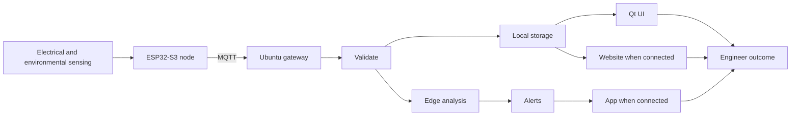
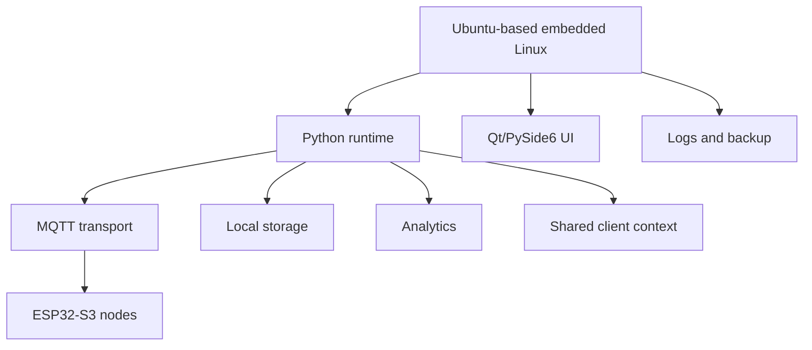
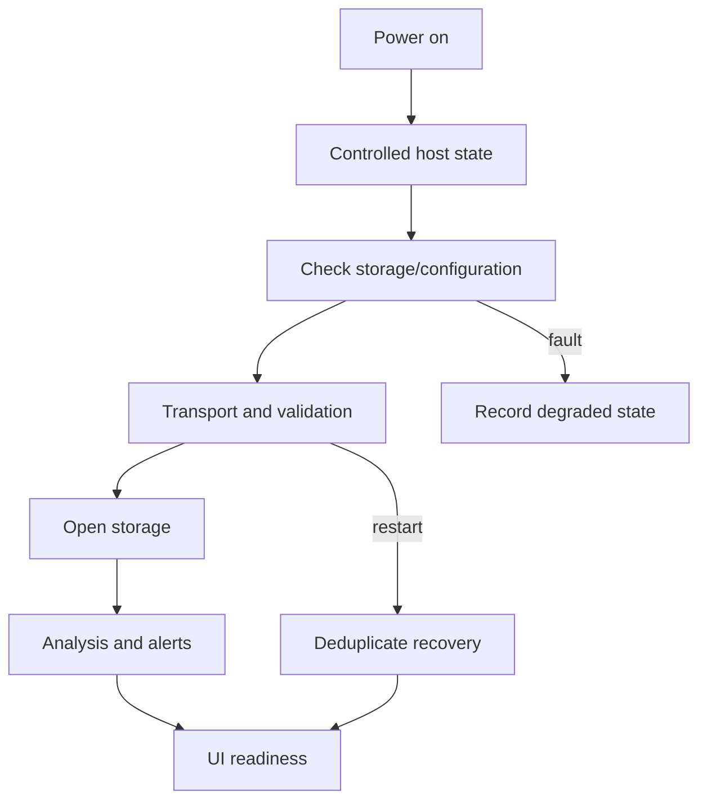
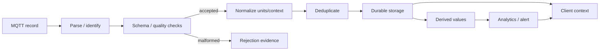
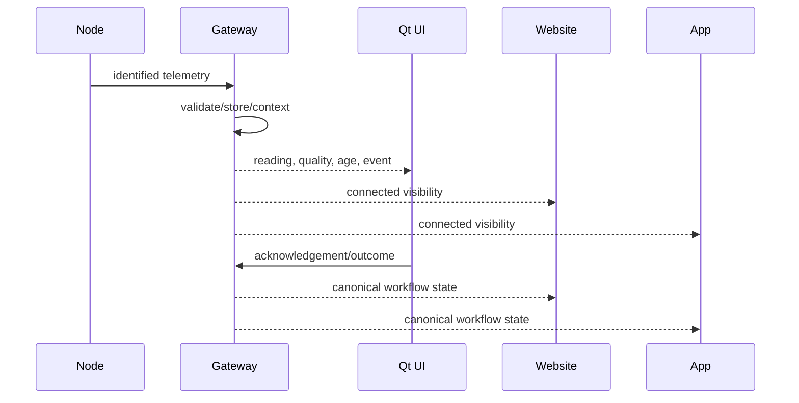
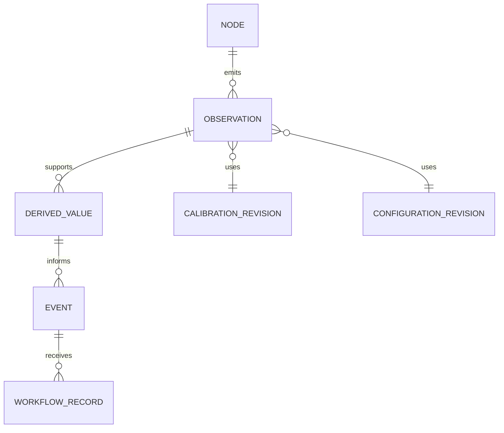
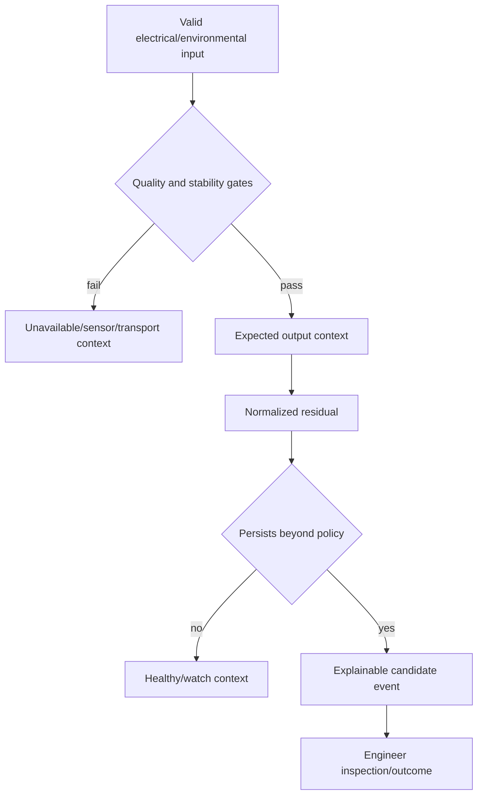
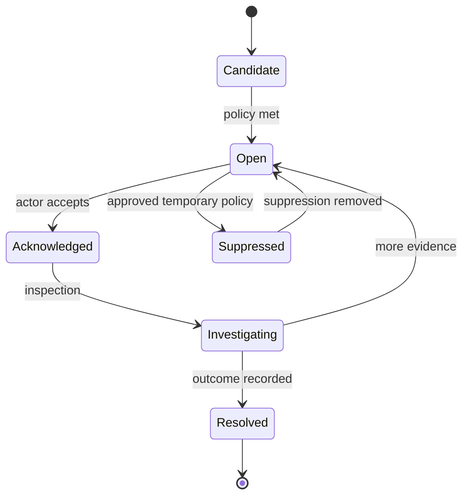
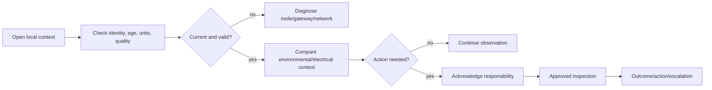

<div align="center">
  <h1>☀️ ARKA AI</h1>
  <h3>Intelligent Edge-AI Monitoring &amp; Performance Optimization<br/>System for Solar Power Plants</h3>
  <p><strong>Local intelligence. Connected monitoring. Engineer-led decisions.</strong></p>
  <p>Ubuntu-based embedded Linux · Qt / PySide6 · Python · ESP32-S3 · MQTT · Website · Companion App</p>
  <p>
    
    
    
    
    
  </p>
  <table>
    <tr><th>Application</th><th>Theme</th><th>Sub-theme</th></tr>
    <tr><td align="center"><strong>VK26-IITH-SE-0021</strong></td><td align="center">Sustainable Energy</td><td align="center">Renewable Energy Harvesting &amp; Generation Systems</td></tr>
  </table>
  <p><a href="https://github.com/DAnuraag/VK26-IITH-SE-0021"><strong>Project Repository &amp; Review Hub</strong></a></p>
  <p><a href="#architecture">Architecture</a> · <a href="#embedded-os">Embedded OS</a> · <a href="#website-app">Website / App</a> · <a href="#installation">Installation</a> · <a href="#validation">Validation</a> · <a href="#prototype-video">Prototype Video</a> · <a href="#safety">Safety</a></p>
</div>
> **Reviewer path:** Begin with [architecture](#architecture), [validation](#validation), and [prototype-video evidence](#prototype-video). The video section records its honest publication status.
## Contents
- [Executive Overview](#executive-overview)
- [Problem, Users & Requirements](#problem-users)
- [Project Scope & Ecosystem Boundaries](#scope)
- [End-to-End System Architecture](#architecture)
- [Ubuntu-Based Embedded Operating Environment](#embedded-os)
- [Boot, Application Services & Recovery](#boot-recovery)
- [Qt / PySide6 Onsite Engineering UI](#qt-ui)
- [Python Backend](#python-backend)
- [Website](#website)
- [Companion App](#companion-app)
- [Cross-Client Consistency & Operator Workflows](#cross-client)
- [ESP32-S3 Sensing-Node Firmware](#firmware)
- [Voltage, Current, Power & Energy Measurement](#measurement)
- [Irradiance, Temperature & Optional Battery Sensing](#environmental-sensing)
- [Power Rails, Isolation & Electrical Safety](#safety)
- [MQTT Topics, Transport & Delivery Behavior](#mqtt)
- [Telemetry Payloads, Units & Configuration Contracts](#telemetry-contracts)
- [Local Storage, Schema & Retention](#storage)
- [Timestamps, Quality, Stale Data & Outage Recovery](#time-quality)
- [Edge-AI Analytics & Explainable Anomaly Logic](#analytics)
- [Alerts, Acknowledgement & Maintenance Workflow](#alerts)
- [Installation & Development Environment](#installation)
- [Configuration & Secret Management](#configuration)
- [Running, Packaging & Deployment](#deployment)
- [Onsite Engineer Operating Guide](#operator-guide)
- [Website / App Connectivity & Access](#website-app)
- [Testing & Validation Strategy](#validation)
- [Metrology Calibration & Acceptance Procedures](#calibration)
- [Security, Privacy & Threat Model](#security)
- [Troubleshooting & Failure Diagnosis](#troubleshooting)
- [Observability, Backup & Maintenance](#observability)
- [CAD, Packaging, Mechanical & Thermal Studies](#mechanical)
- [BOM, Budget & Procurement Assumptions](#bom)
- [Performance Targets & Measurement Methodology](#performance)
- [Risk Register & Mitigation](#risks)
- [Maker Journey & Implementation Milestones](#maker-journey)
- [Roadmap & Future Development](#roadmap)
- [Prototype Video & Review Evidence](#prototype-video)
- [Glossary, References & Documentation Conventions](#glossary)
## Evidence and reading guide
| Label | Meaning here | Reader action |
|---|---|---|
| Implemented scope | Explicit team statement confirms capability. | Request released artifacts for exact mechanics. |
| Inspected material | Only the prior README was in the cloned repository. | Do not infer unpublished detail. |
| Proposed design | Choice awaiting review/validation. | Do not treat as deployed hardware. |
| Acceptance target | Planned measurable criterion. | Do not report as measured. |
| Reference pattern | Safe example without public project mechanics. | Reconcile before use. |
| Publication gap | Relevant artifact/URL/result is unavailable. | Seek evidence. |
### Reading commitments
- ESP32-S3 field nodes and the Ubuntu gateway are separate compute boundaries; ESP32-S3 does not run Ubuntu.
- Values need identity, units, time, quality, and applicable calibration/configuration context.
- The read-only demonstrator is 12–24 V DC and no more than 5 A; it is never direct live-PV-string connection.
- Local-first supports onsite function through WAN loss; it does not create remote access without network.
- Targets, concepts, and estimates are not written as delivered or measured results.
- The Ubuntu environment, Qt/PySide6 UI, Python backend, website, app, and ecosystem are team-confirmed software scope.
- Exact source files, services, routes, targets, versions, URLs, and deployment topology are undocumented publicly.
- Examples are reference contracts, not current endpoints, credentials, or runnable product commands.
- Inverter data requires an approved interface and never permits bypass of inverter or plant protection.
- Analytics support engineer-led inspection and do not promise failure date, RUL, or autonomous repair.
- No verified prototype-video URL was provided or found; this README creates no fake playback link.
- Safety work requires qualified review, proper ratings, covered terminals, current limiting, and disconnect access.
- **Reading control 01 — scope:** preserve the stated boundary, evidence status, limitation, and next review action when citing this document.
- **Reading control 02 — time basis:** preserve the stated boundary, evidence status, limitation, and next review action when citing this document.
- **Reading control 03 — quality state:** preserve the stated boundary, evidence status, limitation, and next review action when citing this document.
- **Reading control 04 — source evidence:** preserve the stated boundary, evidence status, limitation, and next review action when citing this document.
- **Reading control 05 — calibration:** preserve the stated boundary, evidence status, limitation, and next review action when citing this document.
- **Reading control 06 — configuration:** preserve the stated boundary, evidence status, limitation, and next review action when citing this document.
- **Reading control 07 — telemetry:** preserve the stated boundary, evidence status, limitation, and next review action when citing this document.
- **Reading control 08 — storage:** preserve the stated boundary, evidence status, limitation, and next review action when citing this document.
- **Reading control 09 — analytics:** preserve the stated boundary, evidence status, limitation, and next review action when citing this document.
- **Reading control 10 — alerts:** preserve the stated boundary, evidence status, limitation, and next review action when citing this document.
- **Reading control 11 — onsite UI:** preserve the stated boundary, evidence status, limitation, and next review action when citing this document.
- **Reading control 12 — website:** preserve the stated boundary, evidence status, limitation, and next review action when citing this document.
- **Reading control 13 — companion app:** preserve the stated boundary, evidence status, limitation, and next review action when citing this document.
- **Reading control 14 — WAN loss:** preserve the stated boundary, evidence status, limitation, and next review action when citing this document.
- **Reading control 15 — LAN loss:** preserve the stated boundary, evidence status, limitation, and next review action when citing this document.
- **Reading control 16 — node reboot:** preserve the stated boundary, evidence status, limitation, and next review action when citing this document.
- **Reading control 17 — gateway recovery:** preserve the stated boundary, evidence status, limitation, and next review action when citing this document.
- **Reading control 18 — electrical boundary:** preserve the stated boundary, evidence status, limitation, and next review action when citing this document.
- **Reading control 19 — approved interface:** preserve the stated boundary, evidence status, limitation, and next review action when citing this document.
- **Reading control 20 — test method:** preserve the stated boundary, evidence status, limitation, and next review action when citing this document.
- **Reading control 21 — test result:** preserve the stated boundary, evidence status, limitation, and next review action when citing this document.
- **Reading control 22 — risk:** preserve the stated boundary, evidence status, limitation, and next review action when citing this document.
- **Reading control 23 — maintenance:** preserve the stated boundary, evidence status, limitation, and next review action when citing this document.
- **Reading control 24 — review evidence:** preserve the stated boundary, evidence status, limitation, and next review action when citing this document.
- **Reading control 25 — documentation revision:** preserve the stated boundary, evidence status, limitation, and next review action when citing this document.
- **Reading control 26 — operator outcome:** preserve the stated boundary, evidence status, limitation, and next review action when citing this document.
- **Reading control 27 — security:** preserve the stated boundary, evidence status, limitation, and next review action when citing this document.
- **Reading control 28 — privacy:** preserve the stated boundary, evidence status, limitation, and next review action when citing this document.
- **Reading control 29 — procurement:** preserve the stated boundary, evidence status, limitation, and next review action when citing this document.
- **Reading control 30 — mechanical target:** preserve the stated boundary, evidence status, limitation, and next review action when citing this document.
- **Reading control 31 — thermal target:** preserve the stated boundary, evidence status, limitation, and next review action when citing this document.
- **Reading control 32 — video status:** preserve the stated boundary, evidence status, limitation, and next review action when citing this document.
- **Evidence handoff:** name the release or build identity that produced the observation.
- **Measurement handoff:** record reference instrument, range, calibration state, and uncertainty where relevant.
- **Time handoff:** retain source time, receive time, clock-confidence condition, and any ordering caveat.
- **Safety handoff:** state the approved low-voltage setup, current limit, terminal condition, and reviewer.
- **Workflow handoff:** retain event identity, actor, acknowledgement, outcome, and unresolved follow-up.
- **Publication handoff:** distinguish a genuine artifact/link from an intended future publication.
<a id="executive-overview"></a>
## Executive Overview
> **Purpose:** Present ARKA AI as one monitoring ecosystem turning field measurements into contextual, engineer-led action.
**Evidence posture:** Team-confirmed scope includes Ubuntu environment, Qt/PySide6 UI, Python backend, website, companion app, and their integrated ecosystem; mechanics are not public.
### Essential engineering statements
- Decision support, not autonomous plant control.
- Sense → analyse → support decision → engineer response → recorded outcome.
- Beneficiaries: onsite engineers, operators, maintenance, asset owners.
- Measurements: V, A, W, Wh/kWh, W/m², °C, state, quality, history.
- Local storage/analysis support onsite work.
- approved interfaces only for inverter values.
### Detailed engineering control register
- **EXE-001 · mission:** For mission, ensure client rendering cannot convert last-known context into an unqualified live reading.
- **EXE-002 · beneficiary:** For beneficiary, test normal environmental change as well as controlled abnormal stimulus to reduce misleading conclusions.
- **EXE-003 · monitoring boundary:** Before changing monitoring boundary, record the reason, expected consequence, approver, rollback path, and post-change observation.
- **EXE-004 · field evidence:** For field evidence, add a reviewer checkpoint before expanding the system from a safe demonstrator toward site-specific deployment.
- **EXE-005 · local-first:** For local-first, preserve the measured or asserted value together with its unit, identity, time basis, and revision context.
- **EXE-006 · remote visibility:** For remote visibility, consider storage capacity, retention, backup inclusion, and restore value before relying on it as long-term evidence.
- **EXE-007 · engineering judgement:** For engineering judgement, identify the actor and timestamp for workflow actions without rewriting the original telemetry evidence.
- **EXE-008 · maintenance record:** For maintenance record, design the troubleshooting path to move from non-invasive evidence toward approved physical checks only as needed.
- **EXE-009 · system identity:** For system identity, plan a review of supplier, lifecycle, substitute part, or external dependency assumptions before relying on availability.
- **EXE-010 · measurement context:** For measurement context, preserve enough context to reproduce the conclusion after the live panel, application, or remote client has changed.
- **EXE-011 · mission:** For mission, design the troubleshooting path to move from non-invasive evidence toward approved physical checks only as needed.
- **EXE-012 · beneficiary:** For beneficiary, check compatibility with the documented low-voltage, read-only boundary before bench or field-adjacent work.
- **EXE-013 · monitoring boundary:** For monitoring boundary, do not convert proposed pins, component choices, enclosure dimensions, or targets into manufactured evidence.
- **EXE-014 · field evidence:** For field evidence, ensure a replayed record remains identifiable as historical when its receipt time is newer than its observation time.
- **EXE-015 · local-first:** For local-first, state what an operator will see in starting, recovering, offline, stale, and healthy conditions.
- **EXE-016 · remote visibility:** Define ownership for remote visibility during normal operation, degraded operation, recovery, and evidence review.
- **EXE-017 · engineering judgement:** For engineering judgement, explain how an onsite engineer can work locally when remote website or app connectivity is unavailable.
- **EXE-018 · maintenance record:** For maintenance record, maintain a canonical meaning shared by Qt, website, companion app, analytics, and maintenance workflow.
- **EXE-019 · system identity:** For system identity, document range checks, plausibility checks, timing checks, identity checks, and any applicable physical checks.
- **EXE-020 · measurement context:** For measurement context, prefer an explicit “not tested” or “inconclusive” result over a missing value that could be misread as a pass.
- **EXE-021 · mission:** For mission, maintain a canonical meaning shared by Qt, website, companion app, analytics, and maintenance workflow.
- **EXE-022 · beneficiary:** For beneficiary, attach any future video, screenshot, or test capture to its build identity, safe setup, and live/simulated status.
- **EXE-023 · monitoring boundary:** For monitoring boundary, make data loss, overwrite, deduplication, and correction behavior deliberate and auditable.
- **EXE-024 · field evidence:** If field evidence contributes to an alert, retain the evidence window, policy revision, quality gates, and workflow outcome.
- **EXE-025 · local-first:** For local-first, document the expected behavior after gateway restart, node reboot, broker reconnect, and WAN restoration where relevant.
- **EXE-026 · remote visibility:** For remote visibility, do not make an IP target, isolation component, or modeled thermal condition a certification claim.
- **EXE-027 · engineering judgement:** State the timeout, freshness policy, or retry interpretation relevant to engineering judgement; absence of a record is not a value of zero.
- **EXE-028 · maintenance record:** For maintenance record, use explicit unavailable and not-applicable states instead of forcing a numeric or Boolean substitute.
- **EXE-029 · system identity:** For system identity, separate a target from an observed result and label planning, bench, and field evidence distinctly.
- **EXE-030 · measurement context:** For measurement context, treat a QoS 1 delivery acknowledgement as transport context, not proof of exact-once business processing.
- **EXE-031 · mission:** For mission, use explicit unavailable and not-applicable states instead of forcing a numeric or Boolean substitute.
- **EXE-032 · beneficiary:** For beneficiary, use controlled release provenance; a file or setting of unknown origin is not a trustworthy operational basis.
- **EXE-033 · monitoring boundary:** For monitoring boundary, make any unsupported assumption visible to operators and reviewers rather than hiding it behind a calculated value.
- **EXE-034 · field evidence:** For field evidence, ensure client rendering cannot convert last-known context into an unqualified live reading.
- **EXE-035 · local-first:** When local-first depends on calibration, retain the calibration revision and its applicability range with the value.
- **EXE-036 · remote visibility:** For remote visibility, collect as-found evidence before corrective action whenever doing so is safe and does not prolong a hazardous condition.
- **EXE-037 · engineering judgement:** For engineering judgement, add a reviewer checkpoint before expanding the system from a safe demonstrator toward site-specific deployment.
- **EXE-038 · maintenance record:** For maintenance record, preserve the measured or asserted value together with its unit, identity, time basis, and revision context.
- **EXE-039 · system identity:** Before changing system identity, record the reason, expected consequence, approver, rollback path, and post-change observation.
- **EXE-040 · measurement context:** For measurement context, define a safe operator response that includes when to stop, when to inspect, and when to escalate.
- **EXE-041 · mission:** For mission, preserve the measured or asserted value together with its unit, identity, time basis, and revision context.
- **EXE-042 · beneficiary:** For beneficiary, use least privilege: the ability to view context must not automatically grant configuration or administrative access.
- **EXE-043 · monitoring boundary:** For monitoring boundary, preserve clear separation between local-first availability and remote access availability.
- **EXE-044 · field evidence:** For field evidence, design the troubleshooting path to move from non-invasive evidence toward approved physical checks only as needed.
- **EXE-045 · local-first:** For local-first, plan a review of supplier, lifecycle, substitute part, or external dependency assumptions before relying on availability.
- **EXE-046 · remote visibility:** For remote visibility, maintain sequence and reboot context where ordering, duplicate delivery, or replay can affect interpretation.
- **EXE-047 · engineering judgement:** For engineering judgement, ensure a replayed record remains identifiable as historical when its receipt time is newer than its observation time.
- **EXE-048 · maintenance record:** For maintenance record, state what an operator will see in starting, recovering, offline, stale, and healthy conditions.
- **EXE-049 · system identity:** For system identity, do not convert proposed pins, component choices, enclosure dimensions, or targets into manufactured evidence.
- **EXE-050 · measurement context:** Use measurement context to inform an engineer-led decision; never allow a display interpretation to become unreviewed plant control.
- **EXE-051 · mission:** For mission, state what an operator will see in starting, recovering, offline, stale, and healthy conditions.
- **EXE-052 · beneficiary:** For beneficiary, retain the quality reason rather than reducing all non-healthy conditions to a generic error label.
- **EXE-053 · monitoring boundary:** For monitoring boundary, capture as-left evidence after a correction so recovery is distinguishable from an unverified workaround.
- **EXE-054 · field evidence:** For field evidence, maintain a canonical meaning shared by Qt, website, companion app, analytics, and maintenance workflow.
- **EXE-055 · local-first:** For local-first, document range checks, plausibility checks, timing checks, identity checks, and any applicable physical checks.
- **EXE-056 · remote visibility:** For remote visibility, write the failure boundary so an engineer can tell whether responsibility lies with node, gateway, client, or process.
- **EXE-057 · engineering judgement:** If engineering judgement contributes to an alert, retain the evidence window, policy revision, quality gates, and workflow outcome.
- **EXE-058 · maintenance record:** For maintenance record, document the expected behavior after gateway restart, node reboot, broker reconnect, and WAN restoration where relevant.
- **EXE-059 · system identity:** For system identity, make data loss, overwrite, deduplication, and correction behavior deliberate and auditable.
- **EXE-060 · measurement context:** For measurement context, state the uncertainty or limitation that remains after a successful-looking bench observation.
- **EXE-061 · mission:** For mission, document the expected behavior after gateway restart, node reboot, broker reconnect, and WAN restoration where relevant.
- **EXE-062 · beneficiary:** For beneficiary, protect the distinction between raw observation, normalized record, derived metric, alert, acknowledgement, and outcome.
- **EXE-063 · monitoring boundary:** When monitoring boundary is historical, preserve gaps and late-arrival status so a trend does not imply uninterrupted measurement.
- **EXE-064 · field evidence:** For field evidence, use explicit unavailable and not-applicable states instead of forcing a numeric or Boolean substitute.
- **EXE-065 · local-first:** For local-first, separate a target from an observed result and label planning, bench, and field evidence distinctly.
- **EXE-066 · remote visibility:** For remote visibility, use manufacturer documentation and approved review before finalizing wiring, logic compatibility, ratings, or protection.
- **EXE-067 · engineering judgement:** For engineering judgement, ensure client rendering cannot convert last-known context into an unqualified live reading.
- **EXE-068 · maintenance record:** When maintenance record depends on calibration, retain the calibration revision and its applicability range with the value.
<a id="problem-users"></a>
## Problem, Users & Requirements
> **Purpose:** Translate variable solar conditions and fragmented readings into observable human requirements.
**Evidence posture:** Brief documents problem/users; no public traceability or user-study artifact exists.
### Essential engineering statements
- Irradiance, temperature, loading, weather, and configuration change output.
- Delay can conceal underperformance or abnormal voltage/current.
- Engineer needs fresh values, quality, history, and outcome record.
- Operator needs identity, severity, ownership, acknowledgement.
- Maintenance needs timeline and disposition.
- Read-only demonstrator cannot replace protection, permits, or qualified work.
### Detailed engineering control register
- **PRO-001 · changing irradiance:** For changing irradiance, document the expected behavior after gateway restart, node reboot, broker reconnect, and WAN restoration where relevant.
- **PRO-002 · module heating:** Avoid placing secrets, endpoint details, private keys, tokens, or personal data in a record associated with module heating.
- **PRO-003 · electrical deviation:** For electrical deviation, state the uncertainty or limitation that remains after a successful-looking bench observation.
- **PRO-004 · fragmented telemetry:** For fragmented telemetry, preserve the measured or asserted value together with its unit, identity, time basis, and revision context.
- **PRO-005 · onsite inspection:** Before changing onsite inspection, record the reason, expected consequence, approver, rollback path, and post-change observation.
- **PRO-006 · operator escalation:** Evaluate operator escalation against documented acceptance criteria only after the test method, reference instruments, and conditions are captured.
- **PRO-007 · maintenance disposition:** For maintenance disposition, record dependencies on host storage, host time, network path, broker behavior, and client availability where applicable.
- **PRO-008 · asset evidence:** If asset evidence contributes to an alert, retain the evidence window, policy revision, quality gates, and workflow outcome.
- **PRO-009 · read-only boundary:** For read-only boundary, use manufacturer documentation and approved review before finalizing wiring, logic compatibility, ratings, or protection.
- **PRO-010 · acceptance trace:** For acceptance trace, design the troubleshooting path to move from non-invasive evidence toward approved physical checks only as needed.
- **PRO-011 · changing irradiance:** When changing irradiance depends on calibration, retain the calibration revision and its applicability range with the value.
- **PRO-012 · module heating:** Validate module heating with a safe, reproducible stimulus and retain inputs, outputs, relevant logs, and limitations.
- **PRO-013 · electrical deviation:** For electrical deviation, make remote state show connection and last-confirmed time; remote absence must not obscure local evidence.
- **PRO-014 · fragmented telemetry:** For fragmented telemetry, state what an operator will see in starting, recovering, offline, stale, and healthy conditions.
- **PRO-015 · onsite inspection:** For onsite inspection, do not convert proposed pins, component choices, enclosure dimensions, or targets into manufactured evidence.
- **PRO-016 · operator escalation:** For operator escalation, distinguish a normal operational variation from a missing, stale, malformed, or invalid information state.
- **PRO-017 · maintenance disposition:** Avoid placing secrets, endpoint details, private keys, tokens, or personal data in a record associated with maintenance disposition.
- **PRO-018 · asset evidence:** For asset evidence, ensure client rendering cannot convert last-known context into an unqualified live reading.
- **PRO-019 · read-only boundary:** For read-only boundary, test normal environmental change as well as controlled abnormal stimulus to reduce misleading conclusions.
- **PRO-020 · acceptance trace:** For acceptance trace, maintain a canonical meaning shared by Qt, website, companion app, analytics, and maintenance workflow.
- **PRO-021 · changing irradiance:** For changing irradiance, plan a review of supplier, lifecycle, substitute part, or external dependency assumptions before relying on availability.
- **PRO-022 · module heating:** For module heating, identify the actor and timestamp for workflow actions without rewriting the original telemetry evidence.
- **PRO-023 · electrical deviation:** For electrical deviation, record whether information is source-observed, gateway-derived, client-rendered, or operator-entered.
- **PRO-024 · fragmented telemetry:** For fragmented telemetry, document the expected behavior after gateway restart, node reboot, broker reconnect, and WAN restoration where relevant.
- **PRO-025 · onsite inspection:** For onsite inspection, make data loss, overwrite, deduplication, and correction behavior deliberate and auditable.
- **PRO-026 · operator escalation:** For operator escalation, keep configuration examples non-operational until actual released names, paths, services, and endpoints are available.
- **PRO-027 · maintenance disposition:** Validate maintenance disposition with a safe, reproducible stimulus and retain inputs, outputs, relevant logs, and limitations.
- **PRO-028 · asset evidence:** For asset evidence, design the troubleshooting path to move from non-invasive evidence toward approved physical checks only as needed.
- **PRO-029 · read-only boundary:** For read-only boundary, check compatibility with the documented low-voltage, read-only boundary before bench or field-adjacent work.
- **PRO-030 · acceptance trace:** For acceptance trace, use explicit unavailable and not-applicable states instead of forcing a numeric or Boolean substitute.
- **PRO-031 · changing irradiance:** For changing irradiance, document range checks, plausibility checks, timing checks, identity checks, and any applicable physical checks.
- **PRO-032 · module heating:** For module heating, explain how an onsite engineer can work locally when remote website or app connectivity is unavailable.
- **PRO-033 · electrical deviation:** Treat electrical deviation as an explicit engineering object: name its producer, consumer, state transition, and retained evidence.
- **PRO-034 · fragmented telemetry:** When fragmented telemetry depends on calibration, retain the calibration revision and its applicability range with the value.
- **PRO-035 · onsite inspection:** For onsite inspection, make any unsupported assumption visible to operators and reviewers rather than hiding it behind a calculated value.
- **PRO-036 · operator escalation:** For operator escalation, consider storage capacity, retention, backup inclusion, and restore value before relying on it as long-term evidence.
- **PRO-037 · maintenance disposition:** For maintenance disposition, identify the actor and timestamp for workflow actions without rewriting the original telemetry evidence.
- **PRO-038 · asset evidence:** For asset evidence, maintain a canonical meaning shared by Qt, website, companion app, analytics, and maintenance workflow.
- **PRO-039 · read-only boundary:** For read-only boundary, attach any future video, screenshot, or test capture to its build identity, safe setup, and live/simulated status.
- **PRO-040 · acceptance trace:** For acceptance trace, preserve the measured or asserted value together with its unit, identity, time basis, and revision context.
- **PRO-041 · changing irradiance:** For changing irradiance, separate a target from an observed result and label planning, bench, and field evidence distinctly.
- **PRO-042 · module heating:** State the timeout, freshness policy, or retry interpretation relevant to module heating; absence of a record is not a value of zero.
- **PRO-043 · electrical deviation:** For electrical deviation, assess consequences of power interruption and make shutdown, restart, and recovery behavior observable.
- **PRO-044 · fragmented telemetry:** For fragmented telemetry, plan a review of supplier, lifecycle, substitute part, or external dependency assumptions before relying on availability.
- **PRO-045 · onsite inspection:** For onsite inspection, preserve clear separation between local-first availability and remote access availability.
- **PRO-046 · operator escalation:** Define ownership for operator escalation during normal operation, degraded operation, recovery, and evidence review.
- **PRO-047 · maintenance disposition:** For maintenance disposition, explain how an onsite engineer can work locally when remote website or app connectivity is unavailable.
- **PRO-048 · asset evidence:** For asset evidence, use explicit unavailable and not-applicable states instead of forcing a numeric or Boolean substitute.
- **PRO-049 · read-only boundary:** For read-only boundary, use controlled release provenance; a file or setting of unknown origin is not a trustworthy operational basis.
- **PRO-050 · acceptance trace:** For acceptance trace, state what an operator will see in starting, recovering, offline, stale, and healthy conditions.
- **PRO-051 · changing irradiance:** Before changing changing irradiance, record the reason, expected consequence, approver, rollback path, and post-change observation.
- **PRO-052 · module heating:** For module heating, add a reviewer checkpoint before expanding the system from a safe demonstrator toward site-specific deployment.
- **PRO-053 · electrical deviation:** If electrical deviation is used in a derived calculation, retain the source inputs, formula/revision, valid interval, and gap policy.
- **PRO-054 · fragmented telemetry:** For fragmented telemetry, document range checks, plausibility checks, timing checks, identity checks, and any applicable physical checks.
- **PRO-055 · onsite inspection:** For onsite inspection, capture as-left evidence after a correction so recovery is distinguishable from an unverified workaround.
- **PRO-056 · operator escalation:** For operator escalation, do not make an IP target, isolation component, or modeled thermal condition a certification claim.
- **PRO-057 · maintenance disposition:** State the timeout, freshness policy, or retry interpretation relevant to maintenance disposition; absence of a record is not a value of zero.
- **PRO-058 · asset evidence:** For asset evidence, preserve the measured or asserted value together with its unit, identity, time basis, and revision context.
- **PRO-059 · read-only boundary:** For read-only boundary, use least privilege: the ability to view context must not automatically grant configuration or administrative access.
- **PRO-060 · acceptance trace:** For acceptance trace, document the expected behavior after gateway restart, node reboot, broker reconnect, and WAN restoration where relevant.
- **PRO-061 · changing irradiance:** For changing irradiance, do not convert proposed pins, component choices, enclosure dimensions, or targets into manufactured evidence.
- **PRO-062 · module heating:** For module heating, ensure a replayed record remains identifiable as historical when its receipt time is newer than its observation time.
- **PRO-063 · electrical deviation:** When electrical deviation depends on configuration, include the configuration revision that was active at the observation time.
- **PRO-064 · fragmented telemetry:** For fragmented telemetry, separate a target from an observed result and label planning, bench, and field evidence distinctly.
- **PRO-065 · onsite inspection:** When onsite inspection is historical, preserve gaps and late-arrival status so a trend does not imply uninterrupted measurement.
- **PRO-066 · operator escalation:** For operator escalation, collect as-found evidence before corrective action whenever doing so is safe and does not prolong a hazardous condition.
- **PRO-067 · maintenance disposition:** For maintenance disposition, add a reviewer checkpoint before expanding the system from a safe demonstrator toward site-specific deployment.
- **PRO-068 · asset evidence:** For asset evidence, state what an operator will see in starting, recovering, offline, stale, and healthy conditions.
<a id="scope"></a>
## Project Scope & Ecosystem Boundaries
> **Purpose:** Set observation, calculation, presentation, and record boundaries while separating confirmed software from planned detail.
**Evidence posture:** Public repository had no source, config, tests, assets, PDFs, BOM, or deployment artifact beyond README.
### Essential engineering statements
- Path: measurements → ESP32-S3 → MQTT → local gateway → storage/analysis → clients/workflow.
- ESP32-S3 is field node.
-  Ubuntu is onsite gateway.
- Team statement confirms surfaces, not versions/endpoints/topology.
- Approved inverter/SCADA integration is future boundary.
- Battery voltage is expansion and does not prove SOC.
- Analytics do not promise RUL/failure date.
- No plant actuation, protection, or live-string connection.
### Detailed engineering control register
- **SCO-001 · in-scope signal:** For in-scope signal, design the troubleshooting path to move from non-invasive evidence toward approved physical checks only as needed.
- **SCO-002 · out-of-scope control:** State the timeout, freshness policy, or retry interpretation relevant to out-of-scope control; absence of a record is not a value of zero.
- **SCO-003 · firmware boundary:** For firmware boundary, use explicit unavailable and not-applicable states instead of forcing a numeric or Boolean substitute.
- **SCO-004 · gateway boundary:** If gateway boundary contributes to an alert, retain the evidence window, policy revision, quality gates, and workflow outcome.
- **SCO-005 · client boundary:** For client boundary, explain how an onsite engineer can work locally when remote website or app connectivity is unavailable.
- **SCO-006 · approved interface:** For approved interface, design the troubleshooting path to move from non-invasive evidence toward approved physical checks only as needed.
- **SCO-007 · deployment disclosure:** When deployment disclosure depends on calibration, retain the calibration revision and its applicability range with the value.
- **SCO-008 · battery expansion:** When battery expansion depends on configuration, include the configuration revision that was active at the observation time.
- **SCO-009 · analytics limit:** A change involving analytics limit must not weaken certified plant protection, electrical isolation practice, or qualified-review requirements.
- **SCO-010 · plant protection:** For plant protection, document the expected behavior after gateway restart, node reboot, broker reconnect, and WAN restoration where relevant.
- **SCO-011 · in-scope signal:** For in-scope signal, maintain a canonical meaning shared by Qt, website, companion app, analytics, and maintenance workflow.
- **SCO-012 · out-of-scope control:** For out-of-scope control, add a reviewer checkpoint before expanding the system from a safe demonstrator toward site-specific deployment.
- **SCO-013 · firmware boundary:** For firmware boundary, preserve the measured or asserted value together with its unit, identity, time basis, and revision context.
- **SCO-014 · gateway boundary:** For gateway boundary, ensure client rendering cannot convert last-known context into an unqualified live reading.
- **SCO-015 · client boundary:** State the timeout, freshness policy, or retry interpretation relevant to client boundary; absence of a record is not a value of zero.
- **SCO-016 · approved interface:** For approved interface, maintain a canonical meaning shared by Qt, website, companion app, analytics, and maintenance workflow.
- **SCO-017 · deployment disclosure:** For deployment disclosure, plan a review of supplier, lifecycle, substitute part, or external dependency assumptions before relying on availability.
- **SCO-018 · battery expansion:** For battery expansion, retain failure evidence long enough to support cross-node, cross-client, and post-restart comparison.
- **SCO-019 · analytics limit:** For analytics limit, include precondition, stimulus, expected behavior, observed behavior, and evidence location in any test record.
- **SCO-020 · plant protection:** When plant protection depends on calibration, retain the calibration revision and its applicability range with the value.
- **SCO-021 · in-scope signal:** For in-scope signal, use explicit unavailable and not-applicable states instead of forcing a numeric or Boolean substitute.
- **SCO-022 · out-of-scope control:** For out-of-scope control, ensure a replayed record remains identifiable as historical when its receipt time is newer than its observation time.
- **SCO-023 · firmware boundary:** For firmware boundary, state what an operator will see in starting, recovering, offline, stale, and healthy conditions.
- **SCO-024 · gateway boundary:** For gateway boundary, design the troubleshooting path to move from non-invasive evidence toward approved physical checks only as needed.
- **SCO-025 · client boundary:** For client boundary, add a reviewer checkpoint before expanding the system from a safe demonstrator toward site-specific deployment.
- **SCO-026 · approved interface:** For approved interface, use explicit unavailable and not-applicable states instead of forcing a numeric or Boolean substitute.
- **SCO-027 · deployment disclosure:** For deployment disclosure, document range checks, plausibility checks, timing checks, identity checks, and any applicable physical checks.
- **SCO-028 · battery expansion:** For battery expansion, show why a value may be excluded from energy, residual, trend, or alert computation without deleting it.
- **SCO-029 · analytics limit:** For analytics limit, record dependencies on host storage, host time, network path, broker behavior, and client availability where applicable.
- **SCO-030 · plant protection:** For plant protection, plan a review of supplier, lifecycle, substitute part, or external dependency assumptions before relying on availability.
- **SCO-031 · in-scope signal:** For in-scope signal, preserve the measured or asserted value together with its unit, identity, time basis, and revision context.
- **SCO-032 · out-of-scope control:** If out-of-scope control contributes to an alert, retain the evidence window, policy revision, quality gates, and workflow outcome.
- **SCO-033 · firmware boundary:** For firmware boundary, document the expected behavior after gateway restart, node reboot, broker reconnect, and WAN restoration where relevant.
- **SCO-034 · gateway boundary:** For gateway boundary, maintain a canonical meaning shared by Qt, website, companion app, analytics, and maintenance workflow.
- **SCO-035 · client boundary:** For client boundary, ensure a replayed record remains identifiable as historical when its receipt time is newer than its observation time.
- **SCO-036 · approved interface:** For approved interface, preserve the measured or asserted value together with its unit, identity, time basis, and revision context.
- **SCO-037 · deployment disclosure:** For deployment disclosure, separate a target from an observed result and label planning, bench, and field evidence distinctly.
- **SCO-038 · battery expansion:** Evaluate battery expansion against documented acceptance criteria only after the test method, reference instruments, and conditions are captured.
- **SCO-039 · analytics limit:** Avoid placing secrets, endpoint details, private keys, tokens, or personal data in a record associated with analytics limit.
- **SCO-040 · plant protection:** For plant protection, document range checks, plausibility checks, timing checks, identity checks, and any applicable physical checks.
- **SCO-041 · in-scope signal:** For in-scope signal, state what an operator will see in starting, recovering, offline, stale, and healthy conditions.
- **SCO-042 · out-of-scope control:** For out-of-scope control, ensure client rendering cannot convert last-known context into an unqualified live reading.
- **SCO-043 · firmware boundary:** When firmware boundary depends on calibration, retain the calibration revision and its applicability range with the value.
- **SCO-044 · gateway boundary:** For gateway boundary, use explicit unavailable and not-applicable states instead of forcing a numeric or Boolean substitute.
- **SCO-045 · client boundary:** If client boundary contributes to an alert, retain the evidence window, policy revision, quality gates, and workflow outcome.
- **SCO-046 · approved interface:** For approved interface, state what an operator will see in starting, recovering, offline, stale, and healthy conditions.
- **SCO-047 · deployment disclosure:** Before changing deployment disclosure, record the reason, expected consequence, approver, rollback path, and post-change observation.
- **SCO-048 · battery expansion:** For battery expansion, distinguish a normal operational variation from a missing, stale, malformed, or invalid information state.
- **SCO-049 · analytics limit:** Validate analytics limit with a safe, reproducible stimulus and retain inputs, outputs, relevant logs, and limitations.
- **SCO-050 · plant protection:** For plant protection, separate a target from an observed result and label planning, bench, and field evidence distinctly.
- **SCO-051 · in-scope signal:** For in-scope signal, document the expected behavior after gateway restart, node reboot, broker reconnect, and WAN restoration where relevant.
- **SCO-052 · out-of-scope control:** For out-of-scope control, design the troubleshooting path to move from non-invasive evidence toward approved physical checks only as needed.
- **SCO-053 · firmware boundary:** For firmware boundary, plan a review of supplier, lifecycle, substitute part, or external dependency assumptions before relying on availability.
- **SCO-054 · gateway boundary:** For gateway boundary, preserve the measured or asserted value together with its unit, identity, time basis, and revision context.
- **SCO-055 · client boundary:** For client boundary, ensure client rendering cannot convert last-known context into an unqualified live reading.
- **SCO-056 · approved interface:** For approved interface, document the expected behavior after gateway restart, node reboot, broker reconnect, and WAN restoration where relevant.
- **SCO-057 · deployment disclosure:** For deployment disclosure, do not convert proposed pins, component choices, enclosure dimensions, or targets into manufactured evidence.
- **SCO-058 · battery expansion:** For battery expansion, keep configuration examples non-operational until actual released names, paths, services, and endpoints are available.
- **SCO-059 · analytics limit:** For analytics limit, identify the actor and timestamp for workflow actions without rewriting the original telemetry evidence.
- **SCO-060 · plant protection:** Before changing plant protection, record the reason, expected consequence, approver, rollback path, and post-change observation.
- **SCO-061 · in-scope signal:** When in-scope signal depends on calibration, retain the calibration revision and its applicability range with the value.
- **SCO-062 · out-of-scope control:** For out-of-scope control, maintain a canonical meaning shared by Qt, website, companion app, analytics, and maintenance workflow.
- **SCO-063 · firmware boundary:** For firmware boundary, document range checks, plausibility checks, timing checks, identity checks, and any applicable physical checks.
- **SCO-064 · gateway boundary:** For gateway boundary, state what an operator will see in starting, recovering, offline, stale, and healthy conditions.
- **SCO-065 · client boundary:** For client boundary, design the troubleshooting path to move from non-invasive evidence toward approved physical checks only as needed.
- **SCO-066 · approved interface:** When approved interface depends on calibration, retain the calibration revision and its applicability range with the value.
- **SCO-067 · deployment disclosure:** For deployment disclosure, make data loss, overwrite, deduplication, and correction behavior deliberate and auditable.
- **SCO-068 · battery expansion:** For battery expansion, consider storage capacity, retention, backup inclusion, and restore value before relying on it as long-term evidence.
- **SCO-069 · analytics limit:** For analytics limit, explain how an onsite engineer can work locally when remote website or app connectivity is unavailable.
- **SCO-070 · plant protection:** For plant protection, do not convert proposed pins, component choices, enclosure dimensions, or targets into manufactured evidence.
- **SCO-071 · in-scope signal:** For in-scope signal, plan a review of supplier, lifecycle, substitute part, or external dependency assumptions before relying on availability.
- **SCO-072 · out-of-scope control:** For out-of-scope control, use explicit unavailable and not-applicable states instead of forcing a numeric or Boolean substitute.
- **SCO-073 · firmware boundary:** For firmware boundary, separate a target from an observed result and label planning, bench, and field evidence distinctly.
- **SCO-074 · gateway boundary:** For gateway boundary, document the expected behavior after gateway restart, node reboot, broker reconnect, and WAN restoration where relevant.
- **SCO-075 · client boundary:** For client boundary, maintain a canonical meaning shared by Qt, website, companion app, analytics, and maintenance workflow.
- **SCO-076 · approved interface:** For approved interface, plan a review of supplier, lifecycle, substitute part, or external dependency assumptions before relying on availability.
- **SCO-077 · deployment disclosure:** For deployment disclosure, make any unsupported assumption visible to operators and reviewers rather than hiding it behind a calculated value.
- **SCO-078 · battery expansion:** Define ownership for battery expansion during normal operation, degraded operation, recovery, and evidence review.
- **SCO-079 · analytics limit:** State the timeout, freshness policy, or retry interpretation relevant to analytics limit; absence of a record is not a value of zero.
- **SCO-080 · plant protection:** For plant protection, make data loss, overwrite, deduplication, and correction behavior deliberate and auditable.
- **SCO-081 · in-scope signal:** For in-scope signal, document range checks, plausibility checks, timing checks, identity checks, and any applicable physical checks.
- **SCO-082 · out-of-scope control:** For out-of-scope control, preserve the measured or asserted value together with its unit, identity, time basis, and revision context.
- **SCO-083 · firmware boundary:** Before changing firmware boundary, record the reason, expected consequence, approver, rollback path, and post-change observation.
- **SCO-084 · gateway boundary:** When gateway boundary depends on calibration, retain the calibration revision and its applicability range with the value.
- **SCO-085 · client boundary:** For client boundary, use explicit unavailable and not-applicable states instead of forcing a numeric or Boolean substitute.
- **SCO-086 · approved interface:** For approved interface, document range checks, plausibility checks, timing checks, identity checks, and any applicable physical checks.
<a id="architecture"></a>
## End-to-End System Architecture
> **Purpose:** Describe documented flow and boundaries where quality, time, and responsibility change.
**Evidence posture:** Diagram is conceptual; it is not a released network diagram, broker, endpoint, or API.
### Essential engineering statements
- Node record carries identity, boot/epoch, sequence, units, quality, source-time.
- Gateway validates before durable handling.
- Python backend is shared logic surface.
- Qt is onsite while web/app extend context when connected.
- Local analysis may continue through WAN loss.
- Acknowledgement is workflow evidence not measurement mutation.
- Conversions retain source/receive time, quality, revisions.
### Architecture view
**Diagram status:** Conceptual/reference view; labels are not published service, endpoint, or wiring identifiers.

### Detailed engineering control register
- **ARC-001 · sensor acquisition:** Evaluate sensor acquisition against documented acceptance criteria only after the test method, reference instruments, and conditions are captured.
- **ARC-002 · node identity:** For node identity, preserve enough context to reproduce the conclusion after the live panel, application, or remote client has changed.
- **ARC-003 · MQTT transport:** For MQTT transport, consider storage capacity, retention, backup inclusion, and restore value before relying on it as long-term evidence.
- **ARC-004 · gateway validation:** For gateway validation, identify the actor and timestamp for workflow actions without rewriting the original telemetry evidence.
- **ARC-005 · durable storage:** For durable storage, design the troubleshooting path to move from non-invasive evidence toward approved physical checks only as needed.
- **ARC-006 · derived metric:** For derived metric, add a reviewer checkpoint before expanding the system from a safe demonstrator toward site-specific deployment.
- **ARC-007 · edge analysis:** Validate edge analysis with a safe, reproducible stimulus and retain inputs, outputs, relevant logs, and limitations.
- **ARC-008 · Qt display:** For Qt display, ensure client rendering cannot convert last-known context into an unqualified live reading.
- **ARC-009 · website visibility:** For website visibility, treat a QoS 1 delivery acknowledgement as transport context, not proof of exact-once business processing.
- **ARC-010 · app visibility:** For app visibility, record dependencies on host storage, host time, network path, broker behavior, and client availability where applicable.
- **ARC-011 · alert event:** For alert event, ensure a replayed record remains identifiable as historical when its receipt time is newer than its observation time.
- **ARC-012 · engineer outcome:** Validate engineer outcome with a safe, reproducible stimulus and retain inputs, outputs, relevant logs, and limitations.
- **ARC-013 · sensor acquisition:** For sensor acquisition, use least privilege: the ability to view context must not automatically grant configuration or administrative access.
- **ARC-014 · node identity:** Evaluate node identity against documented acceptance criteria only after the test method, reference instruments, and conditions are captured.
- **ARC-015 · MQTT transport:** For MQTT transport, check the dependency chain from sensor or operator input through transport, validation, storage, and client view.
- **ARC-016 · gateway validation:** For gateway validation, plan a review of supplier, lifecycle, substitute part, or external dependency assumptions before relying on availability.
- **ARC-017 · durable storage:** For durable storage, preserve clear separation between local-first availability and remote access availability.
- **ARC-018 · derived metric:** Before changing derived metric, record the reason, expected consequence, approver, rollback path, and post-change observation.
- **ARC-019 · edge analysis:** When edge analysis depends on calibration, retain the calibration revision and its applicability range with the value.
- **ARC-020 · Qt display:** For Qt display, make any unsupported assumption visible to operators and reviewers rather than hiding it behind a calculated value.
- **ARC-021 · website visibility:** For website visibility, keep configuration examples non-operational until actual released names, paths, services, and endpoints are available.
- **ARC-022 · app visibility:** For app visibility, state what an operator will see in starting, recovering, offline, stale, and healthy conditions.
- **ARC-023 · alert event:** For alert event, do not convert proposed pins, component choices, enclosure dimensions, or targets into manufactured evidence.
- **ARC-024 · engineer outcome:** When engineer outcome depends on calibration, retain the calibration revision and its applicability range with the value.
- **ARC-025 · sensor acquisition:** If sensor acquisition is used in a derived calculation, retain the source inputs, formula/revision, valid interval, and gap policy.
- **ARC-026 · node identity:** For node identity, use least privilege: the ability to view context must not automatically grant configuration or administrative access.
- **ARC-027 · MQTT transport:** For MQTT transport, show why a value may be excluded from energy, residual, trend, or alert computation without deleting it.
- **ARC-028 · gateway validation:** For gateway validation, include precondition, stimulus, expected behavior, observed behavior, and evidence location in any test record.
- **ARC-029 · durable storage:** For durable storage, add a reviewer checkpoint before expanding the system from a safe demonstrator toward site-specific deployment.
- **ARC-030 · derived metric:** Validate derived metric with a safe, reproducible stimulus and retain inputs, outputs, relevant logs, and limitations.
- **ARC-031 · edge analysis:** A change involving edge analysis must not weaken certified plant protection, electrical isolation practice, or qualified-review requirements.
- **ARC-032 · Qt display:** State the timeout, freshness policy, or retry interpretation relevant to Qt display; absence of a record is not a value of zero.
- **ARC-033 · website visibility:** For website visibility, protect the distinction between raw observation, normalized record, derived metric, alert, acknowledgement, and outcome.
- **ARC-034 · app visibility:** For app visibility, avoid accidental scale changes by writing the conversion units, sample cadence, and integration interval explicitly.
- **ARC-035 · alert event:** For alert event, identify the actor and timestamp for workflow actions without rewriting the original telemetry evidence.
- **ARC-036 · engineer outcome:** A change involving engineer outcome must not weaken certified plant protection, electrical isolation practice, or qualified-review requirements.
- **ARC-037 · sensor acquisition:** For sensor acquisition, test normal environmental change as well as controlled abnormal stimulus to reduce misleading conclusions.
- **ARC-038 · node identity:** If node identity is used in a derived calculation, retain the source inputs, formula/revision, valid interval, and gap policy.
- **ARC-039 · MQTT transport:** For MQTT transport, use controlled release provenance; a file or setting of unknown origin is not a trustworthy operational basis.
- **ARC-040 · gateway validation:** For gateway validation, preserve the measured or asserted value together with its unit, identity, time basis, and revision context.
- **ARC-041 · durable storage:** Before changing durable storage, record the reason, expected consequence, approver, rollback path, and post-change observation.
- **ARC-042 · derived metric:** When derived metric depends on calibration, retain the calibration revision and its applicability range with the value.
- **ARC-043 · edge analysis:** For edge analysis, use explicit unavailable and not-applicable states instead of forcing a numeric or Boolean substitute.
- **ARC-044 · Qt display:** For Qt display, separate a target from an observed result and label planning, bench, and field evidence distinctly.
- **ARC-045 · website visibility:** For website visibility, retain failure evidence long enough to support cross-node, cross-client, and post-restart comparison.
- **ARC-046 · app visibility:** For app visibility, design the troubleshooting path to move from non-invasive evidence toward approved physical checks only as needed.
- **ARC-047 · alert event:** For alert event, plan a review of supplier, lifecycle, substitute part, or external dependency assumptions before relying on availability.
- **ARC-048 · engineer outcome:** For engineer outcome, use explicit unavailable and not-applicable states instead of forcing a numeric or Boolean substitute.
- **ARC-049 · sensor acquisition:** For sensor acquisition, make remote state show connection and last-confirmed time; remote absence must not obscure local evidence.
- **ARC-050 · node identity:** For node identity, test normal environmental change as well as controlled abnormal stimulus to reduce misleading conclusions.
- **ARC-051 · MQTT transport:** For MQTT transport, assess consequences of power interruption and make shutdown, restart, and recovery behavior observable.
- **ARC-052 · gateway validation:** Where gateway validation crosses a system boundary, keep source time and gateway receive time distinguishable rather than silently replacing one.
- **ARC-053 · durable storage:** Validate durable storage with a safe, reproducible stimulus and retain inputs, outputs, relevant logs, and limitations.
- **ARC-054 · derived metric:** A change involving derived metric must not weaken certified plant protection, electrical isolation practice, or qualified-review requirements.
- **ARC-055 · edge analysis:** When edge analysis is historical, preserve gaps and late-arrival status so a trend does not imply uninterrupted measurement.
- **ARC-056 · Qt display:** Avoid placing secrets, endpoint details, private keys, tokens, or personal data in a record associated with Qt display.
- **ARC-057 · website visibility:** For website visibility, attach any future video, screenshot, or test capture to its build identity, safe setup, and live/simulated status.
- **ARC-058 · app visibility:** For app visibility, preserve clear separation between local-first availability and remote access availability.
- **ARC-059 · alert event:** For alert event, include precondition, stimulus, expected behavior, observed behavior, and evidence location in any test record.
- **ARC-060 · engineer outcome:** When engineer outcome is historical, preserve gaps and late-arrival status so a trend does not imply uninterrupted measurement.
- **ARC-061 · sensor acquisition:** For sensor acquisition, collect as-found evidence before corrective action whenever doing so is safe and does not prolong a hazardous condition.
- **ARC-062 · node identity:** For node identity, make remote state show connection and last-confirmed time; remote absence must not obscure local evidence.
- **ARC-063 · MQTT transport:** For MQTT transport, use manufacturer documentation and approved review before finalizing wiring, logic compatibility, ratings, or protection.
- **ARC-064 · gateway validation:** For gateway validation, ensure client rendering cannot convert last-known context into an unqualified live reading.
- **ARC-065 · durable storage:** When durable storage depends on calibration, retain the calibration revision and its applicability range with the value.
- **ARC-066 · derived metric:** For derived metric, use explicit unavailable and not-applicable states instead of forcing a numeric or Boolean substitute.
- **ARC-067 · edge analysis:** If edge analysis contributes to an alert, retain the evidence window, policy revision, quality gates, and workflow outcome.
- **ARC-068 · Qt display:** For Qt display, document the expected behavior after gateway restart, node reboot, broker reconnect, and WAN restoration where relevant.
- **ARC-069 · website visibility:** Treat website visibility as an explicit engineering object: name its producer, consumer, state transition, and retained evidence.
- **ARC-070 · app visibility:** For app visibility, add a reviewer checkpoint before expanding the system from a safe demonstrator toward site-specific deployment.
- **ARC-071 · alert event:** For alert event, preserve the measured or asserted value together with its unit, identity, time basis, and revision context.
- **ARC-072 · engineer outcome:** If engineer outcome contributes to an alert, retain the evidence window, policy revision, quality gates, and workflow outcome.
- **ARC-073 · sensor acquisition:** For sensor acquisition, treat a QoS 1 delivery acknowledgement as transport context, not proof of exact-once business processing.
- **ARC-074 · node identity:** For node identity, collect as-found evidence before corrective action whenever doing so is safe and does not prolong a hazardous condition.
- **ARC-075 · MQTT transport:** For MQTT transport, state the uncertainty or limitation that remains after a successful-looking bench observation.
- **ARC-076 · gateway validation:** For gateway validation, make any unsupported assumption visible to operators and reviewers rather than hiding it behind a calculated value.
- **ARC-077 · durable storage:** A change involving durable storage must not weaken certified plant protection, electrical isolation practice, or qualified-review requirements.
- **ARC-078 · derived metric:** When derived metric is historical, preserve gaps and late-arrival status so a trend does not imply uninterrupted measurement.
- **ARC-079 · edge analysis:** For edge analysis, make data loss, overwrite, deduplication, and correction behavior deliberate and auditable.
- **ARC-080 · Qt display:** For Qt display, do not infer root cause merely from a threshold crossing; require context and an engineer’s recorded assessment.
- **ARC-081 · website visibility:** For website visibility, write the failure boundary so an engineer can tell whether responsibility lies with node, gateway, client, or process.
- **ARC-082 · app visibility:** Before changing app visibility, record the reason, expected consequence, approver, rollback path, and post-change observation.
- **ARC-083 · alert event:** Where alert event crosses a system boundary, keep source time and gateway receive time distinguishable rather than silently replacing one.
- **ARC-084 · engineer outcome:** For engineer outcome, make data loss, overwrite, deduplication, and correction behavior deliberate and auditable.
- **ARC-085 · sensor acquisition:** For sensor acquisition, keep configuration examples non-operational until actual released names, paths, services, and endpoints are available.
- **ARC-086 · node identity:** For node identity, treat a QoS 1 delivery acknowledgement as transport context, not proof of exact-once business processing.
- **ARC-087 · MQTT transport:** For MQTT transport, do not make an IP target, isolation component, or modeled thermal condition a certification claim.
- **ARC-088 · gateway validation:** State the timeout, freshness policy, or retry interpretation relevant to gateway validation; absence of a record is not a value of zero.
- **ARC-089 · durable storage:** For durable storage, use explicit unavailable and not-applicable states instead of forcing a numeric or Boolean substitute.
- **ARC-090 · derived metric:** If derived metric contributes to an alert, retain the evidence window, policy revision, quality gates, and workflow outcome.
- **ARC-091 · edge analysis:** For edge analysis, explain how an onsite engineer can work locally when remote website or app connectivity is unavailable.
- **ARC-092 · Qt display:** For Qt display, maintain a canonical meaning shared by Qt, website, companion app, analytics, and maintenance workflow.
- **ARC-093 · website visibility:** Use website visibility to inform an engineer-led decision; never allow a display interpretation to become unreviewed plant control.
- **ARC-094 · app visibility:** Validate app visibility with a safe, reproducible stimulus and retain inputs, outputs, relevant logs, and limitations.
- **ARC-095 · alert event:** For alert event, ensure client rendering cannot convert last-known context into an unqualified live reading.
- **ARC-096 · engineer outcome:** For engineer outcome, explain how an onsite engineer can work locally when remote website or app connectivity is unavailable.
- **ARC-097 · sensor acquisition:** For sensor acquisition, protect the distinction between raw observation, normalized record, derived metric, alert, acknowledgement, and outcome.
- **ARC-098 · node identity:** For node identity, keep configuration examples non-operational until actual released names, paths, services, and endpoints are available.
- **ARC-099 · MQTT transport:** For MQTT transport, prefer an explicit “not tested” or “inconclusive” result over a missing value that could be misread as a pass.
- **ARC-100 · gateway validation:** For gateway validation, separate a target from an observed result and label planning, bench, and field evidence distinctly.
- **ARC-101 · durable storage:** When durable storage is historical, preserve gaps and late-arrival status so a trend does not imply uninterrupted measurement.
- **ARC-102 · derived metric:** For derived metric, make data loss, overwrite, deduplication, and correction behavior deliberate and auditable.
- **ARC-103 · edge analysis:** For edge analysis, document range checks, plausibility checks, timing checks, identity checks, and any applicable physical checks.
- **ARC-104 · Qt display:** For Qt display, capture as-left evidence after a correction so recovery is distinguishable from an unverified workaround.
- **ARC-105 · website visibility:** Define ownership for website visibility during normal operation, degraded operation, recovery, and evidence review.
- **ARC-106 · app visibility:** When app visibility depends on calibration, retain the calibration revision and its applicability range with the value.
- **ARC-107 · alert event:** For alert event, make any unsupported assumption visible to operators and reviewers rather than hiding it behind a calculated value.
- **ARC-108 · engineer outcome:** For engineer outcome, document range checks, plausibility checks, timing checks, identity checks, and any applicable physical checks.
- **ARC-109 · sensor acquisition:** For sensor acquisition, retain failure evidence long enough to support cross-node, cross-client, and post-restart comparison.
- **ARC-110 · node identity:** For node identity, protect the distinction between raw observation, normalized record, derived metric, alert, acknowledgement, and outcome.
- **ARC-111 · MQTT transport:** For MQTT transport, distinguish a normal operational variation from a missing, stale, malformed, or invalid information state.
- **ARC-112 · gateway validation:** Avoid placing secrets, endpoint details, private keys, tokens, or personal data in a record associated with gateway validation.
- **ARC-113 · durable storage:** If durable storage contributes to an alert, retain the evidence window, policy revision, quality gates, and workflow outcome.
- **ARC-114 · derived metric:** For derived metric, explain how an onsite engineer can work locally when remote website or app connectivity is unavailable.
- **ARC-115 · edge analysis:** For edge analysis, record dependencies on host storage, host time, network path, broker behavior, and client availability where applicable.
- **ARC-116 · Qt display:** For Qt display, ensure a replayed record remains identifiable as historical when its receipt time is newer than its observation time.
- **ARC-117 · website visibility:** For website visibility, preserve enough context to reproduce the conclusion after the live panel, application, or remote client has changed.
- **ARC-118 · app visibility:** A change involving app visibility must not weaken certified plant protection, electrical isolation practice, or qualified-review requirements.
- **ARC-119 · alert event:** State the timeout, freshness policy, or retry interpretation relevant to alert event; absence of a record is not a value of zero.
- **ARC-120 · engineer outcome:** For engineer outcome, record dependencies on host storage, host time, network path, broker behavior, and client availability where applicable.
<a id="embedded-os"></a>
## Ubuntu-Based Embedded Operating Environment
> **Purpose:** Explain the Ubuntu-based onsite environment without claiming a new kernel, distribution, Ubuntu Core, release, or gateway model.
**Evidence posture:** Team confirms Ubuntu command-line embedded environment; image, manifest, release, service, and model are not public.
### Essential engineering statements
- Ubuntu hosts gateway applications, not ESP32 firmware.
- Qualified engineers need controlled CLI plus Qt surface.
- Concept stack: transport, validation, storage, analysis, clients, UI, logs, backup.
- Actual packages/users/paths/drivers come from release.
- Reference service examples are not existing files.
- Time/storage/network/process health are dependencies.
- Power-loss behavior needs actual-media test.
### Architecture view
**Diagram status:** Conceptual/reference view; labels are not published service, endpoint, or wiring identifiers.

### Detailed engineering control register
- **EMB-001 · host OS:** When host OS is historical, preserve gaps and late-arrival status so a trend does not imply uninterrupted measurement.
- **EMB-002 · CLI administration:** Before changing CLI administration, record the reason, expected consequence, approver, rollback path, and post-change observation.
- **EMB-003 · application runtime:** State the timeout, freshness policy, or retry interpretation relevant to application runtime; absence of a record is not a value of zero.
- **EMB-004 · Qt process:** For Qt process, preserve the measured or asserted value together with its unit, identity, time basis, and revision context.
- **EMB-005 · Python process:** For Python process, use least privilege: the ability to view context must not automatically grant configuration or administrative access.
- **EMB-006 · broker dependency:** For broker dependency, treat a QoS 1 delivery acknowledgement as transport context, not proof of exact-once business processing.
- **EMB-007 · storage volume:** For storage volume, assess consequences of power interruption and make shutdown, restart, and recovery behavior observable.
- **EMB-008 · time source:** For time source, keep configuration examples non-operational until actual released names, paths, services, and endpoints are available.
- **EMB-009 · network interface:** For network interface, make any unsupported assumption visible to operators and reviewers rather than hiding it behind a calculated value.
- **EMB-010 · log retention:** Define ownership for log retention during normal operation, degraded operation, recovery, and evidence review.
- **EMB-011 · service user:** Evaluate service user against documented acceptance criteria only after the test method, reference instruments, and conditions are captured.
- **EMB-012 · update path:** If update path is used in a derived calculation, retain the source inputs, formula/revision, valid interval, and gap policy.
- **EMB-013 · local fallback:** For local fallback, keep configuration examples non-operational until actual released names, paths, services, and endpoints are available.
- **EMB-014 · host OS:** For host OS, show why a value may be excluded from energy, residual, trend, or alert computation without deleting it.
- **EMB-015 · CLI administration:** For CLI administration, record whether information is source-observed, gateway-derived, client-rendered, or operator-entered.
- **EMB-016 · application runtime:** For application runtime, test normal environmental change as well as controlled abnormal stimulus to reduce misleading conclusions.
- **EMB-017 · Qt process:** For Qt process, preserve enough context to reproduce the conclusion after the live panel, application, or remote client has changed.
- **EMB-018 · Python process:** For Python process, document range checks, plausibility checks, timing checks, identity checks, and any applicable physical checks.
- **EMB-019 · broker dependency:** For broker dependency, preserve clear separation between local-first availability and remote access availability.
- **EMB-020 · storage volume:** For storage volume, include precondition, stimulus, expected behavior, observed behavior, and evidence location in any test record.
- **EMB-021 · time source:** For time source, add a reviewer checkpoint before expanding the system from a safe demonstrator toward site-specific deployment.
- **EMB-022 · network interface:** If network interface is used in a derived calculation, retain the source inputs, formula/revision, valid interval, and gap policy.
- **EMB-023 · log retention:** If log retention contributes to an alert, retain the evidence window, policy revision, quality gates, and workflow outcome.
- **EMB-024 · service user:** For service user, explain how an onsite engineer can work locally when remote website or app connectivity is unavailable.
- **EMB-025 · update path:** For update path, record dependencies on host storage, host time, network path, broker behavior, and client availability where applicable.
- **EMB-026 · local fallback:** For local fallback, add a reviewer checkpoint before expanding the system from a safe demonstrator toward site-specific deployment.
- **EMB-027 · host OS:** For host OS, identify the actor and timestamp for workflow actions without rewriting the original telemetry evidence.
- **EMB-028 · CLI administration:** For CLI administration, do not infer root cause merely from a threshold crossing; require context and an engineer’s recorded assessment.
- **EMB-029 · application runtime:** For application runtime, state what an operator will see in starting, recovering, offline, stale, and healthy conditions.
- **EMB-030 · Qt process:** For Qt process, make data loss, overwrite, deduplication, and correction behavior deliberate and auditable.
- **EMB-031 · Python process:** For Python process, state the uncertainty or limitation that remains after a successful-looking bench observation.
- **EMB-032 · broker dependency:** When broker dependency depends on configuration, include the configuration revision that was active at the observation time.
- **EMB-033 · storage volume:** Define ownership for storage volume during normal operation, degraded operation, recovery, and evidence review.
- **EMB-034 · time source:** For time source, check compatibility with the documented low-voltage, read-only boundary before bench or field-adjacent work.
- **EMB-035 · network interface:** For network interface, record dependencies on host storage, host time, network path, broker behavior, and client availability where applicable.
- **EMB-036 · log retention:** For log retention, use controlled release provenance; a file or setting of unknown origin is not a trustworthy operational basis.
- **EMB-037 · service user:** For service user, use manufacturer documentation and approved review before finalizing wiring, logic compatibility, ratings, or protection.
- **EMB-038 · update path:** For update path, do not make an IP target, isolation component, or modeled thermal condition a certification claim.
- **EMB-039 · local fallback:** For local fallback, check compatibility with the documented low-voltage, read-only boundary before bench or field-adjacent work.
- **EMB-040 · host OS:** For host OS, write the failure boundary so an engineer can tell whether responsibility lies with node, gateway, client, or process.
- **EMB-041 · CLI administration:** For CLI administration, keep configuration examples non-operational until actual released names, paths, services, and endpoints are available.
- **EMB-042 · application runtime:** For application runtime, prefer an explicit “not tested” or “inconclusive” result over a missing value that could be misread as a pass.
- **EMB-043 · Qt process:** For Qt process, assess consequences of power interruption and make shutdown, restart, and recovery behavior observable.
- **EMB-044 · Python process:** Where Python process crosses a system boundary, keep source time and gateway receive time distinguishable rather than silently replacing one.
- **EMB-045 · broker dependency:** Avoid placing secrets, endpoint details, private keys, tokens, or personal data in a record associated with broker dependency.
- **EMB-046 · storage volume:** If storage volume contributes to an alert, retain the evidence window, policy revision, quality gates, and workflow outcome.
- **EMB-047 · time source:** For time source, document the expected behavior after gateway restart, node reboot, broker reconnect, and WAN restoration where relevant.
- **EMB-048 · network interface:** For network interface, do not make an IP target, isolation component, or modeled thermal condition a certification claim.
- **EMB-049 · log retention:** For log retention, plan a review of supplier, lifecycle, substitute part, or external dependency assumptions before relying on availability.
- **EMB-050 · service user:** For service user, preserve the measured or asserted value together with its unit, identity, time basis, and revision context.
- **EMB-051 · update path:** For update path, ensure client rendering cannot convert last-known context into an unqualified live reading.
- **EMB-052 · local fallback:** For local fallback, document the expected behavior after gateway restart, node reboot, broker reconnect, and WAN restoration where relevant.
- **EMB-053 · host OS:** For host OS, use explicit unavailable and not-applicable states instead of forcing a numeric or Boolean substitute.
- **EMB-054 · CLI administration:** For CLI administration, add a reviewer checkpoint before expanding the system from a safe demonstrator toward site-specific deployment.
- **EMB-055 · application runtime:** For application runtime, make any unsupported assumption visible to operators and reviewers rather than hiding it behind a calculated value.
- **EMB-056 · Qt process:** For Qt process, include precondition, stimulus, expected behavior, observed behavior, and evidence location in any test record.
- **EMB-057 · Python process:** Evaluate Python process against documented acceptance criteria only after the test method, reference instruments, and conditions are captured.
- **EMB-058 · broker dependency:** For broker dependency, collect as-found evidence before corrective action whenever doing so is safe and does not prolong a hazardous condition.
- **EMB-059 · storage volume:** For storage volume, use controlled release provenance; a file or setting of unknown origin is not a trustworthy operational basis.
- **EMB-060 · time source:** For time source, treat a QoS 1 delivery acknowledgement as transport context, not proof of exact-once business processing.
- **EMB-061 · network interface:** For network interface, ensure client rendering cannot convert last-known context into an unqualified live reading.
- **EMB-062 · log retention:** Use log retention to inform an engineer-led decision; never allow a display interpretation to become unreviewed plant control.
- **EMB-063 · service user:** For service user, preserve enough context to reproduce the conclusion after the live panel, application, or remote client has changed.
- **EMB-064 · update path:** For update path, use least privilege: the ability to view context must not automatically grant configuration or administrative access.
- **EMB-065 · local fallback:** For local fallback, treat a QoS 1 delivery acknowledgement as transport context, not proof of exact-once business processing.
- **EMB-066 · host OS:** For host OS, check the dependency chain from sensor or operator input through transport, validation, storage, and client view.
- **EMB-067 · CLI administration:** For CLI administration, check compatibility with the documented low-voltage, read-only boundary before bench or field-adjacent work.
- **EMB-068 · application runtime:** If application runtime is used in a derived calculation, retain the source inputs, formula/revision, valid interval, and gap policy.
- **EMB-069 · Qt process:** Define ownership for Qt process during normal operation, degraded operation, recovery, and evidence review.
- **EMB-070 · Python process:** For Python process, explain how an onsite engineer can work locally when remote website or app connectivity is unavailable.
- **EMB-071 · broker dependency:** For broker dependency, design the troubleshooting path to move from non-invasive evidence toward approved physical checks only as needed.
- **EMB-072 · storage volume:** For storage volume, plan a review of supplier, lifecycle, substitute part, or external dependency assumptions before relying on availability.
- **EMB-073 · time source:** For time source, preserve clear separation between local-first availability and remote access availability.
- **EMB-074 · network interface:** For network interface, use least privilege: the ability to view context must not automatically grant configuration or administrative access.
- **EMB-075 · log retention:** When log retention is historical, preserve gaps and late-arrival status so a trend does not imply uninterrupted measurement.
- **EMB-076 · service user:** For service user, make data loss, overwrite, deduplication, and correction behavior deliberate and auditable.
- **EMB-077 · update path:** For update path, document range checks, plausibility checks, timing checks, identity checks, and any applicable physical checks.
- **EMB-078 · local fallback:** For local fallback, preserve clear separation between local-first availability and remote access availability.
- **EMB-079 · host OS:** For host OS, do not convert proposed pins, component choices, enclosure dimensions, or targets into manufactured evidence.
- **EMB-080 · CLI administration:** For CLI administration, document the expected behavior after gateway restart, node reboot, broker reconnect, and WAN restoration where relevant.
- **EMB-081 · application runtime:** For application runtime, record dependencies on host storage, host time, network path, broker behavior, and client availability where applicable.
- **EMB-082 · Qt process:** If Qt process contributes to an alert, retain the evidence window, policy revision, quality gates, and workflow outcome.
- **EMB-083 · Python process:** For Python process, use manufacturer documentation and approved review before finalizing wiring, logic compatibility, ratings, or protection.
- **EMB-084 · broker dependency:** For broker dependency, retain the quality reason rather than reducing all non-healthy conditions to a generic error label.
- **EMB-085 · storage volume:** Use storage volume to inform an engineer-led decision; never allow a display interpretation to become unreviewed plant control.
- **EMB-086 · time source:** When time source depends on configuration, include the configuration revision that was active at the observation time.
- **EMB-087 · network interface:** For network interface, document range checks, plausibility checks, timing checks, identity checks, and any applicable physical checks.
- **EMB-088 · log retention:** For log retention, show why a value may be excluded from energy, residual, trend, or alert computation without deleting it.
- **EMB-089 · service user:** For service user, assess consequences of power interruption and make shutdown, restart, and recovery behavior observable.
- **EMB-090 · update path:** For update path, state the uncertainty or limitation that remains after a successful-looking bench observation.
- **EMB-091 · local fallback:** When local fallback depends on configuration, include the configuration revision that was active at the observation time.
- **EMB-092 · host OS:** Treat host OS as an explicit engineering object: name its producer, consumer, state transition, and retained evidence.
- **EMB-093 · CLI administration:** For CLI administration, treat a QoS 1 delivery acknowledgement as transport context, not proof of exact-once business processing.
- **EMB-094 · application runtime:** For application runtime, do not make an IP target, isolation component, or modeled thermal condition a certification claim.
- **EMB-095 · Qt process:** For Qt process, use controlled release provenance; a file or setting of unknown origin is not a trustworthy operational basis.
- **EMB-096 · Python process:** For Python process, preserve the measured or asserted value together with its unit, identity, time basis, and revision context.
- **EMB-097 · broker dependency:** For broker dependency, separate a target from an observed result and label planning, bench, and field evidence distinctly.
- **EMB-098 · storage volume:** When storage volume is historical, preserve gaps and late-arrival status so a trend does not imply uninterrupted measurement.
- **EMB-099 · time source:** Avoid placing secrets, endpoint details, private keys, tokens, or personal data in a record associated with time source.
- **EMB-100 · network interface:** For network interface, state the uncertainty or limitation that remains after a successful-looking bench observation.
- **EMB-101 · log retention:** For log retention, identify the actor and timestamp for workflow actions without rewriting the original telemetry evidence.
- **EMB-102 · service user:** For service user, include precondition, stimulus, expected behavior, observed behavior, and evidence location in any test record.
- **EMB-103 · update path:** Where update path crosses a system boundary, keep source time and gateway receive time distinguishable rather than silently replacing one.
- **EMB-104 · local fallback:** Avoid placing secrets, endpoint details, private keys, tokens, or personal data in a record associated with local fallback.
- **EMB-105 · host OS:** A change involving host OS must not weaken certified plant protection, electrical isolation practice, or qualified-review requirements.
- **EMB-106 · CLI administration:** For CLI administration, preserve clear separation between local-first availability and remote access availability.
- **EMB-107 · application runtime:** For application runtime, ensure client rendering cannot convert last-known context into an unqualified live reading.
- **EMB-108 · Qt process:** For Qt process, plan a review of supplier, lifecycle, substitute part, or external dependency assumptions before relying on availability.
- **EMB-109 · Python process:** For Python process, preserve enough context to reproduce the conclusion after the live panel, application, or remote client has changed.
- **EMB-110 · broker dependency:** For broker dependency, make remote state show connection and last-confirmed time; remote absence must not obscure local evidence.
- **EMB-111 · storage volume:** For storage volume, show why a value may be excluded from energy, residual, trend, or alert computation without deleting it.
- **EMB-112 · time source:** For time source, collect as-found evidence before corrective action whenever doing so is safe and does not prolong a hazardous condition.
- **EMB-113 · network interface:** Where network interface crosses a system boundary, keep source time and gateway receive time distinguishable rather than silently replacing one.
- **EMB-114 · log retention:** For log retention, write the failure boundary so an engineer can tell whether responsibility lies with node, gateway, client, or process.
- **EMB-115 · service user:** Define ownership for service user during normal operation, degraded operation, recovery, and evidence review.
- **EMB-116 · update path:** Evaluate update path against documented acceptance criteria only after the test method, reference instruments, and conditions are captured.
- **EMB-117 · local fallback:** For local fallback, collect as-found evidence before corrective action whenever doing so is safe and does not prolong a hazardous condition.
- **EMB-118 · host OS:** For host OS, consider storage capacity, retention, backup inclusion, and restore value before relying on it as long-term evidence.
- **EMB-119 · CLI administration:** When CLI administration depends on configuration, include the configuration revision that was active at the observation time.
- **EMB-120 · application runtime:** For application runtime, use least privilege: the ability to view context must not automatically grant configuration or administrative access.
- **EMB-121 · Qt process:** Use Qt process to inform an engineer-led decision; never allow a display interpretation to become unreviewed plant control.
- **EMB-122 · Python process:** For Python process, make data loss, overwrite, deduplication, and correction behavior deliberate and auditable.
- **EMB-123 · broker dependency:** For broker dependency, avoid accidental scale changes by writing the conversion units, sample cadence, and integration interval explicitly.
- **EMB-124 · storage volume:** For storage volume, identify the actor and timestamp for workflow actions without rewriting the original telemetry evidence.
- **EMB-125 · time source:** For time source, design the troubleshooting path to move from non-invasive evidence toward approved physical checks only as needed.
- **EMB-126 · network interface:** Evaluate network interface against documented acceptance criteria only after the test method, reference instruments, and conditions are captured.
- **EMB-127 · log retention:** For log retention, use explicit unavailable and not-applicable states instead of forcing a numeric or Boolean substitute.
- **EMB-128 · service user:** If service user contributes to an alert, retain the evidence window, policy revision, quality gates, and workflow outcome.
- **EMB-129 · update path:** For update path, explain how an onsite engineer can work locally when remote website or app connectivity is unavailable.
- **EMB-130 · local fallback:** For local fallback, design the troubleshooting path to move from non-invasive evidence toward approved physical checks only as needed.
- **EMB-131 · host OS:** For host OS, ensure a replayed record remains identifiable as historical when its receipt time is newer than its observation time.
- **EMB-132 · CLI administration:** Avoid placing secrets, endpoint details, private keys, tokens, or personal data in a record associated with CLI administration.
- **EMB-133 · application runtime:** For application runtime, document range checks, plausibility checks, timing checks, identity checks, and any applicable physical checks.
- **EMB-134 · Qt process:** When Qt process is historical, preserve gaps and late-arrival status so a trend does not imply uninterrupted measurement.
- **EMB-135 · Python process:** For Python process, assess consequences of power interruption and make shutdown, restart, and recovery behavior observable.
- **EMB-136 · broker dependency:** For broker dependency, distinguish a normal operational variation from a missing, stale, malformed, or invalid information state.
- **EMB-137 · storage volume:** For storage volume, write the failure boundary so an engineer can tell whether responsibility lies with node, gateway, client, or process.
- **EMB-138 · time source:** For time source, retain the quality reason rather than reducing all non-healthy conditions to a generic error label.
- **EMB-139 · network interface:** For network interface, explain how an onsite engineer can work locally when remote website or app connectivity is unavailable.
- **EMB-140 · log retention:** For log retention, check the dependency chain from sensor or operator input through transport, validation, storage, and client view.
- **EMB-141 · service user:** For service user, use controlled release provenance; a file or setting of unknown origin is not a trustworthy operational basis.
- **EMB-142 · update path:** For update path, use manufacturer documentation and approved review before finalizing wiring, logic compatibility, ratings, or protection.
- **EMB-143 · local fallback:** For local fallback, retain the quality reason rather than reducing all non-healthy conditions to a generic error label.
- **EMB-144 · host OS:** For host OS, attach any future video, screenshot, or test capture to its build identity, safe setup, and live/simulated status.
- **EMB-145 · CLI administration:** For CLI administration, collect as-found evidence before corrective action whenever doing so is safe and does not prolong a hazardous condition.
- **EMB-146 · application runtime:** For application runtime, state the uncertainty or limitation that remains after a successful-looking bench observation.
- **EMB-147 · Qt process:** For Qt process, show why a value may be excluded from energy, residual, trend, or alert computation without deleting it.
- **EMB-148 · Python process:** For Python process, include precondition, stimulus, expected behavior, observed behavior, and evidence location in any test record.
- **EMB-149 · broker dependency:** State the timeout, freshness policy, or retry interpretation relevant to broker dependency; absence of a record is not a value of zero.
- **EMB-150 · storage volume:** For storage volume, use explicit unavailable and not-applicable states instead of forcing a numeric or Boolean substitute.
- **EMB-151 · time source:** For time source, separate a target from an observed result and label planning, bench, and field evidence distinctly.
- **EMB-152 · network interface:** For network interface, use manufacturer documentation and approved review before finalizing wiring, logic compatibility, ratings, or protection.
- **EMB-153 · log retention:** For log retention, do not convert proposed pins, component choices, enclosure dimensions, or targets into manufactured evidence.
- **EMB-154 · service user:** For service user, plan a review of supplier, lifecycle, substitute part, or external dependency assumptions before relying on availability.
<a id="boot-recovery"></a>
## Boot, Application Services & Recovery
> **Purpose:** Set out safe boot and recovery model while labelling it reference until actual units are published.
**Evidence posture:** No boot config, systemd unit, watchdog, shutdown handler, or recovery test record was public.
### Essential engineering statements
- Boot establishes storage, clock, network, supervision.
- Running ingestion does not make time trustworthy.
- UI shows starting/recovering/unavailable/stale.
- Shutdown stops work, flushes valid writes, closes storage.
- Restart needs rate limits and escalation.
- Replay cannot become new data/events.
- Distinguish process restart, reboot, broker reconnect, WAN restoration.
### Architecture view
**Diagram status:** Conceptual/reference view; labels are not published service, endpoint, or wiring identifiers.

### Detailed engineering control register
- **BOO-001 · power-on:** For power-on, preserve enough context to reproduce the conclusion after the live panel, application, or remote client has changed.
- **BOO-002 · mount readiness:** For mount readiness, keep configuration examples non-operational until actual released names, paths, services, and endpoints are available.
- **BOO-003 · clock confidence:** For clock confidence, prefer an explicit “not tested” or “inconclusive” result over a missing value that could be misread as a pass.
- **BOO-004 · network dependency:** A change involving network dependency must not weaken certified plant protection, electrical isolation practice, or qualified-review requirements.
- **BOO-005 · transport start:** State the timeout, freshness policy, or retry interpretation relevant to transport start; absence of a record is not a value of zero.
- **BOO-006 · database readiness:** For database readiness, maintain a canonical meaning shared by Qt, website, companion app, analytics, and maintenance workflow.
- **BOO-007 · analysis start:** For analysis start, make remote state show connection and last-confirmed time; remote absence must not obscure local evidence.
- **BOO-008 · UI readiness:** For UI readiness, capture as-left evidence after a correction so recovery is distinguishable from an unverified workaround.
- **BOO-009 · graceful stop:** For graceful stop, design the troubleshooting path to move from non-invasive evidence toward approved physical checks only as needed.
- **BOO-010 · restart backoff:** Use restart backoff to inform an engineer-led decision; never allow a display interpretation to become unreviewed plant control.
- **BOO-011 · watchdog evidence:** Avoid placing secrets, endpoint details, private keys, tokens, or personal data in a record associated with watchdog evidence.
- **BOO-012 · replay handling:** For replay handling, consider storage capacity, retention, backup inclusion, and restore value before relying on it as long-term evidence.
- **BOO-013 · power-on:** Evaluate power-on against documented acceptance criteria only after the test method, reference instruments, and conditions are captured.
- **BOO-014 · mount readiness:** For mount readiness, protect the distinction between raw observation, normalized record, derived metric, alert, acknowledgement, and outcome.
- **BOO-015 · clock confidence:** For clock confidence, distinguish a normal operational variation from a missing, stale, malformed, or invalid information state.
- **BOO-016 · network dependency:** For network dependency, use explicit unavailable and not-applicable states instead of forcing a numeric or Boolean substitute.
- **BOO-017 · transport start:** For transport start, separate a target from an observed result and label planning, bench, and field evidence distinctly.
- **BOO-018 · database readiness:** For database readiness, capture as-left evidence after a correction so recovery is distinguishable from an unverified workaround.
- **BOO-019 · analysis start:** For analysis start, collect as-found evidence before corrective action whenever doing so is safe and does not prolong a hazardous condition.
- **BOO-020 · UI readiness:** For UI readiness, ensure a replayed record remains identifiable as historical when its receipt time is newer than its observation time.
- **BOO-021 · graceful stop:** For graceful stop, preserve clear separation between local-first availability and remote access availability.
- **BOO-022 · restart backoff:** Define ownership for restart backoff during normal operation, degraded operation, recovery, and evidence review.
- **BOO-023 · watchdog evidence:** For watchdog evidence, document the expected behavior after gateway restart, node reboot, broker reconnect, and WAN restoration where relevant.
- **BOO-024 · replay handling:** For replay handling, check the dependency chain from sensor or operator input through transport, validation, storage, and client view.
- **BOO-025 · power-on:** For power-on, use least privilege: the ability to view context must not automatically grant configuration or administrative access.
- **BOO-026 · mount readiness:** For mount readiness, retain failure evidence long enough to support cross-node, cross-client, and post-restart comparison.
- **BOO-027 · clock confidence:** For clock confidence, retain the quality reason rather than reducing all non-healthy conditions to a generic error label.
- **BOO-028 · network dependency:** When network dependency is historical, preserve gaps and late-arrival status so a trend does not imply uninterrupted measurement.
- **BOO-029 · transport start:** Avoid placing secrets, endpoint details, private keys, tokens, or personal data in a record associated with transport start.
- **BOO-030 · database readiness:** For database readiness, ensure a replayed record remains identifiable as historical when its receipt time is newer than its observation time.
- **BOO-031 · analysis start:** For analysis start, treat a QoS 1 delivery acknowledgement as transport context, not proof of exact-once business processing.
- **BOO-032 · UI readiness:** For UI readiness, do not convert proposed pins, component choices, enclosure dimensions, or targets into manufactured evidence.
- **BOO-033 · graceful stop:** For graceful stop, add a reviewer checkpoint before expanding the system from a safe demonstrator toward site-specific deployment.
- **BOO-034 · restart backoff:** For restart backoff, preserve enough context to reproduce the conclusion after the live panel, application, or remote client has changed.
- **BOO-035 · watchdog evidence:** For watchdog evidence, do not infer root cause merely from a threshold crossing; require context and an engineer’s recorded assessment.
- **BOO-036 · replay handling:** For replay handling, show why a value may be excluded from energy, residual, trend, or alert computation without deleting it.
- **BOO-037 · power-on:** If power-on is used in a derived calculation, retain the source inputs, formula/revision, valid interval, and gap policy.
- **BOO-038 · mount readiness:** For mount readiness, attach any future video, screenshot, or test capture to its build identity, safe setup, and live/simulated status.
- **BOO-039 · clock confidence:** When clock confidence depends on configuration, include the configuration revision that was active at the observation time.
- **BOO-040 · network dependency:** If network dependency contributes to an alert, retain the evidence window, policy revision, quality gates, and workflow outcome.
- **BOO-041 · transport start:** For transport start, document the expected behavior after gateway restart, node reboot, broker reconnect, and WAN restoration where relevant.
- **BOO-042 · database readiness:** For database readiness, do not convert proposed pins, component choices, enclosure dimensions, or targets into manufactured evidence.
- **BOO-043 · analysis start:** For analysis start, keep configuration examples non-operational until actual released names, paths, services, and endpoints are available.
- **BOO-044 · UI readiness:** For UI readiness, identify the actor and timestamp for workflow actions without rewriting the original telemetry evidence.
- **BOO-045 · graceful stop:** Before changing graceful stop, record the reason, expected consequence, approver, rollback path, and post-change observation.
- **BOO-046 · restart backoff:** Evaluate restart backoff against documented acceptance criteria only after the test method, reference instruments, and conditions are captured.
- **BOO-047 · watchdog evidence:** For watchdog evidence, maintain a canonical meaning shared by Qt, website, companion app, analytics, and maintenance workflow.
- **BOO-048 · replay handling:** For replay handling, use controlled release provenance; a file or setting of unknown origin is not a trustworthy operational basis.
- **BOO-049 · power-on:** For power-on, test normal environmental change as well as controlled abnormal stimulus to reduce misleading conclusions.
- **BOO-050 · mount readiness:** Treat mount readiness as an explicit engineering object: name its producer, consumer, state transition, and retained evidence.
- **BOO-051 · clock confidence:** For clock confidence, check compatibility with the documented low-voltage, read-only boundary before bench or field-adjacent work.
- **BOO-052 · network dependency:** For network dependency, make data loss, overwrite, deduplication, and correction behavior deliberate and auditable.
- **BOO-053 · transport start:** For transport start, do not infer root cause merely from a threshold crossing; require context and an engineer’s recorded assessment.
- **BOO-054 · database readiness:** For database readiness, identify the actor and timestamp for workflow actions without rewriting the original telemetry evidence.
- **BOO-055 · analysis start:** For analysis start, protect the distinction between raw observation, normalized record, derived metric, alert, acknowledgement, and outcome.
- **BOO-056 · UI readiness:** For UI readiness, plan a review of supplier, lifecycle, substitute part, or external dependency assumptions before relying on availability.
- **BOO-057 · graceful stop:** Validate graceful stop with a safe, reproducible stimulus and retain inputs, outputs, relevant logs, and limitations.
- **BOO-058 · restart backoff:** For restart backoff, use least privilege: the ability to view context must not automatically grant configuration or administrative access.
- **BOO-059 · watchdog evidence:** For watchdog evidence, capture as-left evidence after a correction so recovery is distinguishable from an unverified workaround.
- **BOO-060 · replay handling:** For replay handling, assess consequences of power interruption and make shutdown, restart, and recovery behavior observable.
- **BOO-061 · power-on:** For power-on, make remote state show connection and last-confirmed time; remote absence must not obscure local evidence.
- **BOO-062 · mount readiness:** For mount readiness, write the failure boundary so an engineer can tell whether responsibility lies with node, gateway, client, or process.
- **BOO-063 · clock confidence:** For clock confidence, record whether information is source-observed, gateway-derived, client-rendered, or operator-entered.
- **BOO-064 · network dependency:** For network dependency, explain how an onsite engineer can work locally when remote website or app connectivity is unavailable.
- **BOO-065 · transport start:** For transport start, maintain a canonical meaning shared by Qt, website, companion app, analytics, and maintenance workflow.
- **BOO-066 · database readiness:** For database readiness, plan a review of supplier, lifecycle, substitute part, or external dependency assumptions before relying on availability.
- **BOO-067 · analysis start:** For analysis start, retain failure evidence long enough to support cross-node, cross-client, and post-restart comparison.
- **BOO-068 · UI readiness:** For UI readiness, include precondition, stimulus, expected behavior, observed behavior, and evidence location in any test record.
- **BOO-069 · graceful stop:** When graceful stop depends on calibration, retain the calibration revision and its applicability range with the value.
- **BOO-070 · restart backoff:** If restart backoff is used in a derived calculation, retain the source inputs, formula/revision, valid interval, and gap policy.
- **BOO-071 · watchdog evidence:** For watchdog evidence, ensure a replayed record remains identifiable as historical when its receipt time is newer than its observation time.
- **BOO-072 · replay handling:** For replay handling, use manufacturer documentation and approved review before finalizing wiring, logic compatibility, ratings, or protection.
- **BOO-073 · power-on:** For power-on, collect as-found evidence before corrective action whenever doing so is safe and does not prolong a hazardous condition.
- **BOO-074 · mount readiness:** Use mount readiness to inform an engineer-led decision; never allow a display interpretation to become unreviewed plant control.
- **BOO-075 · clock confidence:** For clock confidence, maintain sequence and reboot context where ordering, duplicate delivery, or replay can affect interpretation.
- **BOO-076 · network dependency:** For network dependency, document range checks, plausibility checks, timing checks, identity checks, and any applicable physical checks.
- **BOO-077 · transport start:** For transport start, capture as-left evidence after a correction so recovery is distinguishable from an unverified workaround.
- **BOO-078 · database readiness:** For database readiness, include precondition, stimulus, expected behavior, observed behavior, and evidence location in any test record.
- **BOO-079 · analysis start:** For analysis start, attach any future video, screenshot, or test capture to its build identity, safe setup, and live/simulated status.
- **BOO-080 · UI readiness:** For UI readiness, preserve the measured or asserted value together with its unit, identity, time basis, and revision context.
- **BOO-081 · graceful stop:** A change involving graceful stop must not weaken certified plant protection, electrical isolation practice, or qualified-review requirements.
- **BOO-082 · restart backoff:** For restart backoff, test normal environmental change as well as controlled abnormal stimulus to reduce misleading conclusions.
- **BOO-083 · watchdog evidence:** For watchdog evidence, do not convert proposed pins, component choices, enclosure dimensions, or targets into manufactured evidence.
- **BOO-084 · replay handling:** For replay handling, state the uncertainty or limitation that remains after a successful-looking bench observation.
- **BOO-085 · power-on:** For power-on, treat a QoS 1 delivery acknowledgement as transport context, not proof of exact-once business processing.
- **BOO-086 · mount readiness:** Define ownership for mount readiness during normal operation, degraded operation, recovery, and evidence review.
- **BOO-087 · clock confidence:** For clock confidence, define a safe operator response that includes when to stop, when to inspect, and when to escalate.
- **BOO-088 · network dependency:** For network dependency, record dependencies on host storage, host time, network path, broker behavior, and client availability where applicable.
- **BOO-089 · transport start:** For transport start, ensure a replayed record remains identifiable as historical when its receipt time is newer than its observation time.
- **BOO-090 · database readiness:** For database readiness, preserve the measured or asserted value together with its unit, identity, time basis, and revision context.
- **BOO-091 · analysis start:** Treat analysis start as an explicit engineering object: name its producer, consumer, state transition, and retained evidence.
- **BOO-092 · UI readiness:** Where UI readiness crosses a system boundary, keep source time and gateway receive time distinguishable rather than silently replacing one.
- **BOO-093 · graceful stop:** For graceful stop, use explicit unavailable and not-applicable states instead of forcing a numeric or Boolean substitute.
- **BOO-094 · restart backoff:** For restart backoff, make remote state show connection and last-confirmed time; remote absence must not obscure local evidence.
- **BOO-095 · watchdog evidence:** For watchdog evidence, identify the actor and timestamp for workflow actions without rewriting the original telemetry evidence.
- **BOO-096 · replay handling:** For replay handling, do not make an IP target, isolation component, or modeled thermal condition a certification claim.
- **BOO-097 · power-on:** For power-on, keep configuration examples non-operational until actual released names, paths, services, and endpoints are available.
- **BOO-098 · mount readiness:** For mount readiness, preserve enough context to reproduce the conclusion after the live panel, application, or remote client has changed.
- **BOO-099 · clock confidence:** For clock confidence, consider storage capacity, retention, backup inclusion, and restore value before relying on it as long-term evidence.
- **BOO-100 · network dependency:** For network dependency, state what an operator will see in starting, recovering, offline, stale, and healthy conditions.
- **BOO-101 · transport start:** For transport start, do not convert proposed pins, component choices, enclosure dimensions, or targets into manufactured evidence.
- **BOO-102 · database readiness:** Where database readiness crosses a system boundary, keep source time and gateway receive time distinguishable rather than silently replacing one.
- **BOO-103 · analysis start:** For analysis start, write the failure boundary so an engineer can tell whether responsibility lies with node, gateway, client, or process.
<a id="qt-ui"></a>
## Qt / PySide6 Onsite Engineering UI
> **Purpose:** Document confirmed Qt/PySide6 UI without inventing screens, source files, event-loop design, or screenshots.
**Evidence posture:** Team confirms Qt/PySide6 UI; no public source, form, screen list, or performance capture exists.
### Essential engineering statements
- UI is local engineering surface for readings/history/quality/alerts.
- Live values need unit, identity, age, quality, time basis.
- I/O/storage/analysis should not block UI event loop.
- Cross-thread updates need safe ownership/UI thread.
- Degraded differs from healthy low output.
- Events link to history and outcome.
- No page/button/chart/account claim.
### Detailed engineering control register
- **QT--001 · event loop:** Stop or isolate work when ratings, access controls, or qualification are unclear.
- **QT--002 · live reading:** Relate it to an accountable owner, retained record, and explicit next action.
- **QT--003 · trend context:** Preserve its meaning across UI, web, app, analysis, and maintenance records.
- **QT--004 · data age:** Retain context needed to reproduce interpretation after a live display changes.
- **QT--005 · quality badge:** Do not expand capability beyond approved interfaces, documented limits, and validation evidence.
- **QT--006 · node identity:** Keep responsibility within the stated boundary; do not let an adjacent layer silently own it.
- **QT--007 · historical query:** Record identity, time, revision, and observation before reaching a conclusion.
- **QT--008 · event detail:** Expose unavailable, invalid, delayed, or uncertain state instead of normal operation.
- **QT--009 · acknowledgement:** Compare this assumption with released artifacts and actual site conditions before use.
- **QT--010 · worker boundary:** Give the engineer context to inspect, acknowledge, defer, or escalate deliberately.
- **QT--011 · safe signal handoff:** Link material change to rationale, approval, rollback path, and post-change check.
- **QT--012 · offline state:** Define reproducible stimulus, observable response, and retained evidence before calling it verified.
- **QT--013 · event loop:** Stop or isolate work when ratings, access controls, or qualification are unclear.
- **QT--014 · live reading:** Relate it to an accountable owner, retained record, and explicit next action.
- **QT--015 · trend context:** Preserve its meaning across UI, web, app, analysis, and maintenance records.
- **QT--016 · data age:** Retain context needed to reproduce interpretation after a live display changes.
- **QT--017 · quality badge:** Do not expand capability beyond approved interfaces, documented limits, and validation evidence.
- **QT--018 · node identity:** Keep responsibility within the stated boundary; do not let an adjacent layer silently own it.
- **QT--019 · historical query:** Record identity, time, revision, and observation before reaching a conclusion.
- **QT--020 · event detail:** Expose unavailable, invalid, delayed, or uncertain state instead of normal operation.
- **QT--021 · acknowledgement:** Compare this assumption with released artifacts and actual site conditions before use.
- **QT--022 · worker boundary:** Give the engineer context to inspect, acknowledge, defer, or escalate deliberately.
- **QT--023 · safe signal handoff:** Link material change to rationale, approval, rollback path, and post-change check.
- **QT--024 · offline state:** Define reproducible stimulus, observable response, and retained evidence before calling it verified.
- **QT--025 · event loop:** Stop or isolate work when ratings, access controls, or qualification are unclear.
- **QT--026 · live reading:** Relate it to an accountable owner, retained record, and explicit next action.
- **QT--027 · trend context:** Preserve its meaning across UI, web, app, analysis, and maintenance records.
- **QT--028 · data age:** Retain context needed to reproduce interpretation after a live display changes.
- **QT--029 · quality badge:** Do not expand capability beyond approved interfaces, documented limits, and validation evidence.
- **QT--030 · node identity:** Keep responsibility within the stated boundary; do not let an adjacent layer silently own it.
- **QT--031 · historical query:** Record identity, time, revision, and observation before reaching a conclusion.
- **QT--032 · event detail:** Expose unavailable, invalid, delayed, or uncertain state instead of normal operation.
- **QT--033 · acknowledgement:** Compare this assumption with released artifacts and actual site conditions before use.
- **QT--034 · worker boundary:** Give the engineer context to inspect, acknowledge, defer, or escalate deliberately.
- **QT--035 · safe signal handoff:** Link material change to rationale, approval, rollback path, and post-change check.
- **QT--036 · offline state:** Define reproducible stimulus, observable response, and retained evidence before calling it verified.
- **QT--037 · event loop:** Stop or isolate work when ratings, access controls, or qualification are unclear.
- **QT--038 · live reading:** Relate it to an accountable owner, retained record, and explicit next action.
- **QT--039 · trend context:** Preserve its meaning across UI, web, app, analysis, and maintenance records.
- **QT--040 · data age:** Retain context needed to reproduce interpretation after a live display changes.
- **QT--041 · quality badge:** Do not expand capability beyond approved interfaces, documented limits, and validation evidence.
- **QT--042 · node identity:** Keep responsibility within the stated boundary; do not let an adjacent layer silently own it.
- **QT--043 · historical query:** Record identity, time, revision, and observation before reaching a conclusion.
- **QT--044 · event detail:** Expose unavailable, invalid, delayed, or uncertain state instead of normal operation.
- **QT--045 · acknowledgement:** Compare this assumption with released artifacts and actual site conditions before use.
- **QT--046 · worker boundary:** Give the engineer context to inspect, acknowledge, defer, or escalate deliberately.
- **QT--047 · safe signal handoff:** Link material change to rationale, approval, rollback path, and post-change check.
- **QT--048 · offline state:** Define reproducible stimulus, observable response, and retained evidence before calling it verified.
- **QT--049 · event loop:** Stop or isolate work when ratings, access controls, or qualification are unclear.
- **QT--050 · live reading:** Relate it to an accountable owner, retained record, and explicit next action.
- **QT--051 · trend context:** Preserve its meaning across UI, web, app, analysis, and maintenance records.
- **QT--052 · data age:** Retain context needed to reproduce interpretation after a live display changes.
- **QT--053 · quality badge:** Do not expand capability beyond approved interfaces, documented limits, and validation evidence.
- **QT--054 · node identity:** Keep responsibility within the stated boundary; do not let an adjacent layer silently own it.
- **QT--055 · historical query:** Record identity, time, revision, and observation before reaching a conclusion.
- **QT--056 · event detail:** Expose unavailable, invalid, delayed, or uncertain state instead of normal operation.
- **QT--057 · acknowledgement:** Compare this assumption with released artifacts and actual site conditions before use.
- **QT--058 · worker boundary:** Give the engineer context to inspect, acknowledge, defer, or escalate deliberately.
- **QT--059 · safe signal handoff:** Link material change to rationale, approval, rollback path, and post-change check.
- **QT--060 · offline state:** Define reproducible stimulus, observable response, and retained evidence before calling it verified.
- **QT--061 · event loop:** Stop or isolate work when ratings, access controls, or qualification are unclear.
- **QT--062 · live reading:** Relate it to an accountable owner, retained record, and explicit next action.
- **QT--063 · trend context:** Preserve its meaning across UI, web, app, analysis, and maintenance records.
- **QT--064 · data age:** Retain context needed to reproduce interpretation after a live display changes.
- **QT--065 · quality badge:** Do not expand capability beyond approved interfaces, documented limits, and validation evidence.
- **QT--066 · node identity:** Keep responsibility within the stated boundary; do not let an adjacent layer silently own it.
- **QT--067 · historical query:** Record identity, time, revision, and observation before reaching a conclusion.
- **QT--068 · event detail:** Expose unavailable, invalid, delayed, or uncertain state instead of normal operation.
- **QT--069 · acknowledgement:** Compare this assumption with released artifacts and actual site conditions before use.
- **QT--070 · worker boundary:** Give the engineer context to inspect, acknowledge, defer, or escalate deliberately.
- **QT--071 · safe signal handoff:** Link material change to rationale, approval, rollback path, and post-change check.
- **QT--072 · offline state:** Define reproducible stimulus, observable response, and retained evidence before calling it verified.
- **QT--073 · event loop:** Stop or isolate work when ratings, access controls, or qualification are unclear.
- **QT--074 · live reading:** Relate it to an accountable owner, retained record, and explicit next action.
- **QT--075 · trend context:** Preserve its meaning across UI, web, app, analysis, and maintenance records.
- **QT--076 · data age:** Retain context needed to reproduce interpretation after a live display changes.
- **QT--077 · quality badge:** Do not expand capability beyond approved interfaces, documented limits, and validation evidence.
- **QT--078 · node identity:** Keep responsibility within the stated boundary; do not let an adjacent layer silently own it.
- **QT--079 · historical query:** Record identity, time, revision, and observation before reaching a conclusion.
- **QT--080 · event detail:** Expose unavailable, invalid, delayed, or uncertain state instead of normal operation.
- **QT--081 · acknowledgement:** Compare this assumption with released artifacts and actual site conditions before use.
- **QT--082 · worker boundary:** Give the engineer context to inspect, acknowledge, defer, or escalate deliberately.
- **QT--083 · safe signal handoff:** Link material change to rationale, approval, rollback path, and post-change check.
- **QT--084 · offline state:** Define reproducible stimulus, observable response, and retained evidence before calling it verified.
- **QT--085 · event loop:** Stop or isolate work when ratings, access controls, or qualification are unclear.
- **QT--086 · live reading:** Relate it to an accountable owner, retained record, and explicit next action.
- **QT--087 · trend context:** Preserve its meaning across UI, web, app, analysis, and maintenance records.
- **QT--088 · data age:** Retain context needed to reproduce interpretation after a live display changes.
- **QT--089 · quality badge:** Do not expand capability beyond approved interfaces, documented limits, and validation evidence.
- **QT--090 · node identity:** Keep responsibility within the stated boundary; do not let an adjacent layer silently own it.
- **QT--091 · historical query:** Record identity, time, revision, and observation before reaching a conclusion.
- **QT--092 · event detail:** Expose unavailable, invalid, delayed, or uncertain state instead of normal operation.
- **QT--093 · acknowledgement:** Compare this assumption with released artifacts and actual site conditions before use.
- **QT--094 · worker boundary:** Give the engineer context to inspect, acknowledge, defer, or escalate deliberately.
- **QT--095 · safe signal handoff:** Link material change to rationale, approval, rollback path, and post-change check.
- **QT--096 · offline state:** Define reproducible stimulus, observable response, and retained evidence before calling it verified.
- **QT--097 · event loop:** Stop or isolate work when ratings, access controls, or qualification are unclear.
- **QT--098 · live reading:** Relate it to an accountable owner, retained record, and explicit next action.
- **QT--099 · trend context:** Preserve its meaning across UI, web, app, analysis, and maintenance records.
- **QT--100 · data age:** Retain context needed to reproduce interpretation after a live display changes.
- **QT--101 · quality badge:** Do not expand capability beyond approved interfaces, documented limits, and validation evidence.
- **QT--102 · node identity:** Keep responsibility within the stated boundary; do not let an adjacent layer silently own it.
- **QT--103 · historical query:** Record identity, time, revision, and observation before reaching a conclusion.
- **QT--104 · event detail:** Expose unavailable, invalid, delayed, or uncertain state instead of normal operation.
- **QT--105 · acknowledgement:** Compare this assumption with released artifacts and actual site conditions before use.
- **QT--106 · worker boundary:** Give the engineer context to inspect, acknowledge, defer, or escalate deliberately.
- **QT--107 · safe signal handoff:** Link material change to rationale, approval, rollback path, and post-change check.
- **QT--108 · offline state:** Define reproducible stimulus, observable response, and retained evidence before calling it verified.
- **QT--109 · event loop:** Stop or isolate work when ratings, access controls, or qualification are unclear.
- **QT--110 · live reading:** Relate it to an accountable owner, retained record, and explicit next action.
- **QT--111 · trend context:** Preserve its meaning across UI, web, app, analysis, and maintenance records.
- **QT--112 · data age:** Retain context needed to reproduce interpretation after a live display changes.
- **QT--113 · quality badge:** Do not expand capability beyond approved interfaces, documented limits, and validation evidence.
- **QT--114 · node identity:** Keep responsibility within the stated boundary; do not let an adjacent layer silently own it.
- **QT--115 · historical query:** Record identity, time, revision, and observation before reaching a conclusion.
- **QT--116 · event detail:** Expose unavailable, invalid, delayed, or uncertain state instead of normal operation.
- **QT--117 · acknowledgement:** Compare this assumption with released artifacts and actual site conditions before use.
- **QT--118 · worker boundary:** Give the engineer context to inspect, acknowledge, defer, or escalate deliberately.
- **QT--119 · safe signal handoff:** Link material change to rationale, approval, rollback path, and post-change check.
- **QT--120 · offline state:** Define reproducible stimulus, observable response, and retained evidence before calling it verified.
- **QT--121 · event loop:** Stop or isolate work when ratings, access controls, or qualification are unclear.
- **QT--122 · live reading:** Relate it to an accountable owner, retained record, and explicit next action.
- **QT--123 · trend context:** Preserve its meaning across UI, web, app, analysis, and maintenance records.
- **QT--124 · data age:** Retain context needed to reproduce interpretation after a live display changes.
- **QT--125 · quality badge:** Do not expand capability beyond approved interfaces, documented limits, and validation evidence.
- **QT--126 · node identity:** Keep responsibility within the stated boundary; do not let an adjacent layer silently own it.
- **QT--127 · historical query:** Record identity, time, revision, and observation before reaching a conclusion.
- **QT--128 · event detail:** Expose unavailable, invalid, delayed, or uncertain state instead of normal operation.
- **QT--129 · acknowledgement:** Compare this assumption with released artifacts and actual site conditions before use.
- **QT--130 · worker boundary:** Give the engineer context to inspect, acknowledge, defer, or escalate deliberately.
- **QT--131 · safe signal handoff:** Link material change to rationale, approval, rollback path, and post-change check.
- **QT--132 · offline state:** Define reproducible stimulus, observable response, and retained evidence before calling it verified.
- **QT--133 · event loop:** Stop or isolate work when ratings, access controls, or qualification are unclear.
- **QT--134 · live reading:** Relate it to an accountable owner, retained record, and explicit next action.
- **QT--135 · trend context:** Preserve its meaning across UI, web, app, analysis, and maintenance records.
- **QT--136 · data age:** Retain context needed to reproduce interpretation after a live display changes.
- **QT--137 · quality badge:** Do not expand capability beyond approved interfaces, documented limits, and validation evidence.
<a id="python-backend"></a>
## Python Backend
> **Purpose:** Explain confirmed Python backend as shared ingestion, validation, storage, analytics, and client context.
**Evidence posture:** No source, manifest, package, API, migration, or test establishes exact backend mechanics.
### Essential engineering statements
- Backend receives, validates, retains, derives, analyses, supplies context.
- Parsing is not calibration.
-  storage is not analytics.
-  alert is not diagnosis.
- Worker design awaits code.
- Validate identity/unit/sequence/time/range/quality.
- Durable records reproduce calculation/event.
- Clients use canonical meanings.
- Secrets stay in controlled configuration.
### Architecture view
**Diagram status:** Conceptual/reference view; labels are not published service, endpoint, or wiring identifiers.

### Detailed engineering control register
- **PYT-001 · ingestion adapter:** Use ingestion adapter to inform an engineer-led decision; never allow a display interpretation to become unreviewed plant control.
- **PYT-002 · payload parser:** When payload parser depends on configuration, include the configuration revision that was active at the observation time.
- **PYT-003 · schema validation:** For schema validation, consider storage capacity, retention, backup inclusion, and restore value before relying on it as long-term evidence.
- **PYT-004 · deduplication:** For deduplication, document the expected behavior after gateway restart, node reboot, broker reconnect, and WAN restoration where relevant.
- **PYT-005 · normalization:** For normalization, collect as-found evidence before corrective action whenever doing so is safe and does not prolong a hazardous condition.
- **PYT-006 · calculation:** For calculation, ensure a replayed record remains identifiable as historical when its receipt time is newer than its observation time.
- **PYT-007 · storage transaction:** For storage transaction, preserve enough context to reproduce the conclusion after the live panel, application, or remote client has changed.
- **PYT-008 · analytics worker:** For analytics worker, record whether information is source-observed, gateway-derived, client-rendered, or operator-entered.
- **PYT-009 · event engine:** State the timeout, freshness policy, or retry interpretation relevant to event engine; absence of a record is not a value of zero.
- **PYT-010 · client contract:** For client contract, maintain a canonical meaning shared by Qt, website, companion app, analytics, and maintenance workflow.
- **PYT-011 · configuration load:** For configuration load, plan a review of supplier, lifecycle, substitute part, or external dependency assumptions before relying on availability.
- **PYT-012 · error boundary:** For error boundary, retain failure evidence long enough to support cross-node, cross-client, and post-restart comparison.
- **PYT-013 · backpressure:** For backpressure, include precondition, stimulus, expected behavior, observed behavior, and evidence location in any test record.
- **PYT-014 · health signal:** When health signal depends on calibration, retain the calibration revision and its applicability range with the value.
- **PYT-015 · ingestion adapter:** For ingestion adapter, check the dependency chain from sensor or operator input through transport, validation, storage, and client view.
- **PYT-016 · payload parser:** For payload parser, make remote state show connection and last-confirmed time; remote absence must not obscure local evidence.
- **PYT-017 · schema validation:** For schema validation, retain failure evidence long enough to support cross-node, cross-client, and post-restart comparison.
- **PYT-018 · deduplication:** For deduplication, design the troubleshooting path to move from non-invasive evidence toward approved physical checks only as needed.
- **PYT-019 · normalization:** For normalization, distinguish a normal operational variation from a missing, stale, malformed, or invalid information state.
- **PYT-020 · calculation:** Validate calculation with a safe, reproducible stimulus and retain inputs, outputs, relevant logs, and limitations.
- **PYT-021 · storage transaction:** For storage transaction, use controlled release provenance; a file or setting of unknown origin is not a trustworthy operational basis.
- **PYT-022 · analytics worker:** For analytics worker, treat a QoS 1 delivery acknowledgement as transport context, not proof of exact-once business processing.
- **PYT-023 · event engine:** For event engine, record dependencies on host storage, host time, network path, broker behavior, and client availability where applicable.
- **PYT-024 · client contract:** For client contract, add a reviewer checkpoint before expanding the system from a safe demonstrator toward site-specific deployment.
- **PYT-025 · configuration load:** For configuration load, use explicit unavailable and not-applicable states instead of forcing a numeric or Boolean substitute.
- **PYT-026 · error boundary:** For error boundary, record whether information is source-observed, gateway-derived, client-rendered, or operator-entered.
- **PYT-027 · backpressure:** When backpressure is historical, preserve gaps and late-arrival status so a trend does not imply uninterrupted measurement.
- **PYT-028 · health signal:** For health signal, maintain a canonical meaning shared by Qt, website, companion app, analytics, and maintenance workflow.
- **PYT-029 · ingestion adapter:** For ingestion adapter, attach any future video, screenshot, or test capture to its build identity, safe setup, and live/simulated status.
- **PYT-030 · payload parser:** For payload parser, prefer an explicit “not tested” or “inconclusive” result over a missing value that could be misread as a pass.
- **PYT-031 · schema validation:** For schema validation, record whether information is source-observed, gateway-derived, client-rendered, or operator-entered.
- **PYT-032 · deduplication:** State the timeout, freshness policy, or retry interpretation relevant to deduplication; absence of a record is not a value of zero.
- **PYT-033 · normalization:** If normalization is used in a derived calculation, retain the source inputs, formula/revision, valid interval, and gap policy.
- **PYT-034 · calculation:** For calculation, do not infer root cause merely from a threshold crossing; require context and an engineer’s recorded assessment.
- **PYT-035 · storage transaction:** For storage transaction, write the failure boundary so an engineer can tell whether responsibility lies with node, gateway, client, or process.
- **PYT-036 · analytics worker:** For analytics worker, retain the quality reason rather than reducing all non-healthy conditions to a generic error label.
- **PYT-037 · event engine:** Where event engine crosses a system boundary, keep source time and gateway receive time distinguishable rather than silently replacing one.
- **PYT-038 · client contract:** Avoid placing secrets, endpoint details, private keys, tokens, or personal data in a record associated with client contract.
- **PYT-039 · configuration load:** For configuration load, ensure a replayed record remains identifiable as historical when its receipt time is newer than its observation time.
- **PYT-040 · error boundary:** For error boundary, treat a QoS 1 delivery acknowledgement as transport context, not proof of exact-once business processing.
- **PYT-041 · backpressure:** For backpressure, do not convert proposed pins, component choices, enclosure dimensions, or targets into manufactured evidence.
- **PYT-042 · health signal:** For health signal, add a reviewer checkpoint before expanding the system from a safe demonstrator toward site-specific deployment.
- **PYT-043 · ingestion adapter:** For ingestion adapter, maintain sequence and reboot context where ordering, duplicate delivery, or replay can affect interpretation.
- **PYT-044 · payload parser:** For payload parser, use least privilege: the ability to view context must not automatically grant configuration or administrative access.
- **PYT-045 · schema validation:** For schema validation, treat a QoS 1 delivery acknowledgement as transport context, not proof of exact-once business processing.
- **PYT-046 · deduplication:** For deduplication, record dependencies on host storage, host time, network path, broker behavior, and client availability where applicable.
- **PYT-047 · normalization:** For normalization, state the uncertainty or limitation that remains after a successful-looking bench observation.
- **PYT-048 · calculation:** For calculation, preserve clear separation between local-first availability and remote access availability.
- **PYT-049 · storage transaction:** For storage transaction, consider storage capacity, retention, backup inclusion, and restore value before relying on it as long-term evidence.
- **PYT-050 · analytics worker:** For analytics worker, test normal environmental change as well as controlled abnormal stimulus to reduce misleading conclusions.
- **PYT-051 · event engine:** For event engine, make data loss, overwrite, deduplication, and correction behavior deliberate and auditable.
- **PYT-052 · client contract:** For client contract, avoid accidental scale changes by writing the conversion units, sample cadence, and integration interval explicitly.
- **PYT-053 · configuration load:** Validate configuration load with a safe, reproducible stimulus and retain inputs, outputs, relevant logs, and limitations.
- **PYT-054 · error boundary:** For error boundary, retain the quality reason rather than reducing all non-healthy conditions to a generic error label.
- **PYT-055 · backpressure:** When backpressure depends on calibration, retain the calibration revision and its applicability range with the value.
- **PYT-056 · health signal:** Avoid placing secrets, endpoint details, private keys, tokens, or personal data in a record associated with health signal.
- **PYT-057 · ingestion adapter:** For ingestion adapter, keep configuration examples non-operational until actual released names, paths, services, and endpoints are available.
- **PYT-058 · payload parser:** For payload parser, use manufacturer documentation and approved review before finalizing wiring, logic compatibility, ratings, or protection.
- **PYT-059 · schema validation:** For schema validation, retain the quality reason rather than reducing all non-healthy conditions to a generic error label.
- **PYT-060 · deduplication:** Where deduplication crosses a system boundary, keep source time and gateway receive time distinguishable rather than silently replacing one.
- **PYT-061 · normalization:** For normalization, preserve enough context to reproduce the conclusion after the live panel, application, or remote client has changed.
- **PYT-062 · calculation:** For calculation, separate a target from an observed result and label planning, bench, and field evidence distinctly.
- **PYT-063 · storage transaction:** For storage transaction, retain failure evidence long enough to support cross-node, cross-client, and post-restart comparison.
- **PYT-064 · analytics worker:** For analytics worker, do not make an IP target, isolation component, or modeled thermal condition a certification claim.
- **PYT-065 · event engine:** For event engine, plan a review of supplier, lifecycle, substitute part, or external dependency assumptions before relying on availability.
- **PYT-066 · client contract:** For client contract, make any unsupported assumption visible to operators and reviewers rather than hiding it behind a calculated value.
- **PYT-067 · configuration load:** For configuration load, do not infer root cause merely from a threshold crossing; require context and an engineer’s recorded assessment.
- **PYT-068 · error boundary:** For error boundary, test normal environmental change as well as controlled abnormal stimulus to reduce misleading conclusions.
- **PYT-069 · backpressure:** For backpressure, maintain a canonical meaning shared by Qt, website, companion app, analytics, and maintenance workflow.
- **PYT-070 · health signal:** For health signal, avoid accidental scale changes by writing the conversion units, sample cadence, and integration interval explicitly.
- **PYT-071 · ingestion adapter:** When ingestion adapter depends on configuration, include the configuration revision that was active at the observation time.
- **PYT-072 · payload parser:** Define ownership for payload parser during normal operation, degraded operation, recovery, and evidence review.
- **PYT-073 · schema validation:** For schema validation, test normal environmental change as well as controlled abnormal stimulus to reduce misleading conclusions.
- **PYT-074 · deduplication:** For deduplication, make data loss, overwrite, deduplication, and correction behavior deliberate and auditable.
- **PYT-075 · normalization:** For normalization, use controlled release provenance; a file or setting of unknown origin is not a trustworthy operational basis.
- **PYT-076 · calculation:** For calculation, state what an operator will see in starting, recovering, offline, stale, and healthy conditions.
- **PYT-077 · storage transaction:** For storage transaction, record whether information is source-observed, gateway-derived, client-rendered, or operator-entered.
- **PYT-078 · analytics worker:** Evaluate analytics worker against documented acceptance criteria only after the test method, reference instruments, and conditions are captured.
- **PYT-079 · event engine:** For event engine, use explicit unavailable and not-applicable states instead of forcing a numeric or Boolean substitute.
- **PYT-080 · client contract:** For client contract, document range checks, plausibility checks, timing checks, identity checks, and any applicable physical checks.
- **PYT-081 · configuration load:** For configuration load, preserve clear separation between local-first availability and remote access availability.
- **PYT-082 · error boundary:** For error boundary, do not make an IP target, isolation component, or modeled thermal condition a certification claim.
- **PYT-083 · backpressure:** For backpressure, add a reviewer checkpoint before expanding the system from a safe demonstrator toward site-specific deployment.
- **PYT-084 · health signal:** For health signal, make any unsupported assumption visible to operators and reviewers rather than hiding it behind a calculated value.
- **PYT-085 · ingestion adapter:** For ingestion adapter, make remote state show connection and last-confirmed time; remote absence must not obscure local evidence.
- **PYT-086 · payload parser:** For payload parser, show why a value may be excluded from energy, residual, trend, or alert computation without deleting it.
- **PYT-087 · schema validation:** For schema validation, do not make an IP target, isolation component, or modeled thermal condition a certification claim.
- **PYT-088 · deduplication:** For deduplication, plan a review of supplier, lifecycle, substitute part, or external dependency assumptions before relying on availability.
- **PYT-089 · normalization:** For normalization, write the failure boundary so an engineer can tell whether responsibility lies with node, gateway, client, or process.
- **PYT-090 · calculation:** For calculation, ensure client rendering cannot convert last-known context into an unqualified live reading.
- **PYT-091 · storage transaction:** For storage transaction, treat a QoS 1 delivery acknowledgement as transport context, not proof of exact-once business processing.
- **PYT-092 · analytics worker:** For analytics worker, assess consequences of power interruption and make shutdown, restart, and recovery behavior observable.
- **PYT-093 · event engine:** For event engine, ensure a replayed record remains identifiable as historical when its receipt time is newer than its observation time.
- **PYT-094 · client contract:** For client contract, preserve the measured or asserted value together with its unit, identity, time basis, and revision context.
- **PYT-095 · configuration load:** For configuration load, separate a target from an observed result and label planning, bench, and field evidence distinctly.
- **PYT-096 · error boundary:** Evaluate error boundary against documented acceptance criteria only after the test method, reference instruments, and conditions are captured.
- **PYT-097 · backpressure:** Avoid placing secrets, endpoint details, private keys, tokens, or personal data in a record associated with backpressure.
- **PYT-098 · health signal:** For health signal, document range checks, plausibility checks, timing checks, identity checks, and any applicable physical checks.
- **PYT-099 · ingestion adapter:** For ingestion adapter, prefer an explicit “not tested” or “inconclusive” result over a missing value that could be misread as a pass.
- **PYT-100 · payload parser:** Treat payload parser as an explicit engineering object: name its producer, consumer, state transition, and retained evidence.
- **PYT-101 · schema validation:** Evaluate schema validation against documented acceptance criteria only after the test method, reference instruments, and conditions are captured.
- **PYT-102 · deduplication:** For deduplication, use explicit unavailable and not-applicable states instead of forcing a numeric or Boolean substitute.
- **PYT-103 · normalization:** For normalization, consider storage capacity, retention, backup inclusion, and restore value before relying on it as long-term evidence.
- **PYT-104 · calculation:** For calculation, explain how an onsite engineer can work locally when remote website or app connectivity is unavailable.
- **PYT-105 · storage transaction:** For storage transaction, retain the quality reason rather than reducing all non-healthy conditions to a generic error label.
- **PYT-106 · analytics worker:** Use analytics worker to inform an engineer-led decision; never allow a display interpretation to become unreviewed plant control.
- **PYT-107 · event engine:** Validate event engine with a safe, reproducible stimulus and retain inputs, outputs, relevant logs, and limitations.
- **PYT-108 · client contract:** If client contract contributes to an alert, retain the evidence window, policy revision, quality gates, and workflow outcome.
- **PYT-109 · configuration load:** For configuration load, state what an operator will see in starting, recovering, offline, stale, and healthy conditions.
- **PYT-110 · error boundary:** For error boundary, assess consequences of power interruption and make shutdown, restart, and recovery behavior observable.
- **PYT-111 · backpressure:** For backpressure, avoid accidental scale changes by writing the conversion units, sample cadence, and integration interval explicitly.
- **PYT-112 · health signal:** For health signal, preserve the measured or asserted value together with its unit, identity, time basis, and revision context.
- **PYT-113 · ingestion adapter:** For ingestion adapter, use least privilege: the ability to view context must not automatically grant configuration or administrative access.
- **PYT-114 · payload parser:** For payload parser, define a safe operator response that includes when to stop, when to inspect, and when to escalate.
- **PYT-115 · schema validation:** For schema validation, assess consequences of power interruption and make shutdown, restart, and recovery behavior observable.
- **PYT-116 · deduplication:** For deduplication, ensure a replayed record remains identifiable as historical when its receipt time is newer than its observation time.
- **PYT-117 · normalization:** For normalization, retain failure evidence long enough to support cross-node, cross-client, and post-restart comparison.
- **PYT-118 · calculation:** For calculation, include precondition, stimulus, expected behavior, observed behavior, and evidence location in any test record.
- **PYT-119 · storage transaction:** For storage transaction, test normal environmental change as well as controlled abnormal stimulus to reduce misleading conclusions.
- **PYT-120 · analytics worker:** For analytics worker, check the dependency chain from sensor or operator input through transport, validation, storage, and client view.
- **PYT-121 · event engine:** For event engine, do not infer root cause merely from a threshold crossing; require context and an engineer’s recorded assessment.
- **PYT-122 · client contract:** For client contract, identify the actor and timestamp for workflow actions without rewriting the original telemetry evidence.
- **PYT-123 · configuration load:** For configuration load, ensure client rendering cannot convert last-known context into an unqualified live reading.
- **PYT-124 · error boundary:** Use error boundary to inform an engineer-led decision; never allow a display interpretation to become unreviewed plant control.
- **PYT-125 · backpressure:** For backpressure, make any unsupported assumption visible to operators and reviewers rather than hiding it behind a calculated value.
- **PYT-126 · health signal:** If health signal contributes to an alert, retain the evidence window, policy revision, quality gates, and workflow outcome.
- **PYT-127 · ingestion adapter:** For ingestion adapter, use manufacturer documentation and approved review before finalizing wiring, logic compatibility, ratings, or protection.
- **PYT-128 · payload parser:** For payload parser, protect the distinction between raw observation, normalized record, derived metric, alert, acknowledgement, and outcome.
- **PYT-129 · schema validation:** Use schema validation to inform an engineer-led decision; never allow a display interpretation to become unreviewed plant control.
- **PYT-130 · deduplication:** Validate deduplication with a safe, reproducible stimulus and retain inputs, outputs, relevant logs, and limitations.
<a id="website"></a>
## Website
> **Purpose:** Describe confirmed website as connected access surface without inventing framework, URL, host, or page inventory.
**Evidence posture:** Website is team-confirmed; source, URL, hosting, framework, auth, capture, and routes are not public.
### Essential engineering statements
- Preserve identity, unit, age, quality, history, event meaning.
- Remote visibility requires approved network/sync.
- Last-known/unavailable must be honest.
- Remote workflow change records actor/time/event/outcome.
- Never expose CLI/secrets/control.
- Dashboards/maps/accounts/exports are gaps.
### Detailed engineering control register
- **WEB-001 · remote session:** Use remote session to inform an engineer-led decision; never allow a display interpretation to become unreviewed plant control.
- **WEB-002 · site identity:** For site identity, preserve enough context to reproduce the conclusion after the live panel, application, or remote client has changed.
- **WEB-003 · node identity:** If node identity contributes to an alert, retain the evidence window, policy revision, quality gates, and workflow outcome.
- **WEB-004 · freshness display:** For freshness display, use manufacturer documentation and approved review before finalizing wiring, logic compatibility, ratings, or protection.
- **WEB-005 · quality display:** For quality display, design the troubleshooting path to move from non-invasive evidence toward approved physical checks only as needed.
- **WEB-006 · historical context:** When historical context depends on calibration, retain the calibration revision and its applicability range with the value.
- **WEB-007 · event status:** For event status, write the failure boundary so an engineer can tell whether responsibility lies with node, gateway, client, or process.
- **WEB-008 · access control:** For access control, separate a target from an observed result and label planning, bench, and field evidence distinctly.
- **WEB-009 · WAN dependency:** For WAN dependency, test normal environmental change as well as controlled abnormal stimulus to reduce misleading conclusions.
- **WEB-010 · cached state:** For cached state, maintain a canonical meaning shared by Qt, website, companion app, analytics, and maintenance workflow.
- **WEB-011 · audit event:** For audit event, ensure a replayed record remains identifiable as historical when its receipt time is newer than its observation time.
- **WEB-012 · remote session:** For remote session, preserve the measured or asserted value together with its unit, identity, time basis, and revision context.
- **WEB-013 · site identity:** For site identity, ensure client rendering cannot convert last-known context into an unqualified live reading.
- **WEB-014 · node identity:** Evaluate node identity against documented acceptance criteria only after the test method, reference instruments, and conditions are captured.
- **WEB-015 · freshness display:** For freshness display, record dependencies on host storage, host time, network path, broker behavior, and client availability where applicable.
- **WEB-016 · quality display:** For quality display, keep configuration examples non-operational until actual released names, paths, services, and endpoints are available.
- **WEB-017 · historical context:** For historical context, write the failure boundary so an engineer can tell whether responsibility lies with node, gateway, client, or process.
- **WEB-018 · event status:** For event status, include precondition, stimulus, expected behavior, observed behavior, and evidence location in any test record.
- **WEB-019 · access control:** For access control, check compatibility with the documented low-voltage, read-only boundary before bench or field-adjacent work.
- **WEB-020 · WAN dependency:** Avoid placing secrets, endpoint details, private keys, tokens, or personal data in a record associated with WAN dependency.
- **WEB-021 · cached state:** For cached state, consider storage capacity, retention, backup inclusion, and restore value before relying on it as long-term evidence.
- **WEB-022 · audit event:** For audit event, show why a value may be excluded from energy, residual, trend, or alert computation without deleting it.
- **WEB-023 · remote session:** For remote session, do not make an IP target, isolation component, or modeled thermal condition a certification claim.
- **WEB-024 · site identity:** For site identity, distinguish a normal operational variation from a missing, stale, malformed, or invalid information state.
- **WEB-025 · node identity:** For node identity, make any unsupported assumption visible to operators and reviewers rather than hiding it behind a calculated value.
- **WEB-026 · freshness display:** For freshness display, make remote state show connection and last-confirmed time; remote absence must not obscure local evidence.
- **WEB-027 · quality display:** For quality display, capture as-left evidence after a correction so recovery is distinguishable from an unverified workaround.
- **WEB-028 · historical context:** For historical context, include precondition, stimulus, expected behavior, observed behavior, and evidence location in any test record.
- **WEB-029 · event status:** For event status, state the uncertainty or limitation that remains after a successful-looking bench observation.
- **WEB-030 · access control:** Validate access control with a safe, reproducible stimulus and retain inputs, outputs, relevant logs, and limitations.
- **WEB-031 · WAN dependency:** For WAN dependency, record whether information is source-observed, gateway-derived, client-rendered, or operator-entered.
- **WEB-032 · cached state:** When cached state is historical, preserve gaps and late-arrival status so a trend does not imply uninterrupted measurement.
- **WEB-033 · audit event:** For audit event, make data loss, overwrite, deduplication, and correction behavior deliberate and auditable.
- **WEB-034 · remote session:** For remote session, avoid accidental scale changes by writing the conversion units, sample cadence, and integration interval explicitly.
- **WEB-035 · site identity:** For site identity, preserve clear separation between local-first availability and remote access availability.
- **WEB-036 · node identity:** For node identity, retain the quality reason rather than reducing all non-healthy conditions to a generic error label.
- **WEB-037 · freshness display:** For freshness display, document the expected behavior after gateway restart, node reboot, broker reconnect, and WAN restoration where relevant.
- **WEB-038 · quality display:** For quality display, check the dependency chain from sensor or operator input through transport, validation, storage, and client view.
- **WEB-039 · historical context:** For historical context, state the uncertainty or limitation that remains after a successful-looking bench observation.
- **WEB-040 · event status:** For event status, state what an operator will see in starting, recovering, offline, stale, and healthy conditions.
- **WEB-041 · access control:** Treat access control as an explicit engineering object: name its producer, consumer, state transition, and retained evidence.
- **WEB-042 · WAN dependency:** When WAN dependency depends on calibration, retain the calibration revision and its applicability range with the value.
- **WEB-043 · cached state:** For cached state, preserve enough context to reproduce the conclusion after the live panel, application, or remote client has changed.
- **WEB-044 · audit event:** For audit event, use least privilege: the ability to view context must not automatically grant configuration or administrative access.
- **WEB-045 · remote session:** For remote session, treat a QoS 1 delivery acknowledgement as transport context, not proof of exact-once business processing.
- **WEB-046 · site identity:** For site identity, protect the distinction between raw observation, normalized record, derived metric, alert, acknowledgement, and outcome.
- **WEB-047 · node identity:** For node identity, add a reviewer checkpoint before expanding the system from a safe demonstrator toward site-specific deployment.
- **WEB-048 · freshness display:** For freshness display, maintain sequence and reboot context where ordering, duplicate delivery, or replay can affect interpretation.
- **WEB-049 · quality display:** If quality display contributes to an alert, retain the evidence window, policy revision, quality gates, and workflow outcome.
- **WEB-050 · historical context:** For historical context, state what an operator will see in starting, recovering, offline, stale, and healthy conditions.
- **WEB-051 · event status:** For event status, collect as-found evidence before corrective action whenever doing so is safe and does not prolong a hazardous condition.
- **WEB-052 · access control:** For access control, plan a review of supplier, lifecycle, substitute part, or external dependency assumptions before relying on availability.
- **WEB-053 · WAN dependency:** For WAN dependency, write the failure boundary so an engineer can tell whether responsibility lies with node, gateway, client, or process.
- **WEB-054 · cached state:** For cached state, ensure client rendering cannot convert last-known context into an unqualified live reading.
- **WEB-055 · audit event:** State the timeout, freshness policy, or retry interpretation relevant to audit event; absence of a record is not a value of zero.
- **WEB-056 · remote session:** For remote session, maintain a canonical meaning shared by Qt, website, companion app, analytics, and maintenance workflow.
- **WEB-057 · site identity:** For site identity, ensure a replayed record remains identifiable as historical when its receipt time is newer than its observation time.
- **WEB-058 · node identity:** For node identity, retain failure evidence long enough to support cross-node, cross-client, and post-restart comparison.
- **WEB-059 · freshness display:** A change involving freshness display must not weaken certified plant protection, electrical isolation practice, or qualified-review requirements.
- **WEB-060 · quality display:** Evaluate quality display against documented acceptance criteria only after the test method, reference instruments, and conditions are captured.
- **WEB-061 · historical context:** For historical context, collect as-found evidence before corrective action whenever doing so is safe and does not prolong a hazardous condition.
- **WEB-062 · event status:** For event status, do not infer root cause merely from a threshold crossing; require context and an engineer’s recorded assessment.
- **WEB-063 · access control:** For access control, use manufacturer documentation and approved review before finalizing wiring, logic compatibility, ratings, or protection.
- **WEB-064 · WAN dependency:** For WAN dependency, include precondition, stimulus, expected behavior, observed behavior, and evidence location in any test record.
- **WEB-065 · cached state:** For cached state, distinguish a normal operational variation from a missing, stale, malformed, or invalid information state.
- **WEB-066 · audit event:** When audit event depends on configuration, include the configuration revision that was active at the observation time.
- **WEB-067 · remote session:** For remote session, consider storage capacity, retention, backup inclusion, and restore value before relying on it as long-term evidence.
- **WEB-068 · site identity:** For site identity, show why a value may be excluded from energy, residual, trend, or alert computation without deleting it.
- **WEB-069 · node identity:** For node identity, do not convert proposed pins, component choices, enclosure dimensions, or targets into manufactured evidence.
- **WEB-070 · freshness display:** Use freshness display to inform an engineer-led decision; never allow a display interpretation to become unreviewed plant control.
- **WEB-071 · quality display:** For quality display, make any unsupported assumption visible to operators and reviewers rather than hiding it behind a calculated value.
- **WEB-072 · historical context:** For historical context, do not infer root cause merely from a threshold crossing; require context and an engineer’s recorded assessment.
- **WEB-073 · event status:** For event status, define a safe operator response that includes when to stop, when to inspect, and when to escalate.
- **WEB-074 · access control:** For access control, record dependencies on host storage, host time, network path, broker behavior, and client availability where applicable.
- **WEB-075 · WAN dependency:** For WAN dependency, state the uncertainty or limitation that remains after a successful-looking bench observation.
- **WEB-076 · cached state:** For cached state, preserve clear separation between local-first availability and remote access availability.
- **WEB-077 · audit event:** Before changing audit event, record the reason, expected consequence, approver, rollback path, and post-change observation.
- **WEB-078 · remote session:** When remote session is historical, preserve gaps and late-arrival status so a trend does not imply uninterrupted measurement.
- **WEB-079 · site identity:** For site identity, make data loss, overwrite, deduplication, and correction behavior deliberate and auditable.
- **WEB-080 · node identity:** For node identity, use controlled release provenance; a file or setting of unknown origin is not a trustworthy operational basis.
- **WEB-081 · freshness display:** For freshness display, preserve the measured or asserted value together with its unit, identity, time basis, and revision context.
- **WEB-082 · quality display:** For quality display, retain the quality reason rather than reducing all non-healthy conditions to a generic error label.
- **WEB-083 · historical context:** For historical context, define a safe operator response that includes when to stop, when to inspect, and when to escalate.
- **WEB-084 · event status:** For event status, use explicit unavailable and not-applicable states instead of forcing a numeric or Boolean substitute.
- **WEB-085 · access control:** For access control, make remote state show connection and last-confirmed time; remote absence must not obscure local evidence.
- **WEB-086 · WAN dependency:** For WAN dependency, state what an operator will see in starting, recovering, offline, stale, and healthy conditions.
- **WEB-087 · cached state:** For cached state, protect the distinction between raw observation, normalized record, derived metric, alert, acknowledgement, and outcome.
- **WEB-088 · audit event:** For audit event, attach any future video, screenshot, or test capture to its build identity, safe setup, and live/simulated status.
- **WEB-089 · remote session:** For remote session, preserve enough context to reproduce the conclusion after the live panel, application, or remote client has changed.
- **WEB-090 · site identity:** For site identity, use least privilege: the ability to view context must not automatically grant configuration or administrative access.
- **WEB-091 · node identity:** For node identity, explain how an onsite engineer can work locally when remote website or app connectivity is unavailable.
- **WEB-092 · freshness display:** For freshness display, do not make an IP target, isolation component, or modeled thermal condition a certification claim.
- **WEB-093 · quality display:** For quality display, add a reviewer checkpoint before expanding the system from a safe demonstrator toward site-specific deployment.
- **WEB-094 · historical context:** For historical context, use explicit unavailable and not-applicable states instead of forcing a numeric or Boolean substitute.
- **WEB-095 · event status:** Define ownership for event status during normal operation, degraded operation, recovery, and evidence review.
- **WEB-096 · access control:** For access control, document the expected behavior after gateway restart, node reboot, broker reconnect, and WAN restoration where relevant.
- **WEB-097 · WAN dependency:** For WAN dependency, collect as-found evidence before corrective action whenever doing so is safe and does not prolong a hazardous condition.
- **WEB-098 · cached state:** For cached state, ensure a replayed record remains identifiable as historical when its receipt time is newer than its observation time.
<a id="companion-app"></a>
## Companion App
> **Purpose:** Position confirmed app as monitoring-context client, not undocumented mobile platform or autonomous operations tool.
**Evidence posture:** App is team-confirmed; OS, source, package, store, permissions, build, and capture are not public.
### Essential engineering statements
- Share identity/time/freshness/quality/event semantics.
- App never replaces onsite verification.
- Cached state needs time basis.
- Notification needs opt-in, severity, delivery evidence.
- No mobile permissions/push/platform asserted.
- Actions become workflow records and never mutate raw data/protection.
### Detailed engineering control register
- **COM-001 · mobile context:** For mobile context, define a safe operator response that includes when to stop, when to inspect, and when to escalate.
- **COM-002 · cached reading:** For cached reading, maintain a canonical meaning shared by Qt, website, companion app, analytics, and maintenance workflow.
- **COM-003 · network reachability:** For network reachability, distinguish a normal operational variation from a missing, stale, malformed, or invalid information state.
- **COM-004 · freshness cue:** For freshness cue, retain failure evidence long enough to support cross-node, cross-client, and post-restart comparison.
- **COM-005 · quality cue:** For quality cue, include precondition, stimulus, expected behavior, observed behavior, and evidence location in any test record.
- **COM-006 · event action:** When event action depends on calibration, retain the calibration revision and its applicability range with the value.
- **COM-007 · acknowledgement actor:** For acknowledgement actor, do not convert proposed pins, component choices, enclosure dimensions, or targets into manufactured evidence.
- **COM-008 · inspection handoff:** For inspection handoff, avoid accidental scale changes by writing the conversion units, sample cadence, and integration interval explicitly.
- **COM-009 · notification policy:** For notification policy, preserve the measured or asserted value together with its unit, identity, time basis, and revision context.
- **COM-010 · authentication boundary:** For authentication boundary, use least privilege: the ability to view context must not automatically grant configuration or administrative access.
- **COM-011 · platform disclosure:** When platform disclosure is historical, preserve gaps and late-arrival status so a trend does not imply uninterrupted measurement.
- **COM-012 · mobile context:** For mobile context, use explicit unavailable and not-applicable states instead of forcing a numeric or Boolean substitute.
- **COM-013 · cached reading:** For cached reading, consider storage capacity, retention, backup inclusion, and restore value before relying on it as long-term evidence.
- **COM-014 · network reachability:** For network reachability, preserve clear separation between local-first availability and remote access availability.
- **COM-015 · freshness cue:** For freshness cue, do not convert proposed pins, component choices, enclosure dimensions, or targets into manufactured evidence.
- **COM-016 · quality cue:** For quality cue, state the uncertainty or limitation that remains after a successful-looking bench observation.
- **COM-017 · event action:** For event action, write the failure boundary so an engineer can tell whether responsibility lies with node, gateway, client, or process.
- **COM-018 · acknowledgement actor:** For acknowledgement actor, use controlled release provenance; a file or setting of unknown origin is not a trustworthy operational basis.
- **COM-019 · inspection handoff:** For inspection handoff, treat a QoS 1 delivery acknowledgement as transport context, not proof of exact-once business processing.
- **COM-020 · notification policy:** For notification policy, do not make an IP target, isolation component, or modeled thermal condition a certification claim.
- **COM-021 · authentication boundary:** State the timeout, freshness policy, or retry interpretation relevant to authentication boundary; absence of a record is not a value of zero.
- **COM-022 · platform disclosure:** For platform disclosure, preserve enough context to reproduce the conclusion after the live panel, application, or remote client has changed.
- **COM-023 · mobile context:** Define ownership for mobile context during normal operation, degraded operation, recovery, and evidence review.
- **COM-024 · cached reading:** When cached reading is historical, preserve gaps and late-arrival status so a trend does not imply uninterrupted measurement.
- **COM-025 · network reachability:** For network reachability, protect the distinction between raw observation, normalized record, derived metric, alert, acknowledgement, and outcome.
- **COM-026 · freshness cue:** For freshness cue, use controlled release provenance; a file or setting of unknown origin is not a trustworthy operational basis.
- **COM-027 · quality cue:** For quality cue, state what an operator will see in starting, recovering, offline, stale, and healthy conditions.
- **COM-028 · event action:** For event action, include precondition, stimulus, expected behavior, observed behavior, and evidence location in any test record.
- **COM-029 · acknowledgement actor:** For acknowledgement actor, explain how an onsite engineer can work locally when remote website or app connectivity is unavailable.
- **COM-030 · inspection handoff:** For inspection handoff, maintain a canonical meaning shared by Qt, website, companion app, analytics, and maintenance workflow.
- **COM-031 · notification policy:** For notification policy, avoid accidental scale changes by writing the conversion units, sample cadence, and integration interval explicitly.
- **COM-032 · authentication boundary:** When authentication boundary depends on configuration, include the configuration revision that was active at the observation time.
- **COM-033 · platform disclosure:** For platform disclosure, ensure client rendering cannot convert last-known context into an unqualified live reading.
- **COM-034 · mobile context:** Where mobile context crosses a system boundary, keep source time and gateway receive time distinguishable rather than silently replacing one.
- **COM-035 · cached reading:** For cached reading, preserve enough context to reproduce the conclusion after the live panel, application, or remote client has changed.
- **COM-036 · network reachability:** For network reachability, ensure a replayed record remains identifiable as historical when its receipt time is newer than its observation time.
- **COM-037 · freshness cue:** For freshness cue, explain how an onsite engineer can work locally when remote website or app connectivity is unavailable.
- **COM-038 · quality cue:** For quality cue, collect as-found evidence before corrective action whenever doing so is safe and does not prolong a hazardous condition.
- **COM-039 · event action:** For event action, state the uncertainty or limitation that remains after a successful-looking bench observation.
- **COM-040 · acknowledgement actor:** If acknowledgement actor is used in a derived calculation, retain the source inputs, formula/revision, valid interval, and gap policy.
- **COM-041 · inspection handoff:** For inspection handoff, consider storage capacity, retention, backup inclusion, and restore value before relying on it as long-term evidence.
- **COM-042 · notification policy:** For notification policy, treat a QoS 1 delivery acknowledgement as transport context, not proof of exact-once business processing.
- **COM-043 · authentication boundary:** Before changing authentication boundary, record the reason, expected consequence, approver, rollback path, and post-change observation.
- **COM-044 · platform disclosure:** For platform disclosure, distinguish a normal operational variation from a missing, stale, malformed, or invalid information state.
- **COM-045 · mobile context:** For mobile context, prefer an explicit “not tested” or “inconclusive” result over a missing value that could be misread as a pass.
- **COM-046 · cached reading:** For cached reading, ensure client rendering cannot convert last-known context into an unqualified live reading.
- **COM-047 · network reachability:** For network reachability, show why a value may be excluded from energy, residual, trend, or alert computation without deleting it.
- **COM-048 · freshness cue:** If freshness cue is used in a derived calculation, retain the source inputs, formula/revision, valid interval, and gap policy.
- **COM-049 · quality cue:** For quality cue, do not infer root cause merely from a threshold crossing; require context and an engineer’s recorded assessment.
- **COM-050 · event action:** For event action, state what an operator will see in starting, recovering, offline, stale, and healthy conditions.
- **COM-051 · acknowledgement actor:** For acknowledgement actor, separate a target from an observed result and label planning, bench, and field evidence distinctly.
- **COM-052 · inspection handoff:** When inspection handoff is historical, preserve gaps and late-arrival status so a trend does not imply uninterrupted measurement.
- **COM-053 · notification policy:** For notification policy, maintain a canonical meaning shared by Qt, website, companion app, analytics, and maintenance workflow.
- **COM-054 · authentication boundary:** For authentication boundary, attach any future video, screenshot, or test capture to its build identity, safe setup, and live/simulated status.
- **COM-055 · platform disclosure:** For platform disclosure, preserve clear separation between local-first availability and remote access availability.
- **COM-056 · mobile context:** For mobile context, design the troubleshooting path to move from non-invasive evidence toward approved physical checks only as needed.
- **COM-057 · cached reading:** For cached reading, distinguish a normal operational variation from a missing, stale, malformed, or invalid information state.
- **COM-058 · network reachability:** For network reachability, make data loss, overwrite, deduplication, and correction behavior deliberate and auditable.
- **COM-059 · freshness cue:** For freshness cue, separate a target from an observed result and label planning, bench, and field evidence distinctly.
- **COM-060 · quality cue:** For quality cue, define a safe operator response that includes when to stop, when to inspect, and when to escalate.
- **COM-061 · event action:** For event action, collect as-found evidence before corrective action whenever doing so is safe and does not prolong a hazardous condition.
- **COM-062 · acknowledgement actor:** For acknowledgement actor, check compatibility with the documented low-voltage, read-only boundary before bench or field-adjacent work.
- **COM-063 · inspection handoff:** For inspection handoff, preserve enough context to reproduce the conclusion after the live panel, application, or remote client has changed.
- **COM-064 · notification policy:** For notification policy, consider storage capacity, retention, backup inclusion, and restore value before relying on it as long-term evidence.
- **COM-065 · authentication boundary:** For authentication boundary, identify the actor and timestamp for workflow actions without rewriting the original telemetry evidence.
- **COM-066 · platform disclosure:** For platform disclosure, protect the distinction between raw observation, normalized record, derived metric, alert, acknowledgement, and outcome.
- **COM-067 · mobile context:** For mobile context, keep configuration examples non-operational until actual released names, paths, services, and endpoints are available.
- **COM-068 · cached reading:** For cached reading, preserve clear separation between local-first availability and remote access availability.
- **COM-069 · network reachability:** For network reachability, use least privilege: the ability to view context must not automatically grant configuration or administrative access.
- **COM-070 · freshness cue:** For freshness cue, check compatibility with the documented low-voltage, read-only boundary before bench or field-adjacent work.
- **COM-071 · quality cue:** For quality cue, use explicit unavailable and not-applicable states instead of forcing a numeric or Boolean substitute.
- **COM-072 · event action:** For event action, do not infer root cause merely from a threshold crossing; require context and an engineer’s recorded assessment.
- **COM-073 · acknowledgement actor:** Validate acknowledgement actor with a safe, reproducible stimulus and retain inputs, outputs, relevant logs, and limitations.
- **COM-074 · inspection handoff:** For inspection handoff, ensure client rendering cannot convert last-known context into an unqualified live reading.
- **COM-075 · notification policy:** When notification policy is historical, preserve gaps and late-arrival status so a trend does not imply uninterrupted measurement.
- **COM-076 · authentication boundary:** For authentication boundary, assess consequences of power interruption and make shutdown, restart, and recovery behavior observable.
- **COM-077 · platform disclosure:** For platform disclosure, ensure a replayed record remains identifiable as historical when its receipt time is newer than its observation time.
- **COM-078 · mobile context:** For mobile context, capture as-left evidence after a correction so recovery is distinguishable from an unverified workaround.
- **COM-079 · cached reading:** For cached reading, protect the distinction between raw observation, normalized record, derived metric, alert, acknowledgement, and outcome.
- **COM-080 · network reachability:** State the timeout, freshness policy, or retry interpretation relevant to network reachability; absence of a record is not a value of zero.
- **COM-081 · freshness cue:** Validate freshness cue with a safe, reproducible stimulus and retain inputs, outputs, relevant logs, and limitations.
- **COM-082 · quality cue:** Define ownership for quality cue during normal operation, degraded operation, recovery, and evidence review.
- **COM-083 · event action:** For event action, define a safe operator response that includes when to stop, when to inspect, and when to escalate.
- **COM-084 · acknowledgement actor:** Treat acknowledgement actor as an explicit engineering object: name its producer, consumer, state transition, and retained evidence.
- **COM-085 · inspection handoff:** For inspection handoff, distinguish a normal operational variation from a missing, stale, malformed, or invalid information state.
- **COM-086 · notification policy:** For notification policy, preserve enough context to reproduce the conclusion after the live panel, application, or remote client has changed.
- **COM-087 · authentication boundary:** For authentication boundary, document range checks, plausibility checks, timing checks, identity checks, and any applicable physical checks.
- **COM-088 · platform disclosure:** For platform disclosure, show why a value may be excluded from energy, residual, trend, or alert computation without deleting it.
- **COM-089 · mobile context:** For mobile context, check the dependency chain from sensor or operator input through transport, validation, storage, and client view.
- **COM-090 · cached reading:** For cached reading, ensure a replayed record remains identifiable as historical when its receipt time is newer than its observation time.
- **COM-091 · network reachability:** When network reachability depends on configuration, include the configuration revision that was active at the observation time.
- **COM-092 · freshness cue:** Treat freshness cue as an explicit engineering object: name its producer, consumer, state transition, and retained evidence.
- **COM-093 · quality cue:** Where quality cue crosses a system boundary, keep source time and gateway receive time distinguishable rather than silently replacing one.
- **COM-094 · event action:** For event action, use explicit unavailable and not-applicable states instead of forcing a numeric or Boolean substitute.
- **COM-095 · acknowledgement actor:** For acknowledgement actor, plan a review of supplier, lifecycle, substitute part, or external dependency assumptions before relying on availability.
- **COM-096 · inspection handoff:** For inspection handoff, preserve clear separation between local-first availability and remote access availability.
- **COM-097 · notification policy:** For notification policy, ensure client rendering cannot convert last-known context into an unqualified live reading.
- **COM-098 · authentication boundary:** For authentication boundary, test normal environmental change as well as controlled abnormal stimulus to reduce misleading conclusions.
<a id="cross-client"></a>
## Cross-Client Consistency & Operator Workflows
> **Purpose:** Define one interpretation contract for onsite UI, website, and app.
**Evidence posture:** APIs, sync mechanisms, and schema are unpublished; contract is reference-only.
### Essential engineering statements
- Agree on identity, time, unit, quality, freshness, event, status.
- Acknowledgement is responsibility not root cause/repair.
- Resolution preserves outcome/rationale.
- Offline reveals limitation and last reliable context.
- Conflicts retain actor/time/prior state.
- Canonical measurement is immutable/versioned.
### Architecture view
**Diagram status:** Conceptual/reference view; labels are not published service, endpoint, or wiring identifiers.

### Detailed engineering control register
- **CRO-001 · canonical identity:** For canonical identity, capture as-left evidence after a correction so recovery is distinguishable from an unverified workaround.
- **CRO-002 · source timestamp:** For source timestamp, assess consequences of power interruption and make shutdown, restart, and recovery behavior observable.
- **CRO-003 · receive timestamp:** For receive timestamp, attach any future video, screenshot, or test capture to its build identity, safe setup, and live/simulated status.
- **CRO-004 · freshness threshold:** For freshness threshold, make any unsupported assumption visible to operators and reviewers rather than hiding it behind a calculated value.
- **CRO-005 · quality vocabulary:** For quality vocabulary, separate a target from an observed result and label planning, bench, and field evidence distinctly.
- **CRO-006 · event key:** Where event key crosses a system boundary, keep source time and gateway receive time distinguishable rather than silently replacing one.
- **CRO-007 · acknowledgement:** For acknowledgement, check the dependency chain from sensor or operator input through transport, validation, storage, and client view.
- **CRO-008 · assignment:** For assignment, consider storage capacity, retention, backup inclusion, and restore value before relying on it as long-term evidence.
- **CRO-009 · inspection note:** For inspection note, retain failure evidence long enough to support cross-node, cross-client, and post-restart comparison.
- **CRO-010 · resolution:** For resolution, protect the distinction between raw observation, normalized record, derived metric, alert, acknowledgement, and outcome.
- **CRO-011 · conflict record:** For conflict record, check compatibility with the documented low-voltage, read-only boundary before bench or field-adjacent work.
- **CRO-012 · offline client:** For offline client, maintain sequence and reboot context where ordering, duplicate delivery, or replay can affect interpretation.
- **CRO-013 · canonical identity:** For canonical identity, ensure a replayed record remains identifiable as historical when its receipt time is newer than its observation time.
- **CRO-014 · source timestamp:** For source timestamp, use manufacturer documentation and approved review before finalizing wiring, logic compatibility, ratings, or protection.
- **CRO-015 · receive timestamp:** Treat receive timestamp as an explicit engineering object: name its producer, consumer, state transition, and retained evidence.
- **CRO-016 · freshness threshold:** State the timeout, freshness policy, or retry interpretation relevant to freshness threshold; absence of a record is not a value of zero.
- **CRO-017 · quality vocabulary:** Avoid placing secrets, endpoint details, private keys, tokens, or personal data in a record associated with quality vocabulary.
- **CRO-018 · event key:** For event key, ensure client rendering cannot convert last-known context into an unqualified live reading.
- **CRO-019 · acknowledgement:** For acknowledgement, show why a value may be excluded from energy, residual, trend, or alert computation without deleting it.
- **CRO-020 · assignment:** For assignment, check the dependency chain from sensor or operator input through transport, validation, storage, and client view.
- **CRO-021 · inspection note:** For inspection note, attach any future video, screenshot, or test capture to its build identity, safe setup, and live/simulated status.
- **CRO-022 · resolution:** For resolution, retain failure evidence long enough to support cross-node, cross-client, and post-restart comparison.
- **CRO-023 · conflict record:** For conflict record, record whether information is source-observed, gateway-derived, client-rendered, or operator-entered.
- **CRO-024 · offline client:** For offline client, define a safe operator response that includes when to stop, when to inspect, and when to escalate.
- **CRO-025 · canonical identity:** For canonical identity, do not convert proposed pins, component choices, enclosure dimensions, or targets into manufactured evidence.
- **CRO-026 · source timestamp:** For source timestamp, state the uncertainty or limitation that remains after a successful-looking bench observation.
- **CRO-027 · receive timestamp:** For receive timestamp, write the failure boundary so an engineer can tell whether responsibility lies with node, gateway, client, or process.
- **CRO-028 · freshness threshold:** For freshness threshold, separate a target from an observed result and label planning, bench, and field evidence distinctly.
- **CRO-029 · quality vocabulary:** For quality vocabulary, document the expected behavior after gateway restart, node reboot, broker reconnect, and WAN restoration where relevant.
- **CRO-030 · event key:** For event key, make any unsupported assumption visible to operators and reviewers rather than hiding it behind a calculated value.
- **CRO-031 · acknowledgement:** For acknowledgement, use controlled release provenance; a file or setting of unknown origin is not a trustworthy operational basis.
- **CRO-032 · assignment:** For assignment, show why a value may be excluded from energy, residual, trend, or alert computation without deleting it.
- **CRO-033 · inspection note:** Treat inspection note as an explicit engineering object: name its producer, consumer, state transition, and retained evidence.
- **CRO-034 · resolution:** For resolution, attach any future video, screenshot, or test capture to its build identity, safe setup, and live/simulated status.
- **CRO-035 · conflict record:** For conflict record, maintain sequence and reboot context where ordering, duplicate delivery, or replay can affect interpretation.
- **CRO-036 · offline client:** For offline client, consider storage capacity, retention, backup inclusion, and restore value before relying on it as long-term evidence.
- **CRO-037 · canonical identity:** For canonical identity, identify the actor and timestamp for workflow actions without rewriting the original telemetry evidence.
- **CRO-038 · source timestamp:** For source timestamp, do not make an IP target, isolation component, or modeled thermal condition a certification claim.
- **CRO-039 · receive timestamp:** Use receive timestamp to inform an engineer-led decision; never allow a display interpretation to become unreviewed plant control.
- **CRO-040 · freshness threshold:** Avoid placing secrets, endpoint details, private keys, tokens, or personal data in a record associated with freshness threshold.
- **CRO-041 · quality vocabulary:** For quality vocabulary, do not infer root cause merely from a threshold crossing; require context and an engineer’s recorded assessment.
- **CRO-042 · event key:** State the timeout, freshness policy, or retry interpretation relevant to event key; absence of a record is not a value of zero.
- **CRO-043 · acknowledgement:** For acknowledgement, assess consequences of power interruption and make shutdown, restart, and recovery behavior observable.
- **CRO-044 · assignment:** For assignment, use controlled release provenance; a file or setting of unknown origin is not a trustworthy operational basis.
- **CRO-045 · inspection note:** For inspection note, write the failure boundary so an engineer can tell whether responsibility lies with node, gateway, client, or process.
- **CRO-046 · resolution:** Treat resolution as an explicit engineering object: name its producer, consumer, state transition, and retained evidence.
- **CRO-047 · conflict record:** For conflict record, define a safe operator response that includes when to stop, when to inspect, and when to escalate.
- **CRO-048 · offline client:** For offline client, check the dependency chain from sensor or operator input through transport, validation, storage, and client view.
- **CRO-049 · canonical identity:** For canonical identity, plan a review of supplier, lifecycle, substitute part, or external dependency assumptions before relying on availability.
- **CRO-050 · source timestamp:** For source timestamp, prefer an explicit “not tested” or “inconclusive” result over a missing value that could be misread as a pass.
- **CRO-051 · receive timestamp:** Define ownership for receive timestamp during normal operation, degraded operation, recovery, and evidence review.
- **CRO-052 · freshness threshold:** For freshness threshold, document the expected behavior after gateway restart, node reboot, broker reconnect, and WAN restoration where relevant.
- **CRO-053 · quality vocabulary:** For quality vocabulary, maintain a canonical meaning shared by Qt, website, companion app, analytics, and maintenance workflow.
- **CRO-054 · event key:** For event key, separate a target from an observed result and label planning, bench, and field evidence distinctly.
- **CRO-055 · acknowledgement:** For acknowledgement, use manufacturer documentation and approved review before finalizing wiring, logic compatibility, ratings, or protection.
- **CRO-056 · assignment:** For assignment, assess consequences of power interruption and make shutdown, restart, and recovery behavior observable.
- **CRO-057 · inspection note:** Use inspection note to inform an engineer-led decision; never allow a display interpretation to become unreviewed plant control.
- **CRO-058 · resolution:** For resolution, write the failure boundary so an engineer can tell whether responsibility lies with node, gateway, client, or process.
- **CRO-059 · conflict record:** For conflict record, consider storage capacity, retention, backup inclusion, and restore value before relying on it as long-term evidence.
- **CRO-060 · offline client:** For offline client, show why a value may be excluded from energy, residual, trend, or alert computation without deleting it.
- **CRO-061 · canonical identity:** For canonical identity, include precondition, stimulus, expected behavior, observed behavior, and evidence location in any test record.
- **CRO-062 · source timestamp:** For source timestamp, distinguish a normal operational variation from a missing, stale, malformed, or invalid information state.
- **CRO-063 · receive timestamp:** For receive timestamp, preserve enough context to reproduce the conclusion after the live panel, application, or remote client has changed.
- **CRO-064 · freshness threshold:** For freshness threshold, do not infer root cause merely from a threshold crossing; require context and an engineer’s recorded assessment.
- **CRO-065 · quality vocabulary:** For quality vocabulary, capture as-left evidence after a correction so recovery is distinguishable from an unverified workaround.
- **CRO-066 · event key:** Avoid placing secrets, endpoint details, private keys, tokens, or personal data in a record associated with event key.
- **CRO-067 · acknowledgement:** For acknowledgement, state the uncertainty or limitation that remains after a successful-looking bench observation.
- **CRO-068 · assignment:** For assignment, use manufacturer documentation and approved review before finalizing wiring, logic compatibility, ratings, or protection.
- **CRO-069 · inspection note:** Define ownership for inspection note during normal operation, degraded operation, recovery, and evidence review.
- **CRO-070 · resolution:** Use resolution to inform an engineer-led decision; never allow a display interpretation to become unreviewed plant control.
<a id="firmware"></a>
## ESP32-S3 Sensing-Node Firmware
> **Purpose:** Document ESP32-S3 field-node responsibilities without inventing SDK, repository, OTA, or released pins.
**Evidence posture:** ESP32-S3 architecture and interface are proposed inputs; firmware, schematic, board, and test evidence are unavailable.
### Essential engineering statements
- Node acquires/labels/buffers/publishes.
- Node/boot/sequence supports deduplication.
- Node is not Ubuntu.
- 1 Hz target must cover conversion/queue/transport/power.
- Reboot/sensor/time/buffer faults need explicit state.
- GPIO8 SDA/GPIO9 SCL/GPIO4 DQ are proposed only.
- No framework/bootloader/provisioning claim.
### Detailed engineering control register
- **FIR-001 · ESP32-S3 identity:** Where ESP32-S3 identity crosses a system boundary, keep source time and gateway receive time distinguishable rather than silently replacing one.
- **FIR-002 · sampling schedule:** For sampling schedule, preserve enough context to reproduce the conclusion after the live panel, application, or remote client has changed.
- **FIR-003 · sensor conversion:** If sensor conversion contributes to an alert, retain the evidence window, policy revision, quality gates, and workflow outcome.
- **FIR-004 · I2C bus:** Use I2C bus to inform an engineer-led decision; never allow a display interpretation to become unreviewed plant control.
- **FIR-005 · 1-Wire bus:** If 1-Wire bus is used in a derived calculation, retain the source inputs, formula/revision, valid interval, and gap policy.
- **FIR-006 · sequence counter:** For sequence counter, plan a review of supplier, lifecycle, substitute part, or external dependency assumptions before relying on availability.
- **FIR-007 · boot epoch:** For boot epoch, use manufacturer documentation and approved review before finalizing wiring, logic compatibility, ratings, or protection.
- **FIR-008 · outage buffer:** For outage buffer, retain the quality reason rather than reducing all non-healthy conditions to a generic error label.
- **FIR-009 · publish attempt:** When publish attempt is historical, preserve gaps and late-arrival status so a trend does not imply uninterrupted measurement.
- **FIR-010 · connection state:** For connection state, maintain a canonical meaning shared by Qt, website, companion app, analytics, and maintenance workflow.
- **FIR-011 · sensor status:** For sensor status, document range checks, plausibility checks, timing checks, identity checks, and any applicable physical checks.
- **FIR-012 · buffer overflow:** For buffer overflow, retain failure evidence long enough to support cross-node, cross-client, and post-restart comparison.
- **FIR-013 · ESP32-S3 identity:** For ESP32-S3 identity, ensure client rendering cannot convert last-known context into an unqualified live reading.
- **FIR-014 · sampling schedule:** Evaluate sampling schedule against documented acceptance criteria only after the test method, reference instruments, and conditions are captured.
- **FIR-015 · sensor conversion:** For sensor conversion, make data loss, overwrite, deduplication, and correction behavior deliberate and auditable.
- **FIR-016 · I2C bus:** Define ownership for I2C bus during normal operation, degraded operation, recovery, and evidence review.
- **FIR-017 · 1-Wire bus:** For 1-Wire bus, test normal environmental change as well as controlled abnormal stimulus to reduce misleading conclusions.
- **FIR-018 · sequence counter:** For sequence counter, include precondition, stimulus, expected behavior, observed behavior, and evidence location in any test record.
- **FIR-019 · boot epoch:** For boot epoch, state the uncertainty or limitation that remains after a successful-looking bench observation.
- **FIR-020 · outage buffer:** When outage buffer depends on configuration, include the configuration revision that was active at the observation time.
- **FIR-021 · publish attempt:** If publish attempt contributes to an alert, retain the evidence window, policy revision, quality gates, and workflow outcome.
- **FIR-022 · connection state:** For connection state, capture as-left evidence after a correction so recovery is distinguishable from an unverified workaround.
- **FIR-023 · sensor status:** For sensor status, record dependencies on host storage, host time, network path, broker behavior, and client availability where applicable.
- **FIR-024 · buffer overflow:** For buffer overflow, attach any future video, screenshot, or test capture to its build identity, safe setup, and live/simulated status.
- **FIR-025 · ESP32-S3 identity:** For ESP32-S3 identity, make any unsupported assumption visible to operators and reviewers rather than hiding it behind a calculated value.
- **FIR-026 · sampling schedule:** For sampling schedule, use least privilege: the ability to view context must not automatically grant configuration or administrative access.
- **FIR-027 · sensor conversion:** For sensor conversion, explain how an onsite engineer can work locally when remote website or app connectivity is unavailable.
- **FIR-028 · I2C bus:** For I2C bus, preserve enough context to reproduce the conclusion after the live panel, application, or remote client has changed.
- **FIR-029 · 1-Wire bus:** For 1-Wire bus, make remote state show connection and last-confirmed time; remote absence must not obscure local evidence.
- **FIR-030 · sequence counter:** For sequence counter, preserve the measured or asserted value together with its unit, identity, time basis, and revision context.
- **FIR-031 · boot epoch:** For boot epoch, do not make an IP target, isolation component, or modeled thermal condition a certification claim.
- **FIR-032 · outage buffer:** For outage buffer, check compatibility with the documented low-voltage, read-only boundary before bench or field-adjacent work.
- **FIR-033 · publish attempt:** For publish attempt, make data loss, overwrite, deduplication, and correction behavior deliberate and auditable.
- **FIR-034 · connection state:** For connection state, ensure a replayed record remains identifiable as historical when its receipt time is newer than its observation time.
- **FIR-035 · sensor status:** For sensor status, state what an operator will see in starting, recovering, offline, stale, and healthy conditions.
- **FIR-036 · buffer overflow:** Treat buffer overflow as an explicit engineering object: name its producer, consumer, state transition, and retained evidence.
- **FIR-037 · ESP32-S3 identity:** State the timeout, freshness policy, or retry interpretation relevant to ESP32-S3 identity; absence of a record is not a value of zero.
- **FIR-038 · sampling schedule:** If sampling schedule is used in a derived calculation, retain the source inputs, formula/revision, valid interval, and gap policy.
- **FIR-039 · sensor conversion:** For sensor conversion, document range checks, plausibility checks, timing checks, identity checks, and any applicable physical checks.
- **FIR-040 · I2C bus:** Evaluate I2C bus against documented acceptance criteria only after the test method, reference instruments, and conditions are captured.
- **FIR-041 · 1-Wire bus:** For 1-Wire bus, collect as-found evidence before corrective action whenever doing so is safe and does not prolong a hazardous condition.
- **FIR-042 · sequence counter:** Where sequence counter crosses a system boundary, keep source time and gateway receive time distinguishable rather than silently replacing one.
- **FIR-043 · boot epoch:** For boot epoch, prefer an explicit “not tested” or “inconclusive” result over a missing value that could be misread as a pass.
- **FIR-044 · outage buffer:** For outage buffer, record whether information is source-observed, gateway-derived, client-rendered, or operator-entered.
- **FIR-045 · publish attempt:** For publish attempt, explain how an onsite engineer can work locally when remote website or app connectivity is unavailable.
- **FIR-046 · connection state:** For connection state, do not convert proposed pins, component choices, enclosure dimensions, or targets into manufactured evidence.
- **FIR-047 · sensor status:** For sensor status, avoid accidental scale changes by writing the conversion units, sample cadence, and integration interval explicitly.
- **FIR-048 · buffer overflow:** For buffer overflow, write the failure boundary so an engineer can tell whether responsibility lies with node, gateway, client, or process.
- **FIR-049 · ESP32-S3 identity:** For ESP32-S3 identity, separate a target from an observed result and label planning, bench, and field evidence distinctly.
- **FIR-050 · sampling schedule:** For sampling schedule, test normal environmental change as well as controlled abnormal stimulus to reduce misleading conclusions.
- **FIR-051 · sensor conversion:** For sensor conversion, record dependencies on host storage, host time, network path, broker behavior, and client availability where applicable.
- **FIR-052 · I2C bus:** For I2C bus, use least privilege: the ability to view context must not automatically grant configuration or administrative access.
- **FIR-053 · 1-Wire bus:** For 1-Wire bus, treat a QoS 1 delivery acknowledgement as transport context, not proof of exact-once business processing.
- **FIR-054 · sequence counter:** For sequence counter, ensure client rendering cannot convert last-known context into an unqualified live reading.
- **FIR-055 · boot epoch:** For boot epoch, distinguish a normal operational variation from a missing, stale, malformed, or invalid information state.
- **FIR-056 · outage buffer:** For outage buffer, maintain sequence and reboot context where ordering, duplicate delivery, or replay can affect interpretation.
- **FIR-057 · publish attempt:** For publish attempt, document range checks, plausibility checks, timing checks, identity checks, and any applicable physical checks.
- **FIR-058 · connection state:** For connection state, identify the actor and timestamp for workflow actions without rewriting the original telemetry evidence.
- **FIR-059 · sensor status:** For sensor status, design the troubleshooting path to move from non-invasive evidence toward approved physical checks only as needed.
- **FIR-060 · buffer overflow:** Use buffer overflow to inform an engineer-led decision; never allow a display interpretation to become unreviewed plant control.
- **FIR-061 · ESP32-S3 identity:** Avoid placing secrets, endpoint details, private keys, tokens, or personal data in a record associated with ESP32-S3 identity.
- **FIR-062 · sampling schedule:** For sampling schedule, make remote state show connection and last-confirmed time; remote absence must not obscure local evidence.
- **FIR-063 · sensor conversion:** For sensor conversion, state what an operator will see in starting, recovering, offline, stale, and healthy conditions.
- **FIR-064 · I2C bus:** If I2C bus is used in a derived calculation, retain the source inputs, formula/revision, valid interval, and gap policy.
- **FIR-065 · 1-Wire bus:** For 1-Wire bus, keep configuration examples non-operational until actual released names, paths, services, and endpoints are available.
- **FIR-066 · sequence counter:** For sequence counter, make any unsupported assumption visible to operators and reviewers rather than hiding it behind a calculated value.
- **FIR-067 · boot epoch:** For boot epoch, retain the quality reason rather than reducing all non-healthy conditions to a generic error label.
- **FIR-068 · outage buffer:** For outage buffer, define a safe operator response that includes when to stop, when to inspect, and when to escalate.
- **FIR-069 · publish attempt:** For publish attempt, record dependencies on host storage, host time, network path, broker behavior, and client availability where applicable.
- **FIR-070 · connection state:** For connection state, plan a review of supplier, lifecycle, substitute part, or external dependency assumptions before relying on availability.
- **FIR-071 · sensor status:** For sensor status, preserve clear separation between local-first availability and remote access availability.
- **FIR-072 · buffer overflow:** Define ownership for buffer overflow during normal operation, degraded operation, recovery, and evidence review.
- **FIR-073 · ESP32-S3 identity:** For ESP32-S3 identity, document the expected behavior after gateway restart, node reboot, broker reconnect, and WAN restoration where relevant.
- **FIR-074 · sampling schedule:** For sampling schedule, collect as-found evidence before corrective action whenever doing so is safe and does not prolong a hazardous condition.
- **FIR-075 · sensor conversion:** For sensor conversion, avoid accidental scale changes by writing the conversion units, sample cadence, and integration interval explicitly.
- **FIR-076 · I2C bus:** For I2C bus, test normal environmental change as well as controlled abnormal stimulus to reduce misleading conclusions.
- **FIR-077 · 1-Wire bus:** For 1-Wire bus, protect the distinction between raw observation, normalized record, derived metric, alert, acknowledgement, and outcome.
- **FIR-078 · sequence counter:** State the timeout, freshness policy, or retry interpretation relevant to sequence counter; absence of a record is not a value of zero.
- **FIR-079 · boot epoch:** When boot epoch depends on configuration, include the configuration revision that was active at the observation time.
- **FIR-080 · outage buffer:** For outage buffer, consider storage capacity, retention, backup inclusion, and restore value before relying on it as long-term evidence.
- **FIR-081 · publish attempt:** For publish attempt, state what an operator will see in starting, recovering, offline, stale, and healthy conditions.
- **FIR-082 · connection state:** For connection state, include precondition, stimulus, expected behavior, observed behavior, and evidence location in any test record.
- **FIR-083 · sensor status:** For sensor status, add a reviewer checkpoint before expanding the system from a safe demonstrator toward site-specific deployment.
- **FIR-084 · buffer overflow:** For buffer overflow, preserve enough context to reproduce the conclusion after the live panel, application, or remote client has changed.
- **FIR-085 · ESP32-S3 identity:** For ESP32-S3 identity, do not infer root cause merely from a threshold crossing; require context and an engineer’s recorded assessment.
- **FIR-086 · sampling schedule:** For sampling schedule, treat a QoS 1 delivery acknowledgement as transport context, not proof of exact-once business processing.
- **FIR-087 · sensor conversion:** For sensor conversion, design the troubleshooting path to move from non-invasive evidence toward approved physical checks only as needed.
- **FIR-088 · I2C bus:** For I2C bus, make remote state show connection and last-confirmed time; remote absence must not obscure local evidence.
- **FIR-089 · 1-Wire bus:** For 1-Wire bus, retain failure evidence long enough to support cross-node, cross-client, and post-restart comparison.
- **FIR-090 · sequence counter:** For sequence counter, separate a target from an observed result and label planning, bench, and field evidence distinctly.
- **FIR-091 · boot epoch:** For boot epoch, check compatibility with the documented low-voltage, read-only boundary before bench or field-adjacent work.
- **FIR-092 · outage buffer:** For outage buffer, check the dependency chain from sensor or operator input through transport, validation, storage, and client view.
- **FIR-093 · publish attempt:** For publish attempt, avoid accidental scale changes by writing the conversion units, sample cadence, and integration interval explicitly.
- **FIR-094 · connection state:** For connection state, preserve the measured or asserted value together with its unit, identity, time basis, and revision context.
- **FIR-095 · sensor status:** Before changing sensor status, record the reason, expected consequence, approver, rollback path, and post-change observation.
- **FIR-096 · buffer overflow:** Evaluate buffer overflow against documented acceptance criteria only after the test method, reference instruments, and conditions are captured.
- **FIR-097 · ESP32-S3 identity:** For ESP32-S3 identity, maintain a canonical meaning shared by Qt, website, companion app, analytics, and maintenance workflow.
- **FIR-098 · sampling schedule:** For sampling schedule, keep configuration examples non-operational until actual released names, paths, services, and endpoints are available.
- **FIR-099 · sensor conversion:** For sensor conversion, preserve clear separation between local-first availability and remote access availability.
- **FIR-100 · I2C bus:** For I2C bus, collect as-found evidence before corrective action whenever doing so is safe and does not prolong a hazardous condition.
- **FIR-101 · 1-Wire bus:** For 1-Wire bus, attach any future video, screenshot, or test capture to its build identity, safe setup, and live/simulated status.
- **FIR-102 · sequence counter:** Avoid placing secrets, endpoint details, private keys, tokens, or personal data in a record associated with sequence counter.
- **FIR-103 · boot epoch:** For boot epoch, record whether information is source-observed, gateway-derived, client-rendered, or operator-entered.
- **FIR-104 · outage buffer:** For outage buffer, show why a value may be excluded from energy, residual, trend, or alert computation without deleting it.
- **FIR-105 · publish attempt:** For publish attempt, design the troubleshooting path to move from non-invasive evidence toward approved physical checks only as needed.
- **FIR-106 · connection state:** Where connection state crosses a system boundary, keep source time and gateway receive time distinguishable rather than silently replacing one.
- **FIR-107 · sensor status:** Validate sensor status with a safe, reproducible stimulus and retain inputs, outputs, relevant logs, and limitations.
- **FIR-108 · buffer overflow:** For buffer overflow, use least privilege: the ability to view context must not automatically grant configuration or administrative access.
- **FIR-109 · ESP32-S3 identity:** For ESP32-S3 identity, capture as-left evidence after a correction so recovery is distinguishable from an unverified workaround.
- **FIR-110 · sampling schedule:** For sampling schedule, protect the distinction between raw observation, normalized record, derived metric, alert, acknowledgement, and outcome.
- **FIR-111 · sensor conversion:** For sensor conversion, add a reviewer checkpoint before expanding the system from a safe demonstrator toward site-specific deployment.
- **FIR-112 · I2C bus:** For I2C bus, treat a QoS 1 delivery acknowledgement as transport context, not proof of exact-once business processing.
- **FIR-113 · 1-Wire bus:** Treat 1-Wire bus as an explicit engineering object: name its producer, consumer, state transition, and retained evidence.
- **FIR-114 · sequence counter:** For sequence counter, document the expected behavior after gateway restart, node reboot, broker reconnect, and WAN restoration where relevant.
- **FIR-115 · boot epoch:** For boot epoch, maintain sequence and reboot context where ordering, duplicate delivery, or replay can affect interpretation.
- **FIR-116 · outage buffer:** For outage buffer, use controlled release provenance; a file or setting of unknown origin is not a trustworthy operational basis.
- **FIR-117 · publish attempt:** For publish attempt, preserve clear separation between local-first availability and remote access availability.
<a id="measurement"></a>
## Voltage, Current, Power & Energy Measurement
> **Purpose:** Define arithmetic so power/energy remain traceable to valid samples and gaps.
**Evidence posture:** Scaling/calculation is proposed input, not physical calibration, accuracy proof, or field result.
### Essential engineering statements
- P = V × I for valid compatible inputs.
- Energy integrates valid power.
-  unknown gaps are not bridged.
- 0.010 Ω at 5 A gives 50 mV and 0.25 W.
-  ≥1 W shunt is proposed margin.
- Current_LSB 0.00025 A gives CAL 2048/0x0800.
- Power_LSB 0.00625 W.
- Register scaling does not correct offset/gain/thermal error.
- V/I ≤1% above 0.5 A and power ≤2% are targets.
### Illustrative valid-sample calculation
```text
18.40 V × 2.10 A = 38.64 W when both samples are valid and time-compatible.
38.64 W and 38.00 W one second apart integrate by trapezoid to 38.32 W·s = 0.01064 Wh.
Unknown interval or invalid input produces unavailable/segmented energy; no silent bridge.
```
### Detailed engineering control register
- **MEA-001 · voltage:** For voltage, keep configuration examples non-operational until actual released names, paths, services, and endpoints are available.
- **MEA-002 · current:** For current, preserve clear separation between local-first availability and remote access availability.
- **MEA-003 · sample pairing:** If sample pairing contributes to an alert, retain the evidence window, policy revision, quality gates, and workflow outcome.
- **MEA-004 · power calculation:** For power calculation, state what an operator will see in starting, recovering, offline, stale, and healthy conditions.
- **MEA-005 · energy interval:** For energy interval, protect the distinction between raw observation, normalized record, derived metric, alert, acknowledgement, and outcome.
- **MEA-006 · validity gate:** For validity gate, plan a review of supplier, lifecycle, substitute part, or external dependency assumptions before relying on availability.
- **MEA-007 · shunt dissipation:** For shunt dissipation, preserve enough context to reproduce the conclusion after the live panel, application, or remote client has changed.
- **MEA-008 · Current_LSB:** For Current_LSB, ensure client rendering cannot convert last-known context into an unqualified live reading.
- **MEA-009 · CAL register:** When CAL register is historical, preserve gaps and late-arrival status so a trend does not imply uninterrupted measurement.
- **MEA-010 · Power_LSB:** Avoid placing secrets, endpoint details, private keys, tokens, or personal data in a record associated with Power_LSB.
- **MEA-011 · calibration revision:** Where calibration revision crosses a system boundary, keep source time and gateway receive time distinguishable rather than silently replacing one.
- **MEA-012 · range check:** For range check, identify the actor and timestamp for workflow actions without rewriting the original telemetry evidence.
- **MEA-013 · gap policy:** For gap policy, include precondition, stimulus, expected behavior, observed behavior, and evidence location in any test record.
- **MEA-014 · error target:** For error target, check compatibility with the documented low-voltage, read-only boundary before bench or field-adjacent work.
- **MEA-015 · voltage:** When voltage depends on configuration, include the configuration revision that was active at the observation time.
- **MEA-016 · current:** For current, separate a target from an observed result and label planning, bench, and field evidence distinctly.
- **MEA-017 · sample pairing:** For sample pairing, identify the actor and timestamp for workflow actions without rewriting the original telemetry evidence.
- **MEA-018 · power calculation:** For power calculation, ensure client rendering cannot convert last-known context into an unqualified live reading.
- **MEA-019 · energy interval:** For energy interval, check compatibility with the documented low-voltage, read-only boundary before bench or field-adjacent work.
- **MEA-020 · validity gate:** For validity gate, use explicit unavailable and not-applicable states instead of forcing a numeric or Boolean substitute.
- **MEA-021 · shunt dissipation:** For shunt dissipation, use controlled release provenance; a file or setting of unknown origin is not a trustworthy operational basis.
- **MEA-022 · Current_LSB:** For Current_LSB, explain how an onsite engineer can work locally when remote website or app connectivity is unavailable.
- **MEA-023 · CAL register:** For CAL register, do not convert proposed pins, component choices, enclosure dimensions, or targets into manufactured evidence.
- **MEA-024 · Power_LSB:** For Power_LSB, avoid accidental scale changes by writing the conversion units, sample cadence, and integration interval explicitly.
- **MEA-025 · calibration revision:** For calibration revision, make data loss, overwrite, deduplication, and correction behavior deliberate and auditable.
- **MEA-026 · range check:** A change involving range check must not weaken certified plant protection, electrical isolation practice, or qualified-review requirements.
- **MEA-027 · gap policy:** When gap policy is historical, preserve gaps and late-arrival status so a trend does not imply uninterrupted measurement.
- **MEA-028 · error target:** For error target, collect as-found evidence before corrective action whenever doing so is safe and does not prolong a hazardous condition.
- **MEA-029 · voltage:** For voltage, make remote state show connection and last-confirmed time; remote absence must not obscure local evidence.
- **MEA-030 · current:** For current, state what an operator will see in starting, recovering, offline, stale, and healthy conditions.
- **MEA-031 · sample pairing:** A change involving sample pairing must not weaken certified plant protection, electrical isolation practice, or qualified-review requirements.
- **MEA-032 · power calculation:** For power calculation, explain how an onsite engineer can work locally when remote website or app connectivity is unavailable.
- **MEA-033 · energy interval:** For energy interval, collect as-found evidence before corrective action whenever doing so is safe and does not prolong a hazardous condition.
- **MEA-034 · validity gate:** For validity gate, ensure a replayed record remains identifiable as historical when its receipt time is newer than its observation time.
- **MEA-035 · shunt dissipation:** For shunt dissipation, write the failure boundary so an engineer can tell whether responsibility lies with node, gateway, client, or process.
- **MEA-036 · Current_LSB:** For Current_LSB, include precondition, stimulus, expected behavior, observed behavior, and evidence location in any test record.
- **MEA-037 · CAL register:** When CAL register depends on calibration, retain the calibration revision and its applicability range with the value.
- **MEA-038 · Power_LSB:** For Power_LSB, make any unsupported assumption visible to operators and reviewers rather than hiding it behind a calculated value.
- **MEA-039 · calibration revision:** For calibration revision, plan a review of supplier, lifecycle, substitute part, or external dependency assumptions before relying on availability.
- **MEA-040 · range check:** For range check, capture as-left evidence after a correction so recovery is distinguishable from an unverified workaround.
- **MEA-041 · gap policy:** For gap policy, do not convert proposed pins, component choices, enclosure dimensions, or targets into manufactured evidence.
- **MEA-042 · error target:** For error target, distinguish a normal operational variation from a missing, stale, malformed, or invalid information state.
- **MEA-043 · voltage:** For voltage, prefer an explicit “not tested” or “inconclusive” result over a missing value that could be misread as a pass.
- **MEA-044 · current:** For current, ensure client rendering cannot convert last-known context into an unqualified live reading.
- **MEA-045 · sample pairing:** For sample pairing, capture as-left evidence after a correction so recovery is distinguishable from an unverified workaround.
- **MEA-046 · power calculation:** For power calculation, include precondition, stimulus, expected behavior, observed behavior, and evidence location in any test record.
- **MEA-047 · energy interval:** For energy interval, distinguish a normal operational variation from a missing, stale, malformed, or invalid information state.
- **MEA-048 · validity gate:** Validate validity gate with a safe, reproducible stimulus and retain inputs, outputs, relevant logs, and limitations.
- **MEA-049 · shunt dissipation:** For shunt dissipation, consider storage capacity, retention, backup inclusion, and restore value before relying on it as long-term evidence.
- **MEA-050 · Current_LSB:** When Current_LSB is historical, preserve gaps and late-arrival status so a trend does not imply uninterrupted measurement.
- **MEA-051 · CAL register:** For CAL register, maintain a canonical meaning shared by Qt, website, companion app, analytics, and maintenance workflow.
- **MEA-052 · Power_LSB:** For Power_LSB, document range checks, plausibility checks, timing checks, identity checks, and any applicable physical checks.
- **MEA-053 · calibration revision:** For calibration revision, use explicit unavailable and not-applicable states instead of forcing a numeric or Boolean substitute.
- **MEA-054 · range check:** Before changing range check, record the reason, expected consequence, approver, rollback path, and post-change observation.
- **MEA-055 · gap policy:** When gap policy depends on calibration, retain the calibration revision and its applicability range with the value.
- **MEA-056 · error target:** If error target is used in a derived calculation, retain the source inputs, formula/revision, valid interval, and gap policy.
- **MEA-057 · voltage:** For voltage, use least privilege: the ability to view context must not automatically grant configuration or administrative access.
- **MEA-058 · current:** For current, explain how an onsite engineer can work locally when remote website or app connectivity is unavailable.
- **MEA-059 · sample pairing:** Before changing sample pairing, record the reason, expected consequence, approver, rollback path, and post-change observation.
- **MEA-060 · power calculation:** When power calculation is historical, preserve gaps and late-arrival status so a trend does not imply uninterrupted measurement.
- **MEA-061 · energy interval:** If energy interval is used in a derived calculation, retain the source inputs, formula/revision, valid interval, and gap policy.
- **MEA-062 · validity gate:** For validity gate, do not infer root cause merely from a threshold crossing; require context and an engineer’s recorded assessment.
- **MEA-063 · shunt dissipation:** For shunt dissipation, retain failure evidence long enough to support cross-node, cross-client, and post-restart comparison.
- **MEA-064 · Current_LSB:** For Current_LSB, do not convert proposed pins, component choices, enclosure dimensions, or targets into manufactured evidence.
- **MEA-065 · CAL register:** For CAL register, add a reviewer checkpoint before expanding the system from a safe demonstrator toward site-specific deployment.
- **MEA-066 · Power_LSB:** For Power_LSB, preserve the measured or asserted value together with its unit, identity, time basis, and revision context.
- **MEA-067 · calibration revision:** For calibration revision, ensure a replayed record remains identifiable as historical when its receipt time is newer than its observation time.
- **MEA-068 · range check:** For range check, document the expected behavior after gateway restart, node reboot, broker reconnect, and WAN restoration where relevant.
- **MEA-069 · gap policy:** For gap policy, maintain a canonical meaning shared by Qt, website, companion app, analytics, and maintenance workflow.
- **MEA-070 · error target:** For error target, state the uncertainty or limitation that remains after a successful-looking bench observation.
- **MEA-071 · voltage:** For voltage, use manufacturer documentation and approved review before finalizing wiring, logic compatibility, ratings, or protection.
- **MEA-072 · current:** For current, include precondition, stimulus, expected behavior, observed behavior, and evidence location in any test record.
- **MEA-073 · sample pairing:** For sample pairing, document the expected behavior after gateway restart, node reboot, broker reconnect, and WAN restoration where relevant.
- **MEA-074 · power calculation:** For power calculation, do not convert proposed pins, component choices, enclosure dimensions, or targets into manufactured evidence.
- **MEA-075 · energy interval:** For energy interval, state the uncertainty or limitation that remains after a successful-looking bench observation.
- **MEA-076 · validity gate:** For validity gate, preserve clear separation between local-first availability and remote access availability.
- **MEA-077 · shunt dissipation:** For shunt dissipation, record whether information is source-observed, gateway-derived, client-rendered, or operator-entered.
- **MEA-078 · Current_LSB:** When Current_LSB depends on calibration, retain the calibration revision and its applicability range with the value.
- **MEA-079 · CAL register:** Avoid placing secrets, endpoint details, private keys, tokens, or personal data in a record associated with CAL register.
- **MEA-080 · Power_LSB:** If Power_LSB contributes to an alert, retain the evidence window, policy revision, quality gates, and workflow outcome.
- **MEA-081 · calibration revision:** Validate calibration revision with a safe, reproducible stimulus and retain inputs, outputs, relevant logs, and limitations.
- **MEA-082 · range check:** For range check, design the troubleshooting path to move from non-invasive evidence toward approved physical checks only as needed.
- **MEA-083 · gap policy:** For gap policy, add a reviewer checkpoint before expanding the system from a safe demonstrator toward site-specific deployment.
- **MEA-084 · error target:** For error target, preserve enough context to reproduce the conclusion after the live panel, application, or remote client has changed.
- **MEA-085 · voltage:** Define ownership for voltage during normal operation, degraded operation, recovery, and evidence review.
- **MEA-086 · current:** When current is historical, preserve gaps and late-arrival status so a trend does not imply uninterrupted measurement.
- **MEA-087 · sample pairing:** For sample pairing, design the troubleshooting path to move from non-invasive evidence toward approved physical checks only as needed.
- **MEA-088 · power calculation:** When power calculation depends on calibration, retain the calibration revision and its applicability range with the value.
- **MEA-089 · energy interval:** For energy interval, preserve enough context to reproduce the conclusion after the live panel, application, or remote client has changed.
- **MEA-090 · validity gate:** For validity gate, separate a target from an observed result and label planning, bench, and field evidence distinctly.
- **MEA-091 · shunt dissipation:** For shunt dissipation, treat a QoS 1 delivery acknowledgement as transport context, not proof of exact-once business processing.
- **MEA-092 · Current_LSB:** For Current_LSB, maintain a canonical meaning shared by Qt, website, companion app, analytics, and maintenance workflow.
- **MEA-093 · CAL register:** For CAL register, avoid accidental scale changes by writing the conversion units, sample cadence, and integration interval explicitly.
- **MEA-094 · Power_LSB:** For Power_LSB, identify the actor and timestamp for workflow actions without rewriting the original telemetry evidence.
- **MEA-095 · calibration revision:** For calibration revision, do not infer root cause merely from a threshold crossing; require context and an engineer’s recorded assessment.
- **MEA-096 · range check:** State the timeout, freshness policy, or retry interpretation relevant to range check; absence of a record is not a value of zero.
- **MEA-097 · gap policy:** Avoid placing secrets, endpoint details, private keys, tokens, or personal data in a record associated with gap policy.
- **MEA-098 · error target:** For error target, use controlled release provenance; a file or setting of unknown origin is not a trustworthy operational basis.
- **MEA-099 · voltage:** For voltage, show why a value may be excluded from energy, residual, trend, or alert computation without deleting it.
- **MEA-100 · current:** For current, do not convert proposed pins, component choices, enclosure dimensions, or targets into manufactured evidence.
- **MEA-101 · sample pairing:** State the timeout, freshness policy, or retry interpretation relevant to sample pairing; absence of a record is not a value of zero.
- **MEA-102 · power calculation:** For power calculation, maintain a canonical meaning shared by Qt, website, companion app, analytics, and maintenance workflow.
- **MEA-103 · energy interval:** For energy interval, use controlled release provenance; a file or setting of unknown origin is not a trustworthy operational basis.
- **MEA-104 · validity gate:** For validity gate, state what an operator will see in starting, recovering, offline, stale, and healthy conditions.
- **MEA-105 · shunt dissipation:** For shunt dissipation, retain the quality reason rather than reducing all non-healthy conditions to a generic error label.
- **MEA-106 · Current_LSB:** For Current_LSB, add a reviewer checkpoint before expanding the system from a safe demonstrator toward site-specific deployment.
- **MEA-107 · CAL register:** For CAL register, make any unsupported assumption visible to operators and reviewers rather than hiding it behind a calculated value.
- **MEA-108 · Power_LSB:** A change involving Power_LSB must not weaken certified plant protection, electrical isolation practice, or qualified-review requirements.
- **MEA-109 · calibration revision:** For calibration revision, preserve clear separation between local-first availability and remote access availability.
- **MEA-110 · range check:** For range check, record dependencies on host storage, host time, network path, broker behavior, and client availability where applicable.
- **MEA-111 · gap policy:** For gap policy, avoid accidental scale changes by writing the conversion units, sample cadence, and integration interval explicitly.
- **MEA-112 · error target:** For error target, write the failure boundary so an engineer can tell whether responsibility lies with node, gateway, client, or process.
- **MEA-113 · voltage:** Treat voltage as an explicit engineering object: name its producer, consumer, state transition, and retained evidence.
- **MEA-114 · current:** When current depends on calibration, retain the calibration revision and its applicability range with the value.
- **MEA-115 · sample pairing:** For sample pairing, record dependencies on host storage, host time, network path, broker behavior, and client availability where applicable.
- **MEA-116 · power calculation:** For power calculation, add a reviewer checkpoint before expanding the system from a safe demonstrator toward site-specific deployment.
- **MEA-117 · energy interval:** For energy interval, write the failure boundary so an engineer can tell whether responsibility lies with node, gateway, client, or process.
- **MEA-118 · validity gate:** For validity gate, ensure client rendering cannot convert last-known context into an unqualified live reading.
- **MEA-119 · shunt dissipation:** For shunt dissipation, test normal environmental change as well as controlled abnormal stimulus to reduce misleading conclusions.
- **MEA-120 · Current_LSB:** Avoid placing secrets, endpoint details, private keys, tokens, or personal data in a record associated with Current_LSB.
- **MEA-121 · CAL register:** For CAL register, document range checks, plausibility checks, timing checks, identity checks, and any applicable physical checks.
- **MEA-122 · Power_LSB:** For Power_LSB, capture as-left evidence after a correction so recovery is distinguishable from an unverified workaround.
- **MEA-123 · calibration revision:** For calibration revision, separate a target from an observed result and label planning, bench, and field evidence distinctly.
- **MEA-124 · range check:** Where range check crosses a system boundary, keep source time and gateway receive time distinguishable rather than silently replacing one.
- **MEA-125 · gap policy:** For gap policy, make any unsupported assumption visible to operators and reviewers rather than hiding it behind a calculated value.
- **MEA-126 · error target:** For error target, consider storage capacity, retention, backup inclusion, and restore value before relying on it as long-term evidence.
- **MEA-127 · voltage:** For voltage, define a safe operator response that includes when to stop, when to inspect, and when to escalate.
- **MEA-128 · current:** For current, maintain a canonical meaning shared by Qt, website, companion app, analytics, and maintenance workflow.
- **MEA-129 · sample pairing:** Where sample pairing crosses a system boundary, keep source time and gateway receive time distinguishable rather than silently replacing one.
- **MEA-130 · power calculation:** Avoid placing secrets, endpoint details, private keys, tokens, or personal data in a record associated with power calculation.
- **MEA-131 · energy interval:** For energy interval, consider storage capacity, retention, backup inclusion, and restore value before relying on it as long-term evidence.
- **MEA-132 · validity gate:** For validity gate, explain how an onsite engineer can work locally when remote website or app connectivity is unavailable.
- **MEA-133 · shunt dissipation:** For shunt dissipation, do not make an IP target, isolation component, or modeled thermal condition a certification claim.
- **MEA-134 · Current_LSB:** For Current_LSB, avoid accidental scale changes by writing the conversion units, sample cadence, and integration interval explicitly.
- **MEA-135 · CAL register:** For CAL register, preserve the measured or asserted value together with its unit, identity, time basis, and revision context.
- **MEA-136 · Power_LSB:** Before changing Power_LSB, record the reason, expected consequence, approver, rollback path, and post-change observation.
- **MEA-137 · calibration revision:** For calibration revision, state what an operator will see in starting, recovering, offline, stale, and healthy conditions.
- **MEA-138 · range check:** For range check, make data loss, overwrite, deduplication, and correction behavior deliberate and auditable.
- **MEA-139 · gap policy:** For gap policy, document range checks, plausibility checks, timing checks, identity checks, and any applicable physical checks.
- **MEA-140 · error target:** For error target, retain failure evidence long enough to support cross-node, cross-client, and post-restart comparison.
- **MEA-141 · voltage:** For voltage, protect the distinction between raw observation, normalized record, derived metric, alert, acknowledgement, and outcome.
- **MEA-142 · current:** For current, add a reviewer checkpoint before expanding the system from a safe demonstrator toward site-specific deployment.
- **MEA-143 · sample pairing:** For sample pairing, make data loss, overwrite, deduplication, and correction behavior deliberate and auditable.
- **MEA-144 · power calculation:** For power calculation, avoid accidental scale changes by writing the conversion units, sample cadence, and integration interval explicitly.
- **MEA-145 · energy interval:** For energy interval, retain failure evidence long enough to support cross-node, cross-client, and post-restart comparison.
- **MEA-146 · validity gate:** For validity gate, include precondition, stimulus, expected behavior, observed behavior, and evidence location in any test record.
- **MEA-147 · shunt dissipation:** Evaluate shunt dissipation against documented acceptance criteria only after the test method, reference instruments, and conditions are captured.
- **MEA-148 · Current_LSB:** For Current_LSB, make any unsupported assumption visible to operators and reviewers rather than hiding it behind a calculated value.
- **MEA-149 · CAL register:** If CAL register contributes to an alert, retain the evidence window, policy revision, quality gates, and workflow outcome.
- **MEA-150 · Power_LSB:** For Power_LSB, document the expected behavior after gateway restart, node reboot, broker reconnect, and WAN restoration where relevant.
- **MEA-151 · calibration revision:** For calibration revision, ensure client rendering cannot convert last-known context into an unqualified live reading.
- **MEA-152 · range check:** For range check, plan a review of supplier, lifecycle, substitute part, or external dependency assumptions before relying on availability.
- **MEA-153 · gap policy:** For gap policy, preserve the measured or asserted value together with its unit, identity, time basis, and revision context.
- **MEA-154 · error target:** For error target, record whether information is source-observed, gateway-derived, client-rendered, or operator-entered.
- **MEA-155 · voltage:** For voltage, check compatibility with the documented low-voltage, read-only boundary before bench or field-adjacent work.
- **MEA-156 · current:** Avoid placing secrets, endpoint details, private keys, tokens, or personal data in a record associated with current.
- **MEA-157 · sample pairing:** For sample pairing, plan a review of supplier, lifecycle, substitute part, or external dependency assumptions before relying on availability.
- **MEA-158 · power calculation:** For power calculation, make any unsupported assumption visible to operators and reviewers rather than hiding it behind a calculated value.
- **MEA-159 · energy interval:** For energy interval, record whether information is source-observed, gateway-derived, client-rendered, or operator-entered.
<a id="environmental-sensing"></a>
## Irradiance, Temperature & Optional Battery Sensing
> **Purpose:** Explain environmental context without hiding quality faults or asserting battery state.
**Evidence posture:** ADS1115 for SP-110-SS and powered DS18B20 are proposed; conditioning, calibration, placement, and build are unverified.
### Essential engineering statements
- Irradiance W/m² supports context only with quality/calibration.
- Panel temperature °C depends on placement/contact.
- ADS1115 range/reference/protection need review.
- DS18B20 needs mounting/bus/timing evidence.
- Battery voltage does not establish health/capacity/runtime/SOC.
- Environment can be stale/invalid/missing independently.
### Detailed engineering control register
- **ENV-001 · irradiance channel:** For irradiance channel, record dependencies on host storage, host time, network path, broker behavior, and client availability where applicable.
- **ENV-002 · W/m²:** Define ownership for W/m² during normal operation, degraded operation, recovery, and evidence review.
- **ENV-003 · temperature channel:** For temperature channel, write the failure boundary so an engineer can tell whether responsibility lies with node, gateway, client, or process.
- **ENV-004 · °C:** If °C is used in a derived calculation, retain the source inputs, formula/revision, valid interval, and gap policy.
- **ENV-005 · sensor placement:** State the timeout, freshness policy, or retry interpretation relevant to sensor placement; absence of a record is not a value of zero.
- **ENV-006 · signal conditioning:** For signal conditioning, maintain a canonical meaning shared by Qt, website, companion app, analytics, and maintenance workflow.
- **ENV-007 · ADC range:** For ADC range, record whether information is source-observed, gateway-derived, client-rendered, or operator-entered.
- **ENV-008 · conversion revision:** For conversion revision, preserve clear separation between local-first availability and remote access availability.
- **ENV-009 · environmental quality:** Define ownership for environmental quality during normal operation, degraded operation, recovery, and evidence review.
- **ENV-010 · stale context:** For stale context, add a reviewer checkpoint before expanding the system from a safe demonstrator toward site-specific deployment.
- **ENV-011 · battery voltage:** For battery voltage, preserve enough context to reproduce the conclusion after the live panel, application, or remote client has changed.
- **ENV-012 · SOC limitation:** For SOC limitation, use least privilege: the ability to view context must not automatically grant configuration or administrative access.
- **ENV-013 · irradiance channel:** For irradiance channel, state what an operator will see in starting, recovering, offline, stale, and healthy conditions.
- **ENV-014 · W/m²:** For W/m², preserve enough context to reproduce the conclusion after the live panel, application, or remote client has changed.
- **ENV-015 · temperature channel:** Use temperature channel to inform an engineer-led decision; never allow a display interpretation to become unreviewed plant control.
- **ENV-016 · °C:** For °C, test normal environmental change as well as controlled abnormal stimulus to reduce misleading conclusions.
- **ENV-017 · sensor placement:** For sensor placement, separate a target from an observed result and label planning, bench, and field evidence distinctly.
- **ENV-018 · signal conditioning:** For signal conditioning, capture as-left evidence after a correction so recovery is distinguishable from an unverified workaround.
- **ENV-019 · ADC range:** For ADC range, maintain sequence and reboot context where ordering, duplicate delivery, or replay can affect interpretation.
- **ENV-020 · conversion revision:** For conversion revision, add a reviewer checkpoint before expanding the system from a safe demonstrator toward site-specific deployment.
- **ENV-021 · environmental quality:** For environmental quality, preserve enough context to reproduce the conclusion after the live panel, application, or remote client has changed.
- **ENV-022 · stale context:** Before changing stale context, record the reason, expected consequence, approver, rollback path, and post-change observation.
- **ENV-023 · battery voltage:** Evaluate battery voltage against documented acceptance criteria only after the test method, reference instruments, and conditions are captured.
- **ENV-024 · SOC limitation:** If SOC limitation is used in a derived calculation, retain the source inputs, formula/revision, valid interval, and gap policy.
- **ENV-025 · irradiance channel:** For irradiance channel, avoid accidental scale changes by writing the conversion units, sample cadence, and integration interval explicitly.
- **ENV-026 · W/m²:** Evaluate W/m² against documented acceptance criteria only after the test method, reference instruments, and conditions are captured.
- **ENV-027 · temperature channel:** Define ownership for temperature channel during normal operation, degraded operation, recovery, and evidence review.
- **ENV-028 · °C:** For °C, make remote state show connection and last-confirmed time; remote absence must not obscure local evidence.
- **ENV-029 · sensor placement:** Avoid placing secrets, endpoint details, private keys, tokens, or personal data in a record associated with sensor placement.
- **ENV-030 · signal conditioning:** For signal conditioning, ensure a replayed record remains identifiable as historical when its receipt time is newer than its observation time.
- **ENV-031 · ADC range:** For ADC range, define a safe operator response that includes when to stop, when to inspect, and when to escalate.
- **ENV-032 · conversion revision:** Before changing conversion revision, record the reason, expected consequence, approver, rollback path, and post-change observation.
- **ENV-033 · environmental quality:** Evaluate environmental quality against documented acceptance criteria only after the test method, reference instruments, and conditions are captured.
- **ENV-034 · stale context:** Validate stale context with a safe, reproducible stimulus and retain inputs, outputs, relevant logs, and limitations.
- **ENV-035 · battery voltage:** For battery voltage, use least privilege: the ability to view context must not automatically grant configuration or administrative access.
- **ENV-036 · SOC limitation:** For SOC limitation, test normal environmental change as well as controlled abnormal stimulus to reduce misleading conclusions.
- **ENV-037 · irradiance channel:** For irradiance channel, design the troubleshooting path to move from non-invasive evidence toward approved physical checks only as needed.
- **ENV-038 · W/m²:** For W/m², use least privilege: the ability to view context must not automatically grant configuration or administrative access.
- **ENV-039 · temperature channel:** For temperature channel, preserve enough context to reproduce the conclusion after the live panel, application, or remote client has changed.
- **ENV-040 · °C:** For °C, collect as-found evidence before corrective action whenever doing so is safe and does not prolong a hazardous condition.
- **ENV-041 · sensor placement:** For sensor placement, document the expected behavior after gateway restart, node reboot, broker reconnect, and WAN restoration where relevant.
- **ENV-042 · signal conditioning:** For signal conditioning, do not convert proposed pins, component choices, enclosure dimensions, or targets into manufactured evidence.
- **ENV-043 · ADC range:** For ADC range, consider storage capacity, retention, backup inclusion, and restore value before relying on it as long-term evidence.
- **ENV-044 · conversion revision:** Validate conversion revision with a safe, reproducible stimulus and retain inputs, outputs, relevant logs, and limitations.
- **ENV-045 · environmental quality:** For environmental quality, use least privilege: the ability to view context must not automatically grant configuration or administrative access.
- **ENV-046 · stale context:** When stale context depends on calibration, retain the calibration revision and its applicability range with the value.
- **ENV-047 · battery voltage:** If battery voltage is used in a derived calculation, retain the source inputs, formula/revision, valid interval, and gap policy.
- **ENV-048 · SOC limitation:** For SOC limitation, make remote state show connection and last-confirmed time; remote absence must not obscure local evidence.
- **ENV-049 · irradiance channel:** For irradiance channel, preserve clear separation between local-first availability and remote access availability.
- **ENV-050 · W/m²:** If W/m² is used in a derived calculation, retain the source inputs, formula/revision, valid interval, and gap policy.
- **ENV-051 · temperature channel:** Evaluate temperature channel against documented acceptance criteria only after the test method, reference instruments, and conditions are captured.
- **ENV-052 · °C:** For °C, treat a QoS 1 delivery acknowledgement as transport context, not proof of exact-once business processing.
- **ENV-053 · sensor placement:** For sensor placement, do not infer root cause merely from a threshold crossing; require context and an engineer’s recorded assessment.
- **ENV-054 · signal conditioning:** For signal conditioning, identify the actor and timestamp for workflow actions without rewriting the original telemetry evidence.
- **ENV-055 · ADC range:** For ADC range, check the dependency chain from sensor or operator input through transport, validation, storage, and client view.
- **ENV-056 · conversion revision:** When conversion revision depends on calibration, retain the calibration revision and its applicability range with the value.
- **ENV-057 · environmental quality:** If environmental quality is used in a derived calculation, retain the source inputs, formula/revision, valid interval, and gap policy.
- **ENV-058 · stale context:** A change involving stale context must not weaken certified plant protection, electrical isolation practice, or qualified-review requirements.
- **ENV-059 · battery voltage:** For battery voltage, test normal environmental change as well as controlled abnormal stimulus to reduce misleading conclusions.
- **ENV-060 · SOC limitation:** For SOC limitation, collect as-found evidence before corrective action whenever doing so is safe and does not prolong a hazardous condition.
- **ENV-061 · irradiance channel:** For irradiance channel, add a reviewer checkpoint before expanding the system from a safe demonstrator toward site-specific deployment.
- **ENV-062 · W/m²:** For W/m², test normal environmental change as well as controlled abnormal stimulus to reduce misleading conclusions.
- **ENV-063 · temperature channel:** For temperature channel, use least privilege: the ability to view context must not automatically grant configuration or administrative access.
- **ENV-064 · °C:** For °C, keep configuration examples non-operational until actual released names, paths, services, and endpoints are available.
- **ENV-065 · sensor placement:** For sensor placement, maintain a canonical meaning shared by Qt, website, companion app, analytics, and maintenance workflow.
- **ENV-066 · signal conditioning:** For signal conditioning, plan a review of supplier, lifecycle, substitute part, or external dependency assumptions before relying on availability.
- **ENV-067 · ADC range:** For ADC range, show why a value may be excluded from energy, residual, trend, or alert computation without deleting it.
- **ENV-068 · conversion revision:** A change involving conversion revision must not weaken certified plant protection, electrical isolation practice, or qualified-review requirements.
- **ENV-069 · environmental quality:** For environmental quality, test normal environmental change as well as controlled abnormal stimulus to reduce misleading conclusions.
- **ENV-070 · stale context:** For stale context, use explicit unavailable and not-applicable states instead of forcing a numeric or Boolean substitute.
- **ENV-071 · battery voltage:** For battery voltage, make remote state show connection and last-confirmed time; remote absence must not obscure local evidence.
- **ENV-072 · SOC limitation:** For SOC limitation, treat a QoS 1 delivery acknowledgement as transport context, not proof of exact-once business processing.
- **ENV-073 · irradiance channel:** Before changing irradiance channel, record the reason, expected consequence, approver, rollback path, and post-change observation.
- **ENV-074 · W/m²:** For W/m², make remote state show connection and last-confirmed time; remote absence must not obscure local evidence.
- **ENV-075 · temperature channel:** If temperature channel is used in a derived calculation, retain the source inputs, formula/revision, valid interval, and gap policy.
- **ENV-076 · °C:** For °C, protect the distinction between raw observation, normalized record, derived metric, alert, acknowledgement, and outcome.
- **ENV-077 · sensor placement:** For sensor placement, capture as-left evidence after a correction so recovery is distinguishable from an unverified workaround.
- **ENV-078 · signal conditioning:** For signal conditioning, include precondition, stimulus, expected behavior, observed behavior, and evidence location in any test record.
- **ENV-079 · ADC range:** For ADC range, use controlled release provenance; a file or setting of unknown origin is not a trustworthy operational basis.
- **ENV-080 · conversion revision:** For conversion revision, use explicit unavailable and not-applicable states instead of forcing a numeric or Boolean substitute.
- **ENV-081 · environmental quality:** For environmental quality, make remote state show connection and last-confirmed time; remote absence must not obscure local evidence.
- **ENV-082 · stale context:** When stale context is historical, preserve gaps and late-arrival status so a trend does not imply uninterrupted measurement.
- **ENV-083 · battery voltage:** For battery voltage, collect as-found evidence before corrective action whenever doing so is safe and does not prolong a hazardous condition.
- **ENV-084 · SOC limitation:** For SOC limitation, keep configuration examples non-operational until actual released names, paths, services, and endpoints are available.
- **ENV-085 · irradiance channel:** Validate irradiance channel with a safe, reproducible stimulus and retain inputs, outputs, relevant logs, and limitations.
- **ENV-086 · W/m²:** For W/m², collect as-found evidence before corrective action whenever doing so is safe and does not prolong a hazardous condition.
- **ENV-087 · temperature channel:** For temperature channel, test normal environmental change as well as controlled abnormal stimulus to reduce misleading conclusions.
- **ENV-088 · °C:** For °C, retain failure evidence long enough to support cross-node, cross-client, and post-restart comparison.
- **ENV-089 · sensor placement:** For sensor placement, ensure a replayed record remains identifiable as historical when its receipt time is newer than its observation time.
- **ENV-090 · signal conditioning:** For signal conditioning, preserve the measured or asserted value together with its unit, identity, time basis, and revision context.
- **ENV-091 · ADC range:** For ADC range, assess consequences of power interruption and make shutdown, restart, and recovery behavior observable.
- **ENV-092 · conversion revision:** When conversion revision is historical, preserve gaps and late-arrival status so a trend does not imply uninterrupted measurement.
- **ENV-093 · environmental quality:** For environmental quality, collect as-found evidence before corrective action whenever doing so is safe and does not prolong a hazardous condition.
- **ENV-094 · stale context:** If stale context contributes to an alert, retain the evidence window, policy revision, quality gates, and workflow outcome.
- **ENV-095 · battery voltage:** For battery voltage, treat a QoS 1 delivery acknowledgement as transport context, not proof of exact-once business processing.
- **ENV-096 · SOC limitation:** For SOC limitation, protect the distinction between raw observation, normalized record, derived metric, alert, acknowledgement, and outcome.
- **ENV-097 · irradiance channel:** When irradiance channel depends on calibration, retain the calibration revision and its applicability range with the value.
- **ENV-098 · W/m²:** For W/m², treat a QoS 1 delivery acknowledgement as transport context, not proof of exact-once business processing.
<a id="safety"></a>
## Power Rails, Isolation & Electrical Safety
> **Purpose:** Keep low-voltage read-only boundary central and distinguish isolation design intent from certification.
**Evidence posture:** No schematic, PCB, enclosure, dielectric, or qualification record was available; details are proposed/guidance.
### Essential engineering statements
- Boundary: 12–24 V DC, ≤5 A, never direct live PV string.
- Monitoring does not replace protection/PPE/permits/review.
- Proposed: INA226 10 mΩ Kelvin shunt, ISO1540 I²C, B0505S-1WR3, TLV76033.
- B0505S output is unregulated.
- Proposed CTRL and ISO 3V3/GND domains have no direct bridge.
- Bypass/pull-up/protection/clearance/fuses/terminals/disconnect need review.
- IC isolation/IP65 target does not certify assembly.
- Never defeat protection for data.
### Detailed engineering control register
### Hardware safety preconditions
- [ ] Confirm the source is within 12–24 V DC and no more than 5 A before connecting the demonstrator.
- [ ] Confirm no planned connection is directly to a live plant PV string or intended to bypass plant protection.
- [ ] Confirm current limiting, fuse coordination, covered terminals, strain relief, and accessible disconnect provision.
- [ ] Confirm the proposed CTRL and ISO domains have been reviewed in the actual schematic and PCB, not inferred from a concept.
- [ ] Confirm component ratings, logic compatibility, input protection, pull-ups, and thermal assumptions against approved design evidence.
- [ ] Confirm a qualified reviewer and approved procedure are available before any energized low-voltage test.
- [ ] Stop work and escalate if safety assumptions, access limits, wiring identity, or equipment condition are uncertain.
- **SAF-009 · regulated rail:** For regulated rail, document the expected behavior after gateway restart, node reboot, broker reconnect, and WAN restoration where relevant.
- **SAF-010 · ground domains:** For ground domains, collect as-found evidence before corrective action whenever doing so is safe and does not prolong a hazardous condition.
- **SAF-011 · input protection:** For input protection, plan a review of supplier, lifecycle, substitute part, or external dependency assumptions before relying on availability.
- **SAF-012 · fuse coordination:** Validate fuse coordination with a safe, reproducible stimulus and retain inputs, outputs, relevant logs, and limitations.
- **SAF-013 · covered terminal:** A change involving covered terminal must not weaken certified plant protection, electrical isolation practice, or qualified-review requirements.
- **SAF-014 · disconnect access:** For disconnect access, document the expected behavior after gateway restart, node reboot, broker reconnect, and WAN restoration where relevant.
- **SAF-015 · qualified review:** For qualified review, maintain a canonical meaning shared by Qt, website, companion app, analytics, and maintenance workflow.
- **SAF-016 · low-voltage limit:** For low-voltage limit, avoid accidental scale changes by writing the conversion units, sample cadence, and integration interval explicitly.
- **SAF-017 · current limit:** For current limit, use manufacturer documentation and approved review before finalizing wiring, logic compatibility, ratings, or protection.
- **SAF-018 · read-only operation:** A change involving read-only operation must not weaken certified plant protection, electrical isolation practice, or qualified-review requirements.
- **SAF-019 · live-string exclusion:** For live-string exclusion, test normal environmental change as well as controlled abnormal stimulus to reduce misleading conclusions.
- **SAF-020 · Kelvin shunt:** For Kelvin shunt, preserve enough context to reproduce the conclusion after the live panel, application, or remote client has changed.
- **SAF-021 · isolated I2C:** If isolated I2C contributes to an alert, retain the evidence window, policy revision, quality gates, and workflow outcome.
- **SAF-022 · isolated DC/DC:** For isolated DC/DC, treat a QoS 1 delivery acknowledgement as transport context, not proof of exact-once business processing.
- **SAF-023 · unregulated output:** Before changing unregulated output, record the reason, expected consequence, approver, rollback path, and post-change observation.
- **SAF-024 · regulated rail:** For regulated rail, distinguish a normal operational variation from a missing, stale, malformed, or invalid information state.
- **SAF-025 · ground domains:** For ground domains, make any unsupported assumption visible to operators and reviewers rather than hiding it behind a calculated value.
- **SAF-026 · input protection:** For input protection, consider storage capacity, retention, backup inclusion, and restore value before relying on it as long-term evidence.
- **SAF-027 · fuse coordination:** For fuse coordination, treat a QoS 1 delivery acknowledgement as transport context, not proof of exact-once business processing.
- **SAF-028 · covered terminal:** For covered terminal, protect the distinction between raw observation, normalized record, derived metric, alert, acknowledgement, and outcome.
- **SAF-029 · disconnect access:** For disconnect access, distinguish a normal operational variation from a missing, stale, malformed, or invalid information state.
- **SAF-030 · qualified review:** When qualified review depends on configuration, include the configuration revision that was active at the observation time.
- **SAF-031 · low-voltage limit:** For low-voltage limit, use least privilege: the ability to view context must not automatically grant configuration or administrative access.
- **SAF-032 · current limit:** When current limit is historical, preserve gaps and late-arrival status so a trend does not imply uninterrupted measurement.
- **SAF-033 · read-only operation:** For read-only operation, protect the distinction between raw observation, normalized record, derived metric, alert, acknowledgement, and outcome.
- **SAF-034 · live-string exclusion:** Where live-string exclusion crosses a system boundary, keep source time and gateway receive time distinguishable rather than silently replacing one.
- **SAF-035 · Kelvin shunt:** For Kelvin shunt, identify the actor and timestamp for workflow actions without rewriting the original telemetry evidence.
- **SAF-036 · isolated I2C:** Treat isolated I2C as an explicit engineering object: name its producer, consumer, state transition, and retained evidence.
- **SAF-037 · isolated DC/DC:** State the timeout, freshness policy, or retry interpretation relevant to isolated DC/DC; absence of a record is not a value of zero.
- **SAF-038 · unregulated output:** For unregulated output, collect as-found evidence before corrective action whenever doing so is safe and does not prolong a hazardous condition.
- **SAF-039 · regulated rail:** For regulated rail, document range checks, plausibility checks, timing checks, identity checks, and any applicable physical checks.
- **SAF-040 · ground domains:** For ground domains, use manufacturer documentation and approved review before finalizing wiring, logic compatibility, ratings, or protection.
- **SAF-041 · input protection:** Before changing input protection, record the reason, expected consequence, approver, rollback path, and post-change observation.
- **SAF-042 · fuse coordination:** State the timeout, freshness policy, or retry interpretation relevant to fuse coordination; absence of a record is not a value of zero.
- **SAF-043 · covered terminal:** Avoid placing secrets, endpoint details, private keys, tokens, or personal data in a record associated with covered terminal.
- **SAF-044 · disconnect access:** For disconnect access, document range checks, plausibility checks, timing checks, identity checks, and any applicable physical checks.
- **SAF-045 · qualified review:** For qualified review, state what an operator will see in starting, recovering, offline, stale, and healthy conditions.
- **SAF-046 · low-voltage limit:** For low-voltage limit, include precondition, stimulus, expected behavior, observed behavior, and evidence location in any test record.
- **SAF-047 · current limit:** For current limit, attach any future video, screenshot, or test capture to its build identity, safe setup, and live/simulated status.
- **SAF-048 · read-only operation:** Avoid placing secrets, endpoint details, private keys, tokens, or personal data in a record associated with read-only operation.
- **SAF-049 · live-string exclusion:** For live-string exclusion, use controlled release provenance; a file or setting of unknown origin is not a trustworthy operational basis.
- **SAF-050 · Kelvin shunt:** For Kelvin shunt, define a safe operator response that includes when to stop, when to inspect, and when to escalate.
- **SAF-051 · isolated I2C:** For isolated I2C, maintain a canonical meaning shared by Qt, website, companion app, analytics, and maintenance workflow.
- **SAF-052 · isolated DC/DC:** For isolated DC/DC, state the uncertainty or limitation that remains after a successful-looking bench observation.
- **SAF-053 · unregulated output:** For unregulated output, make any unsupported assumption visible to operators and reviewers rather than hiding it behind a calculated value.
- **SAF-054 · regulated rail:** Define ownership for regulated rail during normal operation, degraded operation, recovery, and evidence review.
- **SAF-055 · ground domains:** When ground domains is historical, preserve gaps and late-arrival status so a trend does not imply uninterrupted measurement.
- **SAF-056 · input protection:** For input protection, collect as-found evidence before corrective action whenever doing so is safe and does not prolong a hazardous condition.
- **SAF-057 · fuse coordination:** For fuse coordination, state the uncertainty or limitation that remains after a successful-looking bench observation.
- **SAF-058 · covered terminal:** For covered terminal, prefer an explicit “not tested” or “inconclusive” result over a missing value that could be misread as a pass.
- **SAF-059 · disconnect access:** Define ownership for disconnect access during normal operation, degraded operation, recovery, and evidence review.
- **SAF-060 · qualified review:** Evaluate qualified review against documented acceptance criteria only after the test method, reference instruments, and conditions are captured.
- **SAF-061 · low-voltage limit:** For low-voltage limit, check the dependency chain from sensor or operator input through transport, validation, storage, and client view.
- **SAF-062 · current limit:** For current limit, do not infer root cause merely from a threshold crossing; require context and an engineer’s recorded assessment.
- **SAF-063 · read-only operation:** For read-only operation, prefer an explicit “not tested” or “inconclusive” result over a missing value that could be misread as a pass.
- **SAF-064 · live-string exclusion:** A change involving live-string exclusion must not weaken certified plant protection, electrical isolation practice, or qualified-review requirements.
- **SAF-065 · Kelvin shunt:** For Kelvin shunt, add a reviewer checkpoint before expanding the system from a safe demonstrator toward site-specific deployment.
- **SAF-066 · isolated I2C:** When isolated I2C depends on configuration, include the configuration revision that was active at the observation time.
- **SAF-067 · isolated DC/DC:** If isolated DC/DC contributes to an alert, retain the evidence window, policy revision, quality gates, and workflow outcome.
- **SAF-068 · unregulated output:** For unregulated output, use manufacturer documentation and approved review before finalizing wiring, logic compatibility, ratings, or protection.
- **SAF-069 · regulated rail:** For regulated rail, do not convert proposed pins, component choices, enclosure dimensions, or targets into manufactured evidence.
- **SAF-070 · ground domains:** For ground domains, attach any future video, screenshot, or test capture to its build identity, safe setup, and live/simulated status.
- **SAF-071 · input protection:** For input protection, make any unsupported assumption visible to operators and reviewers rather than hiding it behind a calculated value.
- **SAF-072 · fuse coordination:** If fuse coordination contributes to an alert, retain the evidence window, policy revision, quality gates, and workflow outcome.
- **SAF-073 · covered terminal:** For covered terminal, explain how an onsite engineer can work locally when remote website or app connectivity is unavailable.
- **SAF-074 · disconnect access:** For disconnect access, do not convert proposed pins, component choices, enclosure dimensions, or targets into manufactured evidence.
- **SAF-075 · qualified review:** For qualified review, plan a review of supplier, lifecycle, substitute part, or external dependency assumptions before relying on availability.
- **SAF-076 · low-voltage limit:** Validate low-voltage limit with a safe, reproducible stimulus and retain inputs, outputs, relevant logs, and limitations.
- **SAF-077 · current limit:** For current limit, retain the quality reason rather than reducing all non-healthy conditions to a generic error label.
- **SAF-078 · read-only operation:** For read-only operation, explain how an onsite engineer can work locally when remote website or app connectivity is unavailable.
- **SAF-079 · live-string exclusion:** For live-string exclusion, protect the distinction between raw observation, normalized record, derived metric, alert, acknowledgement, and outcome.
- **SAF-080 · Kelvin shunt:** For Kelvin shunt, make remote state show connection and last-confirmed time; remote absence must not obscure local evidence.
- **SAF-081 · isolated I2C:** For isolated I2C, state what an operator will see in starting, recovering, offline, stale, and healthy conditions.
- **SAF-082 · isolated DC/DC:** Treat isolated DC/DC as an explicit engineering object: name its producer, consumer, state transition, and retained evidence.
- **SAF-083 · unregulated output:** When unregulated output is historical, preserve gaps and late-arrival status so a trend does not imply uninterrupted measurement.
- **SAF-084 · regulated rail:** For regulated rail, maintain sequence and reboot context where ordering, duplicate delivery, or replay can affect interpretation.
- **SAF-085 · ground domains:** For ground domains, do not infer root cause merely from a threshold crossing; require context and an engineer’s recorded assessment.
- **SAF-086 · input protection:** For input protection, use manufacturer documentation and approved review before finalizing wiring, logic compatibility, ratings, or protection.
- **SAF-087 · fuse coordination:** Treat fuse coordination as an explicit engineering object: name its producer, consumer, state transition, and retained evidence.
- **SAF-088 · covered terminal:** Use covered terminal to inform an engineer-led decision; never allow a display interpretation to become unreviewed plant control.
- **SAF-089 · disconnect access:** For disconnect access, maintain sequence and reboot context where ordering, duplicate delivery, or replay can affect interpretation.
- **SAF-090 · qualified review:** For qualified review, consider storage capacity, retention, backup inclusion, and restore value before relying on it as long-term evidence.
- **SAF-091 · low-voltage limit:** For low-voltage limit, treat a QoS 1 delivery acknowledgement as transport context, not proof of exact-once business processing.
- **SAF-092 · current limit:** For current limit, record dependencies on host storage, host time, network path, broker behavior, and client availability where applicable.
- **SAF-093 · read-only operation:** Use read-only operation to inform an engineer-led decision; never allow a display interpretation to become unreviewed plant control.
- **SAF-094 · live-string exclusion:** Avoid placing secrets, endpoint details, private keys, tokens, or personal data in a record associated with live-string exclusion.
- **SAF-095 · Kelvin shunt:** For Kelvin shunt, ensure client rendering cannot convert last-known context into an unqualified live reading.
- **SAF-096 · isolated I2C:** Evaluate isolated I2C against documented acceptance criteria only after the test method, reference instruments, and conditions are captured.
- **SAF-097 · isolated DC/DC:** For isolated DC/DC, maintain a canonical meaning shared by Qt, website, companion app, analytics, and maintenance workflow.
- **SAF-098 · unregulated output:** For unregulated output, attach any future video, screenshot, or test capture to its build identity, safe setup, and live/simulated status.
- **SAF-099 · regulated rail:** For regulated rail, preserve clear separation between local-first availability and remote access availability.
- **SAF-100 · ground domains:** For ground domains, retain the quality reason rather than reducing all non-healthy conditions to a generic error label.
- **SAF-101 · input protection:** When input protection is historical, preserve gaps and late-arrival status so a trend does not imply uninterrupted measurement.
- **SAF-102 · fuse coordination:** For fuse coordination, maintain a canonical meaning shared by Qt, website, companion app, analytics, and maintenance workflow.
- **SAF-103 · covered terminal:** For covered terminal, ensure a replayed record remains identifiable as historical when its receipt time is newer than its observation time.
- **SAF-104 · disconnect access:** For disconnect access, preserve clear separation between local-first availability and remote access availability.
- **SAF-105 · qualified review:** Before changing qualified review, record the reason, expected consequence, approver, rollback path, and post-change observation.
- **SAF-106 · low-voltage limit:** State the timeout, freshness policy, or retry interpretation relevant to low-voltage limit; absence of a record is not a value of zero.
- **SAF-107 · current limit:** For current limit, preserve enough context to reproduce the conclusion after the live panel, application, or remote client has changed.
- **SAF-108 · read-only operation:** For read-only operation, ensure a replayed record remains identifiable as historical when its receipt time is newer than its observation time.
- **SAF-109 · live-string exclusion:** For live-string exclusion, prefer an explicit “not tested” or “inconclusive” result over a missing value that could be misread as a pass.
- **SAF-110 · Kelvin shunt:** For Kelvin shunt, assess consequences of power interruption and make shutdown, restart, and recovery behavior observable.
- **SAF-111 · isolated I2C:** For isolated I2C, plan a review of supplier, lifecycle, substitute part, or external dependency assumptions before relying on availability.
- **SAF-112 · isolated DC/DC:** When isolated DC/DC depends on configuration, include the configuration revision that was active at the observation time.
- **SAF-113 · unregulated output:** For unregulated output, do not infer root cause merely from a threshold crossing; require context and an engineer’s recorded assessment.
- **SAF-114 · regulated rail:** For regulated rail, test normal environmental change as well as controlled abnormal stimulus to reduce misleading conclusions.
- **SAF-115 · ground domains:** For ground domains, record dependencies on host storage, host time, network path, broker behavior, and client availability where applicable.
- **SAF-116 · input protection:** For input protection, attach any future video, screenshot, or test capture to its build identity, safe setup, and live/simulated status.
- **SAF-117 · fuse coordination:** When fuse coordination depends on configuration, include the configuration revision that was active at the observation time.
- **SAF-118 · covered terminal:** For covered terminal, record whether information is source-observed, gateway-derived, client-rendered, or operator-entered.
- **SAF-119 · disconnect access:** For disconnect access, test normal environmental change as well as controlled abnormal stimulus to reduce misleading conclusions.
- **SAF-120 · qualified review:** For qualified review, collect as-found evidence before corrective action whenever doing so is safe and does not prolong a hazardous condition.
- **SAF-121 · low-voltage limit:** For low-voltage limit, state the uncertainty or limitation that remains after a successful-looking bench observation.
- **SAF-122 · current limit:** For current limit, identify the actor and timestamp for workflow actions without rewriting the original telemetry evidence.
- **SAF-123 · read-only operation:** For read-only operation, record whether information is source-observed, gateway-derived, client-rendered, or operator-entered.
- **SAF-124 · live-string exclusion:** For live-string exclusion, explain how an onsite engineer can work locally when remote website or app connectivity is unavailable.
- **SAF-125 · Kelvin shunt:** For Kelvin shunt, use explicit unavailable and not-applicable states instead of forcing a numeric or Boolean substitute.
- **SAF-126 · isolated I2C:** For isolated I2C, consider storage capacity, retention, backup inclusion, and restore value before relying on it as long-term evidence.
- **SAF-127 · isolated DC/DC:** For isolated DC/DC, state what an operator will see in starting, recovering, offline, stale, and healthy conditions.
- **SAF-128 · unregulated output:** For unregulated output, retain the quality reason rather than reducing all non-healthy conditions to a generic error label.
- **SAF-129 · regulated rail:** Where regulated rail crosses a system boundary, keep source time and gateway receive time distinguishable rather than silently replacing one.
- **SAF-130 · ground domains:** For ground domains, preserve enough context to reproduce the conclusion after the live panel, application, or remote client has changed.
- **SAF-131 · input protection:** For input protection, do not infer root cause merely from a threshold crossing; require context and an engineer’s recorded assessment.
- **SAF-132 · fuse coordination:** For fuse coordination, state what an operator will see in starting, recovering, offline, stale, and healthy conditions.
- **SAF-133 · covered terminal:** For covered terminal, design the troubleshooting path to move from non-invasive evidence toward approved physical checks only as needed.
- **SAF-134 · disconnect access:** Where disconnect access crosses a system boundary, keep source time and gateway receive time distinguishable rather than silently replacing one.
- **SAF-135 · qualified review:** For qualified review, make any unsupported assumption visible to operators and reviewers rather than hiding it behind a calculated value.
- **SAF-136 · low-voltage limit:** If low-voltage limit contributes to an alert, retain the evidence window, policy revision, quality gates, and workflow outcome.
<a id="mqtt"></a>
## MQTT Topics, Transport & Delivery Behavior
> **Purpose:** Document MQTT transport and why QoS 1 needs application identity and deduplication.
**Evidence posture:** MQTT/QoS 1 are design inputs; no broker, topic tree, TLS, ACL, library, or traffic capture was public.
### Essential engineering statements
- MQTT does not guarantee exactly-once consumer processing.
- QoS 1 is at-least-once and duplicates are expected.
- node/boot/sequence is reference dedup key.
- 600 records is about ten minutes at 1 Hz subject to overflow policy.
- Report buffer/reconnect/replay.
- Topic names are reference, not hosts/ACLs.
- Retained old record cannot be shown as new live data.
### Architecture view
**Diagram status:** Conceptual/reference view; labels are not published service, endpoint, or wiring identifiers.
```mermaid
sequenceDiagram
  participant N as Node
  participant B as MQTT path
  participant G as Gateway
  N->>B: QoS 1 node, boot, sequence
  B-->>G: delivery
  G->>G: deduplicate/store
  Note over N,B: interruption
  N->>N: buffer records
  N->>B: replay on recovery
  B-->>G: possible duplicate
  G->>G: retain late context; reject duplicate
```
### Illustrative reference topics
```text
arka/{site_id}/{node_id}/telemetry
arka/{site_id}/{node_id}/status
arka/{site_id}/{node_id}/configuration
arka/{site_id}/gateway/health
```
### Detailed engineering control register
- **MQT-001 · broker reachability:** For broker reachability, state what an operator will see in starting, recovering, offline, stale, and healthy conditions.
- **MQT-002 · QoS 1:** For QoS 1, preserve enough context to reproduce the conclusion after the live panel, application, or remote client has changed.
- **MQT-003 · duplicate message:** For duplicate message, add a reviewer checkpoint before expanding the system from a safe demonstrator toward site-specific deployment.
- **MQT-004 · node identifier:** For node identifier, write the failure boundary so an engineer can tell whether responsibility lies with node, gateway, client, or process.
- **MQT-005 · boot identifier:** A change involving boot identifier must not weaken certified plant protection, electrical isolation practice, or qualified-review requirements.
- **MQT-006 · sequence number:** For sequence number, define a safe operator response that includes when to stop, when to inspect, and when to escalate.
- **MQT-007 · topic namespace:** For topic namespace, maintain a canonical meaning shared by Qt, website, companion app, analytics, and maintenance workflow.
- **MQT-008 · publish timestamp:** For publish timestamp, state the uncertainty or limitation that remains after a successful-looking bench observation.
- **MQT-009 · receive timestamp:** For receive timestamp, preserve the measured or asserted value together with its unit, identity, time basis, and revision context.
- **MQT-010 · outage buffer:** Treat outage buffer as an explicit engineering object: name its producer, consumer, state transition, and retained evidence.
- **MQT-011 · replay state:** Use replay state to inform an engineer-led decision; never allow a display interpretation to become unreviewed plant control.
- **MQT-012 · retained message:** For retained message, make data loss, overwrite, deduplication, and correction behavior deliberate and auditable.
- **MQT-013 · deduplication:** For deduplication, do not infer root cause merely from a threshold crossing; require context and an engineer’s recorded assessment.
- **MQT-014 · transport margin:** For transport margin, identify the actor and timestamp for workflow actions without rewriting the original telemetry evidence.
- **MQT-015 · broker reachability:** For broker reachability, ensure client rendering cannot convert last-known context into an unqualified live reading.
- **MQT-016 · QoS 1:** For QoS 1, use controlled release provenance; a file or setting of unknown origin is not a trustworthy operational basis.
- **MQT-017 · duplicate message:** Avoid placing secrets, endpoint details, private keys, tokens, or personal data in a record associated with duplicate message.
- **MQT-018 · node identifier:** For node identifier, consider storage capacity, retention, backup inclusion, and restore value before relying on it as long-term evidence.
- **MQT-019 · boot identifier:** For boot identifier, capture as-left evidence after a correction so recovery is distinguishable from an unverified workaround.
- **MQT-020 · sequence number:** For sequence number, protect the distinction between raw observation, normalized record, derived metric, alert, acknowledgement, and outcome.
- **MQT-021 · topic namespace:** For topic namespace, add a reviewer checkpoint before expanding the system from a safe demonstrator toward site-specific deployment.
- **MQT-022 · publish timestamp:** For publish timestamp, preserve enough context to reproduce the conclusion after the live panel, application, or remote client has changed.
- **MQT-023 · receive timestamp:** If receive timestamp contributes to an alert, retain the evidence window, policy revision, quality gates, and workflow outcome.
- **MQT-024 · outage buffer:** For outage buffer, define a safe operator response that includes when to stop, when to inspect, and when to escalate.
- **MQT-025 · replay state:** For replay state, check the dependency chain from sensor or operator input through transport, validation, storage, and client view.
- **MQT-026 · retained message:** For retained message, plan a review of supplier, lifecycle, substitute part, or external dependency assumptions before relying on availability.
- **MQT-027 · deduplication:** For deduplication, preserve clear separation between local-first availability and remote access availability.
- **MQT-028 · transport margin:** A change involving transport margin must not weaken certified plant protection, electrical isolation practice, or qualified-review requirements.
- **MQT-029 · broker reachability:** For broker reachability, explain how an onsite engineer can work locally when remote website or app connectivity is unavailable.
- **MQT-030 · QoS 1:** For QoS 1, write the failure boundary so an engineer can tell whether responsibility lies with node, gateway, client, or process.
- **MQT-031 · duplicate message:** For duplicate message, avoid accidental scale changes by writing the conversion units, sample cadence, and integration interval explicitly.
- **MQT-032 · node identifier:** For node identifier, retain failure evidence long enough to support cross-node, cross-client, and post-restart comparison.
- **MQT-033 · boot identifier:** Before changing boot identifier, record the reason, expected consequence, approver, rollback path, and post-change observation.
- **MQT-034 · sequence number:** For sequence number, check compatibility with the documented low-voltage, read-only boundary before bench or field-adjacent work.
- **MQT-035 · topic namespace:** Avoid placing secrets, endpoint details, private keys, tokens, or personal data in a record associated with topic namespace.
- **MQT-036 · publish timestamp:** For publish timestamp, use controlled release provenance; a file or setting of unknown origin is not a trustworthy operational basis.
- **MQT-037 · receive timestamp:** For receive timestamp, identify the actor and timestamp for workflow actions without rewriting the original telemetry evidence.
- **MQT-038 · outage buffer:** For outage buffer, protect the distinction between raw observation, normalized record, derived metric, alert, acknowledgement, and outcome.
- **MQT-039 · replay state:** For replay state, attach any future video, screenshot, or test capture to its build identity, safe setup, and live/simulated status.
- **MQT-040 · retained message:** For retained message, use explicit unavailable and not-applicable states instead of forcing a numeric or Boolean substitute.
- **MQT-041 · deduplication:** For deduplication, separate a target from an observed result and label planning, bench, and field evidence distinctly.
- **MQT-042 · transport margin:** For transport margin, capture as-left evidence after a correction so recovery is distinguishable from an unverified workaround.
- **MQT-043 · broker reachability:** For broker reachability, include precondition, stimulus, expected behavior, observed behavior, and evidence location in any test record.
- **MQT-044 · QoS 1:** For QoS 1, consider storage capacity, retention, backup inclusion, and restore value before relying on it as long-term evidence.
- **MQT-045 · duplicate message:** For duplicate message, make any unsupported assumption visible to operators and reviewers rather than hiding it behind a calculated value.
- **MQT-046 · node identifier:** For node identifier, record whether information is source-observed, gateway-derived, client-rendered, or operator-entered.
- **MQT-047 · boot identifier:** For boot identifier, document the expected behavior after gateway restart, node reboot, broker reconnect, and WAN restoration where relevant.
- **MQT-048 · sequence number:** For sequence number, collect as-found evidence before corrective action whenever doing so is safe and does not prolong a hazardous condition.
- **MQT-049 · topic namespace:** For topic namespace, avoid accidental scale changes by writing the conversion units, sample cadence, and integration interval explicitly.
- **MQT-050 · publish timestamp:** For publish timestamp, write the failure boundary so an engineer can tell whether responsibility lies with node, gateway, client, or process.
- **MQT-051 · receive timestamp:** A change involving receive timestamp must not weaken certified plant protection, electrical isolation practice, or qualified-review requirements.
- **MQT-052 · outage buffer:** For outage buffer, check compatibility with the documented low-voltage, read-only boundary before bench or field-adjacent work.
- **MQT-053 · replay state:** For replay state, maintain sequence and reboot context where ordering, duplicate delivery, or replay can affect interpretation.
- **MQT-054 · retained message:** For retained message, ensure a replayed record remains identifiable as historical when its receipt time is newer than its observation time.
- **MQT-055 · deduplication:** For deduplication, state what an operator will see in starting, recovering, offline, stale, and healthy conditions.
- **MQT-056 · transport margin:** Before changing transport margin, record the reason, expected consequence, approver, rollback path, and post-change observation.
- **MQT-057 · broker reachability:** When broker reachability is historical, preserve gaps and late-arrival status so a trend does not imply uninterrupted measurement.
- **MQT-058 · QoS 1:** For QoS 1, retain failure evidence long enough to support cross-node, cross-client, and post-restart comparison.
- **MQT-059 · duplicate message:** For duplicate message, document range checks, plausibility checks, timing checks, identity checks, and any applicable physical checks.
- **MQT-060 · node identifier:** For node identifier, treat a QoS 1 delivery acknowledgement as transport context, not proof of exact-once business processing.
- **MQT-061 · boot identifier:** For boot identifier, design the troubleshooting path to move from non-invasive evidence toward approved physical checks only as needed.
- **MQT-062 · sequence number:** For sequence number, distinguish a normal operational variation from a missing, stale, malformed, or invalid information state.
- **MQT-063 · topic namespace:** For topic namespace, make any unsupported assumption visible to operators and reviewers rather than hiding it behind a calculated value.
- **MQT-064 · publish timestamp:** For publish timestamp, consider storage capacity, retention, backup inclusion, and restore value before relying on it as long-term evidence.
- **MQT-065 · receive timestamp:** For receive timestamp, capture as-left evidence after a correction so recovery is distinguishable from an unverified workaround.
- **MQT-066 · outage buffer:** For outage buffer, collect as-found evidence before corrective action whenever doing so is safe and does not prolong a hazardous condition.
- **MQT-067 · replay state:** For replay state, keep configuration examples non-operational until actual released names, paths, services, and endpoints are available.
- **MQT-068 · retained message:** Validate retained message with a safe, reproducible stimulus and retain inputs, outputs, relevant logs, and limitations.
- **MQT-069 · deduplication:** For deduplication, ensure client rendering cannot convert last-known context into an unqualified live reading.
- **MQT-070 · transport margin:** For transport margin, document the expected behavior after gateway restart, node reboot, broker reconnect, and WAN restoration where relevant.
- **MQT-071 · broker reachability:** For broker reachability, do not convert proposed pins, component choices, enclosure dimensions, or targets into manufactured evidence.
- **MQT-072 · QoS 1:** For QoS 1, record whether information is source-observed, gateway-derived, client-rendered, or operator-entered.
- **MQT-073 · duplicate message:** For duplicate message, preserve the measured or asserted value together with its unit, identity, time basis, and revision context.
- **MQT-074 · node identifier:** For node identifier, retain the quality reason rather than reducing all non-healthy conditions to a generic error label.
- **MQT-075 · boot identifier:** State the timeout, freshness policy, or retry interpretation relevant to boot identifier; absence of a record is not a value of zero.
- **MQT-076 · sequence number:** If sequence number is used in a derived calculation, retain the source inputs, formula/revision, valid interval, and gap policy.
- **MQT-077 · topic namespace:** For topic namespace, document range checks, plausibility checks, timing checks, identity checks, and any applicable physical checks.
- **MQT-078 · publish timestamp:** For publish timestamp, retain failure evidence long enough to support cross-node, cross-client, and post-restart comparison.
- **MQT-079 · receive timestamp:** Before changing receive timestamp, record the reason, expected consequence, approver, rollback path, and post-change observation.
- **MQT-080 · outage buffer:** For outage buffer, distinguish a normal operational variation from a missing, stale, malformed, or invalid information state.
- **MQT-081 · replay state:** When replay state depends on configuration, include the configuration revision that was active at the observation time.
- **MQT-082 · retained message:** For retained message, do not infer root cause merely from a threshold crossing; require context and an engineer’s recorded assessment.
- **MQT-083 · deduplication:** For deduplication, explain how an onsite engineer can work locally when remote website or app connectivity is unavailable.
- **MQT-084 · transport margin:** For transport margin, design the troubleshooting path to move from non-invasive evidence toward approved physical checks only as needed.
- **MQT-085 · broker reachability:** When broker reachability depends on calibration, retain the calibration revision and its applicability range with the value.
- **MQT-086 · QoS 1:** For QoS 1, treat a QoS 1 delivery acknowledgement as transport context, not proof of exact-once business processing.
- **MQT-087 · duplicate message:** If duplicate message contributes to an alert, retain the evidence window, policy revision, quality gates, and workflow outcome.
- **MQT-088 · node identifier:** For node identifier, test normal environmental change as well as controlled abnormal stimulus to reduce misleading conclusions.
- **MQT-089 · boot identifier:** For boot identifier, record dependencies on host storage, host time, network path, broker behavior, and client availability where applicable.
- **MQT-090 · sequence number:** For sequence number, state the uncertainty or limitation that remains after a successful-looking bench observation.
- **MQT-091 · topic namespace:** For topic namespace, preserve the measured or asserted value together with its unit, identity, time basis, and revision context.
- **MQT-092 · publish timestamp:** For publish timestamp, record whether information is source-observed, gateway-derived, client-rendered, or operator-entered.
- **MQT-093 · receive timestamp:** For receive timestamp, document the expected behavior after gateway restart, node reboot, broker reconnect, and WAN restoration where relevant.
- **MQT-094 · outage buffer:** If outage buffer is used in a derived calculation, retain the source inputs, formula/revision, valid interval, and gap policy.
- **MQT-095 · replay state:** For replay state, make remote state show connection and last-confirmed time; remote absence must not obscure local evidence.
- **MQT-096 · retained message:** For retained message, preserve clear separation between local-first availability and remote access availability.
- **MQT-097 · deduplication:** For deduplication, include precondition, stimulus, expected behavior, observed behavior, and evidence location in any test record.
- **MQT-098 · transport margin:** State the timeout, freshness policy, or retry interpretation relevant to transport margin; absence of a record is not a value of zero.
- **MQT-099 · broker reachability:** For broker reachability, maintain a canonical meaning shared by Qt, website, companion app, analytics, and maintenance workflow.
- **MQT-100 · QoS 1:** For QoS 1, retain the quality reason rather than reducing all non-healthy conditions to a generic error label.
- **MQT-101 · duplicate message:** For duplicate message, identify the actor and timestamp for workflow actions without rewriting the original telemetry evidence.
- **MQT-102 · node identifier:** For node identifier, do not make an IP target, isolation component, or modeled thermal condition a certification claim.
- **MQT-103 · boot identifier:** Where boot identifier crosses a system boundary, keep source time and gateway receive time distinguishable rather than silently replacing one.
- **MQT-104 · sequence number:** For sequence number, preserve enough context to reproduce the conclusion after the live panel, application, or remote client has changed.
- **MQT-105 · topic namespace:** If topic namespace contributes to an alert, retain the evidence window, policy revision, quality gates, and workflow outcome.
- **MQT-106 · publish timestamp:** For publish timestamp, treat a QoS 1 delivery acknowledgement as transport context, not proof of exact-once business processing.
- **MQT-107 · receive timestamp:** For receive timestamp, design the troubleshooting path to move from non-invasive evidence toward approved physical checks only as needed.
- **MQT-108 · outage buffer:** For outage buffer, state the uncertainty or limitation that remains after a successful-looking bench observation.
- **MQT-109 · replay state:** For replay state, prefer an explicit “not tested” or “inconclusive” result over a missing value that could be misread as a pass.
- **MQT-110 · retained message:** For retained message, separate a target from an observed result and label planning, bench, and field evidence distinctly.
- **MQT-111 · deduplication:** When deduplication is historical, preserve gaps and late-arrival status so a trend does not imply uninterrupted measurement.
- **MQT-112 · transport margin:** For transport margin, record dependencies on host storage, host time, network path, broker behavior, and client availability where applicable.
- **MQT-113 · broker reachability:** For broker reachability, add a reviewer checkpoint before expanding the system from a safe demonstrator toward site-specific deployment.
- **MQT-114 · QoS 1:** For QoS 1, test normal environmental change as well as controlled abnormal stimulus to reduce misleading conclusions.
- **MQT-115 · duplicate message:** A change involving duplicate message must not weaken certified plant protection, electrical isolation practice, or qualified-review requirements.
- **MQT-116 · node identifier:** Evaluate node identifier against documented acceptance criteria only after the test method, reference instruments, and conditions are captured.
- **MQT-117 · boot identifier:** For boot identifier, make data loss, overwrite, deduplication, and correction behavior deliberate and auditable.
- **MQT-118 · sequence number:** For sequence number, use controlled release provenance; a file or setting of unknown origin is not a trustworthy operational basis.
- **MQT-119 · topic namespace:** For topic namespace, identify the actor and timestamp for workflow actions without rewriting the original telemetry evidence.
- **MQT-120 · publish timestamp:** For publish timestamp, retain the quality reason rather than reducing all non-healthy conditions to a generic error label.
- **MQT-121 · receive timestamp:** State the timeout, freshness policy, or retry interpretation relevant to receive timestamp; absence of a record is not a value of zero.
- **MQT-122 · outage buffer:** For outage buffer, preserve enough context to reproduce the conclusion after the live panel, application, or remote client has changed.
- **MQT-123 · replay state:** For replay state, use least privilege: the ability to view context must not automatically grant configuration or administrative access.
- **MQT-124 · retained message:** For retained message, state what an operator will see in starting, recovering, offline, stale, and healthy conditions.
<a id="telemetry-contracts"></a>
## Telemetry Payloads, Units & Configuration Contracts
> **Purpose:** Define reference vocabulary protecting unit, identity, calibration, and time at every boundary.
**Evidence posture:** No published payload/schema/serialization/config/API exists; examples are reference only.
### Essential engineering statements
- Record includes context, node, boot, sequence, time, values, units, quality, revisions.
- Units prevent bare-number ambiguity.
- Source time and receive time do not overwrite.
- Revisions identify conversion/threshold assumptions.
- Absence distinguishes unavailable/not configured/invalid/not sampled/withheld.
- Reject unknown schema, malformed ID, impossible unit, nonfinite number.
- No secret/endpoint/token/certificate/control in public payload.
### Illustrative payload
```json
{"schema_version":"reference-1","site_id":"site-demo","node_id":"node-03",
 "boot_id":"opaque-boot-token","sequence":1842,
 "source_time":"2026-10-25T10:15:00Z","gateway_received_time":"2026-10-25T10:15:01Z",
 "measurements":{"voltage_v":18.40,"current_a":2.10,"irradiance_w_m2":640.0,"panel_temperature_c":42.3},
 "quality":{"voltage":"valid","current":"valid"},"calibration_revision":"reference-cal-r1"}
```
### Detailed engineering control register
- **TEL-001 · schema version:** For schema version, preserve clear separation between local-first availability and remote access availability.
- **TEL-002 · site identity:** Before changing site identity, record the reason, expected consequence, approver, rollback path, and post-change observation.
- **TEL-003 · node identity:** For node identity, check compatibility with the documented low-voltage, read-only boundary before bench or field-adjacent work.
- **TEL-004 · boot identity:** Avoid placing secrets, endpoint details, private keys, tokens, or personal data in a record associated with boot identity.
- **TEL-005 · sequence:** For sequence, separate a target from an observed result and label planning, bench, and field evidence distinctly.
- **TEL-006 · source timestamp:** For source timestamp, retain failure evidence long enough to support cross-node, cross-client, and post-restart comparison.
- **TEL-007 · gateway timestamp:** For gateway timestamp, retain the quality reason rather than reducing all non-healthy conditions to a generic error label.
- **TEL-008 · voltage unit:** For voltage unit, distinguish a normal operational variation from a missing, stale, malformed, or invalid information state.
- **TEL-009 · current unit:** For current unit, make any unsupported assumption visible to operators and reviewers rather than hiding it behind a calculated value.
- **TEL-010 · power unit:** For power unit, record whether information is source-observed, gateway-derived, client-rendered, or operator-entered.
- **TEL-011 · energy unit:** For energy unit, test normal environmental change as well as controlled abnormal stimulus to reduce misleading conclusions.
- **TEL-012 · irradiance unit:** For irradiance unit, design the troubleshooting path to move from non-invasive evidence toward approved physical checks only as needed.
- **TEL-013 · temperature unit:** Where temperature unit crosses a system boundary, keep source time and gateway receive time distinguishable rather than silently replacing one.
- **TEL-014 · quality flag:** For quality flag, write the failure boundary so an engineer can tell whether responsibility lies with node, gateway, client, or process.
- **TEL-015 · calibration revision:** For calibration revision, document range checks, plausibility checks, timing checks, identity checks, and any applicable physical checks.
- **TEL-016 · configuration revision:** For configuration revision, retain failure evidence long enough to support cross-node, cross-client, and post-restart comparison.
- **TEL-017 · schema version:** For schema version, record dependencies on host storage, host time, network path, broker behavior, and client availability where applicable.
- **TEL-018 · site identity:** For site identity, avoid accidental scale changes by writing the conversion units, sample cadence, and integration interval explicitly.
- **TEL-019 · node identity:** For node identity, prefer an explicit “not tested” or “inconclusive” result over a missing value that could be misread as a pass.
- **TEL-020 · boot identity:** For boot identity, ensure client rendering cannot convert last-known context into an unqualified live reading.
- **TEL-021 · sequence:** Where sequence crosses a system boundary, keep source time and gateway receive time distinguishable rather than silently replacing one.
- **TEL-022 · source timestamp:** For source timestamp, collect as-found evidence before corrective action whenever doing so is safe and does not prolong a hazardous condition.
- **TEL-023 · gateway timestamp:** For gateway timestamp, state the uncertainty or limitation that remains after a successful-looking bench observation.
- **TEL-024 · voltage unit:** For voltage unit, use manufacturer documentation and approved review before finalizing wiring, logic compatibility, ratings, or protection.
- **TEL-025 · current unit:** For current unit, include precondition, stimulus, expected behavior, observed behavior, and evidence location in any test record.
- **TEL-026 · power unit:** For power unit, distinguish a normal operational variation from a missing, stale, malformed, or invalid information state.
- **TEL-027 · energy unit:** For energy unit, preserve enough context to reproduce the conclusion after the live panel, application, or remote client has changed.
- **TEL-028 · irradiance unit:** For irradiance unit, document range checks, plausibility checks, timing checks, identity checks, and any applicable physical checks.
- **TEL-029 · temperature unit:** For temperature unit, identify the actor and timestamp for workflow actions without rewriting the original telemetry evidence.
- **TEL-030 · quality flag:** For quality flag, protect the distinction between raw observation, normalized record, derived metric, alert, acknowledgement, and outcome.
- **TEL-031 · calibration revision:** When calibration revision is historical, preserve gaps and late-arrival status so a trend does not imply uninterrupted measurement.
- **TEL-032 · configuration revision:** For configuration revision, collect as-found evidence before corrective action whenever doing so is safe and does not prolong a hazardous condition.
- **TEL-033 · schema version:** If schema version contributes to an alert, retain the evidence window, policy revision, quality gates, and workflow outcome.
- **TEL-034 · site identity:** For site identity, explain how an onsite engineer can work locally when remote website or app connectivity is unavailable.
- **TEL-035 · node identity:** For node identity, assess consequences of power interruption and make shutdown, restart, and recovery behavior observable.
- **TEL-036 · boot identity:** For boot identity, plan a review of supplier, lifecycle, substitute part, or external dependency assumptions before relying on availability.
- **TEL-037 · sequence:** For sequence, identify the actor and timestamp for workflow actions without rewriting the original telemetry evidence.
- **TEL-038 · source timestamp:** For source timestamp, use least privilege: the ability to view context must not automatically grant configuration or administrative access.
- **TEL-039 · gateway timestamp:** For gateway timestamp, show why a value may be excluded from energy, residual, trend, or alert computation without deleting it.
- **TEL-040 · voltage unit:** For voltage unit, check the dependency chain from sensor or operator input through transport, validation, storage, and client view.
- **TEL-041 · current unit:** For current unit, ensure a replayed record remains identifiable as historical when its receipt time is newer than its observation time.
- **TEL-042 · power unit:** For power unit, use manufacturer documentation and approved review before finalizing wiring, logic compatibility, ratings, or protection.
- **TEL-043 · energy unit:** Treat energy unit as an explicit engineering object: name its producer, consumer, state transition, and retained evidence.
- **TEL-044 · irradiance unit:** When irradiance unit is historical, preserve gaps and late-arrival status so a trend does not imply uninterrupted measurement.
- **TEL-045 · temperature unit:** For temperature unit, maintain a canonical meaning shared by Qt, website, companion app, analytics, and maintenance workflow.
- **TEL-046 · quality flag:** For quality flag, make remote state show connection and last-confirmed time; remote absence must not obscure local evidence.
- **TEL-047 · calibration revision:** Validate calibration revision with a safe, reproducible stimulus and retain inputs, outputs, relevant logs, and limitations.
- **TEL-048 · configuration revision:** For configuration revision, use least privilege: the ability to view context must not automatically grant configuration or administrative access.
- **TEL-049 · schema version:** When schema version depends on calibration, retain the calibration revision and its applicability range with the value.
- **TEL-050 · site identity:** For site identity, use explicit unavailable and not-applicable states instead of forcing a numeric or Boolean substitute.
- **TEL-051 · node identity:** For node identity, consider storage capacity, retention, backup inclusion, and restore value before relying on it as long-term evidence.
- **TEL-052 · boot identity:** For boot identity, capture as-left evidence after a correction so recovery is distinguishable from an unverified workaround.
- **TEL-053 · sequence:** For sequence, maintain a canonical meaning shared by Qt, website, companion app, analytics, and maintenance workflow.
- **TEL-054 · source timestamp:** Use source timestamp to inform an engineer-led decision; never allow a display interpretation to become unreviewed plant control.
- **TEL-055 · gateway timestamp:** For gateway timestamp, maintain sequence and reboot context where ordering, duplicate delivery, or replay can affect interpretation.
- **TEL-056 · voltage unit:** For voltage unit, record whether information is source-observed, gateway-derived, client-rendered, or operator-entered.
- **TEL-057 · current unit:** For current unit, document the expected behavior after gateway restart, node reboot, broker reconnect, and WAN restoration where relevant.
- **TEL-058 · power unit:** For power unit, check the dependency chain from sensor or operator input through transport, validation, storage, and client view.
- **TEL-059 · energy unit:** For energy unit, keep configuration examples non-operational until actual released names, paths, services, and endpoints are available.
- **TEL-060 · irradiance unit:** Validate irradiance unit with a safe, reproducible stimulus and retain inputs, outputs, relevant logs, and limitations.
- **TEL-061 · temperature unit:** For temperature unit, separate a target from an observed result and label planning, bench, and field evidence distinctly.
- **TEL-062 · quality flag:** Evaluate quality flag against documented acceptance criteria only after the test method, reference instruments, and conditions are captured.
- **TEL-063 · calibration revision:** For calibration revision, design the troubleshooting path to move from non-invasive evidence toward approved physical checks only as needed.
- **TEL-064 · configuration revision:** Use configuration revision to inform an engineer-led decision; never allow a display interpretation to become unreviewed plant control.
- **TEL-065 · schema version:** For schema version, preserve clear separation between local-first availability and remote access availability.
- **TEL-066 · site identity:** Before changing site identity, record the reason, expected consequence, approver, rollback path, and post-change observation.
- **TEL-067 · node identity:** For node identity, check compatibility with the documented low-voltage, read-only boundary before bench or field-adjacent work.
- **TEL-068 · boot identity:** Avoid placing secrets, endpoint details, private keys, tokens, or personal data in a record associated with boot identity.
- **TEL-069 · sequence:** For sequence, separate a target from an observed result and label planning, bench, and field evidence distinctly.
- **TEL-070 · source timestamp:** For source timestamp, retain failure evidence long enough to support cross-node, cross-client, and post-restart comparison.
- **TEL-071 · gateway timestamp:** For gateway timestamp, retain the quality reason rather than reducing all non-healthy conditions to a generic error label.
- **TEL-072 · voltage unit:** For voltage unit, distinguish a normal operational variation from a missing, stale, malformed, or invalid information state.
- **TEL-073 · current unit:** For current unit, make any unsupported assumption visible to operators and reviewers rather than hiding it behind a calculated value.
- **TEL-074 · power unit:** For power unit, record whether information is source-observed, gateway-derived, client-rendered, or operator-entered.
- **TEL-075 · energy unit:** For energy unit, test normal environmental change as well as controlled abnormal stimulus to reduce misleading conclusions.
- **TEL-076 · irradiance unit:** For irradiance unit, design the troubleshooting path to move from non-invasive evidence toward approved physical checks only as needed.
- **TEL-077 · temperature unit:** Where temperature unit crosses a system boundary, keep source time and gateway receive time distinguishable rather than silently replacing one.
- **TEL-078 · quality flag:** For quality flag, write the failure boundary so an engineer can tell whether responsibility lies with node, gateway, client, or process.
- **TEL-079 · calibration revision:** For calibration revision, document range checks, plausibility checks, timing checks, identity checks, and any applicable physical checks.
- **TEL-080 · configuration revision:** For configuration revision, retain failure evidence long enough to support cross-node, cross-client, and post-restart comparison.
- **TEL-081 · schema version:** For schema version, record dependencies on host storage, host time, network path, broker behavior, and client availability where applicable.
- **TEL-082 · site identity:** For site identity, avoid accidental scale changes by writing the conversion units, sample cadence, and integration interval explicitly.
- **TEL-083 · node identity:** For node identity, prefer an explicit “not tested” or “inconclusive” result over a missing value that could be misread as a pass.
- **TEL-084 · boot identity:** For boot identity, ensure client rendering cannot convert last-known context into an unqualified live reading.
- **TEL-085 · sequence:** Where sequence crosses a system boundary, keep source time and gateway receive time distinguishable rather than silently replacing one.
- **TEL-086 · source timestamp:** For source timestamp, collect as-found evidence before corrective action whenever doing so is safe and does not prolong a hazardous condition.
- **TEL-087 · gateway timestamp:** For gateway timestamp, state the uncertainty or limitation that remains after a successful-looking bench observation.
- **TEL-088 · voltage unit:** For voltage unit, use manufacturer documentation and approved review before finalizing wiring, logic compatibility, ratings, or protection.
- **TEL-089 · current unit:** For current unit, include precondition, stimulus, expected behavior, observed behavior, and evidence location in any test record.
- **TEL-090 · power unit:** For power unit, distinguish a normal operational variation from a missing, stale, malformed, or invalid information state.
- **TEL-091 · energy unit:** For energy unit, preserve enough context to reproduce the conclusion after the live panel, application, or remote client has changed.
- **TEL-092 · irradiance unit:** For irradiance unit, document range checks, plausibility checks, timing checks, identity checks, and any applicable physical checks.
- **TEL-093 · temperature unit:** For temperature unit, identify the actor and timestamp for workflow actions without rewriting the original telemetry evidence.
- **TEL-094 · quality flag:** For quality flag, protect the distinction between raw observation, normalized record, derived metric, alert, acknowledgement, and outcome.
- **TEL-095 · calibration revision:** When calibration revision is historical, preserve gaps and late-arrival status so a trend does not imply uninterrupted measurement.
- **TEL-096 · configuration revision:** For configuration revision, collect as-found evidence before corrective action whenever doing so is safe and does not prolong a hazardous condition.
- **TEL-097 · schema version:** If schema version contributes to an alert, retain the evidence window, policy revision, quality gates, and workflow outcome.
- **TEL-098 · site identity:** For site identity, explain how an onsite engineer can work locally when remote website or app connectivity is unavailable.
- **TEL-099 · node identity:** For node identity, assess consequences of power interruption and make shutdown, restart, and recovery behavior observable.
- **TEL-100 · boot identity:** For boot identity, plan a review of supplier, lifecycle, substitute part, or external dependency assumptions before relying on availability.
- **TEL-101 · sequence:** For sequence, identify the actor and timestamp for workflow actions without rewriting the original telemetry evidence.
- **TEL-102 · source timestamp:** For source timestamp, use least privilege: the ability to view context must not automatically grant configuration or administrative access.
- **TEL-103 · gateway timestamp:** For gateway timestamp, show why a value may be excluded from energy, residual, trend, or alert computation without deleting it.
- **TEL-104 · voltage unit:** For voltage unit, check the dependency chain from sensor or operator input through transport, validation, storage, and client view.
- **TEL-105 · current unit:** For current unit, ensure a replayed record remains identifiable as historical when its receipt time is newer than its observation time.
- **TEL-106 · power unit:** For power unit, use manufacturer documentation and approved review before finalizing wiring, logic compatibility, ratings, or protection.
- **TEL-107 · energy unit:** Treat energy unit as an explicit engineering object: name its producer, consumer, state transition, and retained evidence.
- **TEL-108 · irradiance unit:** When irradiance unit is historical, preserve gaps and late-arrival status so a trend does not imply uninterrupted measurement.
- **TEL-109 · temperature unit:** For temperature unit, maintain a canonical meaning shared by Qt, website, companion app, analytics, and maintenance workflow.
- **TEL-110 · quality flag:** For quality flag, make remote state show connection and last-confirmed time; remote absence must not obscure local evidence.
- **TEL-111 · calibration revision:** Validate calibration revision with a safe, reproducible stimulus and retain inputs, outputs, relevant logs, and limitations.
- **TEL-112 · configuration revision:** For configuration revision, use least privilege: the ability to view context must not automatically grant configuration or administrative access.
- **TEL-113 · schema version:** When schema version depends on calibration, retain the calibration revision and its applicability range with the value.
- **TEL-114 · site identity:** For site identity, use explicit unavailable and not-applicable states instead of forcing a numeric or Boolean substitute.
- **TEL-115 · node identity:** For node identity, consider storage capacity, retention, backup inclusion, and restore value before relying on it as long-term evidence.
- **TEL-116 · boot identity:** For boot identity, capture as-left evidence after a correction so recovery is distinguishable from an unverified workaround.
- **TEL-117 · sequence:** For sequence, maintain a canonical meaning shared by Qt, website, companion app, analytics, and maintenance workflow.
- **TEL-118 · source timestamp:** Use source timestamp to inform an engineer-led decision; never allow a display interpretation to become unreviewed plant control.
- **TEL-119 · gateway timestamp:** For gateway timestamp, maintain sequence and reboot context where ordering, duplicate delivery, or replay can affect interpretation.
- **TEL-120 · voltage unit:** For voltage unit, record whether information is source-observed, gateway-derived, client-rendered, or operator-entered.
- **TEL-121 · current unit:** For current unit, document the expected behavior after gateway restart, node reboot, broker reconnect, and WAN restoration where relevant.
- **TEL-122 · power unit:** For power unit, check the dependency chain from sensor or operator input through transport, validation, storage, and client view.
- **TEL-123 · energy unit:** For energy unit, keep configuration examples non-operational until actual released names, paths, services, and endpoints are available.
- **TEL-124 · irradiance unit:** Validate irradiance unit with a safe, reproducible stimulus and retain inputs, outputs, relevant logs, and limitations.
- **TEL-125 · temperature unit:** For temperature unit, separate a target from an observed result and label planning, bench, and field evidence distinctly.
- **TEL-126 · quality flag:** Evaluate quality flag against documented acceptance criteria only after the test method, reference instruments, and conditions are captured.
- **TEL-127 · calibration revision:** For calibration revision, design the troubleshooting path to move from non-invasive evidence toward approved physical checks only as needed.
- **TEL-128 · configuration revision:** Use configuration revision to inform an engineer-led decision; never allow a display interpretation to become unreviewed plant control.
- **TEL-129 · schema version:** For schema version, preserve clear separation between local-first availability and remote access availability.
<a id="storage"></a>
## Local Storage, Schema & Retention
> **Purpose:** Describe local retention as onsite evidence while leaving actual storage/schema open.
**Evidence posture:** Storage/history are in scope; no database, migration, retention job, benchmark, or backup record was public.
### Essential engineering statements
- Link raw/normalized values, derived data, quality, events, workflow, revisions.
- 10 node/30 day/64 GB is planning allowance.
- 10 × 200 × 86,400 × 30 = 5.184 GB raw before overhead.
- Capacity includes index/log/backup/headroom.
- Deletion preserves open-event context.
- Schema queries time/receipt/identity/unit/quality/revision.
### Architecture view
**Diagram status:** Conceptual/reference view; labels are not published service, endpoint, or wiring identifiers.

### Detailed engineering control register
- **STO-001 · raw observation:** For raw observation, use explicit unavailable and not-applicable states instead of forcing a numeric or Boolean substitute.
- **STO-002 · normalized record:** For normalized record, make remote state show connection and last-confirmed time; remote absence must not obscure local evidence.
- **STO-003 · derived power:** For derived power, explain how an onsite engineer can work locally when remote website or app connectivity is unavailable.
- **STO-004 · energy segment:** For energy segment, do not convert proposed pins, component choices, enclosure dimensions, or targets into manufactured evidence.
- **STO-005 · quality decision:** For quality decision, distinguish a normal operational variation from a missing, stale, malformed, or invalid information state.
- **STO-006 · event record:** For event record, preserve the measured or asserted value together with its unit, identity, time basis, and revision context.
- **STO-007 · acknowledgement:** For acknowledgement, separate a target from an observed result and label planning, bench, and field evidence distinctly.
- **STO-008 · inspection outcome:** For inspection outcome, capture as-left evidence after a correction so recovery is distinguishable from an unverified workaround.
- **STO-009 · calibration revision:** For calibration revision, do not make an IP target, isolation component, or modeled thermal condition a certification claim.
- **STO-010 · configuration revision:** When configuration revision depends on calibration, retain the calibration revision and its applicability range with the value.
- **STO-011 · retention policy:** For retention policy, write the failure boundary so an engineer can tell whether responsibility lies with node, gateway, client, or process.
- **STO-012 · capacity headroom:** For capacity headroom, record whether information is source-observed, gateway-derived, client-rendered, or operator-entered.
- **STO-013 · backup set:** Use backup set to inform an engineer-led decision; never allow a display interpretation to become unreviewed plant control.
- **STO-014 · restore evidence:** For restore evidence, maintain a canonical meaning shared by Qt, website, companion app, analytics, and maintenance workflow.
- **STO-015 · raw observation:** For raw observation, ensure a replayed record remains identifiable as historical when its receipt time is newer than its observation time.
- **STO-016 · normalized record:** For normalized record, prefer an explicit “not tested” or “inconclusive” result over a missing value that could be misread as a pass.
- **STO-017 · derived power:** For derived power, include precondition, stimulus, expected behavior, observed behavior, and evidence location in any test record.
- **STO-018 · energy segment:** When energy segment depends on calibration, retain the calibration revision and its applicability range with the value.
- **STO-019 · quality decision:** If quality decision is used in a derived calculation, retain the source inputs, formula/revision, valid interval, and gap policy.
- **STO-020 · event record:** If event record contributes to an alert, retain the evidence window, policy revision, quality gates, and workflow outcome.
- **STO-021 · acknowledgement:** For acknowledgement, state what an operator will see in starting, recovering, offline, stale, and healthy conditions.
- **STO-022 · inspection outcome:** Before changing inspection outcome, record the reason, expected consequence, approver, rollback path, and post-change observation.
- **STO-023 · calibration revision:** Evaluate calibration revision against documented acceptance criteria only after the test method, reference instruments, and conditions are captured.
- **STO-024 · configuration revision:** For configuration revision, maintain a canonical meaning shared by Qt, website, companion app, analytics, and maintenance workflow.
- **STO-025 · retention policy:** For retention policy, consider storage capacity, retention, backup inclusion, and restore value before relying on it as long-term evidence.
- **STO-026 · capacity headroom:** For capacity headroom, treat a QoS 1 delivery acknowledgement as transport context, not proof of exact-once business processing.
- **STO-027 · backup set:** For backup set, check the dependency chain from sensor or operator input through transport, validation, storage, and client view.
- **STO-028 · restore evidence:** For restore evidence, add a reviewer checkpoint before expanding the system from a safe demonstrator toward site-specific deployment.
- **STO-029 · raw observation:** Validate raw observation with a safe, reproducible stimulus and retain inputs, outputs, relevant logs, and limitations.
- **STO-030 · normalized record:** For normalized record, use least privilege: the ability to view context must not automatically grant configuration or administrative access.
- **STO-031 · derived power:** When derived power is historical, preserve gaps and late-arrival status so a trend does not imply uninterrupted measurement.
- **STO-032 · energy segment:** For energy segment, maintain a canonical meaning shared by Qt, website, companion app, analytics, and maintenance workflow.
- **STO-033 · quality decision:** For quality decision, state the uncertainty or limitation that remains after a successful-looking bench observation.
- **STO-034 · event record:** For event record, identify the actor and timestamp for workflow actions without rewriting the original telemetry evidence.
- **STO-035 · acknowledgement:** For acknowledgement, ensure client rendering cannot convert last-known context into an unqualified live reading.
- **STO-036 · inspection outcome:** For inspection outcome, document the expected behavior after gateway restart, node reboot, broker reconnect, and WAN restoration where relevant.
- **STO-037 · calibration revision:** For calibration revision, assess consequences of power interruption and make shutdown, restart, and recovery behavior observable.
- **STO-038 · configuration revision:** For configuration revision, add a reviewer checkpoint before expanding the system from a safe demonstrator toward site-specific deployment.
- **STO-039 · retention policy:** For retention policy, retain failure evidence long enough to support cross-node, cross-client, and post-restart comparison.
- **STO-040 · capacity headroom:** For capacity headroom, retain the quality reason rather than reducing all non-healthy conditions to a generic error label.
- **STO-041 · backup set:** For backup set, attach any future video, screenshot, or test capture to its build identity, safe setup, and live/simulated status.
- **STO-042 · restore evidence:** Avoid placing secrets, endpoint details, private keys, tokens, or personal data in a record associated with restore evidence.
- **STO-043 · raw observation:** For raw observation, do not infer root cause merely from a threshold crossing; require context and an engineer’s recorded assessment.
- **STO-044 · normalized record:** For normalized record, use manufacturer documentation and approved review before finalizing wiring, logic compatibility, ratings, or protection.
- **STO-045 · derived power:** For derived power, do not convert proposed pins, component choices, enclosure dimensions, or targets into manufactured evidence.
- **STO-046 · energy segment:** For energy segment, add a reviewer checkpoint before expanding the system from a safe demonstrator toward site-specific deployment.
- **STO-047 · quality decision:** For quality decision, preserve enough context to reproduce the conclusion after the live panel, application, or remote client has changed.
- **STO-048 · event record:** A change involving event record must not weaken certified plant protection, electrical isolation practice, or qualified-review requirements.
- **STO-049 · acknowledgement:** For acknowledgement, explain how an onsite engineer can work locally when remote website or app connectivity is unavailable.
- **STO-050 · inspection outcome:** For inspection outcome, design the troubleshooting path to move from non-invasive evidence toward approved physical checks only as needed.
- **STO-051 · calibration revision:** Use calibration revision to inform an engineer-led decision; never allow a display interpretation to become unreviewed plant control.
- **STO-052 · configuration revision:** Avoid placing secrets, endpoint details, private keys, tokens, or personal data in a record associated with configuration revision.
- **STO-053 · retention policy:** For retention policy, record whether information is source-observed, gateway-derived, client-rendered, or operator-entered.
- **STO-054 · capacity headroom:** For capacity headroom, test normal environmental change as well as controlled abnormal stimulus to reduce misleading conclusions.
- **STO-055 · backup set:** For backup set, maintain sequence and reboot context where ordering, duplicate delivery, or replay can affect interpretation.
- **STO-056 · restore evidence:** For restore evidence, avoid accidental scale changes by writing the conversion units, sample cadence, and integration interval explicitly.
- **STO-057 · raw observation:** For raw observation, preserve clear separation between local-first availability and remote access availability.
- **STO-058 · normalized record:** Define ownership for normalized record during normal operation, degraded operation, recovery, and evidence review.
- **STO-059 · derived power:** When derived power depends on calibration, retain the calibration revision and its applicability range with the value.
- **STO-060 · energy segment:** Avoid placing secrets, endpoint details, private keys, tokens, or personal data in a record associated with energy segment.
- **STO-061 · quality decision:** For quality decision, use controlled release provenance; a file or setting of unknown origin is not a trustworthy operational basis.
- **STO-062 · event record:** For event record, capture as-left evidence after a correction so recovery is distinguishable from an unverified workaround.
- **STO-063 · acknowledgement:** For acknowledgement, include precondition, stimulus, expected behavior, observed behavior, and evidence location in any test record.
- **STO-064 · inspection outcome:** State the timeout, freshness policy, or retry interpretation relevant to inspection outcome; absence of a record is not a value of zero.
- **STO-065 · calibration revision:** For calibration revision, check the dependency chain from sensor or operator input through transport, validation, storage, and client view.
- **STO-066 · configuration revision:** For configuration revision, avoid accidental scale changes by writing the conversion units, sample cadence, and integration interval explicitly.
- **STO-067 · retention policy:** For retention policy, treat a QoS 1 delivery acknowledgement as transport context, not proof of exact-once business processing.
- **STO-068 · capacity headroom:** For capacity headroom, do not make an IP target, isolation component, or modeled thermal condition a certification claim.
- **STO-069 · backup set:** For backup set, keep configuration examples non-operational until actual released names, paths, services, and endpoints are available.
- **STO-070 · restore evidence:** For restore evidence, make any unsupported assumption visible to operators and reviewers rather than hiding it behind a calculated value.
- **STO-071 · raw observation:** For raw observation, separate a target from an observed result and label planning, bench, and field evidence distinctly.
- **STO-072 · normalized record:** For normalized record, show why a value may be excluded from energy, residual, trend, or alert computation without deleting it.
- **STO-073 · derived power:** For derived power, maintain a canonical meaning shared by Qt, website, companion app, analytics, and maintenance workflow.
- **STO-074 · energy segment:** For energy segment, avoid accidental scale changes by writing the conversion units, sample cadence, and integration interval explicitly.
- **STO-075 · quality decision:** For quality decision, write the failure boundary so an engineer can tell whether responsibility lies with node, gateway, client, or process.
- **STO-076 · event record:** Before changing event record, record the reason, expected consequence, approver, rollback path, and post-change observation.
- **STO-077 · acknowledgement:** When acknowledgement is historical, preserve gaps and late-arrival status so a trend does not imply uninterrupted measurement.
- **STO-078 · inspection outcome:** For inspection outcome, record dependencies on host storage, host time, network path, broker behavior, and client availability where applicable.
- **STO-079 · calibration revision:** For calibration revision, attach any future video, screenshot, or test capture to its build identity, safe setup, and live/simulated status.
- **STO-080 · configuration revision:** For configuration revision, make any unsupported assumption visible to operators and reviewers rather than hiding it behind a calculated value.
- **STO-081 · retention policy:** For retention policy, retain the quality reason rather than reducing all non-healthy conditions to a generic error label.
- **STO-082 · capacity headroom:** Evaluate capacity headroom against documented acceptance criteria only after the test method, reference instruments, and conditions are captured.
- **STO-083 · backup set:** When backup set depends on configuration, include the configuration revision that was active at the observation time.
- **STO-084 · restore evidence:** For restore evidence, document range checks, plausibility checks, timing checks, identity checks, and any applicable physical checks.
- **STO-085 · raw observation:** For raw observation, state what an operator will see in starting, recovering, offline, stale, and healthy conditions.
- **STO-086 · normalized record:** Treat normalized record as an explicit engineering object: name its producer, consumer, state transition, and retained evidence.
- **STO-087 · derived power:** For derived power, add a reviewer checkpoint before expanding the system from a safe demonstrator toward site-specific deployment.
- **STO-088 · energy segment:** For energy segment, make any unsupported assumption visible to operators and reviewers rather than hiding it behind a calculated value.
- **STO-089 · quality decision:** For quality decision, consider storage capacity, retention, backup inclusion, and restore value before relying on it as long-term evidence.
- **STO-090 · event record:** For event record, document the expected behavior after gateway restart, node reboot, broker reconnect, and WAN restoration where relevant.
- **STO-091 · acknowledgement:** For acknowledgement, do not convert proposed pins, component choices, enclosure dimensions, or targets into manufactured evidence.
- **STO-092 · inspection outcome:** Where inspection outcome crosses a system boundary, keep source time and gateway receive time distinguishable rather than silently replacing one.
- **STO-093 · calibration revision:** For calibration revision, maintain sequence and reboot context where ordering, duplicate delivery, or replay can affect interpretation.
- **STO-094 · configuration revision:** For configuration revision, document range checks, plausibility checks, timing checks, identity checks, and any applicable physical checks.
- **STO-095 · retention policy:** For retention policy, test normal environmental change as well as controlled abnormal stimulus to reduce misleading conclusions.
- **STO-096 · capacity headroom:** For capacity headroom, assess consequences of power interruption and make shutdown, restart, and recovery behavior observable.
- **STO-097 · backup set:** For backup set, make remote state show connection and last-confirmed time; remote absence must not obscure local evidence.
- **STO-098 · restore evidence:** For restore evidence, preserve the measured or asserted value together with its unit, identity, time basis, and revision context.
- **STO-099 · raw observation:** For raw observation, ensure client rendering cannot convert last-known context into an unqualified live reading.
- **STO-100 · normalized record:** For normalized record, define a safe operator response that includes when to stop, when to inspect, and when to escalate.
- **STO-101 · derived power:** Avoid placing secrets, endpoint details, private keys, tokens, or personal data in a record associated with derived power.
- **STO-102 · energy segment:** For energy segment, document range checks, plausibility checks, timing checks, identity checks, and any applicable physical checks.
- **STO-103 · quality decision:** For quality decision, retain failure evidence long enough to support cross-node, cross-client, and post-restart comparison.
- **STO-104 · event record:** For event record, design the troubleshooting path to move from non-invasive evidence toward approved physical checks only as needed.
- **STO-105 · acknowledgement:** When acknowledgement depends on calibration, retain the calibration revision and its applicability range with the value.
- **STO-106 · inspection outcome:** For inspection outcome, make data loss, overwrite, deduplication, and correction behavior deliberate and auditable.
- **STO-107 · calibration revision:** For calibration revision, keep configuration examples non-operational until actual released names, paths, services, and endpoints are available.
<a id="time-quality"></a>
## Timestamps, Quality, Stale Data & Outage Recovery
> **Purpose:** Define valid, invalid, missing, stale, late, and backfilled data.
**Evidence posture:** Recovery mechanics are unpublished; timing values are targets, not measured availability/latency.
### Essential engineering statements
- Source time is node context.
-  receive time is gateway observation.
- Valid passed checks.
-  invalid failed.
-  missing absent.
- Stale exceeds freshness and is not low output/node failure.
- Backfill is historical late arrival, not live.
- Target display age ≤3 s and stale after 5 s.
- Keep gaps/replay order.
- Quality reason states range/conversion/time/identity/duplicate/sensor/transport.
### Detailed engineering control register
- **TIM-001 · source time:** For source time, do not infer root cause merely from a threshold crossing; require context and an engineer’s recorded assessment.
- **TIM-002 · gateway receive time:** Validate gateway receive time with a safe, reproducible stimulus and retain inputs, outputs, relevant logs, and limitations.
- **TIM-003 · clock confidence:** For clock confidence, retain the quality reason rather than reducing all non-healthy conditions to a generic error label.
- **TIM-004 · valid sample:** Where valid sample crosses a system boundary, keep source time and gateway receive time distinguishable rather than silently replacing one.
- **TIM-005 · invalid sample:** For invalid sample, maintain sequence and reboot context where ordering, duplicate delivery, or replay can affect interpretation.
- **TIM-006 · missing interval:** For missing interval, document range checks, plausibility checks, timing checks, identity checks, and any applicable physical checks.
- **TIM-007 · stale reading:** For stale reading, capture as-left evidence after a correction so recovery is distinguishable from an unverified workaround.
- **TIM-008 · late arrival:** For late arrival, do not convert proposed pins, component choices, enclosure dimensions, or targets into manufactured evidence.
- **TIM-009 · backfilled record:** When backfilled record depends on calibration, retain the calibration revision and its applicability range with the value.
- **TIM-010 · sequence gap:** Validate sequence gap with a safe, reproducible stimulus and retain inputs, outputs, relevant logs, and limitations.
- **TIM-011 · node reboot:** A change involving node reboot must not weaken certified plant protection, electrical isolation practice, or qualified-review requirements.
- **TIM-012 · display age:** For display age, define a safe operator response that includes when to stop, when to inspect, and when to escalate.
- **TIM-013 · freshness threshold:** For freshness threshold, include precondition, stimulus, expected behavior, observed behavior, and evidence location in any test record.
- **TIM-014 · outage boundary:** For outage boundary, attach any future video, screenshot, or test capture to its build identity, safe setup, and live/simulated status.
- **TIM-015 · quality reason:** For quality reason, write the failure boundary so an engineer can tell whether responsibility lies with node, gateway, client, or process.
- **TIM-016 · source time:** For source time, retain the quality reason rather than reducing all non-healthy conditions to a generic error label.
- **TIM-017 · gateway receive time:** For gateway receive time, treat a QoS 1 delivery acknowledgement as transport context, not proof of exact-once business processing.
- **TIM-018 · clock confidence:** For clock confidence, record dependencies on host storage, host time, network path, broker behavior, and client availability where applicable.
- **TIM-019 · valid sample:** For valid sample, use controlled release provenance; a file or setting of unknown origin is not a trustworthy operational basis.
- **TIM-020 · invalid sample:** For invalid sample, preserve clear separation between local-first availability and remote access availability.
- **TIM-021 · missing interval:** Define ownership for missing interval during normal operation, degraded operation, recovery, and evidence review.
- **TIM-022 · stale reading:** For stale reading, check compatibility with the documented low-voltage, read-only boundary before bench or field-adjacent work.
- **TIM-023 · late arrival:** For late arrival, maintain sequence and reboot context where ordering, duplicate delivery, or replay can affect interpretation.
- **TIM-024 · backfilled record:** For backfilled record, keep configuration examples non-operational until actual released names, paths, services, and endpoints are available.
- **TIM-025 · sequence gap:** For sequence gap, treat a QoS 1 delivery acknowledgement as transport context, not proof of exact-once business processing.
- **TIM-026 · node reboot:** For node reboot, protect the distinction between raw observation, normalized record, derived metric, alert, acknowledgement, and outcome.
- **TIM-027 · display age:** For display age, add a reviewer checkpoint before expanding the system from a safe demonstrator toward site-specific deployment.
- **TIM-028 · freshness threshold:** For freshness threshold, check the dependency chain from sensor or operator input through transport, validation, storage, and client view.
- **TIM-029 · outage boundary:** For outage boundary, do not infer root cause merely from a threshold crossing; require context and an engineer’s recorded assessment.
- **TIM-030 · quality reason:** For quality reason, capture as-left evidence after a correction so recovery is distinguishable from an unverified workaround.
- **TIM-031 · source time:** For source time, record dependencies on host storage, host time, network path, broker behavior, and client availability where applicable.
- **TIM-032 · gateway receive time:** State the timeout, freshness policy, or retry interpretation relevant to gateway receive time; absence of a record is not a value of zero.
- **TIM-033 · clock confidence:** For clock confidence, preserve enough context to reproduce the conclusion after the live panel, application, or remote client has changed.
- **TIM-034 · valid sample:** A change involving valid sample must not weaken certified plant protection, electrical isolation practice, or qualified-review requirements.
- **TIM-035 · invalid sample:** For invalid sample, test normal environmental change as well as controlled abnormal stimulus to reduce misleading conclusions.
- **TIM-036 · missing interval:** For missing interval, do not convert proposed pins, component choices, enclosure dimensions, or targets into manufactured evidence.
- **TIM-037 · stale reading:** For stale reading, avoid accidental scale changes by writing the conversion units, sample cadence, and integration interval explicitly.
- **TIM-038 · late arrival:** For late arrival, preserve clear separation between local-first availability and remote access availability.
- **TIM-039 · backfilled record:** For backfilled record, separate a target from an observed result and label planning, bench, and field evidence distinctly.
- **TIM-040 · sequence gap:** State the timeout, freshness policy, or retry interpretation relevant to sequence gap; absence of a record is not a value of zero.
- **TIM-041 · node reboot:** Avoid placing secrets, endpoint details, private keys, tokens, or personal data in a record associated with node reboot.
- **TIM-042 · display age:** For display age, make remote state show connection and last-confirmed time; remote absence must not obscure local evidence.
- **TIM-043 · freshness threshold:** Validate freshness threshold with a safe, reproducible stimulus and retain inputs, outputs, relevant logs, and limitations.
- **TIM-044 · outage boundary:** For outage boundary, retain the quality reason rather than reducing all non-healthy conditions to a generic error label.
- **TIM-045 · quality reason:** For quality reason, check compatibility with the documented low-voltage, read-only boundary before bench or field-adjacent work.
- **TIM-046 · source time:** For source time, preserve enough context to reproduce the conclusion after the live panel, application, or remote client has changed.
- **TIM-047 · gateway receive time:** For gateway receive time, state the uncertainty or limitation that remains after a successful-looking bench observation.
- **TIM-048 · clock confidence:** For clock confidence, identify the actor and timestamp for workflow actions without rewriting the original telemetry evidence.
- **TIM-049 · valid sample:** For valid sample, protect the distinction between raw observation, normalized record, derived metric, alert, acknowledgement, and outcome.
- **TIM-050 · invalid sample:** Where invalid sample crosses a system boundary, keep source time and gateway receive time distinguishable rather than silently replacing one.
- **TIM-051 · missing interval:** For missing interval, maintain sequence and reboot context where ordering, duplicate delivery, or replay can affect interpretation.
- **TIM-052 · stale reading:** For stale reading, use least privilege: the ability to view context must not automatically grant configuration or administrative access.
- **TIM-053 · late arrival:** For late arrival, test normal environmental change as well as controlled abnormal stimulus to reduce misleading conclusions.
- **TIM-054 · backfilled record:** For backfilled record, do not make an IP target, isolation component, or modeled thermal condition a certification claim.
- **TIM-055 · sequence gap:** For sequence gap, state the uncertainty or limitation that remains after a successful-looking bench observation.
- **TIM-056 · node reboot:** For node reboot, prefer an explicit “not tested” or “inconclusive” result over a missing value that could be misread as a pass.
- **TIM-057 · display age:** For display age, ensure client rendering cannot convert last-known context into an unqualified live reading.
- **TIM-058 · freshness threshold:** For freshness threshold, treat a QoS 1 delivery acknowledgement as transport context, not proof of exact-once business processing.
- **TIM-059 · outage boundary:** For outage boundary, record dependencies on host storage, host time, network path, broker behavior, and client availability where applicable.
- **TIM-060 · quality reason:** For quality reason, avoid accidental scale changes by writing the conversion units, sample cadence, and integration interval explicitly.
- **TIM-061 · source time:** For source time, identify the actor and timestamp for workflow actions without rewriting the original telemetry evidence.
- **TIM-062 · gateway receive time:** If gateway receive time contributes to an alert, retain the evidence window, policy revision, quality gates, and workflow outcome.
- **TIM-063 · clock confidence:** For clock confidence, define a safe operator response that includes when to stop, when to inspect, and when to escalate.
- **TIM-064 · valid sample:** Avoid placing secrets, endpoint details, private keys, tokens, or personal data in a record associated with valid sample.
- **TIM-065 · invalid sample:** For invalid sample, use controlled release provenance; a file or setting of unknown origin is not a trustworthy operational basis.
- **TIM-066 · missing interval:** For missing interval, preserve clear separation between local-first availability and remote access availability.
- **TIM-067 · stale reading:** For stale reading, include precondition, stimulus, expected behavior, observed behavior, and evidence location in any test record.
- **TIM-068 · late arrival:** Where late arrival crosses a system boundary, keep source time and gateway receive time distinguishable rather than silently replacing one.
- **TIM-069 · backfilled record:** For backfilled record, make data loss, overwrite, deduplication, and correction behavior deliberate and auditable.
- **TIM-070 · sequence gap:** If sequence gap contributes to an alert, retain the evidence window, policy revision, quality gates, and workflow outcome.
- **TIM-071 · node reboot:** For node reboot, explain how an onsite engineer can work locally when remote website or app connectivity is unavailable.
- **TIM-072 · display age:** For display age, assess consequences of power interruption and make shutdown, restart, and recovery behavior observable.
- **TIM-073 · freshness threshold:** State the timeout, freshness policy, or retry interpretation relevant to freshness threshold; absence of a record is not a value of zero.
- **TIM-074 · outage boundary:** For outage boundary, preserve enough context to reproduce the conclusion after the live panel, application, or remote client has changed.
- **TIM-075 · quality reason:** For quality reason, use least privilege: the ability to view context must not automatically grant configuration or administrative access.
- **TIM-076 · source time:** For source time, define a safe operator response that includes when to stop, when to inspect, and when to escalate.
- **TIM-077 · gateway receive time:** Treat gateway receive time as an explicit engineering object: name its producer, consumer, state transition, and retained evidence.
- **TIM-078 · clock confidence:** For clock confidence, add a reviewer checkpoint before expanding the system from a safe demonstrator toward site-specific deployment.
- **TIM-079 · valid sample:** For valid sample, prefer an explicit “not tested” or “inconclusive” result over a missing value that could be misread as a pass.
- **TIM-080 · invalid sample:** A change involving invalid sample must not weaken certified plant protection, electrical isolation practice, or qualified-review requirements.
- **TIM-081 · missing interval:** For missing interval, test normal environmental change as well as controlled abnormal stimulus to reduce misleading conclusions.
- **TIM-082 · stale reading:** For stale reading, check the dependency chain from sensor or operator input through transport, validation, storage, and client view.
- **TIM-083 · late arrival:** For late arrival, use controlled release provenance; a file or setting of unknown origin is not a trustworthy operational basis.
- **TIM-084 · backfilled record:** For backfilled record, write the failure boundary so an engineer can tell whether responsibility lies with node, gateway, client, or process.
- **TIM-085 · sequence gap:** Treat sequence gap as an explicit engineering object: name its producer, consumer, state transition, and retained evidence.
- **TIM-086 · node reboot:** Use node reboot to inform an engineer-led decision; never allow a display interpretation to become unreviewed plant control.
- **TIM-087 · display age:** For display age, use explicit unavailable and not-applicable states instead of forcing a numeric or Boolean substitute.
- **TIM-088 · freshness threshold:** For freshness threshold, state the uncertainty or limitation that remains after a successful-looking bench observation.
- **TIM-089 · outage boundary:** For outage boundary, identify the actor and timestamp for workflow actions without rewriting the original telemetry evidence.
- **TIM-090 · quality reason:** For quality reason, include precondition, stimulus, expected behavior, observed behavior, and evidence location in any test record.
- **TIM-091 · source time:** For source time, add a reviewer checkpoint before expanding the system from a safe demonstrator toward site-specific deployment.
- **TIM-092 · gateway receive time:** For gateway receive time, maintain a canonical meaning shared by Qt, website, companion app, analytics, and maintenance workflow.
- **TIM-093 · clock confidence:** For clock confidence, make remote state show connection and last-confirmed time; remote absence must not obscure local evidence.
- **TIM-094 · valid sample:** For valid sample, explain how an onsite engineer can work locally when remote website or app connectivity is unavailable.
- **TIM-095 · invalid sample:** For invalid sample, protect the distinction between raw observation, normalized record, derived metric, alert, acknowledgement, and outcome.
- **TIM-096 · missing interval:** Where missing interval crosses a system boundary, keep source time and gateway receive time distinguishable rather than silently replacing one.
- **TIM-097 · stale reading:** Validate stale reading with a safe, reproducible stimulus and retain inputs, outputs, relevant logs, and limitations.
- **TIM-098 · late arrival:** A change involving late arrival must not weaken certified plant protection, electrical isolation practice, or qualified-review requirements.
- **TIM-099 · backfilled record:** For backfilled record, capture as-left evidence after a correction so recovery is distinguishable from an unverified workaround.
- **TIM-100 · sequence gap:** For sequence gap, maintain a canonical meaning shared by Qt, website, companion app, analytics, and maintenance workflow.
- **TIM-101 · node reboot:** For node reboot, ensure a replayed record remains identifiable as historical when its receipt time is newer than its observation time.
- **TIM-102 · display age:** For display age, retain failure evidence long enough to support cross-node, cross-client, and post-restart comparison.
- **TIM-103 · freshness threshold:** If freshness threshold contributes to an alert, retain the evidence window, policy revision, quality gates, and workflow outcome.
- **TIM-104 · outage boundary:** For outage boundary, define a safe operator response that includes when to stop, when to inspect, and when to escalate.
- **TIM-105 · quality reason:** For quality reason, check the dependency chain from sensor or operator input through transport, validation, storage, and client view.
- **TIM-106 · source time:** For source time, make remote state show connection and last-confirmed time; remote absence must not obscure local evidence.
- **TIM-107 · gateway receive time:** When gateway receive time depends on configuration, include the configuration revision that was active at the observation time.
- **TIM-108 · clock confidence:** For clock confidence, ensure client rendering cannot convert last-known context into an unqualified live reading.
- **TIM-109 · valid sample:** Use valid sample to inform an engineer-led decision; never allow a display interpretation to become unreviewed plant control.
- **TIM-110 · invalid sample:** Avoid placing secrets, endpoint details, private keys, tokens, or personal data in a record associated with invalid sample.
- **TIM-111 · missing interval:** For missing interval, use controlled release provenance; a file or setting of unknown origin is not a trustworthy operational basis.
- **TIM-112 · stale reading:** For stale reading, treat a QoS 1 delivery acknowledgement as transport context, not proof of exact-once business processing.
- **TIM-113 · late arrival:** For late arrival, protect the distinction between raw observation, normalized record, derived metric, alert, acknowledgement, and outcome.
- **TIM-114 · backfilled record:** For backfilled record, check compatibility with the documented low-voltage, read-only boundary before bench or field-adjacent work.
- **TIM-115 · sequence gap:** When sequence gap depends on configuration, include the configuration revision that was active at the observation time.
- **TIM-116 · node reboot:** For node reboot, record whether information is source-observed, gateway-derived, client-rendered, or operator-entered.
- **TIM-117 · display age:** For display age, document the expected behavior after gateway restart, node reboot, broker reconnect, and WAN restoration where relevant.
- **TIM-118 · freshness threshold:** Treat freshness threshold as an explicit engineering object: name its producer, consumer, state transition, and retained evidence.
- **TIM-119 · outage boundary:** For outage boundary, add a reviewer checkpoint before expanding the system from a safe demonstrator toward site-specific deployment.
- **TIM-120 · quality reason:** Validate quality reason with a safe, reproducible stimulus and retain inputs, outputs, relevant logs, and limitations.
- **TIM-121 · source time:** For source time, ensure client rendering cannot convert last-known context into an unqualified live reading.
- **TIM-122 · gateway receive time:** For gateway receive time, state what an operator will see in starting, recovering, offline, stale, and healthy conditions.
- **TIM-123 · clock confidence:** For clock confidence, assess consequences of power interruption and make shutdown, restart, and recovery behavior observable.
- **TIM-124 · valid sample:** For valid sample, ensure a replayed record remains identifiable as historical when its receipt time is newer than its observation time.
- **TIM-125 · invalid sample:** For invalid sample, prefer an explicit “not tested” or “inconclusive” result over a missing value that could be misread as a pass.
- **TIM-126 · missing interval:** A change involving missing interval must not weaken certified plant protection, electrical isolation practice, or qualified-review requirements.
- **TIM-127 · stale reading:** State the timeout, freshness policy, or retry interpretation relevant to stale reading; absence of a record is not a value of zero.
- **TIM-128 · late arrival:** Avoid placing secrets, endpoint details, private keys, tokens, or personal data in a record associated with late arrival.
- **TIM-129 · backfilled record:** For backfilled record, avoid accidental scale changes by writing the conversion units, sample cadence, and integration interval explicitly.
- **TIM-130 · sequence gap:** For sequence gap, state what an operator will see in starting, recovering, offline, stale, and healthy conditions.
- **TIM-131 · node reboot:** For node reboot, design the troubleshooting path to move from non-invasive evidence toward approved physical checks only as needed.
- **TIM-132 · display age:** For display age, distinguish a normal operational variation from a missing, stale, malformed, or invalid information state.
- **TIM-133 · freshness threshold:** For freshness threshold, maintain a canonical meaning shared by Qt, website, companion app, analytics, and maintenance workflow.
- **TIM-134 · outage boundary:** For outage boundary, make remote state show connection and last-confirmed time; remote absence must not obscure local evidence.
<a id="analytics"></a>
## Edge-AI Analytics & Explainable Anomaly Logic
> **Purpose:** Explain contextual, explainable decision support and separate targets from model results.
**Evidence posture:** No data, model, labels, code, threshold study, or evaluation record was public.
### Essential engineering statements
- Expected power needs irradiance/temperature/electrical/time/quality context.
- Residual needs floor/gates.
- Target residual >15% for 180 s, valid/stable, irradiance ≥200 W/m².
- Target alert ≤210 s including 30 s margin.
- Separate sensor/transport fault from performance anomaly.
- Use healthy data and chronological/event holdout to avoid leakage.
- Precision ≥90%/recall ≥85% are targets.
- No RUL/failure/yield/autonomous claim.
### Architecture view
**Diagram status:** Conceptual/reference view; labels are not published service, endpoint, or wiring identifiers.

### Detailed engineering control register
- **ANA-001 · expected power:** For expected power, avoid accidental scale changes by writing the conversion units, sample cadence, and integration interval explicitly.
- **ANA-002 · observed power:** For observed power, prefer an explicit “not tested” or “inconclusive” result over a missing value that could be misread as a pass.
- **ANA-003 · irradiance context:** For irradiance context, separate a target from an observed result and label planning, bench, and field evidence distinctly.
- **ANA-004 · temperature context:** For temperature context, explain how an onsite engineer can work locally when remote website or app connectivity is unavailable.
- **ANA-005 · normalized residual:** For normalized residual, assess consequences of power interruption and make shutdown, restart, and recovery behavior observable.
- **ANA-006 · quality gate:** For quality gate, make remote state show connection and last-confirmed time; remote absence must not obscure local evidence.
- **ANA-007 · stability gate:** For stability gate, identify the actor and timestamp for workflow actions without rewriting the original telemetry evidence.
- **ANA-008 · persistence window:** Define ownership for persistence window during normal operation, degraded operation, recovery, and evidence review.
- **ANA-009 · sensor fault:** Where sensor fault crosses a system boundary, keep source time and gateway receive time distinguishable rather than silently replacing one.
- **ANA-010 · transport fault:** Avoid placing secrets, endpoint details, private keys, tokens, or personal data in a record associated with transport fault.
- **ANA-011 · performance anomaly:** For performance anomaly, keep configuration examples non-operational until actual released names, paths, services, and endpoints are available.
- **ANA-012 · healthy-data fit:** For healthy-data fit, use manufacturer documentation and approved review before finalizing wiring, logic compatibility, ratings, or protection.
- **ANA-013 · holdout event:** For holdout event, protect the distinction between raw observation, normalized record, derived metric, alert, acknowledgement, and outcome.
- **ANA-014 · precision:** For precision, avoid accidental scale changes by writing the conversion units, sample cadence, and integration interval explicitly.
- **ANA-015 · recall:** For recall, identify the actor and timestamp for workflow actions without rewriting the original telemetry evidence.
- **ANA-016 · alert latency:** For alert latency, separate a target from an observed result and label planning, bench, and field evidence distinctly.
- **ANA-017 · expected power:** For expected power, explain how an onsite engineer can work locally when remote website or app connectivity is unavailable.
- **ANA-018 · observed power:** For observed power, assess consequences of power interruption and make shutdown, restart, and recovery behavior observable.
- **ANA-019 · irradiance context:** Where irradiance context crosses a system boundary, keep source time and gateway receive time distinguishable rather than silently replacing one.
- **ANA-020 · temperature context:** For temperature context, use explicit unavailable and not-applicable states instead of forcing a numeric or Boolean substitute.
- **ANA-021 · normalized residual:** For normalized residual, consider storage capacity, retention, backup inclusion, and restore value before relying on it as long-term evidence.
- **ANA-022 · quality gate:** Evaluate quality gate against documented acceptance criteria only after the test method, reference instruments, and conditions are captured.
- **ANA-023 · stability gate:** For stability gate, maintain a canonical meaning shared by Qt, website, companion app, analytics, and maintenance workflow.
- **ANA-024 · persistence window:** For persistence window, attach any future video, screenshot, or test capture to its build identity, safe setup, and live/simulated status.
- **ANA-025 · sensor fault:** For sensor fault, identify the actor and timestamp for workflow actions without rewriting the original telemetry evidence.
- **ANA-026 · transport fault:** For transport fault, ensure client rendering cannot convert last-known context into an unqualified live reading.
- **ANA-027 · performance anomaly:** For performance anomaly, test normal environmental change as well as controlled abnormal stimulus to reduce misleading conclusions.
- **ANA-028 · healthy-data fit:** For healthy-data fit, check the dependency chain from sensor or operator input through transport, validation, storage, and client view.
- **ANA-029 · holdout event:** For holdout event, make remote state show connection and last-confirmed time; remote absence must not obscure local evidence.
- **ANA-030 · precision:** For precision, explain how an onsite engineer can work locally when remote website or app connectivity is unavailable.
- **ANA-031 · recall:** For recall, maintain a canonical meaning shared by Qt, website, companion app, analytics, and maintenance workflow.
- **ANA-032 · alert latency:** Where alert latency crosses a system boundary, keep source time and gateway receive time distinguishable rather than silently replacing one.
- **ANA-033 · expected power:** For expected power, use explicit unavailable and not-applicable states instead of forcing a numeric or Boolean substitute.
- **ANA-034 · observed power:** For observed power, consider storage capacity, retention, backup inclusion, and restore value before relying on it as long-term evidence.
- **ANA-035 · irradiance context:** For irradiance context, identify the actor and timestamp for workflow actions without rewriting the original telemetry evidence.
- **ANA-036 · temperature context:** Before changing temperature context, record the reason, expected consequence, approver, rollback path, and post-change observation.
- **ANA-037 · normalized residual:** For normalized residual, check compatibility with the documented low-voltage, read-only boundary before bench or field-adjacent work.
- **ANA-038 · quality gate:** For quality gate, write the failure boundary so an engineer can tell whether responsibility lies with node, gateway, client, or process.
- **ANA-039 · stability gate:** For stability gate, separate a target from an observed result and label planning, bench, and field evidence distinctly.
- **ANA-040 · persistence window:** For persistence window, treat a QoS 1 delivery acknowledgement as transport context, not proof of exact-once business processing.
- **ANA-041 · sensor fault:** For sensor fault, maintain a canonical meaning shared by Qt, website, companion app, analytics, and maintenance workflow.
- **ANA-042 · transport fault:** For transport fault, plan a review of supplier, lifecycle, substitute part, or external dependency assumptions before relying on availability.
- **ANA-043 · performance anomaly:** For performance anomaly, preserve enough context to reproduce the conclusion after the live panel, application, or remote client has changed.
- **ANA-044 · healthy-data fit:** For healthy-data fit, record whether information is source-observed, gateway-derived, client-rendered, or operator-entered.
- **ANA-045 · holdout event:** Evaluate holdout event against documented acceptance criteria only after the test method, reference instruments, and conditions are captured.
- **ANA-046 · precision:** For precision, use explicit unavailable and not-applicable states instead of forcing a numeric or Boolean substitute.
- **ANA-047 · recall:** For recall, separate a target from an observed result and label planning, bench, and field evidence distinctly.
- **ANA-048 · alert latency:** For alert latency, identify the actor and timestamp for workflow actions without rewriting the original telemetry evidence.
- **ANA-049 · expected power:** Before changing expected power, record the reason, expected consequence, approver, rollback path, and post-change observation.
- **ANA-050 · observed power:** For observed power, check compatibility with the documented low-voltage, read-only boundary before bench or field-adjacent work.
- **ANA-051 · irradiance context:** For irradiance context, maintain a canonical meaning shared by Qt, website, companion app, analytics, and maintenance workflow.
- **ANA-052 · temperature context:** For temperature context, avoid accidental scale changes by writing the conversion units, sample cadence, and integration interval explicitly.
- **ANA-053 · normalized residual:** For normalized residual, prefer an explicit “not tested” or “inconclusive” result over a missing value that could be misread as a pass.
- **ANA-054 · quality gate:** For quality gate, protect the distinction between raw observation, normalized record, derived metric, alert, acknowledgement, and outcome.
- **ANA-055 · stability gate:** Where stability gate crosses a system boundary, keep source time and gateway receive time distinguishable rather than silently replacing one.
- **ANA-056 · persistence window:** If persistence window is used in a derived calculation, retain the source inputs, formula/revision, valid interval, and gap policy.
- **ANA-057 · sensor fault:** For sensor fault, separate a target from an observed result and label planning, bench, and field evidence distinctly.
- **ANA-058 · transport fault:** For transport fault, capture as-left evidence after a correction so recovery is distinguishable from an unverified workaround.
- **ANA-059 · performance anomaly:** Treat performance anomaly as an explicit engineering object: name its producer, consumer, state transition, and retained evidence.
- **ANA-060 · healthy-data fit:** For healthy-data fit, distinguish a normal operational variation from a missing, stale, malformed, or invalid information state.
- **ANA-061 · holdout event:** For holdout event, write the failure boundary so an engineer can tell whether responsibility lies with node, gateway, client, or process.
- **ANA-062 · precision:** Before changing precision, record the reason, expected consequence, approver, rollback path, and post-change observation.
- **ANA-063 · recall:** Where recall crosses a system boundary, keep source time and gateway receive time distinguishable rather than silently replacing one.
- **ANA-064 · alert latency:** For alert latency, maintain a canonical meaning shared by Qt, website, companion app, analytics, and maintenance workflow.
- **ANA-065 · expected power:** For expected power, avoid accidental scale changes by writing the conversion units, sample cadence, and integration interval explicitly.
- **ANA-066 · observed power:** For observed power, prefer an explicit “not tested” or “inconclusive” result over a missing value that could be misread as a pass.
- **ANA-067 · irradiance context:** For irradiance context, separate a target from an observed result and label planning, bench, and field evidence distinctly.
- **ANA-068 · temperature context:** For temperature context, explain how an onsite engineer can work locally when remote website or app connectivity is unavailable.
- **ANA-069 · normalized residual:** For normalized residual, assess consequences of power interruption and make shutdown, restart, and recovery behavior observable.
- **ANA-070 · quality gate:** For quality gate, make remote state show connection and last-confirmed time; remote absence must not obscure local evidence.
- **ANA-071 · stability gate:** For stability gate, identify the actor and timestamp for workflow actions without rewriting the original telemetry evidence.
- **ANA-072 · persistence window:** Define ownership for persistence window during normal operation, degraded operation, recovery, and evidence review.
- **ANA-073 · sensor fault:** Where sensor fault crosses a system boundary, keep source time and gateway receive time distinguishable rather than silently replacing one.
- **ANA-074 · transport fault:** Avoid placing secrets, endpoint details, private keys, tokens, or personal data in a record associated with transport fault.
- **ANA-075 · performance anomaly:** For performance anomaly, keep configuration examples non-operational until actual released names, paths, services, and endpoints are available.
- **ANA-076 · healthy-data fit:** For healthy-data fit, use manufacturer documentation and approved review before finalizing wiring, logic compatibility, ratings, or protection.
- **ANA-077 · holdout event:** For holdout event, protect the distinction between raw observation, normalized record, derived metric, alert, acknowledgement, and outcome.
- **ANA-078 · precision:** For precision, avoid accidental scale changes by writing the conversion units, sample cadence, and integration interval explicitly.
- **ANA-079 · recall:** For recall, identify the actor and timestamp for workflow actions without rewriting the original telemetry evidence.
- **ANA-080 · alert latency:** For alert latency, separate a target from an observed result and label planning, bench, and field evidence distinctly.
- **ANA-081 · expected power:** For expected power, explain how an onsite engineer can work locally when remote website or app connectivity is unavailable.
- **ANA-082 · observed power:** For observed power, assess consequences of power interruption and make shutdown, restart, and recovery behavior observable.
- **ANA-083 · irradiance context:** Where irradiance context crosses a system boundary, keep source time and gateway receive time distinguishable rather than silently replacing one.
- **ANA-084 · temperature context:** For temperature context, use explicit unavailable and not-applicable states instead of forcing a numeric or Boolean substitute.
- **ANA-085 · normalized residual:** For normalized residual, consider storage capacity, retention, backup inclusion, and restore value before relying on it as long-term evidence.
- **ANA-086 · quality gate:** Evaluate quality gate against documented acceptance criteria only after the test method, reference instruments, and conditions are captured.
- **ANA-087 · stability gate:** For stability gate, maintain a canonical meaning shared by Qt, website, companion app, analytics, and maintenance workflow.
- **ANA-088 · persistence window:** For persistence window, attach any future video, screenshot, or test capture to its build identity, safe setup, and live/simulated status.
- **ANA-089 · sensor fault:** For sensor fault, identify the actor and timestamp for workflow actions without rewriting the original telemetry evidence.
- **ANA-090 · transport fault:** For transport fault, ensure client rendering cannot convert last-known context into an unqualified live reading.
- **ANA-091 · performance anomaly:** For performance anomaly, test normal environmental change as well as controlled abnormal stimulus to reduce misleading conclusions.
- **ANA-092 · healthy-data fit:** For healthy-data fit, check the dependency chain from sensor or operator input through transport, validation, storage, and client view.
- **ANA-093 · holdout event:** For holdout event, make remote state show connection and last-confirmed time; remote absence must not obscure local evidence.
- **ANA-094 · precision:** For precision, explain how an onsite engineer can work locally when remote website or app connectivity is unavailable.
- **ANA-095 · recall:** For recall, maintain a canonical meaning shared by Qt, website, companion app, analytics, and maintenance workflow.
- **ANA-096 · alert latency:** Where alert latency crosses a system boundary, keep source time and gateway receive time distinguishable rather than silently replacing one.
- **ANA-097 · expected power:** For expected power, use explicit unavailable and not-applicable states instead of forcing a numeric or Boolean substitute.
- **ANA-098 · observed power:** For observed power, consider storage capacity, retention, backup inclusion, and restore value before relying on it as long-term evidence.
- **ANA-099 · irradiance context:** For irradiance context, identify the actor and timestamp for workflow actions without rewriting the original telemetry evidence.
- **ANA-100 · temperature context:** Before changing temperature context, record the reason, expected consequence, approver, rollback path, and post-change observation.
- **ANA-101 · normalized residual:** For normalized residual, check compatibility with the documented low-voltage, read-only boundary before bench or field-adjacent work.
- **ANA-102 · quality gate:** For quality gate, write the failure boundary so an engineer can tell whether responsibility lies with node, gateway, client, or process.
- **ANA-103 · stability gate:** For stability gate, separate a target from an observed result and label planning, bench, and field evidence distinctly.
- **ANA-104 · persistence window:** For persistence window, treat a QoS 1 delivery acknowledgement as transport context, not proof of exact-once business processing.
- **ANA-105 · sensor fault:** For sensor fault, maintain a canonical meaning shared by Qt, website, companion app, analytics, and maintenance workflow.
- **ANA-106 · transport fault:** For transport fault, plan a review of supplier, lifecycle, substitute part, or external dependency assumptions before relying on availability.
- **ANA-107 · performance anomaly:** For performance anomaly, preserve enough context to reproduce the conclusion after the live panel, application, or remote client has changed.
- **ANA-108 · healthy-data fit:** For healthy-data fit, record whether information is source-observed, gateway-derived, client-rendered, or operator-entered.
- **ANA-109 · holdout event:** Evaluate holdout event against documented acceptance criteria only after the test method, reference instruments, and conditions are captured.
- **ANA-110 · precision:** For precision, use explicit unavailable and not-applicable states instead of forcing a numeric or Boolean substitute.
- **ANA-111 · recall:** For recall, separate a target from an observed result and label planning, bench, and field evidence distinctly.
- **ANA-112 · alert latency:** For alert latency, identify the actor and timestamp for workflow actions without rewriting the original telemetry evidence.
- **ANA-113 · expected power:** Before changing expected power, record the reason, expected consequence, approver, rollback path, and post-change observation.
- **ANA-114 · observed power:** For observed power, check compatibility with the documented low-voltage, read-only boundary before bench or field-adjacent work.
- **ANA-115 · irradiance context:** For irradiance context, maintain a canonical meaning shared by Qt, website, companion app, analytics, and maintenance workflow.
- **ANA-116 · temperature context:** For temperature context, avoid accidental scale changes by writing the conversion units, sample cadence, and integration interval explicitly.
- **ANA-117 · normalized residual:** For normalized residual, prefer an explicit “not tested” or “inconclusive” result over a missing value that could be misread as a pass.
- **ANA-118 · quality gate:** For quality gate, protect the distinction between raw observation, normalized record, derived metric, alert, acknowledgement, and outcome.
- **ANA-119 · stability gate:** Where stability gate crosses a system boundary, keep source time and gateway receive time distinguishable rather than silently replacing one.
- **ANA-120 · persistence window:** If persistence window is used in a derived calculation, retain the source inputs, formula/revision, valid interval, and gap policy.
- **ANA-121 · sensor fault:** For sensor fault, separate a target from an observed result and label planning, bench, and field evidence distinctly.
- **ANA-122 · transport fault:** For transport fault, capture as-left evidence after a correction so recovery is distinguishable from an unverified workaround.
- **ANA-123 · performance anomaly:** Treat performance anomaly as an explicit engineering object: name its producer, consumer, state transition, and retained evidence.
- **ANA-124 · healthy-data fit:** For healthy-data fit, distinguish a normal operational variation from a missing, stale, malformed, or invalid information state.
- **ANA-125 · holdout event:** For holdout event, write the failure boundary so an engineer can tell whether responsibility lies with node, gateway, client, or process.
- **ANA-126 · precision:** Before changing precision, record the reason, expected consequence, approver, rollback path, and post-change observation.
- **ANA-127 · recall:** Where recall crosses a system boundary, keep source time and gateway receive time distinguishable rather than silently replacing one.
- **ANA-128 · alert latency:** For alert latency, maintain a canonical meaning shared by Qt, website, companion app, analytics, and maintenance workflow.
- **ANA-129 · expected power:** For expected power, avoid accidental scale changes by writing the conversion units, sample cadence, and integration interval explicitly.
- **ANA-130 · observed power:** For observed power, prefer an explicit “not tested” or “inconclusive” result over a missing value that could be misread as a pass.
- **ANA-131 · irradiance context:** For irradiance context, separate a target from an observed result and label planning, bench, and field evidence distinctly.
- **ANA-132 · temperature context:** For temperature context, explain how an onsite engineer can work locally when remote website or app connectivity is unavailable.
- **ANA-133 · normalized residual:** For normalized residual, assess consequences of power interruption and make shutdown, restart, and recovery behavior observable.
<a id="alerts"></a>
## Alerts, Acknowledgement & Maintenance Workflow
> **Purpose:** Define alerts as explainable evidence into human workflow, not diagnosis or repair.
**Evidence posture:** No alert source, severity policy, notification, acknowledgement, or maintenance integration was public.
### Essential engineering statements
- Alert names node/site/reason/window/quality/time/policy/state.
- Acknowledgement is responsibility, not false-alarm finding.
- Inspection captures safety/check/findings/action/owner.
- Resolution preserves performance/sensor/comms/expected/inconclusive outcome.
- Late/calibrated data stays traceable.
- No push/email/SMS/ticket/severity/color claim.
### Architecture view
**Diagram status:** Conceptual/reference view; labels are not published service, endpoint, or wiring identifiers.

### Detailed engineering control register
- **ALE-001 · candidate event:** When candidate event depends on calibration, retain the calibration revision and its applicability range with the value.
- **ALE-002 · evidence window:** For evidence window, maintain sequence and reboot context where ordering, duplicate delivery, or replay can affect interpretation.
- **ALE-003 · severity policy:** For severity policy, do not infer root cause merely from a threshold crossing; require context and an engineer’s recorded assessment.
- **ALE-004 · acknowledgement:** For acknowledgement, treat a QoS 1 delivery acknowledgement as transport context, not proof of exact-once business processing.
- **ALE-005 · assignment:** For assignment, collect as-found evidence before corrective action whenever doing so is safe and does not prolong a hazardous condition.
- **ALE-006 · inspection:** For inspection, avoid accidental scale changes by writing the conversion units, sample cadence, and integration interval explicitly.
- **ALE-007 · safety check:** For safety check, write the failure boundary so an engineer can tell whether responsibility lies with node, gateway, client, or process.
- **ALE-008 · root-cause category:** For root-cause category, make remote state show connection and last-confirmed time; remote absence must not obscure local evidence.
- **ALE-009 · corrective action:** For corrective action, capture as-left evidence after a correction so recovery is distinguishable from an unverified workaround.
- **ALE-010 · deferred action:** For deferred action, assess consequences of power interruption and make shutdown, restart, and recovery behavior observable.
- **ALE-011 · resolution:** For resolution, use controlled release provenance; a file or setting of unknown origin is not a trustworthy operational basis.
- **ALE-012 · audit trail:** For audit trail, retain failure evidence long enough to support cross-node, cross-client, and post-restart comparison.
- **ALE-013 · candidate event:** A change involving candidate event must not weaken certified plant protection, electrical isolation practice, or qualified-review requirements.
- **ALE-014 · evidence window:** For evidence window, define a safe operator response that includes when to stop, when to inspect, and when to escalate.
- **ALE-015 · severity policy:** For severity policy, maintain a canonical meaning shared by Qt, website, companion app, analytics, and maintenance workflow.
- **ALE-016 · acknowledgement:** For acknowledgement, keep configuration examples non-operational until actual released names, paths, services, and endpoints are available.
- **ALE-017 · assignment:** For assignment, treat a QoS 1 delivery acknowledgement as transport context, not proof of exact-once business processing.
- **ALE-018 · inspection:** For inspection, design the troubleshooting path to move from non-invasive evidence toward approved physical checks only as needed.
- **ALE-019 · safety check:** Use safety check to inform an engineer-led decision; never allow a display interpretation to become unreviewed plant control.
- **ALE-020 · root-cause category:** For root-cause category, collect as-found evidence before corrective action whenever doing so is safe and does not prolong a hazardous condition.
- **ALE-021 · corrective action:** For corrective action, ensure a replayed record remains identifiable as historical when its receipt time is newer than its observation time.
- **ALE-022 · deferred action:** For deferred action, use manufacturer documentation and approved review before finalizing wiring, logic compatibility, ratings, or protection.
- **ALE-023 · resolution:** For resolution, assess consequences of power interruption and make shutdown, restart, and recovery behavior observable.
- **ALE-024 · audit trail:** For audit trail, attach any future video, screenshot, or test capture to its build identity, safe setup, and live/simulated status.
- **ALE-025 · candidate event:** For candidate event, use explicit unavailable and not-applicable states instead of forcing a numeric or Boolean substitute.
- **ALE-026 · evidence window:** For evidence window, consider storage capacity, retention, backup inclusion, and restore value before relying on it as long-term evidence.
- **ALE-027 · severity policy:** For severity policy, capture as-left evidence after a correction so recovery is distinguishable from an unverified workaround.
- **ALE-028 · acknowledgement:** For acknowledgement, protect the distinction between raw observation, normalized record, derived metric, alert, acknowledgement, and outcome.
- **ALE-029 · assignment:** For assignment, keep configuration examples non-operational until actual released names, paths, services, and endpoints are available.
- **ALE-030 · inspection:** For inspection, preserve clear separation between local-first availability and remote access availability.
- **ALE-031 · safety check:** Define ownership for safety check during normal operation, degraded operation, recovery, and evidence review.
- **ALE-032 · root-cause category:** For root-cause category, treat a QoS 1 delivery acknowledgement as transport context, not proof of exact-once business processing.
- **ALE-033 · corrective action:** For corrective action, do not convert proposed pins, component choices, enclosure dimensions, or targets into manufactured evidence.
- **ALE-034 · deferred action:** For deferred action, state the uncertainty or limitation that remains after a successful-looking bench observation.
- **ALE-035 · resolution:** For resolution, use manufacturer documentation and approved review before finalizing wiring, logic compatibility, ratings, or protection.
- **ALE-036 · audit trail:** Treat audit trail as an explicit engineering object: name its producer, consumer, state transition, and retained evidence.
- **ALE-037 · candidate event:** When candidate event is historical, preserve gaps and late-arrival status so a trend does not imply uninterrupted measurement.
- **ALE-038 · evidence window:** For evidence window, check the dependency chain from sensor or operator input through transport, validation, storage, and client view.
- **ALE-039 · severity policy:** For severity policy, ensure a replayed record remains identifiable as historical when its receipt time is newer than its observation time.
- **ALE-040 · acknowledgement:** For acknowledgement, retain failure evidence long enough to support cross-node, cross-client, and post-restart comparison.
- **ALE-041 · assignment:** For assignment, protect the distinction between raw observation, normalized record, derived metric, alert, acknowledgement, and outcome.
- **ALE-042 · inspection:** For inspection, add a reviewer checkpoint before expanding the system from a safe demonstrator toward site-specific deployment.
- **ALE-043 · safety check:** For safety check, preserve enough context to reproduce the conclusion after the live panel, application, or remote client has changed.
- **ALE-044 · root-cause category:** For root-cause category, keep configuration examples non-operational until actual released names, paths, services, and endpoints are available.
- **ALE-045 · corrective action:** For corrective action, identify the actor and timestamp for workflow actions without rewriting the original telemetry evidence.
- **ALE-046 · deferred action:** For deferred action, do not make an IP target, isolation component, or modeled thermal condition a certification claim.
- **ALE-047 · resolution:** For resolution, state the uncertainty or limitation that remains after a successful-looking bench observation.
- **ALE-048 · audit trail:** For audit trail, write the failure boundary so an engineer can tell whether responsibility lies with node, gateway, client, or process.
- **ALE-049 · candidate event:** If candidate event contributes to an alert, retain the evidence window, policy revision, quality gates, and workflow outcome.
- **ALE-050 · evidence window:** For evidence window, show why a value may be excluded from energy, residual, trend, or alert computation without deleting it.
- **ALE-051 · severity policy:** For severity policy, do not convert proposed pins, component choices, enclosure dimensions, or targets into manufactured evidence.
- **ALE-052 · acknowledgement:** For acknowledgement, attach any future video, screenshot, or test capture to its build identity, safe setup, and live/simulated status.
- **ALE-053 · assignment:** For assignment, retain failure evidence long enough to support cross-node, cross-client, and post-restart comparison.
- **ALE-054 · inspection:** Before changing inspection, record the reason, expected consequence, approver, rollback path, and post-change observation.
- **ALE-055 · safety check:** Evaluate safety check against documented acceptance criteria only after the test method, reference instruments, and conditions are captured.
- **ALE-056 · root-cause category:** For root-cause category, protect the distinction between raw observation, normalized record, derived metric, alert, acknowledgement, and outcome.
- **ALE-057 · corrective action:** For corrective action, plan a review of supplier, lifecycle, substitute part, or external dependency assumptions before relying on availability.
- **ALE-058 · deferred action:** For deferred action, prefer an explicit “not tested” or “inconclusive” result over a missing value that could be misread as a pass.
- **ALE-059 · resolution:** For resolution, do not make an IP target, isolation component, or modeled thermal condition a certification claim.
- **ALE-060 · audit trail:** Use audit trail to inform an engineer-led decision; never allow a display interpretation to become unreviewed plant control.
- **ALE-061 · candidate event:** For candidate event, make data loss, overwrite, deduplication, and correction behavior deliberate and auditable.
- **ALE-062 · evidence window:** For evidence window, use controlled release provenance; a file or setting of unknown origin is not a trustworthy operational basis.
- **ALE-063 · severity policy:** For severity policy, identify the actor and timestamp for workflow actions without rewriting the original telemetry evidence.
- **ALE-064 · acknowledgement:** Treat acknowledgement as an explicit engineering object: name its producer, consumer, state transition, and retained evidence.
- **ALE-065 · assignment:** For assignment, attach any future video, screenshot, or test capture to its build identity, safe setup, and live/simulated status.
- **ALE-066 · inspection:** Validate inspection with a safe, reproducible stimulus and retain inputs, outputs, relevant logs, and limitations.
- **ALE-067 · safety check:** For safety check, use least privilege: the ability to view context must not automatically grant configuration or administrative access.
- **ALE-068 · root-cause category:** For root-cause category, retain failure evidence long enough to support cross-node, cross-client, and post-restart comparison.
- **ALE-069 · corrective action:** For corrective action, include precondition, stimulus, expected behavior, observed behavior, and evidence location in any test record.
- **ALE-070 · deferred action:** For deferred action, distinguish a normal operational variation from a missing, stale, malformed, or invalid information state.
- **ALE-071 · resolution:** For resolution, prefer an explicit “not tested” or “inconclusive” result over a missing value that could be misread as a pass.
- **ALE-072 · audit trail:** Define ownership for audit trail during normal operation, degraded operation, recovery, and evidence review.
- **ALE-073 · candidate event:** For candidate event, explain how an onsite engineer can work locally when remote website or app connectivity is unavailable.
- **ALE-074 · evidence window:** For evidence window, assess consequences of power interruption and make shutdown, restart, and recovery behavior observable.
- **ALE-075 · severity policy:** For severity policy, plan a review of supplier, lifecycle, substitute part, or external dependency assumptions before relying on availability.
- **ALE-076 · acknowledgement:** For acknowledgement, write the failure boundary so an engineer can tell whether responsibility lies with node, gateway, client, or process.
- **ALE-077 · assignment:** Treat assignment as an explicit engineering object: name its producer, consumer, state transition, and retained evidence.
- **ALE-078 · inspection:** When inspection depends on calibration, retain the calibration revision and its applicability range with the value.
- **ALE-079 · safety check:** If safety check is used in a derived calculation, retain the source inputs, formula/revision, valid interval, and gap policy.
- **ALE-080 · root-cause category:** For root-cause category, attach any future video, screenshot, or test capture to its build identity, safe setup, and live/simulated status.
- **ALE-081 · corrective action:** For corrective action, preserve the measured or asserted value together with its unit, identity, time basis, and revision context.
- **ALE-082 · deferred action:** For deferred action, retain the quality reason rather than reducing all non-healthy conditions to a generic error label.
- **ALE-083 · resolution:** For resolution, distinguish a normal operational variation from a missing, stale, malformed, or invalid information state.
- **ALE-084 · audit trail:** For audit trail, preserve enough context to reproduce the conclusion after the live panel, application, or remote client has changed.
<a id="installation"></a>
## Installation & Development Environment
> **Purpose:** Provide safe evidence-first installation without invented commands, files, containers, or build systems.
**Evidence posture:** No manifest, installer, executable, container, image, or build command was public; all patterns are reference.
### Essential engineering statements
- Obtain released revision/provenance/instructions first.
- Confirm low-voltage limit/current/terminals/source/reviewer.
- Prepare Ubuntu only after compatibility/policy publication.
- Use non-production config/no secrets/no live plant for development.
- Version templates without production secrets.
- Validate time/storage/recovery/log/local UI first.
- Keep release/package/config/host/test record.
- Never weaken auth/certs/firewall/OS safety.
### Detailed engineering control register
### Reference installation preflight checklist
- [ ] Obtain a released project revision, provenance record, and product-specific instructions from the project team.
- [ ] Verify host, node, schematic, firmware, and configuration documents all refer to the intended revision.
- [ ] Build only a safe bench or approved low-voltage test configuration; do not begin with plant-string attachment.
- [ ] Prepare non-secret configuration through an approved channel and retain its controlled revision identifier.
- [ ] Record host storage, time, network, display, and access-health baseline before starting an evaluation.
- [ ] Confirm backup destination, recovery owner, and evidence-retention approach before a longer data exercise.
- [ ] Run published project commands only; do not turn reference snippets in this README into a deployment procedure.
- **INS-009 · test configuration:** For test configuration, capture as-left evidence after a correction so recovery is distinguishable from an unverified workaround.
- **INS-010 · secret injection:** For secret injection, assess consequences of power interruption and make shutdown, restart, and recovery behavior observable.
- **INS-011 · least privilege:** For least privilege, state the uncertainty or limitation that remains after a successful-looking bench observation.
- **INS-012 · installation record:** For installation record, make any unsupported assumption visible to operators and reviewers rather than hiding it behind a calculated value.
- **INS-013 · safe rollback:** For safe rollback, retain the quality reason rather than reducing all non-healthy conditions to a generic error label.
- **INS-014 · preflight review:** For preflight review, define a safe operator response that includes when to stop, when to inspect, and when to escalate.
- **INS-015 · field boundary:** For field boundary, make data loss, overwrite, deduplication, and correction behavior deliberate and auditable.
- **INS-016 · released revision:** For released revision, avoid accidental scale changes by writing the conversion units, sample cadence, and integration interval explicitly.
- **INS-017 · hardware inventory:** For hardware inventory, preserve the measured or asserted value together with its unit, identity, time basis, and revision context.
- **INS-018 · Ubuntu compatibility:** For Ubuntu compatibility, record whether information is source-observed, gateway-derived, client-rendered, or operator-entered.
- **INS-019 · display dependency:** When display dependency is historical, preserve gaps and late-arrival status so a trend does not imply uninterrupted measurement.
- **INS-020 · network prerequisite:** For network prerequisite, collect as-found evidence before corrective action whenever doing so is safe and does not prolong a hazardous condition.
- **INS-021 · broker prerequisite:** For broker prerequisite, keep configuration examples non-operational until actual released names, paths, services, and endpoints are available.
- **INS-022 · storage prerequisite:** For storage prerequisite, prefer an explicit “not tested” or “inconclusive” result over a missing value that could be misread as a pass.
- **INS-023 · time prerequisite:** Treat time prerequisite as an explicit engineering object: name its producer, consumer, state transition, and retained evidence.
- **INS-024 · test configuration:** For test configuration, check compatibility with the documented low-voltage, read-only boundary before bench or field-adjacent work.
- **INS-025 · secret injection:** For secret injection, use explicit unavailable and not-applicable states instead of forcing a numeric or Boolean substitute.
- **INS-026 · least privilege:** If least privilege contributes to an alert, retain the evidence window, policy revision, quality gates, and workflow outcome.
- **INS-027 · installation record:** For installation record, use manufacturer documentation and approved review before finalizing wiring, logic compatibility, ratings, or protection.
- **INS-028 · safe rollback:** For safe rollback, record dependencies on host storage, host time, network path, broker behavior, and client availability where applicable.
- **INS-029 · preflight review:** For preflight review, add a reviewer checkpoint before expanding the system from a safe demonstrator toward site-specific deployment.
- **INS-030 · field boundary:** For field boundary, write the failure boundary so an engineer can tell whether responsibility lies with node, gateway, client, or process.
- **INS-031 · released revision:** For released revision, use least privilege: the ability to view context must not automatically grant configuration or administrative access.
- **INS-032 · hardware inventory:** For hardware inventory, show why a value may be excluded from energy, residual, trend, or alert computation without deleting it.
- **INS-033 · Ubuntu compatibility:** For Ubuntu compatibility, design the troubleshooting path to move from non-invasive evidence toward approved physical checks only as needed.
- **INS-034 · display dependency:** For display dependency, attach any future video, screenshot, or test capture to its build identity, safe setup, and live/simulated status.
- **INS-035 · network prerequisite:** For network prerequisite, make any unsupported assumption visible to operators and reviewers rather than hiding it behind a calculated value.
- **INS-036 · broker prerequisite:** For broker prerequisite, separate a target from an observed result and label planning, bench, and field evidence distinctly.
- **INS-037 · storage prerequisite:** For storage prerequisite, explain how an onsite engineer can work locally when remote website or app connectivity is unavailable.
- **INS-038 · time prerequisite:** For time prerequisite, maintain a canonical meaning shared by Qt, website, companion app, analytics, and maintenance workflow.
- **INS-039 · test configuration:** For test configuration, avoid accidental scale changes by writing the conversion units, sample cadence, and integration interval explicitly.
- **INS-040 · secret injection:** For secret injection, retain failure evidence long enough to support cross-node, cross-client, and post-restart comparison.
- **INS-041 · least privilege:** Treat least privilege as an explicit engineering object: name its producer, consumer, state transition, and retained evidence.
- **INS-042 · installation record:** When installation record is historical, preserve gaps and late-arrival status so a trend does not imply uninterrupted measurement.
- **INS-043 · safe rollback:** For safe rollback, preserve enough context to reproduce the conclusion after the live panel, application, or remote client has changed.
- **INS-044 · preflight review:** For preflight review, make remote state show connection and last-confirmed time; remote absence must not obscure local evidence.
- **INS-045 · field boundary:** For field boundary, capture as-left evidence after a correction so recovery is distinguishable from an unverified workaround.
- **INS-046 · released revision:** For released revision, include precondition, stimulus, expected behavior, observed behavior, and evidence location in any test record.
- **INS-047 · hardware inventory:** When hardware inventory depends on calibration, retain the calibration revision and its applicability range with the value.
- **INS-048 · Ubuntu compatibility:** If Ubuntu compatibility is used in a derived calculation, retain the source inputs, formula/revision, valid interval, and gap policy.
- **INS-049 · display dependency:** For display dependency, do not infer root cause merely from a threshold crossing; require context and an engineer’s recorded assessment.
- **INS-050 · network prerequisite:** For network prerequisite, use manufacturer documentation and approved review before finalizing wiring, logic compatibility, ratings, or protection.
- **INS-051 · broker prerequisite:** For broker prerequisite, do not make an IP target, isolation component, or modeled thermal condition a certification claim.
- **INS-052 · storage prerequisite:** Use storage prerequisite to inform an engineer-led decision; never allow a display interpretation to become unreviewed plant control.
- **INS-053 · time prerequisite:** When time prerequisite depends on configuration, include the configuration revision that was active at the observation time.
- **INS-054 · test configuration:** For test configuration, use least privilege: the ability to view context must not automatically grant configuration or administrative access.
- **INS-055 · secret injection:** For secret injection, document the expected behavior after gateway restart, node reboot, broker reconnect, and WAN restoration where relevant.
- **INS-056 · least privilege:** For least privilege, maintain a canonical meaning shared by Qt, website, companion app, analytics, and maintenance workflow.
- **INS-057 · installation record:** For installation record, attach any future video, screenshot, or test capture to its build identity, safe setup, and live/simulated status.
- **INS-058 · safe rollback:** For safe rollback, identify the actor and timestamp for workflow actions without rewriting the original telemetry evidence.
- **INS-059 · preflight review:** For preflight review, ensure client rendering cannot convert last-known context into an unqualified live reading.
- **INS-060 · field boundary:** For field boundary, check compatibility with the documented low-voltage, read-only boundary before bench or field-adjacent work.
- **INS-061 · released revision:** For released revision, check the dependency chain from sensor or operator input through transport, validation, storage, and client view.
- **INS-062 · hardware inventory:** For hardware inventory, keep configuration examples non-operational until actual released names, paths, services, and endpoints are available.
- **INS-063 · Ubuntu compatibility:** For Ubuntu compatibility, preserve the measured or asserted value together with its unit, identity, time basis, and revision context.
- **INS-064 · display dependency:** For display dependency, retain the quality reason rather than reducing all non-healthy conditions to a generic error label.
- **INS-065 · network prerequisite:** When network prerequisite is historical, preserve gaps and late-arrival status so a trend does not imply uninterrupted measurement.
- **INS-066 · broker prerequisite:** For broker prerequisite, make data loss, overwrite, deduplication, and correction behavior deliberate and auditable.
- **INS-067 · storage prerequisite:** For storage prerequisite, ensure a replayed record remains identifiable as historical when its receipt time is newer than its observation time.
- **INS-068 · time prerequisite:** For time prerequisite, state what an operator will see in starting, recovering, offline, stale, and healthy conditions.
- **INS-069 · test configuration:** For test configuration, include precondition, stimulus, expected behavior, observed behavior, and evidence location in any test record.
- **INS-070 · secret injection:** For secret injection, distinguish a normal operational variation from a missing, stale, malformed, or invalid information state.
- **INS-071 · least privilege:** When least privilege depends on configuration, include the configuration revision that was active at the observation time.
- **INS-072 · installation record:** For installation record, do not infer root cause merely from a threshold crossing; require context and an engineer’s recorded assessment.
- **INS-073 · safe rollback:** For safe rollback, define a safe operator response that includes when to stop, when to inspect, and when to escalate.
- **INS-074 · preflight review:** For preflight review, assess consequences of power interruption and make shutdown, restart, and recovery behavior observable.
- **INS-075 · field boundary:** For field boundary, avoid accidental scale changes by writing the conversion units, sample cadence, and integration interval explicitly.
- **INS-076 · released revision:** Validate released revision with a safe, reproducible stimulus and retain inputs, outputs, relevant logs, and limitations.
- **INS-077 · hardware inventory:** For hardware inventory, separate a target from an observed result and label planning, bench, and field evidence distinctly.
- **INS-078 · Ubuntu compatibility:** For Ubuntu compatibility, show why a value may be excluded from energy, residual, trend, or alert computation without deleting it.
- **INS-079 · display dependency:** For display dependency, record dependencies on host storage, host time, network path, broker behavior, and client availability where applicable.
- **INS-080 · network prerequisite:** For network prerequisite, attach any future video, screenshot, or test capture to its build identity, safe setup, and live/simulated status.
- **INS-081 · broker prerequisite:** For broker prerequisite, write the failure boundary so an engineer can tell whether responsibility lies with node, gateway, client, or process.
- **INS-082 · storage prerequisite:** For storage prerequisite, record whether information is source-observed, gateway-derived, client-rendered, or operator-entered.
- **INS-083 · time prerequisite:** Evaluate time prerequisite against documented acceptance criteria only after the test method, reference instruments, and conditions are captured.
- **INS-084 · test configuration:** For test configuration, check the dependency chain from sensor or operator input through transport, validation, storage, and client view.
- **INS-085 · secret injection:** For secret injection, document range checks, plausibility checks, timing checks, identity checks, and any applicable physical checks.
- **INS-086 · least privilege:** For least privilege, state what an operator will see in starting, recovering, offline, stale, and healthy conditions.
- **INS-087 · installation record:** For installation record, retain the quality reason rather than reducing all non-healthy conditions to a generic error label.
- **INS-088 · safe rollback:** For safe rollback, add a reviewer checkpoint before expanding the system from a safe demonstrator toward site-specific deployment.
- **INS-089 · preflight review:** For preflight review, use explicit unavailable and not-applicable states instead of forcing a numeric or Boolean substitute.
- **INS-090 · field boundary:** For field boundary, use least privilege: the ability to view context must not automatically grant configuration or administrative access.
- **INS-091 · released revision:** For released revision, treat a QoS 1 delivery acknowledgement as transport context, not proof of exact-once business processing.
- **INS-092 · hardware inventory:** For hardware inventory, do not make an IP target, isolation component, or modeled thermal condition a certification claim.
- **INS-093 · Ubuntu compatibility:** When Ubuntu compatibility depends on calibration, retain the calibration revision and its applicability range with the value.
- **INS-094 · display dependency:** For display dependency, preserve enough context to reproduce the conclusion after the live panel, application, or remote client has changed.
- **INS-095 · network prerequisite:** For network prerequisite, do not infer root cause merely from a threshold crossing; require context and an engineer’s recorded assessment.
- **INS-096 · broker prerequisite:** For broker prerequisite, capture as-left evidence after a correction so recovery is distinguishable from an unverified workaround.
- **INS-097 · storage prerequisite:** For storage prerequisite, design the troubleshooting path to move from non-invasive evidence toward approved physical checks only as needed.
- **INS-098 · time prerequisite:** For time prerequisite, plan a review of supplier, lifecycle, substitute part, or external dependency assumptions before relying on availability.
- **INS-099 · test configuration:** Validate test configuration with a safe, reproducible stimulus and retain inputs, outputs, relevant logs, and limitations.
- **INS-100 · secret injection:** Define ownership for secret injection during normal operation, degraded operation, recovery, and evidence review.
- **INS-101 · least privilege:** Evaluate least privilege against documented acceptance criteria only after the test method, reference instruments, and conditions are captured.
- **INS-102 · installation record:** For installation record, record dependencies on host storage, host time, network path, broker behavior, and client availability where applicable.
- **INS-103 · safe rollback:** For safe rollback, make remote state show connection and last-confirmed time; remote absence must not obscure local evidence.
- **INS-104 · preflight review:** For preflight review, retain failure evidence long enough to support cross-node, cross-client, and post-restart comparison.
- **INS-105 · field boundary:** For field boundary, include precondition, stimulus, expected behavior, observed behavior, and evidence location in any test record.
- **INS-106 · released revision:** State the timeout, freshness policy, or retry interpretation relevant to released revision; absence of a record is not a value of zero.
- **INS-107 · hardware inventory:** For hardware inventory, make data loss, overwrite, deduplication, and correction behavior deliberate and auditable.
- **INS-108 · Ubuntu compatibility:** For Ubuntu compatibility, keep configuration examples non-operational until actual released names, paths, services, and endpoints are available.
- **INS-109 · display dependency:** For display dependency, identify the actor and timestamp for workflow actions without rewriting the original telemetry evidence.
- **INS-110 · network prerequisite:** For network prerequisite, retain the quality reason rather than reducing all non-healthy conditions to a generic error label.
- **INS-111 · broker prerequisite:** For broker prerequisite, check compatibility with the documented low-voltage, read-only boundary before bench or field-adjacent work.
- **INS-112 · storage prerequisite:** If storage prerequisite is used in a derived calculation, retain the source inputs, formula/revision, valid interval, and gap policy.
- **INS-113 · time prerequisite:** For time prerequisite, consider storage capacity, retention, backup inclusion, and restore value before relying on it as long-term evidence.
- **INS-114 · test configuration:** For test configuration, treat a QoS 1 delivery acknowledgement as transport context, not proof of exact-once business processing.
- **INS-115 · secret injection:** For secret injection, do not convert proposed pins, component choices, enclosure dimensions, or targets into manufactured evidence.
- **INS-116 · least privilege:** For least privilege, plan a review of supplier, lifecycle, substitute part, or external dependency assumptions before relying on availability.
- **INS-117 · installation record:** For installation record, preserve enough context to reproduce the conclusion after the live panel, application, or remote client has changed.
- **INS-118 · safe rollback:** For safe rollback, ensure client rendering cannot convert last-known context into an unqualified live reading.
- **INS-119 · preflight review:** For preflight review, document the expected behavior after gateway restart, node reboot, broker reconnect, and WAN restoration where relevant.
- **INS-120 · field boundary:** For field boundary, check the dependency chain from sensor or operator input through transport, validation, storage, and client view.
- **INS-121 · released revision:** For released revision, state the uncertainty or limitation that remains after a successful-looking bench observation.
- **INS-122 · hardware inventory:** For hardware inventory, write the failure boundary so an engineer can tell whether responsibility lies with node, gateway, client, or process.
- **INS-123 · Ubuntu compatibility:** For Ubuntu compatibility, separate a target from an observed result and label planning, bench, and field evidence distinctly.
- **INS-124 · display dependency:** For display dependency, define a safe operator response that includes when to stop, when to inspect, and when to escalate.
- **INS-125 · network prerequisite:** For network prerequisite, record dependencies on host storage, host time, network path, broker behavior, and client availability where applicable.
- **INS-126 · broker prerequisite:** For broker prerequisite, avoid accidental scale changes by writing the conversion units, sample cadence, and integration interval explicitly.
- **INS-127 · storage prerequisite:** For storage prerequisite, preserve the measured or asserted value together with its unit, identity, time basis, and revision context.
- **INS-128 · time prerequisite:** Before changing time prerequisite, record the reason, expected consequence, approver, rollback path, and post-change observation.
- **INS-129 · test configuration:** State the timeout, freshness policy, or retry interpretation relevant to test configuration; absence of a record is not a value of zero.
- **INS-130 · secret injection:** For secret injection, maintain sequence and reboot context where ordering, duplicate delivery, or replay can affect interpretation.
- **INS-131 · least privilege:** For least privilege, consider storage capacity, retention, backup inclusion, and restore value before relying on it as long-term evidence.
- **INS-132 · installation record:** For installation record, identify the actor and timestamp for workflow actions without rewriting the original telemetry evidence.
- **INS-133 · safe rollback:** For safe rollback, assess consequences of power interruption and make shutdown, restart, and recovery behavior observable.
- **INS-134 · preflight review:** For preflight review, distinguish a normal operational variation from a missing, stale, malformed, or invalid information state.
- **INS-135 · field boundary:** Validate field boundary with a safe, reproducible stimulus and retain inputs, outputs, relevant logs, and limitations.
- **INS-136 · released revision:** If released revision contributes to an alert, retain the evidence window, policy revision, quality gates, and workflow outcome.
- **INS-137 · hardware inventory:** For hardware inventory, capture as-left evidence after a correction so recovery is distinguishable from an unverified workaround.
- **INS-138 · Ubuntu compatibility:** For Ubuntu compatibility, do not make an IP target, isolation component, or modeled thermal condition a certification claim.
- **INS-139 · display dependency:** For display dependency, add a reviewer checkpoint before expanding the system from a safe demonstrator toward site-specific deployment.
- **INS-140 · network prerequisite:** For network prerequisite, preserve enough context to reproduce the conclusion after the live panel, application, or remote client has changed.
- **INS-141 · broker prerequisite:** For broker prerequisite, use least privilege: the ability to view context must not automatically grant configuration or administrative access.
- **INS-142 · storage prerequisite:** For storage prerequisite, show why a value may be excluded from energy, residual, trend, or alert computation without deleting it.
- **INS-143 · time prerequisite:** For time prerequisite, collect as-found evidence before corrective action whenever doing so is safe and does not prolong a hazardous condition.
- **INS-144 · test configuration:** For test configuration, state the uncertainty or limitation that remains after a successful-looking bench observation.
- **INS-145 · secret injection:** For secret injection, preserve clear separation between local-first availability and remote access availability.
- **INS-146 · least privilege:** Before changing least privilege, record the reason, expected consequence, approver, rollback path, and post-change observation.
- **INS-147 · installation record:** For installation record, define a safe operator response that includes when to stop, when to inspect, and when to escalate.
- **INS-148 · safe rollback:** For safe rollback, use explicit unavailable and not-applicable states instead of forcing a numeric or Boolean substitute.
- **INS-149 · preflight review:** For preflight review, document range checks, plausibility checks, timing checks, identity checks, and any applicable physical checks.
- **INS-150 · field boundary:** For field boundary, treat a QoS 1 delivery acknowledgement as transport context, not proof of exact-once business processing.
- **INS-151 · released revision:** Treat released revision as an explicit engineering object: name its producer, consumer, state transition, and retained evidence.
- **INS-152 · hardware inventory:** For hardware inventory, check compatibility with the documented low-voltage, read-only boundary before bench or field-adjacent work.
- **INS-153 · Ubuntu compatibility:** For Ubuntu compatibility, make data loss, overwrite, deduplication, and correction behavior deliberate and auditable.
- **INS-154 · display dependency:** For display dependency, make remote state show connection and last-confirmed time; remote absence must not obscure local evidence.
- **INS-155 · network prerequisite:** For network prerequisite, identify the actor and timestamp for workflow actions without rewriting the original telemetry evidence.
- **INS-156 · broker prerequisite:** For broker prerequisite, include precondition, stimulus, expected behavior, observed behavior, and evidence location in any test record.
- **INS-157 · storage prerequisite:** When storage prerequisite depends on calibration, retain the calibration revision and its applicability range with the value.
- **INS-158 · time prerequisite:** For time prerequisite, make any unsupported assumption visible to operators and reviewers rather than hiding it behind a calculated value.
- **INS-159 · test configuration:** If test configuration contributes to an alert, retain the evidence window, policy revision, quality gates, and workflow outcome.
- **INS-160 · secret injection:** For secret injection, test normal environmental change as well as controlled abnormal stimulus to reduce misleading conclusions.
- **INS-161 · least privilege:** For least privilege, collect as-found evidence before corrective action whenever doing so is safe and does not prolong a hazardous condition.
- **INS-162 · installation record:** For installation record, add a reviewer checkpoint before expanding the system from a safe demonstrator toward site-specific deployment.
- **INS-163 · safe rollback:** For safe rollback, retain failure evidence long enough to support cross-node, cross-client, and post-restart comparison.
- **INS-164 · preflight review:** Define ownership for preflight review during normal operation, degraded operation, recovery, and evidence review.
- **INS-165 · field boundary:** State the timeout, freshness policy, or retry interpretation relevant to field boundary; absence of a record is not a value of zero.
- **INS-166 · released revision:** For released revision, maintain a canonical meaning shared by Qt, website, companion app, analytics, and maintenance workflow.
<a id="configuration"></a>
## Configuration & Secret Management
> **Purpose:** Define configuration as controlled context, separate from code and secrets.
**Evidence posture:** No public config format/env file/secret manager/cert store/role policy exists; labels are reference.
### Essential engineering statements
- Separate public metadata, sensitive connection data, and reviewed safety parameters.
- Never publish passwords/tokens/keys/Wi-Fi/certs/personal data/endpoints.
- Calibration/sampling/freshness/anomaly/retention settings need revision.
- Load failure is visible/safe.
- Bench/dev/field configs differ.
- Use least privilege.
- Future credentials require rotate/revoke.
### Detailed engineering control register
- **CON-001 · site metadata:** For site metadata, avoid accidental scale changes by writing the conversion units, sample cadence, and integration interval explicitly.
- **CON-002 · node metadata:** For node metadata, prefer an explicit “not tested” or “inconclusive” result over a missing value that could be misread as a pass.
- **CON-003 · network endpoint:** For network endpoint, record whether information is source-observed, gateway-derived, client-rendered, or operator-entered.
- **CON-004 · credential reference:** For credential reference, capture as-left evidence after a correction so recovery is distinguishable from an unverified workaround.
- **CON-005 · certificate reference:** For certificate reference, design the troubleshooting path to move from non-invasive evidence toward approved physical checks only as needed.
- **CON-006 · calibration constant:** For calibration constant, add a reviewer checkpoint before expanding the system from a safe demonstrator toward site-specific deployment.
- **CON-007 · threshold policy:** For threshold policy, prefer an explicit “not tested” or “inconclusive” result over a missing value that could be misread as a pass.
- **CON-008 · freshness policy:** For freshness policy, ensure client rendering cannot convert last-known context into an unqualified live reading.
- **CON-009 · retention policy:** Evaluate retention policy against documented acceptance criteria only after the test method, reference instruments, and conditions are captured.
- **CON-010 · environment separation:** For environment separation, do not convert proposed pins, component choices, enclosure dimensions, or targets into manufactured evidence.
- **CON-011 · access role:** If access role contributes to an alert, retain the evidence window, policy revision, quality gates, and workflow outcome.
- **CON-012 · rotation event:** For rotation event, state what an operator will see in starting, recovering, offline, stale, and healthy conditions.
- **CON-013 · audit revision:** For audit revision, do not make an IP target, isolation component, or modeled thermal condition a certification claim.
- **CON-014 · site metadata:** For site metadata, distinguish a normal operational variation from a missing, stale, malformed, or invalid information state.
- **CON-015 · node metadata:** For node metadata, make any unsupported assumption visible to operators and reviewers rather than hiding it behind a calculated value.
- **CON-016 · network endpoint:** For network endpoint, do not infer root cause merely from a threshold crossing; require context and an engineer’s recorded assessment.
- **CON-017 · credential reference:** For credential reference, retain failure evidence long enough to support cross-node, cross-client, and post-restart comparison.
- **CON-018 · certificate reference:** For certificate reference, retain the quality reason rather than reducing all non-healthy conditions to a generic error label.
- **CON-019 · calibration constant:** For calibration constant, check compatibility with the documented low-voltage, read-only boundary before bench or field-adjacent work.
- **CON-020 · threshold policy:** For threshold policy, make any unsupported assumption visible to operators and reviewers rather than hiding it behind a calculated value.
- **CON-021 · freshness policy:** For freshness policy, use least privilege: the ability to view context must not automatically grant configuration or administrative access.
- **CON-022 · retention policy:** For retention policy, explain how an onsite engineer can work locally when remote website or app connectivity is unavailable.
- **CON-023 · environment separation:** Treat environment separation as an explicit engineering object: name its producer, consumer, state transition, and retained evidence.
- **CON-024 · access role:** For access role, use controlled release provenance; a file or setting of unknown origin is not a trustworthy operational basis.
- **CON-025 · rotation event:** For rotation event, prefer an explicit “not tested” or “inconclusive” result over a missing value that could be misread as a pass.
- **CON-026 · audit revision:** For audit revision, ensure client rendering cannot convert last-known context into an unqualified live reading.
- **CON-027 · site metadata:** State the timeout, freshness policy, or retry interpretation relevant to site metadata; absence of a record is not a value of zero.
- **CON-028 · node metadata:** If node metadata is used in a derived calculation, retain the source inputs, formula/revision, valid interval, and gap policy.
- **CON-029 · network endpoint:** For network endpoint, keep configuration examples non-operational until actual released names, paths, services, and endpoints are available.
- **CON-030 · credential reference:** Validate credential reference with a safe, reproducible stimulus and retain inputs, outputs, relevant logs, and limitations.
- **CON-031 · certificate reference:** For certificate reference, separate a target from an observed result and label planning, bench, and field evidence distinctly.
- **CON-032 · calibration constant:** For calibration constant, document the expected behavior after gateway restart, node reboot, broker reconnect, and WAN restoration where relevant.
- **CON-033 · threshold policy:** If threshold policy is used in a derived calculation, retain the source inputs, formula/revision, valid interval, and gap policy.
- **CON-034 · freshness policy:** For freshness policy, document range checks, plausibility checks, timing checks, identity checks, and any applicable physical checks.
- **CON-035 · retention policy:** For retention policy, use manufacturer documentation and approved review before finalizing wiring, logic compatibility, ratings, or protection.
- **CON-036 · environment separation:** A change involving environment separation must not weaken certified plant protection, electrical isolation practice, or qualified-review requirements.
- **CON-037 · access role:** For access role, plan a review of supplier, lifecycle, substitute part, or external dependency assumptions before relying on availability.
- **CON-038 · rotation event:** For rotation event, make any unsupported assumption visible to operators and reviewers rather than hiding it behind a calculated value.
- **CON-039 · audit revision:** For audit revision, use least privilege: the ability to view context must not automatically grant configuration or administrative access.
- **CON-040 · site metadata:** For site metadata, test normal environmental change as well as controlled abnormal stimulus to reduce misleading conclusions.
- **CON-041 · node metadata:** For node metadata, record dependencies on host storage, host time, network path, broker behavior, and client availability where applicable.
- **CON-042 · network endpoint:** For network endpoint, add a reviewer checkpoint before expanding the system from a safe demonstrator toward site-specific deployment.
- **CON-043 · credential reference:** For credential reference, maintain sequence and reboot context where ordering, duplicate delivery, or replay can affect interpretation.
- **CON-044 · certificate reference:** For certificate reference, make remote state show connection and last-confirmed time; remote absence must not obscure local evidence.
- **CON-045 · calibration constant:** For calibration constant, treat a QoS 1 delivery acknowledgement as transport context, not proof of exact-once business processing.
- **CON-046 · threshold policy:** For threshold policy, record dependencies on host storage, host time, network path, broker behavior, and client availability where applicable.
- **CON-047 · freshness policy:** For freshness policy, state the uncertainty or limitation that remains after a successful-looking bench observation.
- **CON-048 · retention policy:** For retention policy, preserve the measured or asserted value together with its unit, identity, time basis, and revision context.
- **CON-049 · environment separation:** For environment separation, consider storage capacity, retention, backup inclusion, and restore value before relying on it as long-term evidence.
- **CON-050 · access role:** Use access role to inform an engineer-led decision; never allow a display interpretation to become unreviewed plant control.
- **CON-051 · rotation event:** If rotation event is used in a derived calculation, retain the source inputs, formula/revision, valid interval, and gap policy.
- **CON-052 · audit revision:** For audit revision, document range checks, plausibility checks, timing checks, identity checks, and any applicable physical checks.
- **CON-053 · site metadata:** For site metadata, state what an operator will see in starting, recovering, offline, stale, and healthy conditions.
- **CON-054 · node metadata:** For node metadata, do not make an IP target, isolation component, or modeled thermal condition a certification claim.
- **CON-055 · network endpoint:** For network endpoint, check compatibility with the documented low-voltage, read-only boundary before bench or field-adjacent work.
- **CON-056 · credential reference:** For credential reference, maintain a canonical meaning shared by Qt, website, companion app, analytics, and maintenance workflow.
- **CON-057 · certificate reference:** For certificate reference, avoid accidental scale changes by writing the conversion units, sample cadence, and integration interval explicitly.
- **CON-058 · calibration constant:** For calibration constant, preserve clear separation between local-first availability and remote access availability.
- **CON-059 · threshold policy:** For threshold policy, do not make an IP target, isolation component, or modeled thermal condition a certification claim.
- **CON-060 · freshness policy:** Where freshness policy crosses a system boundary, keep source time and gateway receive time distinguishable rather than silently replacing one.
- **CON-061 · retention policy:** For retention policy, preserve enough context to reproduce the conclusion after the live panel, application, or remote client has changed.
- **CON-062 · environment separation:** For environment separation, ensure a replayed record remains identifiable as historical when its receipt time is newer than its observation time.
- **CON-063 · access role:** When access role is historical, preserve gaps and late-arrival status so a trend does not imply uninterrupted measurement.
- **CON-064 · rotation event:** For rotation event, record dependencies on host storage, host time, network path, broker behavior, and client availability where applicable.
- **CON-065 · audit revision:** For audit revision, state the uncertainty or limitation that remains after a successful-looking bench observation.
- **CON-066 · site metadata:** For site metadata, prefer an explicit “not tested” or “inconclusive” result over a missing value that could be misread as a pass.
- **CON-067 · node metadata:** For node metadata, ensure client rendering cannot convert last-known context into an unqualified live reading.
- **CON-068 · network endpoint:** For network endpoint, document the expected behavior after gateway restart, node reboot, broker reconnect, and WAN restoration where relevant.
- **CON-069 · credential reference:** For credential reference, protect the distinction between raw observation, normalized record, derived metric, alert, acknowledgement, and outcome.
- **CON-070 · certificate reference:** For certificate reference, distinguish a normal operational variation from a missing, stale, malformed, or invalid information state.
- **CON-071 · calibration constant:** When calibration constant depends on configuration, include the configuration revision that was active at the observation time.
- **CON-072 · threshold policy:** For threshold policy, ensure client rendering cannot convert last-known context into an unqualified live reading.
- **CON-073 · freshness policy:** Evaluate freshness policy against documented acceptance criteria only after the test method, reference instruments, and conditions are captured.
- **CON-074 · retention policy:** For retention policy, make data loss, overwrite, deduplication, and correction behavior deliberate and auditable.
- **CON-075 · environment separation:** For environment separation, attach any future video, screenshot, or test capture to its build identity, safe setup, and live/simulated status.
- **CON-076 · access role:** For access role, show why a value may be excluded from energy, residual, trend, or alert computation without deleting it.
- **CON-077 · rotation event:** For rotation event, do not make an IP target, isolation component, or modeled thermal condition a certification claim.
- **CON-078 · audit revision:** Where audit revision crosses a system boundary, keep source time and gateway receive time distinguishable rather than silently replacing one.
- **CON-079 · site metadata:** For site metadata, make any unsupported assumption visible to operators and reviewers rather than hiding it behind a calculated value.
- **CON-080 · node metadata:** For node metadata, use least privilege: the ability to view context must not automatically grant configuration or administrative access.
- **CON-081 · network endpoint:** For network endpoint, treat a QoS 1 delivery acknowledgement as transport context, not proof of exact-once business processing.
- **CON-082 · credential reference:** Before changing credential reference, record the reason, expected consequence, approver, rollback path, and post-change observation.
- **CON-083 · certificate reference:** State the timeout, freshness policy, or retry interpretation relevant to certificate reference; absence of a record is not a value of zero.
- **CON-084 · calibration constant:** Avoid placing secrets, endpoint details, private keys, tokens, or personal data in a record associated with calibration constant.
- **CON-085 · threshold policy:** For threshold policy, use least privilege: the ability to view context must not automatically grant configuration or administrative access.
- **CON-086 · freshness policy:** For freshness policy, explain how an onsite engineer can work locally when remote website or app connectivity is unavailable.
- **CON-087 · retention policy:** For retention policy, assess consequences of power interruption and make shutdown, restart, and recovery behavior observable.
- **CON-088 · environment separation:** When environment separation depends on calibration, retain the calibration revision and its applicability range with the value.
- **CON-089 · access role:** For access role, identify the actor and timestamp for workflow actions without rewriting the original telemetry evidence.
- **CON-090 · rotation event:** For rotation event, ensure client rendering cannot convert last-known context into an unqualified live reading.
- **CON-091 · audit revision:** Evaluate audit revision against documented acceptance criteria only after the test method, reference instruments, and conditions are captured.
- **CON-092 · site metadata:** If site metadata is used in a derived calculation, retain the source inputs, formula/revision, valid interval, and gap policy.
- **CON-093 · node metadata:** For node metadata, document range checks, plausibility checks, timing checks, identity checks, and any applicable physical checks.
- **CON-094 · network endpoint:** For network endpoint, preserve clear separation between local-first availability and remote access availability.
- **CON-095 · credential reference:** For credential reference, record whether information is source-observed, gateway-derived, client-rendered, or operator-entered.
- **CON-096 · certificate reference:** For certificate reference, test normal environmental change as well as controlled abnormal stimulus to reduce misleading conclusions.
- **CON-097 · calibration constant:** For calibration constant, collect as-found evidence before corrective action whenever doing so is safe and does not prolong a hazardous condition.
- **CON-098 · threshold policy:** For threshold policy, document range checks, plausibility checks, timing checks, identity checks, and any applicable physical checks.
- **CON-099 · freshness policy:** For freshness policy, use manufacturer documentation and approved review before finalizing wiring, logic compatibility, ratings, or protection.
- **CON-100 · retention policy:** For retention policy, include precondition, stimulus, expected behavior, observed behavior, and evidence location in any test record.
- **CON-101 · environment separation:** For environment separation, define a safe operator response that includes when to stop, when to inspect, and when to escalate.
- **CON-102 · access role:** For access role, write the failure boundary so an engineer can tell whether responsibility lies with node, gateway, client, or process.
- **CON-103 · rotation event:** For rotation event, use least privilege: the ability to view context must not automatically grant configuration or administrative access.
- **CON-104 · audit revision:** For audit revision, explain how an onsite engineer can work locally when remote website or app connectivity is unavailable.
- **CON-105 · site metadata:** For site metadata, record dependencies on host storage, host time, network path, broker behavior, and client availability where applicable.
- **CON-106 · node metadata:** For node metadata, state the uncertainty or limitation that remains after a successful-looking bench observation.
- **CON-107 · network endpoint:** When network endpoint depends on configuration, include the configuration revision that was active at the observation time.
- **CON-108 · credential reference:** For credential reference, do not infer root cause merely from a threshold crossing; require context and an engineer’s recorded assessment.
- **CON-109 · certificate reference:** For certificate reference, state what an operator will see in starting, recovering, offline, stale, and healthy conditions.
- **CON-110 · calibration constant:** For calibration constant, design the troubleshooting path to move from non-invasive evidence toward approved physical checks only as needed.
- **CON-111 · threshold policy:** For threshold policy, state the uncertainty or limitation that remains after a successful-looking bench observation.
- **CON-112 · freshness policy:** For freshness policy, preserve the measured or asserted value together with its unit, identity, time basis, and revision context.
- **CON-113 · retention policy:** Define ownership for retention policy during normal operation, degraded operation, recovery, and evidence review.
- **CON-114 · environment separation:** For environment separation, capture as-left evidence after a correction so recovery is distinguishable from an unverified workaround.
- **CON-115 · access role:** For access role, use explicit unavailable and not-applicable states instead of forcing a numeric or Boolean substitute.
- **CON-116 · rotation event:** For rotation event, document range checks, plausibility checks, timing checks, identity checks, and any applicable physical checks.
- **CON-117 · audit revision:** For audit revision, use manufacturer documentation and approved review before finalizing wiring, logic compatibility, ratings, or protection.
<a id="deployment"></a>
## Running, Packaging & Deployment
> **Purpose:** Describe future release operation/recovery without asserting executable, installer, container, service, model, or site.
**Evidence posture:** Packaging/deployment artifacts are absent; sequences are reference patterns.
### Essential engineering statements
- Provenance identifies release/dependencies/schema/migration/rollback.
- Use published commands only.
- Bench/stage with safe input before operation.
- Health includes host/storage/time/transport/ingest/database/analysis/UI.
- Rollback preserves evidence and prevents backlog as live.
- Local can persist through WAN only if local dependencies healthy.
- No cloud/registry/OTA/update topology claim.
### Detailed engineering control register
- **DEP-001 · release provenance:** For release provenance, do not make an IP target, isolation component, or modeled thermal condition a certification claim.
- **DEP-002 · package integrity:** For package integrity, distinguish a normal operational variation from a missing, stale, malformed, or invalid information state.
- **DEP-003 · configuration compatibility:** For configuration compatibility, record dependencies on host storage, host time, network path, broker behavior, and client availability where applicable.
- **DEP-004 · migration plan:** A change involving migration plan must not weaken certified plant protection, electrical isolation practice, or qualified-review requirements.
- **DEP-005 · staging deployment:** For staging deployment, show why a value may be excluded from energy, residual, trend, or alert computation without deleting it.
- **DEP-006 · health check:** For health check, make data loss, overwrite, deduplication, and correction behavior deliberate and auditable.
- **DEP-007 · local operation:** For local operation, avoid accidental scale changes by writing the conversion units, sample cadence, and integration interval explicitly.
- **DEP-008 · WAN loss:** For WAN loss, capture as-left evidence after a correction so recovery is distinguishable from an unverified workaround.
- **DEP-009 · rollback:** For rollback, protect the distinction between raw observation, normalized record, derived metric, alert, acknowledgement, and outcome.
- **DEP-010 · version transition:** For version transition, document the expected behavior after gateway restart, node reboot, broker reconnect, and WAN restoration where relevant.
- **DEP-011 · evidence preservation:** For evidence preservation, do not convert proposed pins, component choices, enclosure dimensions, or targets into manufactured evidence.
- **DEP-012 · support handoff:** For support handoff, use controlled release provenance; a file or setting of unknown origin is not a trustworthy operational basis.
- **DEP-013 · release provenance:** For release provenance, prefer an explicit “not tested” or “inconclusive” result over a missing value that could be misread as a pass.
- **DEP-014 · package integrity:** For package integrity, retain the quality reason rather than reducing all non-healthy conditions to a generic error label.
- **DEP-015 · configuration compatibility:** For configuration compatibility, state what an operator will see in starting, recovering, offline, stale, and healthy conditions.
- **DEP-016 · migration plan:** For migration plan, use explicit unavailable and not-applicable states instead of forcing a numeric or Boolean substitute.
- **DEP-017 · staging deployment:** For staging deployment, use controlled release provenance; a file or setting of unknown origin is not a trustworthy operational basis.
- **DEP-018 · health check:** For health check, explain how an onsite engineer can work locally when remote website or app connectivity is unavailable.
- **DEP-019 · local operation:** For local operation, design the troubleshooting path to move from non-invasive evidence toward approved physical checks only as needed.
- **DEP-020 · WAN loss:** For WAN loss, ensure a replayed record remains identifiable as historical when its receipt time is newer than its observation time.
- **DEP-021 · rollback:** For rollback, retain failure evidence long enough to support cross-node, cross-client, and post-restart comparison.
- **DEP-022 · version transition:** For version transition, do not infer root cause merely from a threshold crossing; require context and an engineer’s recorded assessment.
- **DEP-023 · evidence preservation:** For evidence preservation, identify the actor and timestamp for workflow actions without rewriting the original telemetry evidence.
- **DEP-024 · support handoff:** For support handoff, assess consequences of power interruption and make shutdown, restart, and recovery behavior observable.
- **DEP-025 · release provenance:** For release provenance, distinguish a normal operational variation from a missing, stale, malformed, or invalid information state.
- **DEP-026 · package integrity:** When package integrity depends on configuration, include the configuration revision that was active at the observation time.
- **DEP-027 · configuration compatibility:** For configuration compatibility, avoid accidental scale changes by writing the conversion units, sample cadence, and integration interval explicitly.
- **DEP-028 · migration plan:** When migration plan is historical, preserve gaps and late-arrival status so a trend does not imply uninterrupted measurement.
- **DEP-029 · staging deployment:** For staging deployment, assess consequences of power interruption and make shutdown, restart, and recovery behavior observable.
- **DEP-030 · health check:** For health check, document range checks, plausibility checks, timing checks, identity checks, and any applicable physical checks.
- **DEP-031 · local operation:** For local operation, preserve clear separation between local-first availability and remote access availability.
- **DEP-032 · WAN loss:** For WAN loss, do not convert proposed pins, component choices, enclosure dimensions, or targets into manufactured evidence.
- **DEP-033 · rollback:** For rollback, attach any future video, screenshot, or test capture to its build identity, safe setup, and live/simulated status.
- **DEP-034 · version transition:** For version transition, maintain a canonical meaning shared by Qt, website, companion app, analytics, and maintenance workflow.
- **DEP-035 · evidence preservation:** For evidence preservation, plan a review of supplier, lifecycle, substitute part, or external dependency assumptions before relying on availability.
- **DEP-036 · support handoff:** For support handoff, use manufacturer documentation and approved review before finalizing wiring, logic compatibility, ratings, or protection.
- **DEP-037 · release provenance:** For release provenance, retain the quality reason rather than reducing all non-healthy conditions to a generic error label.
- **DEP-038 · package integrity:** For package integrity, check compatibility with the documented low-voltage, read-only boundary before bench or field-adjacent work.
- **DEP-039 · configuration compatibility:** For configuration compatibility, design the troubleshooting path to move from non-invasive evidence toward approved physical checks only as needed.
- **DEP-040 · migration plan:** If migration plan contributes to an alert, retain the evidence window, policy revision, quality gates, and workflow outcome.
- **DEP-041 · staging deployment:** For staging deployment, use manufacturer documentation and approved review before finalizing wiring, logic compatibility, ratings, or protection.
- **DEP-042 · health check:** For health check, record dependencies on host storage, host time, network path, broker behavior, and client availability where applicable.
- **DEP-043 · local operation:** For local operation, add a reviewer checkpoint before expanding the system from a safe demonstrator toward site-specific deployment.
- **DEP-044 · WAN loss:** For WAN loss, identify the actor and timestamp for workflow actions without rewriting the original telemetry evidence.
- **DEP-045 · rollback:** Treat rollback as an explicit engineering object: name its producer, consumer, state transition, and retained evidence.
- **DEP-046 · version transition:** For version transition, capture as-left evidence after a correction so recovery is distinguishable from an unverified workaround.
- **DEP-047 · evidence preservation:** For evidence preservation, include precondition, stimulus, expected behavior, observed behavior, and evidence location in any test record.
- **DEP-048 · support handoff:** For support handoff, state the uncertainty or limitation that remains after a successful-looking bench observation.
- **DEP-049 · release provenance:** When release provenance depends on configuration, include the configuration revision that was active at the observation time.
- **DEP-050 · package integrity:** For package integrity, record whether information is source-observed, gateway-derived, client-rendered, or operator-entered.
- **DEP-051 · configuration compatibility:** For configuration compatibility, preserve clear separation between local-first availability and remote access availability.
- **DEP-052 · migration plan:** For migration plan, make data loss, overwrite, deduplication, and correction behavior deliberate and auditable.
- **DEP-053 · staging deployment:** For staging deployment, state the uncertainty or limitation that remains after a successful-looking bench observation.
- **DEP-054 · health check:** For health check, state what an operator will see in starting, recovering, offline, stale, and healthy conditions.
- **DEP-055 · local operation:** Before changing local operation, record the reason, expected consequence, approver, rollback path, and post-change observation.
- **DEP-056 · WAN loss:** For WAN loss, plan a review of supplier, lifecycle, substitute part, or external dependency assumptions before relying on availability.
- **DEP-057 · rollback:** For rollback, write the failure boundary so an engineer can tell whether responsibility lies with node, gateway, client, or process.
- **DEP-058 · version transition:** For version transition, ensure a replayed record remains identifiable as historical when its receipt time is newer than its observation time.
- **DEP-059 · evidence preservation:** For evidence preservation, preserve the measured or asserted value together with its unit, identity, time basis, and revision context.
- **DEP-060 · support handoff:** For support handoff, do not make an IP target, isolation component, or modeled thermal condition a certification claim.
- **DEP-061 · release provenance:** For release provenance, check compatibility with the documented low-voltage, read-only boundary before bench or field-adjacent work.
- **DEP-062 · package integrity:** For package integrity, maintain sequence and reboot context where ordering, duplicate delivery, or replay can affect interpretation.
- **DEP-063 · configuration compatibility:** For configuration compatibility, add a reviewer checkpoint before expanding the system from a safe demonstrator toward site-specific deployment.
- **DEP-064 · migration plan:** For migration plan, explain how an onsite engineer can work locally when remote website or app connectivity is unavailable.
- **DEP-065 · staging deployment:** For staging deployment, do not make an IP target, isolation component, or modeled thermal condition a certification claim.
- **DEP-066 · health check:** For health check, avoid accidental scale changes by writing the conversion units, sample cadence, and integration interval explicitly.
- **DEP-067 · local operation:** Validate local operation with a safe, reproducible stimulus and retain inputs, outputs, relevant logs, and limitations.
- **DEP-068 · WAN loss:** For WAN loss, include precondition, stimulus, expected behavior, observed behavior, and evidence location in any test record.
- **DEP-069 · rollback:** Use rollback to inform an engineer-led decision; never allow a display interpretation to become unreviewed plant control.
- **DEP-070 · version transition:** For version transition, do not convert proposed pins, component choices, enclosure dimensions, or targets into manufactured evidence.
- **DEP-071 · evidence preservation:** Where evidence preservation crosses a system boundary, keep source time and gateway receive time distinguishable rather than silently replacing one.
- **DEP-072 · support handoff:** For support handoff, prefer an explicit “not tested” or “inconclusive” result over a missing value that could be misread as a pass.
- **DEP-073 · release provenance:** For release provenance, record whether information is source-observed, gateway-derived, client-rendered, or operator-entered.
- **DEP-074 · package integrity:** For package integrity, define a safe operator response that includes when to stop, when to inspect, and when to escalate.
- **DEP-075 · configuration compatibility:** Before changing configuration compatibility, record the reason, expected consequence, approver, rollback path, and post-change observation.
- **DEP-076 · migration plan:** For migration plan, document range checks, plausibility checks, timing checks, identity checks, and any applicable physical checks.
- **DEP-077 · staging deployment:** For staging deployment, prefer an explicit “not tested” or “inconclusive” result over a missing value that could be misread as a pass.
- **DEP-078 · health check:** For health check, design the troubleshooting path to move from non-invasive evidence toward approved physical checks only as needed.
- **DEP-079 · local operation:** When local operation depends on calibration, retain the calibration revision and its applicability range with the value.
- **DEP-080 · WAN loss:** For WAN loss, preserve the measured or asserted value together with its unit, identity, time basis, and revision context.
- **DEP-081 · rollback:** Define ownership for rollback during normal operation, degraded operation, recovery, and evidence review.
- **DEP-082 · version transition:** For version transition, identify the actor and timestamp for workflow actions without rewriting the original telemetry evidence.
- **DEP-083 · evidence preservation:** For evidence preservation, ensure client rendering cannot convert last-known context into an unqualified live reading.
- **DEP-084 · support handoff:** For support handoff, distinguish a normal operational variation from a missing, stale, malformed, or invalid information state.
- **DEP-085 · release provenance:** For release provenance, maintain sequence and reboot context where ordering, duplicate delivery, or replay can affect interpretation.
- **DEP-086 · package integrity:** For package integrity, consider storage capacity, retention, backup inclusion, and restore value before relying on it as long-term evidence.
- **DEP-087 · configuration compatibility:** Validate configuration compatibility with a safe, reproducible stimulus and retain inputs, outputs, relevant logs, and limitations.
- **DEP-088 · migration plan:** For migration plan, record dependencies on host storage, host time, network path, broker behavior, and client availability where applicable.
- **DEP-089 · staging deployment:** For staging deployment, distinguish a normal operational variation from a missing, stale, malformed, or invalid information state.
- **DEP-090 · health check:** For health check, preserve clear separation between local-first availability and remote access availability.
- **DEP-091 · local operation:** A change involving local operation must not weaken certified plant protection, electrical isolation practice, or qualified-review requirements.
- **DEP-092 · WAN loss:** Where WAN loss crosses a system boundary, keep source time and gateway receive time distinguishable rather than silently replacing one.
- **DEP-093 · rollback:** For rollback, preserve enough context to reproduce the conclusion after the live panel, application, or remote client has changed.
- **DEP-094 · version transition:** For version transition, plan a review of supplier, lifecycle, substitute part, or external dependency assumptions before relying on availability.
- **DEP-095 · evidence preservation:** For evidence preservation, make any unsupported assumption visible to operators and reviewers rather than hiding it behind a calculated value.
- **DEP-096 · support handoff:** For support handoff, retain the quality reason rather than reducing all non-healthy conditions to a generic error label.
- **DEP-097 · release provenance:** For release provenance, define a safe operator response that includes when to stop, when to inspect, and when to escalate.
- **DEP-098 · package integrity:** For package integrity, check the dependency chain from sensor or operator input through transport, validation, storage, and client view.
- **DEP-099 · configuration compatibility:** When configuration compatibility depends on calibration, retain the calibration revision and its applicability range with the value.
- **DEP-100 · migration plan:** For migration plan, state what an operator will see in starting, recovering, offline, stale, and healthy conditions.
- **DEP-101 · staging deployment:** For staging deployment, retain the quality reason rather than reducing all non-healthy conditions to a generic error label.
- **DEP-102 · health check:** For health check, add a reviewer checkpoint before expanding the system from a safe demonstrator toward site-specific deployment.
- **DEP-103 · local operation:** For local operation, use explicit unavailable and not-applicable states instead of forcing a numeric or Boolean substitute.
- **DEP-104 · WAN loss:** For WAN loss, ensure client rendering cannot convert last-known context into an unqualified live reading.
- **DEP-105 · rollback:** Evaluate rollback against documented acceptance criteria only after the test method, reference instruments, and conditions are captured.
- **DEP-106 · version transition:** For version transition, include precondition, stimulus, expected behavior, observed behavior, and evidence location in any test record.
- **DEP-107 · evidence preservation:** State the timeout, freshness policy, or retry interpretation relevant to evidence preservation; absence of a record is not a value of zero.
- **DEP-108 · support handoff:** When support handoff depends on configuration, include the configuration revision that was active at the observation time.
- **DEP-109 · release provenance:** For release provenance, consider storage capacity, retention, backup inclusion, and restore value before relying on it as long-term evidence.
- **DEP-110 · package integrity:** For package integrity, show why a value may be excluded from energy, residual, trend, or alert computation without deleting it.
- **DEP-111 · configuration compatibility:** A change involving configuration compatibility must not weaken certified plant protection, electrical isolation practice, or qualified-review requirements.
- **DEP-112 · migration plan:** For migration plan, avoid accidental scale changes by writing the conversion units, sample cadence, and integration interval explicitly.
- **DEP-113 · staging deployment:** When staging deployment depends on configuration, include the configuration revision that was active at the observation time.
- **DEP-114 · health check:** Before changing health check, record the reason, expected consequence, approver, rollback path, and post-change observation.
- **DEP-115 · local operation:** When local operation is historical, preserve gaps and late-arrival status so a trend does not imply uninterrupted measurement.
- **DEP-116 · WAN loss:** For WAN loss, make any unsupported assumption visible to operators and reviewers rather than hiding it behind a calculated value.
- **DEP-117 · rollback:** For rollback, use least privilege: the ability to view context must not automatically grant configuration or administrative access.
<a id="operator-guide"></a>
## Onsite Engineer Operating Guide
> **Purpose:** Give engineers a safety-first evidence workflow, not authority to manipulate plant equipment.
**Evidence posture:** Actual controls/site procedures/access need released product and plant documentation.
### Essential engineering statements
- Check identity/time/age/unit/quality/revision first.
- Compare electrical plus irradiance/temperature/history.
- Treat stale/invalid/missing/backfill as data state first.
- Review evidence and acknowledge only when responsible.
- Keep read-only boundary/no live circuits or bypass.
- Record observation/check/action/deferment/outcome.
- CLI only through approved admin access.
### Architecture view
**Diagram status:** Conceptual/reference view; labels are not published service, endpoint, or wiring identifiers.

### Detailed engineering control register
- **OPE-001 · shift handover:** When shift handover depends on calibration, retain the calibration revision and its applicability range with the value.
- **OPE-002 · identity check:** For identity check, maintain sequence and reboot context where ordering, duplicate delivery, or replay can affect interpretation.
- **OPE-003 · freshness check:** For freshness check, make remote state show connection and last-confirmed time; remote absence must not obscure local evidence.
- **OPE-004 · quality check:** For quality check, capture as-left evidence after a correction so recovery is distinguishable from an unverified workaround.
- **OPE-005 · context comparison:** Before changing context comparison, record the reason, expected consequence, approver, rollback path, and post-change observation.
- **OPE-006 · alert review:** For alert review, attach any future video, screenshot, or test capture to its build identity, safe setup, and live/simulated status.
- **OPE-007 · acknowledgement:** For acknowledgement, preserve enough context to reproduce the conclusion after the live panel, application, or remote client has changed.
- **OPE-008 · safe inspection:** If safe inspection contributes to an alert, retain the evidence window, policy revision, quality gates, and workflow outcome.
- **OPE-009 · recorded outcome:** For recorded outcome, capture as-left evidence after a correction so recovery is distinguishable from an unverified workaround.
- **OPE-010 · escalation:** For escalation, check the dependency chain from sensor or operator input through transport, validation, storage, and client view.
- **OPE-011 · local fallback:** For local fallback, plan a review of supplier, lifecycle, substitute part, or external dependency assumptions before relying on availability.
- **OPE-012 · admin access:** For admin access, prefer an explicit “not tested” or “inconclusive” result over a missing value that could be misread as a pass.
- **OPE-013 · shift handover:** A change involving shift handover must not weaken certified plant protection, electrical isolation practice, or qualified-review requirements.
- **OPE-014 · identity check:** For identity check, define a safe operator response that includes when to stop, when to inspect, and when to escalate.
- **OPE-015 · freshness check:** For freshness check, collect as-found evidence before corrective action whenever doing so is safe and does not prolong a hazardous condition.
- **OPE-016 · quality check:** For quality check, ensure a replayed record remains identifiable as historical when its receipt time is newer than its observation time.
- **OPE-017 · context comparison:** Validate context comparison with a safe, reproducible stimulus and retain inputs, outputs, relevant logs, and limitations.
- **OPE-018 · alert review:** Treat alert review as an explicit engineering object: name its producer, consumer, state transition, and retained evidence.
- **OPE-019 · acknowledgement:** Evaluate acknowledgement against documented acceptance criteria only after the test method, reference instruments, and conditions are captured.
- **OPE-020 · safe inspection:** For safe inspection, make data loss, overwrite, deduplication, and correction behavior deliberate and auditable.
- **OPE-021 · recorded outcome:** For recorded outcome, ensure a replayed record remains identifiable as historical when its receipt time is newer than its observation time.
- **OPE-022 · escalation:** For escalation, show why a value may be excluded from energy, residual, trend, or alert computation without deleting it.
- **OPE-023 · local fallback:** For local fallback, include precondition, stimulus, expected behavior, observed behavior, and evidence location in any test record.
- **OPE-024 · admin access:** For admin access, distinguish a normal operational variation from a missing, stale, malformed, or invalid information state.
- **OPE-025 · shift handover:** For shift handover, use explicit unavailable and not-applicable states instead of forcing a numeric or Boolean substitute.
- **OPE-026 · identity check:** For identity check, consider storage capacity, retention, backup inclusion, and restore value before relying on it as long-term evidence.
- **OPE-027 · freshness check:** For freshness check, treat a QoS 1 delivery acknowledgement as transport context, not proof of exact-once business processing.
- **OPE-028 · quality check:** For quality check, do not convert proposed pins, component choices, enclosure dimensions, or targets into manufactured evidence.
- **OPE-029 · context comparison:** When context comparison depends on calibration, retain the calibration revision and its applicability range with the value.
- **OPE-030 · alert review:** For alert review, write the failure boundary so an engineer can tell whether responsibility lies with node, gateway, client, or process.
- **OPE-031 · acknowledgement:** For acknowledgement, use least privilege: the ability to view context must not automatically grant configuration or administrative access.
- **OPE-032 · safe inspection:** For safe inspection, explain how an onsite engineer can work locally when remote website or app connectivity is unavailable.
- **OPE-033 · recorded outcome:** For recorded outcome, do not convert proposed pins, component choices, enclosure dimensions, or targets into manufactured evidence.
- **OPE-034 · escalation:** For escalation, use controlled release provenance; a file or setting of unknown origin is not a trustworthy operational basis.
- **OPE-035 · local fallback:** For local fallback, preserve the measured or asserted value together with its unit, identity, time basis, and revision context.
- **OPE-036 · admin access:** For admin access, retain the quality reason rather than reducing all non-healthy conditions to a generic error label.
- **OPE-037 · shift handover:** When shift handover is historical, preserve gaps and late-arrival status so a trend does not imply uninterrupted measurement.
- **OPE-038 · identity check:** For identity check, check the dependency chain from sensor or operator input through transport, validation, storage, and client view.
- **OPE-039 · freshness check:** For freshness check, keep configuration examples non-operational until actual released names, paths, services, and endpoints are available.
- **OPE-040 · quality check:** For quality check, identify the actor and timestamp for workflow actions without rewriting the original telemetry evidence.
- **OPE-041 · context comparison:** A change involving context comparison must not weaken certified plant protection, electrical isolation practice, or qualified-review requirements.
- **OPE-042 · alert review:** Use alert review to inform an engineer-led decision; never allow a display interpretation to become unreviewed plant control.
- **OPE-043 · acknowledgement:** If acknowledgement is used in a derived calculation, retain the source inputs, formula/revision, valid interval, and gap policy.
- **OPE-044 · safe inspection:** For safe inspection, document range checks, plausibility checks, timing checks, identity checks, and any applicable physical checks.
- **OPE-045 · recorded outcome:** For recorded outcome, identify the actor and timestamp for workflow actions without rewriting the original telemetry evidence.
- **OPE-046 · escalation:** For escalation, assess consequences of power interruption and make shutdown, restart, and recovery behavior observable.
- **OPE-047 · local fallback:** Where local fallback crosses a system boundary, keep source time and gateway receive time distinguishable rather than silently replacing one.
- **OPE-048 · admin access:** When admin access depends on configuration, include the configuration revision that was active at the observation time.
- **OPE-049 · shift handover:** If shift handover contributes to an alert, retain the evidence window, policy revision, quality gates, and workflow outcome.
- **OPE-050 · identity check:** For identity check, show why a value may be excluded from energy, residual, trend, or alert computation without deleting it.
- **OPE-051 · freshness check:** For freshness check, protect the distinction between raw observation, normalized record, derived metric, alert, acknowledgement, and outcome.
- **OPE-052 · quality check:** For quality check, plan a review of supplier, lifecycle, substitute part, or external dependency assumptions before relying on availability.
- **OPE-053 · context comparison:** For context comparison, use explicit unavailable and not-applicable states instead of forcing a numeric or Boolean substitute.
- **OPE-054 · alert review:** Define ownership for alert review during normal operation, degraded operation, recovery, and evidence review.
- **OPE-055 · acknowledgement:** For acknowledgement, test normal environmental change as well as controlled abnormal stimulus to reduce misleading conclusions.
- **OPE-056 · safe inspection:** For safe inspection, record dependencies on host storage, host time, network path, broker behavior, and client availability where applicable.
- **OPE-057 · recorded outcome:** For recorded outcome, plan a review of supplier, lifecycle, substitute part, or external dependency assumptions before relying on availability.
- **OPE-058 · escalation:** For escalation, use manufacturer documentation and approved review before finalizing wiring, logic compatibility, ratings, or protection.
- **OPE-059 · local fallback:** For local fallback, ensure client rendering cannot convert last-known context into an unqualified live reading.
- **OPE-060 · admin access:** For admin access, check compatibility with the documented low-voltage, read-only boundary before bench or field-adjacent work.
- **OPE-061 · shift handover:** For shift handover, make data loss, overwrite, deduplication, and correction behavior deliberate and auditable.
- **OPE-062 · identity check:** For identity check, use controlled release provenance; a file or setting of unknown origin is not a trustworthy operational basis.
- **OPE-063 · freshness check:** For freshness check, retain failure evidence long enough to support cross-node, cross-client, and post-restart comparison.
- **OPE-064 · quality check:** For quality check, include precondition, stimulus, expected behavior, observed behavior, and evidence location in any test record.
- **OPE-065 · context comparison:** When context comparison is historical, preserve gaps and late-arrival status so a trend does not imply uninterrupted measurement.
- **OPE-066 · alert review:** For alert review, preserve enough context to reproduce the conclusion after the live panel, application, or remote client has changed.
- **OPE-067 · acknowledgement:** For acknowledgement, make remote state show connection and last-confirmed time; remote absence must not obscure local evidence.
- **OPE-068 · safe inspection:** For safe inspection, state what an operator will see in starting, recovering, offline, stale, and healthy conditions.
- **OPE-069 · recorded outcome:** For recorded outcome, include precondition, stimulus, expected behavior, observed behavior, and evidence location in any test record.
- **OPE-070 · escalation:** For escalation, state the uncertainty or limitation that remains after a successful-looking bench observation.
- **OPE-071 · local fallback:** For local fallback, make any unsupported assumption visible to operators and reviewers rather than hiding it behind a calculated value.
- **OPE-072 · admin access:** For admin access, record whether information is source-observed, gateway-derived, client-rendered, or operator-entered.
- **OPE-073 · shift handover:** For shift handover, explain how an onsite engineer can work locally when remote website or app connectivity is unavailable.
- **OPE-074 · identity check:** For identity check, assess consequences of power interruption and make shutdown, restart, and recovery behavior observable.
- **OPE-075 · freshness check:** For freshness check, attach any future video, screenshot, or test capture to its build identity, safe setup, and live/simulated status.
- **OPE-076 · quality check:** For quality check, preserve the measured or asserted value together with its unit, identity, time basis, and revision context.
- **OPE-077 · context comparison:** If context comparison contributes to an alert, retain the evidence window, policy revision, quality gates, and workflow outcome.
- **OPE-078 · alert review:** Evaluate alert review against documented acceptance criteria only after the test method, reference instruments, and conditions are captured.
- **OPE-079 · acknowledgement:** For acknowledgement, collect as-found evidence before corrective action whenever doing so is safe and does not prolong a hazardous condition.
- **OPE-080 · safe inspection:** For safe inspection, avoid accidental scale changes by writing the conversion units, sample cadence, and integration interval explicitly.
- **OPE-081 · recorded outcome:** For recorded outcome, preserve the measured or asserted value together with its unit, identity, time basis, and revision context.
- **OPE-082 · escalation:** For escalation, do not make an IP target, isolation component, or modeled thermal condition a certification claim.
- **OPE-083 · local fallback:** State the timeout, freshness policy, or retry interpretation relevant to local fallback; absence of a record is not a value of zero.
<a id="website-app"></a>
## Website / App Connectivity & Access
> **Purpose:** Explain remote connectivity limits and preserve onsite fallback through WAN loss.
**Evidence posture:** Path, authentication, synchronization, hosting, and offline behavior are unpublished; reference reasoning only.
### Essential engineering statements
- LAN/WAN/broker/gateway/client losses differ.
- Local-first can retain sensing/storage/analysis/UI without WAN.
- Web/app need path/sync and cannot be assumed because local works.
- Remote loss shows last-confirmed time/condition.
- LAN behavior depends on topology.
- Remote access never exposes CLI/secrets/control.
### Detailed engineering control register
- **WEB-001 · LAN reachability:** For LAN reachability, identify the actor and timestamp for workflow actions without rewriting the original telemetry evidence.
- **WEB-002 · WAN reachability:** Treat WAN reachability as an explicit engineering object: name its producer, consumer, state transition, and retained evidence.
- **WEB-003 · gateway availability:** When gateway availability is historical, preserve gaps and late-arrival status so a trend does not imply uninterrupted measurement.
- **WEB-004 · broker availability:** For broker availability, make data loss, overwrite, deduplication, and correction behavior deliberate and auditable.
- **WEB-005 · remote sync:** For remote sync, record whether information is source-observed, gateway-derived, client-rendered, or operator-entered.
- **WEB-006 · last-confirmed time:** For last-confirmed time, identify the actor and timestamp for workflow actions without rewriting the original telemetry evidence.
- **WEB-007 · offline client:** For offline client, do not convert proposed pins, component choices, enclosure dimensions, or targets into manufactured evidence.
- **WEB-008 · local UI fallback:** Where local UI fallback crosses a system boundary, keep source time and gateway receive time distinguishable rather than silently replacing one.
- **WEB-009 · access policy:** For access policy, write the failure boundary so an engineer can tell whether responsibility lies with node, gateway, client, or process.
- **WEB-010 · remote command boundary:** For remote command boundary, ensure a replayed record remains identifiable as historical when its receipt time is newer than its observation time.
- **WEB-011 · site topology:** For site topology, define a safe operator response that includes when to stop, when to inspect, and when to escalate.
- **WEB-012 · LAN reachability:** For LAN reachability, assess consequences of power interruption and make shutdown, restart, and recovery behavior observable.
- **WEB-013 · WAN reachability:** For WAN reachability, plan a review of supplier, lifecycle, substitute part, or external dependency assumptions before relying on availability.
- **WEB-014 · gateway availability:** For gateway availability, preserve enough context to reproduce the conclusion after the live panel, application, or remote client has changed.
- **WEB-015 · broker availability:** For broker availability, use least privilege: the ability to view context must not automatically grant configuration or administrative access.
- **WEB-016 · remote sync:** When remote sync depends on calibration, retain the calibration revision and its applicability range with the value.
- **WEB-017 · last-confirmed time:** For last-confirmed time, assess consequences of power interruption and make shutdown, restart, and recovery behavior observable.
- **WEB-018 · offline client:** For offline client, use controlled release provenance; a file or setting of unknown origin is not a trustworthy operational basis.
- **WEB-019 · local UI fallback:** For local UI fallback, prefer an explicit “not tested” or “inconclusive” result over a missing value that could be misread as a pass.
- **WEB-020 · access policy:** For access policy, include precondition, stimulus, expected behavior, observed behavior, and evidence location in any test record.
- **WEB-021 · remote command boundary:** For remote command boundary, show why a value may be excluded from energy, residual, trend, or alert computation without deleting it.
- **WEB-022 · site topology:** For site topology, use explicit unavailable and not-applicable states instead of forcing a numeric or Boolean substitute.
- **WEB-023 · LAN reachability:** For LAN reachability, document range checks, plausibility checks, timing checks, identity checks, and any applicable physical checks.
- **WEB-024 · WAN reachability:** For WAN reachability, use manufacturer documentation and approved review before finalizing wiring, logic compatibility, ratings, or protection.
- **WEB-025 · gateway availability:** For gateway availability, ensure client rendering cannot convert last-known context into an unqualified live reading.
- **WEB-026 · broker availability:** State the timeout, freshness policy, or retry interpretation relevant to broker availability; absence of a record is not a value of zero.
- **WEB-027 · remote sync:** For remote sync, write the failure boundary so an engineer can tell whether responsibility lies with node, gateway, client, or process.
- **WEB-028 · last-confirmed time:** For last-confirmed time, document range checks, plausibility checks, timing checks, identity checks, and any applicable physical checks.
- **WEB-029 · offline client:** For offline client, explain how an onsite engineer can work locally when remote website or app connectivity is unavailable.
- **WEB-030 · local UI fallback:** For local UI fallback, design the troubleshooting path to move from non-invasive evidence toward approved physical checks only as needed.
- **WEB-031 · access policy:** For access policy, state the uncertainty or limitation that remains after a successful-looking bench observation.
- **WEB-032 · remote command boundary:** For remote command boundary, make data loss, overwrite, deduplication, and correction behavior deliberate and auditable.
- **WEB-033 · site topology:** Define ownership for site topology during normal operation, degraded operation, recovery, and evidence review.
- **WEB-034 · LAN reachability:** For LAN reachability, test normal environmental change as well as controlled abnormal stimulus to reduce misleading conclusions.
- **WEB-035 · WAN reachability:** For WAN reachability, record dependencies on host storage, host time, network path, broker behavior, and client availability where applicable.
- **WEB-036 · gateway availability:** For gateway availability, distinguish a normal operational variation from a missing, stale, malformed, or invalid information state.
- **WEB-037 · broker availability:** When broker availability depends on configuration, include the configuration revision that was active at the observation time.
- **WEB-038 · remote sync:** For remote sync, include precondition, stimulus, expected behavior, observed behavior, and evidence location in any test record.
- **WEB-039 · last-confirmed time:** For last-confirmed time, test normal environmental change as well as controlled abnormal stimulus to reduce misleading conclusions.
- **WEB-040 · offline client:** If offline client is used in a derived calculation, retain the source inputs, formula/revision, valid interval, and gap policy.
- **WEB-041 · local UI fallback:** For local UI fallback, keep configuration examples non-operational until actual released names, paths, services, and endpoints are available.
- **WEB-042 · access policy:** For access policy, state what an operator will see in starting, recovering, offline, stale, and healthy conditions.
- **WEB-043 · remote command boundary:** For remote command boundary, use least privilege: the ability to view context must not automatically grant configuration or administrative access.
- **WEB-044 · site topology:** Where site topology crosses a system boundary, keep source time and gateway receive time distinguishable rather than silently replacing one.
- **WEB-045 · LAN reachability:** Avoid placing secrets, endpoint details, private keys, tokens, or personal data in a record associated with LAN reachability.
- **WEB-046 · WAN reachability:** For WAN reachability, make remote state show connection and last-confirmed time; remote absence must not obscure local evidence.
- **WEB-047 · gateway availability:** For gateway availability, preserve clear separation between local-first availability and remote access availability.
- **WEB-048 · broker availability:** Before changing broker availability, record the reason, expected consequence, approver, rollback path, and post-change observation.
- **WEB-049 · remote sync:** For remote sync, state the uncertainty or limitation that remains after a successful-looking bench observation.
- **WEB-050 · last-confirmed time:** Avoid placing secrets, endpoint details, private keys, tokens, or personal data in a record associated with last-confirmed time.
- **WEB-051 · offline client:** For offline client, separate a target from an observed result and label planning, bench, and field evidence distinctly.
- **WEB-052 · local UI fallback:** For local UI fallback, capture as-left evidence after a correction so recovery is distinguishable from an unverified workaround.
- **WEB-053 · access policy:** For access policy, collect as-found evidence before corrective action whenever doing so is safe and does not prolong a hazardous condition.
- **WEB-054 · remote command boundary:** State the timeout, freshness policy, or retry interpretation relevant to remote command boundary; absence of a record is not a value of zero.
- **WEB-055 · site topology:** For site topology, prefer an explicit “not tested” or “inconclusive” result over a missing value that could be misread as a pass.
- **WEB-056 · LAN reachability:** For LAN reachability, record whether information is source-observed, gateway-derived, client-rendered, or operator-entered.
- **WEB-057 · WAN reachability:** For WAN reachability, document the expected behavior after gateway restart, node reboot, broker reconnect, and WAN restoration where relevant.
- **WEB-058 · gateway availability:** For gateway availability, protect the distinction between raw observation, normalized record, derived metric, alert, acknowledgement, and outcome.
- **WEB-059 · broker availability:** For broker availability, attach any future video, screenshot, or test capture to its build identity, safe setup, and live/simulated status.
- **WEB-060 · remote sync:** For remote sync, state what an operator will see in starting, recovering, offline, stale, and healthy conditions.
- **WEB-061 · last-confirmed time:** For last-confirmed time, record whether information is source-observed, gateway-derived, client-rendered, or operator-entered.
- **WEB-062 · offline client:** For offline client, check compatibility with the documented low-voltage, read-only boundary before bench or field-adjacent work.
- **WEB-063 · local UI fallback:** For local UI fallback, check the dependency chain from sensor or operator input through transport, validation, storage, and client view.
- **WEB-064 · access policy:** For access policy, do not infer root cause merely from a threshold crossing; require context and an engineer’s recorded assessment.
- **WEB-065 · remote command boundary:** When remote command boundary depends on configuration, include the configuration revision that was active at the observation time.
- **WEB-066 · site topology:** For site topology, design the troubleshooting path to move from non-invasive evidence toward approved physical checks only as needed.
- **WEB-067 · LAN reachability:** When LAN reachability depends on calibration, retain the calibration revision and its applicability range with the value.
- **WEB-068 · WAN reachability:** For WAN reachability, maintain sequence and reboot context where ordering, duplicate delivery, or replay can affect interpretation.
- **WEB-069 · gateway availability:** For gateway availability, ensure a replayed record remains identifiable as historical when its receipt time is newer than its observation time.
- **WEB-070 · broker availability:** For broker availability, identify the actor and timestamp for workflow actions without rewriting the original telemetry evidence.
- **WEB-071 · remote sync:** For remote sync, collect as-found evidence before corrective action whenever doing so is safe and does not prolong a hazardous condition.
- **WEB-072 · last-confirmed time:** When last-confirmed time depends on calibration, retain the calibration revision and its applicability range with the value.
- **WEB-073 · offline client:** Validate offline client with a safe, reproducible stimulus and retain inputs, outputs, relevant logs, and limitations.
- **WEB-074 · local UI fallback:** If local UI fallback contributes to an alert, retain the evidence window, policy revision, quality gates, and workflow outcome.
- **WEB-075 · access policy:** For access policy, define a safe operator response that includes when to stop, when to inspect, and when to escalate.
- **WEB-076 · remote command boundary:** Before changing remote command boundary, record the reason, expected consequence, approver, rollback path, and post-change observation.
- **WEB-077 · site topology:** For site topology, keep configuration examples non-operational until actual released names, paths, services, and endpoints are available.
- **WEB-078 · LAN reachability:** For LAN reachability, write the failure boundary so an engineer can tell whether responsibility lies with node, gateway, client, or process.
- **WEB-079 · WAN reachability:** A change involving WAN reachability must not weaken certified plant protection, electrical isolation practice, or qualified-review requirements.
- **WEB-080 · gateway availability:** For gateway availability, show why a value may be excluded from energy, residual, trend, or alert computation without deleting it.
- **WEB-081 · broker availability:** For broker availability, assess consequences of power interruption and make shutdown, restart, and recovery behavior observable.
- **WEB-082 · remote sync:** For remote sync, do not infer root cause merely from a threshold crossing; require context and an engineer’s recorded assessment.
- **WEB-083 · last-confirmed time:** For last-confirmed time, write the failure boundary so an engineer can tell whether responsibility lies with node, gateway, client, or process.
- **WEB-084 · offline client:** Treat offline client as an explicit engineering object: name its producer, consumer, state transition, and retained evidence.
- **WEB-085 · local UI fallback:** Evaluate local UI fallback against documented acceptance criteria only after the test method, reference instruments, and conditions are captured.
- **WEB-086 · access policy:** For access policy, use explicit unavailable and not-applicable states instead of forcing a numeric or Boolean substitute.
- **WEB-087 · remote command boundary:** For remote command boundary, attach any future video, screenshot, or test capture to its build identity, safe setup, and live/simulated status.
- **WEB-088 · site topology:** For site topology, capture as-left evidence after a correction so recovery is distinguishable from an unverified workaround.
<a id="validation"></a>
## Testing & Validation Strategy
> **Purpose:** Provide functional, metrology, timing, resilience, client-consistency, and safety evidence plans without inventing results.
**Evidence posture:** No test source/report/measurement/capture/pass-fail result was present; every item is procedure/evidence request.
### Essential engineering statements
- Each test needs safe precondition/stimulus/expected/evidence/criterion/status.
- Test normal and abnormal conditions.
- Use traceable instruments/uncertainty.
- Exercise source/receive times, reboot, gap, duplicate, stale, replay, backfill.
- Compare clients for identity/unit/age/quality/event/outcome.
- Validate restart/reboot/storage/broker/WAN/power loss safely.
- Keep raw input/config/revision/log/capture/instrument/observer/limits.
- Never call procedure pass.
### Core validation matrix
| Test | Safe stimulus | Expected | Evidence |
|---|---|---|---|
| Duplicate | Repeat node/boot/sequence | No second record/event | decision/count |
| Stale | Stop expected record | Visible state policy | clock/capture |
| Replay | Interrupt/reconnect safe path | Late history context | sequence timeline |
| Clients | Open canonical event | same identity/age/quality | captures |
| Recovery | Controlled restart | no false live/duplicate | logs/post-check |
### Detailed engineering control register
- **VAL-001 · test plan:** For test plan, collect as-found evidence before corrective action whenever doing so is safe and does not prolong a hazardous condition.
- **VAL-002 · safe precondition:** When safe precondition depends on calibration, retain the calibration revision and its applicability range with the value.
- **VAL-003 · controlled stimulus:** If controlled stimulus is used in a derived calculation, retain the source inputs, formula/revision, valid interval, and gap policy.
- **VAL-004 · expected behavior:** For expected behavior, do not infer root cause merely from a threshold crossing; require context and an engineer’s recorded assessment.
- **VAL-005 · evidence capture:** For evidence capture, capture as-left evidence after a correction so recovery is distinguishable from an unverified workaround.
- **VAL-006 · functional path:** For functional path, do not convert proposed pins, component choices, enclosure dimensions, or targets into manufactured evidence.
- **VAL-007 · metrology path:** For metrology path, plan a review of supplier, lifecycle, substitute part, or external dependency assumptions before relying on availability.
- **VAL-008 · time path:** For time path, identify the actor and timestamp for workflow actions without rewriting the original telemetry evidence.
- **VAL-009 · stale-data path:** For stale-data path, record whether information is source-observed, gateway-derived, client-rendered, or operator-entered.
- **VAL-010 · outage replay:** When outage replay is historical, preserve gaps and late-arrival status so a trend does not imply uninterrupted measurement.
- **VAL-011 · duplicate delivery:** For duplicate delivery, do not convert proposed pins, component choices, enclosure dimensions, or targets into manufactured evidence.
- **VAL-012 · client consistency:** For client consistency, attach any future video, screenshot, or test capture to its build identity, safe setup, and live/simulated status.
- **VAL-013 · alert behavior:** For alert behavior, preserve clear separation between local-first availability and remote access availability.
- **VAL-014 · recovery behavior:** A change involving recovery behavior must not weaken certified plant protection, electrical isolation practice, or qualified-review requirements.
- **VAL-015 · normal transient:** When normal transient is historical, preserve gaps and late-arrival status so a trend does not imply uninterrupted measurement.
- **VAL-016 · abnormal event:** If abnormal event is used in a derived calculation, retain the source inputs, formula/revision, valid interval, and gap policy.
- **VAL-017 · result status:** For result status, make remote state show connection and last-confirmed time; remote absence must not obscure local evidence.
- **VAL-018 · test plan:** For test plan, explain how an onsite engineer can work locally when remote website or app connectivity is unavailable.
- **VAL-019 · safe precondition:** For safe precondition, retain the quality reason rather than reducing all non-healthy conditions to a generic error label.
- **VAL-020 · controlled stimulus:** When controlled stimulus is historical, preserve gaps and late-arrival status so a trend does not imply uninterrupted measurement.
- **VAL-021 · expected behavior:** If expected behavior is used in a derived calculation, retain the source inputs, formula/revision, valid interval, and gap policy.
- **VAL-022 · evidence capture:** For evidence capture, make remote state show connection and last-confirmed time; remote absence must not obscure local evidence.
- **VAL-023 · functional path:** For functional path, treat a QoS 1 delivery acknowledgement as transport context, not proof of exact-once business processing.
- **VAL-024 · metrology path:** For metrology path, protect the distinction between raw observation, normalized record, derived metric, alert, acknowledgement, and outcome.
- **VAL-025 · time path:** For time path, keep configuration examples non-operational until actual released names, paths, services, and endpoints are available.
- **VAL-026 · stale-data path:** For stale-data path, make any unsupported assumption visible to operators and reviewers rather than hiding it behind a calculated value.
- **VAL-027 · outage replay:** For outage replay, record whether information is source-observed, gateway-derived, client-rendered, or operator-entered.
- **VAL-028 · duplicate delivery:** For duplicate delivery, treat a QoS 1 delivery acknowledgement as transport context, not proof of exact-once business processing.
- **VAL-029 · client consistency:** For client consistency, design the troubleshooting path to move from non-invasive evidence toward approved physical checks only as needed.
- **VAL-030 · alert behavior:** For alert behavior, state the uncertainty or limitation that remains after a successful-looking bench observation.
- **VAL-031 · recovery behavior:** When recovery behavior depends on configuration, include the configuration revision that was active at the observation time.
- **VAL-032 · normal transient:** For normal transient, record whether information is source-observed, gateway-derived, client-rendered, or operator-entered.
- **VAL-033 · abnormal event:** When abnormal event is historical, preserve gaps and late-arrival status so a trend does not imply uninterrupted measurement.
- **VAL-034 · result status:** For result status, make data loss, overwrite, deduplication, and correction behavior deliberate and auditable.
- **VAL-035 · test plan:** For test plan, consider storage capacity, retention, backup inclusion, and restore value before relying on it as long-term evidence.
- **VAL-036 · safe precondition:** For safe precondition, preserve the measured or asserted value together with its unit, identity, time basis, and revision context.
- **VAL-037 · controlled stimulus:** For controlled stimulus, record whether information is source-observed, gateway-derived, client-rendered, or operator-entered.
- **VAL-038 · expected behavior:** When expected behavior is historical, preserve gaps and late-arrival status so a trend does not imply uninterrupted measurement.
- **VAL-039 · evidence capture:** For evidence capture, make data loss, overwrite, deduplication, and correction behavior deliberate and auditable.
- **VAL-040 · functional path:** For functional path, document range checks, plausibility checks, timing checks, identity checks, and any applicable physical checks.
- **VAL-041 · metrology path:** For metrology path, state what an operator will see in starting, recovering, offline, stale, and healthy conditions.
- **VAL-042 · time path:** For time path, record dependencies on host storage, host time, network path, broker behavior, and client availability where applicable.
- **VAL-043 · stale-data path:** Use stale-data path to inform an engineer-led decision; never allow a display interpretation to become unreviewed plant control.
- **VAL-044 · outage replay:** For outage replay, make any unsupported assumption visible to operators and reviewers rather than hiding it behind a calculated value.
- **VAL-045 · duplicate delivery:** For duplicate delivery, document range checks, plausibility checks, timing checks, identity checks, and any applicable physical checks.
- **VAL-046 · client consistency:** For client consistency, use manufacturer documentation and approved review before finalizing wiring, logic compatibility, ratings, or protection.
- **VAL-047 · alert behavior:** For alert behavior, do not convert proposed pins, component choices, enclosure dimensions, or targets into manufactured evidence.
- **VAL-048 · recovery behavior:** Where recovery behavior crosses a system boundary, keep source time and gateway receive time distinguishable rather than silently replacing one.
- **VAL-049 · normal transient:** For normal transient, make any unsupported assumption visible to operators and reviewers rather than hiding it behind a calculated value.
- **VAL-050 · abnormal event:** For abnormal event, record whether information is source-observed, gateway-derived, client-rendered, or operator-entered.
- **VAL-051 · result status:** For result status, define a safe operator response that includes when to stop, when to inspect, and when to escalate.
- **VAL-052 · test plan:** Avoid placing secrets, endpoint details, private keys, tokens, or personal data in a record associated with test plan.
- **VAL-053 · safe precondition:** For safe precondition, attach any future video, screenshot, or test capture to its build identity, safe setup, and live/simulated status.
- **VAL-054 · controlled stimulus:** For controlled stimulus, make any unsupported assumption visible to operators and reviewers rather than hiding it behind a calculated value.
- **VAL-055 · expected behavior:** For expected behavior, record whether information is source-observed, gateway-derived, client-rendered, or operator-entered.
- **VAL-056 · evidence capture:** For evidence capture, define a safe operator response that includes when to stop, when to inspect, and when to escalate.
- **VAL-057 · functional path:** For functional path, check the dependency chain from sensor or operator input through transport, validation, storage, and client view.
- **VAL-058 · metrology path:** For metrology path, use controlled release provenance; a file or setting of unknown origin is not a trustworthy operational basis.
- **VAL-059 · time path:** For time path, show why a value may be excluded from energy, residual, trend, or alert computation without deleting it.
- **VAL-060 · stale-data path:** Before changing stale-data path, record the reason, expected consequence, approver, rollback path, and post-change observation.
- **VAL-061 · outage replay:** Use outage replay to inform an engineer-led decision; never allow a display interpretation to become unreviewed plant control.
- **VAL-062 · duplicate delivery:** For duplicate delivery, check the dependency chain from sensor or operator input through transport, validation, storage, and client view.
- **VAL-063 · client consistency:** For client consistency, ensure a replayed record remains identifiable as historical when its receipt time is newer than its observation time.
- **VAL-064 · alert behavior:** For alert behavior, treat a QoS 1 delivery acknowledgement as transport context, not proof of exact-once business processing.
- **VAL-065 · recovery behavior:** Treat recovery behavior as an explicit engineering object: name its producer, consumer, state transition, and retained evidence.
- **VAL-066 · normal transient:** Use normal transient to inform an engineer-led decision; never allow a display interpretation to become unreviewed plant control.
- **VAL-067 · abnormal event:** For abnormal event, make any unsupported assumption visible to operators and reviewers rather than hiding it behind a calculated value.
- **VAL-068 · result status:** For result status, separate a target from an observed result and label planning, bench, and field evidence distinctly.
- **VAL-069 · test plan:** Evaluate test plan against documented acceptance criteria only after the test method, reference instruments, and conditions are captured.
- **VAL-070 · safe precondition:** For safe precondition, design the troubleshooting path to move from non-invasive evidence toward approved physical checks only as needed.
- **VAL-071 · controlled stimulus:** Use controlled stimulus to inform an engineer-led decision; never allow a display interpretation to become unreviewed plant control.
- **VAL-072 · expected behavior:** For expected behavior, make any unsupported assumption visible to operators and reviewers rather than hiding it behind a calculated value.
- **VAL-073 · evidence capture:** For evidence capture, separate a target from an observed result and label planning, bench, and field evidence distinctly.
- **VAL-074 · functional path:** For functional path, document the expected behavior after gateway restart, node reboot, broker reconnect, and WAN restoration where relevant.
- **VAL-075 · metrology path:** For metrology path, maintain a canonical meaning shared by Qt, website, companion app, analytics, and maintenance workflow.
- **VAL-076 · time path:** For time path, do not infer root cause merely from a threshold crossing; require context and an engineer’s recorded assessment.
- **VAL-077 · stale-data path:** For stale-data path, prefer an explicit “not tested” or “inconclusive” result over a missing value that could be misread as a pass.
- **VAL-078 · outage replay:** Before changing outage replay, record the reason, expected consequence, approver, rollback path, and post-change observation.
- **VAL-079 · duplicate delivery:** For duplicate delivery, document the expected behavior after gateway restart, node reboot, broker reconnect, and WAN restoration where relevant.
- **VAL-080 · client consistency:** For client consistency, collect as-found evidence before corrective action whenever doing so is safe and does not prolong a hazardous condition.
- **VAL-081 · alert behavior:** For alert behavior, document range checks, plausibility checks, timing checks, identity checks, and any applicable physical checks.
- **VAL-082 · recovery behavior:** For recovery behavior, preserve clear separation between local-first availability and remote access availability.
- **VAL-083 · normal transient:** Before changing normal transient, record the reason, expected consequence, approver, rollback path, and post-change observation.
- **VAL-084 · abnormal event:** Use abnormal event to inform an engineer-led decision; never allow a display interpretation to become unreviewed plant control.
- **VAL-085 · result status:** For result status, preserve enough context to reproduce the conclusion after the live panel, application, or remote client has changed.
- **VAL-086 · test plan:** A change involving test plan must not weaken certified plant protection, electrical isolation practice, or qualified-review requirements.
- **VAL-087 · safe precondition:** For safe precondition, use manufacturer documentation and approved review before finalizing wiring, logic compatibility, ratings, or protection.
- **VAL-088 · controlled stimulus:** Before changing controlled stimulus, record the reason, expected consequence, approver, rollback path, and post-change observation.
- **VAL-089 · expected behavior:** Use expected behavior to inform an engineer-led decision; never allow a display interpretation to become unreviewed plant control.
- **VAL-090 · evidence capture:** For evidence capture, preserve enough context to reproduce the conclusion after the live panel, application, or remote client has changed.
- **VAL-091 · functional path:** For functional path, use least privilege: the ability to view context must not automatically grant configuration or administrative access.
- **VAL-092 · metrology path:** For metrology path, test normal environmental change as well as controlled abnormal stimulus to reduce misleading conclusions.
- **VAL-093 · time path:** If time path is used in a derived calculation, retain the source inputs, formula/revision, valid interval, and gap policy.
- **VAL-094 · stale-data path:** For stale-data path, plan a review of supplier, lifecycle, substitute part, or external dependency assumptions before relying on availability.
- **VAL-095 · outage replay:** For outage replay, prefer an explicit “not tested” or “inconclusive” result over a missing value that could be misread as a pass.
- **VAL-096 · duplicate delivery:** For duplicate delivery, use least privilege: the ability to view context must not automatically grant configuration or administrative access.
- **VAL-097 · client consistency:** For client consistency, explain how an onsite engineer can work locally when remote website or app connectivity is unavailable.
- **VAL-098 · alert behavior:** For alert behavior, check the dependency chain from sensor or operator input through transport, validation, storage, and client view.
- **VAL-099 · recovery behavior:** For recovery behavior, state the uncertainty or limitation that remains after a successful-looking bench observation.
- **VAL-100 · normal transient:** For normal transient, prefer an explicit “not tested” or “inconclusive” result over a missing value that could be misread as a pass.
- **VAL-101 · abnormal event:** Before changing abnormal event, record the reason, expected consequence, approver, rollback path, and post-change observation.
- **VAL-102 · result status:** When result status depends on calibration, retain the calibration revision and its applicability range with the value.
- **VAL-103 · test plan:** When test plan depends on configuration, include the configuration revision that was active at the observation time.
- **VAL-104 · safe precondition:** For safe precondition, ensure a replayed record remains identifiable as historical when its receipt time is newer than its observation time.
- **VAL-105 · controlled stimulus:** For controlled stimulus, prefer an explicit “not tested” or “inconclusive” result over a missing value that could be misread as a pass.
- **VAL-106 · expected behavior:** Before changing expected behavior, record the reason, expected consequence, approver, rollback path, and post-change observation.
- **VAL-107 · evidence capture:** When evidence capture depends on calibration, retain the calibration revision and its applicability range with the value.
- **VAL-108 · functional path:** For functional path, use explicit unavailable and not-applicable states instead of forcing a numeric or Boolean substitute.
- **VAL-109 · metrology path:** If metrology path contributes to an alert, retain the evidence window, policy revision, quality gates, and workflow outcome.
- **VAL-110 · time path:** When time path is historical, preserve gaps and late-arrival status so a trend does not imply uninterrupted measurement.
- **VAL-111 · stale-data path:** For stale-data path, protect the distinction between raw observation, normalized record, derived metric, alert, acknowledgement, and outcome.
- **VAL-112 · outage replay:** For outage replay, plan a review of supplier, lifecycle, substitute part, or external dependency assumptions before relying on availability.
- **VAL-113 · duplicate delivery:** For duplicate delivery, use explicit unavailable and not-applicable states instead of forcing a numeric or Boolean substitute.
- **VAL-114 · client consistency:** For client consistency, consider storage capacity, retention, backup inclusion, and restore value before relying on it as long-term evidence.
- **VAL-115 · alert behavior:** For alert behavior, document the expected behavior after gateway restart, node reboot, broker reconnect, and WAN restoration where relevant.
- **VAL-116 · recovery behavior:** For recovery behavior, do not convert proposed pins, component choices, enclosure dimensions, or targets into manufactured evidence.
- **VAL-117 · normal transient:** For normal transient, plan a review of supplier, lifecycle, substitute part, or external dependency assumptions before relying on availability.
- **VAL-118 · abnormal event:** For abnormal event, prefer an explicit “not tested” or “inconclusive” result over a missing value that could be misread as a pass.
- **VAL-119 · result status:** For result status, retain the quality reason rather than reducing all non-healthy conditions to a generic error label.
- **VAL-120 · test plan:** Where test plan crosses a system boundary, keep source time and gateway receive time distinguishable rather than silently replacing one.
- **VAL-121 · safe precondition:** For safe precondition, collect as-found evidence before corrective action whenever doing so is safe and does not prolong a hazardous condition.
- **VAL-122 · controlled stimulus:** For controlled stimulus, plan a review of supplier, lifecycle, substitute part, or external dependency assumptions before relying on availability.
- **VAL-123 · expected behavior:** For expected behavior, prefer an explicit “not tested” or “inconclusive” result over a missing value that could be misread as a pass.
- **VAL-124 · evidence capture:** For evidence capture, retain the quality reason rather than reducing all non-healthy conditions to a generic error label.
- **VAL-125 · functional path:** For functional path, check compatibility with the documented low-voltage, read-only boundary before bench or field-adjacent work.
- **VAL-126 · metrology path:** For metrology path, maintain sequence and reboot context where ordering, duplicate delivery, or replay can affect interpretation.
- **VAL-127 · time path:** For time path, record whether information is source-observed, gateway-derived, client-rendered, or operator-entered.
- **VAL-128 · stale-data path:** For stale-data path, state what an operator will see in starting, recovering, offline, stale, and healthy conditions.
- **VAL-129 · outage replay:** For outage replay, protect the distinction between raw observation, normalized record, derived metric, alert, acknowledgement, and outcome.
- **VAL-130 · duplicate delivery:** For duplicate delivery, check compatibility with the documented low-voltage, read-only boundary before bench or field-adjacent work.
- **VAL-131 · client consistency:** Avoid placing secrets, endpoint details, private keys, tokens, or personal data in a record associated with client consistency.
- **VAL-132 · alert behavior:** For alert behavior, use least privilege: the ability to view context must not automatically grant configuration or administrative access.
- **VAL-133 · recovery behavior:** For recovery behavior, treat a QoS 1 delivery acknowledgement as transport context, not proof of exact-once business processing.
- **VAL-134 · normal transient:** For normal transient, protect the distinction between raw observation, normalized record, derived metric, alert, acknowledgement, and outcome.
- **VAL-135 · abnormal event:** For abnormal event, plan a review of supplier, lifecycle, substitute part, or external dependency assumptions before relying on availability.
- **VAL-136 · result status:** For result status, preserve the measured or asserted value together with its unit, identity, time basis, and revision context.
- **VAL-137 · test plan:** Treat test plan as an explicit engineering object: name its producer, consumer, state transition, and retained evidence.
- **VAL-138 · safe precondition:** For safe precondition, explain how an onsite engineer can work locally when remote website or app connectivity is unavailable.
- **VAL-139 · controlled stimulus:** For controlled stimulus, protect the distinction between raw observation, normalized record, derived metric, alert, acknowledgement, and outcome.
- **VAL-140 · expected behavior:** For expected behavior, plan a review of supplier, lifecycle, substitute part, or external dependency assumptions before relying on availability.
- **VAL-141 · evidence capture:** For evidence capture, preserve the measured or asserted value together with its unit, identity, time basis, and revision context.
- **VAL-142 · functional path:** For functional path, ensure client rendering cannot convert last-known context into an unqualified live reading.
- **VAL-143 · metrology path:** State the timeout, freshness policy, or retry interpretation relevant to metrology path; absence of a record is not a value of zero.
- **VAL-144 · time path:** For time path, make any unsupported assumption visible to operators and reviewers rather than hiding it behind a calculated value.
- **VAL-145 · stale-data path:** For stale-data path, use controlled release provenance; a file or setting of unknown origin is not a trustworthy operational basis.
- **VAL-146 · outage replay:** For outage replay, state what an operator will see in starting, recovering, offline, stale, and healthy conditions.
- **VAL-147 · duplicate delivery:** For duplicate delivery, ensure client rendering cannot convert last-known context into an unqualified live reading.
- **VAL-148 · client consistency:** Evaluate client consistency against documented acceptance criteria only after the test method, reference instruments, and conditions are captured.
- **VAL-149 · alert behavior:** For alert behavior, use explicit unavailable and not-applicable states instead of forcing a numeric or Boolean substitute.
- **VAL-150 · recovery behavior:** For recovery behavior, document range checks, plausibility checks, timing checks, identity checks, and any applicable physical checks.
- **VAL-151 · normal transient:** For normal transient, state what an operator will see in starting, recovering, offline, stale, and healthy conditions.
- **VAL-152 · abnormal event:** For abnormal event, protect the distinction between raw observation, normalized record, derived metric, alert, acknowledgement, and outcome.
- **VAL-153 · result status:** For result status, attach any future video, screenshot, or test capture to its build identity, safe setup, and live/simulated status.
- **VAL-154 · test plan:** For test plan, preserve clear separation between local-first availability and remote access availability.
- **VAL-155 · safe precondition:** For safe precondition, consider storage capacity, retention, backup inclusion, and restore value before relying on it as long-term evidence.
- **VAL-156 · controlled stimulus:** For controlled stimulus, state what an operator will see in starting, recovering, offline, stale, and healthy conditions.
- **VAL-157 · expected behavior:** For expected behavior, protect the distinction between raw observation, normalized record, derived metric, alert, acknowledgement, and outcome.
- **VAL-158 · evidence capture:** For evidence capture, attach any future video, screenshot, or test capture to its build identity, safe setup, and live/simulated status.
<a id="calibration"></a>
## Metrology Calibration & Acceptance Procedures
> **Purpose:** Detail calibration discipline needed to turn component scaling into defensible measurement.
**Evidence posture:** No certificate, traceable record, uncertainty budget, or acceptance result was public.
### Essential engineering statements
- Use safe setup/traceable references/known wiring/stable points/uncertainty.
- Assess V/I offset and gain separately.
- Error targets test against declared reference.
- INA226 config is not offset/gain/tolerance/drop/thermal/timing calibration.
- Irradiance/temp need own reference/conversion/placement.
- Revisions link to observations.
- Record fail/N/A/not attempted explicitly.
### Detailed engineering control register
- **CAL-001 · reference instrument:** For reference instrument, define a safe operator response that includes when to stop, when to inspect, and when to escalate.
- **CAL-002 · traceability:** For traceability, make any unsupported assumption visible to operators and reviewers rather than hiding it behind a calculated value.
- **CAL-003 · as-found check:** For as-found check, consider storage capacity, retention, backup inclusion, and restore value before relying on it as long-term evidence.
- **CAL-004 · zero offset:** For zero offset, test normal environmental change as well as controlled abnormal stimulus to reduce misleading conclusions.
- **CAL-005 · voltage gain:** For voltage gain, assess consequences of power interruption and make shutdown, restart, and recovery behavior observable.
- **CAL-006 · current gain:** For current gain, plan a review of supplier, lifecycle, substitute part, or external dependency assumptions before relying on availability.
- **CAL-007 · power comparison:** For power comparison, preserve enough context to reproduce the conclusion after the live panel, application, or remote client has changed.
- **CAL-008 · shunt tolerance:** For shunt tolerance, use least privilege: the ability to view context must not automatically grant configuration or administrative access.
- **CAL-009 · thermal stability:** For thermal stability, capture as-left evidence after a correction so recovery is distinguishable from an unverified workaround.
- **CAL-010 · irradiance conversion:** Treat irradiance conversion as an explicit engineering object: name its producer, consumer, state transition, and retained evidence.
- **CAL-011 · temperature placement:** When temperature placement depends on calibration, retain the calibration revision and its applicability range with the value.
- **CAL-012 · uncertainty budget:** For uncertainty budget, make any unsupported assumption visible to operators and reviewers rather than hiding it behind a calculated value.
- **CAL-013 · calibration revision:** For calibration revision, consider storage capacity, retention, backup inclusion, and restore value before relying on it as long-term evidence.
- **CAL-014 · acceptance point:** For acceptance point, document the expected behavior after gateway restart, node reboot, broker reconnect, and WAN restoration where relevant.
- **CAL-015 · as-left check:** For as-left check, make data loss, overwrite, deduplication, and correction behavior deliberate and auditable.
- **CAL-016 · reference instrument:** For reference instrument, add a reviewer checkpoint before expanding the system from a safe demonstrator toward site-specific deployment.
- **CAL-017 · traceability:** For traceability, use manufacturer documentation and approved review before finalizing wiring, logic compatibility, ratings, or protection.
- **CAL-018 · as-found check:** Before changing as-found check, record the reason, expected consequence, approver, rollback path, and post-change observation.
- **CAL-019 · zero offset:** Where zero offset crosses a system boundary, keep source time and gateway receive time distinguishable rather than silently replacing one.
- **CAL-020 · voltage gain:** For voltage gain, use explicit unavailable and not-applicable states instead of forcing a numeric or Boolean substitute.
- **CAL-021 · current gain:** For current gain, consider storage capacity, retention, backup inclusion, and restore value before relying on it as long-term evidence.
- **CAL-022 · power comparison:** For power comparison, identify the actor and timestamp for workflow actions without rewriting the original telemetry evidence.
- **CAL-023 · shunt tolerance:** For shunt tolerance, include precondition, stimulus, expected behavior, observed behavior, and evidence location in any test record.
- **CAL-024 · thermal stability:** For thermal stability, check compatibility with the documented low-voltage, read-only boundary before bench or field-adjacent work.
- **CAL-025 · irradiance conversion:** For irradiance conversion, maintain a canonical meaning shared by Qt, website, companion app, analytics, and maintenance workflow.
- **CAL-026 · temperature placement:** For temperature placement, keep configuration examples non-operational until actual released names, paths, services, and endpoints are available.
- **CAL-027 · uncertainty budget:** For uncertainty budget, use manufacturer documentation and approved review before finalizing wiring, logic compatibility, ratings, or protection.
- **CAL-028 · calibration revision:** Before changing calibration revision, record the reason, expected consequence, approver, rollback path, and post-change observation.
- **CAL-029 · acceptance point:** For acceptance point, distinguish a normal operational variation from a missing, stale, malformed, or invalid information state.
- **CAL-030 · as-left check:** For as-left check, write the failure boundary so an engineer can tell whether responsibility lies with node, gateway, client, or process.
- **CAL-031 · reference instrument:** For reference instrument, make remote state show connection and last-confirmed time; remote absence must not obscure local evidence.
- **CAL-032 · traceability:** When traceability is historical, preserve gaps and late-arrival status so a trend does not imply uninterrupted measurement.
- **CAL-033 · as-found check:** For as-found check, collect as-found evidence before corrective action whenever doing so is safe and does not prolong a hazardous condition.
- **CAL-034 · zero offset:** For zero offset, use controlled release provenance; a file or setting of unknown origin is not a trustworthy operational basis.
- **CAL-035 · voltage gain:** For voltage gain, retain failure evidence long enough to support cross-node, cross-client, and post-restart comparison.
- **CAL-036 · current gain:** Before changing current gain, record the reason, expected consequence, approver, rollback path, and post-change observation.
- **CAL-037 · power comparison:** For power comparison, define a safe operator response that includes when to stop, when to inspect, and when to escalate.
- **CAL-038 · shunt tolerance:** For shunt tolerance, check the dependency chain from sensor or operator input through transport, validation, storage, and client view.
- **CAL-039 · thermal stability:** For thermal stability, avoid accidental scale changes by writing the conversion units, sample cadence, and integration interval explicitly.
- **CAL-040 · irradiance conversion:** When irradiance conversion depends on configuration, include the configuration revision that was active at the observation time.
- **CAL-041 · temperature placement:** For temperature placement, separate a target from an observed result and label planning, bench, and field evidence distinctly.
- **CAL-042 · uncertainty budget:** When uncertainty budget is historical, preserve gaps and late-arrival status so a trend does not imply uninterrupted measurement.
- **CAL-043 · calibration revision:** For calibration revision, collect as-found evidence before corrective action whenever doing so is safe and does not prolong a hazardous condition.
- **CAL-044 · acceptance point:** For acceptance point, document range checks, plausibility checks, timing checks, identity checks, and any applicable physical checks.
- **CAL-045 · as-left check:** For as-left check, capture as-left evidence after a correction so recovery is distinguishable from an unverified workaround.
- **CAL-046 · reference instrument:** For reference instrument, ensure client rendering cannot convert last-known context into an unqualified live reading.
- **CAL-047 · traceability:** For traceability, attach any future video, screenshot, or test capture to its build identity, safe setup, and live/simulated status.
- **CAL-048 · as-found check:** For as-found check, make any unsupported assumption visible to operators and reviewers rather than hiding it behind a calculated value.
- **CAL-049 · zero offset:** A change involving zero offset must not weaken certified plant protection, electrical isolation practice, or qualified-review requirements.
- **CAL-050 · voltage gain:** For voltage gain, document the expected behavior after gateway restart, node reboot, broker reconnect, and WAN restoration where relevant.
- **CAL-051 · current gain:** For current gain, collect as-found evidence before corrective action whenever doing so is safe and does not prolong a hazardous condition.
- **CAL-052 · power comparison:** For power comparison, add a reviewer checkpoint before expanding the system from a safe demonstrator toward site-specific deployment.
- **CAL-053 · shunt tolerance:** Validate shunt tolerance with a safe, reproducible stimulus and retain inputs, outputs, relevant logs, and limitations.
- **CAL-054 · thermal stability:** For thermal stability, use least privilege: the ability to view context must not automatically grant configuration or administrative access.
- **CAL-055 · irradiance conversion:** For irradiance conversion, state what an operator will see in starting, recovering, offline, stale, and healthy conditions.
- **CAL-056 · temperature placement:** For temperature placement, do not make an IP target, isolation component, or modeled thermal condition a certification claim.
- **CAL-057 · uncertainty budget:** For uncertainty budget, attach any future video, screenshot, or test capture to its build identity, safe setup, and live/simulated status.
- **CAL-058 · calibration revision:** For calibration revision, make any unsupported assumption visible to operators and reviewers rather than hiding it behind a calculated value.
- **CAL-059 · acceptance point:** Define ownership for acceptance point during normal operation, degraded operation, recovery, and evidence review.
- **CAL-060 · as-left check:** For as-left check, check compatibility with the documented low-voltage, read-only boundary before bench or field-adjacent work.
- **CAL-061 · reference instrument:** For reference instrument, assess consequences of power interruption and make shutdown, restart, and recovery behavior observable.
- **CAL-062 · traceability:** For traceability, do not infer root cause merely from a threshold crossing; require context and an engineer’s recorded assessment.
- **CAL-063 · as-found check:** For as-found check, use manufacturer documentation and approved review before finalizing wiring, logic compatibility, ratings, or protection.
- **CAL-064 · zero offset:** For zero offset, protect the distinction between raw observation, normalized record, derived metric, alert, acknowledgement, and outcome.
- **CAL-065 · voltage gain:** For voltage gain, distinguish a normal operational variation from a missing, stale, malformed, or invalid information state.
- **CAL-066 · current gain:** For current gain, make any unsupported assumption visible to operators and reviewers rather than hiding it behind a calculated value.
- **CAL-067 · power comparison:** For power comparison, make remote state show connection and last-confirmed time; remote absence must not obscure local evidence.
- **CAL-068 · shunt tolerance:** For shunt tolerance, treat a QoS 1 delivery acknowledgement as transport context, not proof of exact-once business processing.
- **CAL-069 · thermal stability:** For thermal stability, include precondition, stimulus, expected behavior, observed behavior, and evidence location in any test record.
- **CAL-070 · irradiance conversion:** Evaluate irradiance conversion against documented acceptance criteria only after the test method, reference instruments, and conditions are captured.
- **CAL-071 · temperature placement:** For temperature placement, make data loss, overwrite, deduplication, and correction behavior deliberate and auditable.
- **CAL-072 · uncertainty budget:** For uncertainty budget, do not infer root cause merely from a threshold crossing; require context and an engineer’s recorded assessment.
- **CAL-073 · calibration revision:** For calibration revision, use manufacturer documentation and approved review before finalizing wiring, logic compatibility, ratings, or protection.
- **CAL-074 · acceptance point:** For acceptance point, do not convert proposed pins, component choices, enclosure dimensions, or targets into manufactured evidence.
- **CAL-075 · as-left check:** For as-left check, avoid accidental scale changes by writing the conversion units, sample cadence, and integration interval explicitly.
- **CAL-076 · reference instrument:** For reference instrument, use explicit unavailable and not-applicable states instead of forcing a numeric or Boolean substitute.
- **CAL-077 · traceability:** For traceability, retain the quality reason rather than reducing all non-healthy conditions to a generic error label.
- **CAL-078 · as-found check:** When as-found check is historical, preserve gaps and late-arrival status so a trend does not imply uninterrupted measurement.
- **CAL-079 · zero offset:** Avoid placing secrets, endpoint details, private keys, tokens, or personal data in a record associated with zero offset.
- **CAL-080 · voltage gain:** For voltage gain, document range checks, plausibility checks, timing checks, identity checks, and any applicable physical checks.
- **CAL-081 · current gain:** For current gain, use manufacturer documentation and approved review before finalizing wiring, logic compatibility, ratings, or protection.
- **CAL-082 · power comparison:** For power comparison, ensure client rendering cannot convert last-known context into an unqualified live reading.
- **CAL-083 · shunt tolerance:** State the timeout, freshness policy, or retry interpretation relevant to shunt tolerance; absence of a record is not a value of zero.
- **CAL-084 · thermal stability:** For thermal stability, check the dependency chain from sensor or operator input through transport, validation, storage, and client view.
- **CAL-085 · irradiance conversion:** For irradiance conversion, plan a review of supplier, lifecycle, substitute part, or external dependency assumptions before relying on availability.
- **CAL-086 · temperature placement:** For temperature placement, write the failure boundary so an engineer can tell whether responsibility lies with node, gateway, client, or process.
- **CAL-087 · uncertainty budget:** For uncertainty budget, retain the quality reason rather than reducing all non-healthy conditions to a generic error label.
- **CAL-088 · calibration revision:** When calibration revision is historical, preserve gaps and late-arrival status so a trend does not imply uninterrupted measurement.
- **CAL-089 · acceptance point:** For acceptance point, maintain sequence and reboot context where ordering, duplicate delivery, or replay can affect interpretation.
- **CAL-090 · as-left check:** For as-left check, use least privilege: the ability to view context must not automatically grant configuration or administrative access.
- **CAL-091 · reference instrument:** For reference instrument, retain failure evidence long enough to support cross-node, cross-client, and post-restart comparison.
- **CAL-092 · traceability:** For traceability, record dependencies on host storage, host time, network path, broker behavior, and client availability where applicable.
- **CAL-093 · as-found check:** For as-found check, attach any future video, screenshot, or test capture to its build identity, safe setup, and live/simulated status.
- **CAL-094 · zero offset:** For zero offset, prefer an explicit “not tested” or “inconclusive” result over a missing value that could be misread as a pass.
- **CAL-095 · voltage gain:** Define ownership for voltage gain during normal operation, degraded operation, recovery, and evidence review.
- **CAL-096 · current gain:** When current gain is historical, preserve gaps and late-arrival status so a trend does not imply uninterrupted measurement.
- **CAL-097 · power comparison:** For power comparison, assess consequences of power interruption and make shutdown, restart, and recovery behavior observable.
- **CAL-098 · shunt tolerance:** For shunt tolerance, state the uncertainty or limitation that remains after a successful-looking bench observation.
- **CAL-099 · thermal stability:** Validate thermal stability with a safe, reproducible stimulus and retain inputs, outputs, relevant logs, and limitations.
- **CAL-100 · irradiance conversion:** For irradiance conversion, consider storage capacity, retention, backup inclusion, and restore value before relying on it as long-term evidence.
- **CAL-101 · temperature placement:** For temperature placement, capture as-left evidence after a correction so recovery is distinguishable from an unverified workaround.
- **CAL-102 · uncertainty budget:** For uncertainty budget, record dependencies on host storage, host time, network path, broker behavior, and client availability where applicable.
- **CAL-103 · calibration revision:** For calibration revision, attach any future video, screenshot, or test capture to its build identity, safe setup, and live/simulated status.
- **CAL-104 · acceptance point:** For acceptance point, preserve clear separation between local-first availability and remote access availability.
- **CAL-105 · as-left check:** For as-left check, include precondition, stimulus, expected behavior, observed behavior, and evidence location in any test record.
- **CAL-106 · reference instrument:** For reference instrument, document the expected behavior after gateway restart, node reboot, broker reconnect, and WAN restoration where relevant.
- **CAL-107 · traceability:** For traceability, preserve enough context to reproduce the conclusion after the live panel, application, or remote client has changed.
- **CAL-108 · as-found check:** For as-found check, do not infer root cause merely from a threshold crossing; require context and an engineer’s recorded assessment.
- **CAL-109 · zero offset:** For zero offset, explain how an onsite engineer can work locally when remote website or app connectivity is unavailable.
- **CAL-110 · voltage gain:** For voltage gain, do not convert proposed pins, component choices, enclosure dimensions, or targets into manufactured evidence.
- **CAL-111 · current gain:** For current gain, attach any future video, screenshot, or test capture to its build identity, safe setup, and live/simulated status.
- **CAL-112 · power comparison:** For power comparison, use explicit unavailable and not-applicable states instead of forcing a numeric or Boolean substitute.
- **CAL-113 · shunt tolerance:** If shunt tolerance contributes to an alert, retain the evidence window, policy revision, quality gates, and workflow outcome.
- **CAL-114 · thermal stability:** For thermal stability, treat a QoS 1 delivery acknowledgement as transport context, not proof of exact-once business processing.
- **CAL-115 · irradiance conversion:** Before changing irradiance conversion, record the reason, expected consequence, approver, rollback path, and post-change observation.
- **CAL-116 · temperature placement:** For temperature placement, check compatibility with the documented low-voltage, read-only boundary before bench or field-adjacent work.
- **CAL-117 · uncertainty budget:** For uncertainty budget, preserve enough context to reproduce the conclusion after the live panel, application, or remote client has changed.
- **CAL-118 · calibration revision:** For calibration revision, do not infer root cause merely from a threshold crossing; require context and an engineer’s recorded assessment.
- **CAL-119 · acceptance point:** For acceptance point, test normal environmental change as well as controlled abnormal stimulus to reduce misleading conclusions.
- **CAL-120 · as-left check:** For as-left check, check the dependency chain from sensor or operator input through transport, validation, storage, and client view.
- **CAL-121 · reference instrument:** For reference instrument, distinguish a normal operational variation from a missing, stale, malformed, or invalid information state.
- **CAL-122 · traceability:** For traceability, identify the actor and timestamp for workflow actions without rewriting the original telemetry evidence.
- **CAL-123 · as-found check:** For as-found check, retain the quality reason rather than reducing all non-healthy conditions to a generic error label.
- **CAL-124 · zero offset:** Use zero offset to inform an engineer-led decision; never allow a display interpretation to become unreviewed plant control.
- **CAL-125 · voltage gain:** For voltage gain, maintain sequence and reboot context where ordering, duplicate delivery, or replay can affect interpretation.
- **CAL-126 · current gain:** For current gain, do not infer root cause merely from a threshold crossing; require context and an engineer’s recorded assessment.
- **CAL-127 · power comparison:** For power comparison, retain failure evidence long enough to support cross-node, cross-client, and post-restart comparison.
- **CAL-128 · shunt tolerance:** Treat shunt tolerance as an explicit engineering object: name its producer, consumer, state transition, and retained evidence.
- **CAL-129 · thermal stability:** State the timeout, freshness policy, or retry interpretation relevant to thermal stability; absence of a record is not a value of zero.
- **CAL-130 · irradiance conversion:** For irradiance conversion, collect as-found evidence before corrective action whenever doing so is safe and does not prolong a hazardous condition.
- **CAL-131 · temperature placement:** For temperature placement, avoid accidental scale changes by writing the conversion units, sample cadence, and integration interval explicitly.
- **CAL-132 · uncertainty budget:** For uncertainty budget, identify the actor and timestamp for workflow actions without rewriting the original telemetry evidence.
- **CAL-133 · calibration revision:** For calibration revision, retain the quality reason rather than reducing all non-healthy conditions to a generic error label.
- **CAL-134 · acceptance point:** Where acceptance point crosses a system boundary, keep source time and gateway receive time distinguishable rather than silently replacing one.
- **CAL-135 · as-left check:** Validate as-left check with a safe, reproducible stimulus and retain inputs, outputs, relevant logs, and limitations.
- **CAL-136 · reference instrument:** For reference instrument, document range checks, plausibility checks, timing checks, identity checks, and any applicable physical checks.
- **CAL-137 · traceability:** For traceability, define a safe operator response that includes when to stop, when to inspect, and when to escalate.
<a id="security"></a>
## Security, Privacy & Threat Model
> **Purpose:** Frame security/privacy across node, gateway, admin, transport, storage, and clients.
**Evidence posture:** No security architecture, credential method, encryption config, user model, test, or privacy policy was public.
### Essential engineering statements
- Threats: unauthorized publish/replay/spoof/broker misuse/gateway compromise/secret/tamper/DoS/remote access.
- Identity tuple is not cryptographic auth.
- Secrets need protected provisioning/least privilege/rotate/revoke/audit.
- Admin is limited/authenticated/logged and separate.
- Integrity/time matter.
- Minimize personal data.
- Recovery must not disable security.
### Detailed engineering control register
- **SEC-001 · threat source:** For threat source, use explicit unavailable and not-applicable states instead of forcing a numeric or Boolean substitute.
- **SEC-002 · node impersonation:** For node impersonation, ensure a replayed record remains identifiable as historical when its receipt time is newer than its observation time.
- **SEC-003 · replay attack:** For replay attack, capture as-left evidence after a correction so recovery is distinguishable from an unverified workaround.
- **SEC-004 · broker access:** For broker access, protect the distinction between raw observation, normalized record, derived metric, alert, acknowledgement, and outcome.
- **SEC-005 · credential exposure:** State the timeout, freshness policy, or retry interpretation relevant to credential exposure; absence of a record is not a value of zero.
- **SEC-006 · gateway admin:** When gateway admin depends on configuration, include the configuration revision that was active at the observation time.
- **SEC-007 · malicious payload:** For malicious payload, do not infer root cause merely from a threshold crossing; require context and an engineer’s recorded assessment.
- **SEC-008 · data tampering:** For data tampering, explain how an onsite engineer can work locally when remote website or app connectivity is unavailable.
- **SEC-009 · denial of service:** For denial of service, design the troubleshooting path to move from non-invasive evidence toward approved physical checks only as needed.
- **SEC-010 · time integrity:** For time integrity, plan a review of supplier, lifecycle, substitute part, or external dependency assumptions before relying on availability.
- **SEC-011 · audit log:** For audit log, identify the actor and timestamp for workflow actions without rewriting the original telemetry evidence.
- **SEC-012 · privacy minimization:** For privacy minimization, do not infer root cause merely from a threshold crossing; require context and an engineer’s recorded assessment.
- **SEC-013 · incident response:** For incident response, explain how an onsite engineer can work locally when remote website or app connectivity is unavailable.
- **SEC-014 · threat source:** For threat source, check the dependency chain from sensor or operator input through transport, validation, storage, and client view.
- **SEC-015 · node impersonation:** For node impersonation, attach any future video, screenshot, or test capture to its build identity, safe setup, and live/simulated status.
- **SEC-016 · replay attack:** For replay attack, retain failure evidence long enough to support cross-node, cross-client, and post-restart comparison.
- **SEC-017 · broker access:** Before changing broker access, record the reason, expected consequence, approver, rollback path, and post-change observation.
- **SEC-018 · credential exposure:** For credential exposure, test normal environmental change as well as controlled abnormal stimulus to reduce misleading conclusions.
- **SEC-019 · gateway admin:** Avoid placing secrets, endpoint details, private keys, tokens, or personal data in a record associated with gateway admin.
- **SEC-020 · malicious payload:** For malicious payload, keep configuration examples non-operational until actual released names, paths, services, and endpoints are available.
- **SEC-021 · data tampering:** For data tampering, use manufacturer documentation and approved review before finalizing wiring, logic compatibility, ratings, or protection.
- **SEC-022 · denial of service:** For denial of service, retain the quality reason rather than reducing all non-healthy conditions to a generic error label.
- **SEC-023 · time integrity:** Use time integrity to inform an engineer-led decision; never allow a display interpretation to become unreviewed plant control.
- **SEC-024 · audit log:** For audit log, write the failure boundary so an engineer can tell whether responsibility lies with node, gateway, client, or process.
- **SEC-025 · privacy minimization:** For privacy minimization, keep configuration examples non-operational until actual released names, paths, services, and endpoints are available.
- **SEC-026 · incident response:** For incident response, use manufacturer documentation and approved review before finalizing wiring, logic compatibility, ratings, or protection.
- **SEC-027 · threat source:** For threat source, do not convert proposed pins, component choices, enclosure dimensions, or targets into manufactured evidence.
- **SEC-028 · node impersonation:** When node impersonation depends on calibration, retain the calibration revision and its applicability range with the value.
- **SEC-029 · replay attack:** Validate replay attack with a safe, reproducible stimulus and retain inputs, outputs, relevant logs, and limitations.
- **SEC-030 · broker access:** For broker access, record whether information is source-observed, gateway-derived, client-rendered, or operator-entered.
- **SEC-031 · credential exposure:** For credential exposure, state what an operator will see in starting, recovering, offline, stale, and healthy conditions.
- **SEC-032 · gateway admin:** For gateway admin, collect as-found evidence before corrective action whenever doing so is safe and does not prolong a hazardous condition.
- **SEC-033 · malicious payload:** For malicious payload, add a reviewer checkpoint before expanding the system from a safe demonstrator toward site-specific deployment.
- **SEC-034 · data tampering:** For data tampering, preserve the measured or asserted value together with its unit, identity, time basis, and revision context.
- **SEC-035 · denial of service:** For denial of service, separate a target from an observed result and label planning, bench, and field evidence distinctly.
- **SEC-036 · time integrity:** When time integrity is historical, preserve gaps and late-arrival status so a trend does not imply uninterrupted measurement.
- **SEC-037 · audit log:** For audit log, use explicit unavailable and not-applicable states instead of forcing a numeric or Boolean substitute.
- **SEC-038 · privacy minimization:** For privacy minimization, add a reviewer checkpoint before expanding the system from a safe demonstrator toward site-specific deployment.
- **SEC-039 · incident response:** For incident response, preserve the measured or asserted value together with its unit, identity, time basis, and revision context.
- **SEC-040 · threat source:** Treat threat source as an explicit engineering object: name its producer, consumer, state transition, and retained evidence.
- **SEC-041 · node impersonation:** For node impersonation, define a safe operator response that includes when to stop, when to inspect, and when to escalate.
- **SEC-042 · replay attack:** For replay attack, maintain sequence and reboot context where ordering, duplicate delivery, or replay can affect interpretation.
- **SEC-043 · broker access:** For broker access, do not infer root cause merely from a threshold crossing; require context and an engineer’s recorded assessment.
- **SEC-044 · credential exposure:** For credential exposure, prefer an explicit “not tested” or “inconclusive” result over a missing value that could be misread as a pass.
- **SEC-045 · gateway admin:** For gateway admin, design the troubleshooting path to move from non-invasive evidence toward approved physical checks only as needed.
- **SEC-046 · malicious payload:** For malicious payload, check compatibility with the documented low-voltage, read-only boundary before bench or field-adjacent work.
- **SEC-047 · data tampering:** For data tampering, preserve enough context to reproduce the conclusion after the live panel, application, or remote client has changed.
- **SEC-048 · denial of service:** For denial of service, make remote state show connection and last-confirmed time; remote absence must not obscure local evidence.
- **SEC-049 · time integrity:** For time integrity, show why a value may be excluded from energy, residual, trend, or alert computation without deleting it.
- **SEC-050 · audit log:** For audit log, check the dependency chain from sensor or operator input through transport, validation, storage, and client view.
- **SEC-051 · privacy minimization:** For privacy minimization, check compatibility with the documented low-voltage, read-only boundary before bench or field-adjacent work.
- **SEC-052 · incident response:** For incident response, preserve enough context to reproduce the conclusion after the live panel, application, or remote client has changed.
- **SEC-053 · threat source:** A change involving threat source must not weaken certified plant protection, electrical isolation practice, or qualified-review requirements.
- **SEC-054 · node impersonation:** For node impersonation, capture as-left evidence after a correction so recovery is distinguishable from an unverified workaround.
- **SEC-055 · replay attack:** For replay attack, maintain a canonical meaning shared by Qt, website, companion app, analytics, and maintenance workflow.
- **SEC-056 · broker access:** For broker access, keep configuration examples non-operational until actual released names, paths, services, and endpoints are available.
- **SEC-057 · credential exposure:** For credential exposure, make any unsupported assumption visible to operators and reviewers rather than hiding it behind a calculated value.
- **SEC-058 · gateway admin:** For gateway admin, retain the quality reason rather than reducing all non-healthy conditions to a generic error label.
- **SEC-059 · malicious payload:** For malicious payload, document the expected behavior after gateway restart, node reboot, broker reconnect, and WAN restoration where relevant.
- **SEC-060 · data tampering:** For data tampering, make data loss, overwrite, deduplication, and correction behavior deliberate and auditable.
- **SEC-061 · denial of service:** For denial of service, avoid accidental scale changes by writing the conversion units, sample cadence, and integration interval explicitly.
- **SEC-062 · time integrity:** For time integrity, identify the actor and timestamp for workflow actions without rewriting the original telemetry evidence.
- **SEC-063 · audit log:** For audit log, do not convert proposed pins, component choices, enclosure dimensions, or targets into manufactured evidence.
- **SEC-064 · privacy minimization:** For privacy minimization, document the expected behavior after gateway restart, node reboot, broker reconnect, and WAN restoration where relevant.
- **SEC-065 · incident response:** For incident response, make data loss, overwrite, deduplication, and correction behavior deliberate and auditable.
- **SEC-066 · threat source:** For threat source, consider storage capacity, retention, backup inclusion, and restore value before relying on it as long-term evidence.
- **SEC-067 · node impersonation:** For node impersonation, retain failure evidence long enough to support cross-node, cross-client, and post-restart comparison.
- **SEC-068 · replay attack:** For replay attack, protect the distinction between raw observation, normalized record, derived metric, alert, acknowledgement, and outcome.
- **SEC-069 · broker access:** For broker access, add a reviewer checkpoint before expanding the system from a safe demonstrator toward site-specific deployment.
- **SEC-070 · credential exposure:** If credential exposure is used in a derived calculation, retain the source inputs, formula/revision, valid interval, and gap policy.
- **SEC-071 · gateway admin:** For gateway admin, separate a target from an observed result and label planning, bench, and field evidence distinctly.
- **SEC-072 · malicious payload:** For malicious payload, treat a QoS 1 delivery acknowledgement as transport context, not proof of exact-once business processing.
- **SEC-073 · data tampering:** For data tampering, assess consequences of power interruption and make shutdown, restart, and recovery behavior observable.
- **SEC-074 · denial of service:** For denial of service, distinguish a normal operational variation from a missing, stale, malformed, or invalid information state.
- **SEC-075 · time integrity:** For time integrity, write the failure boundary so an engineer can tell whether responsibility lies with node, gateway, client, or process.
- **SEC-076 · audit log:** Treat audit log as an explicit engineering object: name its producer, consumer, state transition, and retained evidence.
- **SEC-077 · privacy minimization:** For privacy minimization, treat a QoS 1 delivery acknowledgement as transport context, not proof of exact-once business processing.
- **SEC-078 · incident response:** For incident response, assess consequences of power interruption and make shutdown, restart, and recovery behavior observable.
- **SEC-079 · threat source:** For threat source, ensure a replayed record remains identifiable as historical when its receipt time is newer than its observation time.
- **SEC-080 · node impersonation:** Validate node impersonation with a safe, reproducible stimulus and retain inputs, outputs, relevant logs, and limitations.
- **SEC-081 · replay attack:** Before changing replay attack, record the reason, expected consequence, approver, rollback path, and post-change observation.
- **SEC-082 · broker access:** For broker access, check compatibility with the documented low-voltage, read-only boundary before bench or field-adjacent work.
- **SEC-083 · credential exposure:** For credential exposure, record dependencies on host storage, host time, network path, broker behavior, and client availability where applicable.
- **SEC-084 · gateway admin:** For gateway admin, make remote state show connection and last-confirmed time; remote absence must not obscure local evidence.
- **SEC-085 · malicious payload:** For malicious payload, preserve clear separation between local-first availability and remote access availability.
- **SEC-086 · data tampering:** For data tampering, include precondition, stimulus, expected behavior, observed behavior, and evidence location in any test record.
- **SEC-087 · denial of service:** State the timeout, freshness policy, or retry interpretation relevant to denial of service; absence of a record is not a value of zero.
- **SEC-088 · time integrity:** For time integrity, use explicit unavailable and not-applicable states instead of forcing a numeric or Boolean substitute.
- **SEC-089 · audit log:** A change involving audit log must not weaken certified plant protection, electrical isolation practice, or qualified-review requirements.
- **SEC-090 · privacy minimization:** For privacy minimization, preserve clear separation between local-first availability and remote access availability.
- **SEC-091 · incident response:** For incident response, include precondition, stimulus, expected behavior, observed behavior, and evidence location in any test record.
- **SEC-092 · threat source:** For threat source, attach any future video, screenshot, or test capture to its build identity, safe setup, and live/simulated status.
- **SEC-093 · node impersonation:** For node impersonation, maintain sequence and reboot context where ordering, duplicate delivery, or replay can affect interpretation.
- **SEC-094 · replay attack:** For replay attack, record whether information is source-observed, gateway-derived, client-rendered, or operator-entered.
- **SEC-095 · broker access:** For broker access, document the expected behavior after gateway restart, node reboot, broker reconnect, and WAN restoration where relevant.
- **SEC-096 · credential exposure:** For credential exposure, do not make an IP target, isolation component, or modeled thermal condition a certification claim.
- **SEC-097 · gateway admin:** For gateway admin, avoid accidental scale changes by writing the conversion units, sample cadence, and integration interval explicitly.
- **SEC-098 · malicious payload:** When malicious payload depends on configuration, include the configuration revision that was active at the observation time.
- **SEC-099 · data tampering:** Define ownership for data tampering during normal operation, degraded operation, recovery, and evidence review.
- **SEC-100 · denial of service:** For denial of service, test normal environmental change as well as controlled abnormal stimulus to reduce misleading conclusions.
- **SEC-101 · time integrity:** For time integrity, check the dependency chain from sensor or operator input through transport, validation, storage, and client view.
- **SEC-102 · audit log:** For audit log, consider storage capacity, retention, backup inclusion, and restore value before relying on it as long-term evidence.
- **SEC-103 · privacy minimization:** When privacy minimization depends on configuration, include the configuration revision that was active at the observation time.
- **SEC-104 · incident response:** Define ownership for incident response during normal operation, degraded operation, recovery, and evidence review.
- **SEC-105 · threat source:** When threat source depends on calibration, retain the calibration revision and its applicability range with the value.
- **SEC-106 · node impersonation:** For node impersonation, maintain a canonical meaning shared by Qt, website, companion app, analytics, and maintenance workflow.
- **SEC-107 · replay attack:** For replay attack, do not infer root cause merely from a threshold crossing; require context and an engineer’s recorded assessment.
- **SEC-108 · broker access:** For broker access, treat a QoS 1 delivery acknowledgement as transport context, not proof of exact-once business processing.
- **SEC-109 · credential exposure:** For credential exposure, ensure client rendering cannot convert last-known context into an unqualified live reading.
- **SEC-110 · gateway admin:** For gateway admin, distinguish a normal operational variation from a missing, stale, malformed, or invalid information state.
- **SEC-111 · malicious payload:** Avoid placing secrets, endpoint details, private keys, tokens, or personal data in a record associated with malicious payload.
- **SEC-112 · data tampering:** If data tampering contributes to an alert, retain the evidence window, policy revision, quality gates, and workflow outcome.
- **SEC-113 · denial of service:** For denial of service, state what an operator will see in starting, recovering, offline, stale, and healthy conditions.
- **SEC-114 · time integrity:** For time integrity, do not convert proposed pins, component choices, enclosure dimensions, or targets into manufactured evidence.
- **SEC-115 · audit log:** For audit log, ensure a replayed record remains identifiable as historical when its receipt time is newer than its observation time.
- **SEC-116 · privacy minimization:** Avoid placing secrets, endpoint details, private keys, tokens, or personal data in a record associated with privacy minimization.
- **SEC-117 · incident response:** If incident response contributes to an alert, retain the evidence window, policy revision, quality gates, and workflow outcome.
<a id="troubleshooting"></a>
## Troubleshooting & Failure Diagnosis
> **Purpose:** Provide symptom-to-evidence troubleshooting that protects safety and avoids guessing plant faults.
**Evidence posture:** No troubleshooting records/known-issue log public; matrices are reference diagnostics, not observed failures.
### Essential engineering statements
- Start identity/time/quality/host/transport/sensor then approved physical inspection.
- Missing value is not failed panel.
-  alert is not failed inverter.
-  preserve evidence before restart.
- Stop on safety doubt.
- Verify after remedy and record change.
- Escalate repeated/cross-node/integrity symptoms.
- Use release docs when available.
### Symptom → check → action matrix
| Symptom | Check | Action / verify |
|---|---|---|
| No reading | last identity/time/health | approved path; new identified record |
| Stale | source/receive time | investigate; valid current clear |
| Invalid V/I | quality reason/reference | approved correction/comparison |
| Duplicate | node/boot/sequence | deduplicate one canonical record |
| Energy jump | interval/validity | segment, retain gap |
| Client mismatch | canonical event | reconcile identical semantics |
| Safety doubt | ratings/access | stop; qualified disposition |
### Detailed engineering control register
- **TRO-001 · blank UI:** For blank UI, define a safe operator response that includes when to stop, when to inspect, and when to escalate.
- **TRO-002 · stale node:** For stale node, record dependencies on host storage, host time, network path, broker behavior, and client availability where applicable.
- **TRO-003 · invalid voltage:** Where invalid voltage crosses a system boundary, keep source time and gateway receive time distinguishable rather than silently replacing one.
- **TRO-004 · invalid current:** For invalid current, preserve enough context to reproduce the conclusion after the live panel, application, or remote client has changed.
- **TRO-005 · zero irradiance:** If zero irradiance contributes to an alert, retain the evidence window, policy revision, quality gates, and workflow outcome.
- **TRO-006 · temperature outlier:** For temperature outlier, use manufacturer documentation and approved review before finalizing wiring, logic compatibility, ratings, or protection.
- **TRO-007 · duplicate record:** For duplicate record, protect the distinction between raw observation, normalized record, derived metric, alert, acknowledgement, and outcome.
- **TRO-008 · sequence gap:** For sequence gap, avoid accidental scale changes by writing the conversion units, sample cadence, and integration interval explicitly.
- **TRO-009 · replay backlog:** For replay backlog, write the failure boundary so an engineer can tell whether responsibility lies with node, gateway, client, or process.
- **TRO-010 · broker unavailable:** If broker unavailable contributes to an alert, retain the evidence window, policy revision, quality gates, and workflow outcome.
- **TRO-011 · storage full:** Evaluate storage full against documented acceptance criteria only after the test method, reference instruments, and conditions are captured.
- **TRO-012 · clock uncertainty:** For clock uncertainty, assess consequences of power interruption and make shutdown, restart, and recovery behavior observable.
- **TRO-013 · alert mismatch:** For alert mismatch, keep configuration examples non-operational until actual released names, paths, services, and endpoints are available.
- **TRO-014 · client disagreement:** When client disagreement depends on configuration, include the configuration revision that was active at the observation time.
- **TRO-015 · WAN unavailable:** For WAN unavailable, ensure client rendering cannot convert last-known context into an unqualified live reading.
- **TRO-016 · LAN unavailable:** Evaluate LAN unavailable against documented acceptance criteria only after the test method, reference instruments, and conditions are captured.
- **TRO-017 · unexpected restart:** For unexpected restart, collect as-found evidence before corrective action whenever doing so is safe and does not prolong a hazardous condition.
- **TRO-018 · config mismatch:** For config mismatch, use controlled release provenance; a file or setting of unknown origin is not a trustworthy operational basis.
- **TRO-019 · safety concern:** For safety concern, use manufacturer documentation and approved review before finalizing wiring, logic compatibility, ratings, or protection.
- **TRO-020 · blank UI:** For blank UI, record dependencies on host storage, host time, network path, broker behavior, and client availability where applicable.
- **TRO-021 · stale node:** For stale node, attach any future video, screenshot, or test capture to its build identity, safe setup, and live/simulated status.
- **TRO-022 · invalid voltage:** For invalid voltage, maintain sequence and reboot context where ordering, duplicate delivery, or replay can affect interpretation.
- **TRO-023 · invalid current:** For invalid current, do not infer root cause merely from a threshold crossing; require context and an engineer’s recorded assessment.
- **TRO-024 · zero irradiance:** For zero irradiance, treat a QoS 1 delivery acknowledgement as transport context, not proof of exact-once business processing.
- **TRO-025 · temperature outlier:** Before changing temperature outlier, record the reason, expected consequence, approver, rollback path, and post-change observation.
- **TRO-026 · duplicate record:** Where duplicate record crosses a system boundary, keep source time and gateway receive time distinguishable rather than silently replacing one.
- **TRO-027 · sequence gap:** For sequence gap, write the failure boundary so an engineer can tell whether responsibility lies with node, gateway, client, or process.
- **TRO-028 · replay backlog:** For replay backlog, separate a target from an observed result and label planning, bench, and field evidence distinctly.
- **TRO-029 · broker unavailable:** For broker unavailable, treat a QoS 1 delivery acknowledgement as transport context, not proof of exact-once business processing.
- **TRO-030 · storage full:** For storage full, maintain a canonical meaning shared by Qt, website, companion app, analytics, and maintenance workflow.
- **TRO-031 · clock uncertainty:** For clock uncertainty, add a reviewer checkpoint before expanding the system from a safe demonstrator toward site-specific deployment.
- **TRO-032 · alert mismatch:** For alert mismatch, preserve the measured or asserted value together with its unit, identity, time basis, and revision context.
- **TRO-033 · client disagreement:** If client disagreement contributes to an alert, retain the evidence window, policy revision, quality gates, and workflow outcome.
- **TRO-034 · WAN unavailable:** For WAN unavailable, define a safe operator response that includes when to stop, when to inspect, and when to escalate.
- **TRO-035 · LAN unavailable:** For LAN unavailable, maintain a canonical meaning shared by Qt, website, companion app, analytics, and maintenance workflow.
- **TRO-036 · unexpected restart:** For unexpected restart, plan a review of supplier, lifecycle, substitute part, or external dependency assumptions before relying on availability.
- **TRO-037 · config mismatch:** For config mismatch, preserve clear separation between local-first availability and remote access availability.
- **TRO-038 · safety concern:** Before changing safety concern, record the reason, expected consequence, approver, rollback path, and post-change observation.
- **TRO-039 · blank UI:** For blank UI, attach any future video, screenshot, or test capture to its build identity, safe setup, and live/simulated status.
- **TRO-040 · stale node:** For stale node, make any unsupported assumption visible to operators and reviewers rather than hiding it behind a calculated value.
- **TRO-041 · invalid voltage:** For invalid voltage, document range checks, plausibility checks, timing checks, identity checks, and any applicable physical checks.
- **TRO-042 · invalid current:** For invalid current, use manufacturer documentation and approved review before finalizing wiring, logic compatibility, ratings, or protection.
- **TRO-043 · zero irradiance:** For zero irradiance, include precondition, stimulus, expected behavior, observed behavior, and evidence location in any test record.
- **TRO-044 · temperature outlier:** Evaluate temperature outlier against documented acceptance criteria only after the test method, reference instruments, and conditions are captured.
- **TRO-045 · duplicate record:** For duplicate record, maintain sequence and reboot context where ordering, duplicate delivery, or replay can affect interpretation.
- **TRO-046 · sequence gap:** For sequence gap, separate a target from an observed result and label planning, bench, and field evidence distinctly.
- **TRO-047 · replay backlog:** For replay backlog, show why a value may be excluded from energy, residual, trend, or alert computation without deleting it.
- **TRO-048 · broker unavailable:** For broker unavailable, include precondition, stimulus, expected behavior, observed behavior, and evidence location in any test record.
- **TRO-049 · storage full:** For storage full, state the uncertainty or limitation that remains after a successful-looking bench observation.
- **TRO-050 · clock uncertainty:** For clock uncertainty, preserve enough context to reproduce the conclusion after the live panel, application, or remote client has changed.
- **TRO-051 · alert mismatch:** For alert mismatch, record whether information is source-observed, gateway-derived, client-rendered, or operator-entered.
- **TRO-052 · client disagreement:** For client disagreement, treat a QoS 1 delivery acknowledgement as transport context, not proof of exact-once business processing.
- **TRO-053 · WAN unavailable:** For WAN unavailable, record dependencies on host storage, host time, network path, broker behavior, and client availability where applicable.
- **TRO-054 · LAN unavailable:** For LAN unavailable, state the uncertainty or limitation that remains after a successful-looking bench observation.
- **TRO-055 · unexpected restart:** When unexpected restart depends on configuration, include the configuration revision that was active at the observation time.
- **TRO-056 · config mismatch:** Define ownership for config mismatch during normal operation, degraded operation, recovery, and evidence review.
- **TRO-057 · safety concern:** Evaluate safety concern against documented acceptance criteria only after the test method, reference instruments, and conditions are captured.
- **TRO-058 · blank UI:** For blank UI, make any unsupported assumption visible to operators and reviewers rather than hiding it behind a calculated value.
- **TRO-059 · stale node:** For stale node, consider storage capacity, retention, backup inclusion, and restore value before relying on it as long-term evidence.
- **TRO-060 · invalid voltage:** For invalid voltage, retain failure evidence long enough to support cross-node, cross-client, and post-restart comparison.
- **TRO-061 · invalid current:** Before changing invalid current, record the reason, expected consequence, approver, rollback path, and post-change observation.
- **TRO-062 · zero irradiance:** For zero irradiance, check compatibility with the documented low-voltage, read-only boundary before bench or field-adjacent work.
- **TRO-063 · temperature outlier:** For temperature outlier, maintain a canonical meaning shared by Qt, website, companion app, analytics, and maintenance workflow.
- **TRO-064 · duplicate record:** For duplicate record, document range checks, plausibility checks, timing checks, identity checks, and any applicable physical checks.
- **TRO-065 · sequence gap:** For sequence gap, show why a value may be excluded from energy, residual, trend, or alert computation without deleting it.
- **TRO-066 · replay backlog:** For replay backlog, design the troubleshooting path to move from non-invasive evidence toward approved physical checks only as needed.
- **TRO-067 · broker unavailable:** For broker unavailable, check compatibility with the documented low-voltage, read-only boundary before bench or field-adjacent work.
- **TRO-068 · storage full:** Validate storage full with a safe, reproducible stimulus and retain inputs, outputs, relevant logs, and limitations.
- **TRO-069 · clock uncertainty:** For clock uncertainty, do not infer root cause merely from a threshold crossing; require context and an engineer’s recorded assessment.
- **TRO-070 · alert mismatch:** For alert mismatch, explain how an onsite engineer can work locally when remote website or app connectivity is unavailable.
- **TRO-071 · client disagreement:** For client disagreement, include precondition, stimulus, expected behavior, observed behavior, and evidence location in any test record.
- **TRO-072 · WAN unavailable:** For WAN unavailable, attach any future video, screenshot, or test capture to its build identity, safe setup, and live/simulated status.
- **TRO-073 · LAN unavailable:** Validate LAN unavailable with a safe, reproducible stimulus and retain inputs, outputs, relevant logs, and limitations.
- **TRO-074 · unexpected restart:** If unexpected restart contributes to an alert, retain the evidence window, policy revision, quality gates, and workflow outcome.
- **TRO-075 · config mismatch:** For config mismatch, document the expected behavior after gateway restart, node reboot, broker reconnect, and WAN restoration where relevant.
- **TRO-076 · safety concern:** For safety concern, maintain a canonical meaning shared by Qt, website, companion app, analytics, and maintenance workflow.
- **TRO-077 · blank UI:** For blank UI, consider storage capacity, retention, backup inclusion, and restore value before relying on it as long-term evidence.
- **TRO-078 · stale node:** For stale node, state what an operator will see in starting, recovering, offline, stale, and healthy conditions.
- **TRO-079 · invalid voltage:** For invalid voltage, ensure client rendering cannot convert last-known context into an unqualified live reading.
- **TRO-080 · invalid current:** Evaluate invalid current against documented acceptance criteria only after the test method, reference instruments, and conditions are captured.
- **TRO-081 · zero irradiance:** For zero irradiance, make data loss, overwrite, deduplication, and correction behavior deliberate and auditable.
- **TRO-082 · temperature outlier:** For temperature outlier, state the uncertainty or limitation that remains after a successful-looking bench observation.
- **TRO-083 · duplicate record:** For duplicate record, retain failure evidence long enough to support cross-node, cross-client, and post-restart comparison.
- **TRO-084 · sequence gap:** For sequence gap, design the troubleshooting path to move from non-invasive evidence toward approved physical checks only as needed.
- **TRO-085 · replay backlog:** Use replay backlog to inform an engineer-led decision; never allow a display interpretation to become unreviewed plant control.
- **TRO-086 · broker unavailable:** For broker unavailable, make data loss, overwrite, deduplication, and correction behavior deliberate and auditable.
- **TRO-087 · storage full:** For storage full, use least privilege: the ability to view context must not automatically grant configuration or administrative access.
- **TRO-088 · clock uncertainty:** For clock uncertainty, use manufacturer documentation and approved review before finalizing wiring, logic compatibility, ratings, or protection.
- **TRO-089 · alert mismatch:** For alert mismatch, protect the distinction between raw observation, normalized record, derived metric, alert, acknowledgement, and outcome.
- **TRO-090 · client disagreement:** For client disagreement, check compatibility with the documented low-voltage, read-only boundary before bench or field-adjacent work.
- **TRO-091 · WAN unavailable:** For WAN unavailable, make any unsupported assumption visible to operators and reviewers rather than hiding it behind a calculated value.
- **TRO-092 · LAN unavailable:** For LAN unavailable, use least privilege: the ability to view context must not automatically grant configuration or administrative access.
- **TRO-093 · unexpected restart:** For unexpected restart, treat a QoS 1 delivery acknowledgement as transport context, not proof of exact-once business processing.
- **TRO-094 · config mismatch:** For config mismatch, assess consequences of power interruption and make shutdown, restart, and recovery behavior observable.
- **TRO-095 · safety concern:** For safety concern, state the uncertainty or limitation that remains after a successful-looking bench observation.
- **TRO-096 · blank UI:** For blank UI, state what an operator will see in starting, recovering, offline, stale, and healthy conditions.
- **TRO-097 · stale node:** Treat stale node as an explicit engineering object: name its producer, consumer, state transition, and retained evidence.
- **TRO-098 · invalid voltage:** For invalid voltage, define a safe operator response that includes when to stop, when to inspect, and when to escalate.
- **TRO-099 · invalid current:** For invalid current, maintain a canonical meaning shared by Qt, website, companion app, analytics, and maintenance workflow.
- **TRO-100 · zero irradiance:** For zero irradiance, keep configuration examples non-operational until actual released names, paths, services, and endpoints are available.
- **TRO-101 · temperature outlier:** Validate temperature outlier with a safe, reproducible stimulus and retain inputs, outputs, relevant logs, and limitations.
- **TRO-102 · duplicate record:** For duplicate record, ensure client rendering cannot convert last-known context into an unqualified live reading.
- **TRO-103 · sequence gap:** Use sequence gap to inform an engineer-led decision; never allow a display interpretation to become unreviewed plant control.
- **TRO-104 · replay backlog:** Avoid placing secrets, endpoint details, private keys, tokens, or personal data in a record associated with replay backlog.
- **TRO-105 · broker unavailable:** For broker unavailable, keep configuration examples non-operational until actual released names, paths, services, and endpoints are available.
- **TRO-106 · storage full:** For storage full, capture as-left evidence after a correction so recovery is distinguishable from an unverified workaround.
- **TRO-107 · clock uncertainty:** Before changing clock uncertainty, record the reason, expected consequence, approver, rollback path, and post-change observation.
- **TRO-108 · alert mismatch:** Where alert mismatch crosses a system boundary, keep source time and gateway receive time distinguishable rather than silently replacing one.
- **TRO-109 · client disagreement:** For client disagreement, make data loss, overwrite, deduplication, and correction behavior deliberate and auditable.
- **TRO-110 · WAN unavailable:** For WAN unavailable, consider storage capacity, retention, backup inclusion, and restore value before relying on it as long-term evidence.
- **TRO-111 · LAN unavailable:** For LAN unavailable, capture as-left evidence after a correction so recovery is distinguishable from an unverified workaround.
- **TRO-112 · unexpected restart:** For unexpected restart, include precondition, stimulus, expected behavior, observed behavior, and evidence location in any test record.
- **TRO-113 · config mismatch:** For config mismatch, add a reviewer checkpoint before expanding the system from a safe demonstrator toward site-specific deployment.
- **TRO-114 · safety concern:** Validate safety concern with a safe, reproducible stimulus and retain inputs, outputs, relevant logs, and limitations.
- **TRO-115 · blank UI:** Treat blank UI as an explicit engineering object: name its producer, consumer, state transition, and retained evidence.
- **TRO-116 · stale node:** State the timeout, freshness policy, or retry interpretation relevant to stale node; absence of a record is not a value of zero.
- **TRO-117 · invalid voltage:** For invalid voltage, record dependencies on host storage, host time, network path, broker behavior, and client availability where applicable.
- **TRO-118 · invalid current:** For invalid current, state the uncertainty or limitation that remains after a successful-looking bench observation.
- **TRO-119 · zero irradiance:** For zero irradiance, preserve the measured or asserted value together with its unit, identity, time basis, and revision context.
- **TRO-120 · temperature outlier:** For temperature outlier, use least privilege: the ability to view context must not automatically grant configuration or administrative access.
- **TRO-121 · duplicate record:** For duplicate record, define a safe operator response that includes when to stop, when to inspect, and when to escalate.
- **TRO-122 · sequence gap:** Avoid placing secrets, endpoint details, private keys, tokens, or personal data in a record associated with sequence gap.
- **TRO-123 · replay backlog:** For replay backlog, use controlled release provenance; a file or setting of unknown origin is not a trustworthy operational basis.
- **TRO-124 · broker unavailable:** For broker unavailable, preserve the measured or asserted value together with its unit, identity, time basis, and revision context.
- **TRO-125 · storage full:** For storage full, do not make an IP target, isolation component, or modeled thermal condition a certification claim.
- **TRO-126 · clock uncertainty:** Evaluate clock uncertainty against documented acceptance criteria only after the test method, reference instruments, and conditions are captured.
- **TRO-127 · alert mismatch:** For alert mismatch, maintain sequence and reboot context where ordering, duplicate delivery, or replay can affect interpretation.
- **TRO-128 · client disagreement:** For client disagreement, keep configuration examples non-operational until actual released names, paths, services, and endpoints are available.
- **TRO-129 · WAN unavailable:** For WAN unavailable, state what an operator will see in starting, recovering, offline, stale, and healthy conditions.
- **TRO-130 · LAN unavailable:** For LAN unavailable, do not make an IP target, isolation component, or modeled thermal condition a certification claim.
- **TRO-131 · unexpected restart:** For unexpected restart, check compatibility with the documented low-voltage, read-only boundary before bench or field-adjacent work.
- **TRO-132 · config mismatch:** For config mismatch, preserve enough context to reproduce the conclusion after the live panel, application, or remote client has changed.
- **TRO-133 · safety concern:** For safety concern, use least privilege: the ability to view context must not automatically grant configuration or administrative access.
- **TRO-134 · blank UI:** State the timeout, freshness policy, or retry interpretation relevant to blank UI; absence of a record is not a value of zero.
- **TRO-135 · stale node:** For stale node, check the dependency chain from sensor or operator input through transport, validation, storage, and client view.
- **TRO-136 · invalid voltage:** For invalid voltage, attach any future video, screenshot, or test capture to its build identity, safe setup, and live/simulated status.
- **TRO-137 · invalid current:** Validate invalid current with a safe, reproducible stimulus and retain inputs, outputs, relevant logs, and limitations.
- **TRO-138 · zero irradiance:** For zero irradiance, record whether information is source-observed, gateway-derived, client-rendered, or operator-entered.
- **TRO-139 · temperature outlier:** For temperature outlier, capture as-left evidence after a correction so recovery is distinguishable from an unverified workaround.
- **TRO-140 · duplicate record:** For duplicate record, record dependencies on host storage, host time, network path, broker behavior, and client availability where applicable.
- **TRO-141 · sequence gap:** For sequence gap, use controlled release provenance; a file or setting of unknown origin is not a trustworthy operational basis.
- **TRO-142 · replay backlog:** For replay backlog, preserve clear separation between local-first availability and remote access availability.
- **TRO-143 · broker unavailable:** For broker unavailable, record whether information is source-observed, gateway-derived, client-rendered, or operator-entered.
- **TRO-144 · storage full:** When storage full depends on calibration, retain the calibration revision and its applicability range with the value.
- **TRO-145 · clock uncertainty:** For clock uncertainty, maintain a canonical meaning shared by Qt, website, companion app, analytics, and maintenance workflow.
- **TRO-146 · alert mismatch:** For alert mismatch, document range checks, plausibility checks, timing checks, identity checks, and any applicable physical checks.
- **TRO-147 · client disagreement:** For client disagreement, preserve the measured or asserted value together with its unit, identity, time basis, and revision context.
- **TRO-148 · WAN unavailable:** Treat WAN unavailable as an explicit engineering object: name its producer, consumer, state transition, and retained evidence.
- **TRO-149 · LAN unavailable:** When LAN unavailable depends on calibration, retain the calibration revision and its applicability range with the value.
- **TRO-150 · unexpected restart:** For unexpected restart, make data loss, overwrite, deduplication, and correction behavior deliberate and auditable.
- **TRO-151 · config mismatch:** For config mismatch, do not infer root cause merely from a threshold crossing; require context and an engineer’s recorded assessment.
- **TRO-152 · safety concern:** For safety concern, capture as-left evidence after a correction so recovery is distinguishable from an unverified workaround.
- **TRO-153 · blank UI:** For blank UI, check the dependency chain from sensor or operator input through transport, validation, storage, and client view.
- **TRO-154 · stale node:** For stale node, avoid accidental scale changes by writing the conversion units, sample cadence, and integration interval explicitly.
- **TRO-155 · invalid voltage:** For invalid voltage, make any unsupported assumption visible to operators and reviewers rather than hiding it behind a calculated value.
- **TRO-156 · invalid current:** For invalid current, use least privilege: the ability to view context must not automatically grant configuration or administrative access.
- **TRO-157 · zero irradiance:** For zero irradiance, explain how an onsite engineer can work locally when remote website or app connectivity is unavailable.
- **TRO-158 · temperature outlier:** For temperature outlier, do not make an IP target, isolation component, or modeled thermal condition a certification claim.
- **TRO-159 · duplicate record:** For duplicate record, attach any future video, screenshot, or test capture to its build identity, safe setup, and live/simulated status.
- **TRO-160 · sequence gap:** For sequence gap, preserve clear separation between local-first availability and remote access availability.
- **TRO-161 · replay backlog:** Define ownership for replay backlog during normal operation, degraded operation, recovery, and evidence review.
- **TRO-162 · broker unavailable:** For broker unavailable, explain how an onsite engineer can work locally when remote website or app connectivity is unavailable.
- **TRO-163 · storage full:** If storage full is used in a derived calculation, retain the source inputs, formula/revision, valid interval, and gap policy.
- **TRO-164 · clock uncertainty:** For clock uncertainty, state the uncertainty or limitation that remains after a successful-looking bench observation.
- **TRO-165 · alert mismatch:** For alert mismatch, retain failure evidence long enough to support cross-node, cross-client, and post-restart comparison.
- **TRO-166 · client disagreement:** For client disagreement, record whether information is source-observed, gateway-derived, client-rendered, or operator-entered.
<a id="observability"></a>
## Observability, Backup & Maintenance
> **Purpose:** Define monitoring-system trust evidence and preserve data through maintenance/recovery.
**Evidence posture:** No logging, metrics, backup, restore drill, retention scheduler, or maintenance record was public.
### Essential engineering statements
- Observe freshness/buffer/host/free space/clock/ingestion/dedup/client.
- Logs avoid secrets/personal excess.
- Backup specifies scope/frequency/access/integrity/retention/location/owner.
- Unrestored backup is unverified.
- Schedule safe checks.
- Any firmware/config/calibration/hardware/host change needs before/after/post-check.
### Detailed engineering control register
- **OBS-001 · node freshness:** For node freshness, add a reviewer checkpoint before expanding the system from a safe demonstrator toward site-specific deployment.
- **OBS-002 · buffer metric:** Validate buffer metric with a safe, reproducible stimulus and retain inputs, outputs, relevant logs, and limitations.
- **OBS-003 · host resource:** For host resource, record whether information is source-observed, gateway-derived, client-rendered, or operator-entered.
- **OBS-004 · storage free space:** For storage free space, treat a QoS 1 delivery acknowledgement as transport context, not proof of exact-once business processing.
- **OBS-005 · clock metric:** For clock metric, maintain a canonical meaning shared by Qt, website, companion app, analytics, and maintenance workflow.
- **OBS-006 · ingestion error:** For ingestion error, plan a review of supplier, lifecycle, substitute part, or external dependency assumptions before relying on availability.
- **OBS-007 · dedup count:** For dedup count, retain failure evidence long enough to support cross-node, cross-client, and post-restart comparison.
- **OBS-008 · alert metric:** For alert metric, retain the quality reason rather than reducing all non-healthy conditions to a generic error label.
- **OBS-009 · client connectivity:** For client connectivity, show why a value may be excluded from energy, residual, trend, or alert computation without deleting it.
- **OBS-010 · structured log:** For structured log, check the dependency chain from sensor or operator input through transport, validation, storage, and client view.
- **OBS-011 · backup set:** For backup set, do not infer root cause merely from a threshold crossing; require context and an engineer’s recorded assessment.
- **OBS-012 · restore drill:** For restore drill, identify the actor and timestamp for workflow actions without rewriting the original telemetry evidence.
- **OBS-013 · maintenance window:** A change involving maintenance window must not weaken certified plant protection, electrical isolation practice, or qualified-review requirements.
- **OBS-014 · change record:** When change record depends on calibration, retain the calibration revision and its applicability range with the value.
- **OBS-015 · node freshness:** Avoid placing secrets, endpoint details, private keys, tokens, or personal data in a record associated with node freshness.
- **OBS-016 · buffer metric:** For buffer metric, do not infer root cause merely from a threshold crossing; require context and an engineer’s recorded assessment.
- **OBS-017 · host resource:** For host resource, treat a QoS 1 delivery acknowledgement as transport context, not proof of exact-once business processing.
- **OBS-018 · storage free space:** For storage free space, retain the quality reason rather than reducing all non-healthy conditions to a generic error label.
- **OBS-019 · clock metric:** For clock metric, add a reviewer checkpoint before expanding the system from a safe demonstrator toward site-specific deployment.
- **OBS-020 · ingestion error:** For ingestion error, use explicit unavailable and not-applicable states instead of forcing a numeric or Boolean substitute.
- **OBS-021 · dedup count:** For dedup count, record whether information is source-observed, gateway-derived, client-rendered, or operator-entered.
- **OBS-022 · alert metric:** For alert metric, test normal environmental change as well as controlled abnormal stimulus to reduce misleading conclusions.
- **OBS-023 · client connectivity:** Treat client connectivity as an explicit engineering object: name its producer, consumer, state transition, and retained evidence.
- **OBS-024 · structured log:** For structured log, attach any future video, screenshot, or test capture to its build identity, safe setup, and live/simulated status.
- **OBS-025 · backup set:** For backup set, preserve clear separation between local-first availability and remote access availability.
- **OBS-026 · restore drill:** A change involving restore drill must not weaken certified plant protection, electrical isolation practice, or qualified-review requirements.
- **OBS-027 · maintenance window:** For maintenance window, capture as-left evidence after a correction so recovery is distinguishable from an unverified workaround.
- **OBS-028 · change record:** For change record, maintain a canonical meaning shared by Qt, website, companion app, analytics, and maintenance workflow.
- **OBS-029 · node freshness:** For node freshness, avoid accidental scale changes by writing the conversion units, sample cadence, and integration interval explicitly.
- **OBS-030 · buffer metric:** For buffer metric, preserve clear separation between local-first availability and remote access availability.
- **OBS-031 · host resource:** For host resource, retain the quality reason rather than reducing all non-healthy conditions to a generic error label.
- **OBS-032 · storage free space:** For storage free space, test normal environmental change as well as controlled abnormal stimulus to reduce misleading conclusions.
- **OBS-033 · clock metric:** Avoid placing secrets, endpoint details, private keys, tokens, or personal data in a record associated with clock metric.
- **OBS-034 · ingestion error:** For ingestion error, ensure a replayed record remains identifiable as historical when its receipt time is newer than its observation time.
- **OBS-035 · dedup count:** For dedup count, treat a QoS 1 delivery acknowledgement as transport context, not proof of exact-once business processing.
- **OBS-036 · alert metric:** For alert metric, do not make an IP target, isolation component, or modeled thermal condition a certification claim.
- **OBS-037 · client connectivity:** For client connectivity, define a safe operator response that includes when to stop, when to inspect, and when to escalate.
- **OBS-038 · structured log:** For structured log, maintain sequence and reboot context where ordering, duplicate delivery, or replay can affect interpretation.
- **OBS-039 · backup set:** For backup set, separate a target from an observed result and label planning, bench, and field evidence distinctly.
- **OBS-040 · restore drill:** For restore drill, capture as-left evidence after a correction so recovery is distinguishable from an unverified workaround.
- **OBS-041 · maintenance window:** Before changing maintenance window, record the reason, expected consequence, approver, rollback path, and post-change observation.
- **OBS-042 · change record:** For change record, add a reviewer checkpoint before expanding the system from a safe demonstrator toward site-specific deployment.
- **OBS-043 · node freshness:** For node freshness, make any unsupported assumption visible to operators and reviewers rather than hiding it behind a calculated value.
- **OBS-044 · buffer metric:** For buffer metric, separate a target from an observed result and label planning, bench, and field evidence distinctly.
- **OBS-045 · host resource:** For host resource, test normal environmental change as well as controlled abnormal stimulus to reduce misleading conclusions.
- **OBS-046 · storage free space:** For storage free space, do not make an IP target, isolation component, or modeled thermal condition a certification claim.
- **OBS-047 · clock metric:** For clock metric, avoid accidental scale changes by writing the conversion units, sample cadence, and integration interval explicitly.
- **OBS-048 · ingestion error:** Validate ingestion error with a safe, reproducible stimulus and retain inputs, outputs, relevant logs, and limitations.
- **OBS-049 · dedup count:** For dedup count, retain the quality reason rather than reducing all non-healthy conditions to a generic error label.
- **OBS-050 · alert metric:** Evaluate alert metric against documented acceptance criteria only after the test method, reference instruments, and conditions are captured.
- **OBS-051 · client connectivity:** For client connectivity, protect the distinction between raw observation, normalized record, derived metric, alert, acknowledgement, and outcome.
- **OBS-052 · structured log:** For structured log, keep configuration examples non-operational until actual released names, paths, services, and endpoints are available.
- **OBS-053 · backup set:** For backup set, state what an operator will see in starting, recovering, offline, stale, and healthy conditions.
- **OBS-054 · restore drill:** Before changing restore drill, record the reason, expected consequence, approver, rollback path, and post-change observation.
- **OBS-055 · maintenance window:** For maintenance window, document the expected behavior after gateway restart, node reboot, broker reconnect, and WAN restoration where relevant.
- **OBS-056 · change record:** Avoid placing secrets, endpoint details, private keys, tokens, or personal data in a record associated with change record.
- **OBS-057 · node freshness:** For node freshness, document range checks, plausibility checks, timing checks, identity checks, and any applicable physical checks.
- **OBS-058 · buffer metric:** For buffer metric, state what an operator will see in starting, recovering, offline, stale, and healthy conditions.
- **OBS-059 · host resource:** For host resource, do not make an IP target, isolation component, or modeled thermal condition a certification claim.
- **OBS-060 · storage free space:** Evaluate storage free space against documented acceptance criteria only after the test method, reference instruments, and conditions are captured.
- **OBS-061 · clock metric:** For clock metric, make any unsupported assumption visible to operators and reviewers rather than hiding it behind a calculated value.
- **OBS-062 · ingestion error:** For ingestion error, do not infer root cause merely from a threshold crossing; require context and an engineer’s recorded assessment.
- **OBS-063 · dedup count:** For dedup count, test normal environmental change as well as controlled abnormal stimulus to reduce misleading conclusions.
- **OBS-064 · alert metric:** For alert metric, assess consequences of power interruption and make shutdown, restart, and recovery behavior observable.
- **OBS-065 · client connectivity:** For client connectivity, check compatibility with the documented low-voltage, read-only boundary before bench or field-adjacent work.
- **OBS-066 · structured log:** When structured log depends on configuration, include the configuration revision that was active at the observation time.
- **OBS-067 · backup set:** For backup set, ensure client rendering cannot convert last-known context into an unqualified live reading.
- **OBS-068 · restore drill:** For restore drill, document the expected behavior after gateway restart, node reboot, broker reconnect, and WAN restoration where relevant.
- **OBS-069 · maintenance window:** For maintenance window, design the troubleshooting path to move from non-invasive evidence toward approved physical checks only as needed.
- **OBS-070 · change record:** For change record, avoid accidental scale changes by writing the conversion units, sample cadence, and integration interval explicitly.
- **OBS-071 · node freshness:** For node freshness, preserve the measured or asserted value together with its unit, identity, time basis, and revision context.
- **OBS-072 · buffer metric:** For buffer metric, ensure client rendering cannot convert last-known context into an unqualified live reading.
- **OBS-073 · host resource:** Evaluate host resource against documented acceptance criteria only after the test method, reference instruments, and conditions are captured.
- **OBS-074 · storage free space:** For storage free space, assess consequences of power interruption and make shutdown, restart, and recovery behavior observable.
- **OBS-075 · clock metric:** For clock metric, document range checks, plausibility checks, timing checks, identity checks, and any applicable physical checks.
- **OBS-076 · ingestion error:** For ingestion error, preserve clear separation between local-first availability and remote access availability.
- **OBS-077 · dedup count:** For dedup count, do not make an IP target, isolation component, or modeled thermal condition a certification claim.
- **OBS-078 · alert metric:** Use alert metric to inform an engineer-led decision; never allow a display interpretation to become unreviewed plant control.
- **OBS-079 · client connectivity:** For client connectivity, collect as-found evidence before corrective action whenever doing so is safe and does not prolong a hazardous condition.
- **OBS-080 · structured log:** For structured log, make remote state show connection and last-confirmed time; remote absence must not obscure local evidence.
- **OBS-081 · backup set:** For backup set, explain how an onsite engineer can work locally when remote website or app connectivity is unavailable.
- **OBS-082 · restore drill:** For restore drill, design the troubleshooting path to move from non-invasive evidence toward approved physical checks only as needed.
- **OBS-083 · maintenance window:** State the timeout, freshness policy, or retry interpretation relevant to maintenance window; absence of a record is not a value of zero.
- **OBS-084 · change record:** For change record, make any unsupported assumption visible to operators and reviewers rather than hiding it behind a calculated value.
- **OBS-085 · node freshness:** If node freshness contributes to an alert, retain the evidence window, policy revision, quality gates, and workflow outcome.
- **OBS-086 · buffer metric:** For buffer metric, explain how an onsite engineer can work locally when remote website or app connectivity is unavailable.
- **OBS-087 · host resource:** For host resource, assess consequences of power interruption and make shutdown, restart, and recovery behavior observable.
- **OBS-088 · storage free space:** Use storage free space to inform an engineer-led decision; never allow a display interpretation to become unreviewed plant control.
- **OBS-089 · clock metric:** For clock metric, preserve the measured or asserted value together with its unit, identity, time basis, and revision context.
- **OBS-090 · ingestion error:** For ingestion error, separate a target from an observed result and label planning, bench, and field evidence distinctly.
- **OBS-091 · dedup count:** Evaluate dedup count against documented acceptance criteria only after the test method, reference instruments, and conditions are captured.
- **OBS-092 · alert metric:** For alert metric, check the dependency chain from sensor or operator input through transport, validation, storage, and client view.
- **OBS-093 · client connectivity:** For client connectivity, distinguish a normal operational variation from a missing, stale, malformed, or invalid information state.
- **OBS-094 · structured log:** For structured log, prefer an explicit “not tested” or “inconclusive” result over a missing value that could be misread as a pass.
- **OBS-095 · backup set:** For backup set, include precondition, stimulus, expected behavior, observed behavior, and evidence location in any test record.
- **OBS-096 · restore drill:** State the timeout, freshness policy, or retry interpretation relevant to restore drill; absence of a record is not a value of zero.
- **OBS-097 · maintenance window:** For maintenance window, record dependencies on host storage, host time, network path, broker behavior, and client availability where applicable.
- **OBS-098 · change record:** For change record, document range checks, plausibility checks, timing checks, identity checks, and any applicable physical checks.
<a id="mechanical"></a>
## CAD, Packaging, Mechanical & Thermal Studies
> **Purpose:** Document proposed mechanical/thermal work without treating concepts as fabricated/tested hardware.
**Evidence posture:** Proposed: 155×115×75 mm enclosure, 110×70 mm PCB, IP65 target, 3 W at 45 °C with interior ≤65 °C; no CAD/FEA/fabrication/test record.
### Essential engineering statements
- Dimensions need stack-up/connector/mount/bend/service/thermal review.
- IP65 is target, not test.
- 3 W/45 °C/≤65 °C is target, not thermal result.
- Consider UV/condensation/dust/vibration/strain/orientation/labels.
- Isolation depends on enclosure/cables too.
- No FEA/fabrication/impact/sealing/environmental/field result.
### Detailed engineering control register
- **MEC-001 · enclosure envelope:** For enclosure envelope, add a reviewer checkpoint before expanding the system from a safe demonstrator toward site-specific deployment.
- **MEC-002 · PCB envelope:** For PCB envelope, retain failure evidence long enough to support cross-node, cross-client, and post-restart comparison.
- **MEC-003 · IP65 target:** Treat IP65 target as an explicit engineering object: name its producer, consumer, state transition, and retained evidence.
- **MEC-004 · thermal load:** For thermal load, check compatibility with the documented low-voltage, read-only boundary before bench or field-adjacent work.
- **MEC-005 · ambient condition:** For ambient condition, collect as-found evidence before corrective action whenever doing so is safe and does not prolong a hazardous condition.
- **MEC-006 · interior target:** For interior target, ensure a replayed record remains identifiable as historical when its receipt time is newer than its observation time.
- **MEC-007 · cable gland:** For cable gland, treat a QoS 1 delivery acknowledgement as transport context, not proof of exact-once business processing.
- **MEC-008 · strain relief:** For strain relief, include precondition, stimulus, expected behavior, observed behavior, and evidence location in any test record.
- **MEC-009 · terminal cover:** When terminal cover depends on calibration, retain the calibration revision and its applicability range with the value.
- **MEC-010 · mount orientation:** For mount orientation, make data loss, overwrite, deduplication, and correction behavior deliberate and auditable.
- **MEC-011 · UV:** For UV, include precondition, stimulus, expected behavior, observed behavior, and evidence location in any test record.
- **MEC-012 · condensation:** For condensation, show why a value may be excluded from energy, residual, trend, or alert computation without deleting it.
- **MEC-013 · service access:** For service access, design the troubleshooting path to move from non-invasive evidence toward approved physical checks only as needed.
- **MEC-014 · enclosure envelope:** For enclosure envelope, check compatibility with the documented low-voltage, read-only boundary before bench or field-adjacent work.
- **MEC-015 · PCB envelope:** Validate PCB envelope with a safe, reproducible stimulus and retain inputs, outputs, relevant logs, and limitations.
- **MEC-016 · IP65 target:** A change involving IP65 target must not weaken certified plant protection, electrical isolation practice, or qualified-review requirements.
- **MEC-017 · thermal load:** For thermal load, document the expected behavior after gateway restart, node reboot, broker reconnect, and WAN restoration where relevant.
- **MEC-018 · ambient condition:** For ambient condition, design the troubleshooting path to move from non-invasive evidence toward approved physical checks only as needed.
- **MEC-019 · interior target:** For interior target, attach any future video, screenshot, or test capture to its build identity, safe setup, and live/simulated status.
- **MEC-020 · cable gland:** For cable gland, preserve clear separation between local-first availability and remote access availability.
- **MEC-021 · strain relief:** Define ownership for strain relief during normal operation, degraded operation, recovery, and evidence review.
- **MEC-022 · terminal cover:** For terminal cover, define a safe operator response that includes when to stop, when to inspect, and when to escalate.
- **MEC-023 · mount orientation:** For mount orientation, assess consequences of power interruption and make shutdown, restart, and recovery behavior observable.
- **MEC-024 · UV:** Define ownership for UV during normal operation, degraded operation, recovery, and evidence review.
- **MEC-025 · condensation:** For condensation, identify the actor and timestamp for workflow actions without rewriting the original telemetry evidence.
- **MEC-026 · service access:** For service access, retain the quality reason rather than reducing all non-healthy conditions to a generic error label.
- **MEC-027 · enclosure envelope:** For enclosure envelope, document the expected behavior after gateway restart, node reboot, broker reconnect, and WAN restoration where relevant.
- **MEC-028 · PCB envelope:** For PCB envelope, maintain sequence and reboot context where ordering, duplicate delivery, or replay can affect interpretation.
- **MEC-029 · IP65 target:** For IP65 target, consider storage capacity, retention, backup inclusion, and restore value before relying on it as long-term evidence.
- **MEC-030 · thermal load:** For thermal load, treat a QoS 1 delivery acknowledgement as transport context, not proof of exact-once business processing.
- **MEC-031 · ambient condition:** For ambient condition, retain the quality reason rather than reducing all non-healthy conditions to a generic error label.
- **MEC-032 · interior target:** When interior target depends on calibration, retain the calibration revision and its applicability range with the value.
- **MEC-033 · cable gland:** When cable gland depends on configuration, include the configuration revision that was active at the observation time.
- **MEC-034 · strain relief:** If strain relief contributes to an alert, retain the evidence window, policy revision, quality gates, and workflow outcome.
- **MEC-035 · terminal cover:** For terminal cover, capture as-left evidence after a correction so recovery is distinguishable from an unverified workaround.
- **MEC-036 · mount orientation:** For mount orientation, include precondition, stimulus, expected behavior, observed behavior, and evidence location in any test record.
- **MEC-037 · UV:** If UV contributes to an alert, retain the evidence window, policy revision, quality gates, and workflow outcome.
- **MEC-038 · condensation:** For condensation, write the failure boundary so an engineer can tell whether responsibility lies with node, gateway, client, or process.
- **MEC-039 · service access:** For service access, separate a target from an observed result and label planning, bench, and field evidence distinctly.
- **MEC-040 · enclosure envelope:** For enclosure envelope, treat a QoS 1 delivery acknowledgement as transport context, not proof of exact-once business processing.
- **MEC-041 · PCB envelope:** For PCB envelope, maintain a canonical meaning shared by Qt, website, companion app, analytics, and maintenance workflow.
- **MEC-042 · IP65 target:** For IP65 target, ensure a replayed record remains identifiable as historical when its receipt time is newer than its observation time.
- **MEC-043 · thermal load:** For thermal load, preserve clear separation between local-first availability and remote access availability.
- **MEC-044 · ambient condition:** For ambient condition, separate a target from an observed result and label planning, bench, and field evidence distinctly.
- **MEC-045 · interior target:** For interior target, define a safe operator response that includes when to stop, when to inspect, and when to escalate.
- **MEC-046 · cable gland:** Avoid placing secrets, endpoint details, private keys, tokens, or personal data in a record associated with cable gland.
- **MEC-047 · strain relief:** For strain relief, use controlled release provenance; a file or setting of unknown origin is not a trustworthy operational basis.
- **MEC-048 · terminal cover:** For terminal cover, retain failure evidence long enough to support cross-node, cross-client, and post-restart comparison.
- **MEC-049 · mount orientation:** Define ownership for mount orientation during normal operation, degraded operation, recovery, and evidence review.
- **MEC-050 · UV:** For UV, use controlled release provenance; a file or setting of unknown origin is not a trustworthy operational basis.
- **MEC-051 · condensation:** For condensation, use explicit unavailable and not-applicable states instead of forcing a numeric or Boolean substitute.
- **MEC-052 · service access:** For service access, make remote state show connection and last-confirmed time; remote absence must not obscure local evidence.
- **MEC-053 · enclosure envelope:** For enclosure envelope, preserve clear separation between local-first availability and remote access availability.
- **MEC-054 · PCB envelope:** For PCB envelope, protect the distinction between raw observation, normalized record, derived metric, alert, acknowledgement, and outcome.
- **MEC-055 · IP65 target:** For IP65 target, attach any future video, screenshot, or test capture to its build identity, safe setup, and live/simulated status.
- **MEC-056 · thermal load:** When thermal load depends on configuration, include the configuration revision that was active at the observation time.
- **MEC-057 · ambient condition:** For ambient condition, make remote state show connection and last-confirmed time; remote absence must not obscure local evidence.
- **MEC-058 · interior target:** For interior target, capture as-left evidence after a correction so recovery is distinguishable from an unverified workaround.
- **MEC-059 · cable gland:** For cable gland, collect as-found evidence before corrective action whenever doing so is safe and does not prolong a hazardous condition.
- **MEC-060 · strain relief:** For strain relief, plan a review of supplier, lifecycle, substitute part, or external dependency assumptions before relying on availability.
- **MEC-061 · terminal cover:** Validate terminal cover with a safe, reproducible stimulus and retain inputs, outputs, relevant logs, and limitations.
- **MEC-062 · mount orientation:** If mount orientation contributes to an alert, retain the evidence window, policy revision, quality gates, and workflow outcome.
- **MEC-063 · UV:** For UV, plan a review of supplier, lifecycle, substitute part, or external dependency assumptions before relying on availability.
- **MEC-064 · condensation:** For condensation, check the dependency chain from sensor or operator input through transport, validation, storage, and client view.
- **MEC-065 · service access:** For service access, avoid accidental scale changes by writing the conversion units, sample cadence, and integration interval explicitly.
- **MEC-066 · enclosure envelope:** When enclosure envelope depends on configuration, include the configuration revision that was active at the observation time.
- **MEC-067 · PCB envelope:** Before changing PCB envelope, record the reason, expected consequence, approver, rollback path, and post-change observation.
- **MEC-068 · IP65 target:** When IP65 target depends on calibration, retain the calibration revision and its applicability range with the value.
- **MEC-069 · thermal load:** Avoid placing secrets, endpoint details, private keys, tokens, or personal data in a record associated with thermal load.
- **MEC-070 · ambient condition:** For ambient condition, avoid accidental scale changes by writing the conversion units, sample cadence, and integration interval explicitly.
- **MEC-071 · interior target:** For interior target, retain failure evidence long enough to support cross-node, cross-client, and post-restart comparison.
- **MEC-072 · cable gland:** For cable gland, design the troubleshooting path to move from non-invasive evidence toward approved physical checks only as needed.
- **MEC-073 · strain relief:** Use strain relief to inform an engineer-led decision; never allow a display interpretation to become unreviewed plant control.
- **MEC-074 · terminal cover:** For terminal cover, maintain sequence and reboot context where ordering, duplicate delivery, or replay can affect interpretation.
- **MEC-075 · mount orientation:** For mount orientation, use controlled release provenance; a file or setting of unknown origin is not a trustworthy operational basis.
- **MEC-076 · UV:** Use UV to inform an engineer-led decision; never allow a display interpretation to become unreviewed plant control.
- **MEC-077 · condensation:** For condensation, do not convert proposed pins, component choices, enclosure dimensions, or targets into manufactured evidence.
- **MEC-078 · service access:** For service access, distinguish a normal operational variation from a missing, stale, malformed, or invalid information state.
- **MEC-079 · enclosure envelope:** Avoid placing secrets, endpoint details, private keys, tokens, or personal data in a record associated with enclosure envelope.
- **MEC-080 · PCB envelope:** For PCB envelope, record whether information is source-observed, gateway-derived, client-rendered, or operator-entered.
- **MEC-081 · IP65 target:** For IP65 target, define a safe operator response that includes when to stop, when to inspect, and when to escalate.
- **MEC-082 · thermal load:** For thermal load, collect as-found evidence before corrective action whenever doing so is safe and does not prolong a hazardous condition.
- **MEC-083 · ambient condition:** For ambient condition, distinguish a normal operational variation from a missing, stale, malformed, or invalid information state.
- **MEC-084 · interior target:** Validate interior target with a safe, reproducible stimulus and retain inputs, outputs, relevant logs, and limitations.
- **MEC-085 · cable gland:** For cable gland, retain the quality reason rather than reducing all non-healthy conditions to a generic error label.
- **MEC-086 · strain relief:** When strain relief is historical, preserve gaps and late-arrival status so a trend does not imply uninterrupted measurement.
- **MEC-087 · terminal cover:** For terminal cover, maintain a canonical meaning shared by Qt, website, companion app, analytics, and maintenance workflow.
- **MEC-088 · mount orientation:** For mount orientation, plan a review of supplier, lifecycle, substitute part, or external dependency assumptions before relying on availability.
- **MEC-089 · UV:** When UV is historical, preserve gaps and late-arrival status so a trend does not imply uninterrupted measurement.
- **MEC-090 · condensation:** Treat condensation as an explicit engineering object: name its producer, consumer, state transition, and retained evidence.
- **MEC-091 · service access:** State the timeout, freshness policy, or retry interpretation relevant to service access; absence of a record is not a value of zero.
- **MEC-092 · enclosure envelope:** For enclosure envelope, collect as-found evidence before corrective action whenever doing so is safe and does not prolong a hazardous condition.
- **MEC-093 · PCB envelope:** For PCB envelope, do not infer root cause merely from a threshold crossing; require context and an engineer’s recorded assessment.
- **MEC-094 · IP65 target:** For IP65 target, capture as-left evidence after a correction so recovery is distinguishable from an unverified workaround.
- **MEC-095 · thermal load:** For thermal load, design the troubleshooting path to move from non-invasive evidence toward approved physical checks only as needed.
- **MEC-096 · ambient condition:** State the timeout, freshness policy, or retry interpretation relevant to ambient condition; absence of a record is not a value of zero.
- **MEC-097 · interior target:** For interior target, maintain sequence and reboot context where ordering, duplicate delivery, or replay can affect interpretation.
- **MEC-098 · cable gland:** For cable gland, separate a target from an observed result and label planning, bench, and field evidence distinctly.
<a id="bom"></a>
## BOM, Budget & Procurement Assumptions
> **Purpose:** Present cost/procurement as planning, not quotation or availability.
**Evidence posture:** Planning: ₹46,700 subtotal; ₹9,340 contingency (20%); ₹56,040 total; ₹7,900 node-only excluding shared reference/gateway; no BOM CSV or quotation was available.
### Essential engineering statements
- Cost/lead time vary by supplier/quantity/tax/shipping/availability/qualification/substitute.
- Node-only excludes shared resources.
- Contingency is planning allowance.
- Every part needs lifecycle/rating/compatibility/alternate/review.
- Critical substitutions need special review.
- Record part/revision/supplier/lot/condition/substitute approval.
### Detailed engineering control register
- **BOM-001 · BOM subtotal:** For BOM subtotal, protect the distinction between raw observation, normalized record, derived metric, alert, acknowledgement, and outcome.
- **BOM-002 · contingency:** For contingency, attach any future video, screenshot, or test capture to its build identity, safe setup, and live/simulated status.
- **BOM-003 · system total:** When system total depends on configuration, include the configuration revision that was active at the observation time.
- **BOM-004 · node-only estimate:** For node-only estimate, document range checks, plausibility checks, timing checks, identity checks, and any applicable physical checks.
- **BOM-005 · shared instrument exclusion:** For shared instrument exclusion, make any unsupported assumption visible to operators and reviewers rather than hiding it behind a calculated value.
- **BOM-006 · gateway exclusion:** For gateway exclusion, do not make an IP target, isolation component, or modeled thermal condition a certification claim.
- **BOM-007 · supplier quote:** For supplier quote, attach any future video, screenshot, or test capture to its build identity, safe setup, and live/simulated status.
- **BOM-008 · lead time:** For lead time, retain failure evidence long enough to support cross-node, cross-client, and post-restart comparison.
- **BOM-009 · part lifecycle:** For part lifecycle, record whether information is source-observed, gateway-derived, client-rendered, or operator-entered.
- **BOM-010 · approved substitute:** For approved substitute, treat a QoS 1 delivery acknowledgement as transport context, not proof of exact-once business processing.
- **BOM-011 · measurement-critical part:** For measurement-critical part, ensure client rendering cannot convert last-known context into an unqualified live reading.
- **BOM-012 · safety-critical part:** Where safety-critical part crosses a system boundary, keep source time and gateway receive time distinguishable rather than silently replacing one.
- **BOM-013 · BOM subtotal:** For BOM subtotal, retain failure evidence long enough to support cross-node, cross-client, and post-restart comparison.
- **BOM-014 · contingency:** Treat contingency as an explicit engineering object: name its producer, consumer, state transition, and retained evidence.
- **BOM-015 · system total:** For system total, check compatibility with the documented low-voltage, read-only boundary before bench or field-adjacent work.
- **BOM-016 · node-only estimate:** For node-only estimate, record dependencies on host storage, host time, network path, broker behavior, and client availability where applicable.
- **BOM-017 · shared instrument exclusion:** State the timeout, freshness policy, or retry interpretation relevant to shared instrument exclusion; absence of a record is not a value of zero.
- **BOM-018 · gateway exclusion:** For gateway exclusion, prefer an explicit “not tested” or “inconclusive” result over a missing value that could be misread as a pass.
- **BOM-019 · supplier quote:** Treat supplier quote as an explicit engineering object: name its producer, consumer, state transition, and retained evidence.
- **BOM-020 · lead time:** For lead time, attach any future video, screenshot, or test capture to its build identity, safe setup, and live/simulated status.
- **BOM-021 · part lifecycle:** For part lifecycle, maintain sequence and reboot context where ordering, duplicate delivery, or replay can affect interpretation.
- **BOM-022 · approved substitute:** For approved substitute, keep configuration examples non-operational until actual released names, paths, services, and endpoints are available.
- **BOM-023 · measurement-critical part:** For measurement-critical part, make any unsupported assumption visible to operators and reviewers rather than hiding it behind a calculated value.
- **BOM-024 · safety-critical part:** For safety-critical part, ensure client rendering cannot convert last-known context into an unqualified live reading.
- **BOM-025 · BOM subtotal:** For BOM subtotal, attach any future video, screenshot, or test capture to its build identity, safe setup, and live/simulated status.
- **BOM-026 · contingency:** For contingency, write the failure boundary so an engineer can tell whether responsibility lies with node, gateway, client, or process.
- **BOM-027 · system total:** For system total, record whether information is source-observed, gateway-derived, client-rendered, or operator-entered.
- **BOM-028 · node-only estimate:** For node-only estimate, state what an operator will see in starting, recovering, offline, stale, and healthy conditions.
- **BOM-029 · shared instrument exclusion:** For shared instrument exclusion, separate a target from an observed result and label planning, bench, and field evidence distinctly.
- **BOM-030 · gateway exclusion:** For gateway exclusion, distinguish a normal operational variation from a missing, stale, malformed, or invalid information state.
- **BOM-031 · supplier quote:** For supplier quote, write the failure boundary so an engineer can tell whether responsibility lies with node, gateway, client, or process.
- **BOM-032 · lead time:** Treat lead time as an explicit engineering object: name its producer, consumer, state transition, and retained evidence.
- **BOM-033 · part lifecycle:** For part lifecycle, define a safe operator response that includes when to stop, when to inspect, and when to escalate.
- **BOM-034 · approved substitute:** For approved substitute, protect the distinction between raw observation, normalized record, derived metric, alert, acknowledgement, and outcome.
- **BOM-035 · measurement-critical part:** State the timeout, freshness policy, or retry interpretation relevant to measurement-critical part; absence of a record is not a value of zero.
- **BOM-036 · safety-critical part:** For safety-critical part, make any unsupported assumption visible to operators and reviewers rather than hiding it behind a calculated value.
- **BOM-037 · BOM subtotal:** Treat BOM subtotal as an explicit engineering object: name its producer, consumer, state transition, and retained evidence.
- **BOM-038 · contingency:** Use contingency to inform an engineer-led decision; never allow a display interpretation to become unreviewed plant control.
- **BOM-039 · system total:** For system total, maintain sequence and reboot context where ordering, duplicate delivery, or replay can affect interpretation.
- **BOM-040 · node-only estimate:** For node-only estimate, avoid accidental scale changes by writing the conversion units, sample cadence, and integration interval explicitly.
- **BOM-041 · shared instrument exclusion:** Avoid placing secrets, endpoint details, private keys, tokens, or personal data in a record associated with shared instrument exclusion.
- **BOM-042 · gateway exclusion:** For gateway exclusion, retain the quality reason rather than reducing all non-healthy conditions to a generic error label.
- **BOM-043 · supplier quote:** Use supplier quote to inform an engineer-led decision; never allow a display interpretation to become unreviewed plant control.
- **BOM-044 · lead time:** For lead time, write the failure boundary so an engineer can tell whether responsibility lies with node, gateway, client, or process.
- **BOM-045 · part lifecycle:** For part lifecycle, consider storage capacity, retention, backup inclusion, and restore value before relying on it as long-term evidence.
- **BOM-046 · approved substitute:** For approved substitute, retain failure evidence long enough to support cross-node, cross-client, and post-restart comparison.
- **BOM-047 · measurement-critical part:** For measurement-critical part, separate a target from an observed result and label planning, bench, and field evidence distinctly.
- **BOM-048 · safety-critical part:** State the timeout, freshness policy, or retry interpretation relevant to safety-critical part; absence of a record is not a value of zero.
- **BOM-049 · BOM subtotal:** For BOM subtotal, write the failure boundary so an engineer can tell whether responsibility lies with node, gateway, client, or process.
- **BOM-050 · contingency:** Define ownership for contingency during normal operation, degraded operation, recovery, and evidence review.
- **BOM-051 · system total:** For system total, define a safe operator response that includes when to stop, when to inspect, and when to escalate.
- **BOM-052 · node-only estimate:** For node-only estimate, design the troubleshooting path to move from non-invasive evidence toward approved physical checks only as needed.
- **BOM-053 · shared instrument exclusion:** For shared instrument exclusion, document the expected behavior after gateway restart, node reboot, broker reconnect, and WAN restoration where relevant.
- **BOM-054 · gateway exclusion:** When gateway exclusion depends on configuration, include the configuration revision that was active at the observation time.
- **BOM-055 · supplier quote:** Define ownership for supplier quote during normal operation, degraded operation, recovery, and evidence review.
- **BOM-056 · lead time:** Use lead time to inform an engineer-led decision; never allow a display interpretation to become unreviewed plant control.
- **BOM-057 · part lifecycle:** For part lifecycle, check the dependency chain from sensor or operator input through transport, validation, storage, and client view.
- **BOM-058 · approved substitute:** For approved substitute, attach any future video, screenshot, or test capture to its build identity, safe setup, and live/simulated status.
- **BOM-059 · measurement-critical part:** Avoid placing secrets, endpoint details, private keys, tokens, or personal data in a record associated with measurement-critical part.
- **BOM-060 · safety-critical part:** For safety-critical part, separate a target from an observed result and label planning, bench, and field evidence distinctly.
- **BOM-061 · BOM subtotal:** Use BOM subtotal to inform an engineer-led decision; never allow a display interpretation to become unreviewed plant control.
- **BOM-062 · contingency:** For contingency, preserve enough context to reproduce the conclusion after the live panel, application, or remote client has changed.
- **BOM-063 · system total:** For system total, consider storage capacity, retention, backup inclusion, and restore value before relying on it as long-term evidence.
- **BOM-064 · node-only estimate:** For node-only estimate, preserve clear separation between local-first availability and remote access availability.
- **BOM-065 · shared instrument exclusion:** For shared instrument exclusion, do not infer root cause merely from a threshold crossing; require context and an engineer’s recorded assessment.
- **BOM-066 · gateway exclusion:** For gateway exclusion, check compatibility with the documented low-voltage, read-only boundary before bench or field-adjacent work.
- **BOM-067 · supplier quote:** For supplier quote, preserve enough context to reproduce the conclusion after the live panel, application, or remote client has changed.
- **BOM-068 · lead time:** Define ownership for lead time during normal operation, degraded operation, recovery, and evidence review.
- **BOM-069 · part lifecycle:** For part lifecycle, show why a value may be excluded from energy, residual, trend, or alert computation without deleting it.
- **BOM-070 · approved substitute:** Treat approved substitute as an explicit engineering object: name its producer, consumer, state transition, and retained evidence.
- **BOM-071 · measurement-critical part:** For measurement-critical part, document the expected behavior after gateway restart, node reboot, broker reconnect, and WAN restoration where relevant.
- **BOM-072 · safety-critical part:** Avoid placing secrets, endpoint details, private keys, tokens, or personal data in a record associated with safety-critical part.
- **BOM-073 · BOM subtotal:** Define ownership for BOM subtotal during normal operation, degraded operation, recovery, and evidence review.
- **BOM-074 · contingency:** Evaluate contingency against documented acceptance criteria only after the test method, reference instruments, and conditions are captured.
- **BOM-075 · system total:** For system total, check the dependency chain from sensor or operator input through transport, validation, storage, and client view.
- **BOM-076 · node-only estimate:** For node-only estimate, add a reviewer checkpoint before expanding the system from a safe demonstrator toward site-specific deployment.
- **BOM-077 · shared instrument exclusion:** For shared instrument exclusion, maintain a canonical meaning shared by Qt, website, companion app, analytics, and maintenance workflow.
- **BOM-078 · gateway exclusion:** For gateway exclusion, record whether information is source-observed, gateway-derived, client-rendered, or operator-entered.
- **BOM-079 · supplier quote:** Evaluate supplier quote against documented acceptance criteria only after the test method, reference instruments, and conditions are captured.
- **BOM-080 · lead time:** For lead time, preserve enough context to reproduce the conclusion after the live panel, application, or remote client has changed.
- **BOM-081 · part lifecycle:** For part lifecycle, use controlled release provenance; a file or setting of unknown origin is not a trustworthy operational basis.
- **BOM-082 · approved substitute:** For approved substitute, write the failure boundary so an engineer can tell whether responsibility lies with node, gateway, client, or process.
- **BOM-083 · measurement-critical part:** For measurement-critical part, do not infer root cause merely from a threshold crossing; require context and an engineer’s recorded assessment.
- **BOM-084 · safety-critical part:** For safety-critical part, document the expected behavior after gateway restart, node reboot, broker reconnect, and WAN restoration where relevant.
- **BOM-085 · BOM subtotal:** For BOM subtotal, preserve enough context to reproduce the conclusion after the live panel, application, or remote client has changed.
- **BOM-086 · contingency:** For contingency, use least privilege: the ability to view context must not automatically grant configuration or administrative access.
- **BOM-087 · system total:** For system total, show why a value may be excluded from energy, residual, trend, or alert computation without deleting it.
- **BOM-088 · node-only estimate:** Before changing node-only estimate, record the reason, expected consequence, approver, rollback path, and post-change observation.
<a id="performance"></a>
## Performance Targets & Measurement Methodology
> **Purpose:** Separate targets/models from achieved performance.
**Evidence posture:** Values are supplied targets or modeling; no measured performance report was inspected.
### Essential engineering statements
- 1 Hz telemetry target.
- Display age ≤3 s/stale after 5 s target.
- 600 record outage buffer target.
- QoS 1 dedup target.
- 10 node/30 day/64 GB exercise target.
- V/I ≤1% above 0.5 A, power ≤2% targets.
- >15% residual for 180 s at valid/stable/≥200 W/m² target.
- ≤210 s alert includes 30 s margin.
- precision ≥90%/recall ≥85% targets.
- 97.1% wait reduction is modeled two-hour vs 210 s, not yield recovery.
### Target measurement framing
| Metric | Evidence needed | Do not claim |
|---|---|---|
| Display age | clock-defined timing | number without basis |
| V/I/P error | traceable range reference | register scaling calibration |
| Alert latency | qualifying evidence to event | single screenshot |
| Precision/recall | held-out labels/no leakage | tuning-data score |
| Wait reduction | two-hour/210 s assumptions | yield recovery |
### Detailed engineering control register
- **PER-001 · telemetry cadence:** For telemetry cadence, preserve the measured or asserted value together with its unit, identity, time basis, and revision context.
- **PER-002 · display age:** For display age, do not make an IP target, isolation component, or modeled thermal condition a certification claim.
- **PER-003 · stale threshold:** State the timeout, freshness policy, or retry interpretation relevant to stale threshold; absence of a record is not a value of zero.
- **PER-004 · outage buffer:** For outage buffer, maintain sequence and reboot context where ordering, duplicate delivery, or replay can affect interpretation.
- **PER-005 · QoS mode:** For QoS mode, record whether information is source-observed, gateway-derived, client-rendered, or operator-entered.
- **PER-006 · retention exercise:** For retention exercise, preserve clear separation between local-first availability and remote access availability.
- **PER-007 · storage allowance:** Before changing storage allowance, record the reason, expected consequence, approver, rollback path, and post-change observation.
- **PER-008 · V/I error:** For V/I error, state the uncertainty or limitation that remains after a successful-looking bench observation.
- **PER-009 · power error:** Validate power error with a safe, reproducible stimulus and retain inputs, outputs, relevant logs, and limitations.
- **PER-010 · residual threshold:** For residual threshold, document range checks, plausibility checks, timing checks, identity checks, and any applicable physical checks.
- **PER-011 · persistence time:** For persistence time, treat a QoS 1 delivery acknowledgement as transport context, not proof of exact-once business processing.
- **PER-012 · irradiance gate:** For irradiance gate, protect the distinction between raw observation, normalized record, derived metric, alert, acknowledgement, and outcome.
- **PER-013 · alert latency:** For alert latency, plan a review of supplier, lifecycle, substitute part, or external dependency assumptions before relying on availability.
- **PER-014 · precision:** For precision, retain failure evidence long enough to support cross-node, cross-client, and post-restart comparison.
- **PER-015 · recall:** For recall, do not make an IP target, isolation component, or modeled thermal condition a certification claim.
- **PER-016 · modeled wait reduction:** For modeled wait reduction, identify the actor and timestamp for workflow actions without rewriting the original telemetry evidence.
- **PER-017 · telemetry cadence:** For telemetry cadence, do not convert proposed pins, component choices, enclosure dimensions, or targets into manufactured evidence.
- **PER-018 · display age:** For display age, use controlled release provenance; a file or setting of unknown origin is not a trustworthy operational basis.
- **PER-019 · stale threshold:** For stale threshold, preserve the measured or asserted value together with its unit, identity, time basis, and revision context.
- **PER-020 · outage buffer:** For outage buffer, retain the quality reason rather than reducing all non-healthy conditions to a generic error label.
- **PER-021 · QoS mode:** For QoS mode, distinguish a normal operational variation from a missing, stale, malformed, or invalid information state.
- **PER-022 · retention exercise:** For retention exercise, record dependencies on host storage, host time, network path, broker behavior, and client availability where applicable.
- **PER-023 · storage allowance:** For storage allowance, avoid accidental scale changes by writing the conversion units, sample cadence, and integration interval explicitly.
- **PER-024 · V/I error:** For V/I error, show why a value may be excluded from energy, residual, trend, or alert computation without deleting it.
- **PER-025 · power error:** For power error, design the troubleshooting path to move from non-invasive evidence toward approved physical checks only as needed.
- **PER-026 · residual threshold:** When residual threshold is historical, preserve gaps and late-arrival status so a trend does not imply uninterrupted measurement.
- **PER-027 · persistence time:** If persistence time is used in a derived calculation, retain the source inputs, formula/revision, valid interval, and gap policy.
- **PER-028 · irradiance gate:** For irradiance gate, make remote state show connection and last-confirmed time; remote absence must not obscure local evidence.
- **PER-029 · alert latency:** For alert latency, capture as-left evidence after a correction so recovery is distinguishable from an unverified workaround.
- **PER-030 · precision:** For precision, collect as-found evidence before corrective action whenever doing so is safe and does not prolong a hazardous condition.
- **PER-031 · recall:** For recall, use controlled release provenance; a file or setting of unknown origin is not a trustworthy operational basis.
- **PER-032 · modeled wait reduction:** For modeled wait reduction, maintain a canonical meaning shared by Qt, website, companion app, analytics, and maintenance workflow.
- **PER-033 · telemetry cadence:** For telemetry cadence, do not infer root cause merely from a threshold crossing; require context and an engineer’s recorded assessment.
- **PER-034 · display age:** For display age, define a safe operator response that includes when to stop, when to inspect, and when to escalate.
- **PER-035 · stale threshold:** For stale threshold, do not convert proposed pins, component choices, enclosure dimensions, or targets into manufactured evidence.
- **PER-036 · outage buffer:** For outage buffer, state the uncertainty or limitation that remains after a successful-looking bench observation.
- **PER-037 · QoS mode:** For QoS mode, use manufacturer documentation and approved review before finalizing wiring, logic compatibility, ratings, or protection.
- **PER-038 · retention exercise:** If retention exercise contributes to an alert, retain the evidence window, policy revision, quality gates, and workflow outcome.
- **PER-039 · storage allowance:** For storage allowance, explain how an onsite engineer can work locally when remote website or app connectivity is unavailable.
- **PER-040 · V/I error:** For V/I error, maintain sequence and reboot context where ordering, duplicate delivery, or replay can affect interpretation.
- **PER-041 · power error:** For power error, document range checks, plausibility checks, timing checks, identity checks, and any applicable physical checks.
- **PER-042 · residual threshold:** Validate residual threshold with a safe, reproducible stimulus and retain inputs, outputs, relevant logs, and limitations.
- **PER-043 · persistence time:** Define ownership for persistence time during normal operation, degraded operation, recovery, and evidence review.
- **PER-044 · irradiance gate:** Evaluate irradiance gate against documented acceptance criteria only after the test method, reference instruments, and conditions are captured.
- **PER-045 · alert latency:** Avoid placing secrets, endpoint details, private keys, tokens, or personal data in a record associated with alert latency.
- **PER-046 · precision:** For precision, use least privilege: the ability to view context must not automatically grant configuration or administrative access.
- **PER-047 · recall:** For recall, define a safe operator response that includes when to stop, when to inspect, and when to escalate.
- **PER-048 · modeled wait reduction:** For modeled wait reduction, separate a target from an observed result and label planning, bench, and field evidence distinctly.
- **PER-049 · telemetry cadence:** State the timeout, freshness policy, or retry interpretation relevant to telemetry cadence; absence of a record is not a value of zero.
- **PER-050 · display age:** When display age depends on configuration, include the configuration revision that was active at the observation time.
- **PER-051 · stale threshold:** For stale threshold, do not infer root cause merely from a threshold crossing; require context and an engineer’s recorded assessment.
- **PER-052 · outage buffer:** For outage buffer, show why a value may be excluded from energy, residual, trend, or alert computation without deleting it.
- **PER-053 · QoS mode:** For QoS mode, check the dependency chain from sensor or operator input through transport, validation, storage, and client view.
- **PER-054 · retention exercise:** When retention exercise depends on calibration, retain the calibration revision and its applicability range with the value.
- **PER-055 · storage allowance:** For storage allowance, use explicit unavailable and not-applicable states instead of forcing a numeric or Boolean substitute.
- **PER-056 · V/I error:** For V/I error, retain the quality reason rather than reducing all non-healthy conditions to a generic error label.
- **PER-057 · power error:** When power error is historical, preserve gaps and late-arrival status so a trend does not imply uninterrupted measurement.
- **PER-058 · residual threshold:** For residual threshold, design the troubleshooting path to move from non-invasive evidence toward approved physical checks only as needed.
- **PER-059 · persistence time:** For persistence time, attach any future video, screenshot, or test capture to its build identity, safe setup, and live/simulated status.
- **PER-060 · irradiance gate:** For irradiance gate, write the failure boundary so an engineer can tell whether responsibility lies with node, gateway, client, or process.
- **PER-061 · alert latency:** For alert latency, ensure client rendering cannot convert last-known context into an unqualified live reading.
- **PER-062 · precision:** Use precision to inform an engineer-led decision; never allow a display interpretation to become unreviewed plant control.
- **PER-063 · recall:** When recall depends on configuration, include the configuration revision that was active at the observation time.
- **PER-064 · modeled wait reduction:** Where modeled wait reduction crosses a system boundary, keep source time and gateway receive time distinguishable rather than silently replacing one.
- **PER-065 · telemetry cadence:** For telemetry cadence, preserve the measured or asserted value together with its unit, identity, time basis, and revision context.
- **PER-066 · display age:** For display age, do not make an IP target, isolation component, or modeled thermal condition a certification claim.
- **PER-067 · stale threshold:** State the timeout, freshness policy, or retry interpretation relevant to stale threshold; absence of a record is not a value of zero.
- **PER-068 · outage buffer:** For outage buffer, maintain sequence and reboot context where ordering, duplicate delivery, or replay can affect interpretation.
- **PER-069 · QoS mode:** For QoS mode, record whether information is source-observed, gateway-derived, client-rendered, or operator-entered.
- **PER-070 · retention exercise:** For retention exercise, preserve clear separation between local-first availability and remote access availability.
- **PER-071 · storage allowance:** Before changing storage allowance, record the reason, expected consequence, approver, rollback path, and post-change observation.
- **PER-072 · V/I error:** For V/I error, state the uncertainty or limitation that remains after a successful-looking bench observation.
- **PER-073 · power error:** Validate power error with a safe, reproducible stimulus and retain inputs, outputs, relevant logs, and limitations.
- **PER-074 · residual threshold:** For residual threshold, document range checks, plausibility checks, timing checks, identity checks, and any applicable physical checks.
- **PER-075 · persistence time:** For persistence time, treat a QoS 1 delivery acknowledgement as transport context, not proof of exact-once business processing.
- **PER-076 · irradiance gate:** For irradiance gate, protect the distinction between raw observation, normalized record, derived metric, alert, acknowledgement, and outcome.
<a id="risks"></a>
## Risk Register & Mitigation
> **Purpose:** Make uncertainty, safety, data, deployment, and evidence risks visible.
**Evidence posture:** Forward-looking register from brief/gaps; no realized incident or completed mitigation is reported.
### Essential engineering statements
- Treatment needs owner/trigger/mitigation/verification/residual risk.
- Hardware/calibration/data/security/operations interact.
- Public risk is scope confirmed but mechanics/results unpublished.
- Mitigation never expands low-voltage scope or replaces protection.
- Future field use needs site-specific review.
### Detailed engineering control register
- **RIS-001 · unpublished artifact:** Treat unpublished artifact as an explicit engineering object: name its producer, consumer, state transition, and retained evidence.
- **RIS-002 · measurement error:** For measurement error, distinguish a normal operational variation from a missing, stale, malformed, or invalid information state.
- **RIS-003 · time error:** For time error, retain failure evidence long enough to support cross-node, cross-client, and post-restart comparison.
- **RIS-004 · data loss:** Treat data loss as an explicit engineering object: name its producer, consumer, state transition, and retained evidence.
- **RIS-005 · duplicate delivery:** For duplicate delivery, show why a value may be excluded from energy, residual, trend, or alert computation without deleting it.
- **RIS-006 · false alert:** If false alert is used in a derived calculation, retain the source inputs, formula/revision, valid interval, and gap policy.
- **RIS-007 · missed alert:** For missed alert, use controlled release provenance; a file or setting of unknown origin is not a trustworthy operational basis.
- **RIS-008 · WAN outage:** For WAN outage, state what an operator will see in starting, recovering, offline, stale, and healthy conditions.
- **RIS-009 · credential exposure:** For credential exposure, separate a target from an observed result and label planning, bench, and field evidence distinctly.
- **RIS-010 · safety boundary:** Evaluate safety boundary against documented acceptance criteria only after the test method, reference instruments, and conditions are captured.
- **RIS-011 · enclosure target:** For enclosure target, check the dependency chain from sensor or operator input through transport, validation, storage, and client view.
- **RIS-012 · procurement variability:** For procurement variability, distinguish a normal operational variation from a missing, stale, malformed, or invalid information state.
- **RIS-013 · unpublished artifact:** For unpublished artifact, write the failure boundary so an engineer can tell whether responsibility lies with node, gateway, client, or process.
- **RIS-014 · measurement error:** For measurement error, retain the quality reason rather than reducing all non-healthy conditions to a generic error label.
- **RIS-015 · time error:** For time error, attach any future video, screenshot, or test capture to its build identity, safe setup, and live/simulated status.
- **RIS-016 · data loss:** For data loss, write the failure boundary so an engineer can tell whether responsibility lies with node, gateway, client, or process.
- **RIS-017 · duplicate delivery:** For duplicate delivery, use controlled release provenance; a file or setting of unknown origin is not a trustworthy operational basis.
- **RIS-018 · false alert:** For false alert, test normal environmental change as well as controlled abnormal stimulus to reduce misleading conclusions.
- **RIS-019 · missed alert:** For missed alert, assess consequences of power interruption and make shutdown, restart, and recovery behavior observable.
- **RIS-020 · WAN outage:** For WAN outage, avoid accidental scale changes by writing the conversion units, sample cadence, and integration interval explicitly.
- **RIS-021 · credential exposure:** Avoid placing secrets, endpoint details, private keys, tokens, or personal data in a record associated with credential exposure.
- **RIS-022 · safety boundary:** For safety boundary, use least privilege: the ability to view context must not automatically grant configuration or administrative access.
- **RIS-023 · enclosure target:** For enclosure target, show why a value may be excluded from energy, residual, trend, or alert computation without deleting it.
- **RIS-024 · procurement variability:** For procurement variability, retain the quality reason rather than reducing all non-healthy conditions to a generic error label.
- **RIS-025 · unpublished artifact:** Use unpublished artifact to inform an engineer-led decision; never allow a display interpretation to become unreviewed plant control.
- **RIS-026 · measurement error:** When measurement error depends on configuration, include the configuration revision that was active at the observation time.
- **RIS-027 · time error:** Treat time error as an explicit engineering object: name its producer, consumer, state transition, and retained evidence.
- **RIS-028 · data loss:** Use data loss to inform an engineer-led decision; never allow a display interpretation to become unreviewed plant control.
- **RIS-029 · duplicate delivery:** For duplicate delivery, assess consequences of power interruption and make shutdown, restart, and recovery behavior observable.
- **RIS-030 · false alert:** For false alert, make remote state show connection and last-confirmed time; remote absence must not obscure local evidence.
- **RIS-031 · missed alert:** For missed alert, use manufacturer documentation and approved review before finalizing wiring, logic compatibility, ratings, or protection.
- **RIS-032 · WAN outage:** For WAN outage, design the troubleshooting path to move from non-invasive evidence toward approved physical checks only as needed.
- **RIS-033 · credential exposure:** For credential exposure, document the expected behavior after gateway restart, node reboot, broker reconnect, and WAN restoration where relevant.
- **RIS-034 · safety boundary:** If safety boundary is used in a derived calculation, retain the source inputs, formula/revision, valid interval, and gap policy.
- **RIS-035 · enclosure target:** For enclosure target, use controlled release provenance; a file or setting of unknown origin is not a trustworthy operational basis.
- **RIS-036 · procurement variability:** When procurement variability depends on configuration, include the configuration revision that was active at the observation time.
- **RIS-037 · unpublished artifact:** Define ownership for unpublished artifact during normal operation, degraded operation, recovery, and evidence review.
- **RIS-038 · measurement error:** For measurement error, check compatibility with the documented low-voltage, read-only boundary before bench or field-adjacent work.
- **RIS-039 · time error:** For time error, write the failure boundary so an engineer can tell whether responsibility lies with node, gateway, client, or process.
- **RIS-040 · data loss:** Define ownership for data loss during normal operation, degraded operation, recovery, and evidence review.
- **RIS-041 · duplicate delivery:** For duplicate delivery, use manufacturer documentation and approved review before finalizing wiring, logic compatibility, ratings, or protection.
- **RIS-042 · false alert:** For false alert, collect as-found evidence before corrective action whenever doing so is safe and does not prolong a hazardous condition.
- **RIS-043 · missed alert:** For missed alert, state the uncertainty or limitation that remains after a successful-looking bench observation.
- **RIS-044 · WAN outage:** For WAN outage, preserve clear separation between local-first availability and remote access availability.
- **RIS-045 · credential exposure:** For credential exposure, do not infer root cause merely from a threshold crossing; require context and an engineer’s recorded assessment.
- **RIS-046 · safety boundary:** For safety boundary, test normal environmental change as well as controlled abnormal stimulus to reduce misleading conclusions.
- **RIS-047 · enclosure target:** For enclosure target, assess consequences of power interruption and make shutdown, restart, and recovery behavior observable.
- **RIS-048 · procurement variability:** For procurement variability, check compatibility with the documented low-voltage, read-only boundary before bench or field-adjacent work.
- **RIS-049 · unpublished artifact:** For unpublished artifact, preserve enough context to reproduce the conclusion after the live panel, application, or remote client has changed.
- **RIS-050 · measurement error:** For measurement error, record whether information is source-observed, gateway-derived, client-rendered, or operator-entered.
- **RIS-051 · time error:** Use time error to inform an engineer-led decision; never allow a display interpretation to become unreviewed plant control.
- **RIS-052 · data loss:** For data loss, preserve enough context to reproduce the conclusion after the live panel, application, or remote client has changed.
- **RIS-053 · duplicate delivery:** For duplicate delivery, state the uncertainty or limitation that remains after a successful-looking bench observation.
- **RIS-054 · false alert:** For false alert, treat a QoS 1 delivery acknowledgement as transport context, not proof of exact-once business processing.
- **RIS-055 · missed alert:** For missed alert, do not make an IP target, isolation component, or modeled thermal condition a certification claim.
- **RIS-056 · WAN outage:** For WAN outage, add a reviewer checkpoint before expanding the system from a safe demonstrator toward site-specific deployment.
- **RIS-057 · credential exposure:** For credential exposure, maintain a canonical meaning shared by Qt, website, companion app, analytics, and maintenance workflow.
- **RIS-058 · safety boundary:** For safety boundary, make remote state show connection and last-confirmed time; remote absence must not obscure local evidence.
- **RIS-059 · enclosure target:** For enclosure target, use manufacturer documentation and approved review before finalizing wiring, logic compatibility, ratings, or protection.
- **RIS-060 · procurement variability:** For procurement variability, record whether information is source-observed, gateway-derived, client-rendered, or operator-entered.
- **RIS-061 · unpublished artifact:** Evaluate unpublished artifact against documented acceptance criteria only after the test method, reference instruments, and conditions are captured.
- **RIS-062 · measurement error:** For measurement error, maintain sequence and reboot context where ordering, duplicate delivery, or replay can affect interpretation.
- **RIS-063 · time error:** Define ownership for time error during normal operation, degraded operation, recovery, and evidence review.
- **RIS-064 · data loss:** Evaluate data loss against documented acceptance criteria only after the test method, reference instruments, and conditions are captured.
- **RIS-065 · duplicate delivery:** For duplicate delivery, do not make an IP target, isolation component, or modeled thermal condition a certification claim.
- **RIS-066 · false alert:** For false alert, keep configuration examples non-operational until actual released names, paths, services, and endpoints are available.
- **RIS-067 · missed alert:** For missed alert, prefer an explicit “not tested” or “inconclusive” result over a missing value that could be misread as a pass.
- **RIS-068 · WAN outage:** Before changing WAN outage, record the reason, expected consequence, approver, rollback path, and post-change observation.
- **RIS-069 · credential exposure:** For credential exposure, capture as-left evidence after a correction so recovery is distinguishable from an unverified workaround.
<a id="maker-journey"></a>
## Maker Journey & Implementation Milestones
> **Purpose:** Record progression from sensing concept through confirmed ecosystem without inventing chronology.
**Evidence posture:** Brief establishes Stage 1 and team confirms later ecosystem; no dates, commits, trials, photos, or endorsements supplied.
### Essential engineering statements
- Start: ESP32-S3/MQTT/local gateway/PySide6/Python/history/alerts.
- Confirmed: Ubuntu, Qt/PySide6, Python backend, website, app, ecosystem.
- Presentation diagrams are not build milestones.
- Next handoff: README, real software artifacts, calibration/test evidence, genuine video.
- No date/customer/trial/endorsement/award/certification invented.
### Detailed engineering control register
- **MAK-001 · Stage 1 concept:** For Stage 1 concept, explain how an onsite engineer can work locally when remote website or app connectivity is unavailable.
- **MAK-002 · field sensing:** For field sensing, collect as-found evidence before corrective action whenever doing so is safe and does not prolong a hazardous condition.
- **MAK-003 · MQTT gateway:** For MQTT gateway, keep configuration examples non-operational until actual released names, paths, services, and endpoints are available.
- **MAK-004 · local HMI:** For local HMI, use manufacturer documentation and approved review before finalizing wiring, logic compatibility, ratings, or protection.
- **MAK-005 · Ubuntu environment:** For Ubuntu environment, use least privilege: the ability to view context must not automatically grant configuration or administrative access.
- **MAK-006 · Qt/PySide6:** When Qt/PySide6 depends on calibration, retain the calibration revision and its applicability range with the value.
- **MAK-007 · Python backend:** For Python backend, check the dependency chain from sensor or operator input through transport, validation, storage, and client view.
- **MAK-008 · website:** For website, use least privilege: the ability to view context must not automatically grant configuration or administrative access.
- **MAK-009 · companion app:** For companion app, identify the actor and timestamp for workflow actions without rewriting the original telemetry evidence.
- **MAK-010 · ecosystem integration:** For ecosystem integration, use least privilege: the ability to view context must not automatically grant configuration or administrative access.
- **MAK-011 · documentation handoff:** For documentation handoff, explain how an onsite engineer can work locally when remote website or app connectivity is unavailable.
- **MAK-012 · software capture:** For software capture, make data loss, overwrite, deduplication, and correction behavior deliberate and auditable.
- **MAK-013 · test evidence:** For test evidence, do not infer root cause merely from a threshold crossing; require context and an engineer’s recorded assessment.
- **MAK-014 · prototype video:** For prototype video, use manufacturer documentation and approved review before finalizing wiring, logic compatibility, ratings, or protection.
- **MAK-015 · Stage 1 concept:** For Stage 1 concept, include precondition, stimulus, expected behavior, observed behavior, and evidence location in any test record.
- **MAK-016 · field sensing:** For field sensing, distinguish a normal operational variation from a missing, stale, malformed, or invalid information state.
- **MAK-017 · MQTT gateway:** When MQTT gateway depends on configuration, include the configuration revision that was active at the observation time.
- **MAK-018 · local HMI:** Define ownership for local HMI during normal operation, degraded operation, recovery, and evidence review.
- **MAK-019 · Ubuntu environment:** For Ubuntu environment, use manufacturer documentation and approved review before finalizing wiring, logic compatibility, ratings, or protection.
- **MAK-020 · Qt/PySide6:** For Qt/PySide6, maintain a canonical meaning shared by Qt, website, companion app, analytics, and maintenance workflow.
- **MAK-021 · Python backend:** For Python backend, attach any future video, screenshot, or test capture to its build identity, safe setup, and live/simulated status.
- **MAK-022 · website:** For website, use manufacturer documentation and approved review before finalizing wiring, logic compatibility, ratings, or protection.
- **MAK-023 · companion app:** A change involving companion app must not weaken certified plant protection, electrical isolation practice, or qualified-review requirements.
- **MAK-024 · ecosystem integration:** For ecosystem integration, use manufacturer documentation and approved review before finalizing wiring, logic compatibility, ratings, or protection.
- **MAK-025 · documentation handoff:** For documentation handoff, include precondition, stimulus, expected behavior, observed behavior, and evidence location in any test record.
- **MAK-026 · software capture:** For software capture, plan a review of supplier, lifecycle, substitute part, or external dependency assumptions before relying on availability.
- **MAK-027 · test evidence:** For test evidence, preserve clear separation between local-first availability and remote access availability.
- **MAK-028 · prototype video:** Define ownership for prototype video during normal operation, degraded operation, recovery, and evidence review.
- **MAK-029 · Stage 1 concept:** When Stage 1 concept is historical, preserve gaps and late-arrival status so a trend does not imply uninterrupted measurement.
- **MAK-030 · field sensing:** If field sensing is used in a derived calculation, retain the source inputs, formula/revision, valid interval, and gap policy.
- **MAK-031 · MQTT gateway:** For MQTT gateway, make remote state show connection and last-confirmed time; remote absence must not obscure local evidence.
- **MAK-032 · local HMI:** For local HMI, show why a value may be excluded from energy, residual, trend, or alert computation without deleting it.
- **MAK-033 · Ubuntu environment:** Define ownership for Ubuntu environment during normal operation, degraded operation, recovery, and evidence review.
- **MAK-034 · Qt/PySide6:** For Qt/PySide6, add a reviewer checkpoint before expanding the system from a safe demonstrator toward site-specific deployment.
- **MAK-035 · Python backend:** For Python backend, maintain sequence and reboot context where ordering, duplicate delivery, or replay can affect interpretation.
- **MAK-036 · website:** Define ownership for website during normal operation, degraded operation, recovery, and evidence review.
- **MAK-037 · companion app:** For companion app, capture as-left evidence after a correction so recovery is distinguishable from an unverified workaround.
- **MAK-038 · ecosystem integration:** Define ownership for ecosystem integration during normal operation, degraded operation, recovery, and evidence review.
- **MAK-039 · documentation handoff:** When documentation handoff is historical, preserve gaps and late-arrival status so a trend does not imply uninterrupted measurement.
- **MAK-040 · software capture:** For software capture, use explicit unavailable and not-applicable states instead of forcing a numeric or Boolean substitute.
- **MAK-041 · test evidence:** For test evidence, separate a target from an observed result and label planning, bench, and field evidence distinctly.
- **MAK-042 · prototype video:** For prototype video, show why a value may be excluded from energy, residual, trend, or alert computation without deleting it.
- **MAK-043 · Stage 1 concept:** For Stage 1 concept, do not convert proposed pins, component choices, enclosure dimensions, or targets into manufactured evidence.
- **MAK-044 · field sensing:** For field sensing, state the uncertainty or limitation that remains after a successful-looking bench observation.
- **MAK-045 · MQTT gateway:** For MQTT gateway, prefer an explicit “not tested” or “inconclusive” result over a missing value that could be misread as a pass.
- **MAK-046 · local HMI:** Treat local HMI as an explicit engineering object: name its producer, consumer, state transition, and retained evidence.
- **MAK-047 · Ubuntu environment:** For Ubuntu environment, show why a value may be excluded from energy, residual, trend, or alert computation without deleting it.
- **MAK-048 · Qt/PySide6:** Avoid placing secrets, endpoint details, private keys, tokens, or personal data in a record associated with Qt/PySide6.
- **MAK-049 · Python backend:** For Python backend, keep configuration examples non-operational until actual released names, paths, services, and endpoints are available.
- **MAK-050 · website:** For website, show why a value may be excluded from energy, residual, trend, or alert computation without deleting it.
- **MAK-051 · companion app:** Before changing companion app, record the reason, expected consequence, approver, rollback path, and post-change observation.
- **MAK-052 · ecosystem integration:** For ecosystem integration, show why a value may be excluded from energy, residual, trend, or alert computation without deleting it.
- **MAK-053 · documentation handoff:** For documentation handoff, do not convert proposed pins, component choices, enclosure dimensions, or targets into manufactured evidence.
- **MAK-054 · software capture:** For software capture, ensure a replayed record remains identifiable as historical when its receipt time is newer than its observation time.
- **MAK-055 · test evidence:** For test evidence, state what an operator will see in starting, recovering, offline, stale, and healthy conditions.
- **MAK-056 · prototype video:** Treat prototype video as an explicit engineering object: name its producer, consumer, state transition, and retained evidence.
- **MAK-057 · Stage 1 concept:** When Stage 1 concept depends on calibration, retain the calibration revision and its applicability range with the value.
- **MAK-058 · field sensing:** For field sensing, preserve enough context to reproduce the conclusion after the live panel, application, or remote client has changed.
- **MAK-059 · MQTT gateway:** For MQTT gateway, use least privilege: the ability to view context must not automatically grant configuration or administrative access.
- **MAK-060 · local HMI:** For local HMI, define a safe operator response that includes when to stop, when to inspect, and when to escalate.
- **MAK-061 · Ubuntu environment:** Treat Ubuntu environment as an explicit engineering object: name its producer, consumer, state transition, and retained evidence.
- **MAK-062 · Qt/PySide6:** For Qt/PySide6, avoid accidental scale changes by writing the conversion units, sample cadence, and integration interval explicitly.
- **MAK-063 · Python backend:** When Python backend depends on configuration, include the configuration revision that was active at the observation time.
- **MAK-064 · website:** Treat website as an explicit engineering object: name its producer, consumer, state transition, and retained evidence.
- **MAK-065 · companion app:** For companion app, document the expected behavior after gateway restart, node reboot, broker reconnect, and WAN restoration where relevant.
- **MAK-066 · ecosystem integration:** Treat ecosystem integration as an explicit engineering object: name its producer, consumer, state transition, and retained evidence.
- **MAK-067 · documentation handoff:** When documentation handoff depends on calibration, retain the calibration revision and its applicability range with the value.
- **MAK-068 · software capture:** Validate software capture with a safe, reproducible stimulus and retain inputs, outputs, relevant logs, and limitations.
- **MAK-069 · test evidence:** For test evidence, ensure client rendering cannot convert last-known context into an unqualified live reading.
<a id="roadmap"></a>
## Roadmap & Future Development
> **Purpose:** Identify evidence-gated future work, not delivered functionality or date commitments.
**Evidence posture:** Roadmap is proposed future direction, not release date, deployed feature, or approved plant integration.
### Essential engineering statements
- Publish source/config/dependency/test/media.
- Complete safe metrology/timing/replay/stale/alert/client tests.
- Review inverter/SCADA only through approved governance.
- Consider zones/fleet/battery/SOC/field only after models/interfaces/safety/evidence.
- Fabricate/test enclosure before rating.
- Release genuine contextual video.
### Detailed engineering control register
- **ROA-001 · artifact publication:** A change involving artifact publication must not weaken certified plant protection, electrical isolation practice, or qualified-review requirements.
- **ROA-002 · metrology evidence:** Evaluate metrology evidence against documented acceptance criteria only after the test method, reference instruments, and conditions are captured.
- **ROA-003 · resilience evidence:** For resilience evidence, check the dependency chain from sensor or operator input through transport, validation, storage, and client view.
- **ROA-004 · client evidence:** For client evidence, do not infer root cause merely from a threshold crossing; require context and an engineer’s recorded assessment.
- **ROA-005 · inverter interface:** For inverter interface, identify the actor and timestamp for workflow actions without rewriting the original telemetry evidence.
- **ROA-006 · SCADA governance:** For SCADA governance, do not make an IP target, isolation component, or modeled thermal condition a certification claim.
- **ROA-007 · additional zones:** Where additional zones crosses a system boundary, keep source time and gateway receive time distinguishable rather than silently replacing one.
- **ROA-008 · fleet analytics:** For fleet analytics, make any unsupported assumption visible to operators and reviewers rather than hiding it behind a calculated value.
- **ROA-009 · battery SOC:** Define ownership for battery SOC during normal operation, degraded operation, recovery, and evidence review.
- **ROA-010 · mechanical qualification:** For mechanical qualification, prefer an explicit “not tested” or “inconclusive” result over a missing value that could be misread as a pass.
- **ROA-011 · field deployment:** For field deployment, do not convert proposed pins, component choices, enclosure dimensions, or targets into manufactured evidence.
- **ROA-012 · prototype media:** For prototype media, plan a review of supplier, lifecycle, substitute part, or external dependency assumptions before relying on availability.
- **ROA-013 · artifact publication:** For artifact publication, use explicit unavailable and not-applicable states instead of forcing a numeric or Boolean substitute.
- **ROA-014 · metrology evidence:** For metrology evidence, use least privilege: the ability to view context must not automatically grant configuration or administrative access.
- **ROA-015 · resilience evidence:** For resilience evidence, show why a value may be excluded from energy, residual, trend, or alert computation without deleting it.
- **ROA-016 · client evidence:** For client evidence, maintain a canonical meaning shared by Qt, website, companion app, analytics, and maintenance workflow.
- **ROA-017 · inverter interface:** For inverter interface, plan a review of supplier, lifecycle, substitute part, or external dependency assumptions before relying on availability.
- **ROA-018 · SCADA governance:** For SCADA governance, prefer an explicit “not tested” or “inconclusive” result over a missing value that could be misread as a pass.
- **ROA-019 · additional zones:** For additional zones, ensure client rendering cannot convert last-known context into an unqualified live reading.
- **ROA-020 · fleet analytics:** State the timeout, freshness policy, or retry interpretation relevant to fleet analytics; absence of a record is not a value of zero.
- **ROA-021 · battery SOC:** For battery SOC, preserve enough context to reproduce the conclusion after the live panel, application, or remote client has changed.
- **ROA-022 · mechanical qualification:** For mechanical qualification, distinguish a normal operational variation from a missing, stale, malformed, or invalid information state.
- **ROA-023 · field deployment:** For field deployment, identify the actor and timestamp for workflow actions without rewriting the original telemetry evidence.
- **ROA-024 · prototype media:** For prototype media, include precondition, stimulus, expected behavior, observed behavior, and evidence location in any test record.
- **ROA-025 · artifact publication:** When artifact publication is historical, preserve gaps and late-arrival status so a trend does not imply uninterrupted measurement.
- **ROA-026 · metrology evidence:** If metrology evidence is used in a derived calculation, retain the source inputs, formula/revision, valid interval, and gap policy.
- **ROA-027 · resilience evidence:** For resilience evidence, use controlled release provenance; a file or setting of unknown origin is not a trustworthy operational basis.
- **ROA-028 · client evidence:** For client evidence, capture as-left evidence after a correction so recovery is distinguishable from an unverified workaround.
- **ROA-029 · inverter interface:** For inverter interface, include precondition, stimulus, expected behavior, observed behavior, and evidence location in any test record.
- **ROA-030 · SCADA governance:** For SCADA governance, distinguish a normal operational variation from a missing, stale, malformed, or invalid information state.
- **ROA-031 · additional zones:** For additional zones, make any unsupported assumption visible to operators and reviewers rather than hiding it behind a calculated value.
- **ROA-032 · fleet analytics:** For fleet analytics, separate a target from an observed result and label planning, bench, and field evidence distinctly.
- **ROA-033 · battery SOC:** Evaluate battery SOC against documented acceptance criteria only after the test method, reference instruments, and conditions are captured.
- **ROA-034 · mechanical qualification:** For mechanical qualification, retain the quality reason rather than reducing all non-healthy conditions to a generic error label.
- **ROA-035 · field deployment:** For field deployment, plan a review of supplier, lifecycle, substitute part, or external dependency assumptions before relying on availability.
- **ROA-036 · prototype media:** For prototype media, preserve the measured or asserted value together with its unit, identity, time basis, and revision context.
- **ROA-037 · artifact publication:** If artifact publication contributes to an alert, retain the evidence window, policy revision, quality gates, and workflow outcome.
- **ROA-038 · metrology evidence:** For metrology evidence, test normal environmental change as well as controlled abnormal stimulus to reduce misleading conclusions.
- **ROA-039 · resilience evidence:** For resilience evidence, assess consequences of power interruption and make shutdown, restart, and recovery behavior observable.
- **ROA-040 · client evidence:** For client evidence, ensure a replayed record remains identifiable as historical when its receipt time is newer than its observation time.
- **ROA-041 · inverter interface:** For inverter interface, preserve the measured or asserted value together with its unit, identity, time basis, and revision context.
- **ROA-042 · SCADA governance:** For SCADA governance, retain the quality reason rather than reducing all non-healthy conditions to a generic error label.
- **ROA-043 · additional zones:** State the timeout, freshness policy, or retry interpretation relevant to additional zones; absence of a record is not a value of zero.
- **ROA-044 · fleet analytics:** Avoid placing secrets, endpoint details, private keys, tokens, or personal data in a record associated with fleet analytics.
- **ROA-045 · battery SOC:** For battery SOC, use least privilege: the ability to view context must not automatically grant configuration or administrative access.
- **ROA-046 · mechanical qualification:** When mechanical qualification depends on configuration, include the configuration revision that was active at the observation time.
- **ROA-047 · field deployment:** For field deployment, include precondition, stimulus, expected behavior, observed behavior, and evidence location in any test record.
- **ROA-048 · prototype media:** Where prototype media crosses a system boundary, keep source time and gateway receive time distinguishable rather than silently replacing one.
<a id="prototype-video"></a>
## Prototype Video & Review Evidence
> **Purpose:** Provide honest media status and evidence requests.
**Evidence posture:** **Publication status:** no verified prototype-video URL, asset, or viewing record was supplied/found; no playback link or viewing claim is made.
### Essential engineering statements
- Future video identifies release/date/safe context/data source/live-simulated-replayed status.
- Pair video with build/config/calibration/raw data/tests.
- Show freshness/quality/identity/outage/limits.
- Alert demo shows context/time/policy/ack/outcome.
- No screenshot/listing/URL/deployment invented.
- Use canonical repository and request genuine evidence.
### Review evidence checklist
| Evidence | Status | Future artifact |
|---|---|---|
| Video | Not verified | build and live/simulated context |
| Captures | Not present | identity/freshness behavior |
| Build artifacts | Not present | runtime mechanics |
| Calibration | Not present | accuracy/uncertainty |
| Tests | Not present | target outcomes |
### Detailed engineering control register
- **PRO-001 · video provenance:** Before changing video provenance, record the reason, expected consequence, approver, rollback path, and post-change observation.
- **PRO-002 · build identity:** Use build identity to inform an engineer-led decision; never allow a display interpretation to become unreviewed plant control.
- **PRO-003 · test context:** For test context, make any unsupported assumption visible to operators and reviewers rather than hiding it behind a calculated value.
- **PRO-004 · live versus simulated:** For live versus simulated, avoid accidental scale changes by writing the conversion units, sample cadence, and integration interval explicitly.
- **PRO-005 · time basis:** For time basis, document the expected behavior after gateway restart, node reboot, broker reconnect, and WAN restoration where relevant.
- **PRO-006 · quality state:** For quality state, do not convert proposed pins, component choices, enclosure dimensions, or targets into manufactured evidence.
- **PRO-007 · raw telemetry:** For raw telemetry, attach any future video, screenshot, or test capture to its build identity, safe setup, and live/simulated status.
- **PRO-008 · alert evidence:** When alert evidence depends on configuration, include the configuration revision that was active at the observation time.
- **PRO-009 · workflow evidence:** For workflow evidence, consider storage capacity, retention, backup inclusion, and restore value before relying on it as long-term evidence.
- **PRO-010 · publication URL:** For publication URL, explain how an onsite engineer can work locally when remote website or app connectivity is unavailable.
- **PRO-011 · review request:** For review request, record dependencies on host storage, host time, network path, broker behavior, and client availability where applicable.
- **PRO-012 · limitation statement:** Use limitation statement to inform an engineer-led decision; never allow a display interpretation to become unreviewed plant control.
- **PRO-013 · video provenance:** Validate video provenance with a safe, reproducible stimulus and retain inputs, outputs, relevant logs, and limitations.
- **PRO-014 · build identity:** Define ownership for build identity during normal operation, degraded operation, recovery, and evidence review.
- **PRO-015 · test context:** State the timeout, freshness policy, or retry interpretation relevant to test context; absence of a record is not a value of zero.
- **PRO-016 · live versus simulated:** For live versus simulated, design the troubleshooting path to move from non-invasive evidence toward approved physical checks only as needed.
- **PRO-017 · time basis:** For time basis, do not infer root cause merely from a threshold crossing; require context and an engineer’s recorded assessment.
- **PRO-018 · quality state:** For quality state, identify the actor and timestamp for workflow actions without rewriting the original telemetry evidence.
- **PRO-019 · raw telemetry:** Treat raw telemetry as an explicit engineering object: name its producer, consumer, state transition, and retained evidence.
- **PRO-020 · alert evidence:** For alert evidence, check compatibility with the documented low-voltage, read-only boundary before bench or field-adjacent work.
- **PRO-021 · workflow evidence:** For workflow evidence, check the dependency chain from sensor or operator input through transport, validation, storage, and client view.
- **PRO-022 · publication URL:** For publication URL, document range checks, plausibility checks, timing checks, identity checks, and any applicable physical checks.
- **PRO-023 · review request:** For review request, state what an operator will see in starting, recovering, offline, stale, and healthy conditions.
- **PRO-024 · limitation statement:** Define ownership for limitation statement during normal operation, degraded operation, recovery, and evidence review.
- **PRO-025 · video provenance:** When video provenance depends on calibration, retain the calibration revision and its applicability range with the value.
- **PRO-026 · build identity:** For build identity, preserve enough context to reproduce the conclusion after the live panel, application, or remote client has changed.
- **PRO-027 · test context:** For test context, separate a target from an observed result and label planning, bench, and field evidence distinctly.
- **PRO-028 · live versus simulated:** For live versus simulated, preserve clear separation between local-first availability and remote access availability.
- **PRO-029 · time basis:** For time basis, maintain a canonical meaning shared by Qt, website, companion app, analytics, and maintenance workflow.
- **PRO-030 · quality state:** For quality state, plan a review of supplier, lifecycle, substitute part, or external dependency assumptions before relying on availability.
- **PRO-031 · raw telemetry:** For raw telemetry, write the failure boundary so an engineer can tell whether responsibility lies with node, gateway, client, or process.
- **PRO-032 · alert evidence:** For alert evidence, record whether information is source-observed, gateway-derived, client-rendered, or operator-entered.
- **PRO-033 · workflow evidence:** For workflow evidence, show why a value may be excluded from energy, residual, trend, or alert computation without deleting it.
- **PRO-034 · publication URL:** For publication URL, record dependencies on host storage, host time, network path, broker behavior, and client availability where applicable.
- **PRO-035 · review request:** For review request, avoid accidental scale changes by writing the conversion units, sample cadence, and integration interval explicitly.
- **PRO-036 · limitation statement:** For limitation statement, preserve enough context to reproduce the conclusion after the live panel, application, or remote client has changed.
- **PRO-037 · video provenance:** A change involving video provenance must not weaken certified plant protection, electrical isolation practice, or qualified-review requirements.
- **PRO-038 · build identity:** Evaluate build identity against documented acceptance criteria only after the test method, reference instruments, and conditions are captured.
- **PRO-039 · test context:** Avoid placing secrets, endpoint details, private keys, tokens, or personal data in a record associated with test context.
- **PRO-040 · live versus simulated:** For live versus simulated, add a reviewer checkpoint before expanding the system from a safe demonstrator toward site-specific deployment.
<a id="glossary"></a>
## Glossary, References & Documentation Conventions
> **Purpose:** Close with terminology/evidence conventions for future maintainers.
**Evidence posture:** Based on inspected repository plus supplied brief; no PDFs, presentation, BOM CSV, code, tests, images, or video were available in workspace.
### Essential engineering statements
- Use SI V/A/W/Wh/kWh/W/m²/°C/s/Hz.
- Node means ESP32-S3 and gateway means Ubuntu onsite computer.
- Use valid/invalid/missing/stale/backfilled/duplicate consistently.
- Implemented only for team-confirmed scope unless artifact supports more.
- Proposed awaits review.
-  target is planned.
- Reference pattern is illustrative, not artifact.
- Future result has method/setup/revision/raw evidence/uncertainty/date/reviewer/status.
### Primary references
| Reference | Use | Status |
|---|---|---|
| Canonical repository | project/review hub | https://github.com/DAnuraag/VK26-IITH-SE-0021 |
| Verified brief | scope/inputs/gaps | supplied task evidence |
| Source/config/tests | exact mechanics | not present publicly |
| Primary data sheets | final wiring/limits | not independently inspected |
### Detailed engineering control register
- **GLO-001 · ARKA AI:** For ARKA AI, retain failure evidence long enough to support cross-node, cross-client, and post-restart comparison.
- **GLO-002 · ESP32-S3 node:** For ESP32-S3 node, separate a target from an observed result and label planning, bench, and field evidence distinctly.
- **GLO-003 · Ubuntu gateway:** For Ubuntu gateway, explain how an onsite engineer can work locally when remote website or app connectivity is unavailable.
- **GLO-004 · Qt/PySide6 UI:** For Qt/PySide6 UI, record dependencies on host storage, host time, network path, broker behavior, and client availability where applicable.
- **GLO-005 · Python backend:** For Python backend, plan a review of supplier, lifecycle, substitute part, or external dependency assumptions before relying on availability.
- **GLO-006 · MQTT:** For MQTT, show why a value may be excluded from energy, residual, trend, or alert computation without deleting it.
- **GLO-007 · QoS 1:** For QoS 1, protect the distinction between raw observation, normalized record, derived metric, alert, acknowledgement, and outcome.
- **GLO-008 · source timestamp:** For source timestamp, test normal environmental change as well as controlled abnormal stimulus to reduce misleading conclusions.
- **GLO-009 · gateway receive timestamp:** For gateway receive timestamp, retain the quality reason rather than reducing all non-healthy conditions to a generic error label.
- **GLO-010 · valid:** For valid, separate a target from an observed result and label planning, bench, and field evidence distinctly.
- **GLO-011 · invalid:** For invalid, show why a value may be excluded from energy, residual, trend, or alert computation without deleting it.
- **GLO-012 · missing:** For missing, do not convert proposed pins, component choices, enclosure dimensions, or targets into manufactured evidence.
- **GLO-013 · stale:** For stale, state the uncertainty or limitation that remains after a successful-looking bench observation.
- **GLO-014 · backfilled:** For backfilled, preserve enough context to reproduce the conclusion after the live panel, application, or remote client has changed.
- **GLO-015 · deduplication:** For deduplication, make remote state show connection and last-confirmed time; remote absence must not obscure local evidence.
- **GLO-016 · calibration revision:** For calibration revision, write the failure boundary so an engineer can tell whether responsibility lies with node, gateway, client, or process.
- **GLO-017 · configuration revision:** For configuration revision, separate a target from an observed result and label planning, bench, and field evidence distinctly.
- **GLO-018 · residual:** For residual, state the uncertainty or limitation that remains after a successful-looking bench observation.
- **GLO-019 · precision:** For precision, write the failure boundary so an engineer can tell whether responsibility lies with node, gateway, client, or process.
- **GLO-020 · recall:** For recall, retain the quality reason rather than reducing all non-healthy conditions to a generic error label.
- **GLO-021 · read-only boundary:** For read-only boundary, identify the actor and timestamp for workflow actions without rewriting the original telemetry evidence.
- **GLO-022 · local-first:** For local-first, record dependencies on host storage, host time, network path, broker behavior, and client availability where applicable.
- **GLO-023 · ARKA AI:** For ARKA AI, use controlled release provenance; a file or setting of unknown origin is not a trustworthy operational basis.
- **GLO-024 · ESP32-S3 node:** Validate ESP32-S3 node with a safe, reproducible stimulus and retain inputs, outputs, relevant logs, and limitations.
- **GLO-025 · Ubuntu gateway:** For Ubuntu gateway, separate a target from an observed result and label planning, bench, and field evidence distinctly.
- **GLO-026 · Qt/PySide6 UI:** For Qt/PySide6 UI, document the expected behavior after gateway restart, node reboot, broker reconnect, and WAN restoration where relevant.
- **GLO-027 · Python backend:** For Python backend, record dependencies on host storage, host time, network path, broker behavior, and client availability where applicable.
- **GLO-028 · MQTT:** For MQTT, use least privilege: the ability to view context must not automatically grant configuration or administrative access.
- **GLO-029 · QoS 1:** For QoS 1, show why a value may be excluded from energy, residual, trend, or alert computation without deleting it.
- **GLO-030 · source timestamp:** For source timestamp, record whether information is source-observed, gateway-derived, client-rendered, or operator-entered.
- **GLO-031 · gateway receive timestamp:** For gateway receive timestamp, retain failure evidence long enough to support cross-node, cross-client, and post-restart comparison.
- **GLO-032 · valid:** Validate valid with a safe, reproducible stimulus and retain inputs, outputs, relevant logs, and limitations.
- **GLO-033 · invalid:** For invalid, use least privilege: the ability to view context must not automatically grant configuration or administrative access.
- **GLO-034 · missing:** For missing, explain how an onsite engineer can work locally when remote website or app connectivity is unavailable.
- **GLO-035 · stale:** For stale, collect as-found evidence before corrective action whenever doing so is safe and does not prolong a hazardous condition.
- **GLO-036 · backfilled:** For backfilled, distinguish a normal operational variation from a missing, stale, malformed, or invalid information state.
- **GLO-037 · deduplication:** For deduplication, maintain sequence and reboot context where ordering, duplicate delivery, or replay can affect interpretation.
- **GLO-038 · calibration revision:** For calibration revision, state the uncertainty or limitation that remains after a successful-looking bench observation.
- **GLO-039 · configuration revision:** Validate configuration revision with a safe, reproducible stimulus and retain inputs, outputs, relevant logs, and limitations.
- **GLO-040 · residual:** For residual, collect as-found evidence before corrective action whenever doing so is safe and does not prolong a hazardous condition.
- **GLO-041 · precision:** For precision, state the uncertainty or limitation that remains after a successful-looking bench observation.
- **GLO-042 · recall:** For recall, retain failure evidence long enough to support cross-node, cross-client, and post-restart comparison.
- **GLO-043 · read-only boundary:** For read-only boundary, document range checks, plausibility checks, timing checks, identity checks, and any applicable physical checks.
- **GLO-044 · local-first:** For local-first, document the expected behavior after gateway restart, node reboot, broker reconnect, and WAN restoration where relevant.
- **GLO-045 · ARKA AI:** If ARKA AI is used in a derived calculation, retain the source inputs, formula/revision, valid interval, and gap policy.
- **GLO-046 · ESP32-S3 node:** For ESP32-S3 node, plan a review of supplier, lifecycle, substitute part, or external dependency assumptions before relying on availability.
- **GLO-047 · Ubuntu gateway:** Validate Ubuntu gateway with a safe, reproducible stimulus and retain inputs, outputs, relevant logs, and limitations.
- **GLO-048 · Qt/PySide6 UI:** A change involving Qt/PySide6 UI must not weaken certified plant protection, electrical isolation practice, or qualified-review requirements.
- **GLO-049 · Python backend:** For Python backend, document the expected behavior after gateway restart, node reboot, broker reconnect, and WAN restoration where relevant.
- **GLO-050 · MQTT:** When MQTT depends on configuration, include the configuration revision that was active at the observation time.
- **GLO-051 · QoS 1:** For QoS 1, use least privilege: the ability to view context must not automatically grant configuration or administrative access.
- **GLO-052 · source timestamp:** For source timestamp, write the failure boundary so an engineer can tell whether responsibility lies with node, gateway, client, or process.
- **GLO-053 · gateway receive timestamp:** For gateway receive timestamp, use controlled release provenance; a file or setting of unknown origin is not a trustworthy operational basis.
- **GLO-054 · valid:** For valid, plan a review of supplier, lifecycle, substitute part, or external dependency assumptions before relying on availability.
- **GLO-055 · invalid:** When invalid depends on configuration, include the configuration revision that was active at the observation time.
- **GLO-056 · missing:** For missing, separate a target from an observed result and label planning, bench, and field evidence distinctly.
- **GLO-057 · stale:** For stale, define a safe operator response that includes when to stop, when to inspect, and when to escalate.
- **GLO-058 · backfilled:** For backfilled, protect the distinction between raw observation, normalized record, derived metric, alert, acknowledgement, and outcome.
- **GLO-059 · deduplication:** Use deduplication to inform an engineer-led decision; never allow a display interpretation to become unreviewed plant control.
- **GLO-060 · calibration revision:** For calibration revision, collect as-found evidence before corrective action whenever doing so is safe and does not prolong a hazardous condition.
- **GLO-061 · configuration revision:** For configuration revision, plan a review of supplier, lifecycle, substitute part, or external dependency assumptions before relying on availability.
- **GLO-062 · residual:** For residual, define a safe operator response that includes when to stop, when to inspect, and when to escalate.
- **GLO-063 · precision:** For precision, collect as-found evidence before corrective action whenever doing so is safe and does not prolong a hazardous condition.
- **GLO-064 · recall:** For recall, use controlled release provenance; a file or setting of unknown origin is not a trustworthy operational basis.
- **GLO-065 · read-only boundary:** Avoid placing secrets, endpoint details, private keys, tokens, or personal data in a record associated with read-only boundary.
- **GLO-066 · local-first:** A change involving local-first must not weaken certified plant protection, electrical isolation practice, or qualified-review requirements.
- **GLO-067 · ARKA AI:** For ARKA AI, check compatibility with the documented low-voltage, read-only boundary before bench or field-adjacent work.
- **GLO-068 · ESP32-S3 node:** For ESP32-S3 node, record dependencies on host storage, host time, network path, broker behavior, and client availability where applicable.
- **GLO-069 · Ubuntu gateway:** For Ubuntu gateway, plan a review of supplier, lifecycle, substitute part, or external dependency assumptions before relying on availability.
- **GLO-070 · Qt/PySide6 UI:** For Qt/PySide6 UI, preserve the measured or asserted value together with its unit, identity, time basis, and revision context.
- **GLO-071 · Python backend:** A change involving Python backend must not weaken certified plant protection, electrical isolation practice, or qualified-review requirements.
- **GLO-072 · MQTT:** For MQTT, attach any future video, screenshot, or test capture to its build identity, safe setup, and live/simulated status.
- **GLO-073 · QoS 1:** When QoS 1 depends on configuration, include the configuration revision that was active at the observation time.
- **GLO-074 · source timestamp:** For source timestamp, state the uncertainty or limitation that remains after a successful-looking bench observation.
- **GLO-075 · gateway receive timestamp:** If gateway receive timestamp is used in a derived calculation, retain the source inputs, formula/revision, valid interval, and gap policy.
- **GLO-076 · valid:** For valid, record dependencies on host storage, host time, network path, broker behavior, and client availability where applicable.
- **GLO-077 · invalid:** For invalid, attach any future video, screenshot, or test capture to its build identity, safe setup, and live/simulated status.
- **GLO-078 · missing:** Validate missing with a safe, reproducible stimulus and retain inputs, outputs, relevant logs, and limitations.
- **GLO-079 · stale:** Define ownership for stale during normal operation, degraded operation, recovery, and evidence review.
