<div align="center">
  <a id="top"></a>
  <p><strong>☀ &nbsp; S O L A R &nbsp; I N T E L L I G E N C E</strong></p>
  <h1>ARKA AI</h1>
  <h3>Intelligent Edge-AI Monitoring &amp; Performance Optimization<br>System for Solar Power Plants</h3>
  <p><strong>Local intelligence. Connected monitoring. Engineer-led decisions.</strong></p>
  <p>
    <code>Ubuntu</code> &nbsp; <code>Qt / PySide6</code> &nbsp; <code>Python</code><br>
    <code>ESP32-S3</code> &nbsp; <code>MQTT</code> &nbsp; <code>Website + App</code>
  </p>
  <table>
    <tr>
      <th>Application ID</th>
      <th>Theme</th>
      <th>Sub-theme</th>
    </tr>
    <tr>
      <td align="center"><strong>VK26-IITH-SE-0021</strong></td>
      <td align="center">Sustainable Energy</td>
      <td align="center">Renewable Energy Harvesting<br>&amp; Generation Systems</td>
    </tr>
  </table>
  <p><strong>A field-to-engineer monitoring ecosystem</strong><br>ESP32-S3 sensing → Ubuntu-based onsite platform → Qt, website &amp; companion app</p>
  <p>
    <a href="https://github.com/DAnuraag/VK26-IITH-SE-0021"><strong>PROJECT REPOSITORY &amp; REVIEW HUB</strong></a><br>
    <a href="docs/references/ARKA_AI_Stage1.pdf"><strong>PROJECT DOCUMENTATION</strong></a> &nbsp; · &nbsp;
    <a href="#prototype-video"><strong>PROTOTYPE VIDEO / PUBLICATION STATUS</strong></a>
  </p>
  <p>
    <a href="#architecture">Architecture</a> &nbsp; · &nbsp;
    <a href="#embedded-os">Embedded OS</a> &nbsp; · &nbsp;
    <a href="#website">Website</a> &nbsp; · &nbsp;
    <a href="#companion-app">App</a> &nbsp; · &nbsp;
    <a href="#installation">Installation</a> &nbsp; · &nbsp;
    <a href="#validation">Validation</a> &nbsp; · &nbsp;
    <a href="#risk-register">Safety</a>
  </p>
</div>

> **REVIEWERS:** start with the [architecture](#architecture),
> [implementation milestones](#maker-journey) and [validation/evidence](#validation).
> **A verified prototype-video URL is not yet supplied; [see publication status](#prototype-video).**

**Document basis:** original Stage 1 submission, team-confirmed software scope,
manufacturer references and explicitly labeled proposed engineering contracts.
**Visual evidence:** 38 technical figures with editable SVGs and PNG fallbacks;
calculated/planned charts are not measured prototype results.

**Operating boundary:** read-only low-voltage demonstrator, **12–24 V DC, ≤5 A**.
**Never connect this reference circuit directly to live plant PV strings.**

<a id="contents"></a>
## Contents

<details open>
<summary><strong>Open the complete engineering handbook index</strong></summary>

1. [Title board and review hub](#top)
2. [Executive Overview](#executive-overview)
3. [Problem, Users and Requirements](#problem-users)
4. [Project Scope and Ecosystem Boundaries](#scope)
5. [End-to-End System Architecture](#architecture)
6. [Ubuntu-Based Embedded Operating Environment](#embedded-os)
7. [Boot, Application Services and Recovery](#boot-recovery)
8. [Qt / PySide6 Onsite Engineering UI](#qt-ui)
9. [Python Backend](#python-backend)
10. [Website](#website)
11. [Companion App](#companion-app)
12. [Shared Monitoring Workflow](#shared-workflow)
13. [Hardware Sensing Plan](#hardware-sensing)
14. [Electrical Connections and Register Calculations](#electrical)
15. [Power Domains and Sensor Conversion Chains](#power-domains)
16. [ESP32-S3 Firmware Reference](#firmware)
17. [MQTT Transport, Replay and Offline Behavior](#mqtt)
18. [Telemetry Schema and Data Contracts](#telemetry)
19. [Data Quality, Clocks and Freshness](#data-quality)
20. [Calibration and Measurement Uncertainty](#calibration)
21. [Power, Energy and Local Storage](#storage-energy)
22. [Edge Analytics and Explainable Anomaly Logic](#analytics)
23. [Alerts, Acknowledgement and Maintenance Workflow](#alerts)
24. [Installation and Development Environment](#installation)
25. [Configuration and Secret Management](#configuration)
26. [Running, Packaging and Deployment](#deployment)
27. [Onsite Engineer Operating Guide](#operator-guide)
28. [Website and App Connectivity / Access](#client-connectivity)
29. [Testing and Validation Strategy](#validation)
30. [Security, Privacy and Threat Model](#security)
31. [Troubleshooting and Failure Diagnosis](#troubleshooting)
32. [Observability, Backup and Preventive Maintenance](#observability)
33. [CAD, Packaging and Thermal Studies](#mechanical)
34. [BOM, Budget and Procurement Assumptions](#bom-budget)
35. [Performance Targets and Measurement Methodology](#performance)
36. [Risk Register and Safety Mitigations](#risk-register)
37. [Maker Journey and Implementation Milestones](#maker-journey)
38. [Roadmap and Future Development](#roadmap)
39. [Prototype Video and Review Evidence](#prototype-video)
40. [Glossary, References and Documentation Conventions](#references)

</details>

<a id="executive-overview"></a>
## Executive Overview

[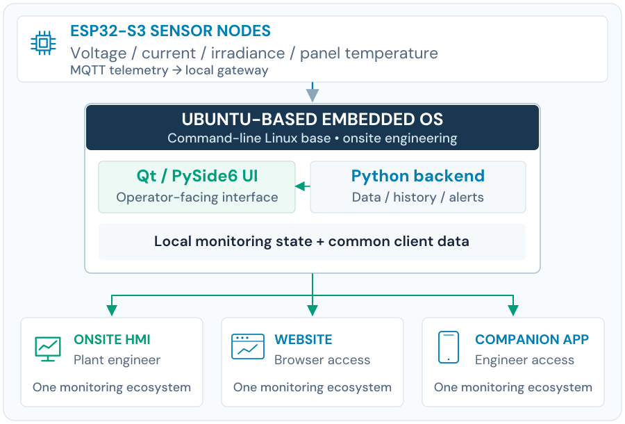](docs/assets/ecosystem_overview.svg)

*Figure — The monitoring ecosystem combines field telemetry, an Ubuntu-based onsite platform and three engineering access surfaces. This is a logical architecture illustration, not a software screenshot.*

ARKA AI connects the electrical output of a solar installation to the
conditions under which that output was produced. Voltage and current
establish what the monitored DC point is delivering; irradiance and panel
temperature help explain why the output changes. The system combines these
signals with local history and interpretable anomaly context so an engineer
can decide when inspection is warranted.

The onsite software environment uses an Ubuntu command-line Linux base, a Qt
/ PySide6 engineering interface and a Python backend. The project team
confirms that the embedded platform, website and companion app have been
built as one monitoring ecosystem. The three access surfaces are
complementary views of the same engineering context, not three separate
definitions of plant health.

This handbook documents the project architecture and supplies explicit
reference contracts, operating procedures and acceptance methods. The
inspected public repository contains documentation rather than a
released implementation tree. Consequently, exact entry points,
service-unit names, deployed versions, endpoint routes and application
build commands must come from the actual release manifest before
installation on a gateway. Reference examples below are not disguised
release artifacts.

| Engineering question | What ARKA AI contributes | What remains an engineer responsibility |
| --- | --- | --- |
| What is the monitored point producing? | Time-aligned V, I, calculated P and valid-interval energy | Confirm measurement point, calibration and safe sensing interface |
| Is output low for current conditions? | Irradiance/temperature context and expected-output comparison | Review environmental transients and physical operating conditions |
| Can monitoring continue without WAN? | Local gateway, history and onsite interface architecture | Verify actual LAN, power, storage and recovery behavior |
| Can different clients discuss one event? | Shared node, timestamp, quality and event identity | Confirm actual cross-client agreement and authorized access |
| Should equipment be inspected? | Persistent-deviation and data-fault context | Authorize inspection and record the physical finding |
| Can the system switch plant equipment? | No plant-control path in the read-only demonstrator | Retain certified protection and separate safety interlocks |

### Capability and evidence map

| Area | Documented / confirmed position | Evidence boundary |
| --- | --- | --- |
| Ubuntu-based embedded environment | Implemented software scope confirmed by the team | Exact image, architecture and release manifest not published |
| Qt / PySide6 interface | Implemented onsite engineering UI confirmed | Illustrations here are not captures from the running interface |
| Python backend | Implemented backend confirmed | Exact framework, process layout and storage release are unspecified |
| Website and companion app | Built as connected monitoring clients | No public URL, platform target or release package was supplied |
| ESP32-S3 / MQTT sensing architecture | Primary project-submission architecture | Exact firmware release and executed bench records are not supplied |
| Sensor parts, PCB allocation, enclosure | Proposed engineering design | Not routed EDA, released CAD, FEA or fabrication proof |
| Accuracy, detection and timing goals | Acceptance targets | No measured achievement is claimed |
| Technical documentation | This handbook and its linked engineering assets | Upload the complete asset folder with the Markdown file |
| Prototype video | Publication pending | No fabricated playback URL is provided |

### How to use the handbook

- Judges: read the architecture, implementation milestones,
  target/evidence matrix and prototype-video status before evaluating
  numeric claims.
- Onsite engineers: begin with the operating boundary, startup checks,
  quality states and troubleshooting decision path.
- Software maintainers: use the identity, telemetry, persistence and
  cross-client contracts as a review baseline; reconcile examples with the
  released code.
- Hardware reviewers: examine the proposed pin-referenced connection,
  separate power domains, metrology plan and enclosure assumptions.
- Future contributors: preserve the distinction between measured records,
  calculated examples, reference designs and planned tests.

> **Hard boundary:** the current hardware demonstrator is read-only, 12–24 V DC and no more than 5 A. Do not connect this sensing concept directly to live plant PV strings.

<a id="problem-users"></a>
## Problem, Users and Requirements

Solar production is conditioned by sunlight, module temperature and
electrical operating point. A lower instantaneous power value does not, by
itself, establish equipment damage. Equally, a display of acceptable voltage
does not prove that current, energy or plant availability is satisfactory. A
useful maintenance view must preserve the relationship between output,
environmental context, time and measurement quality.

The original project submission identifies delayed and fragmented
monitoring as the integration problem. ARKA AI responds with distributed
acquisition and a common local intelligence layer. It does not claim
that capable inverter monitoring or solar analytics did not already
exist. Where approved read-only inverter telemetry is available, the
project should integrate it rather than duplicate certified control
functions.

| Persona | Primary decision | Required context | Unsafe shortcut to avoid |
| --- | --- | --- | --- |
| Onsite engineer | Whether to inspect a zone | Valid output, source time, irradiance, panel temperature, active event | Diagnosing from a stale last-known value |
| Maintenance technician | Which authorized task to perform | Zone identity, event reason, safe work scope, prior actions | Treating an app notification as an electrical work permit |
| Plant operator | How to prioritize issues | Multiple zone states, quality, event age and acknowledgement | Ranking faults solely by a raw AI score |
| Asset owner | Whether monitoring evidence supports action | Traceable trends, assumptions and documented outcomes | Interpreting modeled waiting-time reduction as measured ROI |
| Software maintainer | Which boundary failed | Node sequence, broker state, backend logs and client revision | Restarting every component before preserving evidence |
| Electrical reviewer | Whether the sensing arrangement is appropriate | Ratings, topology, isolation, reference uncertainty and protection | Extending a low-voltage monitor to string voltage by assumption |

### Functional requirement baseline

| ID | Requirement | Acceptance evidence |
| --- | --- | --- |
| FR-01 | Identify the monitored site, zone and node | The same identity appears in storage, Qt, website and app |
| FR-02 | Retain V/I and environment with time and units | Exported records preserve source/receive time and unit names |
| FR-03 | Derive power from synchronized V and I | Arithmetic checks plus reference-meter comparison |
| FR-04 | Integrate energy only across valid intervals | Gap-injection procedure and explicit excluded-time inventory |
| FR-05 | Expose stale, invalid and unavailable states | Timeout and sensor-fault captures from each client |
| FR-06 | Compare output with a contextual healthy baseline | Documented model inputs, quality gates and held-out events |
| FR-07 | Record acknowledgement separately from condition state | Event audit preserves both operator action and sensor condition |
| FR-08 | Keep onsite monitoring independent of continuous WAN | Controlled WAN-off exercise with local data/history checks |
| FR-09 | Deduplicate replayed records | Unique committed node/boot/sequence keys after reconnect |
| FR-10 | Preserve engineering evidence | Versioned calibration, configuration, export and maintenance context |

### Nonfunctional requirements

| Concern | Design intent | Review method |
| --- | --- | --- |
| Safety | Read-only low-voltage demonstration; no protection replacement | Hazard review and approved test setup |
| Responsiveness | Nonblocking acquisition and clear data-age display | Qt interaction and controlled latency tests |
| Availability | Visible degradation rather than silent healthy defaults | Dependency-loss and restart exercises |
| Traceability | Raw observation distinguishable from derived metrics | Schema, event and export audits |
| Maintainability | Explicit release/configuration/calibration identity | Rebuild and rollback rehearsal |
| Access control | Viewing context does not grant shell or plant authority | Role and network-permission review |
| Scalability | Modular zones with a shared gateway architecture | Load/retention tests at a defined node count |
| Portability | Separate domain logic from a particular client display | Cross-client contract tests |

Requirements are testable statements, not a substitute for test results. An
inconclusive or not-executed result is a valid release-review outcome;
omitting it is not equivalent to a pass. Expand the scope only after the
relevant engineering gate is satisfied.

### Requirement-to-evidence traceability

| Contract | Failure it prevents | Review chapter | Minimum artifact |
| --- | --- | --- | --- |
| Stable node identity | Values assigned to the wrong physical zone | Telemetry | Node mapping and a selected-client capture |
| Boot/sequence key | Reboot or QoS replay creates duplicate identity | MQTT | Before/after boot and key inventory |
| Source/receive separation | Old backlog looks live | Data quality | Timestamp/clock fixture comparison |
| Channel-specific status | One failed sensor becomes a healthy record | Hardware sensing | Disconnected-channel evidence |
| V/I pairing policy | P uses unrelated operating points | Power and energy | Conversion-time/pairing record |
| Two-valid-endpoint integration | Outage becomes invented energy | Power and energy | Excluded intervals and partial-energy export |
| Applicable calibration | Scaling is mistaken for system accuracy | Calibration | Reference/DUT points and coefficient revision |
| Environmental gate | Clouds become equipment-fault certainty | Analytics | G/T/quality and timer timeline |
| Event/workflow separation | Acknowledgement erases a real condition | Alerts | Event/action revisions |
| Cross-client revision | Clients disagree about which event was handled | Shared workflow | Same event in Qt/web/app |
| Commit outcome | A changing display is mistaken for durable history | Local storage | Transaction and row inventory |
| Recovery manifest | A backup cannot reconstruct context | Observability | Restore and known-record checks |
| Published release identity | Commands run against an unknown build | Deployment | Artifact/runtime/configuration manifest |
| Safe scope | Bench sensor becomes an assumed plant interface | Risk register | Approved electrical review |

A test can cover several requirements, but each requirement still needs a
traceable result. Record the test identity and result artifact rather than
marking an entire chapter “verified”. When a requirement is changed,
identify the affected tests, clients and historical interpretation before
accepting the new revision.

<a id="scope"></a>
## Project Scope and Ecosystem Boundaries

The project is a monitoring, diagnostic and decision-support layer. The
sensor node measures an approved low-voltage demonstration point. The Ubuntu
gateway hosts the onsite software environment and local intelligence. The
website and app provide connected engineering access. Physical plant
protection, switching interlocks, electrical work authorization and inverter
controls remain outside this demonstrator.

| Boundary | Inside current documentation | Excluded / separately approved |
| --- | --- | --- |
| Electrical | 12–24 V DC, ≤5 A bench sensing concept | Direct utility PV string connection |
| Compute | ESP32-S3 node plus a separate Ubuntu gateway | Running Ubuntu on the ESP32 |
| Onsite OS | Ubuntu base with ARKA application stack | A newly written kernel or new general-purpose distribution |
| UI | Qt / PySide6 onsite engineering interface | Unverified claims about particular screen layouts or toolkit widgets |
| Connected clients | Team-confirmed website and companion app | Invented hosting URLs, mobile targets or app-store listings |
| Analytics | Expected-output residual and maintenance support | Guaranteed failure-date or remaining-life prediction |
| Response | Engineer notification, acknowledgement and recorded action | Autonomous plant switching |
| Evidence | Design calculations, reference contracts and proposed tests | Fabricated measurement logs or passed certifications |

### Local-first is a dependency statement

A WAN outage can remove remote connectivity while the onsite LAN, broker,
gateway and terminal continue working. A LAN outage can disconnect a node
even if the internet remains available. A gateway power failure can
interrupt all local services regardless of WAN state. These are different
failures and require different indications, recovery procedures and
evidence.

| Condition / input | Expected handling | Evidence to retain |
| --- | --- | --- |
| WAN unavailable; LAN intact | Keep onsite UI and local history useful; remote sessions indicate connection loss | Gateway/Qt capture plus remote last-confirmed time |
| Node Wi-Fi unavailable | Mark the affected node stale; buffer/replay is a target to verify | Node sequence before/after outage and source-time gap |
| Broker unavailable | Ingestion degrades explicitly; no current value is invented | Broker/worker status and recovery ordering |
| Storage unavailable | Do not claim a sample was committed; raise persistence fault | Write error, pending state and recovered row inventory |
| Gateway restarted | Restore appropriate event/history context and validate service dependencies | Release/config identity and restart/replay evidence |

### Publication and implementation are different

The project team confirms the software platform and clients as built. The
inspected repository root currently publishes a README rather than those
implementation files. That publication gap prevents this handbook from
naming actual process executables, API routes or build commands as verified.
It does not negate the team statement. Release-specific deployment details
should be attached to the repository when source and build artifacts are
published.

### Change gate for expanded plant scope

- Identify the new measurement point and its maximum operating/fault
  conditions before choosing a sensing interface.
- Obtain qualified electrical review of working voltage, transient
  category, insulation, grounding, protection and enclosure.
- Keep the monitoring data path separate from certified plant protection
  and any future control chain.
- Retest timestamp, quality and consistency contracts after adding
  inverter, SCADA, battery or fleet-level inputs.
- Publish the evidence and limitations that justify the larger scope
  rather than relabeling this low-voltage circuit.

<a id="architecture"></a>
## End-to-End System Architecture

[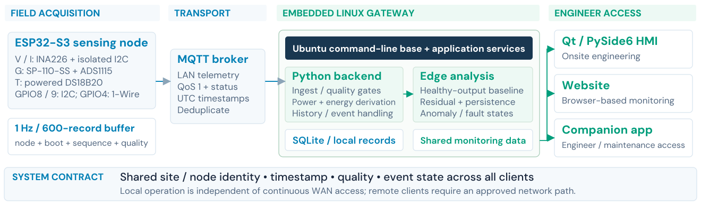](docs/assets/ecosystem_architecture.svg)

*Figure — Field acquisition, MQTT transport, the embedded Linux gateway and engineer-facing clients. Internal service boundaries are a reference decomposition; web/app protocols must be reconciled with the release.*

The architecture has four responsibilities: acquire trustworthy
observations, transport them without losing identity, turn valid
observations into traceable context, and present that context to an
engineer. Client rendering is the last step; a polished graph cannot repair
an ambiguous source timestamp, an uncalibrated input or a duplicated
record.

| Stage | Producer | Consumer | Contract |
| --- | --- | --- | --- |
| Measurement | Electrical/environmental sensor | ESP32-S3 firmware | Range, conversion status, units and calibration context |
| Record assembly | Node acquisition cycle | Node buffer/publisher | Node identity, boot identity, sequence and source-time quality |
| Transport | Node MQTT publisher | Broker/subscriber | Topic scope, envelope, delivery status and reconnect behavior |
| Validation | Gateway ingestion worker | Derived-metric/store pipeline | Schema, plausibility, identity, clock and quality decision |
| Persistence | Gateway writer | Local record store | Unique key, transaction outcome and retained raw context |
| Analysis | Qualified measurements | Event service | Expected output, residual, gate and persistence revision |
| Presentation | Common monitoring state | Qt / website / app | Value, age, quality, unit and event revision |
| Maintenance | Authorized engineer | Event/inspection record | Actor, action time, finding and verified outcome |

<details>
<summary>Expandable diagram source</summary>

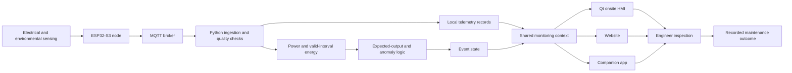

</details>

### Record ownership

The node owns observation identity; the gateway owns receive time and
ingestion decisions; derived services own metric/event revision; the
engineer owns an acknowledgement or maintenance note. None of these roles
should overwrite a different role's evidence. Replayed telemetry may arrive
now while describing an older observation; the display must not infer
freshness from arrival alone.

| Information | Authoritative basis | Must not be confused with |
| --- | --- | --- |
| Source time | Node observation plus clock-quality context | Gateway receipt time |
| Receive time | Gateway receipt clock | Physical event onset |
| Power | Defined V/I pair and formula | Inverter AC power at another measurement point |
| Energy | Integrated valid interval and gap policy | Uninterrupted output through missing samples |
| Anomaly onset | First qualifying event-condition time | Operator acknowledgement |
| Acknowledgement | Authorized human action | Condition clearance or completed repair |
| Configuration revision | Released parameter set | Ad hoc client-local threshold |
| Calibration revision | Applicable metrology record | ADC register scaling alone |

### Design decisions that require the release manifest

- Whether MQTT terminates in the same process as the backend or in a
  separate service.
- Which persistence engine/schema the built release uses; SQLite/WAL below
  is a reference design.
- How website/app clients access common data: exact protocol, routes,
  authentication and update mode.
- How Qt receives snapshots and how UI-thread ownership is enforced.
- How the operating environment launches the application and supervises
  failures.
- Which hardware platform, OS image, Python/Qt versions and dependency
  lock are deployed.

<a id="embedded-os"></a>
## Ubuntu-Based Embedded Operating Environment

[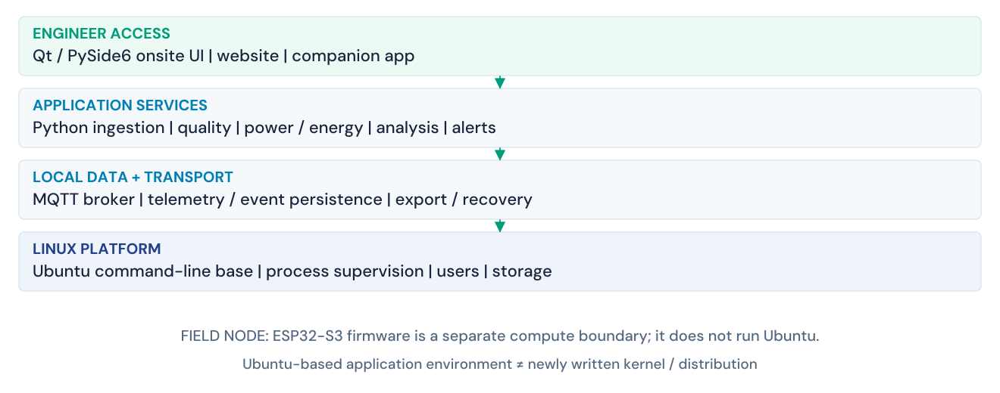](docs/assets/runtime_stack.svg)

*Figure — Logical runtime layers. The Ubuntu engineering terminal and the ESP32-S3 field node are separate compute systems.*

The embedded operating environment is based on Ubuntu command-line Linux
with the ARKA software stack above it. It provides a maintainable base for
onsite application services, operator access and administration. The project
does not claim a new kernel, an independently developed distribution, an
immutable Ubuntu Core deployment or a particular CPU architecture without
the corresponding release record.

| Layer | Responsibility | Release evidence |
| --- | --- | --- |
| Ubuntu base | Kernel/userspace, device access, accounts, storage and networking | Actual image identity and supported gateway hardware |
| Service supervision | Start/restart/shutdown ordering and dependency visibility | Reviewed units or equivalent process-launch configuration |
| Python runtime | Backend execution and dependency isolation | Interpreter version, environment and locked package manifest |
| Qt / PySide6 | Onsite interface, rendering and event-driven interaction | Actual UI package and supported display/session configuration |
| Transport | Broker/subscriber connectivity and authenticated scope | Broker version/configuration and credential source |
| Persistence | Durable records and recovery behavior | Schema/revision, backup procedure and integrity checks |
| Engineer operation | Monitoring without routine administrative privileges | Approved operating guide and least-privilege account |
| Administration | Controlled maintenance, updates and diagnostics | Named authorized role, audit and rollback path |

### Operating modes

| Mode | Expected state | Operator interpretation |
| --- | --- | --- |
| Starting | Application/dependencies not yet ready | No measurements are assumed live |
| Monitoring | Data is fresh, range-checked and contextualized | Use the qualified values and event reason |
| Degraded | A dependency, clock or data channel is impaired | Read the reason and restrict conclusions |
| Offline local | Remote connectivity absent but onsite path available | Continue approved local monitoring |
| Recovering | Dependencies return; identity and records reconcile | Watch backfill and freshness before trusting live status |
| Maintenance | Authorized change/review in progress | Preserve scope, backup and explicit handover |
| Stopped | Application intentionally unavailable | No “healthy” state should remain implied |

Do not confuse an Ubuntu shell with an operator HMI. Routine monitoring
should not require root access, package installation or editing service
files. Administrative actions must be limited to approved maintainers and
should preserve a record of the release, configuration and reason for
change. A website user should not inherit gateway-shell authority.

### Read-only platform inventory

The following Linux commands are general inventory examples, not ARKA launch
commands. Their output describes the actual gateway on which they are
executed; no output is supplied here as if it had been captured from the
team's device.

```bash
# Platform and boot context: read-only inventory.
uname -a
cat /etc/os-release
hostnamectl
uptime
# CPU / memory / storage capacity.
lscpu
free -h
df -h
lsblk -f
# Network state; redact private addresses before public publication.
ip -brief address
ip route
# Time basis and synchronization status.
timedatectl status
# Inspect failures without restarting services.
systemctl --failed
journalctl -b -p warning --no-pager
```

### Record before a change

| Record | Why it matters |
| --- | --- |
| OS release and architecture | Prevents installing a package built for a different target |
| Application source/artifact checksum | Ties behavior to a particular deployed release |
| Interpreter and dependency lock | Makes runtime differences diagnosable |
| Qt platform/session configuration | Separates display/plugin failures from backend failure |
| Broker and storage identities | Makes connectivity and migration assumptions explicit |
| Configuration/calibration revisions | Explains a threshold or numeric change without rewriting history |
| Backup and rollback point | Supports a controlled return to the previous operating state |
| Operator handover note | Prevents a maintainer's shell activity from becoming an unexplained outage |

Gateway hardware is not inferred from the node enclosure. A Raspberry Pi kit
appears in the planning BOM, but the team has not published the exact
hardware used for the built Ubuntu environment. Select installation media,
display drivers and storage accordingly only after that platform is
identified.

### Account and storage responsibility model — reference

| Resource | Proposed access owner | Access rationale |
| --- | --- | --- |
| Application code/artifact | Controlled administrator/release process | Routine operators should not alter the running artifact |
| Runtime configuration | Approved configuration maintainer | Review identity, thresholds and revision before change |
| Runtime secrets | Required service account only | Limit disclosure through shell, logs and exports |
| Telemetry/history files | Writer plus approved readers | Keep commit and read responsibilities distinct |
| Event-action audit | Authorized workflow service | Prevent client-local edits from erasing accountability |
| Calibration records | Approved metrology/release owner | Treat coefficients as controlled engineering evidence |
| Backups | Approved backup/restore role | Protect history and retain recoverability |
| Operator exports | Authorized operator/reviewer scope | Include context without exposing credentials |
| OS package updates | Approved administrator | Preserve dependency/platform compatibility |
| Qt session | Operator account under approved setup | Monitoring need not inherit root privileges |

An application directory may need to be read-only to the service while its
data directory is writable. Apply permissions to the actual release layout,
not to guessed paths. Before changing ownership to suppress an error,
determine which process should own the operation and preserve a note of the
intended permission boundary.

### What a command-line base does and does not imply

| Inference | Correct interpretation |
| --- | --- |
| “Command-line based” means no graphical interface | Incorrect: the Ubuntu base can host a Qt engineering interface |
| “Embedded” means the ESP32 runs Linux | Incorrect: the node and Ubuntu gateway are separate |
| A shell prompt establishes application health | Incorrect: readiness and sensor freshness need their own checks |
| A custom launcher establishes a new OS distribution | Incorrect: it is an application environment unless broader evidence exists |
| A gateway-kit BOM identifies the deployed board | Incorrect: actual hardware must be recorded |
| Remote monitoring needs a public shell | Incorrect: client access and administration are separate boundaries |

<a id="boot-recovery"></a>
## Boot, Application Services and Recovery

[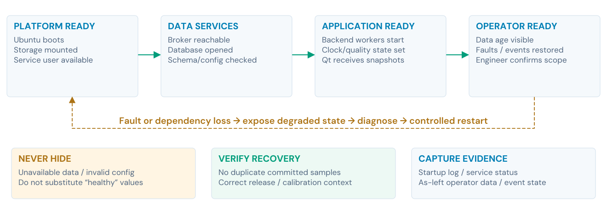](docs/assets/boot_recovery.svg)

*Figure — Reference startup and recovery dependencies. Actual service names and entry points are release-specific.*

A service reporting that it started does not prove that monitoring is ready.
Readiness requires accessible configuration, valid persistence, a usable
time basis, a functioning ingestion path and an interface able to show the
appropriate data state. Keep process liveness separate from application
readiness and sensor freshness.

| Dependency | Ready condition | Degraded indication | Recovery check |
| --- | --- | --- | --- |
| Storage mount | Expected path exists with correct owner/space | Persistence unavailable | Open/backup checks before accepting writes |
| Configuration | Version, required fields and scope accepted | Configuration invalid | Show revision after corrected load |
| Broker | Authenticated connection and intended subscription | Telemetry unavailable | Observe connection and topic scope |
| Database | Schema compatible and transactions available | Write fault / read-only fault | Confirm no duplicate committed records |
| Clock | UTC basis and uncertainty represented | Clock uncertain | Preserve source/receive distinction |
| Analysis | Model/configuration revision available | Analysis unavailable | No healthy score substituted |
| Qt session | Interface responds and shows data age | Interface unavailable | Render a current qualified snapshot |
| Remote path | Approved access and reachable endpoint | Remote disconnected | Reconcile event and freshness state |

<details>
<summary>Expandable diagram source</summary>

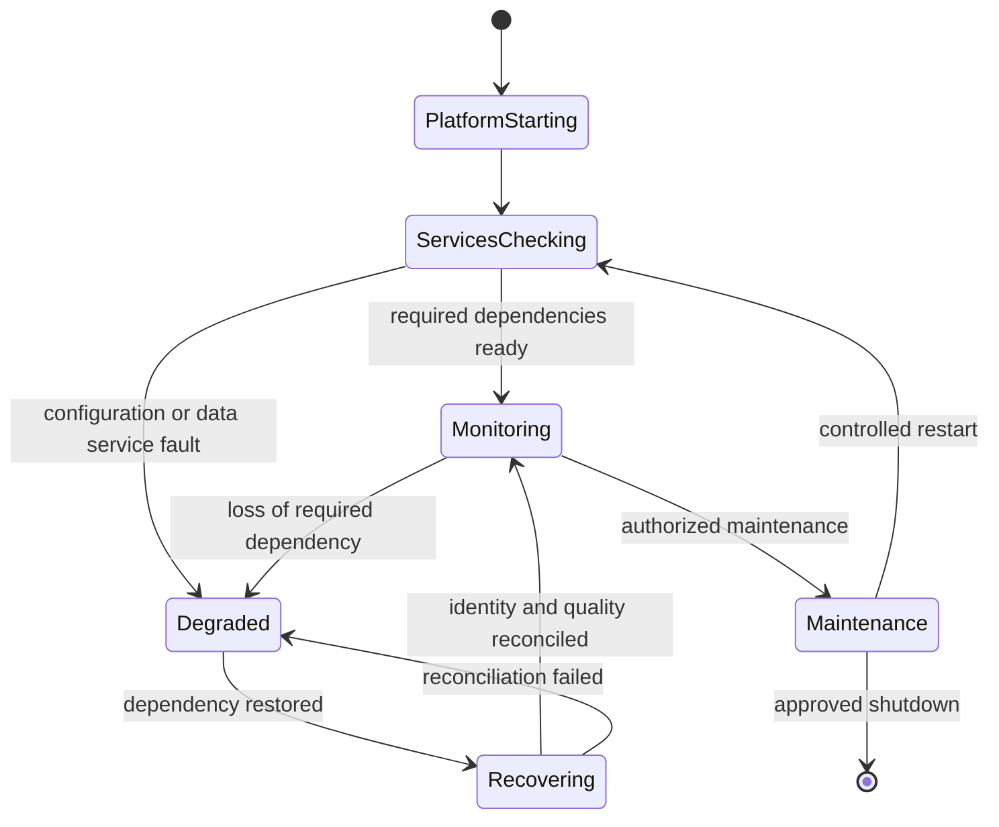

</details>

#### Reference startup acceptance

1. Identify the deployed release and the authorized operator before
   applying bench power.
2. Confirm that the regulated supplies and current limit match the
   approved low-voltage setup.
3. Inspect platform boot/service status without inventing application
   readiness from a process ID.
4. Confirm the intended configuration and calibration revisions are
   loaded.
5. Open the onsite interface and verify selected site/node identity and
   displayed time basis.
6. Check a current sequence/source-time record through acquisition,
   persistence and presentation.
7. Confirm that absent channels show unavailable or an explicit reason
   rather than zero.
8. Record any degraded dependency, startup delay and recovery action in
   the acceptance log.

### Reference service-unit shape

This is a deployment pattern, not a shipped ARKA service. Replace the
symbolic executable/account/configuration paths only from a reviewed release
manifest. The dependency list must match the actual broker/storage layout.
Do not install this example unchanged.

```ini
[Unit]
Description=Reference ARKA backend service pattern
After=network-online.target
Wants=network-online.target
# Add actual broker/mount dependencies only after review.

[Service]
Type=simple
User=RELEASE_DEFINED_NONROOT_ACCOUNT
Group=RELEASE_DEFINED_APPLICATION_GROUP
WorkingDirectory=/RELEASE_DEFINED_WORKING_DIRECTORY
EnvironmentFile=/RELEASE_DEFINED_PROTECTED_ENV_FILE
ExecStart=/RELEASE_DEFINED_ABSOLUTE_EXECUTABLE
Restart=on-failure
RestartSec=5
TimeoutStopSec=30
NoNewPrivileges=true
PrivateTmp=true
# Read/write paths and hardening must match actual devices/storage.
# Do not grant broad privileges merely to suppress a startup error.

[Install]
WantedBy=multi-user.target
```

A restart policy cannot replace fault diagnosis. Bound repeated failures so
that an invalid configuration, migration problem or unavailable disk does
not create a rapid restart loop. On recovery, verify event state and
persistence before calling the system ready. Qt may remain useful by
displaying the dependency fault even when current measurements are
unavailable.

<a id="qt-ui"></a>
## Qt / PySide6 Onsite Engineering UI

[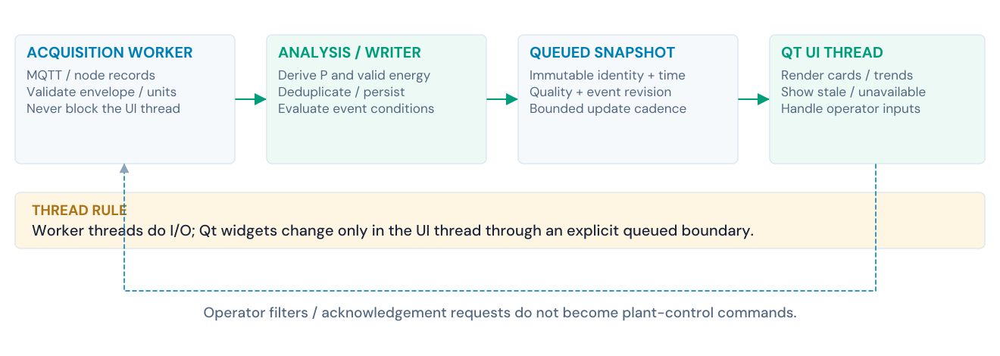](docs/assets/qt_workers.svg)

*Figure — Reference separation between I/O/analysis work and the Qt rendering thread. This is a design pattern, not an audit of unpublished source.*

The onsite interface is the engineer-facing part of the embedded
platform. Its responsibility is to make measurement identity, data age,
quality and maintenance context visible at the point of use. A changing
chart is not sufficient evidence that the selected node is connected,
that the clock is trustworthy or that values have been committed to
history.

| Interface responsibility | Essential context | Interaction expectation |
| --- | --- | --- |
| Live electrical values | V, I, P, unit, source time and quality | Changing node keeps identity unambiguous |
| Energy view | Wh/kWh, integration window and gap policy | Range selection does not imply missing energy was recovered |
| Environment | Irradiance, temperature and mounting/calibration context | Low light and rapid clouds are distinguishable from a fault |
| History | Time basis, selection window and missing intervals | Zoom/filter preserves the original records |
| Events | Condition reason, onset, alert time and workflow state | Acknowledgement is explicit and attributable |
| Health | Sensor, link, time, storage and backend status | Degraded dependencies are visible without a shell |
| Export | Node/window, units and revision manifest | Exported evidence can be interpreted after the session ends |
| Configuration | Role, current revision and change scope | Routine viewing does not grant administrator authority |

[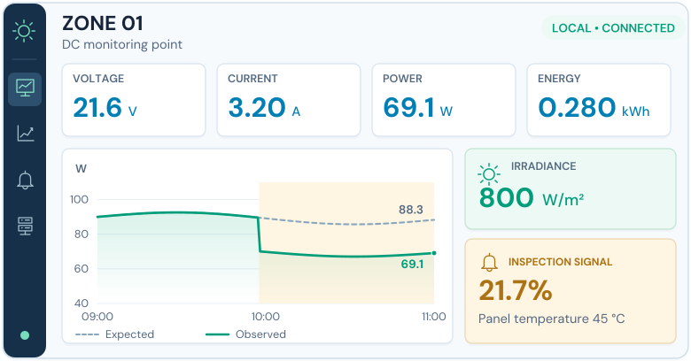](docs/assets/hmi_reference_layout.svg)

*Figure — Interface illustration using example values: 21.6 V × 3.20 A = 69.12 W; expected 88.3 W implies approximately 21.7% shortfall. This is not a running-software capture or test record.*

### UI-state acceptance

| Condition / input | Expected handling | Evidence to retain |
| --- | --- | --- |
| First launch before telemetry | Show starting / no data; do not render healthy zero | Startup capture and first accepted record identity |
| No new node data after freshness timeout | Mark stale, retain last-known value with source time | Last sequence/time and visible stale transition |
| A sensor value is invalid | Show the affected channel reason, not a plausible replacement | Raw status and channel-quality capture |
| Backend writer cannot commit | Expose persistence fault independently of link state | Backend error plus UI quality state |
| Time window contains missing data | Show gaps; do not connect an uninterrupted energy story | Trend/export with excluded interval |
| A late record is replayed | Keep historical source time and backfill status | History position versus current live card |
| An event is acknowledged | Record actor/time and preserve condition state | Event revision before/after action |
| Two clients view the same event | Use a common event identity and revision | Qt and remote captures for the same event |

### Thread and update rules

- I/O and sensor/network waits belong outside the Qt widget thread.
- Worker-to-UI communication should deliver a bounded, explicit snapshot
  through a queued boundary.
- Only the UI thread changes Qt widgets; a direct cross-thread widget
  update is not an acceptable shortcut.
- A high ingestion rate should not create an unbounded rendering queue or
  freeze operator interaction.
- Downsampling a chart must not alter the underlying stored measurement or
  hide gap flags.
- A frontend display cache must not reinterpret gateway-receipt time as a
  fresh physical observation.
- Operator acknowledgement/filter requests are not plant switching
  commands.
- Capture actual screen/build evidence when publishing the release; retain
  the illustrative status of figures here.

### Reference client snapshot

This proposed snapshot shape illustrates how one client update can carry
identity, quality and meaning together. It is an interface-review fixture,
not the built product's unpublished payload or a screen capture. The
fixture never changes its source timestamp merely because a client renders
it again.

```json
{
  "snapshot_basis": "documentation fixture",
  "client_contract_revision": "REFERENCE-ONLY",
  "snapshot_revision": 10,
  "record_identity": {
    "site_id": "bench-site",
    "zone_id": "zone-a",
    "node_id": "bench-node-01",
    "boot_id": "documentation-boot-01",
    "seq": 100
  },
  "time": {
    "source_utc": "2026-01-01T00:00:00Z",
    "receive_utc": "2026-01-01T00:00:00.400Z",
    "snapshot_utc": "2026-01-01T00:00:00.600Z",
    "clock_status": "synced",
    "source_age_s": 0.6
  },
  "channels": {
    "voltage": {
      "value": 21.6,
      "unit": "V",
      "quality": "valid"
    },
    "current": {
      "value": 3.2,
      "unit": "A",
      "quality": "valid"
    },
    "irradiance": {
      "value": 800.0,
      "unit": "W/m2",
      "quality": "valid"
    },
    "panel_temperature": {
      "value": 45.0,
      "unit": "degC",
      "quality": "valid"
    }
  },
  "derived": {
    "power_w": 69.12,
    "expected_power_w": 88.3,
    "shortfall_fraction": 0.217214043,
    "analysis_gate": "qualified_reference_fixture",
    "analysis_policy_revision": "REFERENCE-ONLY"
  },
  "health": {
    "source_state": "fresh",
    "transport_state": "connected_reference_fixture",
    "persistence_state": "committed_reference_fixture"
  },
  "event": {
    "event_id": null,
    "revision": null,
    "condition_state": "no_event_in_this_snapshot",
    "workflow_state": null
  }
}
```

### Visual interpretation rules

| UI element | Engineering rule |
| --- | --- |
| Value card | Unit and channel status remain adjacent to the number |
| Last-known card | Retain source time and a visible stale/offline meaning |
| Trend axis | State time basis, units and range; do not hide missing intervals |
| Energy total | Name the time window and show partial coverage when needed |
| Event badge | Distinguish active condition, acknowledged workflow and data fault |
| Node selector | The selected identity must match every displayed panel |
| Color | Never be the only carrier of fault/quality meaning |
| Rounding | Display precision must not imply accuracy beyond calibration |
| Model result | Show the applicable baseline/policy and gate reason |
| Busy state | Do not freeze interaction while waiting for I/O |
| Export action | Preserve window/identity rather than exporting only a screenshot |
| Error dialog | Name the failed boundary without exposing credentials |

<a id="python-backend"></a>
## Python Backend

The Python backend is part of the team-confirmed onsite software platform.
Its documented role is to connect acquisition to analysis, history, alerts
and common client context. The exact framework, modules, deployment
processes and release entry points have not been published. The
decomposition below is a reference responsibility map rather than a claim
that particular source files exist.

| Responsibility | Input | Output | Failure boundary |
| --- | --- | --- | --- |
| Envelope parser | Broker payload and topic | Typed identity/units/time record | Malformed or unsupported schema |
| Quality evaluator | Sensor status, ranges and clock context | Per-channel and record-quality decision | Invalid or uncertain observation |
| Idempotent writer | Validated record plus source identity | Committed row or explicit duplicate outcome | Storage/transaction failure |
| Derived metrics | Matched V/I and valid elapsed interval | Power and qualified energy contribution | Unmatched samples or missing time |
| Baseline/residual | Valid output and G/T context | Expected output and normalized shortfall | Missing model or unsuitable environment |
| Event engine | Residual, gate and persistence state | Versioned condition/alert event | Invalid data or inconsistent event state |
| Client adapter | Shared telemetry/event snapshots | Qt/web/app representation | Stale cache, identity or authorization issue |
| Export/audit | Requested window and permissions | Traceable file plus manifest | Incomplete window or missing revision context |

### Reference ingest transaction

```text
receive topic and payload
check topic scope and schema version
parse without coercing unknown units to known units
attach gateway receive time
validate identity, source-time status and channel status
form the immutable node/boot/sequence key
begin persistence transaction
    attempt idempotent insert
    if the key already exists:
        compare envelope identity; record duplicate outcome
    else:
        preserve raw values and quality decision
commit or report persistence failure
update derived/event state only according to the chosen replay policy
publish a client snapshot with sample identity and quality
never treat broker receipt as proof of committed history
```

### Compute and evidence separation

A raw record, a corrected engineering value, an energy contribution and an
alert are different records of reasoning. Preserve the coefficients or
policy revision that produced a derived value. An operator note may annotate
a record but should not silently rewrite the raw observation. Reprocessing a
historical window must produce a clearly versioned analysis result, not an
unexplained change to earlier evidence.

| Case | Backend decision | Client-visible consequence |
| --- | --- | --- |
| Unknown calibration revision | Retain/quarantine with explicit reason | Do not claim calibrated accuracy |
| Duplicate QoS 1 delivery | Idempotent commit outcome | No duplicate energy increment |
| Late valid record | Store by source identity/time; label backfill | History may update without claiming a new live observation |
| Clock step backward | Preserve receipt and clock uncertainty | Do not integrate a negative elapsed interval |
| Storage full | Expose write fault and apply bounded recovery policy | Live visibility does not imply durable retention |
| Model absent | Keep measurements available; analysis unavailable | No healthy anomaly score invented |
| Configuration changes | Start a new effective revision | Event interpretation retains the appropriate prior policy |
| Client disconnects | Keep backend contract independent of a viewer | Remote absence does not erase local events |

### Reference observability fields

| Signal | Unit / category | Reason |
| --- | --- | --- |
| ingest_record_count | count per outcome | Separates accepted, duplicate, rejected and quarantined records |
| last_source_time | UTC with uncertainty | Identifies the observation horizon |
| last_receive_time | UTC | Identifies the ingestion horizon |
| writer_queue_depth | records | Reveals backpressure |
| write_failure_count | count | Shows durable-storage failure separately from link success |
| analysis_policy_revision | identifier | Makes result interpretation reproducible |
| active_event_revision | identifier | Allows cross-client consistency checks |
| clock_status | qualified state | Prevents transport-age mistakes |
| process_uptime | monotonic elapsed time | Separates current process health from historical data availability |

### Reference semantic-envelope checks

The helper below supplements structural schema validation. It demonstrates
a few necessary semantic checks but is not a complete security,
plausibility, calibration or timestamp validator. Production ingestion
must use the actual released contract and a reviewed reject/quarantine
policy.

```python
# Reference checks AFTER strict JSON and JSON Schema validation.
# topic_site/topic_node must come from an already validated topic parser.
def semantic_reasons(payload, topic_site, topic_node, known_calibrations):
    reasons = []
    source = payload["source"]
    time = payload["time"]
    measurements = payload["measurements"]
    status = payload["quality"]["channel_status"]
    if source["site_id"] != topic_site:
        reasons.append("topic_site_mismatch")
    if source["node_id"] != topic_node:
        reasons.append("topic_node_mismatch")
    if time["clock_status"] == "synced" and time["source_utc"] is None:
        reasons.append("synced_without_source_utc")
    value_keys = {
        "voltage": "voltage_v",
        "current": "current_a",
        "irradiance": "irradiance_w_m2",
        "panel_temperature": "panel_temperature_c",
    }
    for channel, value_key in value_keys.items():
        value = measurements[value_key]
        if value is None and status[channel] == "valid":
            reasons.append(f"null_valid_{channel}")
        if status[channel] == "missing" and value is not None:
            reasons.append(f"missing_with_value_{channel}")
    if payload["calibration_id"] not in known_calibrations:
        reasons.append("unknown_calibration")
    current = measurements["current_a"]
    if current is not None and current < 0:
        reasons.append("reverse_current_outside_unidirectional_bench_scope")
    return reasons

# Additional release policy still needs:
# - authenticated site/node scope;
# - UTC parsing, uncertainty, age and future-time handling;
# - per-channel conversion age and V/I alignment;
# - instrument/calibration applicability;
# - duplicate-body collision detection;
# - storage and resource limits;
# - reject/quarantine audit without sensitive payload leakage.
```

### Ingestion outcome contract

| Outcome | Record effect | Derived/event effect |
| --- | --- | --- |
| Accepted new | One immutable committed observation | Eligible only under applicable quality/time/replay policy |
| Duplicate same body | No second observation | No second energy or event side effect |
| Key/body conflict | Preserve identity fault evidence | No silent replacement of accepted history |
| Structural reject | No trusted telemetry record | No derived metrics from guessed fields |
| Semantic quarantine | Retain reason/context under approved policy | No calibrated/live interpretation until resolved |
| Commit failure | Known uncommitted/pending outcome | Do not claim durable history |
| Analysis gated | Raw qualified data can still be retained | Explicit unavailable/gated analysis, not healthy score |

<a id="website"></a>
## Website

[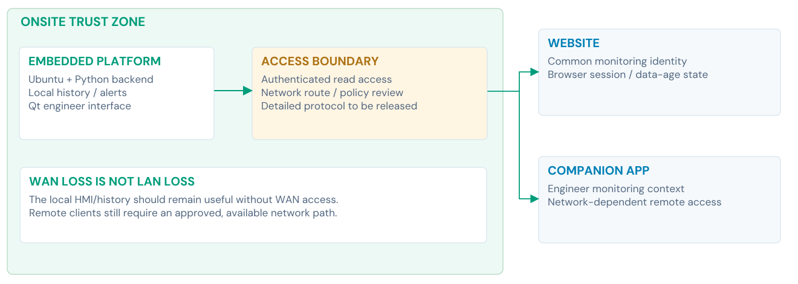](docs/assets/client_access.svg)

*Figure — Logical onsite/remote access boundaries. The website is part of the confirmed ecosystem; exact hosting, protocol and authorization configuration require release evidence.*

The website provides browser-based access to monitoring context. It should
communicate the same engineering identity, time basis, quality and event
state as the onsite platform. A remote user should be able to distinguish a
network problem from an affected sensor node or a stale cached observation.
No public website URL or frontend/backend framework was supplied, so neither
is invented here.

| Browser view concern | Contract to preserve | Review exercise |
| --- | --- | --- |
| Site/node selection | Selection matches the record being rendered | Switch between nodes with visibly different identities |
| Data age | Source time and connection state remain distinct | Disconnect remote access while keeping the local gateway alive |
| Units | V/A/W/Wh/W/m²/°C are consistent | Compare a known reference fixture against Qt |
| History | Window, timezone and gap policy are visible | Open a range containing a controlled outage |
| Events | Same event ID/revision and condition meaning | Compare acknowledgement in onsite and remote views |
| Authorization | A session sees only its approved scope | Review access using approved least-privilege test accounts |
| Exports | Filters and revision context travel with the file | Reopen an exported window independently |
| Recovery | A reconnect does not silently relabel old data live | Observe source time before/after connectivity returns |

### Publication checklist

- [ ] Publish the real website URL only after its identity, ownership and
  intended access scope are confirmed.
- [ ] State whether the site is LAN-only, remotely reachable through
  managed access, or hosted elsewhere; do not infer it from a
  screenshot.
- [ ] Record the client release and compatible backend contract
  version.
- [ ] Document session expiry, logout and reconnection behavior without
  exposing secrets or internal administration.
- [ ] Provide real interface captures with build/time context; do not use
  the reference HMI illustration as proof of the website UI.
- [ ] Keep remote monitoring distinct from a plant-control interface and
  from administrative gateway access.

The operational guide for a browser user begins with confirming identity and
freshness, not with trusting a green connection icon. If the browser cannot
reach the approved data path, last-known information must carry its source
time and disconnection state. A remote failure should not require disabling
protection or granting a public shell on the gateway.

### Browser-visible failure contract — reference

| Failure category | Display meaning | Safe user option |
| --- | --- | --- |
| Session expired | Access must be renewed | Use approved sign-in without exposing secrets |
| Scope denied | The requested site/action is not authorized | Return to permitted scope or contact owner |
| Connection unavailable | Current remote context cannot be obtained | Read labeled last-known context if policy permits |
| Contract incompatible | Client/backend do not agree on the representation | Use a compatible published release |
| Node stale | The source observation is not current | Inspect source/link context, not browser refresh alone |
| Sensor invalid | A channel cannot support interpretation | Read the reason and restrict calculations |
| Storage degraded | Visible context may not be durable | Notify maintainer and retain evidence |
| Analysis unavailable | No current qualified performance conclusion | Continue qualified raw monitoring |
| Event revision conflict | The reviewed event changed before the action | Refresh/review and retry only as authorized |
| Export incomplete | Requested window cannot be fully represented | Download with explicit coverage or refine scope |

A browser refresh is not a repair method for a sensor or writer fault. A
page may reconnect successfully while its newest source observation is still
stale. The UI should expose these states separately so the engineer can
report the correct failure boundary rather than repeatedly reopening the
site.

<a id="companion-app"></a>
## Companion App

The companion app is a team-confirmed part of the monitoring ecosystem. It
extends access to engineering context; it is not evidence of a particular
mobile operating system, notification provider, packaging format or
app-store release. Those details must be published from the actual app build
rather than inferred from the word “app”.

| App concern | Required behavior | Release detail to supply |
| --- | --- | --- |
| Identity | Show the selected site, zone and node | Approved navigation and account scope |
| Freshness | Distinguish source age from phone/network connection | Refresh policy and data-age computation |
| Quality | Carry invalid/stale/environmental-gate meaning | Supported state mapping and accessible indicators |
| Events | Preserve event ID, condition and revision | Acknowledgement capability and authorization rules |
| Connectivity | Show disconnection without inventing live values | Actual caching and reconnect policy |
| History | Preserve time window, timezone and gaps | Supported trend/history scope |
| Security | Protect session material and minimize local retention | Actual storage, session-expiry and logout behavior |
| Distribution | Identify the real build and supported platform | Signed artifact or approved installation instructions |

### Mobile interpretation checks

| Condition / input | Expected handling | Evidence to retain |
| --- | --- | --- |
| The app reconnects after a long outage | First distinguish historical backfill from a current observation | Source time, receive time and displayed freshness |
| A user acknowledges an event | Apply only the released authorization/workflow contract | Actor, event identity, action time and next revision |
| The phone changes timezone | Preserve UTC identity; relabel display time clearly | Same source record in both timezone views |
| An app process is suspended | Do not imply continuous receipt from a foreground-only session | App lifecycle and last-confirmed update indication |
| A cached screen opens without access | Mark it offline/last known and show its time | Cache state and exact stored observation time |
| Another client changes event workflow | Reconcile event revision rather than overwriting blindly | Conflict/revision outcome |

An engineer should not need to guess whether a red indicator means a plant
condition, a sensor issue, a stale cache or an expired session. The app must
name the category and preserve the route back to the underlying event or
observation. If push notifications are part of a later published release,
they must carry identity and source/event time; this handbook does not claim
that push has already been implemented.

### App publication record

| Field | Value to obtain from the team |
| --- | --- |
| Platform target | Actual supported OS/device families |
| Build identifier | App release/version and backend compatibility |
| Install artifact | Approved signed build or distribution link |
| Access method | Actual approved connection and authentication path |
| Offline behavior | What is cached, for how long and with which quality indication |
| Local data policy | Retention, logout clearing and export scope |
| Event capability | View-only, acknowledgement or additional approved workflow |
| Support route | Owner and reproducible issue-report procedure |

### Mobile offline/cache review

| Cache field | Purpose | Must remain true after reconnect |
| --- | --- | --- |
| Record identity | Know which observation was retained | Does not become a new source record |
| Source UTC and clock status | Interpret age honestly | Does not reset to phone receipt/redraw time |
| Node/site mapping | Avoid stale selection ambiguity | Still matches the current authorized scope |
| Channel units and quality | Avoid a naked cached number | Invalid/missing meaning remains visible |
| Event ID/revision | Avoid actions against unknown state | Reconcile before a new workflow action |
| Cache creation/expiry | Apply actual retention policy | Does not override source age |
| Client contract revision | Interpret stored fields | Migrate/reject incompatible cache explicitly |
| Session/access state | Prevent unauthorized reuse | Revalidate according to actual released policy |

### Accessibility and compact-screen criteria

- Keep node identity, quality and source age visible before secondary
  chart detail.
- Use text or shape alongside color for active/stale/invalid states.
- Show units without relying on a tooltip that a touch-only user cannot
  access.
- Preserve usable touch targets and avoid accidental acknowledgement.
- Make confirmation/context clear for any authorized event action.
- Do not reduce long event reasons to an unexplained red icon.
- Avoid changing a time window or node selection silently when
  rotating/resuming.
- State the display timezone and retain UTC in exports or detailed
  evidence.

<a id="shared-workflow"></a>
## Shared Monitoring Workflow

[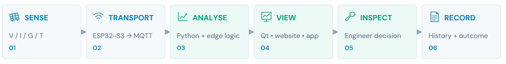](docs/assets/ecosystem_workflow.svg)

*Figure — Observation → validation → context → engineer inspection → recorded outcome. A diagnostic event informs human action; it does not authorize switching.*

#### One observation, several clients

1. A sensor node acquires the approved channels and records
   conversion/clock status.
2. Firmware packages the observation with stable node identity, boot
   identity and sequence.
3. The message crosses the transport boundary; delivery can be retried or
   replayed.
4. The gateway validates schema, units, ranges, time and identity before
   accepting the record.
5. Persistence records the transaction outcome without counting duplicate
   delivery twice.
6. Qualified V/I produce power, while valid neighboring observations
   determine energy increments.
7. Analysis evaluates expected output only when the environmental and
   data-quality gates allow it.
8. The event engine separates observation condition, persistence,
   notification and human workflow.
9. Qt, website and app present compatible identity, units, freshness and
   event revision.
10. The engineer inspects within an approved work scope and records the
    physical finding.
11. Post-action monitoring establishes whether the condition actually
    cleared.
12. The outcome becomes future review context, not a retroactive rewrite
    of raw measurements.

### Cross-client consistency fixture

The following values are arithmetic/UI fixtures, not recorded plant
data. A release review can inject an equivalent controlled fixture
through an approved test interface and compare what each client renders.
Do not insert it into operational history as if it were a real
observation.

| Field | Illustrative fixture | Consistency rule |
| --- | --- | --- |
| Node | bench-node-01 | Exactly the same selected identity |
| Voltage | 21.6 V | No implicit kV or different measurement point |
| Current | 3.20 A | Precision and unit explained |
| Calculated power | 69.12 W | 21.6 × 3.20 on every surface |
| Expected power | 88.3 W | Same model/configuration revision |
| Shortfall | 21.72% before display rounding | (88.3 − 69.12) / 88.3 |
| Irradiance | 800 W/m² | Radiometric context, not lux |
| Panel temperature | 45 °C | Sensor/mounting context retained |
| Illustrative accumulated energy | 0.280 kWh | Same integration window and exclusions |
| Quality | Valid fixture | Same freshness and validity semantics |
| Event | Reference persistent shortfall event | Same ID, onset and revision |

### Read versus action permissions

| Operation | Monitoring permission | Additional gate |
| --- | --- | --- |
| View recent telemetry | Approved read scope | Correct site/node authorization |
| Read history | Approved retention/window scope | Export/privacy policy |
| Acknowledge an event | Explicit workflow permission | Actor/time/event revision |
| Record an inspection finding | Authorized maintenance workflow | Traceable note and physical outcome |
| Change threshold or calibration | Not a routine view operation | Controlled configuration change |
| Restart services or alter OS | Not a browser/app monitoring right | Approved administrator procedure |
| Switch PV equipment | Outside the demonstrator | Separate certified control and work authorization |

A client is consistent when it preserves engineering meaning, not when every
pixel is identical. Rounding, chart aggregation and screen density may
differ, but raw identity, quality, unit, event state and effective
configuration cannot silently diverge.

<a id="hardware-sensing"></a>
## Hardware Sensing Plan

The primary submission uses an ESP32-S3 sensing node for voltage, current,
irradiance, temperature and relevant environmental/inverter context. The
part-level design here is a proposed low-voltage reference implementation.
It is not a claim of fabricated PCB, measured calibration or certified plant
installation.

| Channel | Proposed element | Engineering quantity | Important boundary |
| --- | --- | --- | --- |
| Voltage/current | INA226 plus 10 milliohm Kelvin shunt | DC bus V; shunt-derived A | INA226 bus rating is 36 V, not a PV string interface |
| Irradiance | SP-110-SS pyranometer plus ADS1115 | W/m² from calibration sensitivity | A lux sensor is not an equivalent substitute |
| Panel temperature | Powered three-wire DS18B20 | °C at a documented mounting point | Air temperature is not automatically module temperature |
| Controller | ESP32-S3 DevKitC-1 reference | Acquisition, identity and transport | Separate from the Ubuntu engineering gateway |
| Optional node battery | Appropriately scaled voltage channel | Node supply/battery diagnostic | Not plant battery SOC or pack protection |
| Inverter/environment data | Approved read-only interface if available | Relevant operating context | Vendor mapping and electrical interface must be reviewed |

### Proposed operating envelope

| Parameter | Reference / target | What is not claimed |
| --- | --- | --- |
| Bench DC input | 12–24 V nominal | Permission to connect at a plant string voltage |
| Bench current | 0–5 A; targets evaluated above 0.5 A | Verified operation under fault or reverse-current conditions |
| Maximum planned load point | 24 V × 5 A = 120 W | A load rating certified by this document |
| Irradiance analysis range | 0–1500 W/m² target | Accuracy through every spectral/angular condition |
| Temperature characterization | −10 to 85 °C target window | Enclosure operation throughout the sensor's absolute range |
| Acquisition cadence | 1 Hz reference target | Measured end-to-end timing |
| Voltage/current error | ≤1% target above 0.5 A, after calibration | The INA226 IC accuracy as total assembly accuracy |
| Power error | ≤2% target after calibration | A completed system-accuracy test |

### Acquisition coherence

Power is meaningful when V and I describe the same operating state. Record
conversion timing and the maximum acceptable pairing interval. Slow
temperature conversion must not block the complete node loop; temperature
may have its own acquisition timestamp/age. If a channel is missing, mark
that channel missing rather than using a previous reading without age
context.

| Failure source | Observable symptom | Design response |
| --- | --- | --- |
| Loose Kelvin lead | Current offset/noise not explained by load | Separate sense and load paths; inspect polarity and contact |
| Wrong ADC gain | Irradiance clipping or scale error | Record gain/range in calibration context |
| Temperature sensor CRC failure | Untrustworthy digital conversion | Flag invalid and retain diagnostic status |
| Sensor shade/soiling | Low irradiance reference independent of plant condition | Inspect reference mounting and maintenance |
| I²C pull-up/rise-time issue | Timeouts or intermittent conversion reads | Check both isolated bus domains and compatible low levels |
| Supply dropout | Node reboot or changing measurements | Review regulation, startup/current demand and boot identity |
| Clock not synchronized | Unknown absolute source time | Retain monotonic uptime and explicit clock status |

### Evidence required before assembly release

- [ ] Pin-accurate schematic, net names, connector polarity and component
  orderable suffixes.
- [ ] Actual board layout, creepage/clearance review and power-domain
  isolation inspection.
- [ ] Bench setup diagram with current-limited source, rated load,
  reference meter and safe disconnect.
- [ ] Calibration record covering coefficients, reference uncertainty,
  date, temperature and applicable channel range.
- [ ] Firmware/configuration revisions used for every acceptance run.
- [ ] Photographs of the actual assembly and wiring, clearly separate from
  drawings or CAD renders.

<a id="electrical"></a>
## Electrical Connections and Register Calculations

[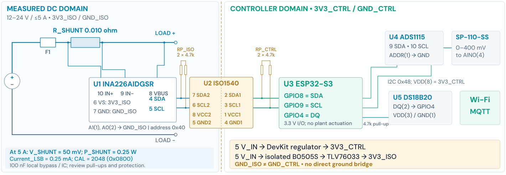](docs/assets/electrical_connections.svg)

*Figure — Proposed pin-referenced sensing connection for the low-voltage bench. It is a documentation schematic, not a routed EDA design or permission for plant wiring.*

### Signal and address allocation

| Signal | Proposed connection | Review note |
| --- | --- | --- |
| I²C SDA | ESP32-S3 GPIO8 | Verify exact DevKit variant and board multiplexing |
| I²C SCL | ESP32-S3 GPIO9 | Pull-up/rise-time review on each isolated side |
| INA226 | Address 0x40 | A0/A1 low to the measured-domain ground |
| ADS1115 | Address 0x48 | ADDR low to controller-domain ground |
| Pyranometer | SP-110-SS output to ADS1115 AIN0 | Use sensor calibration and correct return connection |
| Temperature data | DS18B20 DQ to GPIO4 | Powered three-wire mode, proposed 4.7 kohm pull-up |
| INA ALERT | Optional; not routed in this concept | Do not imply a wired interrupt that is not shown |
| ESP32-S3 GPIO35–37 | Avoid in proposed N8R8 reference | May be reserved by module PSRAM variant |

### INA226DGS pin reference

| Pin | Name | Proposed connection |
| --- | --- | --- |
| 1 | A1 | GND_ISO; selects reference address |
| 2 | A0 | GND_ISO; selects reference address |
| 3 | ALERT | Optional diagnostic output; not routed here |
| 4 | SDA | Isolated I²C measured side |
| 5 | SCL | Isolated I²C measured side |
| 6 | VS | 3V3_ISO with local decoupling |
| 7 | GND | GND_ISO |
| 8 | VBUS | Monitored bus voltage sense |
| 9 | IN− | Kelvin shunt low-side sense |
| 10 | IN+ | Kelvin shunt high-side sense |

### ISO1540 pin reference

| Pin | Name | Proposed connection |
| --- | --- | --- |
| 1 | VCC1 | 3V3_CTRL |
| 2 | SDA1 | Controller-side SDA |
| 3 | SCL1 | Controller-side SCL |
| 4 | GND1 | GND_CTRL |
| 5 | GND2 | GND_ISO |
| 6 | SCL2 | Measured-side SCL |
| 7 | SDA2 | Measured-side SDA |
| 8 | VCC2 | 3V3_ISO |

ISO1540 side 1 has an offset-low behavior that must be checked against the
controller and connected device low-level thresholds. Add the
manufacturer-recommended local bypass capacitors and verify pull-ups and bus
capacitance on each side. Component-level isolation data does not establish
the safe working voltage of the complete assembly.

### ADS1115DGS pin reference

| Pin | Name | Proposed connection |
| --- | --- | --- |
| 1 | ADDR | GND_CTRL for 0x48 |
| 2 | ALERT/RDY | Optional conversion-ready; not required by this concept |
| 3 | GND | GND_CTRL |
| 4 | AIN0 | Pyranometer positive output |
| 5 | AIN1 | Unused input handled according to reviewed configuration |
| 6 | AIN2 | Unused input handled according to reviewed configuration |
| 7 | AIN3 | Unused input handled according to reviewed configuration |
| 8 | VDD | 3V3_CTRL with local bypass |
| 9 | SDA | Controller-side SDA |
| 10 | SCL | Controller-side SCL |

### Shunt and INA226 register arithmetic

```text
R_shunt = 10 milliohm = 0.010 ohm
I_max = 5 A
V_shunt_max = I_max × R_shunt
            = 5 × 0.010 = 0.050 V = 50 mV
P_shunt_max = I_max² × R_shunt
            = 25 × 0.010 = 0.25 W
Proposed shunt nominal rating = at least 1 W
Nominal dissipation / rating = 0.25 / 1 = 25%

INA226 shunt register LSB = 2.5 microvolt
Selected current_LSB = 0.00025 A per count
CAL = 0.00512 / (current_LSB × R_shunt)
    = 0.00512 / (0.00025 × 0.010)
    = 2048 decimal = 0x0800
Power register LSB = 25 × current_LSB
                   = 0.00625 W per count
At 5 A, nominal current count = 20000
At 50 mV, nominal shunt count = 20000
```

[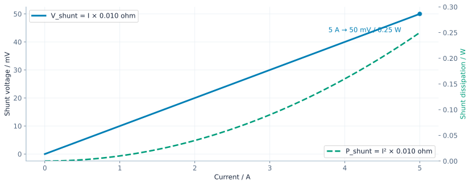](docs/assets/shunt_transfer.svg)

*Figure — Calculated 10 milliohm shunt voltage and dissipation from 0 to 5 A. No measured shunt temperatures or current-error results are shown.*

The register calibration value establishes numeric scaling; it is not
physical calibration of the assembled current path. Real uncertainty
includes shunt tolerance and temperature coefficient, Kelvin routing,
ADC/gain offset, reference instrumentation and operating conditions. Check
signed-register handling, conversion-ready behavior, saturation and the
actual configured averaging/conversion time.

### Electrical review checklist

- [ ] Verify package orientation against the actual manufacturer drawing;
  do not wire from a top/bottom view assumption.
- [ ] Separate load-current conductors from Kelvin sense conductors at the
  shunt terminals.
- [ ] Protect the source/load path using the approved bench arrangement; a
  monitoring IC is not a fuse.
- [ ] Check bus voltage against IC maximum conditions and the smaller
  approved demonstration envelope.
- [ ] Inspect isolated return nets and all temporary USB, debugger and
  oscilloscope connections.
- [ ] Do not connect a grounded probe across an intended isolation barrier
  without an approved measurement arrangement.
- [ ] Confirm unused inputs, test points and exposed conductors are
  handled before energizing.

### Register conversion review points

| Quantity | Reference conversion | Review concern |
| --- | --- | --- |
| INA226 shunt voltage | signed raw × 2.5 microvolt | Sign extension and ±81.92 mV range |
| INA226 bus voltage | raw × 1.25 mV | 36 V IC limit does not enlarge bench scope |
| INA226 current | signed raw × configured current LSB | Actual CAL and shunt value must match |
| INA226 power | raw × 25 × configured current LSB | Do not confuse LSB scaling with system calibration |
| ADS1115 input | signed raw × selected PGA LSB | Actual gain, mux, common-mode and completion state |
| DS18B20 temperature | decode actual resolution and valid conversion | CRC, conversion age and mounting still apply |

At the reference ±0.512 V ADS1115 setting, a 160 mV nominal irradiance
signal corresponds to 10,240 counts before correction. At 21.6 V, the INA226
nominal bus register is 17,280 counts. These are arithmetic check points,
not acquired register dumps. Do not publish them as logs from the actual
prototype.

<a id="power-domains"></a>
## Power Domains and Sensor Conversion Chains

[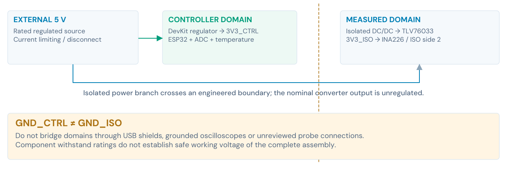](docs/assets/power_domains.svg)

*Figure — External 5 V powers the controller branch and a separately regulated isolated branch. GND_CTRL and GND_ISO must not be bridged by unintended wiring.*

The proposed external source is regulated 5 V. One branch supplies the
DevKit controller-side regulator and controller-domain sensors. A second
branch uses a B0505S-1WR3 isolated 5 V/5 V converter followed by a TLV76033
regulator for the isolated 3.3 V measurement domain. The B0505S output is
unregulated; it is not treated as a precision 5 V rail.

| Domain / element | Reference value | Required review |
| --- | --- | --- |
| External source | Regulated 5 V | Peak current, protection, current limit and safe disconnect |
| Controller rail | 3V3_CTRL from reviewed DevKit path | Actual board regulator, Wi-Fi transient current and GPIO limits |
| Isolated converter | B0505S-1WR3, nominal 1 W | Load range, regulation, startup, ripple and thermal behavior |
| Isolated LDO | TLV76033, 3.3 V, 100 mA rating | Input headroom, dropout, stability and heat |
| INA226 domain | 3V3_ISO / GND_ISO | Bypass and safe sensing common-mode conditions |
| ISO1540 sides | Separate VCC/GND pairs | No accidental return bridge |
| ADS1115/DS18B20 | Controller-side supply and return | Input range and routing |
| External instrumentation | May be earth-referenced | USB/debug/probe paths must be reviewed |

```text
Reference LDO heat estimate:
    P_LDO ≈ (V_in − V_out) × I_out
For an illustrative 5.0 V input and 30 mA load:
    P_LDO ≈ (5.0 − 3.3) × 0.030 = 0.051 W
This is not a measured isolated-domain load.
Use worst-case converter voltage and actual current for release.
Check LDO dropout and minimum headroom at the low-input condition.
Check device temperature and startup under the real enclosure load.
```

### Pyranometer conversion

[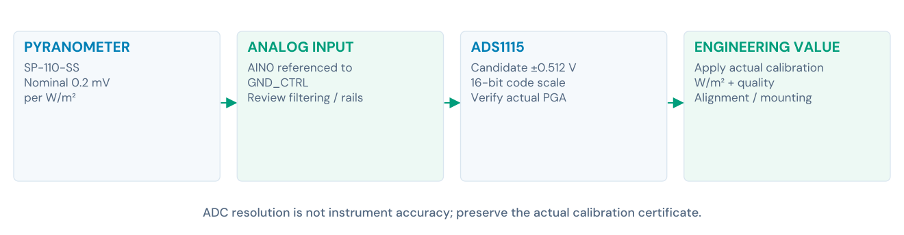](docs/assets/irradiance_chain.svg)

*Figure — Radiometric sensor → ADC conversion → calibrated W/m² with range, quality and mounting context.*

The SP-110-SS is a passive pyranometer, not a general ambient-light sensor.
Its nominal sensitivity is 0.2 mV per W/m², equivalent to 5 W/m² per mV; use
the actual sensor calibration coefficient when supplied. Its published
output range reaches about 400 mV. Orientation, cleanliness,
horizon/shading, cosine response and spectral conditions affect the meaning
of a site measurement.

```text
Nominal irradiance conversion:
    G_W_m2 = sensor_output_mV / 0.2
Example arithmetic:
    800 W/m² → 160 mV
    1000 W/m² → 200 mV
    1500 W/m² → 300 mV
Reference ADS1115 PGA choice:
    full_scale = ±0.512 V
    voltage_LSB = 0.512 / 32768 V = 15.625 microvolt
    nominal irradiance_LSB = 0.015625 mV / 0.2
                           = 0.078125 W/m²
The numeric LSB is not system irradiance accuracy.
Input common-mode and absolute pin limits still apply.
```

[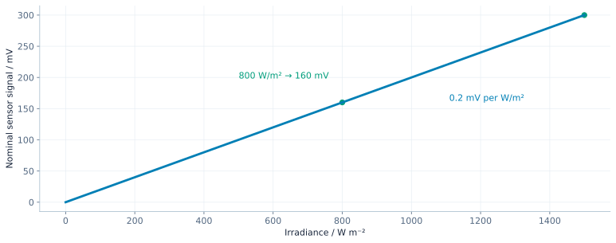](docs/assets/irradiance_transfer.svg)

*Figure — Calculated nominal pyranometer/ADC transfer. Quantization is not a substitute for calibration, mounting review or sensor uncertainty.*

### Temperature and optional supply sensing

| Item | Reference handling | Reason |
| --- | --- | --- |
| DS18B20 mode | Powered three-wire rather than assuming parasite-power support | Avoids an unstated conversion-power arrangement |
| Conversion time | Up to 750 ms at 12-bit per datasheet | Schedule conversion without blocking the complete loop |
| Integrity | Check CRC and conversion completion | A digital response is not automatically a valid temperature |
| Mounting | Document panel contact, adhesive/insulation and location | Module temperature differs from surrounding air |
| Known device accuracy | ±0.5 °C in the stated −10 to 85 °C range | Do not extend that claim across the entire absolute range |
| Optional battery channel | Only with reviewed scaling/reference and chemistry context | Node battery voltage is not a validated SOC estimate |

<a id="firmware"></a>
## ESP32-S3 Firmware Reference

[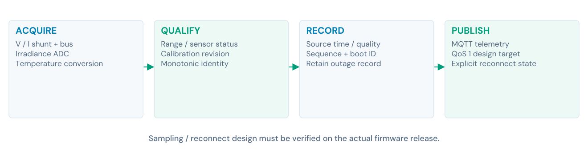](docs/assets/firmware_cycle.svg)

*Figure — Proposed one-second acquisition/publish cycle. Exact firmware task layout and shipped release are not available in the inspected repository.*

Firmware is responsible for truthful observation identity and channel status
before networking is considered. The node should not publish a normal number
simply because a conversion failed or a buffer was empty. Keep sensor
acquisition, conversion state, clock state, record assembly and delivery
outcome separately inspectable.

### Reference task responsibilities

| Task | Responsibility | Failure handling |
| --- | --- | --- |
| Boot/configuration | Load node identity and applicable calibration/configuration | Enter a named fault/degraded state if required data is absent |
| Clock/uptime | Maintain monotonic timing and UTC-quality context | Retain clock uncertainty, never invent a source UTC |
| Electrical sampling | Obtain compatible V/I conversions and status | Flag timeout/saturation/misaligned pairs |
| Environment sampling | Schedule irradiance and temperature reads | Preserve age and channel quality |
| Record assembly | Produce one immutable identity/envelope | Do not mutate a record during retry |
| Local queue | Bound pending records and preserve ordering policy | Count overflow/loss rather than claiming unlimited buffering |
| MQTT publishing | Connect, publish and observe acknowledgement state | Use bounded retry/backoff and explicit reconnect state |
| Health/reporting | Expose reboot, queue and channel diagnostics | Separate a healthy transport from valid measurements |

### Reference cycle pseudocode

```text
on boot:
    establish a new boot identity
    load and validate node/configuration/calibration identity
    initialize sensors and monotonic scheduler
    mark source UTC unsynchronized until qualified
    initialize bounded pending-record queue

at each one-second acquisition deadline:
    record monotonic observation time
    read electrical conversion pair and conversion status
    collect irradiance conversion and sensor status
    collect completed temperature conversion if available
    preserve age of any independently sampled channel
    evaluate channel range/status without hiding raw errors
    build immutable record with boot identity and sequence
    attach UTC only with its clock-quality state
    enqueue or record an explicit overflow/loss outcome
    increment sequence within the defined wrap policy
    schedule the next temperature conversion as needed

network worker:
    connect with approved identity/credentials
    subscribe only if required by the reviewed firmware contract
    publish according to bounded queue/retry policy
    observe delivery state without declaring persistence complete
    retain source identity when retransmitting
    report backlog and reconnect state

watchdog / supervisor:
    check task progress rather than merely network traffic
    preserve reset reason where the platform supports it
    avoid retry loops that starve acquisition
    establish a new boot identity after a genuine reboot
```

### Firmware acceptance cases

| Condition / input | Expected handling | Evidence to retain |
| --- | --- | --- |
| Power-on without network | Acquire/label local status under the approved buffer policy | Boot ID, clock status and queue outcome |
| Temperature conversion still pending | Do not block all channels or label old data new | Per-channel time/age and conversion state |
| Sensor unplugged | Publish missing/invalid status where transport permits | Channel reason and no fabricated zero |
| MQTT reconnect | Replay preserves immutable keys and source time | Sequence inventory and duplicate outcome |
| Queue reaches capacity | Apply documented loss/backpressure policy | First/last retained sequence and overflow count |
| Sequence limit reached | Use reviewed wrap/epoch policy | No duplicate key across the transition |
| Clock obtains UTC after startup | Preserve prior unsynchronized records honestly | Before/after time-quality states |
| Watchdog resets controller | New boot identity and reset context | No collision with the previous boot sequence |

A 600-record buffer at 1 Hz represents ten minutes only when every
acquisition produces one record and all 600 slots are available to that
node. Payload size, overhead, persistence and power-loss behavior must be
tested on the actual hardware. “Buffer target” does not imply durable
flash-backed recovery.

### Reference node-health message

Health metadata explains acquisition and transport behavior without
pretending to be another electrical sample. This fixture supplies no
measured counters; null means that the actual value must come from the
running node. The real firmware must publish its own supported health
contract.

```json
{
  "message_basis": "reference health contract",
  "message_type": "health",
  "node_id": "bench-node-01",
  "boot_id": null,
  "firmware_revision": null,
  "reset_reason": null,
  "uptime_ms": null,
  "clock": {
    "status": null,
    "source_utc": null,
    "synchronization_uncertainty_s": null
  },
  "acquisition": {
    "intended_cadence_hz": 1,
    "completed_cycles": null,
    "missed_deadlines": null,
    "last_conversion_status": {}
  },
  "queue": {
    "capacity_target_records": 600,
    "pending_records": null,
    "overflow_count": null,
    "first_pending_seq": null,
    "last_pending_seq": null,
    "durability_policy": null
  },
  "transport": {
    "connection_state": null,
    "reconnect_count": null,
    "last_publish_outcome": null,
    "last_confirmed_delivery_seq": null
  },
  "power": {
    "supply_diagnostic_available": null,
    "optional_battery_voltage_v": null
  }
}
```

### Reset and loss accounting

| Transition | Identity effect | Evidence boundary |
| --- | --- | --- |
| Normal reconnect without reboot | Keep boot identity and immutable sequence | Network delivery may repeat |
| Actual controller reboot | Establish new boot identity | RAM queue may be lost unless durable behavior is verified |
| Queue overflow | Keep explicit missing/lost record inventory | Do not claim a complete ten-minute history |
| Configuration reload | Preserve effective configuration revision | Do not reinterpret earlier records silently |
| Clock becomes qualified | Keep prior time-quality state | Earlier unsynced UTC is not invented retrospectively |

<a id="mqtt"></a>
## MQTT Transport, Replay and Offline Behavior

[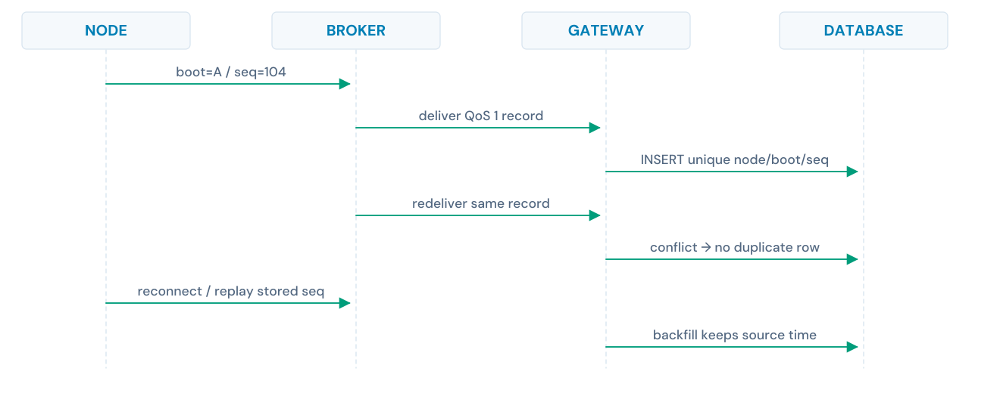](docs/assets/mqtt_replay.svg)

*Figure — Reference QoS 1 redelivery path: a duplicate delivery must not duplicate a committed record or energy contribution.*

MQTT is the node-to-gateway messaging architecture in the primary project
source. QoS 1 permits duplicate delivery; it does not provide an
exactly-once database transaction. The system therefore needs an application
identity and an idempotent persistence policy. The precise broker,
TLS/credential provisioning and web/app transport remain release details.

### Reference topic contract

```text
# Proposed topic namespace; not an exposed deployment endpoint.
arka/v1/sites/{site_id}/nodes/{node_id}/telemetry
arka/v1/sites/{site_id}/nodes/{node_id}/health

# Example documentation scope, not an actual live site.
arka/v1/sites/bench-site/nodes/bench-node-01/telemetry

# Topic identifiers must match payload identity.
# Do not permit arbitrary topic path segments from unvalidated input.
# Plant switching/control topics are outside this demonstrator.
# A retained last-value record is still subject to source-age checks.
```

| Transport setting | Reference policy | Verification |
| --- | --- | --- |
| Telemetry QoS | QoS 1 proposed | Duplicates and reconnect behavior tested explicitly |
| Record identity | node_id + boot_id + seq | Unique committed key and collision review |
| Cadence | 1 Hz target | Measured source interval and client age |
| Freshness | Stale after >5 s, assuming qualified source time | Timeout with controlled current-time/clock state |
| Queue | 600 records per node reference target | Capacity, loss and reset durability tests |
| Reconnect | Bounded backoff with observable state | No unbounded queue or CPU/network storm |
| Retained delivery | Never inherently fresh | Source-time and session/availability semantics |
| Credentials | Per approved provisioning and least privilege | No public secret in README or example payload |
| WAN failure | Local path should remain useful when LAN/services survive | Separate WAN-only test from full network failure |

### Replay decisions

| Condition / input | Expected handling | Evidence to retain |
| --- | --- | --- |
| Same immutable key and same body | Treat as duplicate delivery | One committed row; no duplicate metric increment |
| Same key but different body | Flag identity/collision fault; do not silently overwrite | Both candidate hashes and decision reason |
| New key with older source time | Apply backfill policy and preserve source time | Historical insertion position and analysis policy |
| Sequence gap | Record missing interval; do not infer zero generation | Gap bounds and affected integration time |
| Backlog overtakes live traffic | Use defined scheduling/backpressure policy | Live age plus backlog depth |
| Broker acknowledgement received | Delivery success only, not guaranteed DB commit | Separate publish and writer outcomes |
| Gateway restarts during replay | Recover idempotently from committed state | Before/after key inventory |
| Old retained sample arrives on connect | Evaluate age and clock quality before live display | Source/receive time distinction |

```python
# Reference idempotency concept, not the released backend.
def record_key(payload):
    source = payload["source"]
    return (
        source["node_id"],
        source["boot_id"],
        source["seq"],
    )

def handle_redelivery(writer, payload):
    key = record_key(payload)
    outcome = writer.insert_if_absent(key, payload)
    if outcome == "inserted":
        return "committed_new_record"
    if outcome == "same_record_exists":
        return "duplicate_delivery"
    if outcome == "key_body_conflict":
        return "identity_fault"
    return "persistence_failure"
```

Clock uncertainty limits age claims. With synchronized clocks, compare
source UTC against the qualified gateway clock and report the accepted
uncertainty. Without that basis, gateway receive time can describe arrival
age but cannot establish the age of the physical observation during backlog
replay. Preserve monotonic node uptime and clock status rather than
pretending otherwise.

### Illustrative delivery timeline

All times below are relative documentation fixtures. They explain why
delivery, storage and source freshness require separate state. The source
clock is assumed synchronized for this example. The exact scheduler and
backlog priority are release decisions.

| Gateway elapsed time | Input / state | Correct interpretation |
| --- | --- | --- |
| 0.0 s | Source observation seq 100 at source t=0 | Candidate current observation |
| 0.4 s | Gateway receives seq 100 | Arrival recorded independently |
| 0.5 s | Writer commits seq 100 | One durable record |
| 0.8 s | Same seq/body delivered again | Duplicate, not another sample |
| 1.0 s | Node produces seq 101 | New immutable observation |
| 1–8 s | Node transport unavailable | Source freshness degrades; buffer policy applies |
| 6.1 s | Newest committed source remains t=0 | Stale under >5 s reference policy |
| 8.0 s | Connection returns with seq 101 backlog | Arrival does not make source t=1 current |
| 8.2 s | Historical records replay | Idempotent backfill by source identity |
| 8.4 s | Current seq with source t=8 arrives | Potentially fresh after quality/clock checks |
| 8.5 s | Writer commit succeeds | Current durable horizon advances |
| 8.6 s | All clients receive compatible context | Each displays the same source identity/age meaning |

<a id="telemetry"></a>
## Telemetry Schema and Data Contracts

[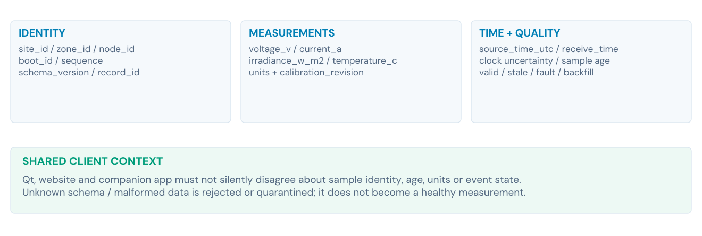](docs/assets/telemetry_contract.svg)

*Figure — Reference envelope groups identity, measurements, time and quality. The built release must publish its actual schema and compatibility policy.*

The following schema is a proposed interoperability contract for
documentation and tests. It does not assert that the unpublished
implementation already uses these exact keys. It makes units and identity
explicit, supports missing measurements with null, and avoids representing a
failed sensor as zero. Domain plausibility and calibration checks are
additional semantic steps after structural validation.

### Field dictionary

| Path | Type | Meaning / constraint |
| --- | --- | --- |
| schema_version | string | Envelope version; reference value 1.0 |
| message_type | string | Reference telemetry record type |
| source.site_id | identifier | Approved site scope; must match topic |
| source.zone_id | identifier | Physical/logical zone; documented mapping |
| source.node_id | identifier | Stable node identity; must match topic |
| source.boot_id | string | New identity for each actual node boot |
| source.seq | integer | Monotonic within a boot under defined wrap policy |
| time.source_utc | RFC 3339 string or null | Observation UTC, not gateway receipt time |
| time.uptime_ms | integer | Monotonic node uptime in milliseconds |
| time.clock_status | enum | synced, uncertain or unsynced |
| measurements.voltage_v | number or null | Monitored DC bus voltage |
| measurements.current_a | number or null | Signed current; approved bench direction checked semantically |
| measurements.irradiance_w_m2 | number or null | Radiometric irradiance, not lux |
| measurements.panel_temperature_c | number or null | Documented panel sensor temperature |
| quality.channel_status | object | Independent status for each required channel |
| calibration_id | string | Applicable coefficient/reference record |
| firmware_revision | string | Actual firmware release identity |
| gateway.receive_utc | gateway-added metadata | Arrival UTC; not supplied as source observation time |
| gateway.ingest_outcome | gateway-added metadata | Accepted, duplicate, rejected or quarantined |
| gateway.config_revision | gateway-added metadata | Policy used for validation and derived context |

### Complete reference JSON Schema

```json
{
  "$schema": "https://json-schema.org/draft/2020-12/schema",
  "$id": "urn:arka:reference:telemetry:1.0",
  "title": "ARKA reference telemetry envelope",
  "description": "Reference contract, not a published implementation schema.",
  "type": "object",
  "additionalProperties": false,
  "required": [
    "schema_version",
    "message_type",
    "source",
    "time",
    "measurements",
    "quality",
    "calibration_id",
    "firmware_revision"
  ],
  "properties": {
    "schema_version": {
      "const": "1.0"
    },
    "message_type": {
      "const": "telemetry"
    },
    "source": {
      "type": "object",
      "additionalProperties": false,
      "required": [
        "site_id",
        "zone_id",
        "node_id",
        "boot_id",
        "seq"
      ],
      "properties": {
        "site_id": {
          "$ref": "#/$defs/identifier"
        },
        "zone_id": {
          "$ref": "#/$defs/identifier"
        },
        "node_id": {
          "$ref": "#/$defs/identifier"
        },
        "boot_id": {
          "type": "string",
          "minLength": 8,
          "maxLength": 64
        },
        "seq": {
          "type": "integer",
          "minimum": 0,
          "maximum": 4294967295
        }
      }
    },
    "time": {
      "type": "object",
      "additionalProperties": false,
      "required": [
        "source_utc",
        "uptime_ms",
        "clock_status"
      ],
      "properties": {
        "source_utc": {
          "anyOf": [
            {
              "type": "string",
              "format": "date-time"
            },
            {
              "type": "null"
            }
          ]
        },
        "uptime_ms": {
          "type": "integer",
          "minimum": 0,
          "maximum": 9007199254740991
        },
        "clock_status": {
          "enum": [
            "synced",
            "uncertain",
            "unsynced"
          ]
        }
      }
    },
    "measurements": {
      "type": "object",
      "additionalProperties": false,
      "required": [
        "voltage_v",
        "current_a",
        "irradiance_w_m2",
        "panel_temperature_c"
      ],
      "properties": {
        "voltage_v": {
          "type": [
            "number",
            "null"
          ],
          "minimum": 0,
          "maximum": 36
        },
        "current_a": {
          "type": [
            "number",
            "null"
          ],
          "minimum": -5,
          "maximum": 5
        },
        "irradiance_w_m2": {
          "type": [
            "number",
            "null"
          ],
          "minimum": 0,
          "maximum": 2000
        },
        "panel_temperature_c": {
          "type": [
            "number",
            "null"
          ],
          "minimum": -55,
          "maximum": 125
        }
      }
    },
    "quality": {
      "type": "object",
      "additionalProperties": false,
      "required": [
        "channel_status"
      ],
      "properties": {
        "channel_status": {
          "type": "object",
          "additionalProperties": false,
          "required": [
            "voltage",
            "current",
            "irradiance",
            "panel_temperature"
          ],
          "properties": {
            "voltage": {
              "$ref": "#/$defs/channelStatus"
            },
            "current": {
              "$ref": "#/$defs/channelStatus"
            },
            "irradiance": {
              "$ref": "#/$defs/channelStatus"
            },
            "panel_temperature": {
              "$ref": "#/$defs/channelStatus"
            }
          }
        }
      }
    },
    "calibration_id": {
      "type": "string",
      "minLength": 1,
      "maxLength": 64
    },
    "firmware_revision": {
      "type": "string",
      "minLength": 1,
      "maxLength": 64
    }
  },
  "$defs": {
    "identifier": {
      "type": "string",
      "minLength": 1,
      "maxLength": 48,
      "pattern": "^[A-Za-z0-9][A-Za-z0-9_-]*$"
    },
    "channelStatus": {
      "enum": [
        "valid",
        "invalid",
        "missing",
        "uncertain",
        "out_of_range"
      ]
    }
  }
}
```

The numeric schema bounds are structural guardrails, not permission to
energize outside the 12–24 V bench envelope. In particular, a physically
impossible or out-of-characterized-range value needs a semantic decision
even if its JSON type and broad device range are valid. Validate null/status
agreement: a missing value cannot simultaneously be advertised as a valid
measurement. Enable format checking explicitly in validators that treat
date-time as annotation by default.

### Valid-value documentation fixture

```json
{
  "schema_version": "1.0",
  "message_type": "telemetry",
  "source": {
    "site_id": "bench-site",
    "zone_id": "zone-a",
    "node_id": "bench-node-01",
    "boot_id": "documentation-boot-01",
    "seq": 100
  },
  "time": {
    "source_utc": "2026-01-01T00:00:00Z",
    "uptime_ms": 100000,
    "clock_status": "synced"
  },
  "measurements": {
    "voltage_v": 21.6,
    "current_a": 3.2,
    "irradiance_w_m2": 800.0,
    "panel_temperature_c": 45.0
  },
  "quality": {
    "channel_status": {
      "voltage": "valid",
      "current": "valid",
      "irradiance": "valid",
      "panel_temperature": "valid"
    }
  },
  "calibration_id": "REFERENCE-ONLY",
  "firmware_revision": "REFERENCE-ONLY"
}
```

### Missing-temperature fixture

```json
{
  "schema_version": "1.0",
  "message_type": "telemetry",
  "source": {
    "site_id": "bench-site",
    "zone_id": "zone-a",
    "node_id": "bench-node-01",
    "boot_id": "documentation-boot-01",
    "seq": 101
  },
  "time": {
    "source_utc": "2026-01-01T00:00:01Z",
    "uptime_ms": 101000,
    "clock_status": "synced"
  },
  "measurements": {
    "voltage_v": 21.6,
    "current_a": 3.2,
    "irradiance_w_m2": 800.0,
    "panel_temperature_c": null
  },
  "quality": {
    "channel_status": {
      "voltage": "valid",
      "current": "valid",
      "irradiance": "valid",
      "panel_temperature": "missing"
    }
  },
  "calibration_id": "REFERENCE-ONLY",
  "firmware_revision": "REFERENCE-ONLY"
}
```

### Unsynchronized-clock fixture

```json
{
  "schema_version": "1.0",
  "message_type": "telemetry",
  "source": {
    "site_id": "bench-site",
    "zone_id": "zone-a",
    "node_id": "bench-node-01",
    "boot_id": "documentation-boot-02",
    "seq": 0
  },
  "time": {
    "source_utc": null,
    "uptime_ms": 1000,
    "clock_status": "unsynced"
  },
  "measurements": {
    "voltage_v": 21.6,
    "current_a": 3.2,
    "irradiance_w_m2": 800.0,
    "panel_temperature_c": 45.0
  },
  "quality": {
    "channel_status": {
      "voltage": "valid",
      "current": "valid",
      "irradiance": "valid",
      "panel_temperature": "valid"
    }
  },
  "calibration_id": "REFERENCE-ONLY",
  "firmware_revision": "REFERENCE-ONLY"
}
```

### Semantic rejection and quarantine cases

| Input problem | Decision | Why structural parsing alone is insufficient |
| --- | --- | --- |
| Topic node differs from payload node | Reject / quarantine identity mismatch | Well-formed JSON can still describe the wrong scope |
| Unsupported schema version | Reject or dedicated compatibility path | Do not guess field interpretation |
| Value is null but channel status is valid | Reject / quarantine inconsistency | Null is not a valid zero |
| Clock says synced but source UTC is null | Reject / quarantine clock inconsistency | Age cannot be qualified |
| Source time far in the future | Quarantine with clock reason | Prevent negative-age live status |
| Negative current in an approved unidirectional bench | Flag reverse/out-of-scope condition | Broad signed device range is not the operating policy |
| Unknown calibration ID | Retain as unqualified or quarantine by policy | A string is not proof of calibrated accuracy |
| Duplicate key with a changed body | Identity fault | A duplicate must be immutable |
| NaN / Infinity / string numerals | Reject nonstandard or wrong-type number | Strict JSON must not coerce these into trusted measurements |
| Irradiance supplied in lux under a W/m² key | Reject unit mapping | A numeric range cannot establish radiometric meaning |
| Temperature outside characterized range | Mark scope/quality restriction | Sensor absolute range differs from validated assembly performance |
| Receive time substituted for source time | Reject provenance error | Backlog arrival is not a new observation |

<a id="data-quality"></a>
## Data Quality, Clocks and Freshness

[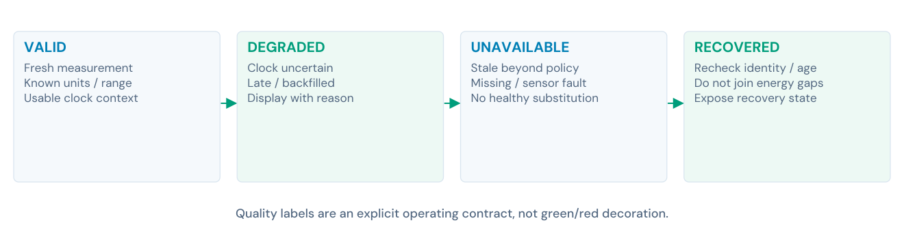](docs/assets/quality_states.svg)

*Figure — Quality governs whether a record can support engineering interpretation. A transport connection and a normal-looking number do not establish validity.*

Quality is multi-dimensional. A record can be structurally valid but stale;
current in the transport sense but uncalibrated; fresh electrically but
unsuitable for a baseline because sunlight is changing quickly. Keep these
reasons independently available even if the interface also shows a concise
overall state.

| State / dimension | Meaning | Allowed interpretation |
| --- | --- | --- |
| Valid channel | Conversion/status/range accepted under applicable calibration | Use within characterized scope |
| Missing channel | No trustworthy value supplied | Do not substitute zero |
| Invalid channel | Conversion, CRC, range or integrity failure | Exclude affected calculations |
| Uncertain channel | Calibration, mounting or interpretation uncertainty | Restrict confidence and show reason |
| Fresh observation | Qualified source age within threshold | Current context subject to other quality gates |
| Stale observation | Source age >5 s reference threshold | Last-known history, not current plant state |
| Clock unsynchronized | Absolute source UTC not qualified | Arrival/uptime context only |
| Backfilled record | Arrived after its observation window | Historical use under explicit replay policy |
| Environment gated | Low/rapidly changing irradiance or unsuitable context | Do not accumulate a fault timer |
| Analysis unavailable | Missing model/dependency or invalid input | No healthy score or forecast invented |

### Reference freshness logic

```python
from datetime import datetime, timezone

# Reference logic only; deployed clock uncertainty must be explicit.
def freshness(source_utc, clock_status, now_utc, stale_after_s=5.0):
    if clock_status != "synced" or source_utc is None:
        return {"state": "clock_uncertain", "age_s": None}
    source = datetime.fromisoformat(source_utc.replace("Z", "+00:00"))
    if source.tzinfo is None or now_utc.tzinfo is None:
        return {"state": "invalid_clock", "age_s": None}
    age_s = (now_utc - source).total_seconds()
    if age_s < 0:
        return {"state": "future_time", "age_s": age_s}
    return {
        "state": "stale" if age_s > stale_after_s else "fresh",
        "age_s": age_s,
    }

# The helper has no access to actual node clocks or live telemetry.
# Production policy must account for synchronization uncertainty.
# Receive time is recorded independently rather than passed as source time.
```

### Time-basis review

| Clock situation | Required treatment | Evidence |
| --- | --- | --- |
| Node starts without UTC | Publish unsynced/null UTC and monotonic uptime | Initial record and clock-status transition |
| Gateway UTC steps | Avoid negative/huge integration intervals | Clock-change log plus interval exclusions |
| Node reboots | New boot identity even if sequence restarts at zero | Boot boundary and duplicate-key test |
| Client timezone changes | Display may change; record UTC does not | Same record shown in two selected zones |
| Record replayed late | Preserve source time and mark backfill | Source versus receive timestamps |
| Clock uncertainty overlaps freshness boundary | Show uncertainty; use approved conservative policy | Synchronization bounds and classification |
| Daylight-saving display shift | UTC identity remains monotonic | Window labels and export time basis |

### Quality propagation rules

- Power needs an accepted V/I pair; a valid voltage does not repair an
  invalid current.
- Energy needs two valid adjacent endpoints and an acceptable elapsed
  interval.
- Expected-output comparison needs valid environmental context and a valid
  model/configuration revision.
- A quality fault can itself create a data-health event without becoming a
  solar-performance fault.
- A dashboard summary must not hide the reason that a detailed channel is
  unavailable.
- Backfilled data may improve history without changing the assertion that
  a live link was unavailable.
- Retain the excluded-duration inventory so energy confidence can be
  interpreted later.
- When quality rules change, version the policy and preserve the original
  raw record.

### Coverage is not a single percentage

Different conclusions require different coverage. A record can contribute
valid electrical power while missing temperature; it may therefore support a
raw power trend but not the temperature-corrected baseline. Similarly, a
valid instantaneous power point does not establish the energy contribution
of an adjacent unknown interval. Report coverage for the claim being made.

| Claim | Coverage inventory to retain |
| --- | --- |
| Voltage trend | Valid voltage points, source-time basis and gaps |
| Current trend | Valid current points, calibrated range and direction |
| Instantaneous power | Accepted V/I pairs and pairing age |
| Energy | Included intervals, excluded seconds and integration revision |
| Expected-output comparison | Qualified G/T/output/model intervals |
| Persistent alert | Continuous qualifying duration and gate transitions |
| Detection metrics | Labeled events, excluded cases and evaluation split |
| Uptime | Defined component/path and observation method |
| Local-first operation | WAN-only condition with surviving local dependencies |

### Time-window reporting

```text
Recommended export labels:
    requested window: start UTC to end UTC
    available source window: first source UTC to last source UTC
    display timezone: explicitly named
    valid electrical-pair count: actual count
    included energy duration: actual seconds
    excluded energy duration: actual seconds, by reason
    qualified analysis duration: actual seconds
    clock-uncertain records: actual count
    backfilled records: actual count

Do not equate “records received” with continuous measurement coverage.
Do not add overlapping excluded intervals twice.
State whether window endpoints are inclusive or half-open.
A half-open [start, end) convention avoids adjacent-window double counting.
```

<a id="calibration"></a>
## Calibration and Measurement Uncertainty

[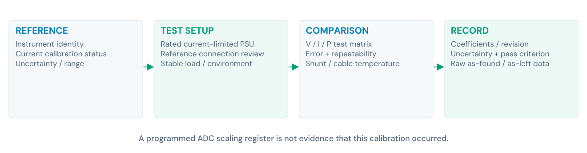](docs/assets/calibration_chain.svg)

*Figure — Reference metrology chain: known source/reference → DUT comparison → coefficient/revision → residual review → retained evidence.*

Calibration of the complete measurement path is different from programming
an IC calibration register. Use a traceable reference of suitable
uncertainty, record the setup and loading, cover the intended operating
window and preserve both raw and corrected observations. The current numeric
accuracy values are acceptance targets, not demonstrated results.

[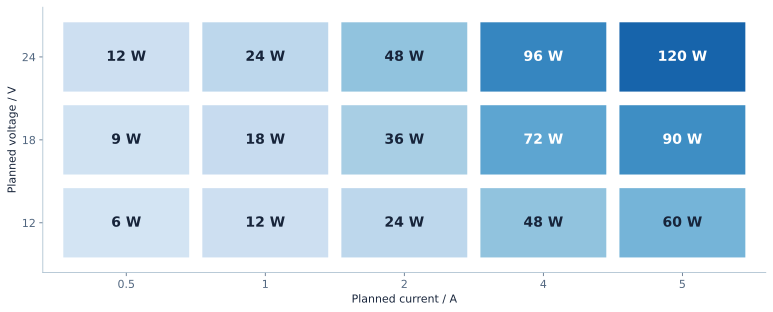](docs/assets/calibration_matrix.svg)

*Figure — Fifteen planned V/I test points: 12, 18 and 24 V against 0.5, 1, 2, 4 and 5 A. Every cell is calculated load power, not measured error or a passed calibration result.*

| Planned voltage | 0.5 A load | 1 A load | 2 A load | 4 A load | 5 A load |
| --- | --- | --- | --- | --- | --- |
| 12 V | 6 W | 12 W | 24 W | 48 W | 60 W |
| 18 V | 9 W | 18 W | 36 W | 72 W | 90 W |
| 24 V | 12 W | 24 W | 48 W | 96 W | 120 W |

### Calibration record fields

| Field | Required content |
| --- | --- |
| Record ID / revision | Immutable reference and any superseding revision |
| DUT identity | Node, board, sensor serials and firmware |
| Measurement channel | Voltage, current, irradiance or panel temperature |
| Reference instrument | Make/model/serial, certificate and uncertainty |
| Setup | Connection, range, load, lead placement and mounting |
| Environment | Ambient/board/sensor temperature and relevant conditions |
| Point list | Applied reference, raw reading, corrected reading and repeat count |
| Coefficient fit | Model form, units, offsets and applicable range |
| Residuals | Pointwise errors, repeatability and outlier handling |
| Acceptance rule | Target, uncertainty/guardband policy and decision |
| Time and personnel | Date, operator and reviewer |
| Applicability | Effective revision and devices/channels covered |

### Uncertainty budget structure

| Contribution | Example mechanism | Evaluation approach |
| --- | --- | --- |
| Reference instrument | Calibration/measurement uncertainty | Certificate and selected range |
| Shunt resistance | Tolerance, self-heating, temperature coefficient | Measured value and temperature characterization |
| Analog conversion | Gain/offset/noise/quantization | Datasheet plus repeated-point observation |
| Lead/contact arrangement | Non-Kelvin drop and resistance change | Connection review and repeat assembly |
| Timing alignment | V/I mismatch under changing load | Measured pairing interval and transient test |
| Pyranometer | Calibration, angular/spectral response and soiling | Sensor record plus mounting/maintenance evidence |
| Temperature mounting | Thermal contact and local gradient | Mounting characterization against a suitable reference |
| Fit residual | Correction-model mismatch | Held-out calibration/check points |
| Drift | Aging, thermal cycling and reassembly | Scheduled reference recheck |
| Reporting | Rounding and unit transformation | Software arithmetic and export tests |

```text
Reference pointwise error:
    absolute_error = DUT_value − reference_value
    relative_error_percent = 100 × absolute_error / reference_value
Do not divide by a zero reference.
Use absolute error / noise criteria near zero current.

For independent small V/I standard uncertainties:
    u_P / P ≈ sqrt((u_V / V)² + (u_I / I)²)
For correlated contributions, include covariance.
For conservative bounded errors of 1% in V and 1% in I:
    upper product bound = 1.01 × 1.01 − 1 = 2.01%
A stated ≤2% power target therefore needs direct verification.
Do not call the product target proven from rounded channel targets.
```

#### Proposed calibration sequence

1. Review the approved bench and instrument ratings before connecting the
   DUT.
2. Record instrument identity, uncertainty, firmware/configuration and
   ambient conditions.
3. Check zero/offset and polarity before applying larger current.
4. Apply the planned point matrix with a suitable rated source/load and
   safe current limit.
5. Allow appropriate stabilization and record repeated raw/reference
   observations.
6. Fit only the approved coefficient form and retain uncorrected values.
7. Evaluate residuals and independent check points; include uncertainty
   in the decision.
8. Assign a calibration revision only after review and record its
   applicability.
9. Repeat a check after reassembly or meaningful thermal/mechanical
   change.
10. Publish the actual record separately from the test-point figure.

<a id="storage-energy"></a>
## Power, Energy and Local Storage

Electrical power and energy need explicit measurement points and timing. DC
power at the proposed shunt/bus location is not automatically inverter AC
power, delivered grid energy or plant yield. The original project requires
V/A/W/Wh/kWh and local history; the following formulas and SQL are reference
implementations for that requirement.

### Power and energy definitions

```text
Instantaneous DC power:
    P_W = V_V × I_A
For matched readings of 21.6 V and 3.20 A:
    P = 69.12 W

Trapezoidal interval energy for two accepted endpoints:
    delta_Wh = 0.5 × (P_previous + P_current) × delta_t_s / 3600
    E_Wh = sum of accepted interval contributions
    E_kWh = E_Wh / 1000

Example accepted interval:
    P_previous = 60 W; P_current = 80 W; delta_t = 5 s
    delta_Wh = 0.5 × 140 × 5 / 3600 = 0.097222... Wh

Do not integrate when:
    either endpoint is invalid or missing;
    elapsed time is nonpositive;
    elapsed time exceeds the approved gap threshold;
    identity/boot/time continuity is not established.
Do not treat a missing interval as zero generation.
Keep excluded duration and the policy revision.
```

[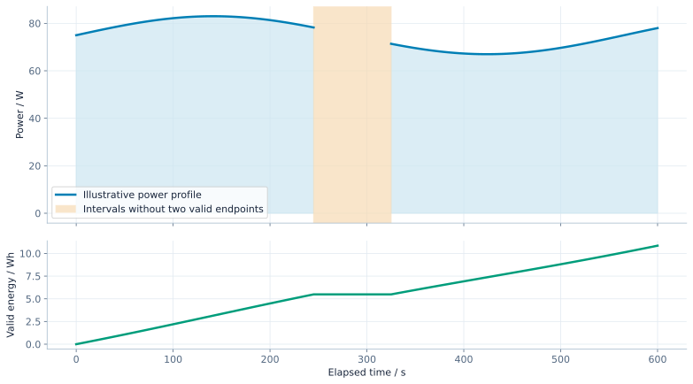](docs/assets/energy_gaps.svg)

*Figure — Calculated 10-minute power/energy example at 5 s spacing. Samples from t=250 through 320 s are invalid, so intervals from the last valid endpoint at 245 s to the next at 325 s are excluded. The flat energy trace is unknown contribution, not proof of zero generation.*

### Reference integration helper

```python
from dataclasses import dataclass
from math import isfinite

@dataclass(frozen=True)
class PowerPoint:
    node_id: str
    boot_id: str
    elapsed_s: float
    power_w: float | None
    valid: bool

def integrate_interval(previous, current, max_gap_s=2.0):
    """Return qualified Wh and excluded seconds for one interval."""
    dt = current.elapsed_s - previous.elapsed_s
    if dt <= 0 or not isfinite(dt):
        return {"wh": 0.0, "excluded_s": 0.0,
                "reason": "nonpositive_or_invalid_time"}
    same_source = (
        current.node_id == previous.node_id
        and current.boot_id == previous.boot_id
    )
    values = (previous.power_w, current.power_w)
    valid_values = all(v is not None and isfinite(v) for v in values)
    if not same_source:
        reason = "identity_discontinuity"
    elif not previous.valid or not current.valid or not valid_values:
        reason = "invalid_endpoint"
    elif dt > max_gap_s:
        reason = "gap_exceeds_policy"
    else:
        contribution = 0.5 * sum(values) * dt / 3600.0
        return {"wh": contribution, "excluded_s": 0.0, "reason": "valid"}
    return {"wh": 0.0, "excluded_s": dt, "reason": reason}

# This reference function does not claim a completed application test.
# The released policy must define reverse power and clock transitions.
# Never sum the same committed interval twice during replay.
```

### Local persistence model

[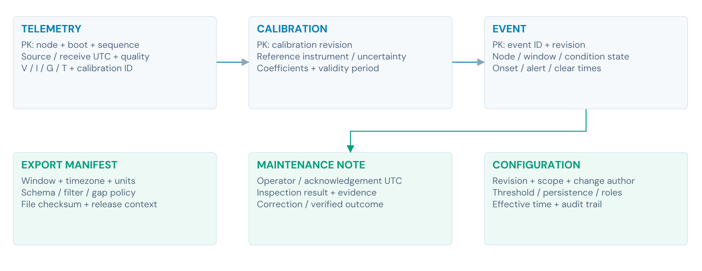](docs/assets/storage_model.svg)

*Figure — Proposed logical telemetry, events, calibration and configuration entities. SQLite/WAL is a reference choice, not a verified engine in the built release.*

A local store supports offline history and inspection evidence, but only if
commit outcomes, identity and backup behavior are explicit. The reference
schema separates raw observations from derived values and human workflow. It
retains source and receive times independently. Use a migration strategy and
actual implementation review before adopting any SQL below.

```sql
-- Reference SQLite schema. Not a released application database.
PRAGMA foreign_keys = ON;
-- WAL is a reference deployment option, not proof of crash safety.
PRAGMA journal_mode = WAL;

CREATE TABLE calibration_record (
    calibration_id TEXT PRIMARY KEY,
    channel TEXT NOT NULL,
    device_identity TEXT NOT NULL,
    coefficient_json TEXT NOT NULL,
    reference_identity TEXT NOT NULL,
    applicable_range_json TEXT NOT NULL,
    reviewed_utc TEXT,
    record_sha256 TEXT NOT NULL
);

CREATE TABLE configuration_revision (
    config_revision TEXT PRIMARY KEY,
    schema_version TEXT NOT NULL,
    config_sha256 TEXT NOT NULL,
    effective_utc TEXT,
    approved_by TEXT,
    reason TEXT NOT NULL
);

CREATE TABLE telemetry_record (
    record_id INTEGER PRIMARY KEY,
    site_id TEXT NOT NULL,
    zone_id TEXT NOT NULL,
    node_id TEXT NOT NULL,
    boot_id TEXT NOT NULL,
    seq INTEGER NOT NULL CHECK (seq >= 0),
    source_utc TEXT,
    receive_utc TEXT NOT NULL,
    uptime_ms INTEGER NOT NULL CHECK (uptime_ms >= 0),
    clock_status TEXT NOT NULL,
    voltage_v REAL,
    current_a REAL,
    irradiance_w_m2 REAL,
    panel_temperature_c REAL,
    channel_quality_json TEXT NOT NULL,
    calibration_id TEXT NOT NULL,
    config_revision TEXT NOT NULL,
    firmware_revision TEXT NOT NULL,
    envelope_sha256 TEXT NOT NULL,
    raw_payload_json TEXT NOT NULL,
    UNIQUE (node_id, boot_id, seq)
);

CREATE INDEX telemetry_node_source
    ON telemetry_record(node_id, source_utc);
CREATE INDEX telemetry_receive
    ON telemetry_record(receive_utc);

CREATE TABLE derived_metric (
    metric_id INTEGER PRIMARY KEY,
    record_id INTEGER NOT NULL REFERENCES telemetry_record(record_id),
    metric_revision TEXT NOT NULL,
    power_w REAL,
    expected_power_w REAL,
    residual_fraction REAL,
    analysis_quality TEXT NOT NULL,
    UNIQUE (record_id, metric_revision)
);

CREATE TABLE energy_interval (
    interval_id INTEGER PRIMARY KEY,
    previous_record_id INTEGER NOT NULL REFERENCES telemetry_record(record_id),
    current_record_id INTEGER NOT NULL REFERENCES telemetry_record(record_id),
    integration_revision TEXT NOT NULL,
    elapsed_s REAL NOT NULL CHECK (elapsed_s > 0),
    contribution_wh REAL,
    included INTEGER NOT NULL CHECK (included IN (0, 1)),
    exclusion_reason TEXT,
    UNIQUE (previous_record_id, current_record_id, integration_revision)
);

CREATE TABLE event_record (
    event_id TEXT PRIMARY KEY,
    node_id TEXT NOT NULL,
    event_type TEXT NOT NULL,
    policy_revision TEXT NOT NULL,
    condition_onset_utc TEXT,
    qualified_alert_utc TEXT,
    latest_revision INTEGER NOT NULL,
    condition_state TEXT NOT NULL,
    workflow_state TEXT NOT NULL
);

CREATE TABLE event_action (
    action_id INTEGER PRIMARY KEY,
    event_id TEXT NOT NULL REFERENCES event_record(event_id),
    expected_revision INTEGER NOT NULL,
    resulting_revision INTEGER NOT NULL,
    actor_identity TEXT NOT NULL,
    action_utc TEXT NOT NULL,
    action_type TEXT NOT NULL,
    note TEXT,
    outcome TEXT NOT NULL
);
```

Calibration and configuration identifiers are preserved even when records
are quarantined for unknown applicability. The reference SQL therefore does
not force an unverified calibration relationship into a trusted foreign-key
match. A real release may use a separate quarantine store, approved foreign
keys and normalized quality tables; document that actual choice.

### Retention capacity model

[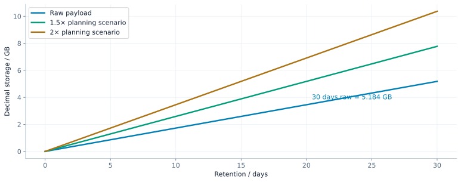](docs/assets/retention_model.svg)

*Figure — Calculated raw payload growth for ten nodes at 1 Hz and an assumed 200 bytes per record. The 1.5× and 2× curves are planning scenarios, not database benchmarks.*

```text
Records per node per day = 86400
Records for 10 nodes over 30 days = 25920000
Assumed compact record size = 200 bytes
Raw bytes = 10 × 200 × 86400 × 30 = 5184000000
Decimal storage = 5.184 GB
Binary storage ≈ 4.828 GiB

1.5× planning scenario = 7.776 GB
2× planning scenario = 10.368 GB
Neither factor includes an independently measured write amplification.
A 64 GB device must also hold OS, indexes, WAL, logs and backups.
The verbose reference JSON above is larger than 200 bytes.
Measure actual serialized and on-disk sizes before approving retention.
```

### Reference diagnostic queries

```sql
-- Latest source observations for a selected node.
SELECT node_id, boot_id, seq, source_utc, receive_utc, clock_status
FROM telemetry_record
WHERE node_id = :approved_node_id
ORDER BY source_utc DESC
LIMIT 20;

-- Count records by boot to investigate a reboot boundary.
SELECT boot_id, COUNT(*) AS row_count, MIN(seq), MAX(seq)
FROM telemetry_record
WHERE node_id = :approved_node_id
GROUP BY boot_id;

-- Explain missing integrated time instead of assuming zero generation.
SELECT exclusion_reason, SUM(elapsed_s) AS excluded_seconds
FROM energy_interval
WHERE included = 0
GROUP BY exclusion_reason;

-- Compare event condition with operator workflow.
SELECT event_id, event_type, condition_state, workflow_state,
       latest_revision, policy_revision
FROM event_record
WHERE node_id = :approved_node_id;

-- These are read-only examples for the reference schema only.
-- Verify actual schema and access permissions before using a query.
```

### Export manifest and coverage

An export must remain understandable when separated from the running UI.
Include the selected identity, window, time basis, units, quality,
calibration/configuration and coverage. If a client exports an aggregated
trend, name the aggregation and preserve access to the raw evidence used for
a claim.

```json
{
  "manifest_basis": "reference export contract",
  "export_id": null,
  "created_utc": null,
  "requested_by_scope": null,
  "selection": {
    "site_id": null,
    "zone_id": null,
    "node_ids": [],
    "start_utc": null,
    "end_utc": null,
    "display_timezone": null
  },
  "contents": {
    "telemetry_rows": null,
    "event_rows": null,
    "raw_or_aggregated": null,
    "aggregation_method": null
  },
  "coverage": {
    "valid_integrated_seconds": null,
    "excluded_seconds": null,
    "exclusion_reasons": {},
    "first_source_utc": null,
    "last_source_utc": null
  },
  "revisions": {
    "gateway_release": null,
    "schema": null,
    "configuration": null,
    "calibration_ids": [],
    "integration_policy": null,
    "analysis_policy": null
  },
  "units": {
    "voltage": "V",
    "current": "A",
    "power": "W",
    "energy": "Wh",
    "irradiance": "W/m2",
    "temperature": "degC"
  },
  "checksums": [],
  "limitations": []
}
```

### Write-volume sensitivity

| Assumed bytes/record | 10 nodes × 1 Hz × 30 days | Scope |
| --- | --- | --- |
| 100 B | 2.592 GB raw | Compact planning scenario |
| 200 B | 5.184 GB raw | Baseline capacity assumption |
| 400 B | 10.368 GB raw | Doubled-payload sensitivity |
| 800 B | 20.736 GB raw | Verbose-payload sensitivity |
| 1600 B | 41.472 GB raw | Large-envelope sensitivity |

The sensitivity table excludes indexes, transaction/WAL overhead, logs, OS
and backup copies in every row. The nominal 64 GB allowance is not a
guaranteed retention result. Measure the actual serialized record, insertion
behavior, filesystem growth and write endurance on the selected storage
device.

<a id="analytics"></a>
## Edge Analytics and Explainable Anomaly Logic

[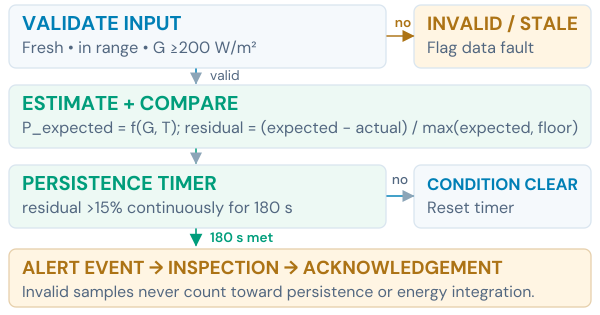](docs/assets/anomaly_flow.svg)

*Figure — Proposed quality-gated expected-output comparison and persistence logic. Predictive-maintenance support is not a validated failure-date forecast.*

ARKA AI uses local context to turn monitoring data into an inspectable
maintenance signal. An initial explainable baseline can compare measured DC
power against expected output for the present irradiance and panel
temperature. More advanced models are future options, not prerequisites for
representing quality honestly. Every deployed model needs a defined scope,
input/calibration lineage, version and evaluation dataset.

### Reference baseline

```text
Illustrative linear baseline:
    P_expected = P_ref × (G / G_ref)
                 × [1 + gamma × (T_panel − T_ref)]
Where:
    P_ref is a healthy reference at the SAME measurement point;
    G_ref is the reference irradiance (often 1000 W/m²);
    T_ref is the reference temperature (often 25 °C);
    gamma is an applicable power-temperature coefficient per °C.

Guarded normalized shortfall:
    residual = (P_expected − P_measured) / max(P_expected, P_floor)

Requirements before interpretation:
    valid and sufficiently time-aligned measurements;
    applicable healthy reference and coefficient;
    expected power above the chosen floor;
    G >= 200 W/m² initial gate;
    irradiance sufficiently stable under a documented criterion;
    no known startup/maintenance/curtailment exclusion.

This simplified model does not inherently model MPPT, shading geometry,
spectral mismatch, inverter clipping, soiling, cable losses or curtailment.
Fit/validate the baseline at the actual DC measurement location.
```

The reference panel rating and temperature coefficient are not supplied, so
no particular P_ref or gamma is asserted as a project measurement. The 88.3
W HMI expectation is an illustrative display value, not a derived claim
about an identified module. Define “stable irradiance” quantitatively in a
released policy; the original material does not establish its exact
window/slope threshold.

### Residual persistence timing

[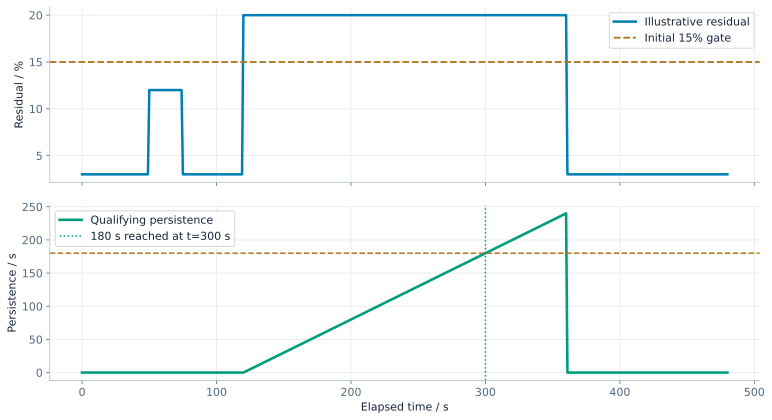](docs/assets/residual_persistence.svg)

*Figure — Calculated example: a 20% shortfall begins at t=120 s. With valid/stable context and a 15% gate, 180 elapsed seconds qualify at t=300 s. The first qualifying sample starts at zero elapsed persistence; it does not count as one second.*

```python
# Reference state machine. It uses elapsed monotonic time, not sample count.
class PersistentShortfall:
    def __init__(self, threshold=0.15, required_s=180.0, max_gap_s=2.0):
        self.threshold = threshold
        self.required_s = required_s
        self.max_gap_s = max_gap_s
        self.started_at = None
        self.previous_time = None
        self.previous_qualified = False

    def update(self, time_s, residual, gates_ok):
        dt = None if self.previous_time is None else time_s - self.previous_time
        continuous = dt is not None and 0 < dt <= self.max_gap_s
        qualified = gates_ok and residual is not None and residual > self.threshold
        if not qualified:
            self.started_at = None
            state = "not_qualifying"
        elif not continuous or not self.previous_qualified:
            self.started_at = time_s
            state = "pending"
        else:
            elapsed = time_s - self.started_at
            state = "qualified" if elapsed >= self.required_s else "pending"
        elapsed = 0.0 if self.started_at is None else time_s - self.started_at
        self.previous_time = time_s
        self.previous_qualified = qualified
        return {"state": state, "persistence_s": elapsed}

# In this reference, a gate loss or unacceptable gap resets persistence.
# A deployed alternative must publish its hold/reset/clear semantics.
# Acknowledgement is deliberately not part of this condition timer.
```

### Fault taxonomy and confounders

| Observation | Possible explanations | Inspection context |
| --- | --- | --- |
| Persistent low power with stable G/T | Electrical loss, shade, soiling, baseline mismatch | Confirm measurement point, load/MPPT and reference-sensor condition |
| Low current with plausible voltage | Reduced loading, disconnected path or irradiance change | Inspect safely under authorized electrical procedure |
| Voltage outside normal bench range | Source/load condition, miswire or sensing fault | Do not diagnose from a clipped/saturated monitor |
| Abrupt temperature jump | Sensor contact/CRC issue or real thermal change | Compare sensor quality and physical mounting |
| All channels stop together | Node power, Wi-Fi, broker or gateway issue | Use sequence, boot and dependency state |
| Only irradiance deviates | Reference shading, dirt, cable or ADC problem | Inspect pyranometer mounting and signal chain |
| Frequent short residual spikes | Clouds, timing mismatch or unstable operating point | Review environmental stability and alignment |
| Expected power implausible | Wrong model, rating, units or revision | Suspend performance classification pending model review |

### Validation for predictive-maintenance claims

| Evaluation item | Required definition |
| --- | --- |
| Target event | What physical/operational condition is being predicted or detected |
| Label process | Who verifies the condition and with what evidence |
| Dataset split | Time/site separation that prevents leakage |
| Class balance | Actual positive/negative event inventory |
| Precision | TP / (TP + FP), with zero-denominator handling |
| Recall | TP / (TP + FN), with zero-denominator handling |
| Detection latency | Condition onset to qualified visible event |
| False-alert burden | Events per operating time under intended conditions |
| Model scope | Plant/node/environment window where the model is applicable |
| Uncertainty | Confidence intervals or justified limitations for the sample size |
| Drift review | Input/label changes and recalibration/retraining trigger |
| Explainability | Input, baseline, residual, gate and policy available to the engineer |

The proposed held-out targets are at least 90% precision and 85% recall.
They have not been demonstrated in supplied records. Detecting a persistent
deviation is not the same as predicting remaining useful life. Avoid
language that promises a failure date, guaranteed generation recovery or
safe autonomous action.

<a id="alerts"></a>
## Alerts, Acknowledgement and Maintenance Workflow

[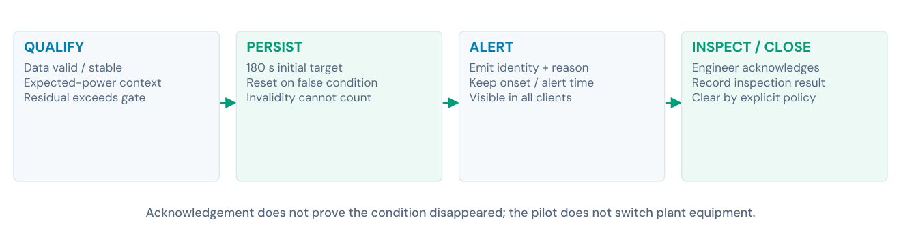](docs/assets/alert_lifecycle.svg)

*Figure — Reference condition and human-workflow sequence. Acknowledged does not mean cleared or repaired.*

An alert has at least two axes: the physical/data condition and the human
handling state. A technician may acknowledge a still-active shortfall, or a
transient may clear before anyone reviews it. Keeping those axes separate
prevents an operator action from erasing the engineering reason for the
event.

| Condition state | Meaning | Workflow consequence |
| --- | --- | --- |
| Not qualifying | Residual/gates do not meet onset rule | No persistent-performance event from this rule |
| Pending | Qualified shortfall has begun but persistence is incomplete | Show context without claiming a qualified alert |
| Active | Persistence/onset policy reached | Create or update a traceable event |
| Condition cleared | Clear policy satisfied | Retain event history and require appropriate closure |
| Data unavailable | Observation cannot support condition decision | Show data-health reason; do not imply recovery |

| Workflow state | Meaning | Required audit |
| --- | --- | --- |
| New | Event not yet reviewed | Event identity, onset, alert time, reason and revision |
| Acknowledged | Authorized person has seen/accepted handling | Actor, action UTC and referenced event revision |
| Inspecting | Approved maintenance process underway | Task/permit scope as applicable |
| Resolved | Action/outcome recorded and closure rule met | Finding, action, verification window and reviewer |
| Closed without repair | Documented explanation or non-fault outcome | Reason and evidence; raw observations preserved |

### Reference event envelope

```json
{
  "example_basis": "documentation fixture, not a recorded event",
  "event_id": "reference-shortfall-event-01",
  "node_id": "bench-node-01",
  "event_type": "persistent_power_shortfall",
  "policy_revision": "REFERENCE-ONLY",
  "revision": 1,
  "condition": {
    "state": "active",
    "onset_utc": "2026-01-01T00:00:00Z",
    "qualified_alert_utc": "2026-01-01T00:03:00Z",
    "residual_fraction": 0.2,
    "threshold_fraction": 0.15,
    "persistence_s": 180,
    "quality_gate": "qualified_reference_fixture"
  },
  "workflow": {
    "state": "new",
    "acknowledged_by": null,
    "acknowledged_utc": null
  },
  "evidence": {
    "first_seq": 120,
    "latest_seq": 300,
    "boot_id": "documentation-boot-01",
    "calibration_id": "REFERENCE-ONLY",
    "config_revision": "REFERENCE-ONLY"
  }
}
```

### Concurrent acknowledgement

A client action should name the event and the revision the operator
reviewed. If another client has already changed that revision, the backend
should apply the released concurrency rule rather than overwriting blindly.
The response must distinguish successful acknowledgement,
already-acknowledged state, permission failure and revision conflict. Exact
API routes are not published here.

```text
reference acknowledgement request:
    event_id
    expected_revision
    actor/session identity from authenticated context
    action type
    optional inspection note

server checks:
    approved site/event scope
    workflow permission
    current event revision
    transition validity
    audit persistence

response semantics:
    action outcome
    resulting event revision
    current condition state
    current workflow state
    authoritative action time
    conflict/retry reason when not accepted
```

### Maintenance closure checklist

- [ ] Confirm the inspected node/zone matches the event identity.
- [ ] Record the approved work scope and physical finding without exposing
  unsafe work instructions.
- [ ] Preserve the original observations, environmental gates and model
  revision.
- [ ] Record the action separately from the acknowledgement.
- [ ] Observe a suitable post-action window with valid data.
- [ ] If the condition persists, keep it active or reopen under a
  documented rule.
- [ ] Distinguish sensor/data repair from a confirmed solar-equipment
  repair.
- [ ] Close with evidence and reviewer identity rather than clearing the
  display alone.

<a id="installation"></a>
## Installation and Development Environment

A runnable product installation requires the actual source or release
artifact, dependency lock, gateway target, configuration schema and start
commands. Those were not present in the inspected public repository root.
This section therefore separates a release handover checklist from
installation of the documentation toolchain included in this package.

### Product-release handover gate

| Item | Why installation depends on it | Present status |
| --- | --- | --- |
| Gateway hardware/architecture | Determines OS image, drivers and artifacts | Exact built hardware not supplied |
| Ubuntu image/release | Determines supported packages and update policy | Ubuntu base confirmed; exact version unspecified |
| Application source/artifact | Provides the executable code | Not published in the inspected root |
| Dependency lock | Pins compatible Python/Qt/network/storage libraries | Not supplied |
| Backend entry point | Defines actual launch command | Not supplied; no invented filename |
| Qt entry point | Defines approved session/display launch | Not supplied |
| Broker configuration | Defines listener, topic scope and credentials | Exact deployed settings unspecified |
| Data path/schema | Defines migration and backup behavior | Reference schema in this handbook only |
| Web/app build artifacts | Defines supported access clients | Built confirmed; release details not supplied |
| Configuration/secrets | Defines safe site identity and access | Reference examples only |
| Calibration record | Defines trusted coefficients/ranges | No executed record supplied |
| Rollback procedure | Defines recovery from an unsuccessful update | Must accompany product release |

### Documentation package layout

```text
ARKA_AI_Documentation/
├── README.md                     # Exactly 5,000 physical lines
├── README.html                   # Offline visual companion
├── requirements-docs.txt          # Documentation dependencies, not product deps
└── docs/
    ├── assets/                   # 38 SVG masters + PNG fallbacks
    │   └── figure_registry.json
    ├── cad/                      # Proposed packaging STEP / source assets
    ├── data/                     # Calculated/planned CSV datasets
    ├── fonts/                    # Embedded figure fonts and OFL licenses
    ├── references/
    │   ├── ARKA_AI_Stage1.pdf
    │   └── ARKA_AI_Ecosystem_Presentation.pdf
    └── tools/
        ├── render_figures.py      # Python diagrams/charts/data
        ├── vector_canvas.py       # Standalone SVG drawing helper
        ├── reference_math.py      # Executable documentation calculations
        ├── test_reference_math.py # Documentation arithmetic/edge-case checks
        ├── check_readme.py        # Line/link/schema/data checks
        ├── build_offline_html.py  # Self-contained visual companion
        ├── build_handbook.py      # Rebuild the authored 5,000-line README
        └── handbook_source/      # Authored chapters and Markdown renderer
```

### Reproduce documentation figures

The following commands operate on this documentation package only. They do
not install or start the ARKA monitoring software. Use a virtual environment
and review dependency versions for the host platform. Font files and their
licenses are bundled so the diagrams do not depend on a remote font service.

```bash
# Start from the extracted documentation-package root.
python3 -m venv .venv
. .venv/bin/activate
python -m pip install --upgrade pip
python -m pip install -r requirements-docs.txt

# Regenerate diagrams, PNG fallbacks and calculated/planned CSV files.
python docs/tools/render_figures.py

# Run documentation calculations and structural checks.
python -m unittest discover -s docs/tools -p 'test_reference_math.py'
python docs/tools/check_readme.py

# Rebuild the offline companion after an intentional README/asset edit.
python docs/tools/build_offline_html.py

# None of these commands launches the unpublished product application.
```

### Release-specific setup sequence

#### Before installing the actual monitoring release

1. Obtain the team-approved artifact/source and verify its
   manifest/checksum.
2. Confirm target hardware, Ubuntu version and storage/display/network
   requirements.
3. Read installation and migration instructions for that exact release.
4. Back up any existing configuration, calibration and historical
   records.
5. Create least-privilege service/operator identities using the approved
   account policy.
6. Install the locked runtime without substituting arbitrary latest
   packages.
7. Provision broker/access secrets outside public source and exported
   diagnostics.
8. Load reviewed site/node mapping and calibration/configuration
   revisions.
9. Run controlled startup, quality and local-connectivity checks.
10. Record acceptance evidence and establish the rollback point before
    handover.

A cloned README is not a runtime application. Avoid a fabricated quick-start
that invokes files the repository does not contain. When the team publishes
a release, replace this handover boundary with tested commands and retain a
record of the supported environment.

<a id="configuration"></a>
## Configuration and Secret Management

Configuration is engineering evidence: it determines channel scope,
thresholds, timing, quality gates and access. The reference YAML below is
deliberately not production-ready. Null fields identify choices that need an
actual reviewed value. Secrets are referenced through protected runtime
storage, never embedded in documentation.

### Reference configuration shape

```yaml
# Reference contract; not an actual released ARKA configuration file.
schema_version: "reference-1"
config_revision: "REFERENCE-ONLY"
site:
  site_id: "bench-site"
  zone_id: "zone-a"
  node_ids:
    - "bench-node-01"
  display_timezone: "Asia/Kolkata"
  storage_time_basis: "UTC"

acquisition:
  cadence_hz: 1
  maximum_voltage_current_pair_age_s: null  # Requires review.
  temperature_max_age_s: null              # Requires review.
  node_queue_capacity_records: 600
  overflow_policy: null                    # Must be documented/tested.

quality:
  live_display_age_target_s: 3
  stale_after_s: 5
  source_clock_uncertainty_limit_s: null
  future_time_tolerance_s: null
  bench_voltage_min_v: 12
  bench_voltage_max_v: 24
  bench_current_max_a: 5
  characterized_temperature_min_c: -10
  characterized_temperature_max_c: 85
  irradiance_analysis_max_w_m2: 1500

transport:
  node_gateway_protocol: "MQTT"
  topic_root: "arka/v1"
  qos: 1
  broker_uri: null                         # Actual approved endpoint.
  credential_reference: null               # Protected secret locator.
  tls_policy: null                         # Actual deployed policy.
  reconnect_backoff_policy: null
  retained_sample_freshness: "source_time_checked"

storage:
  engine: null                             # Release must declare it.
  data_directory: null
  retention_days_target: 30
  node_count_target: 10
  nominal_payload_bytes_assumption: 200
  proposed_device_capacity_gb: 64
  low_space_warning_threshold: null
  low_space_stop_threshold: null
  backup_policy_revision: null

energy:
  method: "trapezoid_with_two_valid_endpoints"
  maximum_interval_s: null                 # Cadence-specific review.
  integrate_across_boot: false
  missing_interval_policy: "exclude_and_report"
  reverse_power_policy: null

analysis:
  expected_output_model_revision: null
  healthy_reference_power_w: null
  reference_irradiance_w_m2: 1000
  reference_temperature_c: 25
  temperature_coefficient_per_c: null
  minimum_expected_power_w: null
  irradiance_gate_min_w_m2: 200
  irradiance_stability_window_s: null
  irradiance_stability_limit: null
  residual_threshold_fraction: 0.15
  persistence_s: 180
  alert_end_to_end_target_s: 210
  quality_gate_loss_policy: "reset_reference_timer"
  condition_clear_threshold_fraction: null
  condition_clear_persistence_s: null

access:
  client_contract_revision: null
  operator_role_policy: null
  administrator_role_policy: null
  session_policy_revision: null
  audit_retention_policy: null

calibration:
  voltage_current_record_id: null
  irradiance_record_id: null
  temperature_record_id: null

# Missing required values should fail review/startup clearly.
# Do not convert a null safety/metrology setting into a permissive default.
```

### Configuration change procedure

#### Apply a controlled revision

1. State the problem, intended change and affected nodes/clients.
2. Review the candidate against the actual schema and operating envelope.
3. Evaluate whether calibration, analysis, energy or access meaning will
   change.
4. Back up the current approved revision and document the rollback
   condition.
5. Obtain the appropriate engineering/administrative approval.
6. Apply the candidate through the released mechanism, not an
   undocumented client-local edit.
7. Verify effective revision and behavior across backend, Qt, website and
   app.
8. Record the transition time; do not relabel earlier records with the
   new revision.
9. Retain the old revision so previous events remain interpretable.

### Secret lifecycle

| Stage | Required handling | Unacceptable practice |
| --- | --- | --- |
| Creation | Approved strong per-scope credentials | Shared public demo password for operational access |
| Provisioning | Protected path/account with least privilege | Credentials pasted into README or screenshot |
| Runtime | Only the required service/account can read | World-readable environment or unrestricted shell access |
| Logging | Redact tokens, passwords and private key material | Publishing raw authorization headers |
| Rotation | Controlled change and reconnect validation | Assuming all clients updated because one connected |
| Revocation | Remove compromised/retired identities | Leaving abandoned node credentials active |
| Backup | Protected/encrypted handling as policy requires | Putting secrets in an unprotected evidence ZIP |
| Publication | Sanitized examples with explicit reference status | A plausible-looking secret that users might deploy |

### Configuration validation failures

| Candidate problem | Required decision |
| --- | --- |
| Unknown schema revision | Reject until supported by the actual release |
| Site/node identity missing | Do not start an ambiguously scoped monitor |
| Clock uncertainty limit absent | Do not assert qualified physical source age |
| Energy maximum interval absent | Require cadence-specific reviewed policy |
| Baseline coefficients absent | Keep raw monitoring; mark model unavailable |
| Stability criterion absent | Do not claim the environmental gate is validated |
| Clear policy absent | Do not invent event-clear behavior in a client |
| Secret reference unreadable | Expose access/dependency fault without logging the secret |
| Calibration ID unknown | Restrict interpretation according to quarantine policy |
| Threshold changed only in one client | Reject divergent local interpretation; reconcile revision |

<a id="deployment"></a>
## Running, Packaging and Deployment

[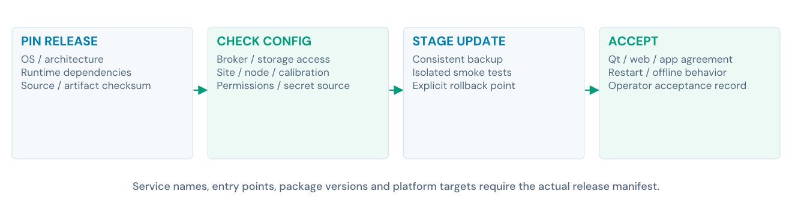](docs/assets/release_contract.svg)

*Figure — Reference handover chain from source/release identity through checksums, configuration, acceptance evidence and rollback.*

The operating environment, backend, Qt UI and remote clients should be
handed over as compatible releases. Do not infer a working deployment from a
repository badge or a successful documentation build. The actual product
package must identify what runs, on what hardware, with which data contract
and which recovery procedure.

### Release manifest shape

```json
{
  "manifest_basis": "reference handover contract; no product release asserted",
  "release_id": null,
  "source_commit": null,
  "artifact_sha256": null,
  "build": {
    "gateway_architecture": null,
    "ubuntu_release": null,
    "python_version": null,
    "qt_pyside_version": null,
    "dependency_lock_sha256": null
  },
  "entrypoints": {
    "backend": null,
    "onsite_ui": null,
    "service_supervisor": null
  },
  "contracts": {
    "telemetry_schema": null,
    "client_contract": null,
    "storage_schema": null,
    "analysis_policy": null,
    "configuration_schema": null
  },
  "clients": {
    "website_release": null,
    "app_release": null,
    "approved_access_description": null
  },
  "operations": {
    "data_directory": null,
    "backup_procedure_revision": null,
    "migration_procedure_revision": null,
    "rollback_procedure_revision": null,
    "acceptance_record_id": null
  },
  "approvals": {
    "release_owner": null,
    "reviewer": null,
    "approval_utc": null
  }
}
```

### Deployment states and gates

| Gate | Required condition | Failure response |
| --- | --- | --- |
| Artifact verification | Source/release and checksum match | Stop; obtain the correct artifact |
| Platform match | Hardware/OS/runtime supported | Do not force-install incompatible packages |
| Backup complete | Config/calibration/history recoverable | Do not migrate without a recovery point |
| Configuration review | Identity, thresholds and secret references approved | Keep prior revision / fail readiness |
| Migration review | Schema path and rollback implications understood | Do not run arbitrary migration SQL |
| Service readiness | Required dependencies actually available | Expose degraded state and diagnose |
| Onsite acceptance | Current identity/time/quality and history agree | Do not call release ready from process liveness |
| Remote acceptance | Website/app observe compatible context | Restrict remote release until compatible |
| Handover | Operator knows limits, support and rollback | Retain maintenance ownership |

### Controlled shutdown

#### Stop without losing meaning

1. Record the reason, operator and expected monitoring interruption.
2. Stop new workflow actions through the approved maintenance mode if
   available.
3. Allow the writer to finish or explicitly report pending/uncommitted
   records.
4. Stop application services using the released supervisor, not arbitrary
   process killing.
5. Close the UI and preserve event/configuration state as designed.
6. Shut down the gateway OS through the approved platform procedure.
7. Remove bench power only after the storage/platform is safe for
   removal.
8. On restart, reconcile last committed identity, backlog and current
   freshness.

### Rollback decision

Rollback is not just restoring executable files. A storage migration,
configuration change or event-policy revision may be incompatible with the
previous binary. The release must define which data/configuration snapshot
is restored, whether newer history is preserved separately and how operators
are informed of the resulting evidence boundary. Rehearse recovery on a
controlled copy before relying on it onsite.

| Rollout fault | Evidence to preserve | Rollback concern |
| --- | --- | --- |
| Backend fails before readiness | Release/config identity and startup error | Do not erase the cause by repeated reinstalling |
| UI fails but backend records | Dependency and writer status | Avoid losing valid history during frontend repair |
| Migration incompatible | Schema version and failed transaction | Use reviewed backup and migration recovery |
| Remote client contract mismatch | Client/backend revisions and rejected fields | Restore compatible client or gateway pair |
| Unexpected threshold behavior | Policy revision and event inputs | Restore policy without rewriting earlier evidence |
| Storage pressure after update | Disk/WAL/log/record sizes | Recover capacity without deleting irreplaceable evidence |

<a id="operator-guide"></a>
## Onsite Engineer Operating Guide

[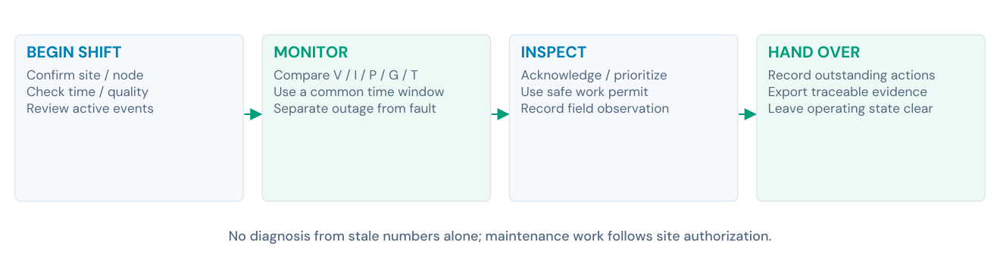](docs/assets/operator_journey.svg)

*Figure — A normal operator session begins with identity/freshness and ends with a traceable inspection or handover.*

### Pre-session checks

- [ ] Confirm the authorized bench/monitoring scope and that no live
  string wiring is implied.
- [ ] Inspect the enclosure, cables and safe disconnect; do not
  open/rewire energized equipment.
- [ ] Confirm site, zone, node and measurement point before reading
  numbers.
- [ ] Verify source time, clock state and last update age.
- [ ] Check sensor/channel quality and backend/storage health.
- [ ] Confirm that displayed thresholds/calibration apply to the selected
  node.
- [ ] Review active events and previous maintenance notes before starting
  a new task.

#### Read a live observation

1. Select the intended node and confirm its identity in the detail view.
2. Check freshness and channel validity before interpreting a value.
3. Read voltage/current/power with units and the actual measurement
   location.
4. Check irradiance and panel temperature alongside a power change.
5. Read the history window to distinguish a persistent pattern from a
   transient.
6. If analysis is gated or unavailable, do not infer a healthy plant
   state.
7. If a persistent event is active, inspect its reason, onset, policy and
   evidence.
8. Acknowledge only through the approved workflow and within your
   authority.

#### Handle a persistent-shortfall event

1. Verify that the event belongs to the selected physical zone/node.
2. Check whether data is current and the environmental gate was
   qualified.
3. Review expected-output assumptions and any known load/curtailment
   condition.
4. Read the residual and persistence history rather than one isolated
   number.
5. Record acknowledgement separately from the intended inspection action.
6. Follow the authorized maintenance/electrical work process; the alert
   is not a permit.
7. Record what was physically found, including a non-fault or sensor
   issue.
8. Observe valid post-action data before recording resolution.
9. Preserve unresolved conditions and hand over clearly if the shift
   ends.

### Decision table at the console

| What you see | First interpretation | Next approved action |
| --- | --- | --- |
| Fresh valid power lower than expected | A qualified deviation may exist | Review environment, baseline and persistent event |
| Stale values on all nodes | Common path may be impaired | Check gateway/broker/time before inspecting every panel |
| One invalid current channel | Electrical data-health issue | Stop power/energy conclusions for that channel |
| Low irradiance with analysis gated | Unsuitable detection context | Wait for qualified conditions; retain history |
| History gap | Unknown interval | Review outage; do not assume no generation |
| Acknowledged but active event | Human has seen an ongoing condition | Continue authorized handling |
| Remote disconnected but Qt live | Remote-path issue possible | Continue local monitoring and report connectivity |
| Storage fault with live values | History may not be durable | Notify maintainer and preserve evidence |

### Shift handover record

```text
Shift / operator:
Site / zone / node:
Application release and configuration revision:
Calibration revision:
Monitoring time window (UTC plus display zone):
Active condition events and event revisions:
Acknowledgements made:
Inspection scope and physical findings:
Any data gaps / uncertain clocks / invalid channels:
Storage / network / service concerns:
Actions taken and authorized by:
Outstanding tasks and owner:
Evidence/export identifiers:
Next review / handover time:
```

Do not clear an alarm merely to make the dashboard green. Do not repeatedly
reboot a node to hide a sensor fault. A useful handover states what is
known, what remains uncertain and what action is authorized next. Preserve
photos/notes securely and avoid public exposure of credentials or sensitive
plant details.

<a id="client-connectivity"></a>
## Website and App Connectivity / Access

Remote access is a distinct boundary from the node MQTT path. The
architecture confirms connected website/app monitoring, but not whether the
built clients use HTTP polling, streaming, WebSocket, another protocol or a
particular hosting model. Review the actual release contract before opening
ports, publishing DNS or configuring authentication.

| Path | Known role | Release questions |
| --- | --- | --- |
| Node → broker/gateway | MQTT telemetry architecture | Broker listener, credential scope, transport security and reconnect |
| Gateway → Qt | Onsite engineering context | Actual process boundary and snapshot/update mechanism |
| Gateway/common data → website | Browser monitoring | Actual route/protocol, hosting, session and cache policy |
| Gateway/common data → app | Companion monitoring | Actual endpoint/protocol, platform and session policy |
| Engineer → gateway administration | Controlled maintenance | Approved identity, network reachability and audit |
| System → plant equipment | No control path in this demonstrator | Any future path requires independent safety/security approval |

### Connection-state vocabulary

| State | Meaning | Must not imply |
| --- | --- | --- |
| Connected | A particular client/path is connected | Every sensor value is valid and fresh |
| Reconnecting | The path is being restored | Historical cached data has become live |
| Unauthorized | Session/scope is not accepted | The plant or node is electrically faulty |
| Contract mismatch | Client/backend versions do not agree | Values should be guessed/coerced |
| Backend unavailable | Remote service cannot supply context | A local sensing failure is proven |
| Node stale | Source observation age exceeded policy | The entire internet connection is down |
| Backfilling | Historical records are arriving | The physical event just occurred |
| Offline cached | Only retained client context is available | Continuous operational coverage |

#### Controlled remote-path acceptance

1. Use only the team-approved endpoint and account scope.
2. Record gateway/backend and client release identities.
3. Select the same node and time window in Qt and the remote client.
4. Compare sample identity, V/I/P, environmental units, quality and event
   revision.
5. Disconnect WAN only while retaining approved local connectivity.
6. Confirm Qt/local history behavior and explicit remote disconnection.
7. Reconnect and compare source time, backlog and live state without
   duplicate events.
8. Test session expiry/logout and scope restriction through approved test
   accounts.
9. Retain sanitized captures and exact conditions for the acceptance
   record.

### No invented endpoint examples

This handbook intentionally avoids a fake production /api/live route, a
guessed public domain or a localhost URL embedded in a website/app guide. If
a browser-based release uses a separate backend, browser code must use the
approved reachable origin/path; the user's device is not the gateway's
loopback interface. Record that actual deployment route in the release
manifest.

### Evidence to attach when access is published

| Artifact | Content |
| --- | --- |
| Access map | LAN/remote boundaries and approved connection method |
| Client contract | Versioned fields, event revisions, errors and cache semantics |
| Role map | Who may read, export, acknowledge and administer |
| Session policy | Expiry, revocation, logout and recovery |
| Certificate/transport policy | Actual trust and provisioning method |
| Compatibility matrix | Gateway/backend and website/app release pairs |
| Recovery record | WAN-off and reconnect test evidence |
| Support note | How to report a failing connection without exposing secrets |

<a id="validation"></a>
## Testing and Validation Strategy

[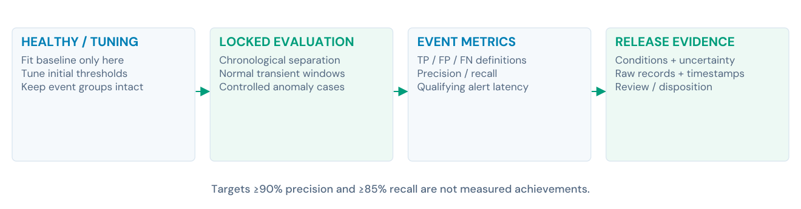](docs/assets/validation_pipeline.svg)

*Figure — Proposed progression from inspection and calibration to fault injection, integration, holdout evaluation and release review. No completed execution is implied.*

Validation should distinguish the documentation's own arithmetic/structure
checks from tests of the actual hardware, runtime and connected clients. The
bundle includes executable checks for formulas and file integrity. It does
not include measured proof that the physical demonstrator or unpublished
application meets its acceptance targets.

### Verification layers

| Layer | Question | Evidence artifact |
| --- | --- | --- |
| Document integrity | Are lines, assets, links and calculations coherent? | Generated documentation quality report |
| Static design review | Do pin maps, domains and ratings make sense? | Reviewed schematic/layout and issue record |
| Metrology | Do calibrated channels meet target under stated uncertainty? | Reference/DUT dataset and signed calibration record |
| Firmware behavior | Do timing, status, identity and buffering behave correctly? | Controlled logs and sequence inventory |
| Backend correctness | Do parsing, dedup, metrics and storage preserve meaning? | Test cases and database/export evidence |
| UI consistency | Do Qt/website/app represent the same context? | Common-fixture captures and comparison |
| Recovery | Do faults degrade and recover explicitly? | Injected-fault timeline and post-recovery audit |
| Analytics | Does held-out event detection meet the stated criteria? | Labeled split, predictions and metrics |
| Release readiness | Can another engineer reproduce/operate/rollback? | Manifest, acceptance record and handover |

### Proposed acceptance matrix

| Test ID | Controlled condition | Expected evidence / decision |
| --- | --- | --- |
| T-EL-01 | Inspect unpowered pin/polarity/domain wiring | Reviewed net/pin map and no return bridge |
| T-EL-02 | Apply approved 12 V low-current point | Stable readings, safe setup and reference comparison |
| T-EL-03 | Apply matrix points up to approved 24 V / 5 A | V/I error and load rating evidence at each point |
| T-EL-04 | Check zero/near-zero current | Absolute noise/offset rule, not relative division by zero |
| T-EL-05 | Inspect shunt heating at maximum planned current | Actual temperature and drift under stated ambient |
| T-IR-01 | Apply documented irradiance reference conditions | Sensor/ADC coefficient and residual evidence |
| T-IR-02 | Check sensor shading/soiling context | Data-quality/inspection response without false certainty |
| T-TM-01 | Compare mounted temperature sensor with reference | Mounting, stabilization and uncertainty record |
| T-TM-02 | Inject temperature CRC/disconnect fault | Invalid/missing state rather than a fake normal value |
| T-FW-01 | Acquire at 1 Hz under expected networking load | Interval distribution and missed-deadline count |
| T-FW-02 | Disconnect network during acquisition | Documented queue/backpressure/loss behavior |
| T-FW-03 | Exercise 600-record backlog target | Capacity and first/last sequence inventory |
| T-FW-04 | Reboot the node | New boot identity and preserved/reset behavior |
| T-FW-05 | Start without UTC | Explicit unsynced state and monotonic uptime |
| T-MQ-01 | Replay duplicate QoS 1 deliveries | One committed key and no duplicate energy |
| T-MQ-02 | Send same key with changed body | Identity fault preserved without overwrite |
| T-MQ-03 | Deliver an old retained observation | Source-age classification remains stale/backfill |
| T-SC-01 | Supply malformed JSON | Controlled reject; backend stays responsive |
| T-SC-02 | Supply unsupported schema | Explicit compatibility error/quarantine |
| T-SC-03 | Supply wrong field type/units | No silent numeric/unit coercion |
| T-SC-04 | Supply null with valid status | Semantic inconsistency rejected/quarantined |
| T-TI-01 | Inject future source time | Clock issue, not negative-age healthy state |
| T-TI-02 | Step source/gateway clock backward | No negative energy interval |
| T-ST-01 | Restart writer during a transaction | Atomic/known commit outcome and integrity check |
| T-ST-02 | Approach storage thresholds | Visible pressure and approved retention response |
| T-ST-03 | Restore a consistent backup on a copy | Integrity plus known records/event/config context |
| T-EN-01 | Integrate a constant-power fixture | Correct Wh using elapsed seconds |
| T-EN-02 | Inject an invalid endpoint/gap | Excluded interval/time retained |
| T-EN-03 | Replay a committed integration interval | No second energy increment |
| T-AI-01 | Residual briefly exceeds threshold | No premature persistent alert |
| T-AI-02 | Residual qualifies continuously for 180 s | Onset/persistence/alert times recorded |
| T-AI-03 | Drop environmental quality during timer | Released reset/hold policy visible |
| T-AI-04 | Use low G or near-zero expected power | Gate/denominator protection rather than unstable score |
| T-AI-05 | Evaluate separated held-out events | Precision, recall, counts and uncertainty reported |
| T-UI-01 | Open Qt before first sample | No live-zero or healthy startup assumption |
| T-UI-02 | Keep UI interactive under update load | Measured interaction/update behavior |
| T-UI-03 | Compare fixture in all three clients | Identity, units, age, quality and event agreement |
| T-EV-01 | Acknowledge an active condition | Workflow changes without clearing condition |
| T-EV-02 | Acknowledge concurrently from two clients | Defined revision/conflict outcome |
| T-NW-01 | Remove WAN only | Onsite path continues if LAN/services remain |
| T-NW-02 | Remove node LAN connectivity | Affected source becomes stale; local history remains |
| T-NW-03 | Restore connectivity with backlog | Idempotent backfill and correct live age |
| T-AC-01 | Use a least-privilege read account | No unauthorized acknowledgement/admin scope |
| T-AC-02 | Expire/revoke session | Explicit access failure without misleading plant alarm |
| T-PK-01 | Inspect enclosure/cable entry | Actual fit and barrier integrity |
| T-PK-02 | Run reviewed thermal condition | Measured ambient/interior/device temperatures |
| T-RL-01 | Deploy and roll back a controlled copy | Compatible data/config recovery |
| T-RL-02 | Complete operator handover | Limits, owner and evidence available |

### Test record template

```yaml
test_record:
  test_id: null
  purpose: null
  status: "not_executed"  # Other states require actual evidence.
  operator: null
  reviewer: null
  execution_utc: null
  dut:
    node_id: null
    board_revision: null
    firmware_revision: null
    gateway_release: null
    config_revision: null
    calibration_revision: null
  setup:
    instruments: []
    source_and_load_ratings: null
    connection_diagram: null
    ambient_conditions: null
    safety_authorization: null
  method:
    preconditions: []
    controlled_input: null
    steps: []
    stop_conditions: []
  acceptance:
    target: null
    uncertainty_policy: null
    decision_rule: null
  observations:
    raw_dataset: null
    timestamps: null
    screenshots_or_photos: []
    unexpected_behavior: null
  result:
    measured_value: null
    uncertainty: null
    pass_fail_inconclusive: null
    limitations: null
  evidence:
    manifest: null
    checksums: []
    review_note: null
```

### Result language

| Use this term | Only when |
| --- | --- |
| Planned | Method/target exists but execution has not occurred |
| Not executed | A scheduled case has no execution record |
| Observed | A specific recorded run produced the stated behavior |
| Passed | The documented acceptance rule and uncertainty policy were met |
| Failed | A valid run did not meet the acceptance criterion |
| Inconclusive | Setup/data/uncertainty prevents a defensible decision |
| Calculated | The value follows from stated inputs and formula |
| Illustrative | The content explains behavior without claiming an actual observation |
| Certified | A relevant authorized certification record genuinely exists |

### Focused acceptance playbooks

#### WAN-only outage playbook

1. Record the active local release, node/source identity and event
   revision.
2. Confirm the planned test interrupts WAN only and does not compromise
   electrical safety.
3. Verify the LAN, gateway, broker and onsite UI are initially
   functioning.
4. Interrupt the approved external access path under authorized
   conditions.
5. Observe whether local acquisition/history and Qt remain useful.
6. Observe website/app disconnection and source-age behavior.
7. Restore access and distinguish backfill from a qualified live
   observation.
8. Compare common event identity/revision and retain sanitized captures.
9. Record pass/fail/inconclusive against the local-first requirement.

#### QoS duplicate/replay playbook

1. Use a controlled test dataset outside operational history.
2. Record the initial committed key and energy-interval inventory.
3. Deliver a reference record followed by an identical redelivery.
4. Confirm one committed observation and no duplicate energy
   contribution.
5. Replay an older source-time record and inspect its history/live
   treatment.
6. Exercise a same-key/different-body fixture through the approved test
   harness.
7. Verify a named identity-conflict outcome rather than silent overwrite.
8. Restart the test subscriber/writer only through the approved
   procedure.
9. Reconcile keys, events and integration intervals after recovery.

#### Freshness/clock playbook

1. Use qualified clocks or a controlled reference-time harness.
2. Record the source, receive and client-visible timestamps
   independently.
3. Stop new observations and verify the stale transition after >5 s.
4. Inject an explicitly labeled unsynchronized-clock fixture.
5. Verify that receive age is not advertised as physical-observation age.
6. Exercise future and nonpositive-time examples without changing a live
   plant clock.
7. Confirm excluded integration intervals and visible clock-quality
   reason.
8. Restore the qualified time basis and review the recovery transition.

#### Cross-client event playbook

1. Select one controlled node/event fixture in Qt, website and app.
2. Compare identity, units, source time, gate and event revision.
3. Perform an authorized acknowledgement from one client.
4. Verify the condition stays active when the physical/data rule remains
   active.
5. Review the resulting workflow/action audit in the other clients.
6. Exercise a stale-revision action using approved test identities.
7. Confirm the released conflict policy and authoritative resulting
   revision.
8. Record any representation mismatch without correcting the fixture
   locally.

<a id="security"></a>
## Security, Privacy and Threat Model

[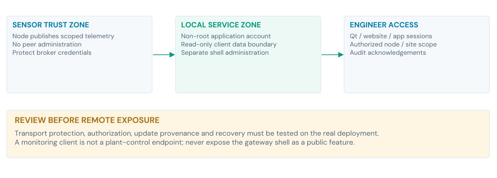](docs/assets/security_zones.svg)

*Figure — Proposed trust boundaries for node, gateway, operator and remote access. The figure is not evidence of a deployed security configuration.*

Monitoring can reveal site performance, maintenance activity and operational
patterns. A read-only application still needs authorization, integrity and
confidentiality controls. Security review must cover node provisioning,
broker access, gateway administration, client sessions, backups, exports and
update artifacts. Do not equate “no switching commands” with “no security
risk”.

| Asset | Threat / failure | Proposed mitigation | Evidence required |
| --- | --- | --- | --- |
| Telemetry integrity | Spoofed node or altered values | Approved identity, topic scope and transport/integrity policy | Provisioning and controlled unauthorized-publish test |
| Historical records | Accidental overwrite or tamper | Append-oriented raw evidence, checksums and access control | Permission/integrity/restore checks |
| Event workflow | Unauthorized acknowledgement or closure | Role checks and revisioned audit | Approved account-scope tests |
| Credentials | Leak in logs, screenshots or repository | Protected secret source and redaction | Sanitized artifact review |
| Gateway availability | Unbounded queue/reconnect/log growth | Bounded resources and low-space/health reporting | Load and outage exercise |
| Remote session | Expired/stolen session retains access | Actual session/revocation policy | Expiry/logout/revocation tests |
| Software supply chain | Unreviewed dependencies or artifact substitution | Locked dependencies, checksums and release review | Manifest and artifact verification |
| Configuration | Wrong threshold/site mapping | Controlled revisions and approval | Before/after effective-revision record |
| Backup | Lost or publicly exposed plant data | Protected storage and recovery policy | Backup-access and restore exercise |
| Physical device | Unintended USB/debug exposure | Approved enclosure/access and maintenance process | Physical inspection and administrative policy |

### Least-privilege role baseline

| Role | Typical monitoring rights | Not automatically granted |
| --- | --- | --- |
| Viewer | Read approved site/node data and event context | Acknowledge, change configuration or obtain shell |
| Operator | Read plus approved event handling | Modify calibration or operating system |
| Maintenance engineer | Approved notes/inspection workflow | Plant switching authority solely from app access |
| Administrator | Controlled application/platform maintenance | Unrestricted public exposure of credentials |
| Reviewer | Sanitized evidence and documentation | Operational accounts or private site access |

### Privacy and evidence handling

- Minimize personal names and sensitive plant-location details in public
  exports.
- Obtain appropriate permission before publishing maker, laboratory,
  faculty or site photographs.
- Keep credentials, session material, private keys and unredacted internal
  network details out of review packages.
- Retain enough actor identity for an authorized operational audit without
  publishing unnecessary personal data.
- Document where exported files are stored and who may access them.
- Use an approved deletion/retention policy; do not improvise deletion of
  evidence during an incident.
- Treat test accounts and simulated fixtures as distinct from operational
  identities.
- A public repository link is not an invitation to expose a gateway
  directly to the internet.

### Incident response outline

#### Preserve, contain, recover

1. Record the observed symptom, scope and UTC time without exposing
   secrets.
2. Preserve relevant logs, event revisions, configuration and artifact
   identities.
3. Notify the authorized owner and restrict the affected access path as
   policy allows.
4. Keep plant protection and electrical safety independent of monitoring
   recovery.
5. Review whether telemetry/history/workflow integrity is affected.
6. Rotate/revoke compromised credentials through the approved
   provisioning path.
7. Restore a reviewed release/configuration or backup on a controlled
   basis.
8. Verify identity, quality, history and client consistency before normal
   handover.
9. Record lessons and the evidence boundary; do not silently delete the
   incident.

No penetration test, security certification or production-hardening result
has been supplied. The measures above are a review baseline. Actual
deployment controls and their acceptance evidence belong in the release
record.

### Broker/access scope review — reference

| Identity class | Minimum intended scope | Forbidden shortcut |
| --- | --- | --- |
| Sensor node | Its approved site/node telemetry/health publication | Publish to another node or arbitrary wildcard topic |
| Gateway ingestion | Approved telemetry subscription scope | Use a universal administrator credential for convenience |
| Monitoring reader | Approved client data scope | Read private broker/system topics without need |
| Event operator | Approved event-action scope | Change sensor calibration or platform users |
| Administrator | Explicit maintenance scope | Leave broad credentials in client code |
| Retired node | No active operational credential | Retain access indefinitely after removal |

### Sanitization before evidence publication

| Material | Remove / protect | Retain for interpretation |
| --- | --- | --- |
| Logs | Secrets, tokens and unnecessary private addresses | UTC, error category and sanitized record identity |
| Screenshots | Passwords, personal accounts and sensitive site detail | Build, node/time/quality context where approved |
| Exports | Unauthorized site/person identifiers | Units, window, revisions and coverage |
| Configuration | Secret values and private credential paths | Schema, nonsecret thresholds and revision |
| Video | Visible credentials and unauthorized people/sites | Authentic behavior and stated test conditions |
| Backup manifest | Sensitive access locations or key material | Checksums, schema and restoration context |

<a id="troubleshooting"></a>
## Troubleshooting and Failure Diagnosis

[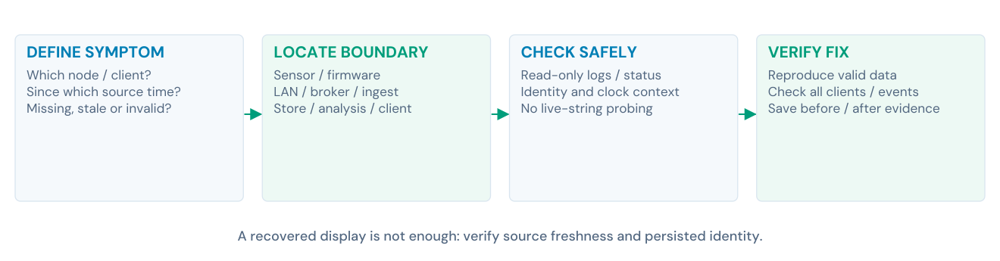](docs/assets/fault_isolation.svg)

*Figure — Diagnose by failed boundary: platform → node → transport → persistence → analysis → presentation. Avoid destroying evidence through indiscriminate restarts.*

Begin with scope and evidence. Is the failure visible for one node, all
nodes, only one client or only historical export? Preserve
release/configuration, source/receive time, boot/sequence and event revision
before changing the system. An apparently recovered display is insufficient
if history, source freshness or event state remains inconsistent.

| Symptom scope | First boundary to inspect | Do not assume |
| --- | --- | --- |
| One sensor channel | Conversion, wiring, status and calibration | The entire gateway is faulty |
| One node, all channels | Node power, boot, link and topic identity | Every physical solar component failed |
| All nodes simultaneously | Broker, gateway, common network and time | Every node independently lost calibration |
| Qt only | Session/display/thread/data adapter | Ingestion has stopped |
| Website only | Remote path/session/client compatibility | Onsite monitoring is unavailable |
| App only | App lifecycle, cache, access and release | Current source values are being received |
| History only | Writer, window/time basis and retention | Live display guarantees durable history |
| Anomaly score only | Input gates, baseline and policy revision | Missing analysis means healthy operation |
| Energy only | Interval identity, gaps and time | Summing visible points yields trustworthy kWh |

<details>
<summary>Expandable diagram source</summary>

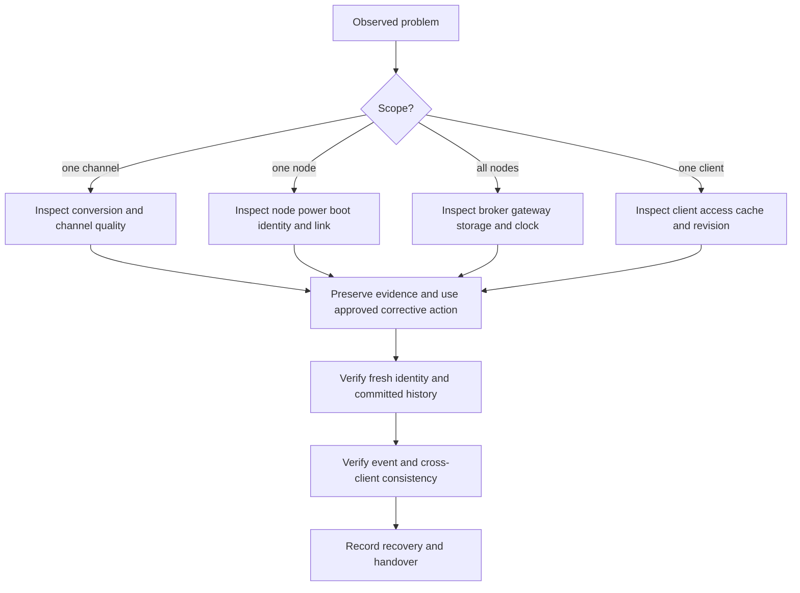

</details>

#### The gateway boots but monitoring is not ready

A Linux login or running process does not prove application readiness.
Inspect failed dependencies, effective configuration, storage availability
and broker connection in that order. Record the exact startup error and
release identity before applying the approved recovery procedure. Do not
manufacture an application command from the documentation package.

#### The Qt window is blank or does not open

Separate display/session/plugin problems from backend health. Check the
actual Qt release, display/session configuration and application log.
Determine whether ingestion/history continues before restarting the backend.
Use only the release-specific launch path and retain a sanitized
screen/error record.

#### The Qt interface freezes during updates

Inspect UI-thread ownership, blocking I/O and render-queue growth in the
actual code. Compare writer/analysis progress with interface interaction.
Reducing chart rendering load may help diagnose the boundary but must not
silently discard stored measurements or suppress quality faults.

#### One node becomes stale

Check last source time, last receive time, boot identity, sequence and
broker/topic scope. Inspect safe node power and LAN status before assuming a
plant fault. Recovery must demonstrate a genuinely current observation, not
merely the arrival of old backlog.

#### All nodes become stale together

Review gateway clock, broker, common network and ingestion readiness.
Compare OS time state with the last received records. A common-path failure
is more plausible than simultaneous independent sensor faults, but preserve
evidence rather than making a diagnosis from likelihood alone.

#### Voltage looks plausible but current is wrong

Inspect shunt polarity, Kelvin lead placement, configured resistance/current
LSB and signed-register interpretation with the bench de-energized as
required by the approved procedure. Compare against a suitable reference
within the safe scope. Register CAL=2048 is scaling arithmetic, not proof of
current calibration.

#### Irradiance clips or has the wrong scale

Confirm the actual sensor sensitivity, ADC PGA/input configuration, unit
conversion and calibration record. Check sensor orientation, shade and
soiling. Do not apply a lux-to-irradiance assumption or change the baseline
to hide a sensing-chain problem.

#### Temperature is missing or implausible

Inspect conversion completion, CRC, power/pull-up arrangement and mounting.
A sensor contact problem can mimic a physical thermal change. Mark the
channel invalid/missing and gate temperature-dependent analysis until
qualified data returns; do not reuse an old temperature without age context.

#### Power differs between clients

Compare node and sample identity before comparing rounding. Check V/I
pairing, unit mapping, derived-metric revision and cache/source time. A
website showing a different observation can disagree numerically without the
multiplication being wrong; the client must make that distinction visible.

#### Energy jumps after reconnect

Investigate duplicate committed intervals, replay ordering, source-time
discontinuities and gap policy. Review unique node/boot/sequence keys and
integration-revision identity. Do not “fix” the display by subtracting
energy manually; preserve the raw records and correct a versioned
derivation.

#### Energy appears flat through an outage

A qualified integrator can stop accumulating because contribution is
unknown, not because generation stopped. Inspect excluded duration and
endpoint validity. Present partial energy and its coverage window rather
than silently interpolating across the outage.

#### A residual spike creates too many alerts

Review irradiance stability, V/I/environment timing, baseline applicability
and persistence behavior. Confirm that a quality-gate loss resets/holds
according to the published rule. Do not raise thresholds without a
controlled policy revision and a false-alert/missed-event review.

#### An acknowledged alert is still active

This can be correct: acknowledgement is a human workflow action, while
active describes the condition. Review the physical finding, current
qualified input and clear policy. Do not use acknowledgement as a substitute
for a verified maintenance outcome.

#### The website/app shows old data as live

Inspect source timestamp, clock status, caching and reconnect logic. Compare
the same source record in Qt. The remote adapter must not reset observation
age on receipt or redraw; retain offline/backfill state until a qualified
current sample is available.

#### The database cannot accept writes

Preserve the error, disk/mount state, free space and pending-record count.
Follow the release-specific space/retention/repair policy. A live card can
continue changing while nothing is durable, so expose the write fault. Do
not delete the only copy of history or blindly copy an active WAL database.

#### A clock step corrupts age or integration

Retain source UTC, receive UTC and monotonic timing context. Exclude
invalid/nonpositive intervals and quarantine implausible future observations
under the reviewed policy. A time-service restart is not permission to
relabel earlier samples or bridge an uncertain interval.

#### A reconnect creates duplicate event entries

Check whether event identity is stable across subscriber restart and replay.
Compare policy revision, onset and source evidence. Telemetry deduplication
and event idempotency are separate responsibilities; one cannot be assumed
from the other.

#### Remote access fails while onsite monitoring works

Check the approved access path, session, client/backend compatibility and
WAN status. Preserve local monitoring if its dependencies are healthy. Do
not expose the broker or gateway shell publicly as an improvised
remote-access fix.

### Recovery acceptance

| Recovered boundary | Evidence needed before closing the issue |
| --- | --- |
| Sensor | Valid conversions and an appropriate reference comparison |
| Node | Current source time, boot/sequence continuity and channel quality |
| Transport | Expected topic/identity, bounded backlog and duplicate handling |
| Writer | Committed rows, integrity and no lost/duplicated interval claim |
| Analysis | Applicable policy/model, qualified inputs and explainable event state |
| Qt | Responsive interaction and a qualified current snapshot |
| Remote client | Correct source age, scope and event revision |
| Whole system | Common node/window agreement plus recorded cause/action |

<a id="observability"></a>
## Observability, Backup and Preventive Maintenance

[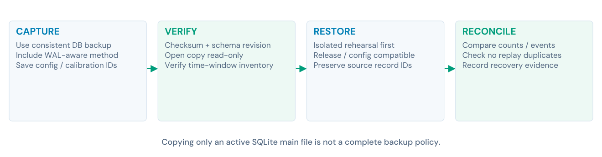](docs/assets/backup_recovery.svg)

*Figure — Consistent backup → manifest/checksum → protected retention → restore on a controlled copy → verify records and operating context.*

### Health inventory

| Health signal | Interpretation | Follow-up |
| --- | --- | --- |
| Platform uptime/reset | Gateway continuity | Compare with application/node boot context |
| Node boot identity | Firmware restart boundary | Review reset reason and sequence |
| Source/receive horizon | Observation versus ingestion progress | Check backlog or clock uncertainty |
| Channel validity counts | Sensor-path health | Inspect recurring channel-specific reasons |
| Broker reconnect count | Transport stability | Review common network/power conditions |
| Pending queue depth | Backpressure/backlog | Check bounds and live-data scheduling |
| Duplicate/conflict counts | Delivery repetition versus identity error | Investigate changed-body collisions separately |
| Write failures | Persistence health | Check disk, mount, schema and permissions |
| Free space / WAL / logs | Capacity pressure | Use approved retention/checkpoint policy |
| Analysis-gated duration | Unavailable performance conclusions | Review environment and data quality |
| Event action failures | Workflow/access/revision conflicts | Review authorization and concurrency outcome |
| Backup age and restore status | Recoverability | Schedule/rehearse recovery rather than trusting file existence |

### Reference backup manifest

```json
{
  "manifest_basis": "reference backup contract",
  "backup_id": null,
  "created_utc": null,
  "source_release": null,
  "schema_revision": null,
  "configuration_revision": null,
  "calibration_revisions": [],
  "window": {
    "first_source_utc": null,
    "last_source_utc": null,
    "last_committed_identity": null
  },
  "contents": {
    "telemetry": null,
    "events_and_actions": null,
    "configuration": null,
    "calibration": null,
    "necessary_metadata": null
  },
  "consistency_method": null,
  "sha256_manifest": null,
  "secret_handling": null,
  "storage_access_scope": null,
  "restore_check": {
    "performed_utc": null,
    "target_copy": null,
    "integrity_outcome": null,
    "known_record_checks": []
  }
}
```

#### Create and verify a backup

1. Identify the actual storage engine and approved consistency method.
2. Capture release/schema/configuration/calibration identities.
3. Use a supported online backup or controlled shutdown snapshot as
   appropriate.
4. Do not assume copying only an active SQLite main file includes current
   WAL state.
5. Include event actions and metadata needed to interpret telemetry.
6. Create checksums and a time/window manifest without exposing secrets.
7. Store under the approved access and retention policy.
8. Restore to an isolated controlled copy, not over the only operational
   dataset.
9. Run integrity checks and compare known telemetry/event identities.
10. Record restore outcome, limitations and reviewer.

### Preventive-maintenance cadence — proposed

| Cadence / trigger | Activity | Evidence |
| --- | --- | --- |
| Before each bench session | Cables, enclosure, current limit and identity/freshness | Operator pre-check |
| Daily while operating | Review gaps, stale duration, storage and active events | Operational health note |
| Weekly while operating | Review reconnects, recurring sensor faults and backup status | Trend and action record |
| Scheduled metrology interval | Compare against suitable references | Calibration/check record |
| After reassembly | Inspect contacts, mounting and isolation boundaries | Reassembly verification |
| After software change | Verify contracts, configuration and rollback | Release acceptance record |
| After unexpected reset | Review power, reset and data continuity | Incident/recovery note |
| Before public submission | Sanitize evidence and verify links/assets | Publication checklist |

A maintenance schedule needs actual operating experience and the
sensor/instrument manufacturer guidance. The intervals above are a proposed
working rhythm, not a claim that the team has already completed recurring
field service. Escalate unexpected heating, damaged wiring or uncertain
isolation through the authorized electrical process rather than continuing a
documentation-led experiment.

<a id="mechanical"></a>
## CAD, Packaging and Thermal Studies

[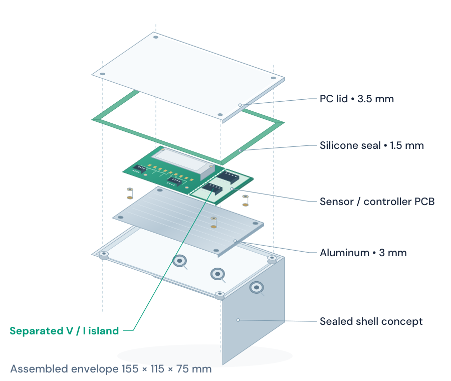](docs/assets/enclosure_assembly.svg)

*Figure — Proposed seven-part sensor-node assembly. STEP exchange geometry is supplied; it is not a fabricated or ingress-tested enclosure.*

The mechanical concept packages the sensing node, not the Ubuntu gateway.
Its purpose is to examine board allocation, cable routing, mounting and
service access before detailed fabrication. The STEP files are concept
geometry and do not establish material certification, manufacturing
tolerances, fastener strength, sealing or electrical insulation performance.

| Concept element | Nominal input | Status / constraint |
| --- | --- | --- |
| Outer envelope | 155 × 115 × 75 mm | Proposed sensor-node case |
| Shell wall | 3 mm | Concept dimension; manufacturing review pending |
| Lid thickness | 3.5 mm | Concept dimension |
| Gasket thickness | 1.5 mm | Compression/groove/sealing design not validated |
| Aluminum backplate | 125 × 85 × 3 mm | Proposed mechanical/thermal support |
| Main PCB envelope | 110 × 70 × 1.6 mm | Envelope only; no routed board supplied |
| Controller envelope | 62 × 25 mm | Placement allowance, not verified 3D component clearance |
| Interface subassembly | Separate concept envelope | Actual connector/cable clearance to be checked |
| Ingress goal | IP65 | Untested design target, not an assigned rating |

[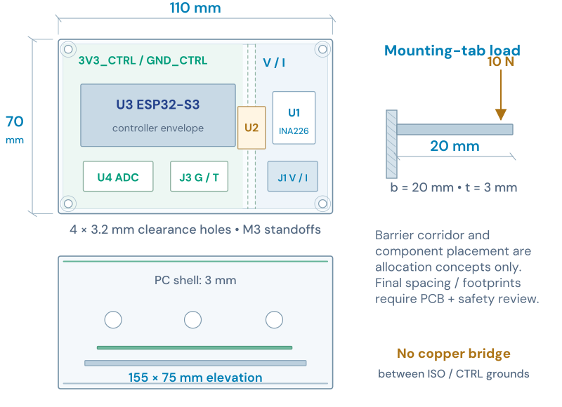](docs/assets/mechanical_layout.svg)

*Figure — Concept board placement, cable/service clearances and analytical mounting-load assumptions. This is not native EDA, FEA or a fabrication drawing.*

### Delivered CAD assets

| File | Content |
| --- | --- |
| `01_pc_body_concept.step` | Case body concept |
| `02_pc_lid_concept.step` | Lid concept |
| `03_silicone_gasket_concept.step` | Gasket concept |
| `04_aluminum_backplate_concept.step` | Backplate concept |
| `05_pcb_envelope.step` | PCB envelope |
| `06_controller_envelope.step` | Controller envelope |
| `07_isolated_interface_envelope.step` | Interface envelope |
| `ARKA_AI_enclosure_assembly_CONCEPT.step` | Combined concept assembly |
| `dimensions.json` | Nominal dimension record |
| `CAD_README.txt` | Concept use/limitations |

All files above are in [docs/cad](docs/cad/). STEP exchange files can be
inspected in a compatible CAD tool. They are not a native manufacturing
release. Reconcile actual component models, connector insertion paths, cable
bend radii and assembly tolerances before producing hardware.

### Cantilever hand calculation

```text
Assumed rectangular aluminum mounting tab:
    F = 10 N
    free length L = 20 mm
    width b = 20 mm
    thickness t = 3 mm
    elastic modulus E = 69000 N/mm²

Small-deflection cantilever end-load model:
    sigma = 6 F L / (b t²)
          = 6 × 10 × 20 / (20 × 3²)
          = 6.67 N/mm² = 6.67 MPa
    delta = 4 F L³ / (E b t³)
          = 4 × 10 × 20³ / (69000 × 20 × 3³)
          ≈ 0.00859 mm

This ignores holes, fillets, contact, fasteners, vibration and fatigue.
No material yield, factor of safety or FEA result is established.
Use the actual geometry and alloy for release review.
```

### Thermal budget

[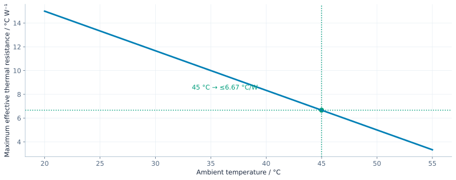](docs/assets/thermal_budget.svg)

*Figure — Calculated maximum effective thermal resistance versus ambient temperature at 3 W and a 65 °C interior limit. Solar heating is excluded and no temperature measurement is plotted.*

```text
Proposed screening condition:
    internal dissipation = 3 W
    ambient = 45 °C
    target interior temperature <=65 °C
    allowable rise = 20 °C
    required effective thermal resistance <=20 / 3
                                         <=6.67 °C/W

The effective value represents the whole heat-rejection path.
It is not the junction-to-ambient rating of a single component.
Direct solar load, wind, mounting and cable heat paths are excluded.
Those effects require a revised model and actual thermal testing.
```

### Mechanical acceptance review

- [ ] Inspect actual component/connector heights and the full assembly
  sequence.
- [ ] Check that cable glands, strain relief and service loops do not
  compromise isolation.
- [ ] Review fastener access, torque, board support and removal without
  wire damage.
- [ ] Assess gasket compression and material compatibility using the
  actual manufactured case.
- [ ] Measure temperatures under controlled load/ambient and record sensor
  placement.
- [ ] Review outdoor UV, condensation, corrosion and thermal cycling if
  the scope expands.
- [ ] Retain IP65 as a target until an appropriate assembly test
  establishes performance.
- [ ] Do not label a hand calculation or STEP view as finite-element
  evidence.

### Fit and assembly tolerance review

| Interface | Dimension / tolerance to establish | Failure prevented |
| --- | --- | --- |
| PCB to supports | Hole positions, boss height and board clearance | Board stress or unsupported connectors |
| Lid to body | Mating faces, fastener engagement and tolerance stack | Interference or loose closure |
| Gasket to groove | Compression, width and corner continuity | Untested seal assumed from nominal thickness |
| Cable to gland | Actual cable diameter, grip and bend radius | Ingress path or conductor strain |
| Plate to case | Fastener access, contact and electrical isolation | Unexpected thermal/ground path |
| Controller to lid | Component height and cable/service loop | Crushed components or inaccessible connectors |
| Isolation region | Actual clearance to conductors and hardware | Barrier defeated by mounting or routing |
| Service opening | Removal sequence and wire retention | Damage during inspection |

Nominal outer dimensions alone cannot prove internal fit. A finished concept
should be checked with actual component models and an assembly sequence.
Keep any future manufacturing drawing revision distinct from the envelope
STEP files supplied here.

<a id="bom-budget"></a>
## BOM, Budget and Procurement Assumptions

The following costs are planning estimates in INR. They are not supplier
quotations, purchased inventory or procurement confirmations. Quantities
reflect one proposed demonstrator with shared irradiance-reference and
gateway resources. Taxes, delivery, exchange-rate changes, tooling and
replacements require an actual procurement review.

| Item | Proposed part / scope | Quantity | Line estimate |
| --- | --- | --- | --- |
| Controller | ESP32-S3-DevKitC-1-N8R8 | 1 | ₹1,300 |
| V/I measurement | INA226 + 10 milliohm / ≥1 W Kelvin shunt | 1 set | ₹650 |
| Isolation | ISO1540 + B0505S-1WR3 + TLV76033 | 1 set | ₹1,100 |
| Irradiance ADC | ADS1115 breakout | 1 | ₹300 |
| Panel temperature | DS18B20, cable and mount | 1 | ₹250 |
| Irradiance reference | Apogee SP-110-SS | 1 | ₹32,000 |
| Gateway planning allowance | Raspberry Pi 4B 4 GB, 64 GB card and supply | 1 set | ₹6,800 |
| Node supply | External 5 V / 3 A; proposed GST18A05-P1J | 1 | ₹1,000 |
| Enclosure/mounting | Case, gasket, glands and aluminum plate | 1 set | ₹1,600 |
| PCB/protection | 2-layer FR4 and protective components | 1 set | ₹1,200 |
| Harness/passives | Terminals, cable, fuse and passives | 1 set | ₹500 |

[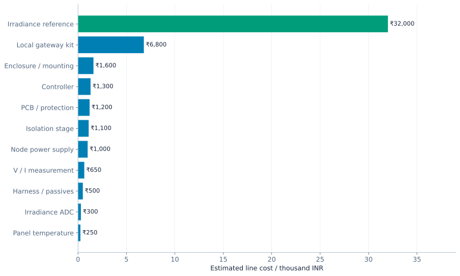](docs/assets/budget_breakdown.svg)

*Figure — Estimated line-cost distribution. The pyranometer and gateway are shared planning resources; the chart does not show actual expenditure.*

```text
Estimated subtotal = ₹46,700
Contingency = 20% × ₹46,700 = ₹9,340
Estimated total with contingency = ₹56,040

Node-only scope in this cost model:
    ₹46,700 − ₹32,000 reference − ₹6,800 gateway = ₹7,900

This is not a production unit price or per-zone installed cost.
Shared sensor placement and gateway capacity must be reviewed.
Gateway BOM identity does not identify the actual built Ubuntu target.
```

### Procurement assumptions

| Resource | Planning lead-time assumption | Unverified issue |
| --- | --- | --- |
| Common controller/analog parts | India, approximately 1–2 weeks | Actual stock, suffix and authentic source |
| Pyranometer | Import, approximately 3–6 weeks | Quote, customs, calibration record and delivery |
| Gateway/storage kit | India, approximately 1–2 weeks | Actual target compatibility and sustained-write suitability |
| Case/plate/harness | Local, approximately 1–2 weeks | Material, gland, finish and sealing details |
| PCB | Local, approximately 1–2 weeks | Reviewed layout, fabrication files and assembly yield |

### Quote-comparison checklist

- [ ] Match full orderable suffix, package, grade and supplied calibration
  where relevant.
- [ ] Record quote date, currency, taxes, freight, warranty and validity.
- [ ] Confirm that a breakout module's analog path and pull-ups match the
  reviewed schematic.
- [ ] Evaluate substitute parts against measurement, isolation, logic and
  thermal requirements.
- [ ] Review enclosure/gland material and actual environmental scope.
- [ ] Retain supplier authenticity and incoming-inspection records.
- [ ] Separate shared-resource cost from incremental node cost.
- [ ] Update the budget revision without claiming that a quote has become
  a purchase.

The machine-readable estimate is
[proposed_bom.csv](docs/data/proposed_bom.csv). Preserve its estimate and
lead-time qualifications in any proposal derived from it. Procurement
evidence should include actual quotations or invoices only after they
genuinely exist.

<a id="performance"></a>
## Performance Targets and Measurement Methodology

| Metric | Target / planning assumption | Method | Result status |
| --- | --- | --- | --- |
| Acquisition | 1 Hz | Source-interval distribution and missed-deadline count | Not supplied |
| Onsite display age | ≤3 s | Qualified source-time to visible-snapshot age | Not supplied |
| Stale state | After >5 s | Controlled timeout and state capture | Not supplied |
| Node buffer | 600 records, roughly 10 minutes at 1 Hz | Sequence inventory and overflow/recovery review | Not supplied |
| Retention scale | 10 nodes over 30 days | Actual on-disk growth, indexes/WAL/logs/backup | Not supplied |
| V/I accuracy | ≤1% above 0.5 A after calibration | Reference-point error with uncertainty policy | Not supplied |
| Power accuracy | ≤2% after calibration | Direct matched-point power comparison | Not supplied |
| Persistent residual | >15% for 180 s with valid/stable G ≥200 W/m² | Condition/onset/gate/timer timeline | Not supplied |
| Visible alert | ≤210 s for a qualifying event | Onset to visible qualified event | Not supplied |
| Precision | ≥90% on held-out labeled events | TP/(TP+FP), counts and uncertainty | Not supplied |
| Recall | ≥85% on held-out labeled events | TP/(TP+FN), counts and uncertainty | Not supplied |
| Thermal screen | 3 W; 45 °C ambient; interior ≤65 °C | Controlled instrumented thermal run | Not supplied |

[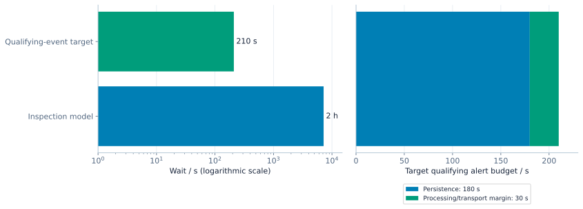](docs/assets/latency_model.svg)

*Figure — Illustrative allocation of the 210-second alert budget. The allocation is a model, not a measured latency trace or percentile distribution.*

### Latency instrumentation

| Timestamp | Definition | Why it matters |
| --- | --- | --- |
| t_condition | Controlled/verified qualifying condition onset | Defines what the delay is measured from |
| t_observation | Node acquisition time for the evidence | Separates sensing delay |
| t_receive | Gateway envelope arrival | Separates transport/backlog delay |
| t_commit | Known persistence outcome | Separates a live path from durable evidence |
| t_qualified | Persistence/analysis condition qualified | Identifies intentional decision delay |
| t_client | Snapshot/event visible in the chosen client | Completes the user-visible delay |
| t_acknowledge | Human acknowledgement | Separate workflow time, not system detection latency |

The initial 210 s target contains 180 s of persistence plus 30 s allowed for
the surrounding sensing/transport/processing/display path. Measure the
actual end-to-end distribution with synchronized clocks or a justified
shared observation method. Report count, conditions, median, upper
percentiles and maximum rather than one favorable screenshot.

### Illustrative inspection-wait comparison

```text
Model assumptions:
    manual inspection rounds are 4 hours apart;
    a fault begins uniformly between rounds;
    average manual wait = 4 / 2 = 2 hours = 7200 seconds;
    monitoring alert delay is the proposed 210-second target.

Modeled waiting-time reduction:
    (7200 − 210) / 7200 × 100 = 97.0833...%

Separate large-plant arithmetic illustration:
    affected capacity = 5 kW (not the bench demonstrator rating)
    shortfall = 10%
    opportunity power = 0.5 kW
    over 2 hours = 1.0 kWh
    over 210 seconds = 0.0291667 kWh

Neither calculation is a measured yield or revenue recovery.
Actual repair time, fault distribution and downtime are not included.
An earlier alert does not guarantee an earlier authorized repair.
```

### Illustrative confusion-matrix arithmetic

These are invented counts solely to explain evaluation, not ARKA validation
data: TP=18, FP=2, FN=3 and TN=77. The totals show why a headline accuracy
value is not enough for maintenance events. The real release must report its
own labeled-event inventory and separated holdout.

| Metric | Calculation from the illustrative counts | Value |
| --- | --- | --- |
| Precision | 18 / (18 + 2) | 90.00% |
| Recall | 18 / (18 + 3) | 85.71% |
| Specificity | 77 / (77 + 2) | 97.47% |
| Accuracy | (18 + 77) / 100 | 95.00% |
| F1 | 2 × 18 / (2 × 18 + 2 + 3) | 87.80% |

### Measurement report fields

| Field | Required reporting content |
| --- | --- |
| Scope | Node/plant condition and measurement location |
| Release | Firmware, gateway, client, config and model revisions |
| Clock basis | Synchronization method and uncertainty |
| Dataset | Record/event count, window and exclusions |
| Method | Controlled input or verified natural-event definition |
| Statistics | Distribution and uncertainty, not only the best case |
| Failures | Lost data, timeouts, resets and rejected events |
| Acceptance | Criterion, guardband and pass/fail/inconclusive outcome |
| Traceability | Raw records, export manifest and checksums |
| Limitations | Conditions where the result cannot be generalized |

### Executable documentation arithmetic

The following bundled module makes the numerical examples reproducible. It
is documentation tooling, not recovered product source and not an
implemented hardware/backend release. Running its tests verifies only these
formulas and edge cases. The tests do not establish sensor accuracy, timing,
app behavior, plant performance or certification.

```python
"""Executable documentation calculations, not ARKA product implementation.

Inputs are explicit numerical examples. Nothing in this module reads hardware,
connects to a broker, validates plant safety or establishes measured performance.
"""
from dataclasses import dataclass
from math import isfinite


def finite_number(value, name):
    """Reject booleans, missing values and nonfinite arithmetic inputs."""
    if isinstance(value, bool) or not isinstance(value, (int, float)):
        raise ValueError(f"{name} must be a numeric value")
    if not isfinite(value):
        raise ValueError(f"{name} must be finite")
    return float(value)


def power_w(voltage_v, current_a):
    """Arithmetic power at one defined DC measurement point."""
    v = finite_number(voltage_v, "voltage_v")
    i = finite_number(current_a, "current_a")
    return v * i


def shunt_values(current_a, resistance_ohm=0.010):
    """Return shunt drop and dissipation; not a thermal rating check."""
    i = finite_number(current_a, "current_a")
    r = finite_number(resistance_ohm, "resistance_ohm")
    if r <= 0:
        raise ValueError("resistance must be positive")
    return {"voltage_v": i * r, "dissipation_w": i * i * r}


def ina226_scaling(current_lsb_a=0.00025, shunt_ohm=0.010):
    """Return ideal CAL arithmetic and power LSB, not metrology results."""
    lsb = finite_number(current_lsb_a, "current_lsb_a")
    r = finite_number(shunt_ohm, "shunt_ohm")
    if min(lsb, r) <= 0:
        raise ValueError("current LSB and shunt resistance must be positive")
    return {"cal_ideal": 0.00512 / (lsb * r), "power_lsb_w": 25 * lsb}


def irradiance_w_m2(sensor_mv, sensitivity_mv_per_w_m2=0.2):
    """Use an explicit pyranometer sensitivity; do not convert lux."""
    mv = finite_number(sensor_mv, "sensor_mv")
    sensitivity = finite_number(sensitivity_mv_per_w_m2, "sensitivity")
    if sensitivity <= 0:
        raise ValueError("sensitivity must be positive")
    return mv / sensitivity


def shortfall_fraction(expected_w, measured_w, floor_w):
    """Return guarded residual only above the reviewed expected-power floor."""
    expected = finite_number(expected_w, "expected_w")
    measured = finite_number(measured_w, "measured_w")
    floor = finite_number(floor_w, "floor_w")
    if floor <= 0:
        raise ValueError("power floor must be positive")
    if expected <= floor:
        return None
    return (expected - measured) / max(expected, floor)


@dataclass(frozen=True)
class PowerPoint:
    node_id: str
    boot_id: str
    elapsed_s: float
    power_w: float | None
    valid: bool


def energy_interval(previous, current, maximum_interval_s=2.0):
    """Return Wh, excluded seconds and reason for exactly one interval."""
    maximum = finite_number(maximum_interval_s, "maximum_interval_s")
    if maximum <= 0:
        raise ValueError("maximum interval must be positive")
    t0 = finite_number(previous.elapsed_s, "previous elapsed time")
    t1 = finite_number(current.elapsed_s, "current elapsed time")
    dt = t1 - t0
    if dt <= 0:
        return {"wh": 0.0, "excluded_s": 0.0, "reason": "nonpositive_time"}
    same_source = (previous.node_id, previous.boot_id) == (
        current.node_id, current.boot_id
    )
    values = (previous.power_w, current.power_w)
    numbers_ok = all(
        isinstance(v, (int, float)) and not isinstance(v, bool) and isfinite(v)
        for v in values
    )
    if not same_source:
        reason = "identity_discontinuity"
    elif not previous.valid or not current.valid or not numbers_ok:
        reason = "invalid_endpoint"
    elif dt > maximum:
        reason = "gap_exceeds_policy"
    else:
        wh = 0.5 * sum(values) * dt / 3600.0
        return {"wh": wh, "excluded_s": 0.0, "reason": "valid"}
    return {"wh": 0.0, "excluded_s": dt, "reason": reason}


def persistence_series(times_s, residuals, gates, threshold=0.15,
                       required_s=180.0, maximum_interval_s=2.0):
    """Reference reset-on-gap/gate-loss policy using elapsed time."""
    if not (len(times_s) == len(residuals) == len(gates)):
        raise ValueError("input series lengths must agree")
    if required_s <= 0 or maximum_interval_s <= 0:
        raise ValueError("persistence and maximum interval must be positive")
    started = None
    previous_t = None
    previous_qualified = False
    result = []
    for t, residual, gate in zip(times_s, residuals, gates):
        t = finite_number(t, "elapsed time")
        residual_ok = (
            isinstance(residual, (int, float))
            and not isinstance(residual, bool)
            and isfinite(residual)
        )
        qualified = bool(gate) and residual_ok and residual > threshold
        dt = None if previous_t is None else t - previous_t
        continuous = dt is not None and 0 < dt <= maximum_interval_s
        if not qualified:
            started = None
        elif not continuous or not previous_qualified:
            started = t
        elapsed = 0.0 if started is None else t - started
        result.append({"persistence_s": elapsed,
                       "qualified_alert": qualified and elapsed >= required_s})
        previous_t = t
        previous_qualified = qualified
    return result


def raw_storage_bytes(nodes=10, payload_bytes=200, hz=1, days=30):
    """Raw payload arithmetic; indexes/WAL/logs/backups are excluded."""
    values = [finite_number(v, n) for v, n in zip(
        (nodes, payload_bytes, hz, days), ("nodes", "payload_bytes", "hz", "days")
    )]
    if any(v < 0 for v in values):
        raise ValueError("capacity inputs must be nonnegative")
    n, size, rate, duration = values
    return n * size * rate * 86400 * duration


def thermal_limit_c_per_w(dissipation_w=3, ambient_c=45, limit_c=65):
    """Whole-path effective thermal-resistance screen, excluding solar load."""
    p = finite_number(dissipation_w, "dissipation_w")
    ambient = finite_number(ambient_c, "ambient_c")
    limit = finite_number(limit_c, "limit_c")
    if p <= 0 or limit <= ambient:
        raise ValueError("positive dissipation and temperature rise required")
    return (limit - ambient) / p


def cantilever_screen(force_n=10, length_mm=20, width_mm=20,
                      thickness_mm=3, modulus_n_mm2=69000):
    """Rectangular end-load small-deflection screen, not FEA."""
    f, length, width, thick, modulus = [finite_number(v, n) for v, n in zip(
        (force_n, length_mm, width_mm, thickness_mm, modulus_n_mm2),
        ("force", "length", "width", "thickness", "modulus")
    )]
    if f < 0 or min(length, width, thick, modulus) <= 0:
        raise ValueError("invalid cantilever geometry/load")
    return {"stress_mpa": 6 * f * length / (width * thick ** 2),
            "deflection_mm": 4 * f * length ** 3 / (modulus * width * thick ** 3)}


def confusion_metrics(tp, fp, fn, tn):
    """Illustrative count arithmetic; undefined rates return None."""
    counts = (tp, fp, fn, tn)
    if any(isinstance(v, bool) or not isinstance(v, int) or v < 0 for v in counts):
        raise ValueError("counts must be nonnegative integers")
    divide = lambda n, d: n / d if d else None
    return {"precision": divide(tp, tp + fp), "recall": divide(tp, tp + fn),
            "specificity": divide(tn, tn + fp),
            "accuracy": divide(tp + tn, sum(counts)),
            "f1": divide(2 * tp, 2 * tp + fp + fn)}


def waiting_time_reduction(round_interval_s=14400, alert_s=210):
    """Uniform-between-rounds model; not measured yield recovery."""
    rounds = finite_number(round_interval_s, "round_interval_s")
    alert = finite_number(alert_s, "alert_s")
    if rounds <= 0 or alert < 0:
        raise ValueError("invalid waiting-time assumptions")
    mean_wait = rounds / 2
    return (mean_wait - alert) / mean_wait
```

### Arithmetic and edge-case test source

These unit tests are included so another reviewer can reproduce the
documentation checks. Their fixtures are labeled references; none is an
actual plant event or captured prototype result. Execute them with the
documentation command shown in Installation.

```python
"""Tests of documentation examples, not physical/software acceptance results."""
import unittest
from reference_math import (
    PowerPoint, power_w, shunt_values, ina226_scaling, irradiance_w_m2,
    shortfall_fraction, energy_interval, persistence_series, raw_storage_bytes,
    thermal_limit_c_per_w, cantilever_screen, confusion_metrics,
    waiting_time_reduction,
)


class DocumentationArithmeticTests(unittest.TestCase):
    def point(self, t, p=60.0, valid=True, boot="reference-boot", node="reference-node"):
        return PowerPoint(node, boot, t, p, valid)

    def test_hmi_power_fixture(self):
        self.assertAlmostEqual(power_w(21.6, 3.2), 69.12)

    def test_power_rejects_nonfinite(self):
        with self.assertRaises(ValueError):
            power_w(float("nan"), 1)

    def test_power_rejects_boolean(self):
        with self.assertRaises(ValueError):
            power_w(True, 1)

    def test_shunt_drop_at_five_amperes(self):
        self.assertAlmostEqual(shunt_values(5)["voltage_v"], 0.050)

    def test_shunt_dissipation_at_five_amperes(self):
        self.assertAlmostEqual(shunt_values(5)["dissipation_w"], 0.25)

    def test_ina_calibration_scaling(self):
        self.assertAlmostEqual(ina226_scaling()["cal_ideal"], 2048)

    def test_ina_power_lsb(self):
        self.assertAlmostEqual(ina226_scaling()["power_lsb_w"], 0.00625)

    def test_nominal_pyranometer_conversion(self):
        self.assertAlmostEqual(irradiance_w_m2(160), 800)

    def test_hmi_shortfall_fixture(self):
        self.assertAlmostEqual(shortfall_fraction(88.3, 69.12, 1), 0.2172140430)

    def test_denominator_floor_gates_analysis(self):
        self.assertIsNone(shortfall_fraction(0.5, 0.2, 1))

    def test_one_hour_constant_power(self):
        result = energy_interval(self.point(0), self.point(3600), 3600)
        self.assertAlmostEqual(result["wh"], 60)
        self.assertEqual(result["reason"], "valid")

    def test_trapezoid_example(self):
        result = energy_interval(self.point(0, 60), self.point(5, 80), 5)
        self.assertAlmostEqual(result["wh"], 70 * 5 / 3600)

    def test_invalid_endpoint_excludes_elapsed_time(self):
        result = energy_interval(self.point(0), self.point(1, None, False))
        self.assertEqual(result["wh"], 0)
        self.assertEqual(result["excluded_s"], 1)
        self.assertEqual(result["reason"], "invalid_endpoint")

    def test_long_gap_is_not_interpolated(self):
        result = energy_interval(self.point(0), self.point(10), 2)
        self.assertEqual(result["excluded_s"], 10)
        self.assertEqual(result["reason"], "gap_exceeds_policy")

    def test_boot_boundary_is_not_bridged(self):
        result = energy_interval(self.point(0), self.point(1, boot="new-boot"))
        self.assertEqual(result["reason"], "identity_discontinuity")

    def test_node_boundary_is_not_bridged(self):
        result = energy_interval(self.point(0), self.point(1, node="other-node"))
        self.assertEqual(result["reason"], "identity_discontinuity")

    def test_nonpositive_time_adds_no_energy(self):
        result = energy_interval(self.point(10), self.point(9))
        self.assertEqual(result["reason"], "nonpositive_time")
        self.assertEqual(result["wh"], 0)

    def test_first_qualifying_sample_starts_at_zero(self):
        result = persistence_series([120], [0.20], [True])
        self.assertEqual(result[0]["persistence_s"], 0)
        self.assertFalse(result[0]["qualified_alert"])

    def test_180_seconds_reached_at_300(self):
        times = list(range(120, 301))
        result = persistence_series(times, [0.20] * len(times), [True] * len(times))
        self.assertFalse(result[-2]["qualified_alert"])
        self.assertTrue(result[-1]["qualified_alert"])
        self.assertEqual(result[-1]["persistence_s"], 180)

    def test_gate_loss_resets_reference_timer(self):
        result = persistence_series([0, 1, 2], [0.2] * 3, [True, False, True])
        self.assertEqual(result[-1]["persistence_s"], 0)

    def test_gap_resets_reference_timer(self):
        result = persistence_series([0, 1, 10], [0.2] * 3, [True] * 3)
        self.assertEqual(result[-1]["persistence_s"], 0)

    def test_threshold_is_strictly_greater_than(self):
        result = persistence_series([0, 1], [0.15, 0.15], [True, True])
        self.assertFalse(any(r["qualified_alert"] for r in result))

    def test_raw_retention_model(self):
        self.assertEqual(raw_storage_bytes(), 5_184_000_000)

    def test_verbose_payload_changes_capacity(self):
        self.assertEqual(raw_storage_bytes(payload_bytes=400), 10_368_000_000)

    def test_effective_thermal_screen(self):
        self.assertAlmostEqual(thermal_limit_c_per_w(), 20 / 3)

    def test_cantilever_stress(self):
        self.assertAlmostEqual(cantilever_screen()["stress_mpa"], 6.6666666667)

    def test_cantilever_deflection(self):
        self.assertAlmostEqual(cantilever_screen()["deflection_mm"], 0.0085882984)

    def test_confusion_fixture_is_not_a_validation_result(self):
        result = confusion_metrics(18, 2, 3, 77)
        self.assertAlmostEqual(result["precision"], 0.90)
        self.assertAlmostEqual(result["recall"], 18 / 21)

    def test_no_events_has_undefined_rates(self):
        self.assertTrue(all(v is None for v in confusion_metrics(0, 0, 0, 0).values()))

    def test_negative_event_counts_rejected(self):
        with self.assertRaises(ValueError):
            confusion_metrics(-1, 0, 0, 0)

    def test_modeled_wait_reduction(self):
        self.assertAlmostEqual(waiting_time_reduction(), 0.9708333333333333)

    def test_invalid_assumptions_rejected(self):
        for calculation in [
            lambda: shunt_values(1, 0),
            lambda: ina226_scaling(0, 0.010),
            lambda: irradiance_w_m2(100, 0),
            lambda: thermal_limit_c_per_w(0),
            lambda: waiting_time_reduction(0),
        ]:
            with self.subTest(calculation=calculation):
                with self.assertRaises(ValueError):
                    calculation()


if __name__ == "__main__":
    unittest.main()
```

<a id="risk-register"></a>
## Risk Register and Safety Mitigations

This is a proposed engineering risk register, not a signed plant safety
assessment. Priority labels indicate review urgency, not measured
probability. Qualified personnel must review electrical and deployment
hazards for the actual setup. Certified protection and authorized work
processes remain independent of the monitoring platform.

| Risk ID | Hazard / failure | Priority | Mitigation / release gate |
| --- | --- | --- | --- |
| R-01 | Direct live-string connection to the bench circuit | Critical | Prohibit; use a separately engineered rated interface |
| R-02 | Isolation defeated by USB, ground or probe path | High | Review every return/instrument connection before energizing |
| R-03 | Shunt/load wiring overheats | High | Rated source/load/conductors, current limit and thermal review |
| R-04 | Stale last-known value looks live | High | Source-age/quality visible across all clients |
| R-05 | Invalid channel becomes a normal zero | High | Null/status contract and fault-injection tests |
| R-06 | Duplicate replay inflates energy | High | Immutable key plus interval idempotency |
| R-07 | Clock discontinuity corrupts time/energy | High | Clock quality, monotonic timing and interval exclusions |
| R-08 | Environmental transients cause false alerts | Medium | Stable/valid irradiance gate and persistence review |
| R-09 | Baseline misses real faults or mislabels normal conditions | High | Applicable model and separated labeled evaluation |
| R-10 | Storage exhaustion silently loses history | High | Capacity margin, write-health state and retention policy |
| R-11 | Unauthorized remote access or event action | High | Least privilege, approved transport and workflow audit |
| R-12 | Unsafe expectation of predictive certainty | High | Explain scope; no unvalidated failure-date guarantee |
| R-13 | Enclosure solar heating exceeds internal limit | High | Outdoor heat-load model and measured thermal test |
| R-14 | Untested IP goal mistaken for certification | High | Keep target label; obtain actual assembly evidence |
| R-15 | Configuration/calibration changes erase context | Medium | Revisioned raw/derived records and controlled change |
| R-16 | Release migration destroys recoverability | High | Consistent backup and rehearsed rollback |
| R-17 | Public evidence exposes secrets or personal/site data | Medium | Sanitized publication review and permission |
| R-18 | Website/app assumes monitoring grants control authority | High | Separate read/workflow/admin/control permissions |

### Stop conditions for a demonstration

- Unexpected heating, smell, visible damage, unstable supply or unsafe
  exposed conductors.
- Uncertain polarity, unknown instrument ground path or isolation-domain
  bridge.
- A source/load rating or operating point outside the approved bench
  scope.
- An invalid/unqualified measurement being used to justify an electrical
  action.
- A required safety/work authorization or qualified supervisor is absent.
- A condition that cannot be made safe through the approved
  shutdown/disconnect procedure.

### Residual-risk ownership

| Area | Review owner role | Evidence before expanding scope |
| --- | --- | --- |
| Electrical interface | Qualified electrical reviewer | Ratings, topology, protection and insulation review |
| Metrology | Measurement/calibration reviewer | Traceable calibration and uncertainty decision |
| Firmware/data | Firmware/backend maintainer | Identity, time, loss and replay verification |
| Analytics | Model/validation owner | Labeled evaluation, confounders and limits |
| Operations | Authorized site/maintenance owner | Work process and handover |
| Security | Deployment/access owner | Actual controls and tested permissions |
| Mechanical/environment | Packaging reviewer | Fit, thermal and ingress evidence |

A future release can accept, mitigate or reject a risk only with a named
owner and supporting evidence. This document deliberately does not declare
residual risk acceptable for a real plant installation.

<a id="maker-journey"></a>
## Maker Journey and Implementation Milestones

[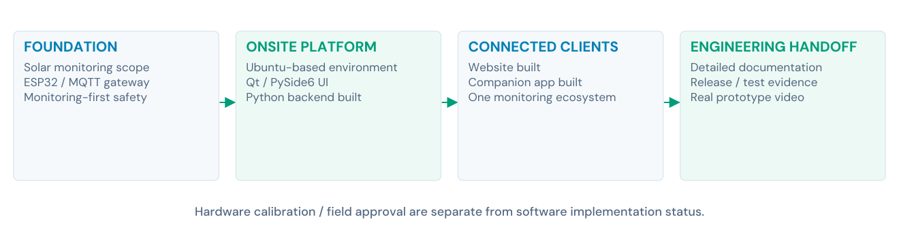](docs/assets/maker_progress.svg)

*Figure — Progression from the original sensing concept to the team-confirmed embedded/software ecosystem, followed by evidence publication and forward validation.*

The maker journey starts with the original Stage 1 submission: ESP32-S3
sensing, MQTT, a local gateway, Python/PySide6 visualization, local history
and edge analysis for solar monitoring. That document established the system
intent and staged validation direction. It did not establish the part-level
circuit, measured accuracy or certification.

The team subsequently confirms the implementation of an Ubuntu
command-line-based embedded environment, Qt UI, Python backend, website and
companion app. The project therefore extends beyond a single dashboard
concept into an onsite/connected monitoring ecosystem. These are
implementation milestones reported by the team, not future capabilities
invented for this handbook.

The engineering documentation expands the original concept into explicit
interfaces, calculations, proposed packaging, a budget and testable
acceptance criteria. This work supports review and reproducibility; it does
not convert a drawing or numerical target into completed hardware evidence.
Publishing source, captures and executed records is the next evidence step.

| Milestone | Basis | Status meaning |
| --- | --- | --- |
| Identify solar monitoring problem and users | Original Stage 1 project submission | Documented foundation |
| Define ESP32-S3 / MQTT / gateway chain | Original Stage 1 architecture | Documented architecture |
| Build Ubuntu-based onsite platform | Explicit team statement | Implemented software milestone confirmed by team |
| Build Qt / Python engineering stack | Explicit team statement | Implemented software milestone confirmed by team |
| Build website and companion app | Explicit team statement | Implemented connected-client milestone confirmed by team |
| Integrate monitoring ecosystem | Explicit team statement | Shared ecosystem confirmed; exact mechanics await publication |
| Develop part-level low-voltage reference | Engineering proposal and manufacturer references | Proposed design |
| Develop enclosure and analytical screens | STEP concept and calculations | Concept / calculated, not fabricated or FEA |
| Define validation/acceptance protocol | This handbook and engineering presentation | Planned verification |
| Publish reproducible release and real captures | Required handover artifacts | Publication gap to close |
| Execute physical/integration/holdout tests | Actual signed datasets and reports required | No supplied result claimed |

### What changed from the original submission

| Original foundation | Documented extension | Boundary retained |
| --- | --- | --- |
| Local Python/PySide6 HMI | Ubuntu-based onsite engineering environment | No claim of a newly written operating-system kernel |
| Local monitoring/history | Qt plus website and companion app ecosystem | Remote network access is not WAN-independent |
| Edge analysis and maintenance support | Explicit baseline, residual, persistence and audit contracts | No guaranteed failure-date prediction |
| Staged prototype validation | Pin-level reference, calibration plan and fault matrix | No fabricated calibration or pass results |
| Future multi-zone/security/SCADA | Versioned contracts and forward roadmap | Future integration is not presented as deployed |

### Evidence that will strengthen the journey

- [ ] Authentic device/lab photographs with permission and truthful
  captions.
- [ ] Actual Qt, website and app captures with release and source-time
  context.
- [ ] A published runtime source/artifact and dependency/configuration
  manifest.
- [ ] Executed calibration, reconnect, retention and cross-client test
  records.
- [ ] A real prototype recording that shows the implemented ecosystem and
  its limits.
- [ ] A maintained issue/release history connecting findings to revisions.

No faculty endorsement, maker photograph, manufacturing milestone, award,
procurement record or production deployment is invented. Add those only from
authentic project evidence and retain the distinction between demonstrated
behavior and planned expansion.

<a id="roadmap"></a>
## Roadmap and Future Development

[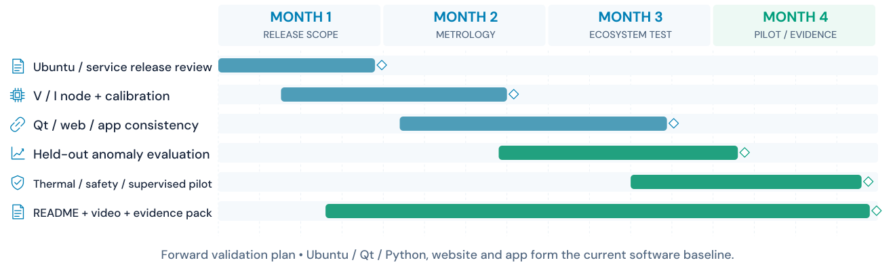](docs/assets/verification_roadmap.svg)

*Figure — Relative four-month forward verification plan. Month labels are planning phases, not dates of completed work.*

| Relative phase | Work package | Exit evidence |
| --- | --- | --- |
| Month 1 | Reconcile runtime release, node identities and pin-level design; establish metrology | Release manifest, reviewed schematic and calibration method |
| Month 2 | Execute bench conversion/timing/replay tests and common-client fixtures | Datasets, screenshots and fault/recovery inventory |
| Month 3 | Run environmental/confounder studies and held-out event evaluation | Labeled split, metrics, limits and false-alert burden |
| Month 4 | Exercise retention/backup/rollback, review risks and publish demo evidence | Acceptance pack, operator guide, real video and known-issue list |

### Expansion gates

| Future capability | Prerequisite | Not implied today |
| --- | --- | --- |
| More zones/nodes | Measured capacity, identity and time-quality review | Unlimited fleet scalability |
| SCADA/inverter integration | Approved read-only interface and vendor mapping | Direct inverter control |
| Node-battery visibility | Reviewed voltage sensing and chemistry/load context | Validated SOC or remaining-life prediction |
| Fleet analytics | Cross-site schema, access and comparable data-quality policy | Deployed multi-site cloud platform |
| Advanced predictive models | Representative labels and leakage-controlled evaluation | A trained model with guaranteed failure dates |
| Outdoor deployment | Rated interface, environment/thermal/sealing evidence | IP65 certification from a concept case |
| Remote hardening | Published actual protocol/authentication and tested controls | Production security certification |
| Plant control | Independent safety/control architecture and approvals | Authority to switch equipment through this monitor |

Prioritize evidence and correctness before additional screens or headline
metrics. A smaller reproducible demonstrator with clear quality handling is
more defensible than a broad feature list that cannot be traced to
artifacts. Treat dates, owners and dependencies as a real project plan once
the team approves them; the relative phases above are not commitments on
behalf of unnamed members.

### Suggested issue categories

- Runtime publication and reproducible build.
- Node identity, timing and channel-quality verification.
- Metrology and physical assembly evidence.
- Cross-client consistency and access behavior.
- Replay, persistence, retention and restore.
- Baseline confounders and labeled-event evaluation.
- Packaging, thermal and environmental qualification.
- Operator handover, video publication and known limitations.

<a id="prototype-video"></a>
## Prototype Video and Review Evidence

> **JUDGES / REVIEWERS: [OPEN THE PROJECT DOCUMENTATION](docs/references/ARKA_AI_Stage1.pdf) · [OPEN THE ECOSYSTEM REVIEW](docs/references/ARKA_AI_Ecosystem_Presentation.pdf) · [OPEN THE CANONICAL REPOSITORY](https://github.com/DAnuraag/VK26-IITH-SE-0021).**

> **PROTOTYPE VIDEO — A verified playback URL has not been supplied. Video publication is pending; this handbook does not link to a fabricated or unavailable recording.**

### Evidence index

| Artifact | What it supports | What it does not establish |
| --- | --- | --- |
| [Original Stage 1 PDF](docs/references/ARKA_AI_Stage1.pdf) | Primary project architecture and intended scope | Measured implementation performance |
| [Ecosystem presentation PDF](docs/references/ARKA_AI_Ecosystem_Presentation.pdf) | Software scope, engineering proposals and review narrative | A complete released runtime or executed tests |
| [Architecture figures](#architecture) | Logical system/data boundaries | Actual deployment topology by themselves |
| [Proposed circuit](#electrical) | Pin-level low-voltage reference review | Routed PCB or plant-safe interface |
| [Calculated/planned data](docs/data/figure_index.csv) | Reproducible technical-documentation charts | Plant telemetry or metrology results |
| [CAD concepts](docs/cad/) | Packaging/placement concept | Fabrication, FEA, ingress or thermal qualification |
| [Validation strategy](#validation) | Testable methods and acceptance targets | Completed or passed test cases |
| [Public repository](https://github.com/DAnuraag/VK26-IITH-SE-0021) | Canonical review/publication location | Unpublished source, releases or a missing video |

### Recommended genuine recording sequence

#### When the team records the prototype

1. Show project identity, actual device and approved low-voltage test
   arrangement.
2. Identify the release and the source of displayed readings.
3. Demonstrate the Ubuntu-based onsite environment without exposing
   secrets.
4. Show the real Qt UI and Python-backed monitoring context.
5. Show the actual website and app using the same node/event context.
6. Demonstrate an authorized controlled data-quality or connectivity
   case.
7. Show the system distinguishing stale/backfill from a current
   observation.
8. Explain the proposed alert criteria and distinguish any simulated
   fixture.
9. Show an acknowledgement/inspection workflow if implemented in the
   demonstrated release.
10. State the current limits and evidence still being collected.
11. Publish an accessible verified playback URL and add its date/build
    context here.

### Publication readiness

- [ ] The video link opens for the intended reviewers without an
  undisclosed access requirement.
- [ ] Every screenshot/photo is authentic or explicitly labeled
  illustrative.
- [ ] No password, token, private key, internal account or sensitive site
  detail is visible.
- [ ] The build, test conditions and any injected examples are stated.
- [ ] Numeric results have a dataset/method rather than only a narration.
- [ ] The README and asset folder are published together so relative
  figures load.
- [ ] Known limitations and pending test cases remain visible.

<a id="references"></a>
## Glossary, References and Documentation Conventions

### Glossary

| Term | Meaning in this project |
| --- | --- |
| ADC | Analog-to-digital converter; conversion resolution is not complete system accuracy. |
| Age | Elapsed time since a qualified source observation, not merely a client redraw. |
| Alert | A qualified event communicated for review; not a work permit or protection trip. |
| App | The team-confirmed companion monitoring client; exact platform is unpublished. |
| Backfill | Historical records arriving after their observation window. |
| Baseline | Expected healthy output at the relevant measurement point and conditions. |
| Boot identity | An identity distinguishing one actual node run from another. |
| Calibration | A traceable relationship between reference and measured/corrected values. |
| Channel quality | A sensor-specific validity, missing, uncertainty or range decision. |
| Clock quality | The trust/uncertainty associated with source time. |
| Configuration revision | The version of thresholds, scope and policies effective for a record. |
| CRC | Cyclic redundancy check; an integrity check used by supported sensor protocols. |
| Current LSB | Current represented by one configured monitor register count. |
| Data health | Condition of sensing, clocks, transport and persistence, not solar performance. |
| DC | Direct current; the proposed measurement point is a low-voltage DC point. |
| Deduplication | Preventing repeated transport delivery from duplicating a committed record. |
| DUT | Device under test. |
| Edge analysis | Processing near the onsite monitoring data rather than requiring continuous WAN. |
| Energy coverage | The intervals that contributed qualified energy, alongside excluded duration. |
| Event revision | Version of event condition/workflow context used for consistent actions. |
| Expected output | Modeled healthy output under stated assumptions, not guaranteed generation. |
| FEA | Finite-element analysis; no completed native FEA is supplied here. |
| Fresh | Source age is within policy and has a suitable clock basis. |
| Gateway | Onsite computing/data boundary separate from the ESP32-S3 node. |
| HMI | Human-machine interface for engineering monitoring. |
| Holdout | Evaluation data separated from fitting/tuning to reduce leakage. |
| I²C | Two-wire serial bus; isolated domains still need separate electrical review. |
| Idempotency | Repeating a delivery/action does not create an unintended second effect. |
| Ingress target | A desired enclosure protection level, not an untested certification. |
| Irradiance | Radiant power per area in W/m²; not illuminance in lux. |
| Kelvin sensing | Separate sense connections reduce load-path lead-drop error. |
| kWh | Kilowatt-hour; 1000 Wh, an energy unit rather than power. |
| LAN | Local-area network; distinct from external WAN availability. |
| LDO | Low-dropout regulator; headroom, stability and heat still require review. |
| Local-first | Onsite operation need not depend on continuous WAN when local dependencies survive. |
| MQTT | Messaging transport used in the node-to-gateway architecture. |
| Node | Field acquisition controller with explicit identity and boot/sequence context. |
| Persistence | Durable storage outcome, not merely broker/client receipt. |
| Precision | Fraction of predicted positive events that are confirmed positive. |
| Pyranometer | Radiometric solar-irradiance instrument with calibration/mounting requirements. |
| QoS 1 | MQTT at-least-once delivery behavior; duplicates remain possible. |
| Qt / PySide6 | Qt for Python technology used by the onsite engineering UI. |
| Recall | Fraction of true positive events that are detected. |
| Reference contract | A proposed explicit interface/example, not an assertion of unpublished keys. |
| Residual | Normalized difference between expected and measured output under valid gates. |
| SCADA | Supervisory control/data-acquisition ecosystem; future integration needs approval. |
| SOC | State of charge; node battery voltage alone does not establish a validated SOC model. |
| Source time | When the node observed the measurement, with clock-quality context. |
| Stale | A last-known observation older than the reference freshness threshold. |
| STEP | CAD exchange format used for proposed assembly geometry. |
| UTC | Common storage/record time basis; client display timezone is separate. |
| WAL | Write-ahead log; backup consistency must account for the actual storage mode. |
| WAN | Wide-area connectivity; not required for every local engineering function. |
| Wh | Watt-hour; power integrated over qualified elapsed time. |

### Source hierarchy

- Inspected implementation/configuration/test artifacts establish exact
  release mechanics and measured results.
- Explicit team statements establish the reported implemented software
  scope.
- The original Stage 1 PDF establishes the foundational architecture and
  intended project scope.
- Proposed designs, calculated examples and future tests are identified as
  such.
- The public repository README is supporting documentation, not
  independent evidence of completed tests.

### Primary project references

| Reference | Purpose |
| --- | --- |
| [Canonical repository](https://github.com/DAnuraag/VK26-IITH-SE-0021) | Project review and future publication hub |
| [Original Stage 1 submission](docs/references/ARKA_AI_Stage1.pdf) | User-selected primary architecture/requirements source |
| [Ecosystem review presentation](docs/references/ARKA_AI_Ecosystem_Presentation.pdf) | Current project narrative and proposed engineering studies |
| [Proposed BOM CSV](docs/data/proposed_bom.csv) | Estimated costs and unverified lead-time assumptions |
| [Figure index](docs/data/figure_index.csv) | Asset names, descriptions and evidence basis |

### Manufacturer references

| Reference | Use / limitation |
| --- | --- |
| [TI INA226 product](https://www.ti.com/product/INA226) · [datasheet](https://www.ti.com/lit/ds/symlink/ina226.pdf) | Pinout, range and register scaling; not assembled-system accuracy |
| [TI ISO1540](https://www.ti.com/product/ISO1540) · [datasheet](https://www.ti.com/lit/ds/symlink/iso1540.pdf) | Isolated bus behavior and ratings; not assembly working-voltage approval |
| [TI ADS1115](https://www.ti.com/product/ADS1115) · [datasheet](https://www.ti.com/lit/ds/symlink/ads1115.pdf) | ADC PGA/rate/input behavior; not irradiance system accuracy |
| [ESP32-S3 DevKitC-1 guide](https://docs.espressif.com/projects/esp-dev-kits/en/latest/esp32s3/esp32-s3-devkitc-1/user_guide_v1.1.html) | Variant-specific pin/power review |
| [Apogee SP-110-SS](https://www.apogeeinstruments.com/sp-110-ss-self-powered-pyranometer/) · [manual](https://www.apogeeinstruments.com/content/SP-110-manual.pdf) | Radiometric sensitivity, calibration and mounting |
| [Analog Devices DS18B20](https://www.analog.com/en/products/ds18b20.html) | Temperature conversion, CRC and stated accuracy range |
| [Mornsun B_S-1WR3 reference](https://www.mornsun-power.com/public/uploads/pdf/B_S-1WR3.pdf) | Unregulated converter/load/isolation review |
| [TI TLV760](https://www.ti.com/lit/gpn/TLV760) | LDO headroom, current, bypass and thermal review |

### Software and standards references

| Reference | Use / limitation |
| --- | --- |
| [Ubuntu Server documentation](https://documentation.ubuntu.com/server/) | Linux administration reference; does not identify the actual deployed version |
| [Qt for Python](https://doc.qt.io/qtforpython-6/) | Qt/PySide programming and threading reference |
| [Python documentation](https://docs.python.org/3/) | Language/runtime reference; actual version must be released |
| [MQTT 3.1.1](https://docs.oasis-open.org/mqtt/mqtt/v3.1.1/os/mqtt-v3.1.1-os.html) | Delivery semantics reference, not deployed-broker evidence |
| [JSON Schema 2020-12](https://json-schema.org/draft/2020-12) | Reference schema vocabulary/validation |
| [SQLite backup documentation](https://www.sqlite.org/backup.html) | Consistent-backup reference for the proposed engine |
| [IEC 61724-1:2021](https://webstore.iec.ch/en/publication/65561) | PV monitoring reference; no claimed system classification/compliance |
| [IEC 61010-1](https://webstore.iec.ch/en/publication/4279) | Safety reference; no certification claimed |
| [IEC IP-rating overview](https://www.iec.ch/ip-ratings) | Ingress terminology; IP65 remains an untested goal |

### Visual atlas

| Figure / editable SVG | PNG fallback | Basis |
| --- | --- | --- |
| [ecosystem overview](docs/assets/ecosystem_overview.svg) | [PNG](docs/assets/ecosystem_overview.png) | Stage 1 scope + team-confirmed software capabilities |
| [ecosystem architecture](docs/assets/ecosystem_architecture.svg) | [PNG](docs/assets/ecosystem_architecture.png) | Logical architecture; detailed contracts are reference design |
| [ecosystem workflow](docs/assets/ecosystem_workflow.svg) | [PNG](docs/assets/ecosystem_workflow.png) | Documented user journey extended with connected clients |
| [electrical connections](docs/assets/electrical_connections.svg) | [PNG](docs/assets/electrical_connections.png) | Proposed low-voltage connection; TI pin tables |
| [mechanical layout](docs/assets/mechanical_layout.svg) | [PNG](docs/assets/mechanical_layout.png) | Proposed geometry; analytical assumptions, not EDA/FEA |
| [enclosure assembly](docs/assets/enclosure_assembly.svg) | [PNG](docs/assets/enclosure_assembly.png) | Proposed seven-part STEP packaging concept |
| [anomaly flow](docs/assets/anomaly_flow.svg) | [PNG](docs/assets/anomaly_flow.png) | Proposed anomaly acceptance logic |
| [hmi reference layout](docs/assets/hmi_reference_layout.svg) | [PNG](docs/assets/hmi_reference_layout.png) | Illustrative layout/values, not an actual software capture |
| [verification roadmap](docs/assets/verification_roadmap.svg) | [PNG](docs/assets/verification_roadmap.png) | Four-month relative plan, not completed milestones |
| [runtime stack](docs/assets/runtime_stack.svg) | [PNG](docs/assets/runtime_stack.png) | Known software technologies; logical service decomposition |
| [boot recovery](docs/assets/boot_recovery.svg) | [PNG](docs/assets/boot_recovery.png) | Reference architecture / proposed operating contract |
| [qt workers](docs/assets/qt_workers.svg) | [PNG](docs/assets/qt_workers.png) | Reference architecture / proposed operating contract |
| [client access](docs/assets/client_access.svg) | [PNG](docs/assets/client_access.png) | Reference architecture / proposed operating contract |
| [firmware cycle](docs/assets/firmware_cycle.svg) | [PNG](docs/assets/firmware_cycle.png) | Reference architecture / proposed operating contract |
| [power domains](docs/assets/power_domains.svg) | [PNG](docs/assets/power_domains.png) | Proposed node power design; not a safety certification |
| [irradiance chain](docs/assets/irradiance_chain.svg) | [PNG](docs/assets/irradiance_chain.png) | Reference architecture / proposed operating contract |
| [mqtt replay](docs/assets/mqtt_replay.svg) | [PNG](docs/assets/mqtt_replay.png) | Reference architecture / proposed operating contract |
| [telemetry contract](docs/assets/telemetry_contract.svg) | [PNG](docs/assets/telemetry_contract.png) | Reference architecture / proposed operating contract |
| [storage model](docs/assets/storage_model.svg) | [PNG](docs/assets/storage_model.png) | Reference architecture / proposed operating contract |
| [quality states](docs/assets/quality_states.svg) | [PNG](docs/assets/quality_states.png) | Reference architecture / proposed operating contract |
| [alert lifecycle](docs/assets/alert_lifecycle.svg) | [PNG](docs/assets/alert_lifecycle.png) | Reference architecture / proposed operating contract |
| [validation pipeline](docs/assets/validation_pipeline.svg) | [PNG](docs/assets/validation_pipeline.png) | Reference architecture / proposed operating contract |
| [security zones](docs/assets/security_zones.svg) | [PNG](docs/assets/security_zones.png) | Reference architecture / proposed operating contract |
| [operator journey](docs/assets/operator_journey.svg) | [PNG](docs/assets/operator_journey.png) | Reference architecture / proposed operating contract |
| [backup recovery](docs/assets/backup_recovery.svg) | [PNG](docs/assets/backup_recovery.png) | Reference architecture / proposed operating contract |
| [calibration chain](docs/assets/calibration_chain.svg) | [PNG](docs/assets/calibration_chain.png) | Reference architecture / proposed operating contract |
| [fault isolation](docs/assets/fault_isolation.svg) | [PNG](docs/assets/fault_isolation.png) | Reference architecture / proposed operating contract |
| [release contract](docs/assets/release_contract.svg) | [PNG](docs/assets/release_contract.png) | Reference architecture / proposed operating contract |
| [maker progress](docs/assets/maker_progress.svg) | [PNG](docs/assets/maker_progress.png) | Reference architecture / proposed operating contract |
| [shunt transfer](docs/assets/shunt_transfer.svg) | [PNG](docs/assets/shunt_transfer.png) | Ohm/Joule laws; not measured calibration or thermal performance |
| [irradiance transfer](docs/assets/irradiance_transfer.svg) | [PNG](docs/assets/irradiance_transfer.png) | Manufacturer nominal sensitivity; calibration coefficient must come from the actual instrument |
| [energy gaps](docs/assets/energy_gaps.svg) | [PNG](docs/assets/energy_gaps.png) | Calculated example, not plant telemetry or a meter-comparison result |
| [residual persistence](docs/assets/residual_persistence.svg) | [PNG](docs/assets/residual_persistence.png) | Reference algorithm timing; stable/valid irradiance assumed; not measured alert performance |
| [retention model](docs/assets/retention_model.svg) | [PNG](docs/assets/retention_model.png) | 10 nodes × 200 B × 1 Hz; overhead factors are not SQLite benchmark results |
| [calibration matrix](docs/assets/calibration_matrix.svg) | [PNG](docs/assets/calibration_matrix.png) | Test plan only; cells are P=VI, not calibration errors or passed test results |
| [thermal budget](docs/assets/thermal_budget.svg) | [PNG](docs/assets/thermal_budget.png) | 3 W steady dissipation; direct solar loading excluded; not a thermal test |
| [budget breakdown](docs/assets/budget_breakdown.svg) | [PNG](docs/assets/budget_breakdown.png) | Planning prices only; subtotal ₹46,700, contingency total ₹56,040 |
| [latency model](docs/assets/latency_model.svg) | [PNG](docs/assets/latency_model.png) | 97.08% modeled wait reduction is not measured yield recovery |

### Documentation conventions

“Implemented” in the software capability statements reflects the explicit
team update. “Proposed” identifies a design/reference contract awaiting
reconciliation and acceptance. “Calculated” identifies arithmetic using
stated inputs. “Illustrative” identifies explanatory values or layouts.
“Target” identifies an acceptance goal. None of those terms should be
substituted for a measured result, a released source artifact or an external
certification.

Tables and code examples retain units in keys or headings. Images contain
functional/data labels rather than an overall presentation title; section
titles and captions remain editable Markdown. SVG assets are preferred for
detail and PNG fallbacks are supplied. The offline HTML companion embeds its
resources and does not need a CDN to show the figures.

The project license has not been supplied, so this handbook does not invent
an open-source license grant. Bundled font license notices remain in
docs/fonts. Consult the canonical repository owner before reusing project
code or issuing a product release under a particular license.

> **Final boundary:** ARKA AI supports informed engineering decisions. It does not replace certified electrical protection, qualified inspection or the evidence required to expand beyond the documented low-voltage monitoring scope.
